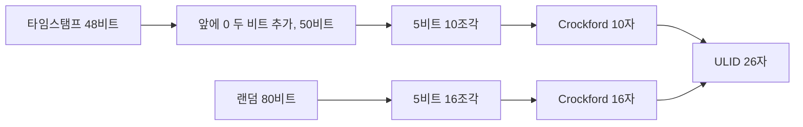
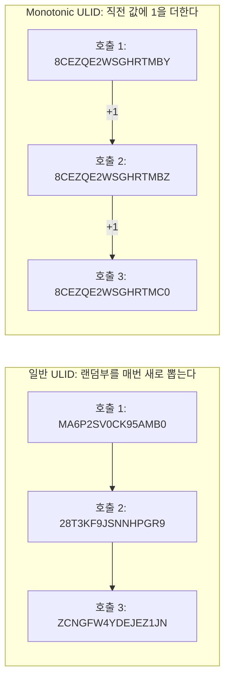
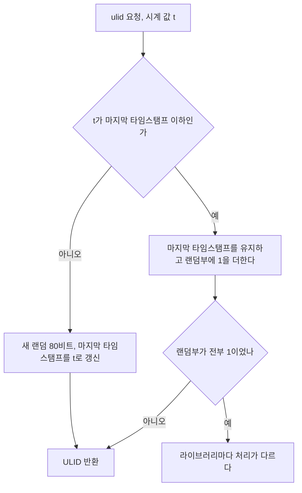
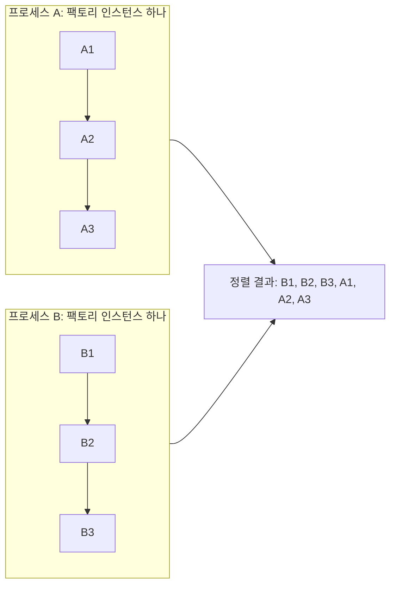
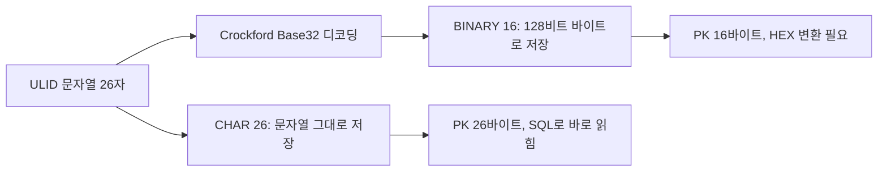
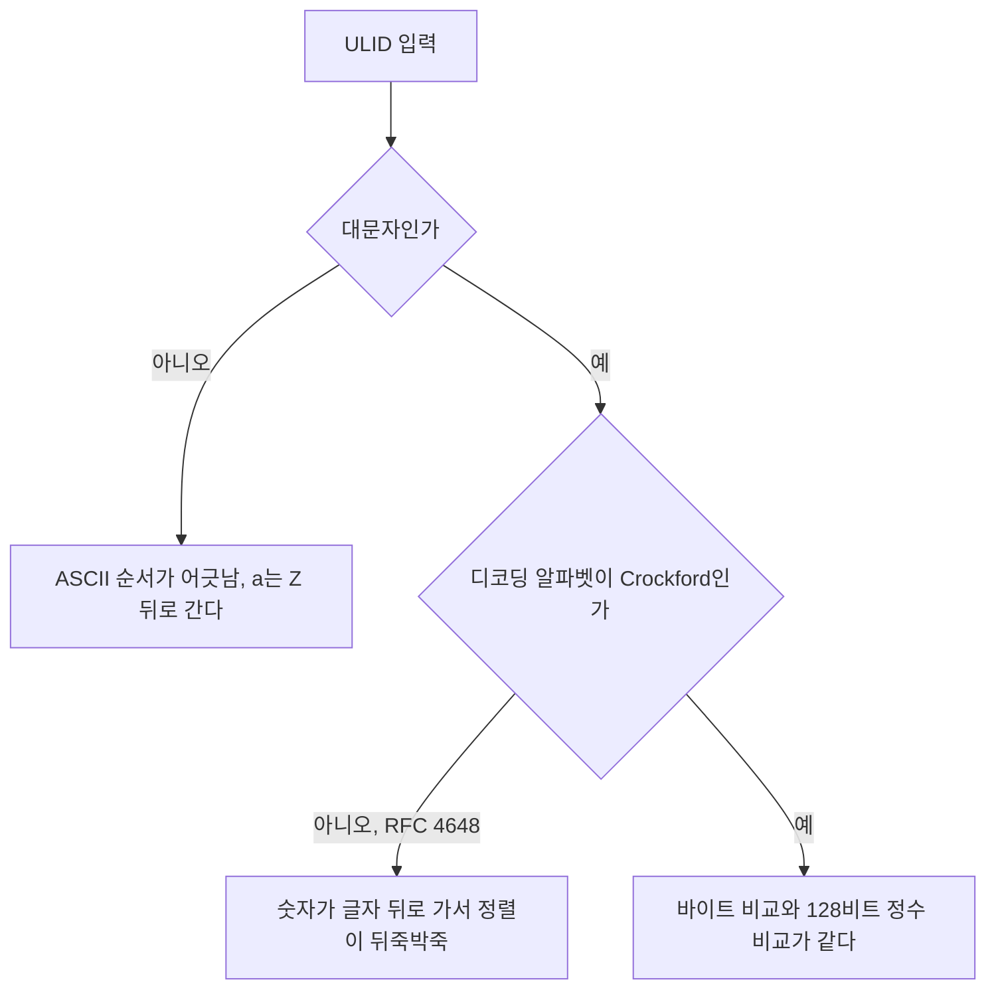
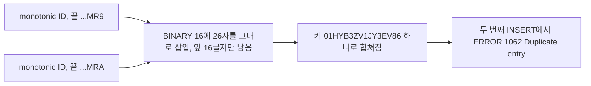
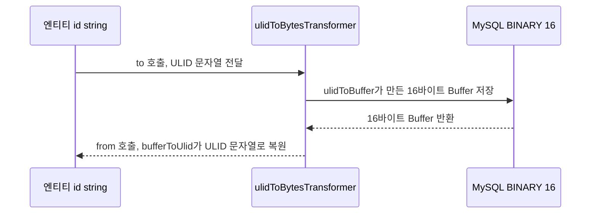
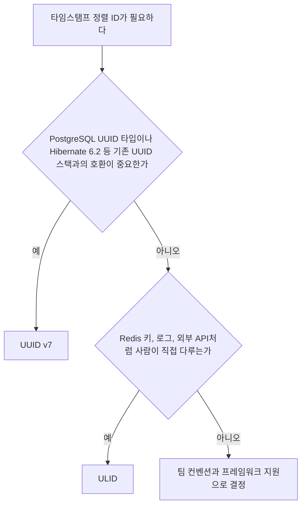

# ULID

ULID(Universally Unique Lexicographically Sortable Identifier)는 128비트 식별자다. UUID와 같은 크기지만 앞 48비트에 밀리초 단위 타임스탬프가 들어가서 생성 시각 순 정렬이 된다. 출력 형식은 26자리 대문자 문자열이다.

UUID v4를 PK로 쓰다가 InnoDB 페이지 분할로 INSERT 성능이 무너지는 걸 경험하면 보통 ULID나 UUID v7로 넘어간다. 타임스탬프가 앞에 있어 새 행이 B+트리 인덱스의 끝 쪽에 삽입되므로 페이지 분할 빈도가 크게 줄어든다.

## 128비트 구조

```
 비트 위치: 127               79              0
           ┌────────────────────┬─────────────────────────────┐
           │   48비트 타임스탬프  │          80비트 랜덤           │
           └────────────────────┴─────────────────────────────┘
```

상위 48비트에 Unix 에포크 기준 밀리초 타임스탬프를 저장한다. 2^48밀리초는 약 8925년이라 서기 10895년까지 표현 가능하다.

하위 80비트는 암호학적으로 안전한 랜덤 값이다. 같은 밀리초에 생성된 두 ULID의 랜덤 파트가 충돌할 확률은 2^80분의 1로, 실제 운영에서 무시할 수 있는 수준이다.

26자리 문자열로 표현할 때는 Crockford Base32로 인코딩한다.

```
01HX2Y3Z4A5B6C7D8E9F0G1H2J
└─────────┘└────────────────┘
 10자리 타임스탬프   16자리 랜덤
```

문자열 그대로 사전 순 비교하면 생성 시각 순 정렬이 된다.

## Crockford Base32 인코딩

표준 Base64나 RFC 4648 Base32가 아닌 Crockford Base32를 쓴다. 사람이 읽을 때 혼동하기 쉬운 문자를 제외한 32자리 알파벳이다.

```
값:  0  1  2  3  4  5  6  7  8  9 10 11 12 13 14 15
문자: 0  1  2  3  4  5  6  7  8  9  A  B  C  D  E  F

값: 16 17 18 19 20 21 22 23 24 25 26 27 28 29 30 31
문자: G  H  J  K  M  N  P  Q  R  S  T  V  W  X  Y  Z
```

I, L, O, U가 빠져 있다. I와 L은 숫자 1과 혼동되고, O는 숫자 0과 혼동된다. U는 영어 욕설 필터 우회 이슈로 제외됐다. 소문자도 수용하지만 출력은 항상 대문자다.

128비트를 5비트씩 분할하면 26자리가 된다(128 ÷ 5 = 25.6이라 첫 자리에는 3비트만 들어간다). 첫 자리가 가질 수 있는 최대값은 7(0b111)이라 ULID는 항상 `0`으로 시작하거나 최대 `7`로 시작한다.

인코딩은 타임스탬프와 랜덤을 따로 5비트씩 자른다. 맨 앞에 0 두 비트를 붙여 130비트로 만든다고 보면 이해가 쉽다. 아래 도식은 두 갈래가 어디서 합쳐지는지를 보여준다.



50비트는 10자, 80비트는 16자로 정확히 떨어진다. 그래서 문자열을 앞 10자와 뒤 16자로 잘라 따로 디코딩할 수 있고, 시각만 필요하면 앞 10자만 읽으면 된다. 첫 자리가 `8` 이상인 문자열은 48비트를 넘는 타임스탬프라 유효한 ULID가 아니다.

## 언어별 생성 코드

### Node.js

```javascript
import { ulid, monotonicFactory } from 'ulid';

// 기본 ULID 생성
const id = ulid();
// '01HX2Y3Z4A5B6C7D8E9F0G1H2J'

// 특정 타임스탬프 기준 생성
const id = ulid(Date.now());

// Monotonic ULID - 같은 밀리초 내 순서 보장
const monotonicUlid = monotonicFactory();
const id1 = monotonicUlid();
const id2 = monotonicUlid(); // id1 < id2 보장
```

브라우저에서는 `Math.random()` 폴백이 동작한다. 서버 사이드에서는 `crypto.getRandomValues()`를 사용하므로 암호학적으로 안전하다.

### TypeScript (추가 예시)

```typescript
// npm install ulid
import { ulid, monotonicFactory, decodeTime } from 'ulid';

// 기본 생성
const id = ulid(); // '01HX2Y3Z4A5B6C7D8E9F0G1H2J'

// Monotonic ULID — UUID로 변환 (저장 시)
const ulidStr = ulid();
// ULID 문자열에서 타임스탬프 추출
const epochMs = decodeTime(ulidStr);

// TypeScript에서 UUID 형식으로 변환이 필요하면 별도 변환 로직 사용
function ulidToUuidHex(ulidStr: string): string {
    // ULID Base32 → hex 128비트 → UUID 형식으로 변환
    const base32Chars = '0123456789ABCDEFGHJKMNPQRSTVWXYZ';
    let n = BigInt(0);
    for (const c of ulidStr.toUpperCase()) {
        n = n * 32n + BigInt(base32Chars.indexOf(c));
    }
    const hex = n.toString(16).padStart(32, '0');
    return `${hex.slice(0,8)}-${hex.slice(8,12)}-${hex.slice(12,16)}-${hex.slice(16,20)}-${hex.slice(20)}`;
}
```

### Python

```python
# pip install python-ulid
from ulid import ULID

u = ULID()
str(u)          # '01HX2Y3Z4A5B6C7D8E9F0G1H2J'
u.timestamp()   # Unix timestamp (float)
u.datetime      # datetime 객체 (UTC)

# 특정 시각 기준 생성
from datetime import datetime, timezone
u = ULID.from_datetime(datetime(2024, 1, 1, tzinfo=timezone.utc))
```

### Go

```go
// go get github.com/oklog/ulid/v2
import (
    "crypto/rand"
    "time"
    "github.com/oklog/ulid/v2"
)

// Monotonic entropy: 같은 밀리초 내 단조 증가 보장
entropy := ulid.Monotonic(rand.Reader, 0)
id := ulid.MustNew(ulid.Timestamp(time.Now()), entropy)
fmt.Println(id.String()) // '01HX2Y3Z4A5B6C7D8E9F0G1H2J'
```

`ulid.Monotonic()`이 돌려주는 값은 동시 사용에 안전하지 않다. 소스에 "The returned type isn't safe for concurrent use"라고 적혀 있다(oklog/ulid v2.1.2 확인). 고루틴이 공유하려면 `ulid.LockedMonotonicReader`로 감싸거나 `ulid.DefaultEntropy()`를 써야 한다. 락을 피하려고 고루틴마다 인스턴스를 따로 만들면 락 경합은 사라지지만, 같은 밀리초에 고루틴 간 순서 보장도 같이 사라진다.

`Monotonic(r, 0)`의 `0`은 증분이 1이라는 뜻이 아니다. 0이면 기본값 `math.MaxUint32`가 들어가서 직전 값에 1~2^32 사이의 랜덤 수를 더한다. 값이 단조 증가하는 것은 맞지만 연속된 숫자가 되지는 않는다. 정확히 +1을 원하면 `Monotonic(r, 1)`로 만든다.

## Monotonic ULID와 같은 밀리초 내 엣지케이스

표준 ULID는 같은 밀리초에 여러 개를 만들어도 랜덤부를 매번 새로 뽑는다. 타임스탬프가 같으니 정렬 순서는 랜덤부가 정하고, 생성 순서와 무관해진다. 이벤트 로그나 아웃박스처럼 삽입 순서와 정렬 순서가 일치해야 하는 테이블에서 문제가 된다.

Monotonic ULID는 같은 밀리초의 첫 값만 랜덤으로 뽑고, 이후 값은 직전 랜덤부에 1을 더한다. 아래 도식은 같은 밀리초(`01HYB3ZV1J`)에 세 번 호출한 실제 출력이다. 화살표가 생성 순서이고, 앞 10자가 같아서 뒤 16자만 적었다.



일반 ULID를 정렬하면 호출 2, 호출 1, 호출 3 순서가 된다. 호출 1이 `MA6...`, 호출 2가 `28T...`로 시작하기 때문이다. Monotonic은 `...MBY`, `...MBZ`, `...MC0`으로 이어져서 문자열 비교와 호출 순서가 같다. 끝자리가 `Z`에서 `0`으로 넘어가며 윗자리가 올라가는 것에 주목한다. 80비트 정수에 1을 더하는 것이지 마지막 글자만 바꾸는 게 아니다.

Node에서 같은 밀리초에 2000개를 만들어 이웃한 값끼리 비교하면 일반 `ulid(T)`는 1005건에서 앞 값이 뒤 값보다 컸고, `monotonicFactory()`는 0건이었다. 일반 ULID의 역전 비율이 절반 근처인 것은 랜덤부끼리 크기를 비교하는 셈이라 동전 던지기와 같기 때문이다.

### 호출마다 일어나는 일

`ulid` 2.4.0(JS)의 monotonic 팩토리를 기준으로 하면 호출 한 번의 분기를 따라가 보면 시계 역행과 오버플로가 어디서 갈리는지 보인다.



"이하"라는 조건 때문에 시계가 뒤로 가도 값이 줄지 않는다. `m(T+5)` 다음에 `m(T)`를 부르면 두 번째 값의 타임스탬프도 `T+5`로 나오고 랜덤부만 1 커진다(실행으로 확인). 대신 ID에 박힌 시각이 실제 시각보다 앞서 있게 되니, ID에서 시각을 역산해 쓰는 코드는 NTP 보정 직후 몇 ms 어긋날 수 있다. Go의 `MonotonicRead`는 `m.ms == ms`일 때만 증가시키므로(소스 확인) 시계가 뒤로 가면 새 랜덤부를 뽑는다. 타임스탬프가 더 작아서 이전 값보다 앞에 정렬된다.

### 랜덤부가 전부 1일 때

랜덤부가 2^80 - 1이면 더할 자리가 없다. 라이브러리마다 다르게 반응하는 것을 랜덤 공급자를 전부 1로 고정해서 직접 확인했다.

| 라이브러리 | 다음 호출 결과 |
|---|---|
| JS `ulid` 2.4.0 | 예외 `incorrectly encoded string`. 오버플로를 알려주는 메시지가 아니라서 로그만 보면 원인을 찾기 어렵다 |
| Go `oklog/ulid` v2.1.2 | `ulid: monotonic entropy overflow` 에러와 함께 `01HYB3ZV1J0000000000000000`을 같이 돌려준다. 랜덤부가 0으로 되감긴 값이다 |
| Java `ulid-creator` 5.2.3 | 에러 없이 타임스탬프를 1ms 올린 `01HYB3ZV1K0000000000000000`을 반환한다 |

Go에서 에러를 무시하면 이전 값보다 작은 ID가 그대로 저장된다. `ulid.MustNew`는 에러가 나면 panic이므로 오히려 안전하고, `ulid.New`의 에러를 `_`로 버리는 코드가 위험하다. ulid-creator 방식은 예외가 없어 서비스가 멈추지 않는 대신, 반환된 ID의 타임스탬프가 시계보다 1ms 앞선다.

발생 확률은 높지 않다. 시작값이 80비트 균등 난수이므로 한 밀리초에 n건을 +1로 만들 때 오버플로 확률은 n / 2^80 근처다. 1밀리초에 100만 건이어도 10^-18 수준이다. Go 기본 증분(최대 2^32, 평균 약 2^31)이면 같은 조건에서 약 10^-9다. 이 경로가 열리는 곳은 운영보다 테스트다. 랜덤 공급자를 전부 1로 고정하면 같은 밀리초의 두 번째 호출에서 바로 위 표의 반응이 나온다.

### 프로세스가 다르면 보장이 없다

Monotonic이 지키는 순서는 팩토리 인스턴스 하나의 안쪽뿐이다. 마지막 타임스탬프와 랜덤부를 그 인스턴스의 메모리에 들고 있기 때문이다. 프로세스, 서버, Go에서 고루틴마다 만든 인스턴스는 서로의 상태를 모른다.

자식 프로세스 두 개가 같은 밀리초에 각각 monotonic으로 세 개씩 만든 결과다(앞 10자 `01HYB3ZV1J`는 생략).

| 프로세스 | 호출 1 | 호출 2 | 호출 3 |
|---|---|---|---|
| A | Q8YMKRWC9NGD6A21 | Q8YMKRWC9NGD6A22 | Q8YMKRWC9NGD6A23 |
| B | A9ZHY2FRVEPWXF01 | A9ZHY2FRVEPWXF02 | A9ZHY2FRVEPWXF03 |

A1, B1, A2, B2, A3, B3 순서로 호출했다고 하면 정렬 결과는 B1, B2, B3, A1, A2, A3이다. 각 프로세스 안의 순서는 지켜지지만, 프로세스 사이는 시작값 랜덤부가 큰 쪽이 뒤로 간다. 서버가 여러 대인 서비스에서 "ULID 순서가 곧 커밋 순서"라고 가정하면 ms 단위 안에서 깨진다.

아래 도식에서 각 프로세스 안쪽 화살표는 지켜지지만, 두 프로세스를 합친 정렬에서는 호출 순서가 섞인다.



- 서로 다른 ms에서 만든 값의 순서는 시계 오차 범위에서만 맞는다. 서버 간 시계 차이가 수 ms면 그 범위의 순서는 믿을 수 없다.
- 컨슈머가 "마지막으로 처리한 ID보다 큰 것만 가져온다"는 식으로 커서를 쓰면, 늦게 커밋된 작은 ID를 영원히 놓친다. 이 용도에는 DB의 AUTO_INCREMENT나 시퀀스 같은 단일 발급처가 필요하다.
- 식별자를 무엇으로 고를지는 [식별자 설계의 선택 순서](Identifier_Design.md#선택-순서)에서 다룬다. 이 문서는 ULID를 쓰기로 정한 뒤의 동작만 다룬다.

## MySQL 저장 방식: CHAR(26) vs BINARY(16)

### CHAR(26)

Crockford Base32 문자열을 그대로 저장한다.

```sql
CREATE TABLE events (
    id         CHAR(26)     NOT NULL,
    payload    JSON         NOT NULL,
    created_at DATETIME(3)  NOT NULL DEFAULT CURRENT_TIMESTAMP(3),
    PRIMARY KEY (id)
);

-- 삽입
INSERT INTO events (id, payload) VALUES ('01HX2Y3Z4A5B6C7D8E9F0G1H2J', '{}');

-- 조회
SELECT * FROM events WHERE id = '01HX2Y3Z4A5B6C7D8E9F0G1H2J';
```

문자열 그대로라 MySQL Workbench, DBeaver에서 바로 읽힌다. 변환 없이 저장하고 꺼내므로 애플리케이션 코드가 단순하다. 단점은 26바이트라 BINARY(16)보다 크다.

### BINARY(16)

128비트를 바이너리로 그대로 저장한다.

```sql
CREATE TABLE events (
    id         BINARY(16)   NOT NULL,
    payload    JSON         NOT NULL,
    created_at DATETIME(3)  NOT NULL DEFAULT CURRENT_TIMESTAMP(3),
    PRIMARY KEY (id)
);
```

```typescript
// 저장: ULID → Buffer(16바이트)
import { ulid } from 'ulid';

function ulidToBuffer(ulidStr: string): Buffer {
    const base32Chars = '0123456789ABCDEFGHJKMNPQRSTVWXYZ';
    const upper = ulidStr.toUpperCase();
    if (!/^[0-7][0-9A-HJKMNP-TV-Z]{25}$/.test(upper)) {
        throw new Error(`invalid ULID: ${ulidStr}`);
    }
    let n = 0n;
    for (const c of upper) {
        n = n * 32n + BigInt(base32Chars.indexOf(c));
    }
    const hex = n.toString(16).padStart(32, '0');
    return Buffer.from(hex, 'hex');
}

// 조회: Buffer(16바이트) → ULID 문자열
function bufferToUlid(buf: Buffer): string {
    const base32Chars = '0123456789ABCDEFGHJKMNPQRSTVWXYZ';
    let n = BigInt('0x' + buf.toString('hex'));
    let result = '';
    for (let i = 0; i < 26; i++) {
        result = base32Chars[Number(n & 31n)] + result;
        n >>= 5n;
    }
    return result;
}
```

16바이트라 PK 인덱스 크기가 CHAR(26)의 약 60%다. 데이터가 수천만 건을 넘어 인덱스가 버퍼 풀을 넘기 시작하면 이 차이가 체감된다. 조회 시 16진수 변환이 필요해서 직접 SQL로 확인하기 불편하다.

```sql
-- BINARY(16) 컬럼 직접 확인할 때
SELECT HEX(id), created_at FROM events LIMIT 10;
```

팀에서 SQL로 직접 데이터를 확인하는 빈도가 높다면 CHAR(26)이 낫다. 스토리지 효율이 중요하고 수백만 건 이상의 테이블이라면 BINARY(16)이 낫다.

아래 도식은 두 방식이 저장까지 가는 경로의 차이를 보여준다. BINARY(16)에만 디코딩 단계가 끼어 있다.



검증 정규식이 없으면 조용히 틀린다. `I`, `L`, `O`, `U`는 알파벳에 없어서 `indexOf`가 -1을 돌려주고, 이 값이 `n * 32n + -1n`으로 그대로 계산에 들어간다. `0000000000000000000000000I`를 넣어 보면 예외 없이 `-1n`이 나오고, 16진수 문자열에 `-`가 섞여 `Buffer.from(hex, 'hex')`가 15바이트짜리 버퍼를 돌려준다. 첫 글자가 `8` 이상이어도 16진수가 33자리가 되는데 `Buffer.from`이 마지막 한 자리를 버리고 16바이트로 만들어 버린다. 둘 다 에러 없이 엉뚱한 값이 INSERT된다. Crockford 규격은 `I`, `L`을 1로, `O`를 0으로 읽도록 허용하지만 이 코드는 정규화 대신 거부한다. 사람이 손으로 옮겨 적은 ID를 받는 API라면 디코딩 앞에서 `I`, `L`은 `1`, `O`는 `0`으로 바꿔 주는 단계를 넣는다.

### 문자열로 저장할 때와 바이트로 저장할 때의 정렬

CHAR(26)에 문자열을 넣을 때와, Base32를 디코딩한 16바이트를 넣을 때 정렬 결과가 같은지는 두 가지 조건에 달려 있다.

Crockford 알파벳은 값 순서가 ASCII 순서와 같다. 숫자 `0`~`9`(48~57)가 먼저, 그 뒤에 `A`~`Z`(65~90)가 오고, 빠진 `I`, `L`, `O`, `U`는 사이를 건너뛸 뿐 상대 순서를 바꾸지 않는다. 그래서 **대문자 ULID**를 바이트 단위로 비교하면 디코딩한 128비트 정수 비교와 같다. 대문자 2만 건을 무작위 타임스탬프로 만들어 인접한 쌍을 비교했을 때 불일치는 0건이었다.

깨지는 경우는 둘이다. 하나는 소문자가 섞인 입력으로, `a`는 97이라 `Z`(90)보다 뒤에 정렬된다. 대소문자를 섞어 비교한 2만 쌍 중 4,974쌍에서 디코딩 순서와 어긋났다. 다른 하나는 디코딩에 Crockford가 아닌 알파벳을 쓴 경우다. RFC 4648 Base32는 `A`~`Z`가 0~25, `2`~`7`이 26~31이라 숫자가 글자보다 뒤에 온다. ASCII에서는 숫자가 앞이다. 표준 Base32 라이브러리로 ULID를 디코딩해서 BINARY에 넣으면 정렬이 뒤죽박죽이 되고, 에러는 나지 않는다.

두 조건을 차례로 통과해야 바이트 비교가 시각 순과 같아진다.



MySQL에서 CHAR(26)을 쓸 때는 콜레이션도 같이 본다. 같은 값을 넣어 확인했다(MySQL 8.0.46).

| 컬럼 | 소문자 입력 | `...MR9`, `...mra`, `...MRB` 정렬 |
|---|---|---|
| CHAR(26), utf8mb4_0900_ai_ci(기본) | 대문자와 같은 키로 취급, 중복 삽입이 `Duplicate entry`로 막힘 | MR9, mra, MRB. 대소문자를 무시해서 의도한 순서 |
| CHAR(26), ascii_bin | 다른 키로 취급, 중복 행이 들어감 | MR9, MRB, mra. 소문자가 뒤로 밀림 |

기본 콜레이션은 대소문자를 합쳐 주기 때문에 우연히 안전하다. 바이너리 콜레이션을 쓰거나 BINARY로 옮기면 그 안전장치가 사라지므로, 애플리케이션에서 저장 전에 `toUpperCase()`로 통일해야 한다.

26자 문자열을 BINARY(16)에 디코딩 없이 넣는 실수도 있다. ASCII 바이트를 그대로 넣는 셈인데, 엄격 모드(기본)에서는 `ERROR 1406 Data too long`으로 막힌다. 문제는 `sql_mode`를 비워 둔 환경이다.

```sql
SET SESSION sql_mode='';
INSERT INTO b1 VALUES ('01HYB3ZV1JY3EV86847BN94MR9');   -- 앞 16글자만 남기고 잘림
INSERT INTO b1 VALUES ('01HYB3ZV1JY3EV86847BN94MRA');
-- ERROR 1062: Duplicate entry '01HYB3ZV1JY3EV86' for key 'b1.PRIMARY'
```

16바이트가 되려면 타임스탬프 10자 + 랜덤 6자만 남는다. 같은 밀리초에 만든 monotonic ID는 랜덤부의 끝자리만 다르기 때문에 잘린 뒤에는 전부 같은 키가 된다. 다른 밀리초의 ID는 정상으로 들어가서 한동안 문제를 못 알아채고, 트래픽이 몰려 같은 밀리초에 두 건이 들어오는 순간 PK 중복이 터진다. 문자열 그대로 저장하려면 CHAR(26)을 쓰고, 16바이트로 줄이려면 반드시 위 `ulidToBuffer`처럼 디코딩해야 한다.

같은 밀리초의 두 ID가 잘린 뒤 한 키로 합쳐지는 과정은 아래와 같다.



InnoDB는 PK 기준 클러스터드 인덱스로 데이터를 저장한다. ULID를 PK로 쓰면 타임스탬프 선두라 새 행이 인덱스 끝 근처에 삽입된다. UUID v4의 완전 랜덤 삽입보다 페이지 분할이 훨씬 적게 발생한다.

## PostgreSQL 저장 패턴

PostgreSQL에는 UUID 타입이 있다. ULID는 128비트라 UUID와 바이트 수가 같으므로 UUID 타입에 저장할 수 있다.

### UUID 타입으로 저장

```sql
CREATE TABLE events (
    id      UUID        NOT NULL,
    payload JSONB       NOT NULL,
    PRIMARY KEY (id)
);
```

```typescript
// TypeScript에서 ULID를 UUID 형식으로 변환 후 저장
const ulidStr = ulid();
const uuidStr = ulidToUuidHex(ulidStr);
// UUID 형식: 018f7a23-4c9b-7000-8f0a-b2c3d4e5f6a7
```

UUID 타입은 내부적으로 16바이트를 저장하므로 TEXT(가변)나 BYTEA보다 효율적이다. ULID의 타임스탬프 비트가 UUID의 상위 비트에 위치하므로 UUID 기준 정렬이 시각 순 정렬과 일치한다.

```sql
-- 생성 시각 순 정렬 (ULID를 UUID로 저장한 경우)
SELECT * FROM events ORDER BY id ASC;
-- 타임스탬프 앞에 있어 사전 순 = 시각 순
```

### TEXT로 저장

ULID 문자열을 그대로 저장한다. 가장 단순하고 직관적이다.

```sql
CREATE TABLE events (
    id      TEXT  NOT NULL,
    payload JSONB NOT NULL,
    PRIMARY KEY (id)
);
```

TEXT 타입은 가변 길이라 26자리 고정 문자열에는 CHAR(26)이 낫지만, PostgreSQL에서 CHAR는 공백 패딩 처리가 있어 TEXT나 VARCHAR(26)을 더 많이 쓴다.

### BYTEA로 저장

```sql
CREATE TABLE events (
    id      BYTEA NOT NULL,
    payload JSONB NOT NULL,
    PRIMARY KEY (id)
);
```

16바이트 저장이라 효율은 좋지만, SQL로 직접 확인할 때 16진수 변환이 필요하다. PostgreSQL에서는 UUID 타입이 있어 BYTEA를 쓸 이유가 없는 경우가 많다.

실무에서는 PostgreSQL + ULID 조합이면 UUID 타입에 저장하는 패턴이 가장 무난하다.

## TypeORM 통합

### CHAR(26) 저장 방식

```typescript
import { ulid, monotonicFactory } from 'ulid';
import { Entity, PrimaryColumn, Column, BeforeInsert } from 'typeorm';

const monotonicUlid = monotonicFactory();

@Entity('events')
export class Event {
    @PrimaryColumn({ type: 'char', length: 26 })
    id: string;

    @Column({ nullable: false })
    payload: string;

    @BeforeInsert()
    generateId(): void {
        if (!this.id) {
            this.id = monotonicUlid();
        }
    }
}
```

`@PrimaryGeneratedColumn`을 쓰지 않고 `@BeforeInsert()`에서 직접 할당한다. INSERT 전에 id가 결정되므로 TypeORM의 배치 INSERT가 동작한다.

```typescript
// TypeORM 배치 INSERT — @BeforeInsert()로 id 직접 할당 시 정상 동작
await manager.insert(Event, events);
// 내부적으로 INSERT ... VALUES (...), (...), ... 로 실행
```

### BINARY(16) 저장 방식 — ValueTransformer

Buffer 타입을 엔티티에서 직접 다루면 불편하다. TypeORM의 `transformer` 옵션으로 ULID 문자열과 바이트 배열 사이 자동 변환을 걸어두는 편이 낫다.

```typescript
import { ValueTransformer } from 'typeorm';

const ulidToBytesTransformer: ValueTransformer = {
    to(ulidStr: string | null): Buffer | null {
        if (ulidStr == null) return null;
        return ulidToBuffer(ulidStr);
    },
    from(dbData: Buffer | null): string | null {
        if (dbData == null) return null;
        return bufferToUlid(dbData);
    },
};

@Entity('events')
export class Event {
    @PrimaryColumn({ type: 'binary', length: 16, transformer: ulidToBytesTransformer })
    id: string;

    @BeforeInsert()
    generateId(): void {
        if (!this.id) {
            this.id = monotonicUlid();
        }
    }
}
```

엔티티에서는 string으로 다루고, DB에는 16바이트로 저장된다.

저장과 조회에서 transformer가 변환하는 방향을 아래 도식으로 본다.



### Repository에서 ULID 기반 범위 쿼리

ULID의 타임스탬프를 이용하면 created_at 컬럼 없이도 PK 인덱스로 시각 범위 조회를 할 수 있다.

```typescript
// TypeORM Repository에서 ULID 범위 쿼리
const fromUlid = buildMinUlid(new Date('2024-01-01T00:00:00Z').getTime());
const events = await eventRepository
    .createQueryBuilder('e')
    .where('e.id >= :fromUlid', { fromUlid })
    .orderBy('e.id', 'ASC')
    .getMany();

// 특정 밀리초의 최솟값 ULID (랜덤 파트를 0으로 채운 값)
function buildMinUlid(epochMs: number): string {
    const base32Chars = '0123456789ABCDEFGHJKMNPQRSTVWXYZ';
    // 48비트 타임스탬프를 앞에, 80비트 랜덤을 0으로
    let n = BigInt(epochMs) << 80n;
    let result = '';
    for (let i = 0; i < 26; i++) {
        result = base32Chars[Number(n & 31n)] + result;
        n >>= 5n;
    }
    return result;
}
```

별도 created_at 컬럼에 인덱스를 만들지 않아도 PK 인덱스 하나로 시각 범위 쿼리가 된다. 단, ULID PK가 클러스터드 인덱스일 때만 효율적이다. MySQL InnoDB는 PK가 클러스터드 인덱스라 해당한다.

## 타임스탬프 역산과 디버깅 활용

ULID에서 생성 시각을 꺼내는 방법은 간단하다.

```typescript
// Node.js (TypeScript)
import { decodeTime } from 'ulid';
const epochMs = decodeTime('01HX2Y3Z4A5B6C7D8E9F0G1H2J');
const date = new Date(epochMs);
const kstOffset = 9 * 60 * 60 * 1000;
const kstDate = new Date(epochMs + kstOffset);
```

```python
# Python
from ulid import ULID
u = ULID.from_str("01HX2Y3Z4A5B6C7D8E9F0G1H2J")
print(u.datetime)  # 2024-05-04 23:13:09.258000+00:00
```

```javascript
// Node.js
import { decodeTime } from 'ulid';
const epochMs = decodeTime('01HX2Y3Z4A5B6C7D8E9F0G1H2J');
new Date(epochMs); // Sat May 04 2024 23:13:09.258 GMT
```

이게 실무에서 쓸모 있는 상황이 있다. 에러 로그에 ULID만 남아 있어도 생성 시각을 바로 뽑아낼 수 있다. UUID v4라면 타임스탬프가 없어서 created_at 컬럼을 별도로 조회해야 한다.

```
에러 로그: "payment 01HX2Y3Z4A5B6C7D8E9F0G1H2J 처리 실패"
-> ULID에서 타임스탬프 추출 -> 2024-05-05 08:13:09.258 KST
-> 이 시각 전후의 외부 API 로그, DB 슬로우쿼리 로그 검색
```

CHAR(26)으로 저장했다면 SQL에서도 시각 범위 필터링이 가능하다.

```sql
-- 특정 날짜 범위의 이벤트 조회 (created_at 컬럼 없이)
SELECT * FROM events
WHERE id >= '01HY9MRH000000000000000000'  -- 2024-05-20 00:00:00.000 UTC 기준 최솟값
  AND id <  '01HYC758000000000000000000'; -- 2024-05-21 00:00:00.000 UTC 기준 최솟값
```

Monotonic ULID의 랜덤 파트가 단조 증가하더라도, 타임스탬프는 상위 48비트(10자리)에 고정돼 있다. 역산 시 항상 상위 10자리를 기준으로 한다.

## ULID vs UUID v7 실무 선택 기준

UUID v7도 ULID처럼 타임스탬프 기반 정렬 가능한 식별자다. 둘 다 128비트, 48비트 밀리초 타임스탬프, 단조 증가 특성을 갖는다.

차이는 형식이다.

```
ULID:     01HX2Y3Z4A5B6C7D8E9F0G1H2J     (26자리, Crockford Base32)
UUID v7:  018f7a23-4c9b-7e1d-8f0a-b2c3d4  (36자리, 16진수 + 대시)
```

UUID v7은 DB와 프레임워크 지원이 앞선다. PostgreSQL의 UUID 타입, MySQL의 `UUID_TO_BIN()`, Hibernate 6.2의 `@GeneratedValue(strategy = GenerationType.UUID)` 설정으로 UUID v7을 생성할 수 있다(별도 라이브러리 설정 필요). 기존 UUID v4 스택을 유지한 채 전환하기 쉽다.

ULID는 사람이 읽기 편한 형식이라는 게 주요 장점이다. 대시 없이 26자리 대문자라 복사-붙여넣기 실수가 적다. Crockford Base32 알파벳이 혼동하기 쉬운 문자를 제외해서 손으로 옮겨 쓸 때 I/1, O/0 같은 오타가 없다. URL에 그대로 넣어도 인코딩 문제가 없다.

| 항목 | ULID | UUID v7 |
|------|------|---------|
| 형식 | 26자리 Crockford Base32 | 36자리 UUID 형식 |
| DB 타입 지원 | CHAR(26), BINARY(16) | UUID, BINARY(16) |
| 프레임워크 지원 | 라이브러리 필요 | Hibernate 6.2+ 지원 |
| 가독성 | 높음 (혼동 문자 제외) | 낮음 (16진수 + 대시) |
| URL 안전 | 안전 | 대시 때문에 인코딩 필요할 수 있음 |
| 타임스탬프 정밀도 | 48비트 밀리초 | 48비트 밀리초 |

PostgreSQL + Spring 스택에서 UUID 타입 컬럼과 기존 호환성이 중요하면 UUID v7을 선택한다.

Redis 키, 로그 식별자, 외부 API로 노출하는 ID처럼 사람이 직접 다루는 맥락에서는 ULID가 편하다.

MySQL에서는 둘 다 BINARY(16)으로 저장하는 것이 공통이고, 선택은 주로 팀 컨벤션과 프레임워크 지원 편의성에 따라 갈린다.

위 기준을 분기로 줄이면 아래와 같다.



## Redis/Cassandra에서 ULID 정렬 활용

### Redis

ULID 문자열 자체가 시각 순 정렬이 되므로, Sorted Set에서 score 없이 ZRANGEBYLEX로 시각 범위 조회를 할 수 있다.

```javascript
// ZSET에 score를 0으로 균일하게, member를 ULID로 저장
await redis.zadd('user:events:123', {
    score: 0,
    member: `${ulid()}:${JSON.stringify(eventData)}`
});

// 사전 순 = 시각 순 조회
const items = await redis.zrangebylex('user:events:123', '-', '+');
```

score에 타임스탬프를 저장하는 방식이 더 직관적인 경우도 있다.

```javascript
const now = Date.now();
const id = ulid(now);

await redis.zadd('feed:global', {
    score: now,  // 타임스탬프 score
    member: id   // ULID member
});

// 특정 시간대 이벤트 조회
const from = new Date('2024-01-01').getTime();
const to   = new Date('2024-01-02').getTime();
const ids  = await redis.zrangebyscore('feed:global', from, to);
```

ULID를 캐시 키로 쓸 때 생성 시각에서 TTL을 계산하는 패턴도 있다.

```javascript
import { decodeTime } from 'ulid';

const id = ulid();
await redis.hset(`session:${id}`, { userId, data: JSON.stringify(sessionData) });

// ULID에서 생성 시각 추출 -> TTL 계산
const createdAt = decodeTime(id);
const expiresAt = createdAt + 24 * 60 * 60 * 1000; // 24시간 후
await redis.pexpireat(`session:${id}`, expiresAt);
```

### Cassandra

Cassandra는 클러스터링 키 기준으로 파티션 내 데이터를 정렬한다. ULID를 클러스터링 키로 쓰면 삽입 순서 = 정렬 순서가 된다.

```cql
CREATE TABLE user_events (
    user_id    UUID,
    event_id   TEXT,   -- ULID
    event_type TEXT,
    payload    TEXT,
    PRIMARY KEY (user_id, event_id)
) WITH CLUSTERING ORDER BY (event_id ASC);
```

파티션 내에서 event_id(ULID) 기준 오름차순 정렬이 생성 시각 순 정렬과 일치한다.

```cql
-- 특정 시각 이후의 이벤트 조회
SELECT * FROM user_events
WHERE user_id = ?
  AND event_id >= '01HY9MRH000000000000000000'
ORDER BY event_id ASC;
```

활성 사용자의 파티션이 무한히 커지는 문제가 있다. Cassandra는 파티션 크기를 수백 MB 이하로 유지하는 것을 권고하므로, 기간별로 파티션을 나누는 패턴을 쓴다.

```cql
CREATE TABLE user_events_partitioned (
    user_id     UUID,
    month       TEXT,   -- '2024-05' 형식
    event_id    TEXT,   -- ULID
    payload     TEXT,
    PRIMARY KEY ((user_id, month), event_id)
) WITH CLUSTERING ORDER BY (event_id ASC);
```

파티션 키를 `(user_id, month)` 복합으로 구성하면 특정 사용자의 특정 월 데이터가 하나의 파티션에 모인다. ULID 클러스터링으로 파티션 내 시각 순 정렬이 유지된다.

### DynamoDB

ULID를 Sort Key로 쓰면 시각 순 조회가 된다.

```
PK: USER#userId
SK: EVENT#01HX2Y3Z4A5B6C7D8E9F0G1H2J
```

```javascript
const result = await dynamodb.query({
    TableName: 'Events',
    KeyConditionExpression: 'PK = :pk AND SK >= :fromSk',
    ExpressionAttributeValues: {
        ':pk':    { S: `USER#${userId}` },
        ':fromSk': { S: `EVENT#01HY9MRH000000000000000000` } // 2024-05-20 이후
    },
    ScanIndexForward: true  // SK 오름차순 = 시각 순
});
```

SK begins_with 패턴과 함께 쓰면 특정 사용자의 이벤트를 시각 순으로 효율적으로 조회할 수 있다.
