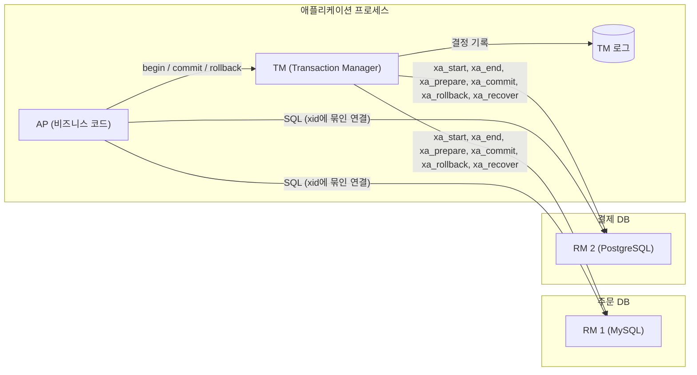
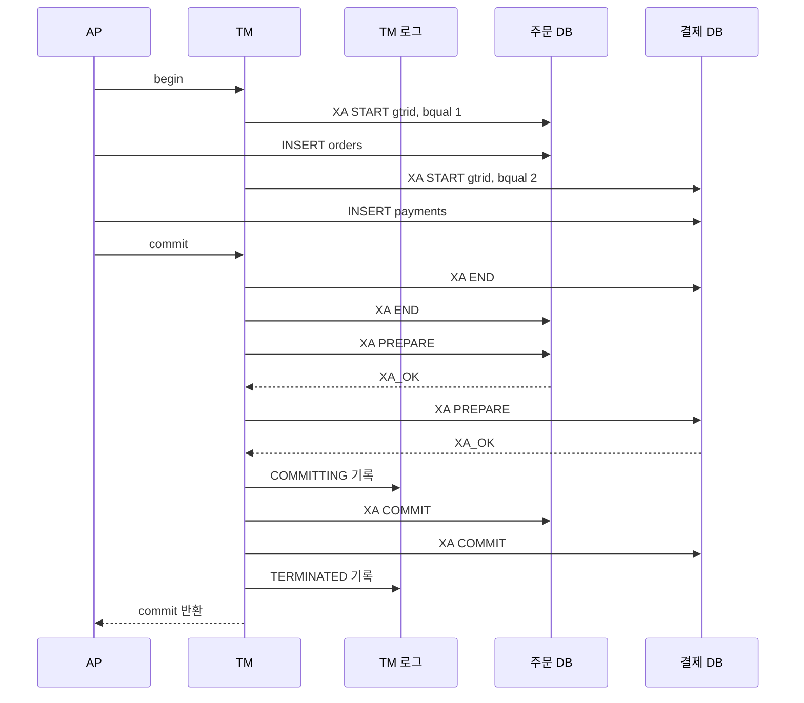
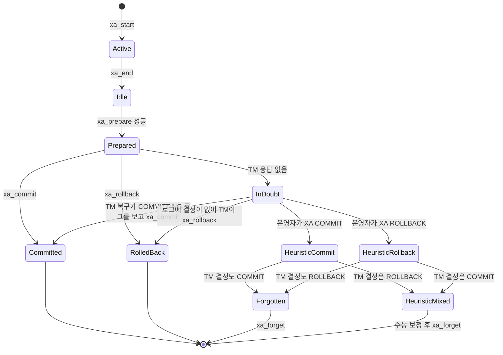
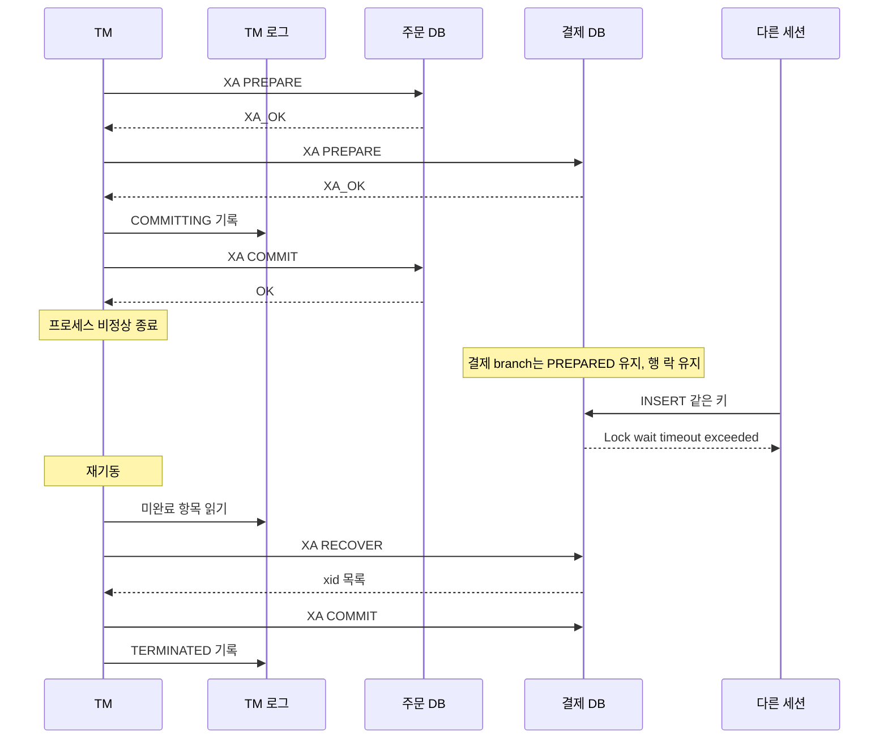

# XA와 2PC 구현 내부

[분산 트랜잭션](Distributed_Transaction.md)이 2PC의 필요성과 Saga·Outbox와의 선택을 다룬다면, 이 문서는 그 아래층이다. TM과 RM이 주고받는 XA 호출과, 호출이 중간에 끊겼을 때 DB에 남는 것을 본다.

로그와 수치는 직접 돌려서 얻었다. 돌리지 못한 항목은 그렇게 적었다.

| 구분 | 버전 (모두 Docker 컨테이너 또는 로컬 JVM) |
|---|---|
| MySQL | 8.0.46, 5.7.44, 5.6.51 |
| PostgreSQL | 16.15 |
| JTA·드라이버 | Atomikos 6.0.0, Connector/J 8.4.0, pgjdbc 42.7.3, Spring 5.3.39, Java 17 |

## XA 인터페이스의 구성

애플리케이션은 TM에게 경계만 알리고, TM이 RM마다 `xa_*` 함수를 호출한다. SQL은 TM을 거치지 않고 RM으로 직접 간다. TM이 모르는 연결의 SQL은 전역 트랜잭션에 묶이지 않는다.



TM에서 RM으로 가는 선이 XA, AP에서 RM으로 가는 선은 평범한 JDBC다.

| XA 함수 | 하는 일 | JDBC `XAResource` | MySQL | PostgreSQL |
|---|---|---|---|---|
| `xa_start` | branch 시작, xid 바인딩 | `start(xid, flags)` | `XA START` | 전용 문장 없음 |
| `xa_end` | branch 작업 종료 | `end(xid, flags)` | `XA END` | 전용 문장 없음 |
| `xa_prepare` | 1단계 투표 | `prepare(xid)` | `XA PREPARE` | `PREPARE TRANSACTION 'gid'` |
| `xa_commit` | 2단계 커밋 | `commit(xid, onePhase)` | `XA COMMIT` | `COMMIT PREPARED 'gid'` |
| `xa_rollback` | 롤백 | `rollback(xid)` | `XA ROLLBACK` | `ROLLBACK PREPARED 'gid'` |
| `xa_recover` | PREPARED 상태 xid 목록 | `recover(flags)` | `XA RECOVER` | `pg_prepared_xacts` 조회 |
| `xa_forget` | heuristic 결과 폐기 | `forget(xid)` | 문장 없음 | 문장 없음 |

| xid 구성 | 뜻 |
|---|---|
| `formatID` | TM 종류를 구분하는 정수 (Atomikos는 `0x41544f4d`, ASCII `ATOM`) |
| `gtrid` | 전역 트랜잭션 ID. 모든 branch가 공유 |
| `bqual` | branch 한정자. RM마다 다름 |
| pgjdbc의 gid | `formatID_base64(gtrid)_base64(bqual)`. `gtrid-1`, `bq-1`을 넣으면 `1_Z3RyaWQtMQ==_YnEtMQ==` |

| 코드 | 뜻 |
|---|---|
| `XA_OK` | prepare 투표 찬성 |
| `XA_RDONLY` | 변경 없음, TM이 그 branch의 2단계를 생략 |
| `XAER_NOTA` | 모르는 xid |
| `XAER_DUPID` | 이미 있는 xid |
| `XAER_RMFAIL` | RM이 지금 그 명령을 받을 수 없음 |
| `XA_HEURCOM` / `XA_HEURRB` | RM이 TM 결정 없이 커밋 / 롤백함 |
| `XA_HEURMIX` / `XA_HEURHAZ` | RM 안에서 일부만 커밋됨 / 결과를 모름 |

정상 커밋의 호출 순서는 Atomikos로 주문 DB와 결제 DB에 INSERT를 하나씩 넣고 MySQL general log로 받았다.



전역 커밋은 `COMMITTING`이 TM 로그에 들어간 시점에 정해진다. 같은 gtrid 아래 bqual이 `tm-demo1`, `tm-demo2`로 갈렸다.

## MySQL에서 XA 문장을 직접 실행한 결과

### 정상 흐름과 XA RECOVER

```
mysql> XA START 'tx1';
mysql> INSERT INTO orders VALUES (1,'NEW');
mysql> XA END 'tx1';
mysql> XA PREPARE 'tx1';
mysql> XA RECOVER;
+----------+--------------+--------------+------+
| formatID | gtrid_length | bqual_length | data |
+----------+--------------+--------------+------+
|        1 |            3 |            0 | tx1  |
+----------+--------------+--------------+------+
mysql> XA RECOVER CONVERT XID;
| formatID | gtrid_length | bqual_length | data     |
|        1 |            3 |            0 | 0x747831 |
mysql> XA COMMIT 'tx1';
```

`data`는 gtrid와 bqual을 이어붙인 값이다. `XA START 'a1','br1',7`은 `gtrid_length=2`, `bqual_length=3`, `data=a1br1`로 나온다. 경계는 길이 컬럼으로만 알 수 있다.

### 상태 오류

| 실행한 것 | 결과 |
|---|---|
| `XA START` 후 `XA END` 없이 `XA PREPARE` | `ERROR 1399 (XAE07) XAER_RMFAIL ... in the ACTIVE state` |
| `XA END` 후 일반 `COMMIT` | `ERROR 1399 (XAE07) XAER_RMFAIL ... in the IDLE state` |
| 없는 xid에 `XA COMMIT 'nope'` | `ERROR 1397 (XAE04) XAER_NOTA: Unknown XID` |
| PREPARED인 xid로 `XA START 'd1'` | `ERROR 1440 (XAE08) XAER_DUPID: The XID already exists` |

SELECT만 한 branch를 `XA PREPARE`해도 `XA RECOVER`에 남았다. SQL 수준에서 `XA_RDONLY` 생략은 없었다. 드라이버가 이 값을 돌려주는지는 확인하지 않았다.

### PREPARED가 살아남는 범위

PREPARE 후 연결을 끊고 다른 세션에서 봤다.

```
mysql> XA RECOVER;      -- 연결 종료 후, 다른 세션에서
| formatID | gtrid_length | bqual_length | data  |
|        7 |            2 |            3 | a1br1 |

-- docker restart 후에도 같은 한 줄이 나온다

mysql> SELECT trx_id, trx_state, trx_mysql_thread_id, trx_rows_locked FROM information_schema.innodb_trx;
| 1825 | RUNNING | 0 | 1 |

mysql> SELECT lock_type, lock_mode, lock_data FROM performance_schema.data_locks WHERE object_name='orders';
| TABLE  | IX            | NULL |
| RECORD | X,REC_NOT_GAP | 10   |

mysql> UPDATE orders SET status='X' WHERE id=10;   -- 다른 세션
ERROR 1205 (HY000): Lock wait timeout exceeded; try restarting transaction
```

재시작 후에도 행 락이 복원된다. 소유 스레드가 없어 `trx_mysql_thread_id`는 0이다. `XA RECOVER`에는 PREPARE 시각이 없어서 방치 시간은 `trx_started`로 잰다.

```sql
SELECT trx_id, TIMESTAMPDIFF(SECOND, trx_started, NOW()) AS age_sec
FROM information_schema.innodb_trx
WHERE trx_mysql_thread_id = 0 AND trx_rows_modified > 0;
```

### 버전별 차이

같은 시나리오를 세 버전에서 돌렸다.

| | 5.6.51 | 5.7.44 | 8.0.46 |
|---|---|---|---|
| 연결 종료 후 `XA RECOVER` | 빈 결과, 행 0건 | 1건 유지 | 1건 유지 |
| 서버 재시작 후 | 빈 결과, 행 0건 | 1건 유지 | 1건 유지 |
| binlog의 `XA PREPARE` | 이벤트 없음 | `XA_prepare` 이벤트 | `XA_prepare` 이벤트 |

5.6.51은 연결이 끊기는 순간 롤백됐고 binlog에도 흔적이 없었다. "5.7.7 이전은 롤백, 이후는 유지"는 5.6.51과 5.7.44로 확인했다. 5.7.0~5.7.6은 돌리지 않았다. 8.0.46의 binlog에는 PREPARE와 COMMIT이 별개 이벤트로 남는다.

```
binlog.000001  Query       XA START X'6131',X'627231',7
binlog.000001  Write_rows  table_id: 88 flags: STMT_END_F
binlog.000001  Query       XA END X'6131',X'627231',7
binlog.000001  XA_prepare  XA PREPARE X'6131',X'627231',7
binlog.000002  Query       XA COMMIT X'6131',X'627231',7
```

`gtid_mode=ON`에서도 8.0.46의 XA는 막히지 않고 정상 커밋됐다.

## PostgreSQL에서 방치된 prepared transaction

기본 문법은 [분산 트랜잭션](Distributed_Transaction.md#postgresql에서-xa를-직접-돌려보기)에 있다. 여기서는 PREPARE 후 종료 명령이 없는 경우를 재현했다. `max_prepared_transactions=10`, 10만 행 `payments`와 5만 행 `audit`이다.

```sql
BEGIN;
UPDATE payments SET status='PAID' WHERE id=1;
PREPARE TRANSACTION 'orphan-1';
-- 연결 종료
```

| 관찰한 것 | 결과 |
|---|---|
| 다른 세션이 같은 행 UPDATE | `ERROR: canceling statement due to lock timeout` / `CONTEXT: while updating tuple (0,1)` |
| `pg_locks`의 소유자 | `pid`가 비어 있고 `virtualtransaction`이 `3/223` |
| 두 번 대량 UPDATE 후 `VACUUM VERBOSE payments` | `tuples: 0 removed, 299998 remain, 199998 are dead but not yet removable` / `removable cutoff: 741` |
| 락과 무관한 `audit` 테이블의 VACUUM | `50000 are dead but not yet removable` / `removable cutoff: 741` |
| 테이블 크기 | 4328 kB에서 13 MB로 증가 |
| 서버 재시작 | `pg_prepared_xacts`에 그대로 남고 `xid_age`가 1에서 10으로 증가 |
| `ROLLBACK PREPARED` 후 VACUUM | `199999 removed`, 크기는 13 MB 그대로 |

사고는 두 갈래다. 그 행의 락, 그리고 xid 741이 정리 기준선(`removable cutoff`)을 붙잡는 것이다. 뒤쪽이 더 아프다. 락과 무관한 테이블도 dead tuple을 못 치우고, 부푼 테이블은 롤백해도 줄지 않는다.

DDL을 PREPARE해 둔 경우는 읽기까지 막는다.

```sql
BEGIN; ALTER TABLE audit ADD COLUMN note text; PREPARE TRANSACTION 'ddl-orphan';
SET lock_timeout='2s'; SELECT count(*) FROM audit;
-- ERROR:  canceling statement due to lock timeout
-- pg_locks: audit | AccessExclusiveLock | granted | pid 없음
```

슬롯이 차면 새 PREPARE도 거절된다.

```
ERROR:  maximum number of prepared transactions reached
HINT:  Increase max_prepared_transactions (currently 10).
```

MySQL에서 같은 방치 상태에 같은 부하를 주면 `trx_rseg_history_len`이 0에 머문다. 일반 REPEATABLE READ 트랜잭션이 read view를 쥐면 20까지 올랐다가 COMMIT 후 0이 됐다. MySQL의 PREPARED는 행 락만 쥐고 undo 정리는 막지 않는다.

감시는 `pg_prepared_xacts`로 한다.

```sql
SELECT gid, prepared, now() - prepared AS held, owner, database, age(transaction) AS xid_age
FROM pg_prepared_xacts
WHERE prepared < now() - interval '1 minute'
ORDER BY prepared;
```

## in-doubt 트랜잭션과 heuristic outcome

PREPARED 이후 TM의 결정을 못 받은 branch가 in-doubt다. RM은 커밋을 이미 약속해서 스스로 결론을 낼 수 없다.



`Heuristic*` 간선은 RM이 TM의 결정 없이 끝낸 경우이고 JTA에서는 `HeuristicMixedException` 같은 예외로 올라온다. MySQL과 PostgreSQL은 재시작과 수십 초 대기 동안 스스로 결정하지 않았다. heuristic은 사람이 `XA COMMIT`이나 `XA ROLLBACK`을 직접 쳤을 때만 생겼다.

코디네이터가 2단계 중간에 죽는 경우는 두 번째 RM의 `commit` 호출 직전에 `Runtime.halt`를 걸어 만들었다. prepare는 끝났고 commit은 한 건만 나간 상태다.



종료 직후에는 `orders`에 행이 있고 `payments`에는 없다. `XA RECOVER`에는 formatID 1096044365, gtrid 25바이트, bqual 8바이트 한 줄이 남는다. 복구 조건을 바꿔 세 번 돌렸다.

| 재기동 전 조건 | TM 동작 | 결과 |
|---|---|---|
| TM 로그 유지 | `COMMITTING`을 읽고 `XA COMMIT` 전송, 로그에 `TERMINATED` | `XA RECOVER` 빈 결과, 두 테이블 모두 행 존재 |
| TM 로그 디렉터리 삭제 | 30초를 기다려도 손대지 않음 | branch가 PREPARED로 남고 같은 키 INSERT가 lock wait timeout |
| TM 로그 유지, 그 전에 DBA가 결제 branch를 `XA ROLLBACK` | 로그에 `COMMITTING`, `TERMINATED`만 기록 | `orders`에만 행이 있고 `payments`에는 없음 |

둘째 줄은 수동으로 닫아야 한다. 다른 branch가 이미 커밋됐거나 TM 로그에 `COMMITTING`이 있었으면 `XA COMMIT`, 아니면 `XA ROLLBACK`이다.

```sql
XA RECOVER CONVERT XID;
XA COMMIT 'tm-demo179367334231500001','tm-demo2',1096044365;
```

셋째 줄이 가장 위험하다. 이 설정(`throw_on_heuristic=false`, 기본 로그 레벨)에서는 경고가 찍히지 않았고 Atomikos는 "no pending transactions"로 종료했다. 결제가 빠진 주문이 에러 없이 남는다.

## JTA 트랜잭션 매니저와 Spring

자바 TM은 Narayana, Atomikos, Bitronix가 대표적이다. 돌려본 것은 Atomikos뿐이고 나머지 키는 각 프로젝트 문서 기준이다.

| TM | 로그 위치 설정 | 노드 식별자 |
|---|---|---|
| Atomikos | `com.atomikos.icatch.log_base_dir` | `com.atomikos.icatch.tm_unique_name` |
| Narayana | `ObjectStoreEnvironmentBean.objectStoreDir` | `CoreEnvironmentBean.nodeIdentifier` |
| Bitronix | `bitronix.tm.journal.disk.logPart1Filename` | `bitronix.tm.serverId` |

노드 식별자는 xid에 들어간다(실험에서 gtrid가 `tm-demo...`로 시작했다). 인스턴스끼리 이름이 같으면 어느 branch가 자기 것인지 구분할 수 없다.

```java
System.setProperty("com.atomikos.icatch.log_base_dir", "/var/lib/app/tmlogs");
System.setProperty("com.atomikos.icatch.tm_unique_name", "tm-orders-1");

AtomikosDataSourceBean orders = new AtomikosDataSourceBean();
orders.setUniqueResourceName("orders");
orders.setXaDataSource(mysqlXa("shop"));   // MysqlXADataSource
orders.setPoolSize(2);
orders.init();

UserTransactionManager utm = new UserTransactionManager();
utm.init();
JtaTransactionManager tm = new JtaTransactionManager(new UserTransactionImp(), utm);
```

`log_base_dir`이 컨테이너 임시 경로면 배포마다 로그 디렉터리가 지워진다. 영속 볼륨에 둔다.

### 커넥션 풀과의 충돌

`orders`는 Atomikos XA 풀, `payments`는 일반 HikariCP(autoCommit=true)로 두고 JTA 트랜잭션 안에서 INSERT 후 `rollback()`을 불렀다.

```
[app] rollback 반환
orders   | 1          -- id 2는 롤백됨
payments | 1, 2       -- id 2가 남음
```

Hikari 연결은 TM이 모르는 연결이라 branch가 만들어지지 않았고 에러도 경고도 없었다. 풀 하나만 XA가 아니어도 원자성이 조용히 깨진다. 반대로 XA 풀은 `close()`를 먼저 불러도 트랜잭션이 끝날 때까지 물리 연결을 쥔다. general log에서 같은 스레드가 `XA START`부터 `XA COMMIT`까지 처리했다.

### JtaTransactionManager가 안 해주는 것

| 호출 | 결과 |
|---|---|
| `REQUIRED`, `ISOLATION_DEFAULT` | 정상 |
| `ISOLATION_SERIALIZABLE` | `InvalidIsolationLevelException: JtaTransactionManager does not support custom isolation levels by default - switch 'allowCustomIsolationLevels' to 'true'` |
| `readOnly=true`로 INSERT | 에러 없이 INSERT됨 |
| 바깥 트랜잭션 안의 `NESTED` | `UncategorizedSQLException ... Failed to suspend branch` (Atomikos 6.0.0 + MySQL 8.0.46) |

`readOnly`는 강제되지 않는다. `allowCustomIsolationLevels`를 켠 경우는 돌리지 않았다.

## 처리량이 떨어지는 지점과 측정

prepare부터 commit까지 branch는 락을 쥔다. 16개 스레드가 MySQL 8.0.46에 `XA START → UPDATE → XA END → XA PREPARE → sleep → XA COMMIT`을 8초간 반복했다. sleep이 코디네이터 지연이다.

| 방식 | hold(ms) | 대상 | TPS | p50(ms) | p99(ms) |
|---|---|---|---|---|---|
| 로컬 트랜잭션 | 0 | 한 행 | 115 | 108 | 287 |
| XA | 0 | 한 행 | 70 | 204 | 421 |
| XA | 5 | 한 행 | 58 | 267 | 439 |
| XA | 20 | 한 행 | 39 | 403 | 578 |
| XA | 100 | 한 행 | 11 | 1674 | 1747 |
| 로컬 트랜잭션 | 0 | 스레드별 행 | 362 | 17 | 105 |
| XA | 0 | 스레드별 행 | 147 | 100 | 215 |
| XA | 100 | 스레드별 행 | 106 | 123 | 387 |

이 컨테이너는 fsync가 느려서 절대값이 낮으니 비율만 본다. 한 행에 몰리면 TPS가 1/(락 유지 시간)에 수렴한다. hold 100ms의 p50 1674ms는 스레드 16개가 줄을 선 값(16 × 약 104ms)과 맞는다.

| 위치 | 재는 것 | 방법 |
|---|---|---|
| TM | prepare 응답에서 commit 호출까지의 간격 | `XAResource`를 프록시로 감싸 `prepare` 반환 시각과 `commit` 호출 시각을 기록. 위의 크래시 재현에 쓴 방식과 같다 |
| MySQL | 락 대기, 방치 시간 | `SHOW GLOBAL STATUS`의 `Innodb_row_lock_waits`, `Innodb_row_lock_time_avg`, `Innodb_row_lock_time_max`, 앞의 `innodb_trx` 쿼리 |
| PostgreSQL | 방치 시간, 락 대기 | `pg_prepared_xacts`, `pg_stat_activity`의 `wait_event_type='Lock'` |

TM 로그 유실은 RM에 남은 PREPARED xid 중 TM 접두어를 가진 수에서 TM 로그의 미완료 수를 뺀 값으로 센다. 평소 0이어야 하고, 0이 아닌 값이 오래 유지되면 수동 처리 대상이다.

## XA를 쓰지 않는 편이 나은 경우

HTTP 서비스 경계에는 쓸 수 없다. RM은 `xa_prepare`와 `xa_recover`를 구현해야 하는데 REST API에는 그 규약이 없다. 상대 서비스의 DB에 TM을 직접 붙이면 서비스 경계가 사라진다. 이 경우는 [Saga와 Outbox](Distributed_Transaction.md)로 간다.

락 유지 시간이 처리량 상한이 되는 핫 로우(재고, 잔액, 시퀀스)도 피한다. 한 DB 안에서 풀리는 일이면 로컬 트랜잭션에 outbox 테이블을 같이 쓰는 쪽이 낫다.

PostgreSQL은 `max_prepared_transactions` 기본값 0에서 PREPARE를 거절한다(`prepared transactions are disabled`). 매니지드 DB가 XA나 `PREPARE TRANSACTION`을 막은 경우가 있다고 들었지만 서비스·버전별로 달라서 로컬 컨테이너만 돌린 이 문서에서는 확인하지 못했다. 도입 전에 실제 인스턴스에서 실행해 본다. Redis와 Kafka는 XA의 RM이 아니다.

두 DB가 한 배포 단위에 있고, 핫 로우가 없고, TM 로그가 영속 볼륨에 있고, PREPARED 방치를 감시하는 환경이면 XA를 쓸 만하다. 하나라도 빠지면 앞의 사고가 그대로 일어난다.
