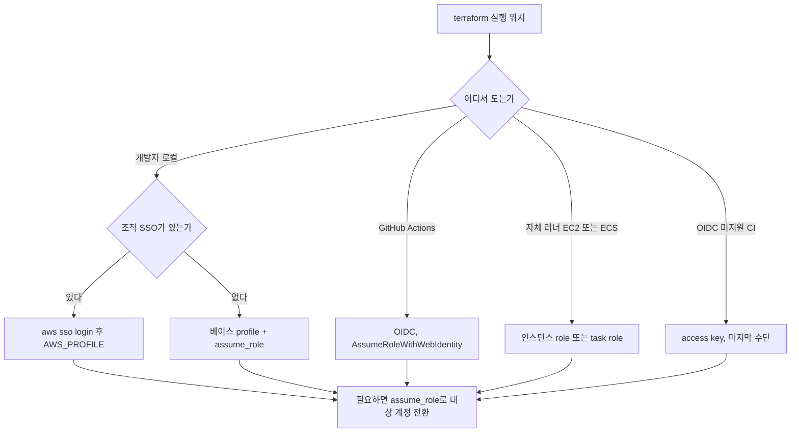
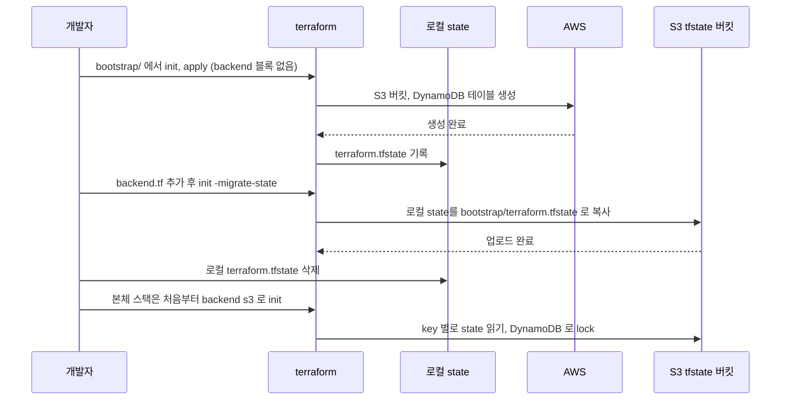
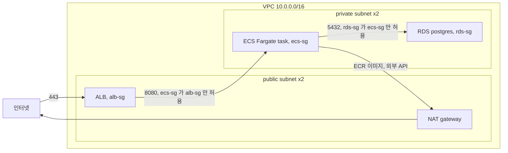
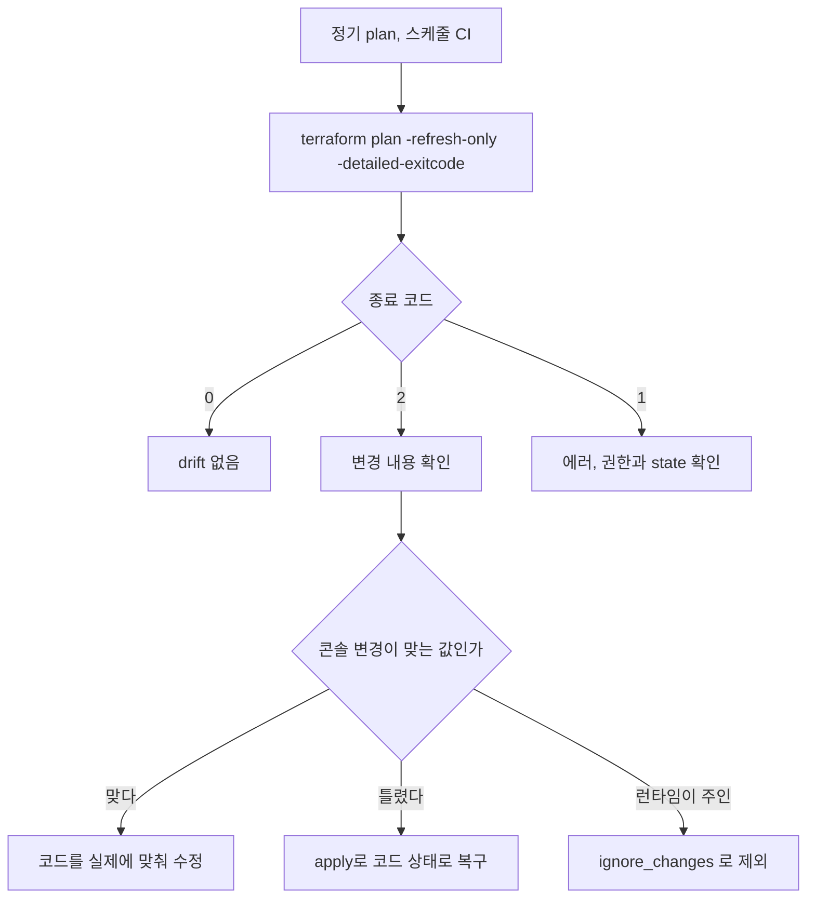
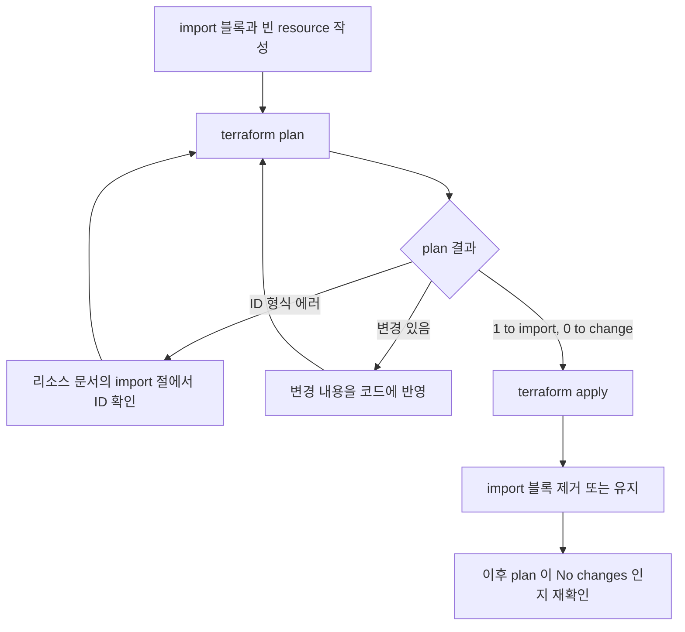

# AWS Terraform 실전

[Terraform](./Terraform.md)과 [Terraform 기초](./Terraform_기초.md)는 HCL 문법, state 관리, 모듈 같은 범용 내용을 다룬다. 이 문서는 AWS 위에서 실제 스택을 올릴 때만 겪는 문제를 정리한다. provider 인증, backend 부트스트랩, VPC부터 ECS/RDS까지 이어지는 구성, AWS에서만 나는 drift, 콘솔에서 만든 리소스를 코드로 가져오는 import 순서까지다.

AWS provider는 메이저 버전마다 리소스 인자가 바뀐다. 버전을 고정하지 않으면 팀원마다 `terraform init` 시점에 다른 provider를 받는다. 이 문서 예제는 Terraform 1.9, `hashicorp/aws` 5.x 기준이고 모든 스택의 첫 블록은 이렇게 시작한다.

```hcl
terraform {
  required_version = "~> 1.9"

  required_providers {
    aws = {
      source  = "hashicorp/aws"
      version = "~> 5.70"   # 5.70 이상 6.0 미만
    }
  }
}
```

`.terraform.lock.hcl`은 반드시 커밋한다. 이 파일이 없으면 `~> 5.70` 범위 안에서도 로컬과 CI가 서로 다른 마이너 버전을 받아서, 로컬 plan은 깨끗한데 CI plan에는 변경이 뜨는 일이 생긴다.

---

## provider 인증

AWS provider는 자격증명을 코드에 박지 않는다. 환경 변수, 공유 credentials 파일, EC2/ECS의 인스턴스 role, OIDC 같은 외부 소스에서 읽는다. 어디서 읽느냐는 코드가 어디서 도느냐로 갈린다.



위에서 아래로 내려가며 가능한 가장 위쪽 방식을 고른다. access key는 만료가 없어서 유출되면 끝까지 살아 있다. 어쩔 수 없이 써야 하면 전용 IAM 사용자에 권한을 좁히고 90일 안에 교체한다.

### 로컬은 profile, 계정 전환은 assume_role

여러 계정을 오가는 로컬에서는 named profile이 깔끔하다. 다만 provider에 `profile = "myteam-dev"`를 적으면 그 값이 코드에 박힌다. dev용으로 짠 코드를 prod에 그대로 apply하면 엉뚱한 계정으로 나간다. profile은 코드에 적지 않고 `AWS_PROFILE`로 넘긴다.

```hcl
provider "aws" {
  region = "ap-northeast-2"
  # profile은 AWS_PROFILE 환경 변수로 주입
}
```

```bash
AWS_PROFILE=myteam-dev terraform plan
AWS_PROFILE=myteam-prod terraform plan
```

크로스 계정 배포는 `assume_role`을 쓴다. 권한이 약한 베이스 자격증명으로 시작해서 대상 계정의 role을 떠맡는다.

```hcl
provider "aws" {
  region = "ap-northeast-2"

  assume_role {
    role_arn     = "arn:aws:iam::111122223333:role/terraform-deploy"
    session_name = "terraform-ci"
  }
}
```

`session_name`은 CloudTrail에 그대로 찍힌다. 어느 파이프라인이 apply했는지 추적하려면 `terraform-ci-${run_id}`처럼 구분되는 이름을 넣어야 한다. 비워두면 사고가 났을 때 로그만 보고는 누가 했는지 못 찾는다.

### GitHub Actions는 OIDC로 키 없이 인증

CI에서 가장 흔한 실수가 `AWS_ACCESS_KEY_ID`와 `AWS_SECRET_ACCESS_KEY`를 GitHub Secrets에 넣는 것이다. OIDC를 쓰면 장기 키 없이 단기 토큰으로 role을 assume한다. AWS에 GitHub OIDC provider를 등록하고, 그 provider를 신뢰하는 role을 만든다.

```hcl
data "aws_iam_openid_connect_provider" "github" {
  url = "https://token.actions.githubusercontent.com"
}

resource "aws_iam_role" "github_actions" {
  name = "github-actions-terraform"

  assume_role_policy = jsonencode({
    Version = "2012-10-17"
    Statement = [{
      Effect = "Allow"
      Principal = {
        Federated = data.aws_iam_openid_connect_provider.github.arn
      }
      Action = "sts:AssumeRoleWithWebIdentity"
      Condition = {
        StringEquals = {
          "token.actions.githubusercontent.com:aud" = "sts.amazonaws.com"
          "token.actions.githubusercontent.com:sub" = "repo:myorg/myrepo:ref:refs/heads/main"
        }
      }
    }]
  })
}
```

`data` source는 OIDC provider가 이미 계정에 등록돼 있어야 동작한다. 처음 한 번은 `aws_iam_openid_connect_provider` resource로 만들어야 한다.

핵심은 `sub` 조건이다. `repo:myorg/myrepo:ref:refs/heads/main`으로 묶으면 main 브랜치 워크플로우만 이 role을 얻는다. `repo:myorg/myrepo:*`로 풀면 PR을 여는 것만으로 prod role을 얻는다. PR의 plan은 `repo:myorg/myrepo:pull_request`를 허용하는 읽기 전용 role을 따로 만들어 쓴다.

```yaml
permissions:
  id-token: write   # OIDC 토큰 발급에 필요. 빠지면 인증 자체가 안 된다
  contents: read

jobs:
  deploy:
    runs-on: ubuntu-latest
    steps:
      - uses: actions/checkout@v4
      - uses: aws-actions/configure-aws-credentials@v4
        with:
          role-to-assume: arn:aws:iam::111122223333:role/github-actions-terraform
          aws-region: ap-northeast-2
      - uses: hashicorp/setup-terraform@v3
        with:
          terraform_version: 1.9.8
      - run: terraform init
      - run: terraform apply -auto-approve
```

`id-token: write`가 빠지면 에러가 "Could not assume role"로 나와서 OIDC 등록이나 trust policy를 의심하게 된다. 실제로는 이 한 줄이 빠진 경우가 많다.

### default_tags로 태그 누락 막기

리소스마다 `tags`를 적으면 빠뜨리는 게 생긴다. 비용 추적용 태그가 절반쯤 빠져 있으면 월말에 팀별 사용량을 못 가른다. provider의 `default_tags`는 그 provider로 만든 모든 리소스에 태그를 붙인다.

```hcl
provider "aws" {
  region = "ap-northeast-2"

  default_tags {
    tags = {
      Environment = "prod"
      ManagedBy   = "terraform"
      Team        = "backend"
    }
  }
}
```

리소스에서 같은 키를 다시 적으면 리소스 쪽 값이 이긴다. 다만 같은 키를 양쪽에 두면 provider 버전에 따라 plan에 매번 변경으로 잡히는 경우가 있어서, 공통 태그는 `default_tags`에만 둔다. 태그를 지원하지 않는 리소스에는 붙지 않는다.

---

## S3 + DynamoDB backend 부트스트랩

state를 로컬에 두면 팀 작업이 안 된다. S3에 state를 두고 DynamoDB로 lock을 건다. 여기서 닭과 달걀 문제가 생긴다. backend용 버킷과 테이블을 Terraform으로 만들고 싶은데, 그 state를 둘 backend가 아직 없다.

해법은 backend 리소스만 로컬 state로 먼저 만들고, 만든 뒤 state를 그 버킷으로 옮기는 것이다.



가운데 `-migrate-state`가 닭과 달걀을 수동으로 끊는 유일한 지점이다. 이후 본체 스택은 backend를 S3로 선언하고 시작하면 된다.

### 1단계, 로컬 state로 backend 리소스 생성

`bootstrap/` 디렉토리를 따로 두고 backend 블록 없이 시작한다.

```hcl
# bootstrap/main.tf — backend 블록 없음. state는 로컬 파일로 시작

resource "aws_s3_bucket" "tfstate" {
  bucket = "myteam-tfstate-prod"

  lifecycle {
    prevent_destroy = true   # destroy 시도 자체를 plan 단계에서 막는다
  }
}

resource "aws_s3_bucket_versioning" "tfstate" {
  bucket = aws_s3_bucket.tfstate.id
  versioning_configuration {
    status = "Enabled"
  }
}

resource "aws_s3_bucket_server_side_encryption_configuration" "tfstate" {
  bucket = aws_s3_bucket.tfstate.id
  rule {
    apply_server_side_encryption_by_default {
      sse_algorithm = "aws:kms"
    }
  }
}

resource "aws_s3_bucket_public_access_block" "tfstate" {
  bucket                  = aws_s3_bucket.tfstate.id
  block_public_acls       = true
  block_public_policy     = true
  ignore_public_acls      = true
  restrict_public_buckets = true
}

resource "aws_dynamodb_table" "tflock" {
  name         = "myteam-tflock-prod"
  billing_mode = "PAY_PER_REQUEST"
  hash_key     = "LockID"

  attribute {
    name = "LockID"
    type = "S"
  }
}
```

`versioning`은 반드시 켠다. state가 깨졌을 때 이전 버전으로 되돌릴 유일한 수단이다. `public_access_block`은 버킷 삭제를 막는 장치가 아니라 공개 접근을 막는 장치이고, 삭제 방지는 `prevent_destroy`가 맡는다. `prevent_destroy`는 코드에서 resource 블록을 지우는 경우에는 막아주지 못한다는 점을 기억해야 한다.

### 2단계, backend 선언 후 state 이전

```hcl
# bootstrap/backend.tf
terraform {
  backend "s3" {
    bucket         = "myteam-tfstate-prod"
    key            = "bootstrap/terraform.tfstate"
    region         = "ap-northeast-2"
    dynamodb_table = "myteam-tflock-prod"
    encrypt        = true
  }
}
```

```bash
cd bootstrap
terraform init
terraform apply
# backend.tf 추가 후
terraform init -migrate-state
# "Do you want to copy existing state to the new backend?" → yes
rm terraform.tfstate terraform.tfstate.backup
```

이전이 끝나면 로컬에 남은 `terraform.tfstate`와 백업 파일은 지운다. 남겨두면 누군가 backend 블록 없이 init했을 때 낡은 로컬 state가 다시 쓰인다.

Terraform 1.10부터 DynamoDB 없이 S3 자체 lock(`use_lockfile = true`)을 쓸 수 있고, 1.11에서 정식이 되면서 `dynamodb_table`은 deprecated 처리됐다. 이 문서는 1.9 기준이라 DynamoDB 방식으로 적었다. 버전을 올릴 때 backend 블록을 같이 손봐야 한다.

### state key는 환경별로 분리

같은 버킷을 쓰더라도 `key`는 `prod/terraform.tfstate`, `dev/terraform.tfstate`처럼 환경별로 나눈다. 같은 key를 공유하면 한쪽 apply가 다른 쪽 state를 덮어쓴다. 복구가 까다로운 사고다.

### 실행용 IAM role 최소 권한

CI가 assume하는 `terraform-deploy` role에 `AdministratorAccess`를 붙이는 경우가 많다. 편하지만 role이 유출되면 계정 전체가 털린다. 그 스택이 건드리는 서비스로 좁힌다. 아래는 VPC/ECS/RDS 스택 기준이다.

```hcl
resource "aws_iam_role_policy" "terraform_deploy" {
  name = "terraform-deploy-policy"
  role = aws_iam_role.terraform_deploy.id

  policy = jsonencode({
    Version = "2012-10-17"
    Statement = [
      {
        Effect = "Allow"
        Action = [
          "ec2:*",
          "ecs:*",
          "elasticloadbalancing:*",
          "rds:*",
          "logs:*",
          "secretsmanager:*",   # manage_master_user_password 가 secret 을 만든다
          "kms:Describe*", "kms:CreateGrant", "kms:GenerateDataKey",
        ]
        Resource = "*"
      },
      {
        # state 접근
        Effect = "Allow"
        Action = ["s3:GetObject", "s3:PutObject", "s3:ListBucket"]
        Resource = [
          "arn:aws:s3:::myteam-tfstate-prod",
          "arn:aws:s3:::myteam-tfstate-prod/*",
        ]
      },
      {
        Effect   = "Allow"
        Action   = ["dynamodb:GetItem", "dynamodb:PutItem", "dynamodb:DeleteItem"]
        Resource = "arn:aws:dynamodb:ap-northeast-2:111122223333:table/myteam-tflock-prod"
      },
      {
        # ECS task role 등을 만들기 때문에 IAM 은 거의 필수다
        Effect = "Allow"
        Action = [
          "iam:CreateRole", "iam:DeleteRole", "iam:GetRole", "iam:TagRole",
          "iam:PassRole", "iam:AttachRolePolicy", "iam:DetachRolePolicy",
          "iam:PutRolePolicy", "iam:GetRolePolicy", "iam:DeleteRolePolicy",
          "iam:ListRolePolicies", "iam:ListAttachedRolePolicies",
        ]
        Resource = "arn:aws:iam::111122223333:role/app-*"
      },
    ]
  })
}
```

`ec2:*`처럼 서비스 단위 와일드카드는 현실적인 타협이다. 액션을 하나하나 좁히면 plan을 돌릴 때마다 권한 부족 에러가 나서 끝없이 추가하게 된다. 서비스 범위로 막고 IAM만 role 이름 prefix로 좁히는 선에서 시작한다. IAM에 `Resource = "*"`를 주면 이 role이 스스로 관리자 role을 만들 수 있어서, 권한을 좁힌 의미가 없어진다.

`iam:PassRole`이 빠지면 ECS task definition을 만들 때 "is not authorized to perform iam:PassRole"로 막힌다. `iam:GetRolePolicy`, `iam:ListAttachedRolePolicies` 같은 읽기 권한이 빠지면 apply가 아니라 refresh에서 실패해서 원인 찾기가 더 어렵다.

---

## VPC, ALB, ECS Fargate, RDS 구성

웹 서비스 스택은 VPC 안에 세 계층을 쌓는다. ALB는 public subnet, Fargate task와 RDS는 private subnet에 두고 security group ID로 서로를 연결한다.



화살표 위 포트는 받는 쪽 security group이 허용하는 규칙이다. RDS는 인터넷으로 나가는 경로가 없고, Fargate task가 ECR에서 이미지를 당기려면 NAT gateway(또는 VPC endpoint)를 거친다. 이 경로를 빼먹으면 task가 `CannotPullContainerError`로 계속 재시작한다.

### 기존 VPC는 data source로 조회

회사에서는 VPC를 네트워크 팀이 따로 관리하는 경우가 흔하다. 그럴 때는 만들지 않고 조회한다.

```hcl
data "aws_vpc" "main" {
  filter {
    name   = "tag:Name"
    values = ["main-vpc"]
  }
}

data "aws_subnets" "private" {
  filter {
    name   = "vpc-id"
    values = [data.aws_vpc.main.id]
  }
  filter {
    name   = "tag:Tier"
    values = ["private"]
  }
}

data "aws_ami" "al2023" {
  most_recent = true
  owners      = ["amazon"]

  filter {
    name   = "name"
    values = ["al2023-ami-*-x86_64"]
  }
}
```

`most_recent = true`로 AMI를 조회하면 AWS가 새 AMI를 내놓는 순간 plan에 변경이 잡히고 인스턴스를 갈아엎으려 든다. ASG나 launch template에서는 AMI ID를 변수로 고정하거나 `ignore_changes = [image_id]`로 막는다. Fargate만 쓰는 스택이면 AMI 조회는 필요 없다.

### 네트워크

이 아래 코드는 신규 VPC 기준이다. 서브넷만 만들고 끝내면 라우팅이 없어서 아무 데도 못 나간다. internet gateway, route table, NAT까지 같이 만든다.

```hcl
data "aws_availability_zones" "available" {
  state = "available"
}

resource "aws_vpc" "main" {
  cidr_block           = "10.0.0.0/16"
  enable_dns_support   = true
  enable_dns_hostnames = true
}

resource "aws_subnet" "public" {
  count                   = 2
  vpc_id                  = aws_vpc.main.id
  cidr_block              = "10.0.${count.index}.0/24"
  availability_zone       = data.aws_availability_zones.available.names[count.index]
  map_public_ip_on_launch = true
}

resource "aws_subnet" "private" {
  count             = 2
  vpc_id            = aws_vpc.main.id
  cidr_block        = "10.0.${count.index + 10}.0/24"
  availability_zone = data.aws_availability_zones.available.names[count.index]
}

resource "aws_internet_gateway" "main" {
  vpc_id = aws_vpc.main.id
}

resource "aws_eip" "nat" {
  domain = "vpc"   # 4.x 의 vpc = true 는 deprecated
}

resource "aws_nat_gateway" "main" {
  allocation_id = aws_eip.nat.id
  subnet_id     = aws_subnet.public[0].id   # 비용 때문에 한 개만. AZ 장애에는 약하다
  depends_on    = [aws_internet_gateway.main]
}

resource "aws_route_table" "public" {
  vpc_id = aws_vpc.main.id
  route {
    cidr_block = "0.0.0.0/0"
    gateway_id = aws_internet_gateway.main.id
  }
}

resource "aws_route_table" "private" {
  vpc_id = aws_vpc.main.id
  route {
    cidr_block     = "0.0.0.0/0"
    nat_gateway_id = aws_nat_gateway.main.id
  }
}

resource "aws_route_table_association" "public" {
  count          = 2
  subnet_id      = aws_subnet.public[count.index].id
  route_table_id = aws_route_table.public.id
}

resource "aws_route_table_association" "private" {
  count          = 2
  subnet_id      = aws_subnet.private[count.index].id
  route_table_id = aws_route_table.private.id
}
```

`route { ... }`를 `aws_route_table` 안에 inline으로 쓰는 방식은 별도 `aws_route` 리소스와 섞으면 서로 덮어쓴다. 보안그룹 규칙과 같은 문제다. 한 route table에는 한 방식만 쓴다.

### security group, inline과 별도 리소스를 섞지 않는다

ALB는 인터넷에서 443을 받고, ECS는 ALB에서만 받고, RDS는 ECS에서만 받는다. source를 CIDR이 아니라 다른 security group ID로 거는 것이 핵심이다.

```hcl
resource "aws_security_group" "alb" {
  name   = "alb-sg"
  vpc_id = aws_vpc.main.id
}

resource "aws_security_group" "ecs" {
  name   = "ecs-sg"
  vpc_id = aws_vpc.main.id
}

resource "aws_security_group" "rds" {
  name   = "rds-sg"
  vpc_id = aws_vpc.main.id
}

resource "aws_vpc_security_group_ingress_rule" "alb_https" {
  security_group_id = aws_security_group.alb.id
  cidr_ipv4         = "0.0.0.0/0"
  from_port         = 443
  to_port           = 443
  ip_protocol       = "tcp"
}

resource "aws_vpc_security_group_ingress_rule" "ecs_from_alb" {
  security_group_id            = aws_security_group.ecs.id
  referenced_security_group_id = aws_security_group.alb.id
  from_port                    = 8080
  to_port                      = 8080
  ip_protocol                  = "tcp"
}

resource "aws_vpc_security_group_ingress_rule" "rds_from_ecs" {
  security_group_id            = aws_security_group.rds.id
  referenced_security_group_id = aws_security_group.ecs.id
  from_port                    = 5432
  to_port                      = 5432
  ip_protocol                  = "tcp"
}

# Terraform 이 만든 security group 은 AWS 기본 egress 전체 허용 규칙이 제거된다.
# egress 를 따로 안 열면 task 가 ECR 에 못 가고, ALB 가 task 에 못 간다.
resource "aws_vpc_security_group_egress_rule" "alb_to_ecs" {
  security_group_id            = aws_security_group.alb.id
  referenced_security_group_id = aws_security_group.ecs.id
  from_port                    = 8080
  to_port                      = 8080
  ip_protocol                  = "tcp"
}

resource "aws_vpc_security_group_egress_rule" "ecs_all" {
  security_group_id = aws_security_group.ecs.id
  cidr_ipv4         = "0.0.0.0/0"
  ip_protocol       = "-1"
}
```

`aws_security_group` 안의 inline `ingress`/`egress`와 `aws_security_group_rule`, `aws_vpc_security_group_*_rule`은 한 security group에 같이 쓸 수 없다. 섞으면 inline 쪽이 별도 리소스가 만든 규칙을 매 apply마다 지우고, 별도 리소스가 다시 만드는 핑퐁이 난다. 새 코드는 별도 리소스 방식으로 통일하고, 이미 inline으로 짜인 기존 코드는 뒤 drift 절에서 다룬다. 별도 리소스 방식은 `aws_security_group_rule`보다 `aws_vpc_security_group_ingress_rule`을 권장한다. 규칙 하나가 리소스 하나이고 import도 규칙 ID로 바로 된다.

### ALB와 target group

```hcl
resource "aws_lb" "main" {
  name               = "app-alb"
  load_balancer_type = "application"
  subnets            = aws_subnet.public[*].id
  security_groups    = [aws_security_group.alb.id]
}

resource "aws_lb_target_group" "app" {
  name        = "app-tg"
  port        = 8080
  protocol    = "HTTP"
  vpc_id      = aws_vpc.main.id
  target_type = "ip"   # Fargate 는 ip. instance 모드로 두면 task 가 등록되지 않는다

  health_check {
    path                = "/health"
    healthy_threshold   = 2
    unhealthy_threshold = 3
  }
}

resource "aws_lb_listener" "https" {
  load_balancer_arn = aws_lb.main.arn
  port              = 443
  protocol          = "HTTPS"
  ssl_policy        = "ELBSecurityPolicy-TLS13-1-2-2021-06"
  certificate_arn   = var.acm_certificate_arn

  default_action {
    type             = "forward"
    target_group_arn = aws_lb_target_group.app.arn
  }
}
```

`target_type`을 `instance`로 두면 health check가 영원히 unhealthy로 뜨는데, 원인이 코드 한 줄이라는 걸 모르면 한참 헤맨다.

### ECS Fargate 서비스

```hcl
resource "aws_cloudwatch_log_group" "app" {
  name              = "/ecs/app"
  retention_in_days = 30
}

resource "aws_ecs_cluster" "main" {
  name = "app-cluster"
}

resource "aws_ecs_task_definition" "app" {
  family                   = "app"
  requires_compatibilities = ["FARGATE"]
  network_mode             = "awsvpc"
  cpu                      = 512
  memory                   = 1024
  execution_role_arn       = aws_iam_role.ecs_execution.arn
  task_role_arn            = aws_iam_role.ecs_task.arn

  container_definitions = jsonencode([{
    name  = "app"
    image = "${var.ecr_repo_url}:${var.image_tag}"
    portMappings = [{
      containerPort = 8080
    }]
    environment = [
      { name = "DB_HOST", value = aws_db_instance.main.address }
    ]
    logConfiguration = {
      logDriver = "awslogs"
      options = {
        "awslogs-group"         = aws_cloudwatch_log_group.app.name
        "awslogs-region"        = "ap-northeast-2"
        "awslogs-stream-prefix" = "app"
      }
    }
  }])
}

resource "aws_ecs_service" "app" {
  name                              = "app"
  cluster                           = aws_ecs_cluster.main.id
  task_definition                   = aws_ecs_task_definition.app.arn
  desired_count                     = 2
  launch_type                       = "FARGATE"
  health_check_grace_period_seconds = 60

  network_configuration {
    subnets         = aws_subnet.private[*].id
    security_groups = [aws_security_group.ecs.id]
  }

  load_balancer {
    target_group_arn = aws_lb_target_group.app.arn
    container_name   = "app"
    container_port   = 8080
  }

  # listener 가 target group 을 ALB 에 연결하기 전에 service 를 만들면
  # "target group does not have an associated load balancer" 로 실패한다
  depends_on = [aws_lb_listener.https]
}
```

`ecs_execution`과 `ecs_task` role은 다른 곳에서 정의한다. execution role에는 `AmazonECSTaskExecutionRolePolicy`를 붙인다. 둘을 헷갈리면 안 된다. execution role은 ECS 에이전트가 ECR에서 이미지를 당기고 CloudWatch에 로그를 쓰는 권한이고, task role은 컨테이너 안 애플리케이션이 S3나 SQS를 호출할 때 쓰는 권한이다. 하나로 합치면 애플리케이션에 ECR/로그 권한이 새어 들어간다.

`depends_on`이 없으면 listener와 service가 동시에 만들어지는 순서가 걸려서 첫 apply만 실패하고 재실행하면 통과하는 불안정한 증상이 나온다. 재실행하면 되니까 넘어가기 쉬운데, 새 환경을 처음 올리는 CI에서 계속 빨간불이 난다.

### RDS

```hcl
resource "aws_db_subnet_group" "main" {
  name       = "app-db-subnet"
  subnet_ids = aws_subnet.private[*].id
}

resource "aws_db_instance" "main" {
  identifier             = "app-db"
  engine                 = "postgres"
  engine_version         = "16"
  instance_class         = "db.t4g.medium"
  allocated_storage      = 50
  storage_encrypted      = true
  db_subnet_group_name   = aws_db_subnet_group.main.name
  vpc_security_group_ids = [aws_security_group.rds.id]

  username                    = "appuser"
  manage_master_user_password = true   # 비밀번호는 Secrets Manager 가 관리

  skip_final_snapshot       = false
  final_snapshot_identifier = "app-db-final"
}
```

`engine_version`을 `"16.3"`처럼 마이너까지 박으면 AWS가 그 마이너를 내릴 때 새 환경에서 생성이 실패하고, 자동 마이너 업그레이드가 켜져 있으면 실제 버전과 코드가 어긋난다. 메이저만 적고 `lifecycle { ignore_changes = [engine_version] }`를 거는 방법이 있다. 대신 의도하지 않은 업그레이드를 코드로는 못 막는다.

ECS task가 `aws_db_instance.main.address`를 참조하니 Terraform이 RDS를 먼저 만든다. 명시적 `depends_on` 없이도 참조만으로 순서가 잡힌다. RDS 생성이 10분 넘게 걸려서 첫 apply가 길 뿐이다.

---

## AWS에서만 겪는 drift

drift는 코드에 적힌 상태와 실제 AWS 리소스가 어긋난 상태다. AWS는 콘솔, 오토스케일링, 배포 도구가 리소스를 직접 바꾸는 경로가 많아서 유독 잘 난다. 같은 drift라도 Terraform이 알아채는 것과 못 알아채는 것이 갈려서, 감지 방법이 다르다.

| 대상 | 바뀌는 경로 | plan에 보이는가 | 대응 |
|---|---|---|---|
| 보안그룹 규칙 | 콘솔에서 규칙 추가 | 별도 규칙 리소스 방식이면 보이지 않는다. inline이면 삭제 대상으로 보인다 | 별도 리소스 방식이면 AWS Config 규칙이나 주기 스크립트로 별도 감지. inline이면 apply가 콘솔 규칙을 지우니 먼저 확인 |
| 태그 | 콘솔, 비용 관리 도구가 태그 추가 | `tags` 지정 리소스에서는 제거 대상으로 보인다 | 외부 도구가 다는 키는 provider `ignore_tags`로 제외. 나머지는 코드로 흡수 |
| ASG `desired_capacity` | 오토스케일링 정책 | 보인다. apply하면 줄여버린다 | `ignore_changes = [desired_capacity]` |
| ECS 서비스 `desired_count` | Application Auto Scaling | 보인다 | `ignore_changes = [desired_count]` |
| ECS `task_definition` | CD 파이프라인이 새 revision 등록 | 보인다. apply하면 옛 revision으로 롤백 | 배포 주체를 하나로 정하고 CD 담당이면 `ignore_changes` |
| RDS 비밀번호 | 콘솔, CLI에서 변경 | `password`를 코드에 쓴 경우만 보인다 | `manage_master_user_password` 사용, 불가피하면 `ignore_changes = [password]` |

표에서 첫 줄이 가장 위험하다. 보이는 drift는 plan에서 사람이 거르지만 안 보이는 drift는 아무도 모른 채 쌓인다. `aws_security_group`에 inline `ingress`/`egress`를 하나도 안 적으면 provider는 그 속성을 관리하지 않는다. 그래서 별도 규칙 리소스로 통일한 스택에서 누가 콘솔로 `0.0.0.0/0` 22번 포트를 열어도 plan은 "No changes"다.



`-refresh-only`는 실제 리소스 상태를 state에 반영한 결과만 보여주고 코드와의 차이는 계산하지 않는다. 코드 대비 차이까지 보려면 `-refresh-only` 없이 `terraform plan -detailed-exitcode`를 쓴다. 종료 코드 2가 변경 있음이다. 이걸 야간 CI로 돌려서 2가 나오면 알림을 보내는 식으로 운영한다.

### ASG와 ECS의 desired 값

`desired_capacity`가 코드에 `2`인데 트래픽 때문에 ASG가 5로 늘렸다면, 다음 apply가 2로 되돌린다. 피크 시간에 인스턴스가 강제로 줄어드는 사고다. 런타임에 오토스케일링이 주인인 값이므로 Terraform은 초기값만 정한다.

```hcl
resource "aws_autoscaling_group" "app" {
  desired_capacity = 2
  min_size         = 2
  max_size         = 10

  lifecycle {
    ignore_changes = [desired_capacity]
  }
}
```

`min_size`와 `max_size`는 사람이 정하는 경계라 무시하지 않는다. ECS 서비스의 `desired_count`도 Application Auto Scaling을 쓰면 같은 처리를 한다.

### 기존 inline 보안그룹

이미 inline `ingress`가 잔뜩 있는 코드를 바로 못 바꾸면 `ignore_changes`로 막아둔다. 이 경우에도 같은 group에 별도 규칙 리소스를 추가하지는 않는다.

```hcl
resource "aws_security_group" "legacy" {
  lifecycle {
    ignore_changes = [ingress, egress]
  }
}
```

`ignore_changes`로 막으면 plan은 깨끗해지지만, 그 뒤로 규칙 변경은 코드가 아니라 콘솔로만 가능해진다. 임시 조치로 두고 별도 리소스로 옮기는 일정을 잡아야 한다. 옮기는 작업은 import 블록으로 규칙을 하나씩 가져오고 inline 블록을 지운다. 순서를 틀리면 apply 도중에 규칙이 잠깐 사라져 서비스가 끊긴다.

### RDS master password

`aws_db_instance`에 `password = "..."`를 적으면 그 값이 state에 평문으로 남는다. S3 backend가 암호화돼 있어도 state를 읽을 수 있는 사람은 다 본다. 그래서 RDS 예제에서 `manage_master_user_password = true`를 썼다. AWS가 비밀번호를 Secrets Manager에 만들고 주기적으로 교체한다. 이 옵션은 `password`와 같이 쓸 수 없다.

직접 비밀번호를 넣어야 하는 상황이면 처음 한 번만 넣고 이후는 Terraform이 건드리지 않게 한다.

```hcl
resource "aws_db_instance" "main" {
  lifecycle {
    ignore_changes = [password]
  }
}
```

콘솔에서 비밀번호를 돌렸는데 코드에 옛 값이 남아 있고 `ignore_changes`도 없으면, 다음 apply가 DB 비밀번호를 옛 값으로 되돌려서 애플리케이션 연결이 죽는다.

### ECS task definition revision

CD 파이프라인이 새 이미지로 task definition을 갱신하는 구조라면 Terraform이 가진 건 옛 revision이다. 다음 `terraform apply`가 서비스를 옛 revision으로 되돌려 방금 배포한 버전이 롤백된다.

```hcl
resource "aws_ecs_service" "app" {
  # 이미지 배포는 CD 담당, Terraform 은 서비스 구성만 관리
  lifecycle {
    ignore_changes = [task_definition, desired_count]
  }
}
```

이미지 배포까지 Terraform으로 하면 `image_tag`를 변수로 받아 apply로 배포하고 `ignore_changes`를 걸지 않는다. 배포를 별도 CD가 하면 위처럼 무시한다. 둘을 섞으면 서로 상대 변경을 되돌리는 핑퐁이 난다. 어느 쪽이 task definition의 주인인지 팀에서 먼저 정한다.

---

## terraform import

콘솔에서 급히 만든 리소스를 코드로 가져올 때 import를 쓴다. import는 실제 리소스를 state에 등록할 뿐이고 코드는 사람이 쓴다. 1.5부터는 `terraform import` 명령 대신 `import` 블록으로 선언한다. plan으로 결과를 먼저 볼 수 있어서 이쪽이 안전하다.

```hcl
import {
  to = aws_s3_bucket.legacy
  id = "my-existing-bucket"
}

resource "aws_s3_bucket" "legacy" {
  bucket = "my-existing-bucket"
}
```

### 절차



핵심은 `1 to import, 0 to change`가 나올 때까지 코드를 실제에 맞추는 것이다. import 후 plan에 변경이 남아 있으면 코드가 실제와 다르다는 뜻이고, 그 상태로 apply하면 콘솔에서 만든 설정을 코드 기준으로 덮어쓴다. 운영 중인 리소스에서 이게 터지면 설정이 날아간다.

`terraform plan -generate-config-out=generated.tf`로 코드 초안을 만들 수 있다. 모든 속성이 default 값까지 박힌 거친 코드라 그대로 쓰지 말고 정리한다. `generated.tf`가 이미 있으면 덮어쓰지 않고 실패한다.

### 리소스별 ID 형식

ID 형식이 리소스마다 달라서 틀리면 import가 그냥 실패한다. 이 표의 형식을 쓰되, 확실하지 않으면 해당 리소스 문서의 import 절을 본다.

| 리소스 | import ID |
|---|---|
| `aws_s3_bucket` | 버킷 이름 |
| `aws_dynamodb_table` | 테이블 이름 |
| `aws_vpc` | `vpc-0abc...` |
| `aws_subnet` | `subnet-0abc...` |
| `aws_security_group` | `sg-0abc...` |
| `aws_vpc_security_group_ingress_rule` | 규칙 ID `sgr-0abc...` |
| `aws_security_group_rule` | `sg-0abc_ingress_tcp_443_443_0.0.0.0/0` 형태의 복합 문자열 |
| `aws_iam_role` | role 이름 |
| `aws_instance` | `i-0abc...` |
| `aws_lb`, `aws_lb_target_group`, `aws_lb_listener` | ARN |
| `aws_ecs_cluster` | 클러스터 이름 |
| `aws_ecs_service` | `클러스터이름/서비스이름` |
| `aws_db_instance` | `identifier` 값 |
| `aws_cloudwatch_log_group` | 로그 그룹 이름 |

보안그룹 규칙이 가장 자주 틀린다. `aws_vpc_security_group_ingress_rule`은 콘솔의 규칙 ID(`sgr-`로 시작)를 쓰고, 옛 `aws_security_group_rule`만 복합 문자열을 쓴다. 두 리소스의 ID를 바꿔 넣으면 "not found"만 나와서 원인이 안 보인다.

### 여러 리소스를 가져올 때

import 블록은 한 번의 plan에서 같이 처리된다. VPC → subnet → security group 순서로 나눠 apply할 필요는 없지만, 코드에서 서로 참조하는 리소스는 같은 구성 안에 있어야 한다. subnet의 `vpc_id = aws_vpc.main.id`를 쓰는데 VPC를 import 대상에서 빼면, VPC를 새로 만들려는 plan이 나온다. 참조가 얽힌 묶음은 한 번에 가져오고, 묶음마다 `No changes`를 확인하고 넘어간다.

이미 state에 있는 리소스를 다시 import하면 "Resource already managed by Terraform" 에러가 난다. 이건 import 문제가 아니라 `terraform state mv`나 `moved` 블록으로 주소를 옮기는 문제다.
