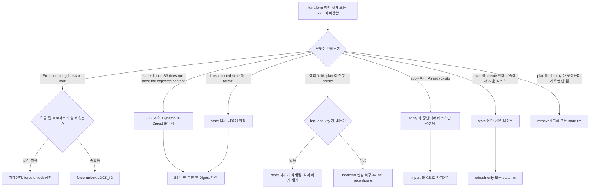
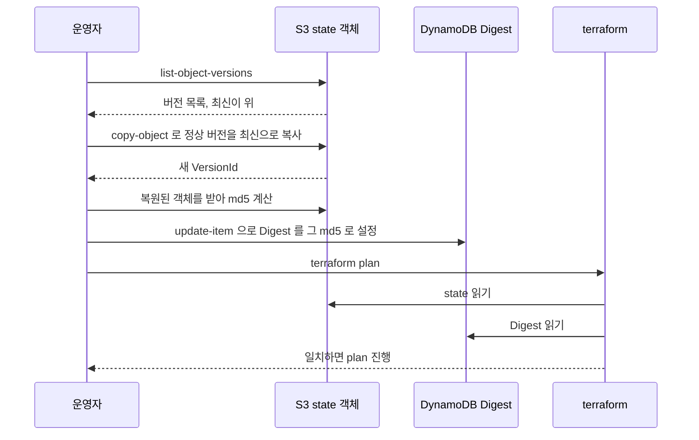
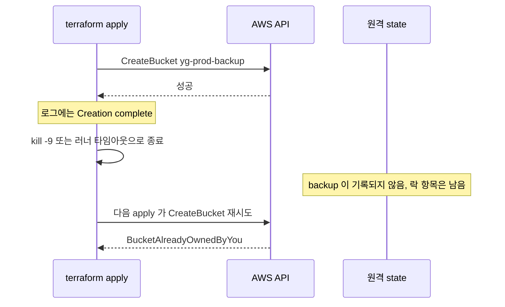
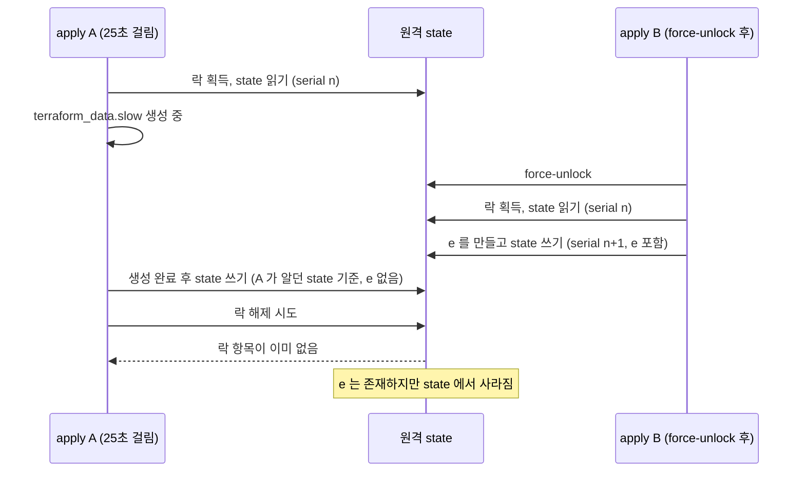
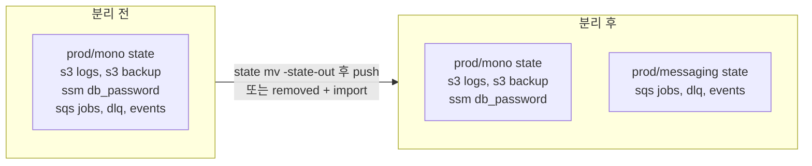

# Terraform State 장애 복구

state 사고는 증상이 비슷해서 원인을 잘못 짚기 쉽다. "plan 이 전부 create 로 나온다"는 증상 하나에도 state 객체가 지워진 경우, backend key 가 바뀐 경우, 다른 워크스페이스를 보고 있는 경우가 섞여 있다. 원인을 잘못 짚고 `apply` 를 치면 멀쩡히 돌던 인프라 위에 같은 리소스를 한 벌 더 만들려다 중복 에러를 맞거나, 더 나쁘게는 destroy 를 승인하게 된다.

이 문서는 사고 유형별로 증상, 원인, 복구 명령을 묶었다. 평소 운영 규칙은 [Terraform 운영 실무](Terraform_운영_실무.md) 에, 이 문서는 이미 사고가 난 뒤의 절차에 집중한다.

본문의 명령과 출력은 전부 직접 돌려서 확인한 것이다. 환경은 Terraform 1.17.1, AWS provider 5.100.0 이고, 실제 AWS 계정 대신 `moto_server` 로 S3·DynamoDB·SQS·SSM 을 띄웠다. backend 코드(Digest 검증, 락, push 검증)는 실제 Terraform 바이너리가 그대로 실행하므로 에러 문구와 동작은 AWS 와 같다. 다만 응답 속도나 일부 서비스의 중복 생성 처리는 AWS 와 다를 수 있어서 해당하는 곳에서 따로 적었다. 출력에 찍힌 호스트명은 `ci-runner-7f9c` 로 바꿨다.

## 증상에서 유형 찾기

처음 5분은 명령을 치는 시간이 아니라 증상을 분류하는 시간이다. 아래 도식은 에러 문구와 plan 결과로 갈래를 나눈 것이다. 왼쪽 위의 에러 문구부터 확인하고, 에러가 없는데 plan 이 이상할 때만 아래 갈래로 내려간다.



사고 유형별로 증상, 원인, 복구 명령을 한 표에 모으면 다음과 같다. 각 행은 뒤에서 하나씩 재현한 결과를 붙였다.

| 유형 | 증상 | 원인 | 복구 |
|---|---|---|---|
| 객체와 Digest 불일치 | `state data in S3 does not have the expected content` | S3 객체를 직접 덮어썼거나 이전 버전을 복원함 | S3 객체 복원, DynamoDB `Digest` 를 객체의 md5 로 갱신 |
| state 내용 손상 | `Unsupported state file format` | 잘린 파일, 빈 파일 | 정상 버전을 `copy-object` 로 복원 후 Digest 갱신 |
| state 객체 삭제 | 에러 없이 plan 이 전부 create | 객체 삭제, 삭제 마커가 최신 | 삭제 마커를 `delete-object --version-id` 로 제거 |
| 생성됐는데 state 에 없음 | `BucketAlreadyOwnedByYou` 같은 중복 에러, 또는 고아 리소스 | apply 가 state 기록 전에 죽음 | `import` 블록, plan 으로 diff 확인 |
| state 에만 있고 실제론 없음 | plan 에 `will be created`, 사유는 안 나옴 | 콘솔·스크립트로 삭제 | `plan -refresh-only` 후 apply, 필요하면 `state rm` |
| 락이 남음 | `Error acquiring the state lock` | apply 프로세스가 `kill -9` 등으로 죽음 | 프로세스 사망 확인 후 `force-unlock` |
| 살아 있는 apply 의 락을 풀어버림 | 나중에 끝난 apply 가 앞선 변경을 덮어씀 | `force-unlock` 오용 | 사고 후 고아가 된 리소스를 import |
| 거대 state | plan 이 수 분, 락 경합 | 모든 리소스가 한 state | `state mv -state-out`, 또는 `removed` + `import` |
| secret 평문 노출 | `state pull` 로 값이 그대로 보임 | provider 가 state 에 값을 저장 | write-only 속성, backend 접근 제한 |

## 손대기 전에 사본부터

복구 명령은 대부분 remote state 를 즉시 바꾼다. 어떤 명령이든 실행하기 전에 지금 state 를 로컬에 받아둔다.

```bash
terraform state pull > /tmp/state.before.$(date +%Y%m%d-%H%M%S).json
```

state 가 깨져 있으면 `state pull` 자체가 실패한다. 그때는 S3 쪽에서 `aws s3 cp` 로 객체를 그대로 받아둔다. 버전 관리가 켜져 있어도 사본이 있으면 "복원했더니 더 나빠졌다" 상황에서 되돌아갈 곳이 생긴다. 버전 관리가 없는 bucket 이라면 이 사본이 유일한 안전망이다.

## S3 state 가 깨졌을 때

### Digest 불일치가 나는 이유

S3 backend 에 `dynamodb_table` 을 지정하면 DynamoDB 에는 락 항목 말고 `<bucket>/<key>-md5` 라는 `LockID` 를 가진 항목이 하나 더 생긴다. 이 항목의 `Digest` 속성에 마지막으로 정상 기록한 state 의 md5 가 들어 있다. Terraform 은 state 를 읽을 때마다 S3 객체의 md5 를 계산해서 이 값과 비교한다.

```
$ aws dynamodb scan --table-name tf-lock --output json
  ...
  "LockID": { "S": "my-tfstate/prod/app/terraform.tfstate-md5" },
  "Digest": { "S": "12fb3f3120d5ae93d298056e420a1826" }
```

그래서 S3 객체를 `aws s3 cp` 로 덮어쓰거나 콘솔에서 이전 버전으로 되돌리면 DynamoDB 쪽은 모르는 채로 남는다. 일부러 state 를 앞 1000바이트만 남기고 덮어쓰면 이렇게 나온다.

```
Error: state data in S3 does not have the expected content.

The checksum calculated for the state stored in S3 does not match the checksum
stored in DynamoDB.

Bucket: my-tfstate
Key:    prod/app/terraform.tfstate
Calculated checksum: 67cdda44b29c5da194929ecded9ed368
Stored checksum:     e09ccb7903f17521629a9673bd342b6b

This may be caused by unusually long delays in S3 processing a previous state
update. Please wait for a minute or two and try again.
...
```

문구는 "S3 처리 지연일 수 있으니 1~2분 기다려 보라"고 권한다. 지연이 원인인 경우도 있지만, 직접 객체를 건드린 기억이 있다면 기다려도 달라지지 않는다.

### 복원 절차

흐름은 객체 복원, Digest 갱신, plan 확인 순서다. 아래 시퀀스는 운영자가 쓰는 도구와 각 저장소 사이에서 일어나는 일이다. `copy-object` 는 새 버전을 하나 더 만들 뿐 기존 버전을 지우지 않는다는 점을 눈여겨본다.



버전 목록은 최신이 위에 나온다. 정상이었던 시점의 버전을 크기와 시각으로 고른다. 위 실험에서는 최신 1000바이트짜리가 손상본이고 바로 아래 4464바이트짜리가 마지막 정상본이었다.

```bash
aws s3api list-object-versions \
  --bucket my-tfstate --prefix prod/app/terraform.tfstate \
  --query 'Versions[].[VersionId,Size,IsLatest,LastModified]' --output text
```

```
10e44593-16ca-41c8-917c-a87f49f2a899	1000	True	2026-11-05T03:18:41.000Z
b433e786-ba6a-45fe-8256-65909b334ec5	4464	False	2026-11-05T03:18:39.000Z
ac6f37f5-d467-40cc-b251-d5755eb009d3	3037	False	2026-11-05T03:18:31.000Z
```

복원은 `get-object` 로 받아서 `terraform state push` 하는 방법보다 `copy-object` 로 서버 안에서 끝내는 쪽이 낫다. 아래에서 보듯 깨진 state 에는 `push` 가 아예 동작하지 않는다.

```bash
KEY=prod/app/terraform.tfstate
aws s3api copy-object --bucket my-tfstate --key $KEY \
  --copy-source "my-tfstate/$KEY?versionId=b433e786-ba6a-45fe-8256-65909b334ec5"
```

여기서 갈린다. **직전 정상본을 복원하면 Digest 를 건드릴 필요가 없다.** DynamoDB 에는 그 정상본의 md5 가 그대로 남아 있기 때문이다. 실제로 위 손상 사례에서 `b433e786` 을 복사하자마자 plan 이 `No changes` 로 통과했다. 손상 당시 에러에 찍힌 `Stored checksum` 이 정상본의 md5 였다는 점이 이를 보여준다.

그보다 **오래된 버전을 복원하면 Digest 가 어긋난다.** 마지막 정상본 대신 `ac6f37f5` 를 복원했을 때는 다시 같은 에러가 나왔다. 이때는 복원한 객체의 md5 를 계산해서 DynamoDB 항목에 써준다.

```bash
D=$(aws s3 cp s3://my-tfstate/$KEY - | md5sum | cut -d' ' -f1)
aws dynamodb update-item --table-name tf-lock \
  --key "{\"LockID\":{\"S\":\"my-tfstate/$KEY-md5\"}}" \
  --update-expression 'SET Digest = :d' \
  --expression-attribute-values "{\":d\":{\"S\":\"$D\"}}"
```

에러 문구 끝에 Terraform 이 "update the Digest value stored in the DynamoDB table to the following value" 라며 계산값을 알려주기도 한다. 다만 그 값은 지금 S3 에 있는 객체가 정상이라고 가정한 값이다. 객체가 손상본인 채로 그 값을 써넣으면 에러만 사라지고 깨진 state 를 정상 취급하게 되므로, 객체 내용부터 확인한다.

### 오래된 버전을 복원하면 빠지는 것

`ac6f37f5` 시점에는 리소스가 a, b 두 개뿐이었고 c 는 그 뒤에 만들었다. 복원 후 plan 은 c 를 새로 만들겠다고 한다.

```
  # local_file.c will be created
Plan: 1 to add, 0 to change, 0 to destroy.
```

복원한 state 의 `serial` 도 1 로 돌아가 있다. 복원 시점 이후에 만들어진 리소스는 실제로 존재하는데 state 에는 없다. 이 리소스가 `local_file` 같은 멱등 리소스면 덮어쓰고 끝나지만, 중복 에러를 내는 종류면 아래 "apply 가 중단된 경우" 절차로 import 해야 한다. 복원한 버전을 고를 때 "얼마나 오래된 것인가"가 곧 다시 import 해야 할 리소스의 수다.

### push 로 복원하려고 할 때 막히는 곳

`terraform state push` 로 복원하려는 시도는 세 군데서 막혔다.

- 원격 state 의 serial 이 더 높으면 거부한다. `Failed to write state: cannot import state with serial 1 over newer state with serial 2`. 원격이 정상이고 의도한 롤백이면 `-force` 로 넘어간다. 이때는 `push` 가 Digest 도 같이 갱신하므로 DynamoDB 를 만질 필요가 없다.
- Digest 가 어긋나 있으면 `push -force` 도 실패한다. `Failed to refresh destination state: state data in S3 does not have the expected content.` push 가 먼저 대상 state 를 읽기 때문이다.
- Digest 를 맞춰도 객체가 잘린 JSON 이면 `Unsupported state file format` 으로 실패한다.

결국 객체 자체가 깨졌을 때는 S3 에서 직접 복원하는 경로밖에 없다. `push` 는 원격이 정상인 상태에서 의도적으로 롤백할 때만 쓴다.

### 객체를 지운 경우

state 객체를 `aws s3 rm` 으로 지우면 에러가 나지 않는다. Terraform 은 state 가 없는 것을 "처음 쓰는 backend"로 해석한다.

```
$ aws s3 rm s3://my-tfstate/prod/lockfile/terraform.tfstate
$ terraform plan
Plan: 2 to add, 0 to change, 0 to destroy.
```

기존 리소스 전부가 create 로 나온다. 이 plan 을 apply 하면 중복 에러가 우수수 나거나, 중복 에러가 없는 리소스는 조용히 두 벌이 생긴다. 버전 관리가 켜져 있으면 객체는 삭제 마커가 최신이 된 것일 뿐이므로 마커의 `VersionId` 를 지정해 삭제하면 이전 버전이 최신으로 돌아온다.

```bash
aws s3api list-object-versions --bucket my-tfstate --prefix $KEY \
  --query 'DeleteMarkers[?IsLatest].VersionId' --output text
aws s3api delete-object --bucket my-tfstate --key $KEY --version-id <마커 VersionId>
```

마커를 지운 뒤 plan 이 원래 결과(앞선 실험에서는 `1 to add, 1 to change`)로 돌아오는 것을 확인했다. `--version-id` 없이 `delete-object` 를 치면 마커가 하나 더 쌓일 뿐이니 주의한다.

### 락을 S3 로 옮기면 Digest 문제가 사라진다

Terraform 1.10 부터 `use_lockfile = true` 로 S3 객체 자체를 락으로 쓸 수 있다. 이 방식에서는 DynamoDB 를 쓰지 않으므로 Digest 항목도 없다. `dynamodb_table` 은 1.17.1 에서 deprecated 경고가 나온다.

```
Warning: Deprecated Parameter
The parameter "dynamodb_table" is deprecated. Use parameter "use_lockfile" instead.
```

`use_lockfile` 만 쓰는 key 에서 이전 버전을 `copy-object` 로 복원해 봤고, 복원 후 plan 이 Digest 에러 없이 바로 통과했다. 락 방식을 옮기면 이 문서의 Digest 갱신 단계는 필요 없어진다. 대신 복원 후 어떤 serial 로 돌아갔는지는 여전히 확인해야 한다.

## apply 가 중단되어 리소스만 만들어진 경우

### 어떻게 생기는가

apply 는 리소스를 만들 때마다 원격 state 를 쓰지 않는다. 한 apply 안에서 이미 생성이 끝난 리소스도 프로세스가 죽으면 state 에 없을 수 있다. 재현은 이렇게 했다. 버킷 하나와 SQS 큐 하나를 추가하고 apply 를 걸어서, 로그에 버킷의 `Creation complete` 가 찍히는 순간 `kill -9` 를 보냈다.

```
aws_s3_bucket.backup: Creating...
aws_s3_bucket.backup: Creation complete after 0s [id=yg-prod-backup]
(kill -9)
```

버킷은 실제로 존재한다. 하지만 `terraform state list` 에는 없다. 게다가 락이 남아 있어서 바로 다시 apply 할 수도 없다.



로그의 `Creation complete` 를 근거로 "만들어졌으니 state 에도 있겠지"라고 믿으면 안 된다. 이 도식에서 state 쪽이 비어 있는 구간이 사고가 나는 구간이다.

### 중복 에러가 나는 리소스와 안 나는 리소스

락을 풀고(아래 락 절 참고) 다시 apply 하면 이렇게 실패한다.

```
Error: creating S3 Bucket (yg-prod-backup): operation error S3: CreateBucket,
https response error StatusCode: 409, ... BucketAlreadyOwnedByYou:
```

같은 apply 안에 있던 SQS 큐 `yg-prod-events` 는 kill 시점에 생성이 진행 중이었는데, 재시도 때 에러 없이 `Creation complete` 로 끝났다. moto 에서는 같은 이름·같은 속성의 CreateQueue 가 에러 없이 성공했다. 실제 AWS 에서의 동작은 확인하지 못했으므로 리소스 종류마다 직접 시험해 봐야 한다. 중복 에러가 나는 쪽은 앞선 apply 의 흔적을 알려주는 안전한 경우이고, 에러가 안 나는 쪽은 흔적이 조용히 흡수되는 경우다. 문제는 이름이 랜덤으로 붙는 리소스다. 재시도가 새 리소스를 하나 더 만들고, 앞서 만들어진 것은 아무도 모르는 고아로 남는다. 이 부류는 중복 에러가 힌트가 되지 못해서 CloudTrail 의 `Create*` 이벤트와 대조하는 수밖에 없다.

### import 블록으로 가져오기

에러가 지목한 버킷을 `import` 블록으로 가져온다. 코드에는 이미 `aws_s3_bucket.backup` 리소스 블록이 있는 상태다.

```hcl
import {
  to = aws_s3_bucket.backup
  id = "yg-prod-backup"
}
```

```
$ terraform plan
aws_s3_bucket.backup: Preparing import... [id=yg-prod-backup]
  # aws_s3_bucket.backup will be imported
Plan: 1 to import, 0 to add, 0 to change, 0 to destroy.

$ terraform apply
aws_s3_bucket.backup: Import complete [id=yg-prod-backup]
Apply complete! Resources: 1 imported, 0 added, 0 changed, 0 destroyed.
```

import 가 끝나면 `import.tf` 를 지우고 plan 을 다시 돌려 `No changes` 를 확인했다. plan 의 `to import` 옆에 `change` 나 `-/+` 가 붙어 있으면 코드와 실제 속성이 다르다는 뜻이므로, apply 전에 코드를 실제 값에 맞춘다. 같은 흐름을 [운영 실무 문서](Terraform_운영_실무.md#import-블록으로-가져오기) 에서 CLI import 와 비교해 두었다.

## state 에는 있는데 실제 리소스가 없는 경우

### plan 은 이유를 알려주지 않는다

누군가 콘솔에서 `yg-prod-assets` 버킷을 지웠다. 이 상태에서 일반 `plan` 은 이렇게만 말한다.

```
  # aws_s3_bucket.assets will be created
Plan: 1 to add, 0 to change, 0 to destroy.
```

"밖에서 지워졌다"는 설명이 따로 붙지 않는다. 새로 만들어도 되는 리소스라면 이대로 apply 하면 끝이다. 문제는 지워진 게 의도였을 때다. 코드와 state 에서 정리해야 하는 리소스를 plan 의 create 만 보고 되살리게 된다.

원인을 눈으로 확인하려면 `-refresh-only` 를 쓴다. 이 모드는 state 와 실제 환경의 차이만 보여주고 리소스를 건드리지 않는다.

```
$ terraform plan -refresh-only
Note: Objects have changed outside of Terraform

  # aws_s3_bucket.assets has been deleted
  - resource "aws_s3_bucket" "assets" {
      - bucket = "yg-prod-assets" -> null
      ...
    }

This is a refresh-only plan, so Terraform will not take any actions to undo
these. If you were expecting these changes then you can apply this plan to
record the updated values in the Terraform state without changing any remote
objects.
```

### 어떻게 정리하는가

갈림길은 이 리소스를 앞으로도 Terraform 이 만들어야 하는가 하나다.

되살려야 하면 그냥 apply 한다. 지워진 것이 맞고 앞으로도 필요 없다면, 순서가 중요하다. 먼저 `apply -refresh-only` 로 state 에서 지운 사실을 반영하고, 그다음 코드의 리소스 블록을 지운다.

```bash
terraform apply -refresh-only -auto-approve
terraform state list     # aws_s3_bucket.assets 가 사라졌는지 확인
# main.tf 에서 resource "aws_s3_bucket" "assets" 블록 삭제
terraform plan           # No changes
```

실험에서 이 순서를 지키자 마지막 plan 이 `No changes` 였다. state 에서 먼저 빠졌으니 코드를 지워도 destroy 계획이 생길 대상이 없다.

### state rm 은 관리만 끊는다

리소스가 실제로 멀쩡히 있는데 Terraform 의 관리에서 빼고 싶을 때는 `state rm` 이다. 이 명령은 실제 리소스를 건드리지 않는다. 실행 전에 `-dry-run` 으로 대상을 확인한다.

```
$ terraform state rm -dry-run aws_sqs_queue.events
Would remove aws_sqs_queue.events

$ terraform state rm aws_sqs_queue.events
Removed aws_sqs_queue.events
Successfully removed 1 resource instance(s).
```

`state rm` 만 하고 코드의 리소스 블록을 그대로 두면 다음 plan 이 `will be created` 를 보여준다. 방금 뺀 리소스를 다시 만들겠다는 계획이다. 명령 하나가 아니라 "state 에서 빼기"와 "코드에서 지우기"가 한 묶음이어야 한다. 이 작업을 PR 로 남기고 싶으면 뒤에 나오는 `removed` 블록을 쓴다.

## 락이 남았을 때

### 락 정보를 읽는 법

락이 걸린 state 에 명령을 치면 락 정보가 같이 나온다.

```
Lock Info:
  ID:        3d4a5a7b-5d7e-599d-48e7-c8a0c12c6d9f
  Path:      my-tfstate/prod/app/terraform.tfstate
  Operation: OperationTypeApply
  Who:       root@ci-runner-7f9c
  Version:   1.17.1
  Created:   2026-11-05 03:20:27.141730334 +0000 UTC
  Info:
```

`Operation` 은 이 버전에서 `OperationTypeApply` 로 나온다. DynamoDB 에서 같은 항목을 읽어도 `Who`, `Created`, `Operation`, `Version`, `Path` 가 전부다. **프로세스 ID 는 없다.** 이 락을 쥔 프로세스가 살아 있는지는 락 정보만으로 알 수 없고, `Who` 에 적힌 호스트에 가서 직접 봐야 한다.

```bash
ps -C terraform -o pid,etime,args
```

CI 러너라면 해당 잡이 아직 실행 중인지 CI 콘솔에서 본다. 취소를 눌렀어도 컨테이너가 정리되는 동안은 프로세스가 살아 있다. `Created` 가 몇 분 전이고 `Operation` 이 apply 라면 정상 실행 중일 확률이 높다. 몇 시간 전인데 러너가 이미 사라졌다면 죽은 락이다.

### 죽은 락 풀기

`kill -9` 로 apply 를 죽인 뒤 락이 남은 것을 확인하고 푼다. 락 ID 는 에러 출력의 `ID:` 줄에서 가져온다.

```
$ terraform force-unlock -force 3d4a5a7b-5d7e-599d-48e7-c8a0c12c6d9f
Terraform state has been successfully unlocked!
```

`-force` 를 빼면 확인 프롬프트가 뜬다. 스크립트에서는 락 ID 를 파싱할 때 `grep ID:` 로 잡으면 `RequestID:` 줄까지 같이 걸린다. 앞의 공백 두 칸을 포함해 `^  ID:` 로 잡아야 한다. 이걸 놓쳐서 `force-unlock` 이 `Expected a single argument: LOCK_ID` 로 실패한 적이 있다.

### 살아 있는 락을 풀면 일어나는 일

기존 문서에 "진행 중인 락을 풀면 안 된다"고만 적혀 있어서 실제로 어떤 일이 생기는지 재현했다. 25초짜리 apply(A)를 걸어 두고, 도중에 다른 터미널(B)에서 락을 풀고 별도 리소스 `local_file.e` 를 만드는 apply 를 돌렸다.



최종 `terraform state list` 에는 B 가 만든 `local_file.e` 가 없었다. A 의 로그 끝에는 이런 에러가 찍혔다.

```
Error: Error releasing the state lock

Error message: failed to retrieve lock info for lock ID
"a10bae4e-164e-b183-7db4-189ea95751af": unexpected end of JSON input
```

A 는 시작할 때 읽은 state 에 자기 변경만 얹어서 썼다. 락이 있으면 그 사이에 B 가 쓸 일이 없지만, 락을 풀어버리면 B 의 쓰기는 사라진다. A 가 끝나고 락 해제를 시도할 때 이미 B 가 락을 잡았다 놓은 뒤라 항목이 없어서 위 에러가 난다. 이 에러가 보이면 같은 state 에 다른 쓰기가 있었다는 뜻이므로 `e` 처럼 고아가 된 리소스를 찾아 import 해야 한다.

### lockfile 방식의 락

`use_lockfile = true` 는 state 객체 옆에 `.tflock` 객체를 만든다. 실행 중에 객체 목록을 보면 이렇게 나온다.

```
prod/lockfile/terraform.tfstate          853
prod/lockfile/terraform.tfstate.tflock   236
```

이 상태로 다른 터미널에서 plan 을 치면 DynamoDB 때와 같은 락 정보 형식이지만 HTTP 상태는 `412` 다. `kill -9` 후에는 `.tflock` 이 남고, `force-unlock` 이 이 객체를 지운다. 판단 기준과 위험은 DynamoDB 락과 같다.

## 거대 state 쪼개기

### 왜 쪼개고 무엇이 어려운가

리소스 수백 개가 한 state 에 있으면 plan 시간이 길어지고, 서로 무관한 변경끼리 락 때문에 줄을 선다. 한 팀의 실수가 다른 팀 리소스의 plan 에 같이 실린다. 쪼개는 작업의 본질은 "리소스를 실제로 건드리지 않고 state 의 소속만 옮기는 것"이다. 아래 도식은 `prod/mono` 에서 큐 계열을 `prod/messaging` 으로 옮기는 전후 구조다.



실제 SQS 큐와 S3 버킷은 분리 전후로 그대로고, 옮겨지는 것은 state 항목뿐이다. 다만 이 이동 도중에 한쪽 state 에만 있거나 양쪽 어디에도 없는 순간이 생기는데, 그 순간 plan 을 치면 create 나 destroy 가 보인다.

### 방법 1. state mv -state-out 후 push

원격 state 에서 리소스를 로컬 파일로 옮긴다. 원본이 remote backend 여도 동작한다.

```bash
terraform state pull > /tmp/sr/mono.backup.tfstate          # 사본
terraform state mv -state-out=/tmp/sr/messaging.tfstate \
    aws_sqs_queue.jobs aws_sqs_queue.jobs
terraform state mv -state-out=/tmp/sr/messaging.tfstate \
    aws_sqs_queue.dlq aws_sqs_queue.dlq
```

```
Move "aws_sqs_queue.jobs" to "aws_sqs_queue.jobs"
Successfully moved 1 object(s).
Move "aws_sqs_queue.dlq" to "aws_sqs_queue.dlq"
Successfully moved 1 object(s).
```

여기서 관찰한 것이 세 가지다. 첫째, 원본(remote)에서는 두 리소스가 **그 즉시** 사라진다. `-state-out` 은 롤백이 불가능한 쓰기를 원격에 한다. 둘째, 로컬에 만들어진 `messaging.tfstate` 는 원본과 다른 새 `lineage` 를 받았고 `serial` 은 2 였다. 셋째, `*.backup` 파일이 자동으로 생겼다. 이어서 새 프로젝트에서 backend key 를 `prod/messaging/terraform.tfstate` 로 init 하고 push 한다.

```bash
cd messaging && terraform init
terraform plan          # 빈 state 라서 2 to add
terraform state push /tmp/sr/messaging.tfstate
terraform state list    # aws_sqs_queue.dlq, aws_sqs_queue.jobs
terraform plan          # No changes
```

push 전에는 `Plan: 2 to add` 였다가 push 후 `No changes` 로 바뀌었다. 빈 backend 에는 lineage 가 달라도 push 가 막히지 않았다.

이 방법의 위험은 순서다. `state mv` 직후 mono 쪽 코드에 큐 리소스 블록이 남아 있으면 mono 의 plan 이 `2 to add` 를 보여준다. 이 plan 을 apply 하면 이미 messaging 쪽에 속한 큐를 mono 가 다시 만들려 한다. mono 의 코드에서 블록을 지우는 PR 은 `state mv` 직후 같은 작업 안에서 끝내야 하고, 블록을 지운 뒤 mono 의 plan 이 `No changes` 인 것을 확인해야 한다. `state mv` 는 PR 에 남지 않기 때문에 작업 로그와 사본 경로를 작업 티켓에 적어 둔다.

### moved 블록은 state 경계를 못 넘는다

`moved` 블록은 같은 state 안에서 주소를 바꾸는 선언이다. 다른 state 로 옮기는 용도로는 동작하지 않고, 에러도 내지 않는다. messaging 프로젝트에서 mono 에 있는 `aws_ssm_parameter.db_password` 를 새 이름으로 받겠다고 선언해 보았다.

```hcl
resource "aws_ssm_parameter" "database_password" {
  name  = "/prod/db/password"
  type  = "SecureString"
  value = var.db_password
}

moved {
  from = aws_ssm_parameter.db_password
  to   = aws_ssm_parameter.database_password
}
```

```
  # aws_ssm_parameter.database_password will be created
Plan: 1 to add, 0 to change, 0 to destroy.
```

`from` 주소가 이 state 에 없으니 블록은 조용히 무시되고 평범한 create 가 계획된다. 같은 SSM 파라미터를 두 번 만들겠다는 뜻이다. 모듈로 감쌌다가 풀 때처럼 한 state 안에서의 이동에만 `moved` 를 쓴다. state 를 가로지르는 이동은 `state mv -state-out` 이나 아래의 `removed` + `import` 를 쓴다.

### 방법 2. removed 블록과 import 블록

state 파일을 직접 옮기지 않고 양쪽 코드에 선언을 남기는 방법이다. 옮길 리소스 `aws_sqs_queue.events` 를 이 방식으로 옮겼다. 새 프로젝트에는 리소스 블록과 `import` 블록을 넣고 plan 을 본다.

```hcl
resource "aws_sqs_queue" "events" {
  name = "yg-prod-events"
}

import {
  to = aws_sqs_queue.events
  id = "http://127.0.0.1:5555/123456789012/yg-prod-events"
}
```

```
  # aws_sqs_queue.events will be imported
Plan: 1 to import, 0 to add, 0 to change, 0 to destroy.
Apply complete! Resources: 1 imported, 0 added, 0 changed, 0 destroyed.
```

그다음 mono 의 리소스 블록을 `removed` 블록으로 바꾼다. 이때 `lifecycle { destroy = false }` 를 빠뜨리면 안 된다.

```hcl
removed {
  from = aws_sqs_queue.events

  lifecycle {
    destroy = false
  }
}
```

```
  # aws_sqs_queue.events will no longer be managed by Terraform, but will not be destroyed
  # (destroy = false is set in the configuration)
Plan: 0 to add, 0 to change, 0 to destroy.

Warning: Some objects will no longer be managed by Terraform
```

**`lifecycle` 블록을 생략한 `removed` 는 destroy 를 계획한다.** mono 의 `aws_s3_bucket.backup` 으로 시험했고 결과는 이랬다.

```
  # aws_s3_bucket.backup will be destroyed
Plan: 0 to add, 0 to change, 1 to destroy.
```

`removed` 라는 이름이 "관리에서 뺀다"로 읽히지만, `destroy` 의 기본값은 true 다. 이 블록을 PR 에서 리뷰할 때는 `lifecycle` 이 있는지와 plan 의 destroy 숫자가 0 인지를 같이 본다.

이 방법은 순서도 신경 쓴다. messaging 에서 import 를 apply 한 뒤 mono 에서 `removed` 를 apply 하기 전까지는 같은 큐가 두 state 에 동시에 들어 있다. 이 사이에 mono 에서 큐 속성을 바꾸는 apply 가 나가면 두 state 가 서로 다른 값을 기억한다. 두 apply 사이는 짧게 두고, 그 시간 동안 mono 의 큐 관련 변경을 막는다.

### 두 방법의 차이

| 항목 | state mv -state-out + push | removed + import |
|---|---|---|
| 리뷰 | 명령 실행이라 PR 에 안 남음 | 양쪽 코드와 plan 이 PR 에 남음 |
| 중간 상태 | 원격에서 즉시 빠져서 mono plan 이 create 를 보임 | 두 state 가 동시에 소유하는 구간이 있음 |
| 실패 시 되돌리기 | 사본 push, 또는 S3 버전 복원 | 블록을 되돌리면 끝, state 파일은 안 만짐 |
| import 가 안 되는 리소스 | 영향 없음 | import 를 지원하지 않는 리소스는 못 씀 |
| 리소스 수가 많을 때 | 주소 나열이 필요하지만 한 번에 끝남 | 블록 수가 늘어 PR 이 커짐 |

import 를 지원하지 않거나 의존 속성이 많아 import 후 diff 가 수십 줄 나오는 리소스는 방법 1 이 낫다. 그 외에는 방법 2 가 사고 확률이 낮다.

## state 에 평문으로 남는 secret

### 확인

`sensitive = true` 는 plan 과 출력에서 값을 가릴 뿐 state 에는 그대로 쓴다. 변수에 `sensitive = true` 를 붙인 DB 비밀번호를 SSM SecureString 에 넣어 보았다.

```
$ terraform state show aws_ssm_parameter.db_password
    value           = (sensitive value)

$ terraform state pull | grep -n Pa55w0rd
128:            "value": "S3cr3t-Pa55w0rd!",

$ aws s3 cp s3://my-tfstate/prod/mono/terraform.tfstate - | grep -c S3cr3t
1
```

`state show` 는 가려서 보여주지만 `state pull` 이나 S3 객체를 그대로 받으면 평문이다. "sensitive 로 표시했으니 안전하다"는 인상 때문에 오히려 방치하기 쉽다. 입력값을 그대로 저장하는 속성이라면 다른 리소스도 같은 식으로 의심해야 한다.

### write-only 속성

Terraform 1.11 부터 provider 가 지원하는 속성에 한해 write-only 값을 쓸 수 있다. AWS provider 5.100 의 `aws_ssm_parameter` 는 `value_wo` 를 받는다.

```hcl
resource "aws_ssm_parameter" "api_key" {
  name             = "/prod/api/key"
  type             = "SecureString"
  value_wo         = var.db_password
  value_wo_version = 1
}
```

apply 후 state 와 실제 값을 비교했다.

```
state:  value= (빈 문자열)  value_wo= None  version= 1
state 전체에서 비밀번호 문자열 검색: 0건
SSM 에서 복호화 조회: S3cr3t-Pa55w0rd!
```

값은 SSM 에 저장됐고 state 에는 없다. 값을 바꿔서 다시 적용하려면 `value_wo_version` 을 올리는 방식이다. 값이 state 에 없어서 Terraform 이 변경을 비교할 수 없기 때문이다(변경 시나리오까지는 돌려보지 않았다). 모든 속성이 이 방식을 지원하는 것은 아니라서, 쓰는 provider 문서에서 해당 속성이 있는지부터 확인한다. 없는 리소스(RDS 의 `password` 등)는 state 에 평문이 남는 걸 전제로 접근 권한을 걸어야 한다.

### 접근 권한 제한

state 를 읽을 수 있는 사람은 그 안의 secret 을 읽을 수 있다. 문제는 `terraform plan` 이 state 읽기를 필요로 하므로, PR plan 용 CI 역할에도 읽기 권한이 필요하다는 점이다. 그 역할이 PR 코드를 실행하는 러너에서 쓰이면, PR 작성자가 state 를 읽어 가는 경로가 된다. 이 구조는 [CI/CD 파이프라인 문서](Terraform_CI_CD_파이프라인.md) 에서 다룬다.

bucket 정책은 state 객체는 지정한 역할만 허용하고 나머지는 거부하는 형태로 쓴다. 아래는 문법 예시이고, moto 는 IAM 평가를 하지 않아서 거부 동작은 재현하지 못했다. 적용 전에 IAM Policy Simulator 로 확인한다.

```json
{
  "Version": "2012-10-17",
  "Statement": [
    {
      "Sid": "DenyStateAccessExceptTerraformRoles",
      "Effect": "Deny",
      "Principal": "*",
      "Action": ["s3:GetObject", "s3:PutObject", "s3:DeleteObject"],
      "Resource": "arn:aws:s3:::my-tfstate/*",
      "Condition": {
        "StringNotLike": {
          "aws:PrincipalArn": [
            "arn:aws:iam::123456789012:role/terraform-apply",
            "arn:aws:iam::123456789012:role/terraform-plan"
          ]
        }
      }
    }
  ]
}
```

이 정책은 사람 계정의 직접 읽기도 막으므로, 장애 때 쓰는 break-glass 역할을 목록에 넣어 두지 않으면 복구 작업이 자기 정책에 막힌다. 복구 절차에서 쓰는 `list-object-versions`, `copy-object`, `delete-object --version-id` 는 `s3:ListBucketVersions`, `s3:GetObjectVersion`, `s3:DeleteObjectVersion` 권한이 따로 필요하다는 점도 같이 준비한다.

## 정리

실험에서 반복해서 나온 패턴은 둘이다. 복구 명령이 대체로 원격을 즉시 바꾸므로 사본이 먼저이고, 에러가 없는 plan(전부 create, 이유 없는 create)이 에러가 나는 plan 보다 위험하다. 에러는 멈추게 하지만 조용한 create 는 apply 를 부른다.
