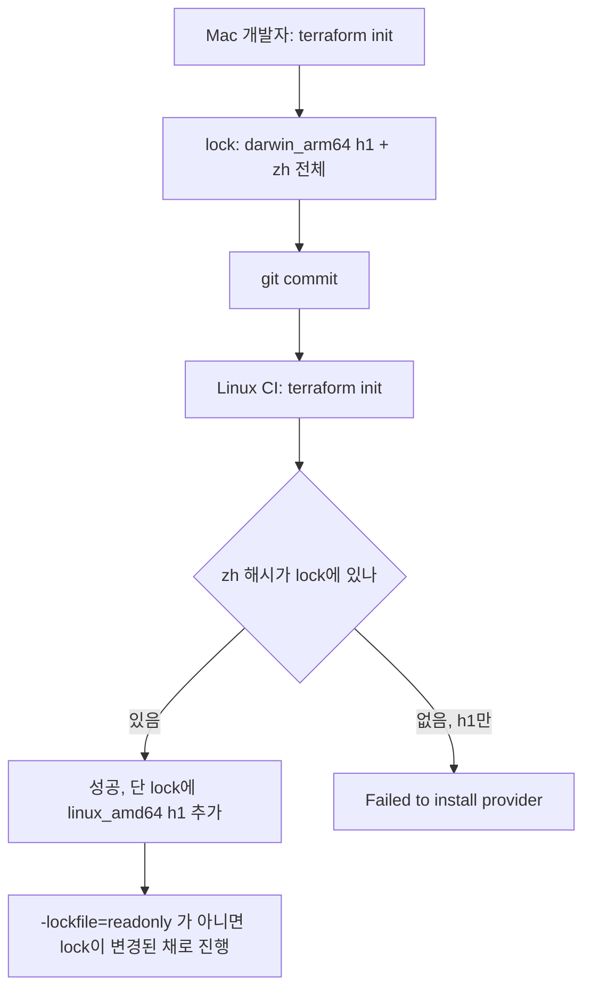
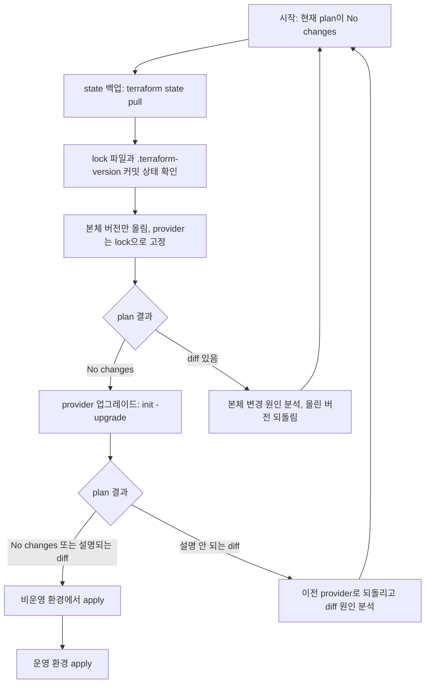
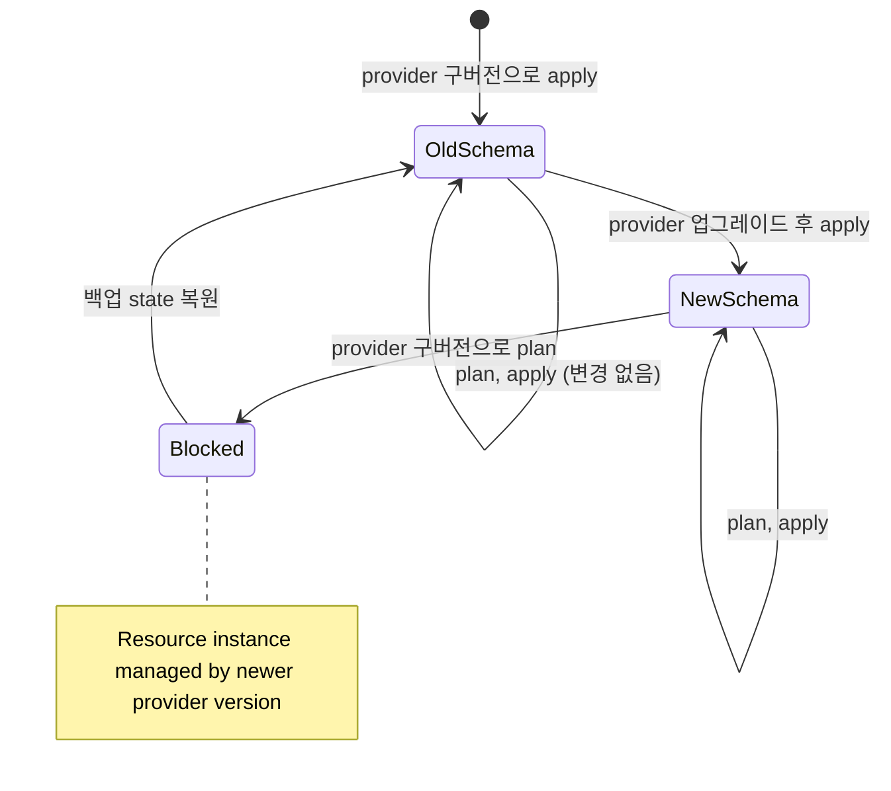
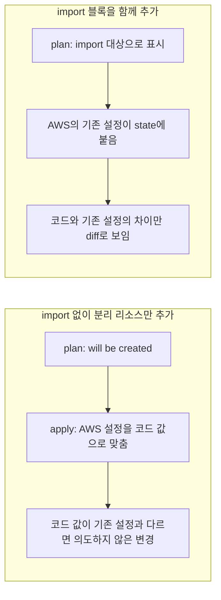
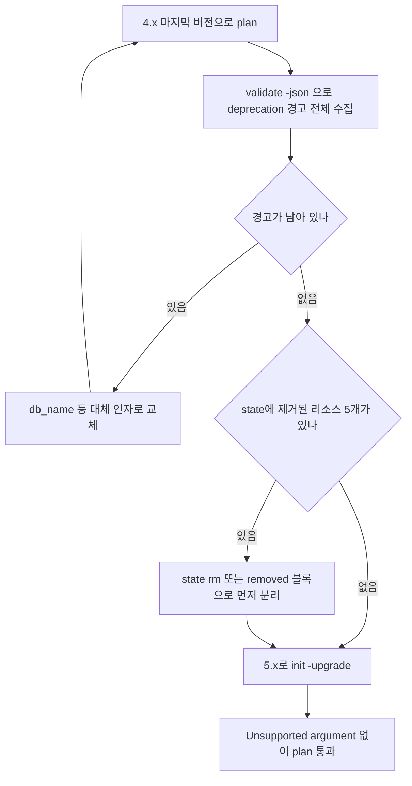
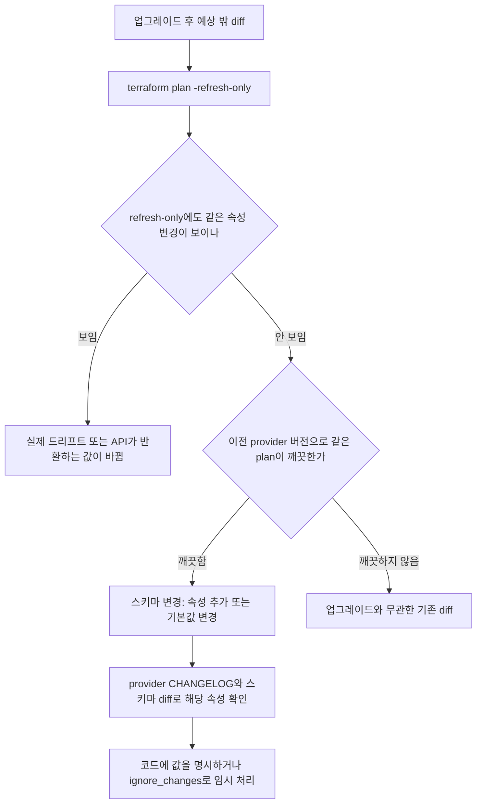
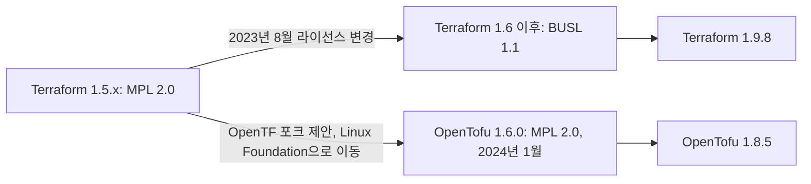
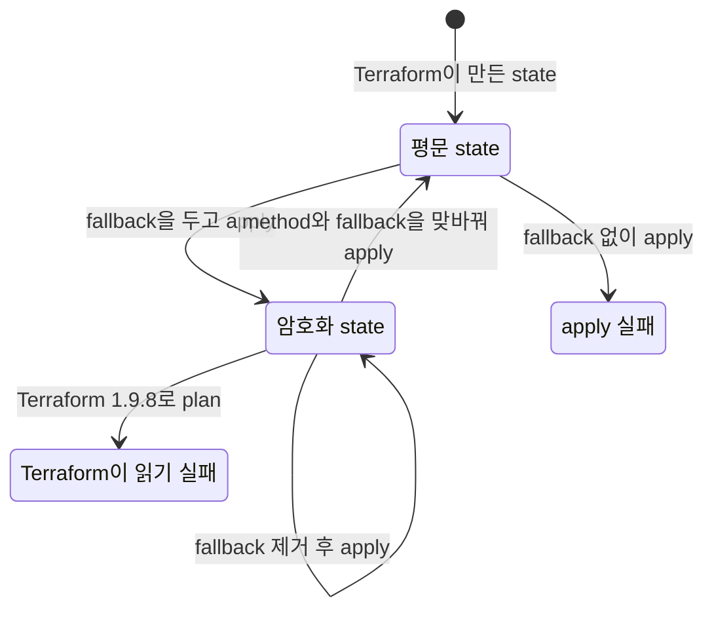
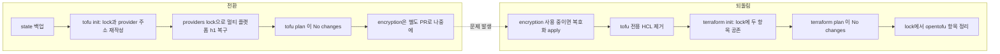

# Terraform 버전 업그레이드와 OpenTofu

Terraform 업그레이드는 세 갈래다. 본체(`terraform` 바이너리), provider(AWS provider 3.x → 4.x → 5.x), 그리고 아예 바이너리를 OpenTofu로 바꾸는 것. 셋 다 `plan`이 깨끗하게 나오면 끝난 것처럼 보이는데, 실제로 문제가 터지는 곳은 `plan` 밖이다. lock 파일 해시가 플랫폼마다 달라서 CI에서만 init이 실패하고, apply 한 번 했더니 provider 스키마가 올라가서 이전 버전으로 못 돌아가고, OpenTofu로 옮기고 나서야 lock 파일이 통째로 다시 쓰인 걸 발견한다.

이 문서의 동작은 전부 리눅스(linux_amd64)에서 바이너리를 직접 내려받아 돌려본 결과다. 돌려보지 못한 부분은 마지막 절에 따로 적었다.

| 도구 | 버전 |
|---|---|
| Terraform | 1.5.7, 1.9.8 |
| OpenTofu | 1.8.5 |
| AWS provider | 3.76.1, 4.67.0, 5.100.0 |
| random provider | 3.1.0, 3.6.3, 3.9.1 |
| time provider | 0.14.2 |

AWS 자격 증명이 없어서 AWS 리소스를 만들어 보지는 못했다. provider 스키마(`terraform providers schema -json`)를 버전별로 뽑아 비교했고, `skip_credentials_validation` 같은 플래그로 `plan`까지만 돌렸다. 스키마 버전 때문에 롤백이 막히는 문제는 AWS 대신 `random` provider로 재현했다. 원리가 같다.

## 버전 제약은 두 군데에서 건다

```hcl
terraform {
  required_version = ">= 1.5.0, < 2.0.0"

  required_providers {
    aws = {
      source  = "hashicorp/aws"
      version = "~> 5.0"
    }
  }
}
```

`required_version`은 Terraform 본체 버전, `required_providers`는 provider 버전을 막는다. 둘은 서로 다른 파일(`.terraform-version`, `.terraform.lock.hcl`)과 짝을 이룬다. 루트 모듈과 재사용 모듈에서 쓰는 방식이 다르다.

루트 모듈은 범위를 좁게 잡는다. `~> 5.0`은 5.x 전체를 허용하므로 `init -upgrade`를 누가 돌리느냐에 따라 5.0이 될 수도 5.100이 될 수도 있다. lock 파일이 있어서 평소엔 고정되지만, lock 파일을 지우거나 `-upgrade`를 붙이는 순간 최신 5.x로 올라간다. 팀에서 "5.x 안에서는 자동으로 올려도 된다"고 합의했다면 `~> 5.0`이 맞고, 그렇지 않으면 `~> 5.40.0`처럼 마이너까지 고정한다.

재사용 모듈은 하한만 건다. `>= 5.0`처럼 쓰고 상한을 두지 않는다. 모듈이 상한을 걸면 그 모듈을 쓰는 모든 루트 모듈이 상한에 묶여서, provider 메이저를 올리려면 모듈부터 전부 새 버전으로 바꿔야 한다.

constraint만 바꾸고 `init`을 돌리면 lock 파일이 막는다.

```
Error: Failed to query available provider packages

Could not retrieve the list of available versions for provider
hashicorp/random: locked provider registry.terraform.io/hashicorp/random
3.1.0 does not match configured version constraint ~> 3.5; must use terraform
init -upgrade to allow selection of new versions
```

lock에 3.1.0이 박혀 있는데 constraint를 `~> 3.5`로 올린 경우다. 의도한 업그레이드면 `init -upgrade`를 쓰면 된다. 이 오류가 "init이 이상하다"로 읽히는 경우가 많은데, lock 파일이 정상 동작하는 것이다.

### required_version은 OpenTofu에서도 평가된다

OpenTofu는 `required_version`을 **OpenTofu 자신의 버전**과 비교한다. Terraform 버전이 아니다. 1.8.5로 같은 파일을 init 해봤다.

| required_version | tofu 1.8.5 |
|---|---|
| `>= 1.9.0` | `This configuration does not support OpenTofu version 1.8.5` |
| `>= 1.6.0, < 1.9.0` | 통과 |
| `~> 1.8.0` | 통과 |

그래서 Terraform과 OpenTofu를 병행하는 동안에는 `required_version = ">= 1.6.0"` 정도로 하한만 두는 게 낫다. Terraform 기준으로 `~> 1.9.0` 같은 제약을 두면 OpenTofu 1.8.x는 막히고, OpenTofu 1.9 이상이 나온 뒤에야 풀린다. 두 도구의 마이너 번호는 서로 의미가 다르다.

## .terraform.lock.hcl이 플랫폼마다 달라지는 문제

lock 파일의 `hashes`에는 두 종류가 섞여 있다.

```hcl
provider "registry.terraform.io/hashicorp/random" {
  version     = "3.9.1"
  constraints = "~> 3.5"
  hashes = [
    "h1:g40qr7yDmIpaur4SsK5BcOda3HSo1RJ6zHVMqN4EJ+0=",
    "zh:05f4734c1f0be840b711b3eff259ebc5fca436784c728955b1678078466f48d7",
    "zh:0b91bf19371d012434eba1deeb6aab77158def9b39601dcbd94450b3974a2a26",
  ]
}
```

`h1:`은 **설치된 패키지 내용**의 해시라서 플랫폼마다 값이 다르다. `zh:`는 레지스트리가 알려주는 **zip 파일**의 해시고, 모든 플랫폼 분이 한꺼번에 들어온다. 리눅스에서 `init`을 처음 돌렸을 때 lock에는 `h1`이 1개(리눅스 것), `zh`가 13개 들어갔다.

문제는 Mac 개발자가 만든 lock을 리눅스 CI가 읽을 때 생긴다. 상황별로 재현했다. 모두 Terraform 1.9.8, random 3.9.1, 리눅스다.

| 상황 | lock 내용 | 결과 |
|---|---|---|
| A | darwin h1만, `-lockfile=readonly` | init 실패 |
| B | darwin h1만, 옵션 없이 | init 실패, lock은 그대로 |
| C | darwin h1만, `TF_PLUGIN_CACHE_DIR` 사용 | init 실패 |
| D | darwin h1 + zh 전체, `-lockfile=readonly` | 성공, lock 변화 없음 |
| E | darwin h1 + zh 전체, 옵션 없이 | 성공, lock에 리눅스 h1이 추가됨 (h1 1개 → 2개) |

A, B, C의 오류는 같은 메시지다.

```
Error: Failed to install provider

Error while installing hashicorp/random v3.9.1: the current package for
registry.terraform.io/hashicorp/random 3.9.1 doesn't match any of the
checksums previously recorded in the dependency lock file; for more
information: https://www.terraform.io/language/provider-checksum-verification
```

`zh` 해시는 레지스트리에서 받을 때만 기록된다. 미러나 plugin cache에서 설치하면 그 플랫폼의 `h1`만 남는 lock이 만들어진다. 그 lock을 다른 플랫폼 머신이 받으면 위 오류가 난다. A·B는 이 상태를 손으로 만들어서 재현한 것이고, C는 여기에 plugin cache까지 붙인 경우다.

E가 더 흔하고 더 눈에 안 띈다. init이 성공은 하는데 lock 파일이 바뀐다. CI에서 `git diff --exit-code .terraform.lock.hcl`로 검사하는 파이프라인이면 여기서 빨갛게 되고, 아무 검사가 없으면 CI 워크스페이스에서만 lock이 바뀐 채 지나간다.



도식은 Mac에서 커밋한 lock이 리눅스 CI에서 두 갈래로 갈리는 지점을 보여준다. 분기 기준은 `zh`가 lock에 남아 있느냐다.

### 해결은 사용하는 모든 플랫폼을 한 번에 기록하는 것

```bash
terraform providers lock \
  -platform=linux_amd64 \
  -platform=linux_arm64 \
  -platform=darwin_arm64 \
  -platform=darwin_amd64
```

이 명령은 레지스트리에서 각 플랫폼 패키지를 받아 `h1`을 모두 기록한다. random provider로 3개 플랫폼을 지정했을 때 `h1`이 3개가 됐다. 개발자가 Mac, CI가 리눅스, 빌드 서버가 Graviton이면 적어도 세 개가 필요하다.

운영 방식은 두 가지로 정리된다. provider 버전이나 constraint를 바꾸는 PR에서는 `providers lock`을 위 플랫폼 전체로 돌려서 lock을 커밋한다. CI의 `init`에는 `-lockfile=readonly`를 붙여서, lock이 부족하면 조용히 고쳐 쓰지 말고 실패하게 한다. E 상황에서 `-lockfile=readonly`는 오류를 내지 않고 lock만 건드리지 않는다(D). 그러니 이 옵션은 "lock이 충분한지" 검사하는 게 아니라 "CI가 lock을 바꾸지 못하게" 막는 것이다. 충분한지는 `git diff --exit-code`로 따로 본다.

## 업그레이드는 한 번에 하나만 올린다

Terraform 본체와 provider를 한 PR에서 같이 올리면 plan에 diff가 나왔을 때 어느 쪽 탓인지 가를 수 없다. 순서를 고정한다.



흐름에서 봐야 할 곳은 두 번의 `plan` 판정이다. 본체를 올린 직후에는 provider가 그대로이므로 diff가 나오면 본체가 원인이다. provider를 올린 직후에는 본체가 그대로이므로 diff가 나오면 provider가 원인이다. 한 번에 하나만 바꿔야 이 판정이 성립한다.

본체 업그레이드 PR에서 건드리는 파일은 `required_version`, `.terraform-version`(tfenv나 mise를 쓰는 경우), CI 이미지 태그 세 개다. 로컬에서 팀원마다 다른 버전을 쓰고 있으면 `required_version`이 막아주지만, 하한이 넓으면 막아주지 못한다. `>= 1.5.0`이라고 써놓고 한 명은 1.5.7, 한 명은 1.9.8을 쓰면 state의 `terraform_version`이 번갈아 바뀌고 그 사이에 쓰는 문법이 갈린다. 1.8 이후에 들어온 provider-defined function 문법은 1.5.7에서 파싱 자체가 안 된다.

```
Error: Missing newline after argument
   7:   value = provider::time::rfc3339_parse("2026-11-05T10:00:00Z").year
```

위는 Terraform 1.5.7이 `provider::time::rfc3339_parse(...)`를 읽다 낸 오류다. 같은 파일을 Terraform 1.9.8과 OpenTofu 1.8.5는 둘 다 정상 처리해서 `year = 2026`을 출력했다. 새 문법을 쓰기 시작하는 순간 `required_version` 하한을 올려야 한다.

## state는 되돌릴 수 있고, 되돌릴 수 없는 건 provider 스키마다

"새 Terraform으로 apply하면 state 포맷이 올라가서 이전 버전으로 못 돌아간다"는 말을 자주 듣는다. 실제로 확인해 봤다.

state 파일의 `version`은 4다. 1.5.7에서 apply한 state도, 1.9.8에서 apply한 state도 `version: 4`였다. `terraform_version` 필드만 `1.5.7`에서 `1.9.8`로 바뀌었다. 그 state를 1.5.7로 다시 `plan` 하면 `No changes`가 나왔다. 호기심에 `terraform_version`을 `1.12.0`, `2.0.0`으로 직접 고쳐서 1.5.7과 1.9.8, OpenTofu 1.8.5로 읽혀봤는데 전부 정상으로 읽었다. 이 필드는 기록용이고 읽기를 막지 않았다.

`version`을 5로 고치면 그때서야 막는다.

```
Error: Error acquiring the state lock

Error message: Unsupported state file format: The state file uses format
version 5, which is not supported by Terraform 1.9.8. This state file was
created by Terraform 1.9.8.
```

state 포맷 자체가 올라가는 일은 Terraform 0.12 이후 일어나지 않았으므로 1.x 내에서 이 오류를 만날 일은 거의 없다. 대신 막히는 곳은 provider 쪽이다.

### provider가 스키마를 올리면 이전 provider는 그 리소스를 못 읽는다

random provider로 재현했다. 3.1.0으로 `random_password`를 만들고, 3.6.3으로 올려 apply하고, 다시 3.1.0으로 내려서 `plan`을 돌렸다.

| 시점 | provider | state의 schema_version | 속성 |
|---|---|---|---|
| 처음 | 3.1.0 | 0 | 13개 (`bcrypt_hash`, `numeric` 없음) |
| 업그레이드 후 apply | 3.6.3 | 3 | 15개 (`bcrypt_hash`, `numeric` 추가) |
| 다시 3.1.0으로 | 3.1.0 | - | plan 실패 |

```
Planning failed. Terraform encountered an error while generating this plan.

Error: Resource instance managed by newer provider version

The current state of random_password.p was created by a newer provider
version than is currently selected. Upgrade the random provider to work with
this state.
```

3.6.3으로 올린 뒤 `plan`은 diff 없이 통과했고 `apply`는 `0 added, 0 changed, 0 destroyed`였다. 바뀐 게 없다고 출력하면서 state는 스키마 3으로 다시 쓰였다. 리소스 변경이 없어도 provider가 state를 새 스키마로 올리는 것이다. 그 뒤에는 되돌릴 수 없다.



상태도에서 `NewSchema` 이후에는 구버전 provider로 가는 간선이 없다. 돌아가는 길은 `Blocked`에서 백업 state를 복원하는 것 하나뿐이다. 복원이 가능하려면 **업그레이드 전에 만든 백업**이 있어야 한다. 백업 state로 복원한 뒤 `plan`을 돌리면 `No changes`가 나왔다.

### 백업과 복구

```bash
# 업그레이드 전
terraform state pull > state-before-upgrade-$(date +%Y%m%d).json
```

S3 backend를 쓰면 버킷 버저닝을 켜 두는 게 기본이다. 위 파일은 그래도 따로 둔다. 로컬에서 한 번에 되돌릴 수 있어야 하기 때문이다.

복구는 `state push`다. 단, 현재 state보다 serial이 낮으면 거부한다.

```bash
$ terraform state push old.json
Failed to write state: cannot import state with serial 2 over newer state with serial 4

$ terraform state push -force old.json
```

`-force`를 붙이면 들어간다. 업그레이드 뒤에 다른 사람이 apply한 변경이 있다면 그것도 같이 날아간다. 복구 전에 팀에 알리고 apply를 막아야 한다. 복구 후에는 `required_providers`와 lock을 이전 커밋으로 되돌리고 `init`을 다시 돌려야 한다. state만 되돌리고 lock이 신버전이면 같은 상황으로 돌아간다.

## AWS provider 메이저 업그레이드에서 깨지는 곳

세 버전의 스키마를 뽑아서 비교했다.

| 비교 | 리소스 수 | 제거된 리소스 | 추가된 리소스 |
|---|---|---|---|
| 3.76.1 → 4.67.0 | 914 → 1213 | 0 | 299 |
| 4.67.0 → 5.100.0 | 1213 → 1526 | 5 | 318 |

4.0은 S3 분리가 핵심이고 리소스 제거는 없었다. 5.0은 EC2-Classic 관련 리소스를 정리했다. 5.100.0에서 사라진 5개는 `aws_db_security_group`, `aws_elasticache_security_group`, `aws_redshift_security_group`, `aws_macie_member_account_association`, `aws_macie_s3_bucket_association`이다. 이 리소스들이 state에 들어 있는데 5.x로 올리면 plan이 스키마를 못 찾는다. 코드에서 지우기 전에 `terraform state rm`이나 `removed` 블록으로 먼저 state에서 떼야 한다.

### aws_s3_bucket

`aws_s3_bucket`의 인라인 인자(`acl`, `versioning`, `logging`, `lifecycle_rule` 등)는 별도 리소스(`aws_s3_bucket_acl`, `aws_s3_bucket_versioning`, ...)로 분리됐다. 스키마를 열어 보면 상태가 단계별로 다르다.

| 인자 | 3.76.1 | 4.67.0 | 5.100.0 |
|---|---|---|---|
| `acl` | optional, deprecated | optional + computed, deprecated | 동일 |
| `versioning` 블록 | deprecated | deprecated | deprecated |
| `policy` | optional | optional + computed, deprecated | 동일 |
| `object_lock_configuration` | deprecated 아님 | deprecated | deprecated |
| `bucket_prefix` | optional | optional + computed | 동일 |

보이는 것은 두 가지다. 인라인 인자는 5.100.0에서도 제거되지 않았고 deprecated 상태다. 그리고 4.x에서 `acl`, `policy`, `bucket_prefix`에 computed가 붙었다. optional + computed 인자는 코드에 값이 없으면 Terraform이 그 값에 의견을 내지 않는다. 코드에서 `acl`을 지워도 plan에 diff가 안 나오는 이유이고, 그래서 "plan이 깨끗하니 AWS에서도 지워졌다"로 읽으면 안 된다. AWS에는 값이 그대로 남아 있다.

5.100.0에서 인라인 `versioning`을 쓰면 plan은 통과하고 경고만 낸다.

```
Warning: Argument is deprecated

  with aws_s3_bucket.logs,
  on main.tf line 24, in resource "aws_s3_bucket" "logs":
  24: resource "aws_s3_bucket" "logs" {

versioning is deprecated. Use the aws_s3_bucket_versioning resource instead.
```

분리 리소스로 옮길 때는 AWS에 이미 있는 설정을 state에 붙이는 import를 같이 넣는다. import 없이 분리 리소스만 추가하면 plan에는 `will be created`로 나오고, apply는 AWS에 있는 설정을 코드 값으로 맞춘다. 코드 값이 기존 설정과 다르면 의도하지 않은 변경이 된다.



두 갈래의 차이는 plan 첫 단계에서 이미 갈린다. import가 없으면 AWS에 이미 있는 설정을 새로 만드는 리소스로 취급한다.

```hcl
resource "aws_s3_bucket" "logs" {
  bucket = "my-logs-bucket"
}

resource "aws_s3_bucket_versioning" "logs" {
  bucket = aws_s3_bucket.logs.id
  versioning_configuration {
    status = "Enabled"
  }
}

import {
  to = aws_s3_bucket_versioning.logs
  id = "my-logs-bucket"
}
```

`import` 블록은 Terraform 1.5 이상에서 쓴다. import ID 형식은 리소스마다 다르다(`aws_s3_bucket_acl`은 버킷 이름 외에 ACL 값이 붙는다). 이 문서의 실험은 자격 증명이 없어 import를 실행해 보지 못했으므로, ID 형식은 apply 전에 provider 문서의 Import 절로 확인한다.

### 제거된 인자는 에러가 난다

같은 코드를 4.67.0과 5.100.0에서 plan 했다. `aws_db_instance`에 `name = "appdb"`를 넣은 코드다.

```
# 4.67.0
Warning: Argument is deprecated
  on main.tf line 19, in resource "aws_db_instance" "main":
  19:   name                = "appdb"
Use db_name instead

# 5.100.0
Error: Unsupported argument
  on main.tf line 19, in resource "aws_db_instance" "main":
  19:   name                = "appdb"
An argument named "name" is not expected here.
```

4.x에서는 경고로 버티던 인자가 5.x에서 에러로 바뀐다. 그래서 5.x로 올리기 전에 **4.x의 마지막 버전에서 deprecation 경고를 0으로 만든다.** 4.67.0으로 `plan`을 돌리면 이 경고들이 `(and 5 more similar warnings elsewhere)`처럼 접혀서 나온다. 전체를 보려면 `terraform validate -json | jq '.diagnostics[] | select(.severity=="warning")'`를 쓴다.



5.x로 올리는 문은 두 번 잠겨 있다. 경고가 남아 있으면 인자 교체로 되돌아가고, 제거된 리소스가 state에 있으면 먼저 떼어낸 뒤에야 올린다.

스키마 비교로 확인한 이름 변경 중 자주 부딪히는 것들이다.

| 리소스 | 4.67.0에는 있고 5.100.0에는 없는 인자 | 대체 |
|---|---|---|
| `aws_db_instance` | `name`, `security_group_names` | `db_name` (security_group_names는 EC2-Classic이라 대체 없음) |
| `aws_elasticache_replication_group` | `replication_group_description` | `description` (5.100.0 스키마에서 required) |
| `aws_elasticache_replication_group` | `number_cache_clusters` | `num_cache_clusters` |
| `aws_elasticache_replication_group` | `availability_zones` | `preferred_cache_cluster_azs` |
| `aws_elasticache_cluster` | `security_group_names` | 없음 |
| `aws_vpc`, `aws_default_vpc` | `enable_classiclink`, `enable_classiclink_dns_support` | 없음 |

그리고 `aws_s3_bucket_object`는 5.100.0에서도 남아 있지만 deprecated다. `aws_s3_object`로 옮기는 게 맞다. 이 외에 opsworks 계열, simpledb, worklink도 deprecated 목록에 있다.

## plan에 예상 밖 diff가 나올 때

provider를 올렸는데 코드는 안 바꿨고 plan에 `~ update in-place`가 줄줄이 나오는 경우가 있다. 무작정 apply하지 말고 순서대로 가른다.

우선 plan을 파일로 저장하고 어떤 속성이 바뀌는지 JSON으로 뽑는다. 화면 출력은 `(4 unchanged attributes hidden)`처럼 접혀서 원인 속성이 안 보일 때가 있다.

```bash
terraform plan -out=tfplan
terraform show -json tfplan | jq '
  .resource_changes[]
  | select(.change.actions != ["no-op"])
  | {address, actions: .change.actions,
     before: (.change.before | keys),
     after_unknown: .change.after_unknown}'
```

그다음 이 diff가 **provider가 바꾼 것인지, 실제 드리프트인지** 구분한다. `plan -refresh-only`는 코드 변경 없이 state와 실제 인프라 차이만 보여준다.



도식에서 중요한 분기는 두 번째 질문이다. 이전 provider 버전으로 같은 plan을 돌려서 깨끗했다면 provider 변화가 원인이다. 이때 쓰는 도구가 스키마 비교다. 위에서 한 것처럼 두 버전을 각각 `providers schema -json`으로 뽑아 해당 리소스의 속성 집합을 비교하면, 새로 생긴 속성과 computed/optional 여부가 나온다. 예를 들어 `aws_s3_bucket_lifecycle_configuration`은 4.67.0에 없던 `transition_default_minimum_object_size`가 5.100.0에서 optional + computed로 추가됐다. computed 속성은 코드에 값이 없으면 provider가 값을 결정하는데, 그 기본값이 AWS 쪽 동작이나 provider 버전에 따라 바뀔 수 있다. 이런 속성에서 diff가 나오면 코드에 명시적으로 값을 쓰는 것이 가장 안정적이다. `lifecycle { ignore_changes = [...] }`는 원인을 가리는 임시 조치로만 쓴다.

diff가 한두 개가 아니라 수십 개 나오면 `-target`으로 쪼개기보다 provider를 한 단계 이전 마이너로 되돌려서 diff가 사라지는 경계 버전을 찾는 쪽이 빠르다. 5.0에서 5.100까지는 마이너가 100개라 이분 탐색으로 일곱 번 안에 찾는다.

## BUSL과 OpenTofu 포크

2023년 8월 HashiCorp가 Terraform의 라이선스를 MPL 2.0에서 BUSL 1.1(Business Source License)로 바꿨다고 발표했다. 1.5.x가 마지막 MPL 릴리스고 1.6부터 BUSL이다. 직접 확인한 것은 1.9.8이 BUSL이고 OpenTofu가 MPL이라는 부분이다. 1.9.8 zip에는 `LICENSE.txt`가 들어 있고 첫 줄이 "License text copyright (c) 2020 MariaDB Corporation Ab"이며 본문에 "Business Source License 1.1"이 있다. OpenTofu 1.8.5 zip의 `LICENSE`는 "Mozilla Public License, version 2.0"이다.

BUSL은 소스를 공개하되 HashiCorp 제품과 경쟁하는 서비스에 쓰는 것을 제한한다. 사내 인프라를 Terraform으로 관리하는 일은 영향이 없다. 영향받는 쪽은 Terraform을 내장해서 제3자에게 인프라 관리 서비스를 파는 업체들이다. 이 제한이 있어서 Gruntwork, Spacelift, env0 같은 업체들이 OpenTF라는 이름으로 포크를 제안했고, 이후 Linux Foundation으로 들어가 OpenTofu가 됐다. 1.6.0이 2024년 1월에 나왔다.



도식은 두 도구가 1.5.x에서 갈라져 나온 뒤 각자 다른 라이선스로 이어지는 모양이다. 아래 표의 호환 차이는 이 분기 이후에 생긴 것이다.

일반 사용자에게 중요한 것은 법적 위험보다 **호환 범위가 갈리기 시작한다**는 점이다. 두 도구를 같은 파일로 계속 쓸 수 있는 구간과 쓸 수 없는 구간을 직접 확인했다.

| 항목 | Terraform 1.9.8 | OpenTofu 1.8.5 | 확인 방법 |
|---|---|---|---|
| 라이선스 | BUSL 1.1 | MPL 2.0 | 배포 zip의 LICENSE |
| provider-defined function (`provider::time::...`) | 동작 | 동작 | time 0.14.2로 `year = 2026` 출력 |
| state 암호화 (`encryption` 블록) | 없음 | 있음 | 실제 암호화·복호화 |
| module `source`에 변수 | `Variables not allowed` | 동작 | `./modules/${var.env}` init |
| `backend` 블록에 변수 | `Variables not allowed` | 동작 | `path = "${var.bucket}.tfstate"` init |
| provider 소스 주소 | `registry.terraform.io` | `registry.opentofu.org` | 전환 후 lock·state 확인 |
| `required_version` 비교 대상 | Terraform 버전 | OpenTofu 버전 | `>= 1.9.0`으로 tofu 1.8.5 실패 |
| 바이너리 크기 | 89,059,480 B | 82,448,384 B | `ls -la` |

provider-defined function은 두 도구가 모두 지원하고 동작이 같았다. 기능 격차가 큰 영역은 아니다. 호환이 깨지는 곳은 OpenTofu 쪽에만 있는 문법이다. 변수를 `backend`나 module `source`에 쓰는 것, `encryption` 블록이 그렇다. 이걸 한 번 쓰면 그 HCL은 Terraform에서 파싱되지 않는다. OpenTofu로 옮긴 뒤에 되돌아갈 여지를 두려면 이 문법들은 도입 시점을 따로 정해야 한다.

## Terraform에서 OpenTofu로 옮기기

Terraform 1.9.8로 만든 random_pet 리소스 하나짜리 구성을 OpenTofu 1.8.5로 옮기며 무엇이 바뀌는지 봤다. state와 lock이 모두 Terraform 1.9.8이 만든 것이다.

### init이 lock과 state 주소를 바꾼다

`tofu init`은 provider를 `registry.opentofu.org`에서 받는다.

```
- Finding hashicorp/random versions matching "~> 3.5"...
- Installing hashicorp/random v3.9.1...
- Installed hashicorp/random v3.9.1 (signed, key ID 0C0AF313E5FD9F80)
...
OpenTofu has made some changes to the provider dependency selections recorded
in the .terraform.lock.hcl file.
```

lock 파일이 다시 쓰였다. 기존 항목 `registry.terraform.io/hashicorp/random`은 사라지고 `registry.opentofu.org/hashicorp/random`이 들어갔다. 더 눈여겨볼 것은 해시다. 전환 전 lock에는 `h1`이 3개(멀티 플랫폼으로 만들어 둔 것) 있었는데 전환 후에는 **1개**였다. 현재 플랫폼 것만 남은 것이다. 위 lock 절의 E 상황이 전환 직후 그대로 재현되는 셈이다. 플랫폼을 다시 지정해서 복구한다.

```bash
tofu providers lock \
  -platform=linux_amd64 -platform=linux_arm64 \
  -platform=darwin_arm64 -platform=darwin_amd64
```

이 명령 후 `h1`이 4개가 됐다. OpenTofu로 전환하는 PR에는 이 명령 결과까지 포함해야 한다. 이걸 빼면 개발자 Mac에서 init 한 번에 lock이 또 바뀐다.

state는 `tofu apply` 이후에 provider 주소가 바뀌어 있었다. `provider["registry.terraform.io/hashicorp/random"]`이 `provider["registry.opentofu.org/hashicorp/random"]`로 다시 쓰였고, `terraform_version`은 `1.8.5`로 갱신됐다. `version`은 4 그대로다. OpenTofu 1.8.5가 Terraform 1.9.8이 만든 state를 별도 변환 없이 읽었다.

### CI 이미지와 도구 교체

전환 시 바꿔야 하는 것은 대부분 CI 쪽이다.

| 바꿀 곳 | 내용 |
|---|---|
| 바이너리 호출 | `terraform` → `tofu` (스크립트, Makefile, pre-commit 훅) |
| CI 설치 단계 | `hashicorp/setup-terraform` 대신 `opentofu/setup-opentofu` |
| 컨테이너 이미지 | `hashicorp/terraform` 대신 OpenTofu 공식 이미지 |
| 캐시 키 | `.terraform.lock.hcl` 해시를 키로 쓰고 있으면 전환 PR에서 캐시 무효화됨 |
| 정적 분석 | tflint, checkov 등은 `.tf` 파일을 읽으므로 대체로 그대로 |
| wrapper 스크립트 | `terraform_wrapper` 같은 도구 출력 파싱이 `OpenTofu` 문구에 의존하는지 확인 |

스크립트에서 `terraform plan` 출력을 grep으로 파싱하는 곳이 있다면 문구가 달라진다. 확인한 것만 보면 Terraform의 `Terraform has compared your real infrastructure against your configuration`이 OpenTofu에서는 `OpenTofu has compared ...`로 나왔다. `grep "Terraform will perform"` 같은 패턴은 깨진다. 가능하면 `-json` 출력이나 `-detailed-exitcode`로 바꾼다.

### state 암호화를 켤 때

OpenTofu로 옮기는 가장 큰 동기가 state 암호화인 경우가 많다. `random_password`의 `result`는 state에 평문으로 들어간다. 확인해 보니 실제로 `terraform.tfstate`에 `xJj8=EpopOvu*E28`처럼 그대로 보였다.

처음 암호화를 켤 때는 **기존 평문 state를 읽을 fallback이 필요하다.**

```hcl
terraform {
  encryption {
    key_provider "pbkdf2" "main" {
      passphrase = "correct-horse-battery-staple-1234"
    }
    method "aes_gcm" "default" {
      keys = key_provider.pbkdf2.main
    }
    method "unencrypted" "migrate" {}

    state {
      method = method.aes_gcm.default
      fallback {
        method = method.unencrypted.migrate
      }
    }
  }
}
```

fallback 없이 `method`만 지정하면 apply가 이 오류로 실패한다.

```
Error message: encountered unencrypted payload without unencrypted method
configured
```

위 설정으로 apply하면 state 파일이 `{"serial":2,"lineage":"...","meta":{"key_provider.pbkdf2.main":"..."},"encrypted_data":"..."}` 형태로 바뀌고 `version` 키가 사라진다. 이 상태의 파일을 Terraform 1.9.8이 읽으면 이렇게 실패한다.

```
Error message: Unsupported state file format: The state file does not have a
"version" attribute, which is required to identify the format version.
```

암호화한 순간부터 Terraform으로의 롤백 경로가 막힌다. 암호화가 끝나면 fallback은 지우는 게 맞다. fallback이 남아 있으면 평문 state를 읽는 경로가 계속 열려 있다. 전환이 끝났으면 지워서, 평문 state가 나타나면 바로 실패하게 만든다.



도식에서 `Plain`에서 `Encrypted`로 가는 간선은 fallback이 있을 때만 열린다. `Encrypted`에서 Terraform으로 직접 가는 길은 없고, `Plain`을 거쳐야 한다.

암호화 설정 없이 `tofu plan`을 돌리거나 passphrase가 틀리면 오류가 다르다.

```
# 설정 없음
Unsupported state file format: This state file is encrypted
and can not be read without an encryption configuration

# passphrase 틀림
decryption failed for all provided methods: attempted
decryption failed for state: decryption failed: cipher: message
authentication failed
```

위 passphrase는 예제다. 실제로는 설정 파일에 평문으로 두지 않는다. `pbkdf2`는 passphrase 기반이라 키 관리가 약하고, 운영 환경에는 KMS 연동 key provider를 쓰는 쪽이 맞다. 이 문서의 실험은 `pbkdf2`로만 했고 KMS 연동은 확인하지 못했다.

## OpenTofu에서 되돌아오기

전환 전에 되돌리는 경로를 한 번 돌려봐야 한다. 같은 구성으로 확인한 결과다.

OpenTofu로 apply한 뒤 Terraform 1.9.8로 plan 하면 먼저 lock 오류가 난다.

```
Error: Inconsistent dependency lock file

The following dependency selections recorded in the lock file are
inconsistent with the current configuration:
  - provider registry.terraform.io/hashicorp/random: required by this configuration but no version is selected
```

lock에는 `registry.opentofu.org` 항목만 있고 Terraform은 `registry.terraform.io`를 찾기 때문이다. `terraform init`을 돌리면 해결된다. init 후 lock에는 **두 레지스트리 항목이 공존**했다. 오래된 쪽을 직접 지우거나 lock을 삭제하고 `providers lock`을 다시 돌린다.

init 이후 `terraform plan`은 `No changes`였다. 리소스를 하나 추가해서 `terraform apply`까지 돌리면 state의 provider 주소가 `registry.terraform.io`로 되돌아가 있었다. 이 실험의 provider는 `hashicorp/random`뿐이라 서드파티 provider에서도 같이 동작하는지는 확인하지 못했다. 서드파티 provider가 있으면 전환 전에 해당 provider가 `registry.opentofu.org`에 올라와 있는지 먼저 본다. 없으면 `tofu init`에서 막힌다.



도식의 좌측 전환 단계에서 마지막 박스를 의도적으로 분리했다. state 암호화와 tofu 전용 HCL 문법은 전환 자체와 같은 PR에 넣지 않는다. 그 둘을 쓰지 않은 상태에서만 우측 되돌림 경로가 `terraform init` 한 번으로 끝난다.

암호화를 이미 켠 뒤에 되돌린다면 순서가 있다. `state` 블록의 `method`를 `unencrypted`로, `fallback`을 `aes_gcm`으로 맞바꾸고 `tofu apply`를 한 번 돌린다. 이 apply 후에 state 파일 첫 부분이 `{"version":4,"terraform_version":"1.8.5","serial":2,...`로 평문으로 돌아온 것을 확인했다. 그다음에 encryption 블록을 지우고 Terraform으로 간다.

한 가지 짚어 둔다. Terraform으로 돌아갈 때 OpenTofu 1.8.5가 쓴 state를 Terraform 1.9.8이 읽은 것이다. 방향이 반대인 경우, 즉 Terraform이 아주 최신이어서 OpenTofu가 아직 따라잡지 못한 기능을 state에 쓰고 있다면 OpenTofu가 못 읽을 수 있다. 이 실험에서 확인한 것은 1.9.8 → 1.8.5 방향이 통한다는 것까지다.

## 이 문서에서 확인하지 못한 것

- darwin_arm64에서의 실제 init 동작. `providers lock`으로 해시만 받아서 lock에 기록하는 것까지만 봤다.
- AWS 리소스를 실제로 만들고 provider를 올리는 시나리오. 자격 증명이 없어서 스키마 비교와 `plan`으로 대체했다. S3 분리 리소스의 import ID 형식도 이 때문에 확인하지 못했다.
- S3 + DynamoDB 같은 원격 backend에서의 state 버전 검사. 로컬 backend에서만 `terraform_version` 변조 실험을 했다.
- Terraform 1.10 이상, OpenTofu 1.9 이상. 이 문서의 비교는 1.9.8과 1.8.5까지다. `for_each`를 provider 설정에 쓰는 문법처럼 이후 버전에서 갈라진 기능은 다루지 못했다.
- `registry.opentofu.org`에 없는 서드파티 provider의 처리.
