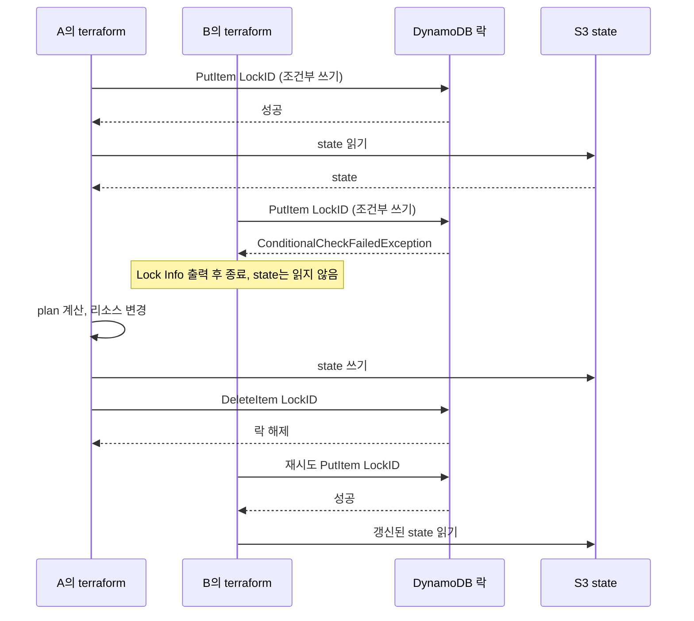
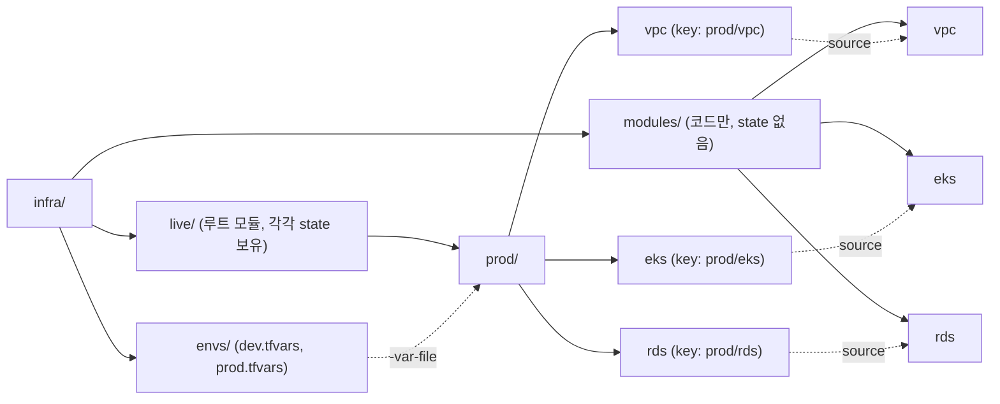
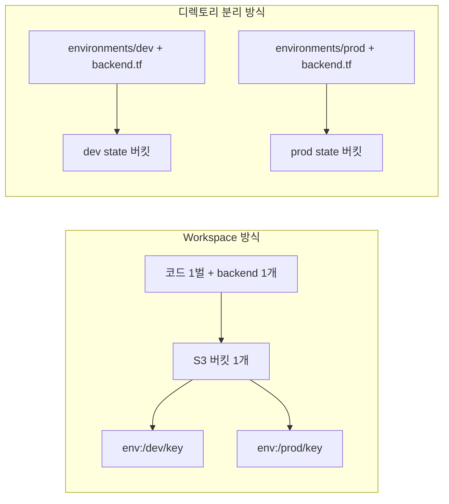
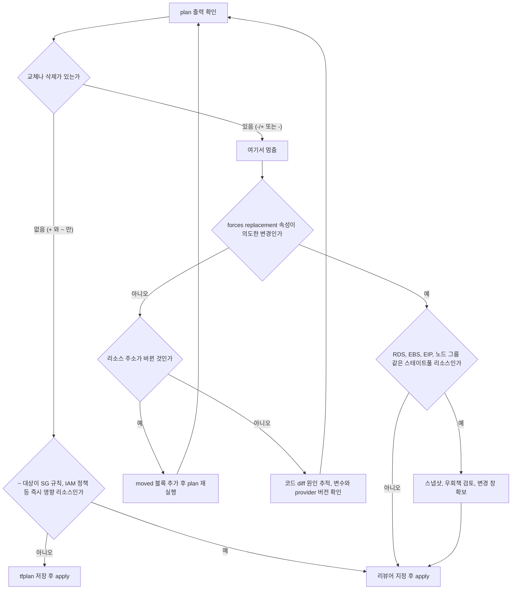
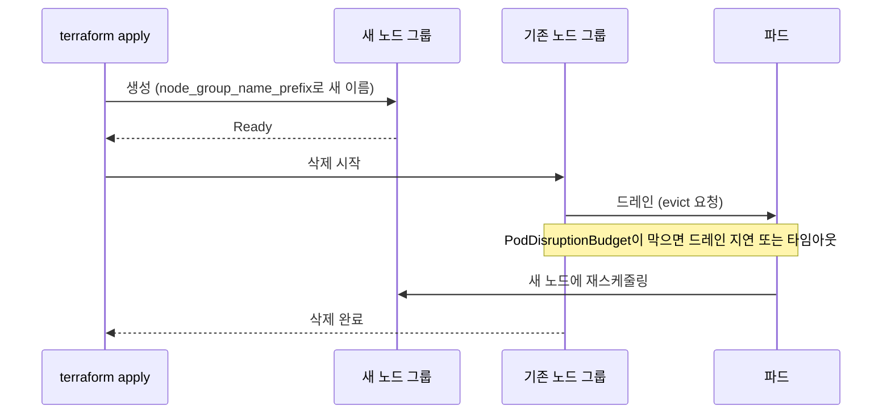
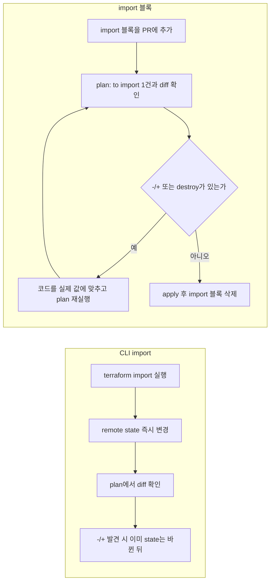
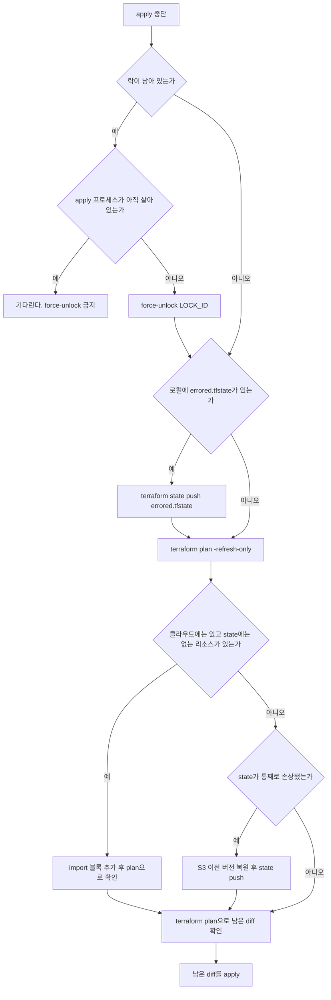

# Terraform 운영 실무
Terraform은 HashiCorp이 만든 IaC 도구다. HCL(HashiCorp Configuration Language)로 인프라를 선언하고, 실제 클라우드 리소스와 state 파일을 동기화해서 관리한다. 선언적으로 쓰지만, 내부에서는 DAG를 그려서 리소스 생성 순서를 정한다.

처음에 로컬에서 `terraform.tfstate`만 쓰다가 팀이 커지면 반드시 remote backend로 옮겨야 한다. 로컬 state로 여러 명이 작업하면 충돌이 생기고, 누군가 파일을 덮어쓰면 리소스 추적이 깨진다.

이 문서는 문법보다 운영 중에 사고가 나는 지점을 다룬다. state 락, 모듈 구조, 환경 분리, plan 읽는 법, 재생성 트랩, 그리고 `removed`/`import` 블록과 apply 중단 후 복구까지 순서대로 정리한다.

---

## State 관리

### Remote Backend

State를 S3, GCS, Terraform Cloud 같은 원격 저장소에 보관한다. S3 + DynamoDB 조합이 AWS 환경에서 가장 많이 쓰인다.

```hcl
terraform {
  backend "s3" {
    bucket         = "my-terraform-state"
    key            = "prod/vpc/terraform.tfstate"
    region         = "ap-northeast-2"
    dynamodb_table = "terraform-lock"
    encrypt        = true
  }
}
```

DynamoDB 테이블은 `LockID`를 파티션 키로 가진 테이블이어야 한다. 이 테이블이 없으면 locking이 작동하지 않는다.

```bash
aws dynamodb create-table \
  --table-name terraform-lock \
  --attribute-definitions AttributeName=LockID,AttributeType=S \
  --key-schema AttributeName=LockID,KeyType=HASH \
  --billing-mode PAY_PER_REQUEST
```

Terraform 1.10 이상에서는 S3 backend에 `use_lockfile = true`를 쓰면 DynamoDB 없이 S3 객체(`<key>.tflock`)로 락을 건다. 이 경우 `dynamodb_table`은 deprecated 대상이다. 쓰는 버전의 backend 문서에서 옵션 이름을 확인하고 옮긴다. 이 문서의 락 설명은 두 방식 모두 같은 흐름이다.

state 버킷에는 versioning을 켜둔다. 뒤에 나오는 apply 중단 사고에서 직전 state 버전으로 되돌릴 때 이게 유일한 수단이 되는 경우가 있다.

### State Locking

`terraform plan`과 `terraform apply`는 둘 다 시작할 때 락을 건다. plan도 락을 잡는다는 점을 놓치기 쉽다. CI에서 PR마다 plan을 돌리면 다른 PR의 apply가 락 때문에 막힌다.

아래 도식은 두 사람이 같은 state에 접근했을 때 일어나는 일이다. A가 락을 쥔 동안 B의 요청은 락 획득 단계에서 실패하고, B는 state를 읽지도 못한다.



B가 받는 에러는 다음 형태다.

```
Error: Error locking state: Error acquiring the state lock:
  ConditionalCheckFailedException: The conditional request failed
Lock Info:
  ID:        f5b8d1c2-...
  Who:       user@hostname
  Operation: apply
```

`Who`와 `Operation`을 먼저 읽는다. `Operation: apply`이고 `Who`가 동료 이름이면 기다리는 게 맞다. 파이프라인 러너 호스트명이고 그 잡이 이미 죽었다면 락이 남은 것이다. 이때만 `terraform force-unlock <LOCK_ID>`로 푼다. 진행 중인 apply의 락을 풀면 두 프로세스가 같은 리소스에 동시에 쓰고, 나중에 쓴 쪽의 state가 앞쪽을 덮어쓴다.

CI에서는 `-lock-timeout=5m`을 붙여두면 락이 잠깐 잡혀 있는 경우에 바로 실패하지 않고 기다린다. 값이 너무 크면 죽은 락을 붙잡고 러너가 오래 점유되므로 10분을 넘기지 않는 편이 낫다.

### State 파일 직접 수정

`terraform.tfstate`를 텍스트 에디터로 직접 수정하면 안 된다. 수정이 필요한 경우 `terraform state mv`, `terraform state rm` 명령을 쓴다.

```bash
# 리소스 이름 바꾸기
terraform state mv aws_instance.old_name aws_instance.new_name

# state에서 리소스 제거 (실제 리소스는 삭제 안 됨)
terraform state rm aws_s3_bucket.legacy
```

이 명령들은 코드 리뷰를 거치지 않는다. 내 로컬에서 실행한 순간 바로 remote state가 바뀌고 PR에는 흔적이 남지 않는다. 같은 일을 하는 선언형 수단(`moved`, `removed` 블록)이 있으므로 Terraform 1.1 이상에서는 그쪽을 먼저 쓴다. 뒤에서 다룬다.

---

## Module 구조 설계

### 기본 디렉토리 구조

모듈은 재사용 가능한 단위로 쪼갠다. 한 디렉토리 안에 모든 리소스를 때려넣으면 나중에 특정 환경에만 변경을 적용하기 어려워진다.

```
infra/
├── modules/
│   ├── vpc/
│   │   ├── main.tf
│   │   ├── variables.tf
│   │   └── outputs.tf
│   ├── eks/
│   │   ├── main.tf
│   │   ├── variables.tf
│   │   └── outputs.tf
│   └── rds/
│       ├── main.tf
│       ├── variables.tf
│       └── outputs.tf
└── environments/
    ├── dev/
    │   ├── main.tf
    │   ├── variables.tf
    │   └── terraform.tfvars
    └── prod/
        ├── main.tf
        ├── variables.tf
        └── terraform.tfvars
```

`environments/prod` 하나에 vpc, eks, rds를 전부 호출하면 state가 하나다. 이 구조는 시작할 때는 편하지만 plan 시간이 리소스 수에 비례해 늘고, RDS 한 줄을 고치려는데 EKS까지 refresh하게 된다. 락도 환경 전체에 걸린다.

그래서 규모가 커지면 state를 컴포넌트 단위로 쪼갠다. 아래 도식에서 `modules`는 코드만 갖고, `live` 아래 각 리프 디렉토리가 독립된 루트 모듈이자 독립된 state다. `envs`에는 환경별 변수 파일만 둔다.



`live/prod/eks`가 `live/prod/vpc`의 서브넷 ID를 쓰려면 `terraform_remote_state` 데이터 소스나 SSM Parameter로 값을 넘겨야 한다. 이 의존이 늘어나면 apply 순서를 사람이 기억해야 하는 문제가 생긴다. Terragrunt가 이 순서를 `dependency` 블록으로 관리해주는 이유가 여기 있다.

모듈 호출 시 버전을 고정해두지 않으면 나중에 모듈이 업데이트됐을 때 예상치 못한 변경이 적용된다.

```hcl
module "vpc" {
  source  = "terraform-aws-modules/vpc/aws"
  version = "5.1.2"  # 버전 고정 필수

  name = "my-vpc"
  cidr = "10.0.0.0/16"
}
```

### 모듈 설계 원칙

모듈이 너무 작으면 호출 코드만 늘어나고, 너무 크면 재사용하기 어렵다. 실무에서는 AWS의 논리적 그룹 단위(VPC, EKS 클러스터, RDS 인스턴스)로 나누는 경우가 많다.

모듈 내부에서 `count`나 `for_each`로 동적으로 리소스를 생성할 때, 나중에 리소스가 삭제되면 인덱스가 밀려서 의도치 않은 destroy가 발생하는 경우가 있다. `for_each`에 map을 쓰면 키 기반으로 관리되기 때문에 이 문제를 피할 수 있다.

```hcl
# count 방식 - 중간 항목 삭제 시 인덱스 재배치로 의도치 않은 destroy 발생 가능
resource "aws_subnet" "private" {
  count = length(var.private_subnets)
  cidr_block = var.private_subnets[count.index]
}

# for_each 방식 - 키 기반이라 다른 항목에 영향 없음
resource "aws_subnet" "private" {
  for_each   = var.private_subnets
  cidr_block = each.value
}
```

이미 `count`로 만든 서브넷을 `for_each`로 바꾸면 state 키가 `[0]`에서 `["a"]`로 달라져서 전부 destroy 후 create로 잡힌다. 이때 코드만 바꾸고 plan을 보면 서브넷 수만큼 `-/+`가 나온다. `moved` 블록으로 주소 대응을 선언해야 한다.

```hcl
moved {
  from = aws_subnet.private[0]
  to   = aws_subnet.private["a"]
}

moved {
  from = aws_subnet.private[1]
  to   = aws_subnet.private["b"]
}
```

`moved` 블록은 Terraform 1.1부터 쓸 수 있고, 모듈 이름을 바꾸거나 리소스를 모듈 안으로 옮길 때도 같은 방식이다. apply가 한 번 끝난 뒤에도 블록을 지우지 않고 두는 편이 안전하다. 다른 환경(dev, prod)이 아직 옛 주소를 state에 갖고 있을 수 있기 때문이다.

---

## Workspace vs 디렉토리 분리

### Workspace 방식

`terraform workspace`는 같은 코드베이스로 여러 환경을 관리할 때 쓴다. `terraform.workspace`로 현재 workspace 이름을 참조한다.

```bash
terraform workspace new dev
terraform workspace new prod
terraform workspace select prod
```

```hcl
locals {
  env = terraform.workspace

  instance_type = {
    dev  = "t3.micro"
    prod = "m5.large"
  }
}

resource "aws_instance" "app" {
  instance_type = local.instance_type[local.env]
}
```

workspace는 state 파일만 분리한다. S3 backend에서는 같은 버킷 안에 `env:/<workspace>/<key>` 경로로 state가 갈라질 뿐이다. 코드, backend 설정, 접근 권한이 전부 같다. dev에서 쓰는 자격 증명이 prod state에도 닿는다는 뜻이다. 조건문이 코드 전체에 퍼지면 가독성이 급격히 나빠진다.

아래 도식은 두 방식에서 격리가 걸리는 범위를 비교한다. workspace는 코드와 backend가 하나이고 state 경로만 갈라지지만, 디렉토리 분리는 backend 버킷까지 따로 가질 수 있다.



### 디렉토리 분리 방식

환경별로 디렉토리를 나누는 방식이 더 명확하다. 각 환경이 독립된 state를 가지고, 코드도 환경에 맞게 커스터마이징할 수 있다.

```
environments/
├── dev/
│   ├── main.tf       # 모듈 호출
│   ├── backend.tf    # dev용 backend 설정
│   └── terraform.tfvars
└── prod/
    ├── main.tf
    ├── backend.tf    # prod용 backend 설정
    └── terraform.tfvars
```

단점은 디렉토리마다 `terraform init`, `terraform apply`를 따로 실행해야 한다는 점이다. Terragrunt를 쓰면 이 반복을 줄일 수 있다.

### 두 방식 비교

| 기준 | Workspace | 디렉토리 분리 |
|---|---|---|
| 격리 수준 | state 경로만 분리. 같은 버킷, 같은 backend, 같은 자격 증명 | state, backend 버킷, IAM 권한까지 환경별로 분리 가능 |
| 실수 위험 | `workspace select`를 잊고 apply하면 prod에 반영. 현재 workspace가 프롬프트나 plan 출력에 안 보임 | 디렉토리 위치가 곧 환경이라 터미널 경로로 구분됨. 잘못 들어가도 backend가 달라 state 불일치로 드러남 |
| 코드 중복 | 거의 없음. 한 벌의 코드에 변수 테이블 | 환경마다 `main.tf` 호출부가 중복. 모듈로 줄이고 호출부만 남김 |
| 환경 간 구조 차이 | 허용하기 어려움. `count = terraform.workspace == "prod" ? 1 : 0` 같은 조건이 쌓임 | 환경별로 다른 리소스를 자연스럽게 가짐 |
| 적합한 경우 | 환경 간 차이가 변수 몇 개이고 같은 계정에서 임시 환경을 자주 만들었다 지우는 경우 | prod와 dev가 계정 또는 권한이 다르고, 독립 배포가 필요한 경우 |

workspace에서 사고가 나는 전형적인 순서는 이렇다. 점심 전에 `terraform workspace select prod`로 확인용 plan을 돌린다. 오후에 dev 변경을 적용하려고 같은 터미널에서 apply를 친다. 계정이 같으니 막는 것이 없다. 이 위험 때문에 prod가 있는 조직에서는 대부분 디렉토리 분리를 택한다.

---

## import / taint / refresh 주의사항

### terraform import

이미 수동으로 만든 리소스를 Terraform 관리 대상으로 가져올 때 쓴다.

```bash
terraform import aws_instance.web i-1234567890abcdef0
```

CLI import는 state에 리소스 정보만 추가한다. `.tf` 파일에 해당 리소스 블록을 직접 작성해야 한다. 작성하지 않으면 다음 plan에서 해당 리소스를 destroy하려 한다.

더 큰 문제는 CLI import가 plan을 거치지 않는다는 점이다. 명령을 치는 순간 remote state가 바뀐다. Terraform 1.5부터는 `import` 블록을 HCL에 쓸 수 있고, 이 방식은 import도 plan에 올라간다. 아래 [import 블록으로 가져오기](#import-블록으로-가져오기)에서 사고 사례와 함께 다룬다.

```hcl
import {
  to = aws_instance.web
  id = "i-1234567890abcdef0"
}
```

### terraform taint (deprecated)

taint는 특정 리소스를 다음 apply 시 destroy 후 재생성하도록 표시하는 명령이었다. Terraform 0.15.2부터 deprecated됐고, 대신 `-replace` 옵션을 쓴다.

```bash
# 구 방식
terraform taint aws_instance.web

# 현재 방식
terraform apply -replace="aws_instance.web"
```

`-replace`는 plan 단계에서 어떤 리소스가 교체되는지 미리 볼 수 있어서 더 안전하다. taint는 state에 표시를 남겨두기 때문에 잊고 있다가 다른 사람의 apply에서 재생성이 터지는 일이 있었다.

### terraform refresh

현재 실제 리소스 상태를 읽어서 state 파일을 업데이트한다. `terraform plan`과 `terraform apply` 실행 시 자동으로 수행되기 때문에 명시적으로 실행할 일은 많지 않다.

수동으로 변경된 리소스가 많은 환경에서 refresh를 실행하면 state가 실제 상태로 덮어써진다. 이 상태에서 plan을 보면 Terraform 코드와 실제 상태의 차이가 드러나는데, 여기서 바로 apply하면 수동 변경이 모두 Terraform 코드 기준으로 되돌아간다.

```bash
# -refresh-only로 state만 업데이트하고 변경은 하지 않음
terraform apply -refresh-only
```

---

## Plan 결과 해석 및 리뷰

### 기호 읽기

| 기호 | 의미 | 위험도 |
|---|---|---|
| `+` | 새 리소스 생성 | 낮음 |
| `~` | 속성 변경, 재생성 없음 (update in-place) | 속성에 따라 다름. 보안 그룹 규칙이나 IAM 정책은 즉시 영향 |
| `-` | 리소스 삭제 | 높음 |
| `-/+` | 삭제 후 생성 (destroy and then create replacement) | 가장 높음 |
| `+/-` | 생성 후 삭제 (`create_before_destroy` 적용 시의 교체 순서) | 높음. 순서만 안전해진 것이고 교체 자체는 일어남 |
| `<=` | 데이터 소스 읽기 | 낮음 |

`-/+`가 가장 위험하다. 이 기호가 보이면 반드시 리소스가 삭제되고 새로 만들어진다. 데이터베이스, EKS 노드 그룹, EIP 같은 리소스는 재생성 시 데이터 손실이나 서비스 중단이 발생한다. 기호 옆에 붙는 `# forces replacement` 주석이 원인 속성을 가리킨다.

아래 도식은 plan 출력을 받았을 때 어디서 멈출지를 정리한 것이다. `-/+`가 나오면 일단 apply를 멈추고 대상이 스테이트풀 리소스인지부터 따진다.



### Plan 파일 저장

CI/CD 파이프라인에서 plan과 apply를 분리할 때 plan 결과를 파일로 저장한다.

```bash
# plan 저장
terraform plan -out=tfplan

# 저장된 plan 적용 (plan 이후 변경이 없음을 보장)
terraform apply tfplan
```

plan 파일 없이 apply하면 apply 직전에 plan을 다시 실행하기 때문에, 그 사이에 다른 사람이 변경을 가했을 때 의도치 않은 결과가 생길 수 있다. 저장된 plan은 만들 때의 state와 달라지면 apply가 거부된다. 리뷰한 plan과 실제 적용이 같다는 보장이 이 파일에서 나온다.

plan 파일에는 변수 값이 들어가므로 민감 값이 평문으로 담길 수 있다. CI 아티팩트로 올릴 때 접근 범위를 제한한다.

### 리뷰 포인트

`known after apply`로 표시된 값이 다른 리소스의 참조로 쓰이면 실제 값을 예측해서 문제가 없는지 판단해야 한다. `destroy` 숫자가 예상보다 많으면 모듈 이름이 바뀌었거나 `count`에서 `for_each`로 전환하면서 인덱스가 변경된 경우가 대부분이다. 이 경우 리소스 자체를 바꾸려던 게 아니므로 `moved` 블록으로 풀린다.

---

## 운영 중 리소스 변경 시 destroy/recreate 트랩

재생성은 코드에서 한 줄을 바꿨을 뿐인데 plan에 `-/+`가 뜨는 형태로 온다. 아래 표는 이 저장소에서 자주 마주치는 경우를 원인 속성과 우회책 기준으로 모은 것이다. 속성 목록은 provider 버전마다 달라질 수 있으므로, 실제 판단은 plan의 `# forces replacement` 주석을 기준으로 한다.

| 리소스 | 재생성을 트리거하는 속성 | 원인 | 우회책 |
|---|---|---|---|
| `aws_security_group` | `name` | 이름이 immutable. 교체 시 기존 SG가 ENI에 붙어 있으면 삭제가 `DependencyViolation`으로 막힘 | `name_prefix` + `create_before_destroy` |
| `aws_db_instance` | `storage_encrypted`, `kms_key_id`, `db_name` 등 생성 시점 속성 | 생성 후 바꿀 수 없는 속성이라 교체로만 반영됨 | 코드를 실제 값에 맞춘다. 정말 바꿔야 하면 스냅샷 복원 또는 새 인스턴스 이관 |
| `aws_eks_node_group` | `instance_types`, `ami_type`, `disk_size`, 노드 그룹 이름 | 노드 그룹 API가 변경을 지원하지 않음 | `node_group_name_prefix` + `create_before_destroy`로 새 그룹 먼저 생성 후 기존 그룹 드레인 |
| 모든 리소스 | 리소스 주소 (모듈명, `count` 인덱스 → `for_each` 키) | state의 주소 키가 달라져 다른 리소스로 인식됨 | `moved` 블록 |
| Auto Scaling이 바꾸는 값 | `desired_size` 등 외부에서 바뀌는 속성 | 코드 값으로 계속 되돌리려 함 (교체는 아니고 in-place) | `ignore_changes` |

### `name` 속성 변경

AWS의 많은 리소스는 `name`이 immutable 속성이다. 이름을 바꾸면 기존 리소스를 삭제하고 새로 만든다.

```hcl
# 이름 변경 → -/+ destroy and then create replacement
resource "aws_security_group" "web" {
  name = "web-sg-v2"  # 기존 "web-sg"에서 변경
}
```

이름 변경이 필요한 경우 `create_before_destroy` lifecycle 설정으로 순서를 바꿀 수 있다. 같은 이름의 리소스를 먼저 만들 수는 없으므로 이름은 `name_prefix`로 받아야 한다.

```hcl
resource "aws_security_group" "web" {
  name_prefix = "web-sg-"

  lifecycle {
    create_before_destroy = true
  }
}
```

단, `create_before_destroy`가 항상 작동하는 건 아니다. 기존 리소스에 의존하는 다른 리소스가 있으면 의존성 그래프 때문에 순서를 바꾸기 어렵다. 이 설정은 의존 대상 리소스에도 전파되는 성격이 있어서, 한 곳에 넣었더니 plan에서 다른 리소스의 교체 순서까지 바뀌는 경우가 있다.

### RDS 인스턴스 변경

`aws_db_instance`에서 `engine_version`을 올리면 보통 in-place update로 잡히고 재생성되지 않는다. 메이저 버전을 올리려면 `allow_major_version_upgrade = true`가 필요하고, 즉시 적용하려면 `apply_immediately = true`를 같이 줘야 한다. 이 값이 없으면 변경이 다음 유지보수 시간으로 밀리고, 그 사이 plan에는 계속 diff가 남는다.

반대로 plan에서 교체로 잡히는 것은 암호화 설정(`storage_encrypted`, `kms_key_id`)처럼 생성 시점에 정해지는 속성이다. 템플릿을 복사하면서 `storage_encrypted = false`가 남아 있는 코드를 실제 암호화된 인스턴스에 적용하면 `-/+`가 뜬다. 이 plan을 그대로 apply하면 DB가 삭제된다. `deletion_protection = true`와 `skip_final_snapshot = false`를 prod 모듈의 기본값으로 둬야 마지막 방어선이 생긴다.

파라미터 그룹의 `apply_method`는 재시작 필요 여부를 정한다.

```hcl
resource "aws_db_parameter_group" "mysql" {
  parameter {
    name         = "slow_query_log"
    value        = "1"
    apply_method = "pending-reboot"  # 즉시 적용하지 않음
  }
}
```

### EKS 노드 그룹 변경

`instance_types`, `ami_type`, `disk_size` 변경은 노드 그룹을 재생성한다. 노드 그룹 재생성은 드레인과 재스케줄링 과정이 필요하기 때문에 운영 중에 갑자기 적용하면 안 된다. 기존 그룹을 지우는 동안 파드가 갈 곳이 없으면 서비스가 끊긴다.

`create_before_destroy`와 `node_group_name_prefix`를 같이 써서 새 노드 그룹이 먼저 올라오고 Ready가 된 뒤 기존 그룹이 지워지게 한다. PodDisruptionBudget이 걸려 있으면 기존 그룹 삭제가 드레인 단계에서 오래 걸리거나 타임아웃으로 실패할 수 있다.

아래 도식에서 새 노드 그룹이 Ready가 된 뒤에야 기존 그룹 삭제가 시작되는 순서를 보라. 드레인 구간에서 PodDisruptionBudget이 막으면 삭제 전체가 여기서 지연된다.



```hcl
resource "aws_eks_node_group" "workers" {
  node_group_name_prefix = "workers-"
  instance_types         = ["m5.large"]

  scaling_config {
    desired_size = 3
    min_size     = 2
    max_size     = 10
  }

  lifecycle {
    create_before_destroy = true
    # Cluster Autoscaler가 바꾸는 값만 무시
    ignore_changes = [scaling_config[0].desired_size]
  }
}
```

`ignore_changes`는 Terraform 외부에서 값이 변경되는 경우(예: Auto Scaling이 노드 수를 조정)에 쓴다. `scaling_config` 전체를 무시하면 `max_size`를 올리려는 코드 변경도 조용히 무시된다. 속성 단위로 좁혀서 쓴다. 무분별하게 쓰면 실제 코드와 state 차이를 놓치게 된다.

### 태그 변경

대부분의 AWS 리소스는 태그 변경 시 in-place update가 된다. 단, 태그가 리소스 이름이나 identifier로 쓰이는 경우(예: EKS 클러스터 태그, Karpenter 노드 선택기)는 변경 전에 영향 범위를 확인해야 한다.

### 운영 중 변경 전에 보는 것

운영 환경에서 apply 전에 plan의 `-/+`를 전부 읽는다. 재생성 대상에 연결된 보안 그룹, 서브넷 연결, IAM 역할이 무엇인지 파악하고, 데이터베이스나 스테이트풀 리소스는 스냅샷을 먼저 찍는다. 변경 창을 잡고 모니터링을 켠 상태에서 진행한다.

plan 결과를 팀원에게 리뷰받는 절차를 CI/CD에 넣으면 실수가 줄어든다. Atlantis나 Terraform Cloud의 PR 연동 기능이 이 용도에 맞다.

---

## removed 블록과 import 블록으로 plan 먼저 확인하기

`terraform state rm`과 `terraform import`는 실행하는 순간 state가 바뀌고, 리뷰도 plan도 없다. 둘 다 선언형 블록이 생겨서 PR에 올리고 plan으로 결과를 먼저 볼 수 있다.

### removed 블록으로 관리에서 빼기

코드에서 리소스 블록을 지우면 Terraform은 "더 이상 선언되지 않았다"고 보고 destroy를 계획한다. 관리만 그만두고 실제 리소스는 남기려는 의도였다면 사고가 된다.

실제로 겪는 형태는 이렇다. 레거시 S3 버킷을 다른 팀에 넘기려고 코드에서 `aws_s3_bucket.legacy` 블록을 지운다. PR 리뷰어는 삭제된 줄만 보고 plan 출력을 열어보지 않는다. apply가 돌고 버킷이 사라진다. `force_destroy`가 없으면 비어 있지 않은 버킷은 삭제가 실패하지만, 비어 있거나 `force_destroy = true`인 버킷은 그냥 지워진다.

Terraform 1.7부터는 `removed` 블록으로 의도를 명시한다.

```hcl
removed {
  from = aws_s3_bucket.legacy

  lifecycle {
    destroy = false
  }
}
```

리소스 블록은 지우고 `removed` 블록만 남긴다. 같은 주소의 `resource` 블록과 `removed` 블록이 같이 있으면 에러가 난다. plan에는 이 리소스가 "더 이상 Terraform으로 관리되지 않지만 destroy되지는 않는다"는 취지의 메시지가 나오고, 삭제 대상 수에는 잡히지 않는다. plan에 `destroy` 숫자가 0인지 확인하는 것이 리뷰 기준이다.

`removed`는 모듈 호출에도 쓸 수 있다. 모듈째 관리를 끊을 때 모듈 안 리소스를 `state rm`으로 하나씩 지우지 않아도 된다. 이 블록도 apply가 끝나면 그 환경의 state에서는 역할이 끝나지만, dev와 prod를 따로 apply하는 구조라면 모든 환경이 반영될 때까지 블록을 유지한다.

### import 블록으로 가져오기

`import` 블록은 plan에서 `Plan: 1 to import, 0 to add, 0 to change, 0 to destroy.` 형태로 결과를 보여준다. 가져올 리소스를 코드와 대조해서 diff가 나면 apply 전에 알 수 있다.

사고 사례는 import와 코드 불일치에서 온다. 콘솔에서 만든 암호화된 RDS를 가져오면서, 다른 환경에서 복사한 코드의 `storage_encrypted = false`를 그대로 두었다고 하자. CLI import로 state에 넣고 바로 apply하면 그 속성이 ForceNew라서 DB가 교체 대상이 된다. 같은 상황이라도 import 블록이면 plan에서 `import` 한 건과 함께 `-/+`와 `# forces replacement`가 보이므로 apply 전에 멈출 수 있다.

코드를 처음부터 쓰기 어려우면 plan이 초안을 만들어준다.

```bash
terraform plan -generate-config-out=generated.tf
```

`import` 블록이 있는 상태에서 이 옵션을 쓰면 Terraform 1.5 이상이 `generated.tf`에 리소스 블록을 작성한다. 이 파일은 초안으로만 쓴다. 기본값과 같은 속성이 전부 풀려서 나오고, 민감 정보가 평문으로 들어가는 경우가 있으므로 검토하고 정리한 뒤 일반 `.tf` 파일로 옮긴다.

다음 순서로 진행한다. 먼저 `import` 블록을 PR에 올려 plan을 본다. `to import`가 의도한 개수인지, `change`나 `destroy`가 0인지 확인한다. 속성 불일치가 있으면 코드를 실제 값에 맞춘다. 모든 diff가 사라진 plan을 확인한 다음 apply한다. apply가 끝나면 `import` 블록은 지워도 된다.

아래 도식은 CLI import와 import 블록이 어디서 갈리는지를 비교한 것이다. CLI import는 state가 먼저 바뀌고 나서야 diff를 보지만, import 블록은 apply 전에 diff를 보고 코드를 고칠 기회가 있다.



---

## apply 도중 중단됐을 때 state 복구

apply는 리소스를 하나씩 만들면서 state를 갱신한다. 중간에 죽으면 "클라우드에는 만들어졌는데 state에는 없는" 상태가 생길 수 있다. 원인은 CI 러너 타임아웃, 노트북 절전, 네트워크 단절, `Ctrl+C` 등이다.

`Ctrl+C`를 한 번 누르면 Terraform은 진행 중인 작업이 끝나기를 기다린 뒤 정상 종료하고 state를 저장한다. 두 번 누르면 즉시 중단하는데, 이때 state 저장이 안 될 수 있다. 운영에서는 한 번만 누르고 기다린다.

복구는 어떤 상태가 남았는지부터 구분한다.



### 락 정리

도식 첫 분기가 락이다. 프로세스가 죽었는데 락이 남았으면 `force-unlock`으로 풀고, 아직 살아 있으면 건드리지 않는다. CI 러너가 취소된 경우에는 러너 쪽 프로세스가 실제로 끝났는지를 CI 콘솔에서 확인한다. 취소 요청은 접수됐지만 컨테이너가 아직 정리 중인 경우가 있다.

### errored.tfstate

remote backend에 state를 쓰다가 실패하면 Terraform은 작업 디렉토리에 `errored.tfstate`를 남긴다. 최신 변경이 들어 있는 유일한 사본이므로 지우면 안 된다. 백엔드 연결을 복구한 뒤 밀어 넣는다.

```bash
terraform state push errored.tfstate
```

`state push`는 push하려는 state의 `serial`이 remote보다 낮거나 `lineage`가 다르면 거부한다. 이 거부는 다른 사람이 그사이 state를 갱신했다는 신호일 수 있으므로 `-force`로 넘기기 전에 remote state 내용부터 비교한다. `-force`는 상대 변경을 덮어쓴다.

### state에 없는 리소스

state를 못 남기고 죽으면 EC2나 SG 같은 리소스는 만들어졌는데 Terraform은 모른다. 다음 apply는 같은 리소스를 다시 만들려고 하고, `InvalidGroup.Duplicate`나 `EntityAlreadyExists` 같은 중복 에러로 실패한다. 에러 메시지에 나온 리소스를 `import` 블록으로 가져온 뒤 plan으로 diff를 확인한다. 이름 충돌이 없는 리소스(예: 이름이 랜덤인 EBS)는 중복 에러조차 안 나고 고아 리소스로 남아 비용이 계속 나간다. `terraform plan -refresh-only`로는 이런 리소스가 보이지 않으므로, 중단된 시각의 CloudTrail에서 `Create*` 이벤트를 찾아 대조한다.

### state 자체가 손상됐을 때

비정상 종료로 state가 비었거나 잘렸으면 S3 versioning에서 직전 버전을 꺼낸다.

```bash
aws s3api list-object-versions \
  --bucket my-terraform-state \
  --prefix prod/vpc/terraform.tfstate

aws s3api get-object \
  --bucket my-terraform-state \
  --key prod/vpc/terraform.tfstate \
  --version-id <이전 VersionId> \
  restored.tfstate

terraform state push restored.tfstate
```

복원한 state는 중단 직전까지의 변경이 빠져 있다. 그 사이에 만들어진 리소스는 위의 import 절차로 다시 들여온다. versioning을 켜두지 않았다면 이 경로는 없고, 모든 리소스를 import로 재구성해야 한다.

복구가 끝나면 `terraform plan`에서 diff가 0이 되는지를 확인하는 것으로 마친다. diff가 남아 있으면 그 diff가 중단된 apply의 나머지 작업인지, 복구 과정에서 생긴 불일치인지부터 구분해서 읽는다.
