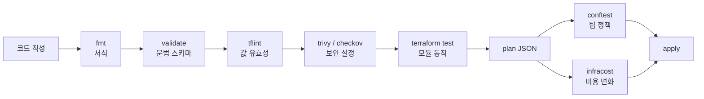
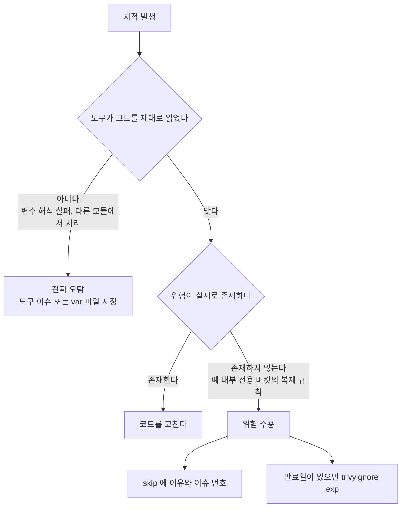
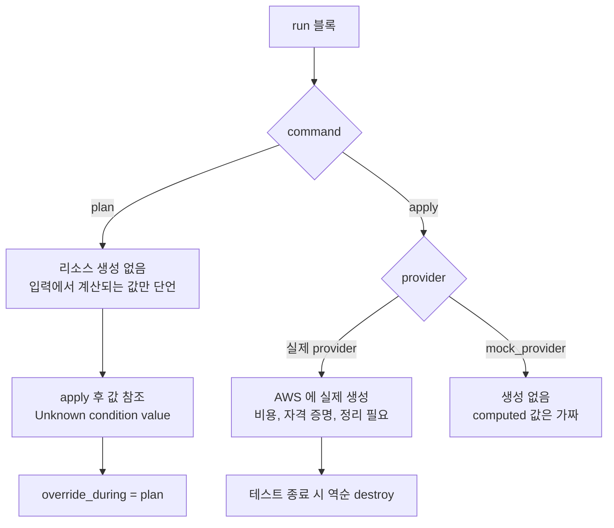
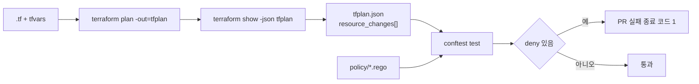

# Terraform 정적 분석과 테스트

`terraform validate` 가 통과했다고 apply 가 성공하는 건 아니다. 인스턴스 타입을 `t2.micr0` 으로 오타 내도 validate 는 `Success!` 를 찍는다. 오타는 apply 중에 AWS API 가 거절하고 나서야 드러난다. 보안 설정은 더 심하다. S3 퍼블릭 액세스 차단을 전부 `false` 로 둔 코드도, 22번 포트를 `0.0.0.0/0` 에 연 코드도 문법상으로는 아무 문제가 없다.

이 문서는 `fmt`, `validate`, `tflint`, `checkov`, `trivy`, `terraform test`, `conftest`, `infracost` 가 각각 어느 단계에서 무엇을 잡는지 정리한다. 모든 출력은 직접 돌려서 가져왔고, 돌리지 못한 부분은 본문에 그렇게 적었다. 파이프라인 자체(plan 아티팩트, 락, 승인)는 [Terraform CI/CD 파이프라인](Terraform_CI_CD_파이프라인.md)에, 기본 명령은 [Terraform](Terraform.md)에 있다.

확인한 버전은 다음과 같다. 규칙 이름과 출력 형식은 버전마다 달라진다.

| 도구 | 버전 |
|---|---|
| terraform | 1.17.1 |
| tflint / tflint-ruleset-aws / terraform ruleset | 0.65.0 / 0.40.0 / 0.15.0 |
| checkov | 3.4.3 |
| trivy | 0.76.1 |
| conftest | 0.71.1 |
| infracost | 0.10.47 |
| pre-commit-terraform | v1.109.4 |

## 검사마다 보는 곳이 다르다

도구를 늘리면 검사가 겹칠 거라고 생각하기 쉬운데, 실제로는 서로 거의 안 겹친다. 각 도구가 입력으로 받는 것이 다르기 때문이다.

| 도구 | 입력 | 잡는 것 | 못 잡는 것 |
|---|---|---|---|
| `terraform fmt` | `.tf` 소스 | 들여쓰기, 정렬 | 의미 |
| `terraform validate` | `.tf` + provider 스키마 | 문법, 없는 속성, 타입 불일치, 없는 참조 | 값이 유효한지 (인스턴스 타입, AZ 이름) |
| `tflint` | `.tf` + 규칙 플러그인 | provider 가 받아주지 않을 값, 쓰지 않는 선언, 비권장 문법, 모듈 버전 미고정 | 보안 설정, 변수로 들어오는 값 |
| `checkov`, `trivy config` | `.tf` (선택적으로 plan JSON) | 암호화 미설정, 퍼블릭 노출, 0.0.0.0/0 | 팀 고유 규칙, 변수 주입 값 (var 파일을 안 주면) |
| `terraform test` | 모듈 + `.tftest.hcl` | 모듈 입출력 계약, validation 블록, 조건부 리소스 개수 | provider 가 실제로 받아주는지 (mock 일 때) |
| `conftest` | plan JSON | 최종 계산된 값에 대한 팀 규칙 | plan 에 안 나오는 apply 후 값 |
| `infracost` | `.tf` 또는 plan JSON | 월 비용 변화 | 사용량 기반 요금 (usage 파일 없이는) |

validate 가 못 잡는 AWS 값 오류가 tflint 규칙의 영역이다. validate 는 provider 스키마에서 `instance_type` 이 문자열이라는 것까지만 안다. `t2.micro` 가 실존하는 타입인지는 tflint-ruleset-aws 가 타입 목록을 내장하고 있어서 판별한다.



왼쪽에서 오른쪽으로 갈수록 필요한 것이 늘어난다. fmt 는 소스 파일만 있으면 되고, validate 는 init, plan JSON 부터는 provider 자격 증명까지 필요하다. 준비물이 적은 검사가 앞에 와야 PR 에서 빨리 빨개진다.

## fmt 와 validate

`fmt -check` 는 고칠 게 있으면 종료 코드 3 을 반환한다. 0 과 1 만 구분하는 스크립트에서 이걸 놓치면 CI 가 조용히 통과한다.

```console
$ terraform fmt -check -diff; echo "fmt exit=$?"
main.tf
--- old/main.tf
+++ new/main.tf
@@ -18,7 +18,7 @@
 }

 variable "unused_var" {
-  type = string
+  type    = string
   default = "x"
 }

fmt exit=3
```

validate 는 `init` 이 끝난 디렉터리에서만 돈다. provider 스키마를 받아야 하기 때문이다. 앞의 `t2.micr0` 코드에 대한 결과는 이렇다.

```console
$ terraform validate; echo "validate exit=$?"
Success! The configuration is valid.

validate exit=0
```

CI 에서 validate 만 돌릴 때는 backend 에 접속할 필요가 없으므로 `terraform init -backend=false` 로 초기화하면 state 버킷 권한 없이 돈다.

## tflint

`.tflint.hcl` 은 플러그인 두 개를 켜는 정도로 시작한다. aws 플러그인은 `version` 을 고정해야 한다. 고정하지 않으면 플러그인 업데이트로 어제 초록이던 PR 이 오늘 빨개진다.

```hcl
plugin "terraform" {
  enabled = true
  preset  = "recommended"
}

plugin "aws" {
  enabled = true
  version = "0.40.0"
  source  = "github.com/terraform-linters/tflint-ruleset-aws"
}
```

`tflint --init` 으로 플러그인을 받고 실행하면 앞의 코드에서 이렇게 나온다.

```console
$ tflint --init && tflint; echo "exit=$?"
2 issue(s) found:

Warning: [Fixable] variable "unused_var" is declared but not used (terraform_unused_declarations)

  on main.tf line 20:
  20: variable "unused_var" {

Reference: https://github.com/terraform-linters/tflint-ruleset-terraform/blob/v0.15.0/docs/rules/terraform_unused_declarations.md

Error: "t2.micr0" is an invalid value as instance_type (aws_instance_invalid_type)

  on main.tf line 27:
  27:   instance_type = "t2.micr0"

exit=2
```

validate 가 통과시킨 `t2.micr0` 을 `aws_instance_invalid_type` 이 잡았다. 같은 계열이 RDS 와 ElastiCache 에도 있다.

```console
Error: "db.t3.mircro" is invalid instance type. (aws_db_instance_invalid_type)
Error: "cache.t3.mikro" is invalid node type. (aws_elasticache_cluster_invalid_type)
Warning: Module source "git::https://github.com/example/vpc.git" is not pinned (terraform_module_pinned_source)
Warning: Missing version constraint for provider "aws" in `required_providers` (terraform_required_providers)
Warning: terraform "required_version" attribute is required (terraform_required_version)
Warning: `name` variable has no type (terraform_typed_variables)
Warning: [Fixable] Interpolation-only expressions are deprecated in Terraform v0.12.14 (terraform_deprecated_interpolation)
```

모든 AWS 값을 검증해 주는 건 아니다. IAM 정책을 `jsonencode` 로 넣고 액션 이름을 `s3:GetObjectt` 로 틀린 코드를 돌려봤는데 tflint 는 아무것도 말하지 않았다. 규칙 목록에 없는 속성은 통과한다고 보면 된다. 어떤 속성이 검증되는지는 ruleset 저장소의 rules 문서에서 `aws_` 로 시작하는 `_invalid_` 규칙을 확인한다.

`Error` 와 `Warning` 이 섞여 있을 때 종료 코드는 2 였다. Warning 만 있을 때의 종료 코드는 이 실행에서 확인하지 않았다. CI 에서 Warning 도 막을지는 `--minimum-failure-severity` 옵션으로 정한다.

## pre-commit 으로 커밋 전에 막기

CI 에서만 잡으면 오타 하나 때문에 PR 을 올리고 3분 기다렸다가 다시 올린다. pre-commit 훅은 커밋 시점에 같은 검사를 돌린다. `antonbabenko/pre-commit-terraform` 이 훅을 제공한다.

```yaml
repos:
  - repo: https://github.com/antonbabenko/pre-commit-terraform
    rev: v1.109.4
    hooks:
      - id: terraform_fmt
      - id: terraform_validate
      - id: terraform_tflint
        args:
          - --args=--config=__GIT_WORKING_DIR__/.tflint.hcl
      - id: terraform_trivy
        args:
          - --args=--severity=HIGH,CRITICAL
          - --args=--skip-dirs="**/.terraform"
      - id: terraform_checkov
        args:
          - --args=--quiet
          - --args=--skip-check CKV_AWS_144,CKV2_AWS_62
```

앞의 오타 코드에 돌린 결과다.

```console
$ pre-commit run --all-files
Terraform fmt............................................................Failed
- hook id: terraform_fmt
- files were modified by this hook

main.tf

Terraform validate.......................................................Passed
Terraform validate with tflint...........................................Failed
- hook id: terraform_tflint
- exit code: 2
...
Error: "t2.micr0" is an invalid value as instance_type (aws_instance_invalid_type)
...
Terraform validate with trivy............................................Failed
- hook id: terraform_trivy
- exit code: 1
...
Tests: 9 (SUCCESSES: 0, FAILURES: 9)
Failures: 9 (HIGH: 9, CRITICAL: 0)
```

세 가지를 알고 있어야 한다.

- `terraform_fmt` 는 파일을 고치고 나서 실패로 끝난다. 고쳐진 파일을 `git add` 하고 다시 커밋하면 통과한다. 처음 겪으면 "고쳤는데 왜 실패냐" 싶다.
- `rev` 는 훅 정의의 버전이지 도구 버전이 아니다. tflint, trivy, checkov 바이너리는 각자 PATH 에 있는 것을 쓴다. 팀원마다 버전이 다르면 어떤 사람 로컬에서는 통과하고 CI 에서 실패한다. CI 쪽 버전을 고정하고 README 에 같은 버전을 적어둔다.
- 훅 이름은 `terraform_trivy` 인데 pre-commit 출력에는 `Terraform validate with trivy` 로 나온다. 로그를 검색할 때 헷갈린다.

trivy 는 실행할 때 misconfiguration 검사 번들을 내려받는다. 첫 실행 로그에 `Need to update the checks bundle` / `Downloading the checks bundle...` 이 찍혔다. 번들이 갱신되면 코드를 안 건드려도 새 규칙이 생겨 CI 가 빨개질 수 있다. 재현성이 필요하면 `--skip-check-update` 로 갱신을 끄고 번들을 이미지에 고정한다.

## checkov 와 trivy

### 같은 파일을 돌렸을 때

EC2, S3, 보안 그룹, RDS 5개 리소스를 일부러 허술하게 쓴 파일에 두 도구를 돌렸다.

| | checkov 3.4.3 | trivy 0.76.1 |
|---|---|---|
| 결과 | Passed 17, Failed 27 | Failures 17 (LOW 4, MEDIUM 4, HIGH 9) |
| 심각도 | 기본 출력에 없음 | 있음 |
| 규칙 ID | `CKV_AWS_24`, `CKV2_AWS_5` | `AWS-0107` |
| 종료 코드 | 실패 시 1 | 기본 0, `--exit-code 1` 필요 |
| 하드코딩된 비밀번호 | `CKV_SECRET_6` 으로 잡음 | 잡지 못함 |

trivy 는 지적이 17개나 나와도 종료 코드가 0 이다. CI 에서 `trivy config .` 만 쓰면 영원히 초록이다. 실제로 `--severity HIGH,CRITICAL --exit-code 1` 을 붙였을 때 종료 코드 1 이 나왔다.

```bash
trivy config . --severity HIGH,CRITICAL --exit-code 1
```

checkov 의 비밀번호 탐지는 이름을 보고 하는 게 아니었다. `password = "changeme1234"` 줄에서 `CKV_SECRET_6: Base64 High Entropy String` 이 나왔다. 엔트로피 기반이라 `password = "admin"` 같은 짧은 값은 놓칠 수 있다. 비밀번호는 코드에 넣지 않는 것이 기본이고, 탐지에 기대면 안 된다.

### S3 퍼블릭, 암호화, 0.0.0.0/0

세 부류의 지적이 어떤 규칙 이름으로 나오는지 정리했다.

| 문제 | checkov | trivy |
|---|---|---|
| S3 public access block 4개 항목 `false` | `CKV_AWS_53`, `54`, `55`, `56` | `AWS-0086`, `0087`, `0091`, `0093` |
| S3 암호화 설정 없음 | `CKV_AWS_145` (KMS 기본 암호화) | `AWS-0132` (CMK 사용 권고) |
| RDS 저장 시 암호화 없음 | `CKV_AWS_16` | `AWS-0080` |
| EBS 블록 디바이스 암호화 없음 | `CKV_AWS_8` | `AWS-0131` |
| 보안 그룹 22번 포트 0.0.0.0/0 | `CKV_AWS_24` | `AWS-0107` |
| IMDSv1 허용 | `CKV_AWS_79` | `AWS-0028` |

checkov 의 출력은 이런 모양이다.

```console
Check: CKV_AWS_24: "Ensure no security groups allow ingress from 0.0.0.0:0 to port 22"
	FAILED for resource: aws_security_group.web
	File: /main.tf:42-52
```

trivy 는 해당 줄을 같이 보여준다.

```console
AWS-0107 (HIGH): Security group rule allows unrestricted ingress from any IP address.
 main.tf:50
   via main.tf:46-51 (ingress)
    via main.tf:42-52 (aws_security_group.web)
```

고친 코드는 이렇다. public access block 은 네 개를 전부 `true` 로 두고, 암호화와 버전 관리는 별도 리소스로 분리한다(AWS provider 4.x 이후 구조).

```hcl
resource "aws_s3_bucket" "logs" {
  bucket = "my-team-logs-bucket"
}

resource "aws_s3_bucket_public_access_block" "logs" {
  bucket                  = aws_s3_bucket.logs.id
  block_public_acls       = true
  block_public_policy     = true
  ignore_public_acls      = true
  restrict_public_buckets = true
}

resource "aws_s3_bucket_server_side_encryption_configuration" "logs" {
  bucket = aws_s3_bucket.logs.id

  rule {
    apply_server_side_encryption_by_default {
      sse_algorithm     = "aws:kms"
      kms_master_key_id = var.kms_key_arn
    }
  }
}

resource "aws_s3_bucket_versioning" "logs" {
  bucket = aws_s3_bucket.logs.id

  versioning_configuration {
    status = "Enabled"
  }
}

resource "aws_security_group" "web" {
  name        = "web"
  description = "web"
  vpc_id      = var.vpc_id

  ingress {
    description = "ssh from office"
    from_port   = 22
    to_port     = 22
    protocol    = "tcp"
    cidr_blocks = ["10.0.0.0/8"]
  }
}
```

이렇게 고친 파일에서도 지적이 남았다. trivy 는 `AWS-0089 (LOW): Bucket has logging disabled` 하나, checkov 는 5개(`CKV2_AWS_5`, `CKV2_AWS_62`, `CKV_AWS_144`, `CKV_AWS_18`, `CKV2_AWS_61`)였다. 로그 버킷에 또 로그 버킷을 달고, 크로스 리전 복제와 이벤트 알림까지 요구하는 규칙들이다. 이런 걸 전부 만족시키려고 코드를 늘리기 시작하면 도구가 코드를 지배한다. 오탐 처리 기준은 뒤에서 다룬다.

### 변수로 들어오는 값은 안 보인다

가장 늦게 알아챈 함정이다. 보안 그룹의 CIDR 을 변수로 받고 값은 tfvars 로 넣는 구조를 시험했다.

```hcl
variable "ssh_cidr" {
  type = string
}

resource "aws_security_group" "web" {
  # ... 생략
  ingress {
    from_port   = 22
    to_port     = 22
    protocol    = "tcp"
    cidr_blocks = [var.ssh_cidr]
  }
}
```

`prod.tfvars` 에는 `ssh_cidr = "0.0.0.0/0"` 을 넣었다.

```console
$ trivy config . -q | grep AWS-0107
(출력 없음)
$ trivy config . -q --tf-vars prod.tfvars | grep AWS-0107
AWS-0107 (HIGH): Security group rule allows unrestricted ingress from any IP address.
$ checkov -d . --framework terraform --var-file prod.tfvars | grep CKV_AWS_24
Check: CKV_AWS_24: "Ensure no security groups allow ingress from 0.0.0.0:0 to port 22"
```

var 파일을 안 주면 두 도구 모두 `CKV_AWS_24`, `AWS-0107` 을 내지 않았다. 변수 값을 모르니 판단을 포기하고 통과시킨 것이다. 환경별 tfvars 를 쓰는 저장소라면 CI 에서 환경마다 `--tf-vars`, `--var-file` 을 줘서 돌려야 한다. 안 그러면 "스캔은 통과했는데 prod 에 22번이 열려 있는" 상태가 된다. 이 구멍은 plan JSON 검사로 막는 게 확실하다(뒤의 Conftest 절).

## skip 주석이 쌓이는 과정

처음 도입하면 지적이 수십 개 나오고, 팀은 PR 을 통과시키려고 skip 주석을 붙인다. 6개월 뒤에 `grep -r "checkov:skip" | wc -l` 을 돌리면 이유 없는 skip 이 수백 개다.

checkov 는 리소스 블록 안에 주석을 쓴다.

```hcl
resource "aws_security_group" "bastion" {
  #checkov:skip=CKV_AWS_24:사내 VPN 대역 확정 전 임시. SECOPS-412 에서 제거
  #checkov:skip=CKV_AWS_23
  #checkov:skip=CKV2_AWS_5
  name        = "bastion"
  # ...
}
```

콜론 뒤의 이유는 선택이다. 이유를 안 쓰면 verbose 출력에서 이렇게 보인다.

```console
	SKIPPED for resource: aws_security_group.bastion
	Suppress comment: No comment provided
```

이유를 쓴 쪽은 `Suppress comment: 사내 VPN 대역 확정 전 임시. SECOPS-412 에서 제거` 로 나온다. skip 이 3개면 리포트의 `Skipped checks: 3` 으로 집계된다.

trivy 는 문법이 다르다. 리소스 위 줄이나 속성 바로 위 줄에 쓴다.

```hcl
#trivy:ignore:AWS-0107
resource "aws_security_group" "other" {
  # ...
}
```

두 도구를 같이 돌리면 서로의 주석을 읽지 않는다. 위 `bastion` 리소스는 checkov skip 3개를 달았는데도 trivy 는 `AWS-0107` 을 그대로 냈다. 같은 지적을 두 번 억제해야 한다. 옛 tfsec 주석 `#tfsec:ignore:aws-ec2-no-public-ingress-sgr` 도 0.76.1 에서 여전히 동작했다. tfsec 에서 넘어온 저장소에서는 주석을 일괄 치환하지 않아도 된다.

만료일이 있는 방법은 trivy 의 `.trivyignore` 다.

```text
AWS-0107 exp:2026-12-31
```

만료일 전에는 지적이 사라지고, `exp:2026-01-01` 처럼 지난 날짜로 바꾸면 지적이 다시 나오는 것을 확인했다. 임시 예외는 이 형태로 쓰는 편이 낫다. 주석 skip 은 코드를 지우기 전까지 영원히 남는다.

checkov 에는 만료일이 없는 대신 baseline 이 있다. 기존 지적을 파일로 저장해 두고 그 이후 새로 생긴 지적만 실패시킨다.

```console
$ checkov -d . --framework terraform --create-baseline
$ ls -la .checkov.baseline
-rw-r--r-- 1 root root 1921 Nov  5 11:37 .checkov.baseline
```

baseline 을 만든 뒤 보안 그룹 `new_one` (0.0.0.0/0 포함)을 추가하고 `--baseline .checkov.baseline` 으로 돌리자 기존 리소스의 지적은 빠지고 `new_one` 의 `CKV_AWS_24`, `CKV2_AWS_5` 만 남아 종료 코드 1 이 나왔다. 기존 코드의 빚은 두고 새 코드만 막을 때 쓴다. baseline 파일이 커밋되므로 리뷰에서 그 파일이 커지는지 봐야 한다. 리뷰어가 보는 순간 baseline 은 또 하나의 skip 목록이다.

## 오탐으로 볼지 판단하는 기준

지적이 나왔을 때 "이건 오탐이니 skip" 이라고 하는 일이 쉽게 생긴다. 오탐이라는 말이 두 가지를 섞어 쓰기 때문이다. 도구가 코드를 잘못 읽은 경우가 진짜 오탐이고, 도구는 맞게 읽었는데 우리 상황에서 문제가 아닌 경우는 위험 수용이다.



실제로 겪은 사례로 갈라보면 이렇다.

**진짜 오탐에 가까운 것.** `CKV2_AWS_5` ("Security Groups are attached to another resource") 는 보안 그룹을 한 모듈에 만들고 다른 모듈에서 인스턴스에 붙이는 구조에서 항상 나온다. 모듈 경계를 넘어 참조를 추적하지 못하기 때문이다. 앞의 고친 파일에서도 이 규칙이 남았다. 보안 그룹만 정의한 모듈이라면 이 규칙은 모듈 전체에서 끄는 것이 맞다.

**위험 수용에 해당하는 것.** `CKV_AWS_144` (크로스 리전 복제), `CKV2_AWS_62` (이벤트 알림), `AWS-0089` (로그 버킷의 로깅). 로그 버킷의 로깅은 순환이고, 복제는 재해 복구 요건이 있는 데이터에만 의미가 있다. 이런 규칙은 건별 skip 이 아니라 설정 파일에서 일괄로 끈다. 위 pre-commit 설정의 `--skip-check CKV_AWS_144,CKV2_AWS_62` 가 그 예다. 건별 주석으로 흩어지면 아무도 목록을 관리하지 못한다.

**S3 암호화 지적.** 설정이 없는 버킷에 `CKV_AWS_145` 와 `AWS-0132` 가 나온다. S3 는 2023년 1월부터 새 객체를 SSE-S3 로 기본 암호화하기 때문에 "암호화가 안 된 상태"는 아니다. 이 규칙이 요구하는 것은 KMS 키(고객 관리 키)를 쓰라는 것이다. 키 사용 이력이 감사 대상이거나 키 정책으로 접근을 제어해야 하면 고치고, 아니면 규칙을 끈다. 도구 메시지를 "암호화 안 됨" 으로 읽고 당황하는 경우가 많아서 적어둔다.

skip 을 넣을 때 쓰는 기준은 세 가지다. 이유가 한 문장으로 안 써지면 skip 하지 않는다. 이슈 번호나 만료일이 없으면 임시 예외로 인정하지 않는다. 같은 규칙을 3곳 이상에서 skip 하고 있으면 개별 skip 을 지우고 규칙을 끈다. 규칙을 끄는 것은 리뷰에서 한 번 논의되지만, 개별 skip 은 논의 없이 쌓인다.

## terraform test

`terraform test` 는 1.6 에서 들어왔다. `.tftest.hcl` 파일에 `run` 블록을 쓰면 `tests/` 디렉터리에서 자동으로 찾는다. 간단한 예제는 [Terraform](Terraform.md) 에 있고, 여기서는 plan 과 apply 의 차이와 mock 의 한계를 다룬다.

시험에 쓴 모듈은 환경 이름(`dev`/`stg`/`prod`)을 받아 S3 버킷과 EC2 를 만들고, prod 에서만 인스턴스를 2개로 늘린다. `env` 변수에는 validation 이 있다.

```hcl
variable "env" {
  type = string

  validation {
    condition     = contains(["dev", "stg", "prod"], var.env)
    error_message = "env 는 dev, stg, prod 중 하나여야 한다. 입력값: ${var.env}"
  }
}

resource "aws_instance" "app" {
  ami           = "ami-0abcdef1234567890"
  instance_type = var.instance_type
  count         = var.env == "prod" ? 2 : 1
}

output "bucket_arn" {
  value = aws_s3_bucket.logs.arn
}
```

### plan 과 apply

`command = plan` 은 실제 리소스를 만들지 않고, 계획 결과에 대해 단언한다. 입력으로부터 계산되는 값은 확인할 수 있다.

```hcl
run "prod_has_two_instances" {
  command = plan

  variables {
    env = "prod"
  }

  assert {
    condition     = length(aws_instance.app) == 2
    error_message = "prod 는 인스턴스 2대여야 한다"
  }
}

run "invalid_env_rejected" {
  command = plan

  variables {
    env = "production"
  }

  expect_failures = [var.env]
}
```

```console
$ terraform test
tests/plan.tftest.hcl... in progress
  run "prod_has_two_instances"... pass
  run "invalid_env_rejected"... pass
tests/plan.tftest.hcl... tearing down
tests/plan.tftest.hcl... pass

Success! 2 passed, 0 failed.
```

`expect_failures` 로 validation 이 거절하는 것을 확인하는 테스트는 규칙이 느슨해지는 회귀를 막는다. 입력 검증은 한 번 풀리면 아무도 눈치채지 못한다.

plan 으로는 apply 후에야 정해지는 값을 볼 수 없다. S3 버킷의 `arn` 에 단언을 걸면 이렇게 된다.

```console
  run "arn_at_plan_time"... fail
╷
│ Error: Unknown condition value
│
│   on tests/plan.tftest.hcl line 36, in run "arn_at_plan_time":
│   36:     condition     = startswith(aws_s3_bucket.logs.arn, "arn:aws:s3:::")
│     ├────────────────
│     │ aws_s3_bucket.logs.arn is a string
│
│ Condition expression could not be evaluated at this time. This means you
│ have executed a `run` block with `command = plan` and one of the values
│ your condition depended on is not known until after the plan has been
│ applied. ...
╵
  run "invalid_env_rejected"... skip
```

한 run 이 실패하면 뒤의 run 은 `skip` 된다. 테스트 파일 안에서 순서가 의존이 아닌 독립 검증이라면 파일을 나누는 편이 실패 원인 파악이 빠르다.

해결 방법은 두 가지다. `command = apply` 로 바꾸면 실제 AWS 에 리소스를 만든다. 아니면 `override_resource` 에 `override_during = plan` 을 써서 plan 단계에서 값을 지정한다.

```hcl
run "arn_at_plan_with_override" {
  command = plan

  override_resource {
    target          = aws_s3_bucket.logs
    override_during = plan
    values = {
      arn = "arn:aws:s3:::acme-dev-logs"
    }
  }

  variables {
    env = "dev"
  }

  assert {
    condition     = output.bucket_arn == "arn:aws:s3:::acme-dev-logs"
    error_message = "output 이 arn 을 그대로 전달하지 않는다"
  }
}
```

이 방식은 `output.bucket_arn` 이 버킷의 `arn` 을 그대로 내보내는지만 검증한다. 값은 우리가 넣은 것이다. 모듈 내부의 연결(출력이 올바른 속성을 가리키는가)을 보는 용도이고, AWS 가 실제로 어떤 값을 돌려주는지는 보지 못한다.



`command = apply` 와 실제 provider 를 쓰면 테스트가 끝날 때 `tearing down` 단계에서 만든 리소스를 역순으로 destroy 한다. 중간에 프로세스가 죽으면 리소스가 남는다. 테스트용 계정을 분리하고 태그로 정리 대상을 식별할 수 있게 해야 한다.

### mock_provider 의 한계

`mock_provider "aws" {}` 를 쓰면 자격 증명도 계정도 필요 없이 apply 까지 돈다. CI 에서 돌리기 쉽다는 것이 장점인데, 한계가 분명하다.

**computed 값은 가짜 랜덤 문자열이다.** 기본 mock 에서 apply 한 뒤 `output.bucket_arn` 을 검사하면 이렇게 나온다.

```console
  run "arn_with_default_mock"... fail
│   11:     condition     = startswith(output.bucket_arn, "arn:aws:s3:::")
│     ├────────────────
│     │ output.bucket_arn is "uwd0np15"
│
│ arn 형식 오류: uwd0np15
```

`arn` 이 `arn:aws:s3:::...` 형식이 아니라 8자리 랜덤 문자열이다. 이 값을 IAM 정책 JSON 에 넣거나 `split(":", arn)` 으로 파싱하는 코드는 mock 환경에서 깨진다. `mock_resource` 의 `defaults` 로 형식을 맞춰준다.

```hcl
mock_provider "aws" {
  mock_resource "aws_s3_bucket" {
    defaults = {
      arn = "arn:aws:s3:::mocked"
    }
  }
}
```

이 설정으로 apply 단언은 통과했다. 같은 파일에서 `override_resource` 를 run 안에 같이 쓰면 override 한 값이 아니라 defaults 의 `arn:aws:s3:::mocked` 가 나왔다. 이유까지는 확인하지 못했다. 한 테스트 파일 안에서는 둘 중 한쪽 방식만 쓰는 것을 권한다.

**provider 의 값 검증을 하지 않는다.** 이 한계가 가장 크다. mock 환경에서 `instance_type = "t2.micr0"` 로 apply 를 돌렸더니 통과했다.

```console
  run "typo_instance_type_passes"... pass
```

mock 은 AWS API 를 호출하지 않으므로 존재하지 않는 인스턴스 타입, 이미 쓰는 버킷 이름, 권한 부족 같은 문제는 하나도 못 잡는다. `terraform test` 에서 mock 으로 통과했다는 사실은 "HCL 로직과 모듈 연결이 맞다" 이상을 말해 주지 않는다. 값 오류는 앞에서 본 tflint 의 몫이고, 실제 API 와의 호환성은 실제 provider 로 돌리는 통합 테스트의 몫이다.

mock 없이 `command = plan` 만 돌릴 때도 provider 블록은 필요하다. 자격 증명 없는 CI 에서는 `skip_credentials_validation`, `skip_requesting_account_id`, `skip_metadata_api_check` 를 `true` 로 두고 access key 에 더미 값을 넣어서 돌렸다. data 소스(`aws_caller_identity`, `aws_ami`)를 쓰는 모듈은 이 방식으로 plan 이 안 된다. 그 경우 mock 의 `mock_data` 를 쓴다.

## Terratest 와 비교

Terratest 는 Go 로 쓰는 테스트 라이브러리다. 실제로 `terraform apply` 를 하고, 만들어진 리소스에 HTTP 요청이나 SSH 를 날려서 동작을 확인한 뒤 destroy 한다. 이 환경에는 Go 가 없어서 아래 코드는 컴파일하지 않았다. 구조를 비교하는 용도로만 본다.

```go
func TestWebModule(t *testing.T) {
	t.Parallel()

	opts := terraform.WithDefaultRetryableErrors(t, &terraform.Options{
		TerraformDir: "../modules/web",
		Vars:         map[string]interface{}{"env": "dev"},
	})

	defer terraform.Destroy(t, opts)
	terraform.InitAndApply(t, opts)

	url := terraform.Output(t, opts, "url")
	http_helper.HttpGetWithRetry(t, url, nil, 200, "ok", 30, 5*time.Second)
}
```

| | terraform test | Terratest |
|---|---|---|
| 작성 언어 | HCL | Go |
| 실제 리소스 생성 | `apply` + 실제 provider 일 때만 | 항상 |
| 리소스 정리 | 자동 (역순 destroy) | `defer terraform.Destroy` 를 직접 작성 |
| 만든 리소스에 대한 동작 확인 | 불가. state 와 output 에 대한 단언만 | HTTP, SSH, AWS SDK 호출 가능 |
| 자격 증명 없이 | `mock_provider` 로 가능 | 불가 |
| 입력 validation 확인 | `expect_failures` | 에러 반환을 직접 단언 |
| 병렬 실행 | run 블록은 기본 순차 | `t.Parallel()` |

고르는 기준은 "만든 리소스에 접속해서 확인해야 하는가" 이다. ALB 를 만들고 헬스체크가 200 을 주는지, RDS 에 접속해서 쿼리가 되는지를 봐야 하면 Terratest 가 필요하다. 모듈의 입력 조합에 따라 리소스 개수, 태그, 이름 규칙이 맞게 나오는지가 관심사면 `terraform test` 의 plan 으로 충분하다. 팀에 Go 를 쓰는 사람이 없으면 Terratest 는 관리되지 않고 방치되는 경우가 많다.

## plan JSON 을 OPA/Conftest 로 검사

checkov 와 trivy 는 코드를 읽는다. 앞에서 본 것처럼 변수로 들어오는 값, `for_each` 로 펼쳐지는 값, 모듈 안에서 계산되는 값을 놓친다. `terraform show -json` 으로 뽑은 plan JSON 은 이 값들이 전부 계산된 최종 결과다.



보는 것은 `resource_changes` 배열이다. 각 항목에 `address`, `type`, `change.actions`(`create`, `update`, `delete`), `change.after`(적용 후 속성)가 있다. 정책은 이 구조를 순회한다.

```rego
package main

import rego.v1

# 보안그룹 ingress 에 0.0.0.0/0 이 있으면 거부
deny contains msg if {
	rc := input.resource_changes[_]
	rc.type == "aws_security_group"
	"create" in rc.change.actions
	ing := rc.change.after.ingress[_]
	"0.0.0.0/0" in ing.cidr_blocks
	msg := sprintf("%s: %d번 포트가 0.0.0.0/0 에 열려 있다", [rc.address, ing.from_port])
}

# 허용 인스턴스 타입 외에는 거부
allowed_types := {"t3.micro", "t3.small", "t3.medium"}

deny contains msg if {
	rc := input.resource_changes[_]
	rc.type == "aws_instance"
	not rc.change.after.instance_type in allowed_types
	msg := sprintf("%s: instance_type %s 는 허용 목록에 없다", [rc.address, rc.change.after.instance_type])
}

# 삭제는 경고만
warn contains msg if {
	rc := input.resource_changes[_]
	"delete" in rc.change.actions
	msg := sprintf("%s: 삭제가 포함돼 있다", [rc.address])
}
```

```console
$ terraform plan -out=tfplan && terraform show -json tfplan > tfplan.json
$ conftest test tfplan.json -p policy; echo "exit=$?"
FAIL - tfplan.json - main - aws_instance.app: instance_type t2.micr0 는 허용 목록에 없다
FAIL - tfplan.json - main - aws_security_group.web: 22번 포트가 0.0.0.0/0 에 열려 있다

3 tests, 1 passed, 0 warnings, 2 failures, 0 exceptions
exit=1
```

`deny` 규칙에 걸리면 실패이고, `warn` 은 출력만 한다. 위 결과의 `3 tests, 1 passed` 는 규칙 3개(deny 2, warn 1) 중 warn 이 해당 사항 없이 통과했다는 뜻이다.

앞 절의 `ssh_cidr` 변수 사례를 이 경로로 돌렸다. `terraform plan -var-file=prod.tfvars` 로 plan 을 만들고 같은 정책을 적용하자, 정적 스캐너가 놓친 보안 그룹에서 `22번 포트가 0.0.0.0/0 에 열려 있다` 가 나왔다. 정적 분석에 `--tf-vars` 를 일일이 맞추는 것보다 plan JSON 쪽에 팀 규칙을 두는 것이 환경이 늘어날 때 덜 어긋난다.

주의할 점이 있다.

- plan JSON 에는 apply 후에야 정해지는 값이 `after_unknown` 에 `true` 로 표시되고 `after` 에서 빠진다. 규칙이 `rc.change.after.some_attr` 를 참조하는데 그 값이 unknown 이면 정의되지 않아 규칙이 조용히 매치되지 않는다. 필수 값을 검사하는 규칙은 `after_unknown` 도 같이 본다.
- plan 을 만들려면 provider 자격 증명과 state 접근이 필요하다. PR 단계에서 fork 의 기여자에게 이 권한을 주면 안 된다. 권한 분리는 [CI/CD 파이프라인](Terraform_CI_CD_파이프라인.md) 문서의 내용을 따른다.
- 태그 필수화, 리전 제한, 리소스 종류 화이트리스트처럼 조직 규칙은 checkov 의 커스텀 체크로도 쓸 수 있다. Rego 를 쓰는 이유는 plan JSON 이라는 최종 결과를 입력으로 받을 수 있어서다.

## Infracost

Infracost 는 Terraform 코드(또는 plan JSON)에서 월 비용을 계산하고 PR 에 변경 전후의 차이를 댓글로 남긴다. 이 환경에서는 API 키가 없어서 비용 계산 출력까지는 못 돌렸다. 키 없이 실행하면 이렇게 끝난다.

```console
$ infracost breakdown --path .
Error: INFRACOST_API_KEY is not set but is required, check your environment variable is named correctly or add your API key to your /root/.config/infracost/credentials.yml credentials file.
```

가격 조회를 Infracost 의 클라우드 가격 API 로 하기 때문에 키가 필요하다. 이 출력과 `--help` 의 예제로 확인한 사실만 정리한다. 실행 시 `v0.10.47 → v2.18.3` 업데이트 안내가 같이 떴다. 신규 CLI는 명령 체계가 다를 수 있어서 v2 계열은 확인하지 않았고, 아래는 0.10.x 기준이다.

PR 비교는 기준 브랜치의 JSON 을 만들고 PR 브랜치에서 그것과 비교하는 순서다. `--help` 의 예제 그대로의 흐름이다.

```bash
# base 브랜치 체크아웃 상태에서
infracost breakdown --path . --format json --out-file infracost-base.json

# PR 브랜치 체크아웃 상태에서
infracost diff --path . --compare-to infracost-base.json --format json --out-file infracost.json

infracost comment github \
  --repo my-org/my-repo \
  --pull-request "$PR_NUMBER" \
  --path infracost.json \
  --behavior update \
  --github-token "$GITHUB_TOKEN"
```

`--behavior` 의 기본값은 `update` 로, 기존 Infracost 댓글을 갱신한다. `new` 를 쓰면 푸시마다 댓글이 새로 달린다. GitHub Actions 에서는 `infracost/actions/setup` 액션으로 CLI 를 설치하고 `INFRACOST_API_KEY` 를 시크릿으로 넘긴다. 댓글을 쓰려면 job 에 `pull-requests: write` 권한이 필요하다. 이 워크플로 전체는 실행해 보지 못했다.

비용 도구가 틀리는 지점은 정해져 있다. 사용량에 비례하는 요금(S3 요청 수, NAT 게이트웨이 데이터 처리량, Lambda 호출 수)은 코드에 정보가 없으므로 `--usage-file` 에 가정치를 넣어야 한다. 넣지 않으면 그 항목은 고정 요금만 반영된다. 그러므로 PR 댓글의 "월 +$12" 는 하한에 가깝다고 읽어야 한다. 비용 변화가 큰 PR 의 판단 근거는 Infracost 숫자가 아니라 어떤 리소스가 바뀌었는지 목록이다.

Conftest 정책으로 인스턴스 타입을 막는 것(앞 절의 `allowed_types`)과 Infracost 는 역할이 다르다. 전자는 금지 목록이고 후자는 영향 크기를 보여준다. 둘 다 있어야 "허용 목록 안의 타입을 200대 만든" PR 을 사람이 알아본다.

## 파이프라인에서 놓는 위치

앞의 도구를 한 번에 다 붙이지 말고 위치를 나눈다.

| 위치 | 돌리는 것 | 자격 증명 | 이유 |
|---|---|---|---|
| 로컬 pre-commit | fmt, validate, tflint, trivy(HIGH 이상) | 불필요 | 몇 초 안에 끝나야 커밋을 막아도 짜증이 안 난다 |
| PR (자격 증명 없음) | fmt -check, `init -backend=false` + validate, tflint, trivy/checkov 전체 | 불필요 | fork PR 에서도 안전하게 돈다 |
| PR (자격 증명 있음) | `terraform test`(plan 위주), plan → conftest, infracost | plan 용 읽기 권한 | 팀 정책과 비용은 최종 계산값이 필요하다 |
| main 머지 후 | 승인 전에 plan 재생성, 필요하면 conftest 재실행 | apply 권한 | PR 시점과 state 가 달라졌을 수 있다 |

GitHub Actions 에서 자격 증명이 필요 없는 정적 검사 job 은 이렇게 구성한다.

```yaml
jobs:
  static:
    runs-on: ubuntu-latest
    steps:
      - uses: actions/checkout@v4
      - uses: hashicorp/setup-terraform@v3
        with:
          terraform_version: 1.9.8
      - run: terraform fmt -check -recursive
      - run: terraform init -backend=false -input=false
      - run: terraform validate
      - uses: terraform-linters/setup-tflint@v4
        with:
          tflint_version: v0.65.0
      - run: tflint --init && tflint --recursive
        env:
          GITHUB_TOKEN: ${{ github.token }}
      - run: pip install checkov==3.4.3
      - run: checkov -d . --framework terraform --quiet --baseline .checkov.baseline
      - uses: aquasecurity/setup-trivy@v0.2.0
      - run: trivy config . --severity HIGH,CRITICAL --exit-code 1 --skip-check-update
```

이 YAML 은 구조를 보이는 용도이고 액션 버전은 실제 저장소에서 확인해야 한다. `tflint --init` 에 `GITHUB_TOKEN` 을 넘기는 이유는 플러그인을 GitHub 릴리스에서 내려받을 때 익명 호출은 rate limit 에 걸리기 때문이다. `terraform_version` 은 팀 저장소의 `required_version` 과 맞춘다. 문서에서 실험한 1.17.1 이 아니라 팀 버전을 쓴다.

## 도입하면서 막혔던 지점

**한 번에 켜면 아무도 안 본다.** 지적이 수백 개 나오는 상태로 게이트를 켜면 다음 날 `|| true` 가 붙는다. fmt, validate, tflint 의 Error 부터 필수로 켜고, 보안 스캐너는 baseline 으로 기존 빚을 얼려둔 상태에서 신규 코드만 막는 것으로 시작한다. HIGH 이상으로 시작해서 MEDIUM 으로 내려가는 쪽이 반대보다 안정적이다.

**도구마다 규칙 ID 가 달라서 집계가 안 된다.** 같은 문제가 `CKV_AWS_24` 이면서 `AWS-0107` 이다. 두 도구를 같이 쓰면 두 번 지적되고 두 번 억제해야 한다. 팀에서 하나를 기준으로 삼고 다른 하나는 그 기준이 못 잡는 것(예: checkov 의 secrets, trivy 의 severity 필터)만 쓰는 것도 방법이다. 둘을 같이 돌리는 이 문서의 예제는 비교하기 위한 것이다.

**mock 으로 초록이 된 테스트를 믿고 apply 한다.** `terraform test` 가 초록이어도 인스턴스 타입이 틀렸을 수 있다. mock 테스트는 로직 검증, tflint 는 값 검증, 실제 apply 는 환경 검증이다. 어느 한 단계의 초록을 다른 단계의 보증으로 쓰지 않는다.

**도구 버전이 사람마다 다르다.** pre-commit 의 `rev` 는 훅 정의만 고정한다. tflint 플러그인 버전은 `.tflint.hcl` 에, 나머지 도구는 CI 의 버전 인자에 고정하고, 로컬 버전은 README 에 적는다. 첫 줄이 `Need to update the checks bundle` 로 시작하는 trivy 로그를 보면 규칙이 바뀌었을 가능성을 먼저 의심한다.
