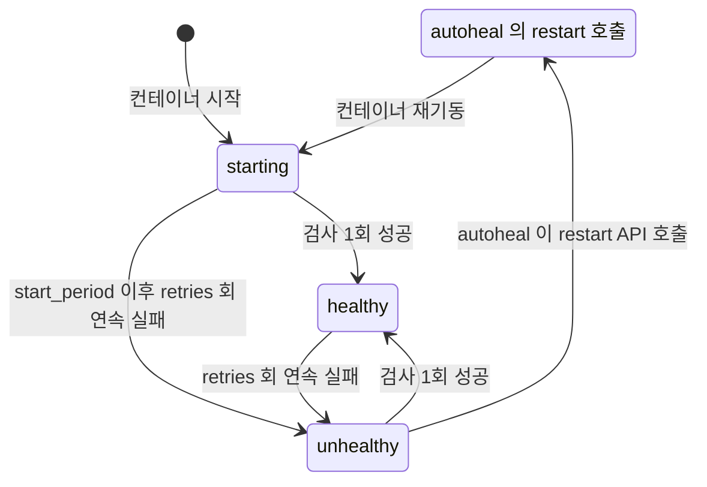
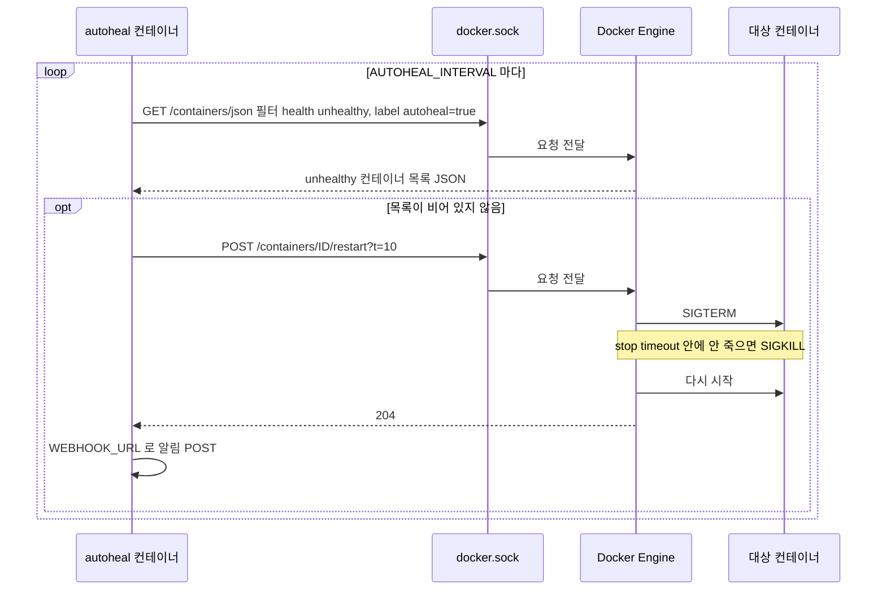
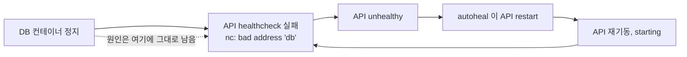
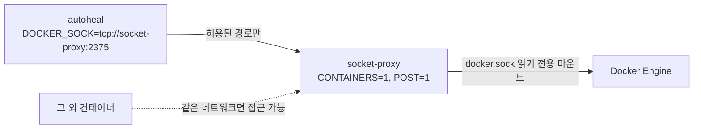
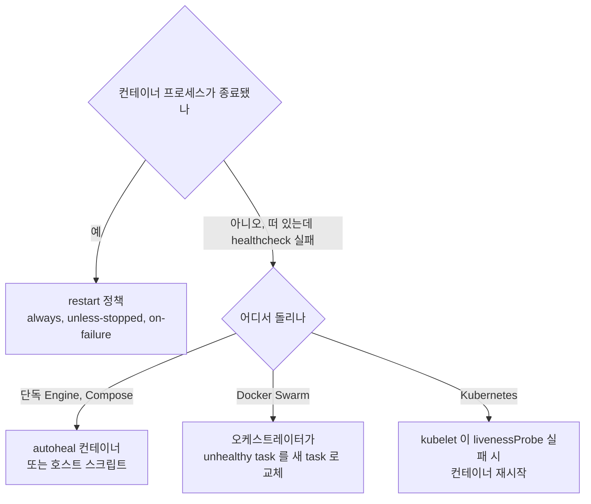

# Docker Autoheal

Compose 로 띄운 서버에 healthcheck 를 달면 `docker ps` 에 `(unhealthy)` 가 찍힌다. 거기서 끝이다. 누군가 재시작해 줄 거라고 기대하기 쉬운데 아무도 하지 않는다. willfarrell/autoheal 은 이 빈자리를 메우는 작은 컨테이너다.

이 문서의 로그와 수치는 전부 `/tmp` 에서 직접 돌린 결과다.

- Docker Engine 29.1.3
- Docker Compose v2.29.7 (standalone 바이너리)
- willfarrell/autoheal:latest (2026-10-29 pull)
- tecnativa/docker-socket-proxy:latest
- alpine:3.20

Swarm 과 Kubernetes 는 돌리지 않았고, 해당 절에 그렇게 적어 두었다.

## restart 정책은 unhealthy 를 보지 않는다

`restart: always` 와 `unless-stopped` 는 프로세스가 종료됐을 때만 동작한다. 프로세스가 살아 있고 healthcheck 만 실패하는 상태는 감시 대상이 아니다. 직접 확인했다.

```yaml
services:
  api:
    image: alpine:3.20
    command: sh -c "touch /tmp/healthy; sleep 3600"
    restart: always
    healthcheck:
      test: ["CMD-SHELL", "test -f /tmp/healthy"]
      interval: 2s
      timeout: 1s
      retries: 2
```

기동 후 `docker exec api rm /tmp/healthy` 로 healthcheck 를 망가뜨리고 12초 뒤에 본 상태다.

```text
status=unhealthy restarts=0 running=true started=2026-10-29T05:05:33.167587187Z
```

기동 직후 찍어 둔 `started` 값과 같다. `unhealthy` 인데 재시작은 한 번도 일어나지 않았고 컨테이너는 계속 `running` 이다. 데드락이 걸린 서버, 커넥션 풀이 고갈돼 요청에 응답하지 않는 서버가 정확히 이 상태가 된다. 프로세스는 멀쩡하니 exit 가 없고, 사람이 `docker restart` 를 칠 때까지 방치된다.

### healthcheck 상태가 바뀌는 조건

Engine 이 계산하는 health 상태는 세 개다. autoheal 은 이 상태를 읽을 뿐 판정에는 관여하지 않는다.



`unhealthy` 에서 나가는 화살표가 두 개다. 스스로 회복해서 `healthy` 로 돌아가는 경로는 Engine 이 알아서 처리한다. `restart_call` 쪽 경로는 autoheal 이 있을 때만 존재하고, 재시작되면 상태가 `starting` 으로 초기화된다.

`start_period` 동안의 실패는 `retries` 에 세지 않는다. 기동이 느린 앱에 이 값을 주지 않으면 앱이 뜨기도 전에 `unhealthy` 로 넘어가고, 그 순간부터 autoheal 의 재시작 대상이 된다. 실제로 재시작 루프에 빠지는 모습은 뒤에서 본다.

기억해 둘 숫자는 두 개다. 장애가 발생해서 재시작이 시작되기까지는 최대 `interval × retries + AUTOHEAL_INTERVAL` 초가 걸리고, 재시작이 끝나기까지는 거기에 stop timeout 이 최대 10초 더 붙는다. 이 문서의 최종 예제처럼 `interval: 5s`, `retries: 3`, `AUTOHEAL_INTERVAL=5` 면 감지에 15~20초가 든다.

## autoheal 이 하는 일

autoheal 은 Docker 이벤트를 구독하지 않는다. 이미지에 들어 있는 `/docker-entrypoint` 를 읽어 보면 셸 스크립트이고, `AUTOHEAL_INTERVAL` 초마다 `curl` 로 Engine API 를 조회하는 폴링 루프다. `jq` 로 응답을 거르고, 걸리는 컨테이너가 있으면 restart 를 호출한다.



조회 한 번과 restart 한 번이 전부다. 이벤트를 쓰지 않으니 `unhealthy` 로 바뀌는 순간 즉시 반응하지는 않고, 최악의 경우 `AUTOHEAL_INTERVAL` 만큼 늦는다. `docker events --filter event=health_status` 는 사람이 상태 변화를 지켜볼 때 쓰는 명령이고 autoheal 은 쓰지 않는다.

### 대상을 고르는 규칙

조회 URL 에 `health=unhealthy` 필터가 박혀 있다. healthcheck 가 없는 컨테이너는 Engine 이 `unhealthy` 로 분류할 방법이 없으니 어떤 설정을 해도 목록에 나오지 않는다.

기본 모드에서는 라벨이 `autoheal=true` 인 컨테이너만 대상이다. 환경변수로 동작을 바꾼다. 아래 기본값은 이미지의 `Config.Env` 를 덤프해서 확인했다.

| 환경변수 | 기본값 | 설명 |
|---|---|---|
| `AUTOHEAL_CONTAINER_LABEL` | `autoheal` | 감시할 라벨 이름. `all` 이면 라벨 필터를 빼고 전체가 대상 |
| `AUTOHEAL_INTERVAL` | `5` | 조회 주기(초) |
| `AUTOHEAL_START_PERIOD` | `0` | autoheal 자신이 시작 후 감시를 미루는 시간(초) |
| `AUTOHEAL_DEFAULT_STOP_TIMEOUT` | `10` | restart 호출의 `t` 값(초). SIGTERM 이후 SIGKILL 까지의 대기 |
| `AUTOHEAL_ONLY_MONITOR_RUNNING` | `false` | `true` 면 `running` 상태만 조회 |
| `WEBHOOK_URL` | 빈 값 | 재시작 결과를 JSON 으로 POST |
| `WEBHOOK_JSON_KEY` | `content` | 웹훅 JSON 의 키 이름 |
| `DOCKER_SOCK` | `/var/run/docker.sock` | `tcp://host:port` 도 지정 가능 |

`AUTOHEAL_START_PERIOD` 이름 때문에 컨테이너별 유예 시간으로 오해하기 쉽다. 8초로 주고 돌려 보니 로그에 `Monitoring containers for unhealthy status in 8 second(s)` 가 찍히고 autoheal 자신이 8초 쉬었다 시작했다. 이미 떠 있는 대상에는 영향이 없다. 느리게 뜨는 앱을 보호하는 값은 앱 쪽 healthcheck 의 `start_period` 다.

웹훅은 이렇게 나간다. `WEBHOOK_URL` 에 로컬 수신기를 붙여 받은 본문이다.

```text
application/json {
  "content":"Container ah8-target (b5b54996b43a) found to be unhealthy. Successfully restarted the container!"
}
```

`content` 는 Discord 웹훅이 기대하는 키다. Slack 은 `text` 를 쓰므로 `WEBHOOK_JSON_KEY=text` 로 바꿔야 한다.

### 컨테이너 쪽에서 거는 라벨

대상 컨테이너에 붙이는 라벨이 두 개 더 있다. 둘 다 실험으로 확인했다.

- `autoheal=False` 는 대상에서 뺀다. `AUTOHEAL_CONTAINER_LABEL=all` 일 때도 제외된다. 대소문자까지 `False` 여야 하고, 이 비교는 스크립트에 `autoheal` 라벨로 고정돼 있다.
- `autoheal.stop.timeout=2` 는 컨테이너별 stop timeout 이다. 같은 조건에서 이 라벨을 준 쪽은 restart 로그 후 2초 만에, 주지 않은 쪽은 10초 만에 다시 올라왔다.

autoheal 이 restart 를 호출해도 Engine 의 `RestartCount` 는 오르지 않는다. 이 값은 restart 정책이 센 횟수만 담는다. 아래 실험에서 autoheal 이 재시작한 뒤에도 `restarts=0` 이었다. 재시작 이력은 autoheal 로그, `State.StartedAt`, 이벤트 로그에서 읽어야 한다.

## Compose 에서 쓰는 모양

API 서비스와 autoheal 서비스를 한 파일에 둔다. 아래 파일 그대로 `up` 해서 확인했다. alpine 컨테이너가 3초 뒤에 `/tmp/healthy` 를 만드는 방식으로 느린 기동을 흉내 낸다. 실제 서비스에서는 `healthcheck.test` 를 앱의 헬스 엔드포인트 호출로 바꾼다.

```yaml
services:
  api:
    image: alpine:3.20
    init: true
    restart: always
    labels:
      autoheal: "true"
    command: sh -c "sleep 3; touch /tmp/healthy; exec sleep 3600"
    healthcheck:
      test: ["CMD-SHELL", "test -f /tmp/healthy"]
      interval: 5s
      timeout: 2s
      retries: 3
      start_period: 10s

  autoheal:
    image: willfarrell/autoheal:latest
    restart: always
    environment:
      AUTOHEAL_INTERVAL: "5"
      AUTOHEAL_DEFAULT_STOP_TIMEOUT: "10"
    volumes:
      - /var/run/docker.sock:/var/run/docker.sock
```

`up -d` 후 `docker exec api rm /tmp/healthy` 로 장애를 만들면 autoheal 로그에 한 줄이 남는다.

```text
29-10-2026 05:15:54 Container /fin-api-1 (24596aa89ff4) found to be unhealthy - Restarting container now with 10s timeout
```

`restart: always` 는 그대로 둔다. autoheal 은 unhealthy 만 맡고, 프로세스가 죽는 경우와 호스트 재부팅 후 복구는 restart 정책이 맡는다. autoheal 이미지에는 `pgrep -f autoheal` 을 쓰는 자체 healthcheck 가 들어 있어서, `docker ps` 에서 autoheal 도 `(healthy)` 로 보인다.

### 재시작이 10초 걸리는 이유

처음 돌린 예제는 `init: true` 가 없었고, 컨테이너의 PID 1 이 `sleep` 이었다. 이벤트를 찍어 보니 이렇게 나왔다.

```text
1793250370 health_status: unhealthy
1793250372 kill        <- SIGTERM
1793250382 kill        <- SIGKILL, 정확히 10초 뒤
1793250382 die
1793250383 start
1793250385 health_status: healthy
```

리눅스 커널은 PID 1 프로세스에 기본 시그널 핸들러를 달아 주지 않는다. 앱이 SIGTERM 핸들러를 직접 등록하지 않았다면 SIGTERM 은 무시되고, stop timeout 이 끝난 뒤 SIGKILL 이 들어간다. `sh -c` 로 감싼 실행도 같은 결과다. `init: true` 를 주면 init 프로세스가 PID 1 이 돼서 시그널을 자식에게 넘긴다. 같은 stop timeout 10초에서 `init: true` 를 준 컨테이너는 autoheal 재시작 로그 간격이 6~7초였다. 10초를 다 기다리지 않았다는 뜻이다. 정상 종료 처리가 필요한 앱은 `autoheal.stop.timeout` 을 늘리고, 그럴 필요가 없는 앱은 줄인다.

### 소켓을 읽기 전용으로 마운트하면

`/var/run/docker.sock:/var/run/docker.sock:ro` 로 마운트하면 restart 호출이 막힐 거라고 기대하기 쉽다. 직접 돌려 봤다. `docker inspect` 로 마운트가 `RW=false` 인 것을 확인했고, 그 상태에서 `/tmp/healthy` 를 지웠더니 autoheal 이 재시작을 호출했고 `StartedAt` 이 바뀌었다. `:ro` 는 소켓 파일을 수정하는 권한을 막을 뿐, 소켓에 연결해서 API 를 호출하는 것은 막지 못한다. 보안 목적으로 `:ro` 를 믿으면 안 된다.

## 조용히 깨지는 곳

### 의존 DB 가 죽으면 API 만 계속 재시작된다

API 의 healthcheck 가 DB 연결까지 확인하는 경우다. DB 를 내렸더니 API 가 `unhealthy` 가 됐고, autoheal 이 API 를 재시작했다. DB 는 그대로 죽어 있으니 API 는 다시 `unhealthy` 가 된다.



원인인 DB 는 그대로인데 증상인 API 만 순환한다. 45초 동안 5번 재시작됐다. `docker ps` 에는 API 가 `Up 2 seconds (health: starting)` 으로 계속 보이니, 로그를 안 보면 서비스가 기동 중인 줄 안다.

"재시작을 반복하면 로그가 유실된다"는 말을 흔히 하는데, 기본 설정에서는 확인되지 않았다. 5번 재시작한 뒤 `docker logs` 에는 기동 로그가 6줄(최초 1 + 재시작 5) 그대로 남아 있었고, 컨테이너 쓰기 레이어의 `/tmp` 파일도 6줄이었다. 재시작은 컨테이너를 새로 만들지 않기 때문이다. 사라지는 건 프로세스 메모리에 있던 사건 당시의 상태다. 스레드 덤프를 뜰 틈이 없고, 커넥션 풀이 왜 고갈됐는지 볼 수 없게 된다.

healthcheck 에는 그 컨테이너 자기 프로세스가 응답하는지만 넣는 편이 낫다. DB 연결 확인까지 넣으려면 DB 장애 때 API 재시작이 의미 없다는 점을 알고 넣어야 한다. 재시작으로 해결되지 않는 원인이 있는 서비스는 `autoheal=False` 로 빼 두는 것도 방법이다.

### start_period 를 안 두면 재시작 루프에 빠진다

기동에 15초 걸리는 앱 두 개를 같은 autoheal 아래 50초 동안 돌렸다. 둘 다 `interval: 2s`, `retries: 2` 이고 `start_period` 만 다르다.

| 서비스 | start_period | autoheal 재시작 횟수 | 50초 후 상태 |
|---|---|---|---|
| no-start-period | 없음 | 7회 | unhealthy |
| with-start-period | 20s | 0회 | healthy |

`no-start-period` 는 기동 후 7초쯤 지나 `unhealthy` 가 됐고 재시작되면 다시 처음부터 15초를 기다린다. 앱이 healthy 가 되는 15초에 닿지 못하므로 영원히 빠져나오지 못한다. 마이그레이션이나 캐시 워밍으로 기동이 오래 걸리는 서비스에서 흔히 생기고, `start_period` 는 기동 시간의 최댓값보다 넉넉하게 잡아야 한다.

### healthcheck 도 라벨도 없으면 대상이 아니다

라벨과 healthcheck 조합별로 `/tmp/healthy` 를 지워서 `unhealthy` 로 만든 뒤 15~25초 기다린 결과다.

| 컨테이너 | 기본 모드 | `AUTOHEAL_CONTAINER_LABEL=all` |
|---|---|---|
| `autoheal=true` + healthcheck | 재시작 | 재시작 |
| 라벨 없음 + healthcheck | 그대로 unhealthy | 재시작 |
| `autoheal=False` + healthcheck | 그대로 unhealthy | 그대로 unhealthy |
| `autoheal=true`, healthcheck 없음 | 대상 아님 | 대상 아님 |

Compose 파일에서 `autoheal: true` 처럼 따옴표 없이 써도 v2.29.7 의 `config` 출력은 `autoheal: "true"` 로 바꿔 준다. 오류는 나지 않는다. 다만 `docker run --label` 같은 다른 경로와 값이 같다는 걸 눈으로 확인하기 쉬워서 이 문서의 예제는 따옴표를 붙였다.

`all` 모드는 같은 Engine 에서 도는 다른 팀의 컨테이너까지 건드린다. 공용 호스트에서는 켜지 않는다.

### healthcheck 명령이 항상 실패하는 경우

slim 이미지나 alpine 에는 `curl` 이 없다. healthcheck 를 `curl -f http://localhost:8080/health` 로 쓰면 앱이 멀쩡해도 영원히 실패한다. autoheal 은 이 실패와 진짜 장애를 구분하지 못한다. 두 가지 쓰기 방식으로 `Health.Log` 를 비교했다.

```text
# CMD-SHELL 형식
1 '/bin/sh: curl: not found\n'

# CMD 배열 형식
-1 'OCI runtime exec failed: exec failed: unable to start container process: exec: "curl": executable file not found in $PATH'
```

셸 형식은 종료 코드 1 에 `curl: not found`, 배열 형식은 종료 코드 `-1` 이다. 둘 다 `unhealthy` 가 되고, 라벨이 붙어 있으면 앱이 재시작 루프에 들어간다. 새 이미지에 healthcheck 를 처음 붙일 때는 autoheal 라벨을 붙이기 전에 `docker inspect` 로 `Health.Log` 를 읽어 명령 자체가 실행되는지 본다.

### depends_on 의 service_healthy 와 겹칠 때

`depends_on` 의 `condition: service_healthy` 는 `docker compose up` 시점에만 평가된다. 두 가지 결과를 확인했다.

첫째, 기동에 15초 걸리는 DB 에 `start_period` 없이 `retries: 2` 를 주면 `up` 자체가 실패한다.

```text
dependency failed to start: container ah5b-db-1 is unhealthy
exit=1
```

DB 는 `Up (unhealthy)` 로 남고 의존하는 API 는 `Created` 상태에서 시작되지 않았다. 이 시점에는 autoheal 이 개입할 여지가 없다. `up` 이 끝나지 않았기 때문이다.

둘째, 반대 방향이다. 앞의 DB 중단 실험에서 DB 는 `Exited` 인데 API 는 autoheal 의 재시작을 받아 `Up` 이었다. autoheal 이 호출하는 restart API 는 `depends_on` 조건을 다시 보지 않는다. `depends_on` 이 기동 순서만 보장한다는 사실은 [Docker Compose](Docker_Compose.md#depends_on과-healthcheck) 에도 있다. 순서 보장이 런타임 복구까지 이어지지 않으므로 앱 코드의 DB 재연결 로직은 여전히 필요하다.

## docker.sock 은 호스트 root 와 같다

autoheal 에게 소켓을 주면 Engine API 전체를 주는 셈이다. 컨테이너를 만들고 지우고, 호스트 디렉터리를 마운트한 privileged 컨테이너를 띄울 수 있다. autoheal 이미지나 그 안의 curl, jq 에 취약점이 생기면 호스트까지 넘어간다. `:ro` 는 앞에서 봤듯이 방어가 못 된다.

tecnativa/docker-socket-proxy 를 끼우면 autoheal 은 소켓 대신 프록시의 TCP 포트에 붙는다. 프록시가 환경변수로 켠 API 경로만 통과시킨다.



```yaml
services:
  socket-proxy:
    image: tecnativa/docker-socket-proxy:latest
    environment:
      CONTAINERS: "1"
      POST: "1"
    volumes:
      - /var/run/docker.sock:/var/run/docker.sock:ro

  autoheal:
    image: willfarrell/autoheal:latest
    restart: always
    environment:
      DOCKER_SOCK: tcp://socket-proxy:2375
    depends_on: [socket-proxy]
```

autoheal 쪽에는 `docker.sock` 마운트가 없다. 설정을 바꿔 가며 호출 결과를 확인했다.

왼쪽 열의 create, exec, DELETE 결과는 `ALLOW_RESTARTS=1` 을 함께 준 상태에서 잰 값이다.

| 호출 | CONTAINERS=1, POST 없음 | CONTAINERS=1, POST=1 |
|---|---|---|
| `GET /containers/json` | 200 | 200 |
| `POST /containers/ID/restart` | 실패, autoheal 로그에 `Restarting container ... failed` 반복 | 성공 |
| `GET /containers/ID/json` | 200 | 200 |
| `POST /containers/create` (privileged, `/:/host`) | 403 | 201 |
| `POST /containers/ID/exec` | 403 | 201 |
| `DELETE /containers/ID?force=true` | 403 | 204, 컨테이너 삭제됨 |
| `GET /images/json`, `GET /volumes` | 403 | 403 |

여기서 세 가지를 얻는다.

1. `POST=1` 을 켜는 순간 `/containers/` 아래의 쓰기 호출이 전부 열린다. restart 만 쓰고 싶었는데 컨테이너 생성, exec, 삭제까지 통과한다. `/:/host` 를 마운트한 privileged 컨테이너를 만들 수 있으니 호스트 root 와 사실상 같다. 이미지·볼륨 조회가 막히는 정도의 차이다.
2. restart 만 여는 `ALLOW_RESTARTS=1` 이 있지만, 이 이미지 버전에서는 단독으로 동작하지 않았다. 설정 파일의 첫 규칙이 `deny unless METH_GET || { env(POST) -m bool }` 라서 `POST` 가 꺼져 있으면 `ALLOW_RESTARTS` 규칙에 도달하기 전에 거부된다. `ALLOW_RESTARTS=1` 만 주고 돌렸더니 restart 가 실패했다.
3. 조회 응답에 컨테이너의 `Config.Env` 가 그대로 담긴다. 확인용으로 넣은 `DB_PASSWORD=s3cret-for-test` 가 프록시 너머에서 그대로 읽혔다. 비밀번호를 환경변수로 주입하는 컨테이너가 같은 Engine 에 있다면 프록시도 이 유출은 막지 못한다.

프록시가 줄여 주는 건 이미지·볼륨 같은 나머지 API 의 노출뿐이고, `POST=1` 이후의 위험은 그대로 남는다. 프록시 컨테이너에는 `ports:` 를 열지 않고 autoheal 과 같은 내부 네트워크에만 둔다. 도식의 점선처럼 같은 네트워크에 있는 다른 컨테이너는 프록시에 접근할 수 있으므로, 프록시 전용 네트워크를 따로 만들어 autoheal 만 붙이는 편이 안전하다. 컨테이너 런타임 설정 전반은 [Docker 컨테이너 보안](../../../Security/Container_Security.md)에 정리돼 있다.

소켓을 컨테이너에 아예 주기 싫으면 호스트에서 cron 이나 systemd timer 로 아래 한 줄을 돌리는 방법이 있다. `hs-target` 으로 시험했을 때 unhealthy 인 컨테이너가 재시작됐다. 권한은 호스트 쪽 스크립트 실행 계정이 가지므로 컨테이너 이미지 하나가 공급망에서 빠진다.

```bash
docker ps --filter health=unhealthy --filter label=autoheal=true -q | xargs -r docker restart -t 10
```

## Swarm, Kubernetes 와의 선택

이 문서의 실험은 단독 Engine 에서만 했고 Swarm 과 Kubernetes 는 돌리지 않았다. 아래는 각 공식 문서 기준이다.



| 환경 | unhealthy 를 보는 주체 | 동작 |
|---|---|---|
| 단독 Engine + Compose | 아무도 없음 | autoheal 이나 외부 스크립트가 필요 |
| Docker Swarm | 오케스트레이터 | healthcheck 가 실패한 task 를 종료하고 새 task 로 교체 |
| Kubernetes | kubelet | livenessProbe 실패 시 해당 컨테이너를 재시작 |

Kubernetes 는 Dockerfile 의 `HEALTHCHECK` 를 읽지 않고 Pod spec 의 `livenessProbe`, `readinessProbe` 를 쓴다. 이미지에 HEALTHCHECK 를 넣어 두었다고 쿠버네티스에서 자동 복구가 되는 것이 아니다. Deployment 예제와 probe 설정은 [Kubernetes](../Kubernetes.md) 에, HEALTHCHECK 옵션 문법은 [Dockerfile](Dockerfile.md#healthcheck-문법) 에 있다.

Kubernetes 에는 `readinessProbe` 가 따로 있어서, 의존 서비스 장애로 트래픽만 끊고 재시작은 하지 않는 구성이 가능하다. Compose 의 단일 healthcheck 는 이 둘을 구분하지 못한다. 앞의 DB 중단 사례가 Compose 에서 문제가 되는 이유다.

autoheal 로 시작하는 쪽은 Compose 로 단일 호스트에서 운영하는 서비스다. 호스트가 두 대 이상이거나 롤링 배포가 필요해지면 autoheal 을 늘려 가기보다 오케스트레이터로 옮기는 편이 낫다.

## 상태 확인과 원인 추적

autoheal 이 뭘 했는지, 왜 재시작이 반복되는지 볼 때 쓰는 명령이다. 모두 실행해서 출력 형식을 확인했다.

```bash
# 재시작 이력. 라벨이 안 맞으면 아무 줄도 안 나온다
docker logs autoheal

# 지금 unhealthy 인 컨테이너
docker ps --filter health=unhealthy --format '{{.Names}} | {{.Status}}'

# 현재 상태
docker inspect --format '{{.State.Health.Status}}' api

# 최근 검사 5회의 종료 코드와 출력. 실패 원인은 여기에 있다
docker inspect --format '{{json .State.Health.Log}}' api

# 마지막으로 시작된 시각. autoheal 재시작 여부를 판단하는 기준
docker inspect --format '{{.State.StartedAt}}' api

# 상태 전이와 재시작을 시간순으로
docker events --filter container=api \
  --filter event=health_status --filter event=kill --filter event=die --filter event=start \
  --format '{{.Time}} {{.Action}}'
```

`Health.Log` 는 최근 5건만 남는다. 앞서 `nc: bad address 'db'`, `curl: not found` 같은 원인이 모두 이 필드에서 나왔다. 재시작이 반복될 때는 autoheal 로그를 볼 것이 아니라 이 필드를 먼저 본다. autoheal 로그는 "재시작했다"만 알려 주고 이유는 말하지 않는다.

`State.Health` 는 healthcheck 가 없는 컨테이너에는 키 자체가 없다. 이런 컨테이너에 `{{.State.Health.Status}}` 를 쓰면 `map has no entry for key "Health"` 로 템플릿 오류가 난다. 여러 컨테이너를 한 번에 훑는 스크립트에서는 조건을 붙인다.

```bash
docker inspect --format '{{.Name}} {{if .State.Health}}{{.State.Health.Status}}{{else}}no-healthcheck{{end}}' api
```

`RestartCount` 로 autoheal 의 재시작을 세려고 하면 항상 0 이 나온다는 점도 다시 적어 둔다. 이 숫자로 알림을 걸었다면 autoheal 이 도는 순간부터 무용지물이다. 대신 `WEBHOOK_URL` 알림 횟수나 `docker events` 의 `start` 횟수를 센다.
