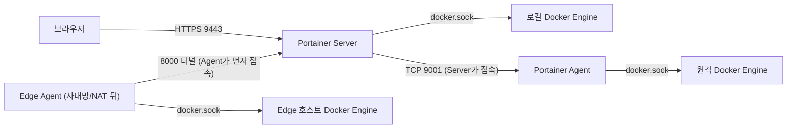
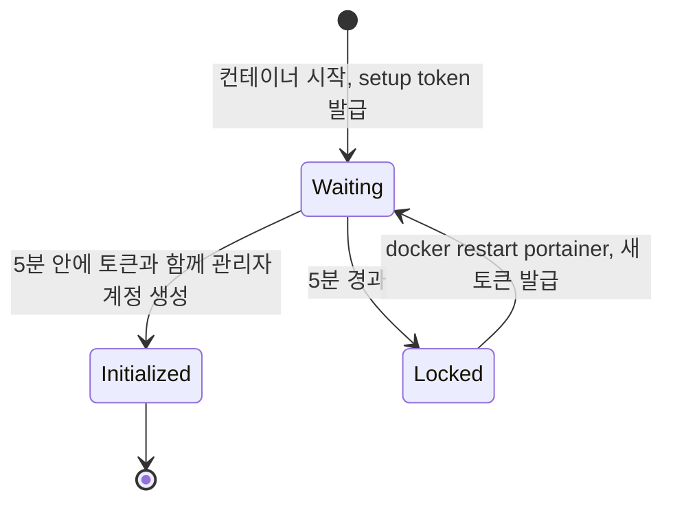
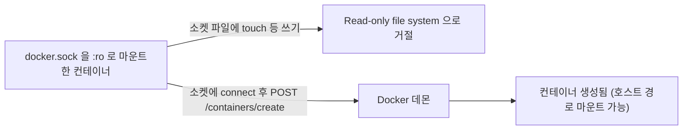
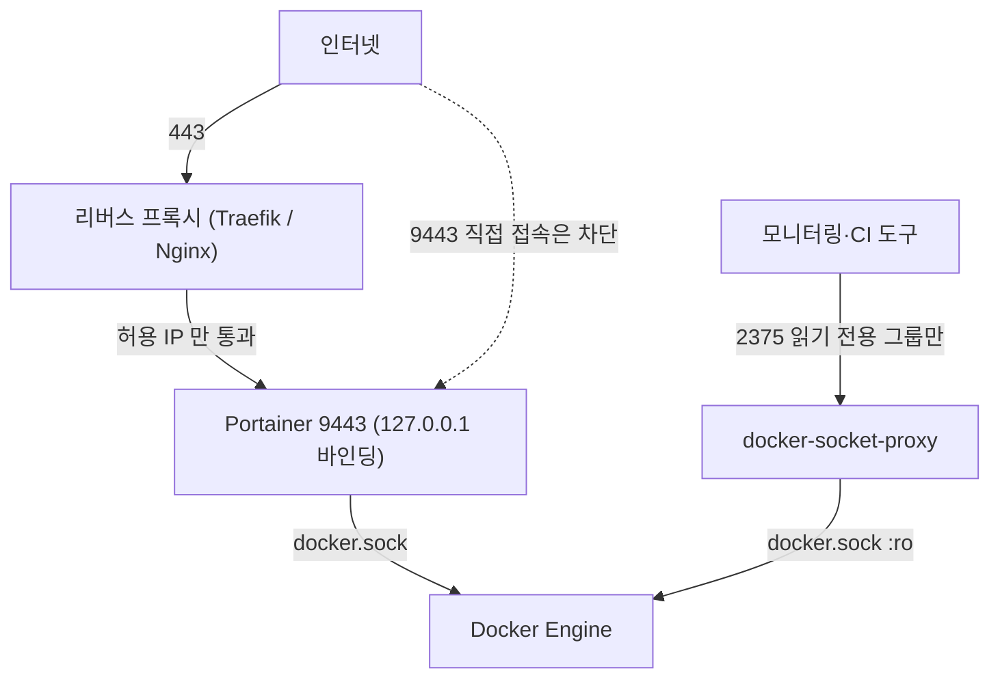
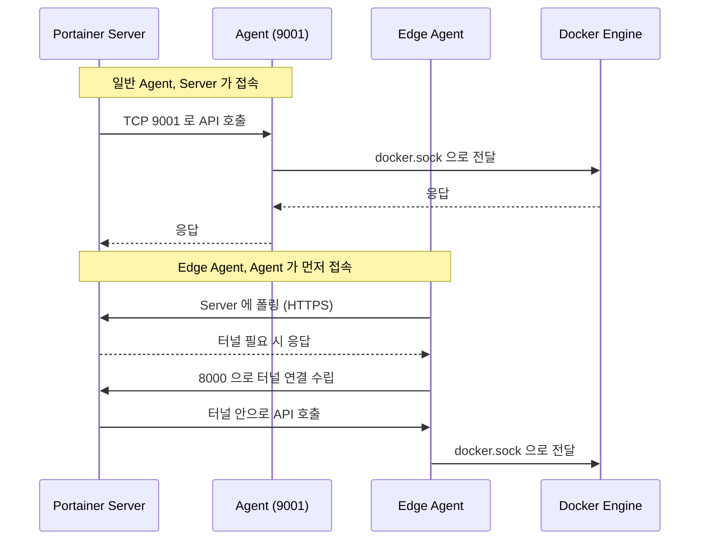
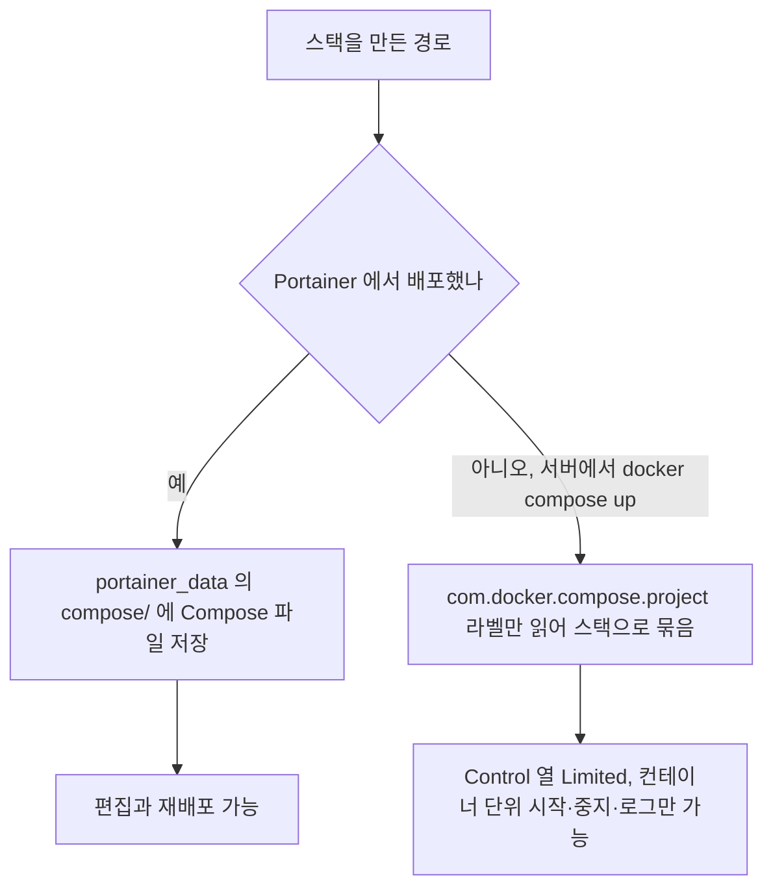
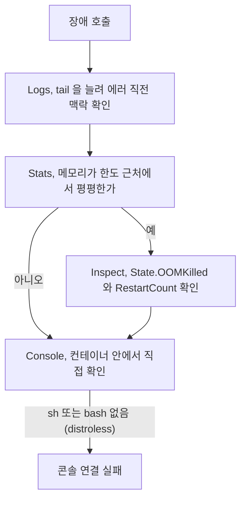
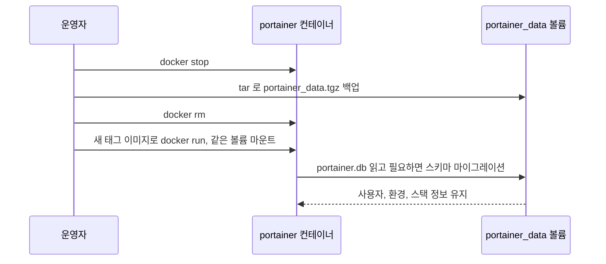
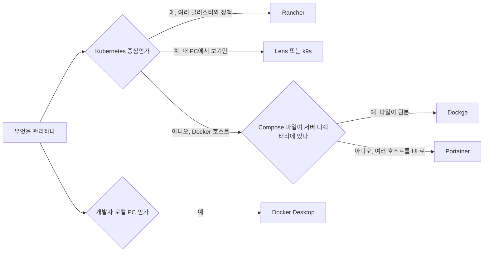

# Portainer

Docker 호스트가 서너 대로 늘면 SSH 로 들어가 `docker ps` 를 치는 일이 하루에 수십 번이 된다. Portainer 는 그 자리를 웹 UI 로 대신하는 컨테이너다. 컨테이너 목록, 로그, 콘솔, 스택 배포를 브라우저에서 한다. 편하다. 그런데 이 편함의 대가가 `docker.sock` 이고, 이 문서의 절반은 그 대가가 실제로 무엇인지 적는 데 쓴다.

이 문서의 명령은 Docker 29.1.3, Portainer CE 2.45.3 에서 직접 실행했다. `docker run` 으로 Server 띄우기, `:ro` 마운트 쓰기 테스트, docker-socket-proxy, 볼륨 백업, 컨테이너 교체 업그레이드는 실제로 돌려서 출력을 확인했다. Edge Agent, LDAP·OAuth, Git 연동 스택, Swarm·Kubernetes 환경은 이 환경에서 돌리지 못했고, 해당 절에서 그렇게 표시했다.

## 구성 요소와 에디션

Portainer 는 두 종류의 컨테이너로 이뤄진다.

- Server: 웹 UI 와 API 를 제공하고, 환경(Environment) 목록과 사용자·스택 정보를 `/data` 의 BoltDB 파일(`portainer.db`)에 저장한다.
- Agent: 관리 대상 호스트에서 돌며 Server 의 요청을 그 호스트의 Docker Engine 으로 전달한다.

Server 가 떠 있는 호스트 하나만 관리한다면 Agent 는 필요 없다. Server 컨테이너에 `/var/run/docker.sock` 을 직접 마운트하면 그 호스트가 "local" 환경으로 잡힌다.

에디션은 CE(Community)와 Business 두 개다. CE 는 무료이고 환경 연결, 스택 배포, 로그·콘솔 같은 기본 기능을 다 쓴다. Business 는 유료이고 세분화된 RBAC, 레지스트리 접근 제어, 일부 Edge 기능 등이 붙는다. 어느 기능이 어느 에디션인지는 버전마다 조금씩 움직이므로 도입 전에 현재 버전의 공식 비교표를 봐야 한다. 무료 노드 수로 Business 를 쓸 수 있는 라이선스 정책도 있었는데, 조건이 바뀌는 항목이라 문서에는 숫자를 적지 않는다.

배포 형태는 관리 대상이 무엇이냐로 갈린다.

| 대상 | Server 가 붙는 방식 | 메모 |
|---|---|---|
| 단일 Docker 호스트 | `docker.sock` 직접 마운트 | 가장 단순. 이 문서의 기본 구성 |
| Docker Swarm | Agent 를 global 서비스로 배포 | 노드마다 Agent 가 하나씩 뜬다 |
| Kubernetes | Agent 를 클러스터에 배포 | Docker 와 화면 구조가 다르다. 이 문서는 Docker 중심 |
| Amazon ECS | Business 기능 | 이 문서에서는 다루지 않는다 |

아래 도식은 이 문서 전체에서 반복되는 통신 구조다. 화살표 방향을 보면 된다. 일반 Agent 는 Server 가 Agent 로 접속하고, Edge Agent 는 반대로 Agent 가 Server 로 먼저 접속한다.



## Server 를 띄우는 명령

`docker run` 으로 띄우는 최소 형태다.

```bash
docker volume create portainer_data

docker run -d \
  --name portainer \
  --restart=always \
  -p 9443:9443 \
  -p 8000:8000 \
  -v /var/run/docker.sock:/var/run/docker.sock \
  -v portainer_data:/data \
  portainer/portainer-ce:2.45.3
```

포트 두 개의 역할이 다르다. 9443 은 웹 UI 와 API 의 HTTPS 포트이고, 8000 은 Edge Agent 가 터널을 맺을 때만 쓴다. Edge 를 안 쓴다면 `-p 8000:8000` 은 빼도 된다. 포트를 열어 둘 이유가 없다. 이 버전의 로그에는 `starting HTTP server | bind_address=:9000` 도 찍히는데, 9000 은 `-p` 로 퍼블리시하지 않으면 호스트 밖에서 닿지 않는다.

이미지 태그는 `latest` 대신 버전을 박는다. `latest` 로 두면 `docker pull` 한 번에 메이저가 바뀌고, 롤백하려 해도 `portainer_data` 의 DB 스키마가 이미 올라가 있다.

Compose 로 쓰면 아래와 같다. 같은 호스트의 리버스 프록시 뒤에 둘 계획이라 9443 을 루프백에만 바인딩했다.

```yaml
services:
  portainer:
    image: portainer/portainer-ce:2.45.3
    container_name: portainer
    restart: unless-stopped
    ports:
      - "127.0.0.1:9443:9443"
      # Edge Agent 를 쓸 때만 연다
      # - "8000:8000"
    volumes:
      - /var/run/docker.sock:/var/run/docker.sock
      - portainer_data:/data

volumes:
  portainer_data:
```

`restart: unless-stopped` 와 `always` 의 차이는 Docker 데몬 재시작 후에 드러난다. 사람이 `docker stop` 으로 끈 컨테이너를 `always` 는 데몬이 다시 올릴 때 같이 살리고, `unless-stopped` 는 그대로 둔다. Portainer 는 점검 중에 일부러 내리는 일이 있어서 나는 `unless-stopped` 를 쓴다.

### 초기 관리자 계정과 시간 제한

Portainer 는 처음 뜬 뒤 5분 안에 관리자 계정을 만들지 않으면 인스턴스를 잠근다. 2.45.3 에서 컨테이너를 띄우고 5분을 그냥 흘려보냈더니 로그에 이 줄이 찍혔다.

```text
the Portainer instance timed out for security purposes, to re-enable your Portainer instance, you will need to restart Portainer
```

잠긴 뒤에는 `/` 요청이 307 리다이렉트로 빠지고, 계정 생성 API 는 `Administrator initialization timeout` 을 돌려준다. 외부에 노출된 미초기화 인스턴스를 아무나 먼저 선점하지 못하게 하는 장치다. 서버를 띄워 놓고 점심 먹고 오면 이 화면을 만난다. 복구는 컨테이너 재시작이다.

```bash
docker restart portainer
```

재시작하면 5분 타이머가 새로 시작한다. 데이터는 `portainer_data` 에 있으므로 날아가지 않는다. 2.45.3 에서는 여기에 한 겹이 더 있다. 시작할 때마다(계정이 없는 동안) 로그에 setup token 이 찍히고, 이 토큰 없이는 계정 생성 API 가 거부한다. 재시작하면 토큰도 새로 발급된다. 실제로 잠금 전에 받아 둔 토큰과 재시작 뒤 로그의 토큰은 값이 달랐고, 새 토큰으로 계정 생성이 성공했다.

```bash
docker logs portainer 2>&1 | grep setup_token
# setup_token=<64자 hex>
# Paste it into the setup screen, or send it in the X-Setup-Token header.
# Start with --no-setup-token to disable.
```

아래 상태도는 위 동작을 한 장으로 묶은 것이다. 잠긴 상태에서 빠져나오는 길이 재시작 하나뿐이라는 점을 보면 된다.



토큰 없이 `POST /api/users/admin/init` 를 부르면 `Invalid or missing setup token` 이 돌아온다. 토큰을 `X-Setup-Token` 헤더에 넣으면 계정이 만들어진다. 로그를 오래된 것부터 `grep` 하면 재시작 전의 만료된 토큰을 집을 수 있으니 `tail -1` 로 마지막 줄을 쓴다. 자동화 스크립트로 Portainer 를 띄우는 경우에는 이 토큰 때문에 초기화 단계가 깨질 수 있다. 로그에서 토큰을 읽어 넘기거나, 격리된 망에서만 `--no-setup-token` 을 쓴다.

## docker.sock 마운트는 호스트 root 와 같다

Portainer 에 `/var/run/docker.sock` 을 넘기면 Portainer 는 Docker API 를 마음대로 부를 수 있다. Docker API 로 할 수 있는 일 중에 호스트 파일시스템 전체를 컨테이너에 마운트하는 것이 있다. 즉 Portainer 에 로그인한 관리자, 그리고 Portainer 의 취약점을 찌른 공격자는 호스트 root 와 같은 권한을 얻는다. 컨테이너 격리는 이 시점에서 의미가 없다.

### `:ro` 를 붙여도 막히지 않는다

소켓을 읽기 전용으로 마운트하면 안전하다고 생각하기 쉽다. 직접 해봤다. 소켓을 `:ro` 로 마운트한 컨테이너 안에서 `docker create` 를 실행했다.

```bash
docker run --rm -v /var/run/docker.sock:/var/run/docker.sock:ro docker:cli \
  sh -c 'docker create --name ro_test alpine:3.20 true; docker ps -a --filter name=ro_test --format "{{.Names}} {{.Status}}"'
# <컨테이너 ID>
# ro_test Created
```

컨테이너가 만들어졌다. 같은 컨테이너에서 소켓 파일 자체에 쓰려고 하면 `touch: /var/run/docker.sock: Read-only file system` 으로 막힌다. `:ro` 는 마운트된 파일시스템에 대한 쓰기(파일 생성·수정·삭제)를 막는 플래그다. 유닉스 소켓에 `connect()` 해서 HTTP 요청을 보내는 것은 파일에 쓰는 동작이 아니라서 걸리지 않는다. API 의 `POST /containers/create` 는 그냥 지나간다.

아래 도식에서 `:ro` 가 막는 지점과 막지 못하는 지점을 나란히 본다.



### docker-socket-proxy 를 앞에 두기

소켓에 필터를 거는 방법은 `tecnativa/docker-socket-proxy` 같은 프록시다. 프록시만 소켓을 잡고, 다른 컨테이너는 프록시의 TCP 포트로 접속한다. 프록시는 HAProxy 로 요청 경로를 보고 환경변수로 허용한 API 그룹만 통과시킨다.

```bash
docker network create sp_test
docker run -d --name sp_proxy --network sp_test \
  -e CONTAINERS=1 \
  -v /var/run/docker.sock:/var/run/docker.sock:ro \
  tecnativa/docker-socket-proxy

docker run --rm --network sp_test docker:cli sh -c '
  export DOCKER_HOST=tcp://sp_proxy:2375
  docker ps --format "{{.Names}}" | head -3     # 통과
  docker create --name sp_test alpine:3.20 true # Request forbidden by administrative rules.
  docker images                                 # Request forbidden by administrative rules.
'
```

`CONTAINERS=1` 만 켠 프록시는 컨테이너 목록 조회(GET)를 통과시키고, `POST` 가 꺼져 있어서 `create` 는 `Request forbidden by administrative rules.` 로 거절한다. `IMAGES` 도 꺼져 있으니 이미지 목록도 막힌다.

그런데 Portainer 를 이 프록시 뒤에 두면 얻는 것이 제한적이다. Portainer 는 컨테이너 생성·삭제·exec 같은 쓰기 API 를 써야 하니 `POST=1` 과 `CONTAINERS`, `IMAGES`, `NETWORKS`, `VOLUMES`, 콘솔을 쓰려면 `EXEC` 까지 켜야 한다. `POST=1` 로 컨테이너 생성이 열려 있는 이상 호스트 마운트 컨테이너를 만들 수 있다는 구멍은 그대로다. 프록시로 막는 것은 `BUILD`, `SECRETS`, `SWARM` 같은 일부 그룹뿐이다. 프록시가 진짜로 효과를 내는 곳은 Portainer 가 아니라 Traefik, 모니터링 에이전트, CI 러너처럼 목록 조회만 필요한 도구다. 이 환경에서는 Portainer 를 프록시 뒤에 붙여보지 않았다. 붙인다면 통계나 콘솔처럼 허용하지 않은 API 그룹을 쓰는 화면이 막힐 수 있으니, 켜는 그룹을 하나씩 늘려가며 화면마다 확인해야 한다.

### 9443 을 인터넷에 열지 않는다

현실적으로 할 수 있는 방어는 Portainer 의 노출면을 줄이는 쪽이다. 인터넷에서 `:9443` 이 열린 Portainer 는 스캐너가 찾는 목록에 올라간다. 로그인 화면 하나가 호스트 root 로 가는 문이다.



도식의 위쪽 줄기가 Portainer 보호 구성이다. 9443 은 `127.0.0.1` 에만 바인딩하고, 앞의 프록시가 허용 IP 대역만 통과시킨다. 아래쪽 줄기는 Portainer 와 별개로 읽기 전용 도구가 소켓을 직접 잡지 않도록 프록시를 끼운 구성이다.

Nginx 에서 IP 를 제한하고 업스트림을 HTTPS 로 잡는 최소 설정이다. Portainer 의 9443 은 자체 서명 인증서를 쓰므로 `proxy_ssl_verify off` 가 필요하다. 웹소켓(콘솔, 로그 스트림)이 지나가므로 업그레이드 헤더도 넘긴다.

```nginx
server {
    listen 443 ssl;
    server_name portainer.example.com;

    allow 203.0.113.0/24;   # 사무실 대역
    deny  all;

    location / {
        proxy_pass https://127.0.0.1:9443;
        proxy_ssl_verify off;
        proxy_http_version 1.1;
        proxy_set_header Upgrade $http_upgrade;
        proxy_set_header Connection "upgrade";
        proxy_set_header Host $host;
    }
}
```

웹소켓 헤더를 빼먹으면 로그인과 목록은 정상인데 컨테이너 콘솔만 연결에 실패한다. 프록시가 `Upgrade` 를 버려서 생기는 증상이고, Portainer 자체의 문제로 오해하기 쉽다.

## 원격 호스트를 붙이는 세 가지 방법

관리 대상이 Server 와 다른 호스트라면 연결 방식을 고른다.



위 시퀀스에서 봐야 할 것은 연결을 시작하는 쪽이다. 일반 Agent 는 Server 가 Agent 의 9001 로 들어간다. Edge Agent 는 방향이 반대라서, 사내망이나 NAT 뒤에 있는 호스트에서 인바운드 포트를 열 필요가 없다.

| 항목 | Agent | Edge Agent | docker.sock 직접 |
|---|---|---|---|
| 연결 주도 | Server → Agent | Agent → Server | Server 컨테이너가 로컬 소켓 사용 |
| 필요한 포트 | Agent 호스트의 9001 인바운드 | Server 의 8000(터널), 9443(HTTPS) 아웃바운드 | 없음 |
| 사내망·NAT 뒤 | 포트포워딩이나 VPN 필요 | 그대로 붙는다 | 해당 없음 (같은 호스트만) |
| 대상 범위 | 원격 호스트 다수 | 원격 호스트 다수, 연결이 불안정한 곳 | Server 가 도는 호스트 1대 |
| 설정 난이도 | 방화벽 한 줄 | 키 발급 후 에이전트에 주입 | `-v` 한 줄 |

### Agent 모드와 9001 방화벽

Agent 는 대상 호스트에서 이렇게 띄운다. Portainer UI 의 환경 추가 화면이 이 명령을 만들어 주는데, 버전을 박은 형태로 쓰는 것이 좋다.

```bash
docker run -d \
  --name portainer_agent \
  --restart=always \
  -p 9001:9001 \
  -v /var/run/docker.sock:/var/run/docker.sock \
  -v /var/lib/docker/volumes:/var/lib/docker/volumes \
  portainer/agent:2.45.3
```

AWS 에서는 Agent 호스트의 보안 그룹에서 9001 의 소스를 Portainer Server 의 보안 그룹이나 고정 IP 로만 연다. `0.0.0.0/0` 으로 열면 Agent 가 `docker.sock` 을 쥐고 있는 포트를 인터넷에 내놓는 셈이다. Agent 는 Server 와 TLS 로 통신하지만 연결 주체를 제한하는 것은 방화벽의 몫이다. 환경을 추가하고 "Down" 이 뜨면 대부분 9001 이 막힌 것이다. Server 컨테이너 안에서 `nc -zv <Agent IP> 9001` 로 먼저 확인한다.

### Edge Agent

Edge Agent 는 Server 에서 키를 발급하고 그 키를 Agent 컨테이너에 환경변수로 주입해서 쓴다. Agent 가 Server 에 먼저 접속하므로 Agent 쪽 방화벽은 인바운드가 필요 없다. 대신 Server 쪽에서 8000 과 9443 이 Agent 가 있는 망에서 닿아야 한다. 앞 절에서 9443 을 인터넷에서 닫으라고 했는데, Edge 를 쓰면 이 두 포트를 Edge 호스트의 IP 에만 열거나 VPN 안으로 넣어야 해서 구성이 한 번 더 복잡해진다. 이 환경에서 Edge Agent 를 실제로 띄워보지는 못했다. 그래서 정확한 명령은 UI 가 키와 함께 만들어 주는 것을 쓰고, 여기서는 방향만 적는다.

### 버전 불일치

Server 를 2.45.3 으로 올려 놓고 Agent 를 옛 버전으로 둔 환경이 어느 날 "Down" 으로 바뀌는 일이 있다. Portainer 문서는 Server 와 Agent 의 버전을 맞추도록 안내한다. 원인은 Server 가 호출하는 Agent API 가 버전마다 바뀌는 데 있다. 점검 순서는 Server 로그에서 해당 환경의 에러를 먼저 보고, 다음으로 `docker inspect portainer_agent --format '{{.Config.Image}}'` 로 Agent 태그를 확인하는 것이다. Server 를 올릴 때 Agent 도 같은 태그로 같이 올리는 것을 절차에 넣어 두면 이 문제는 거의 안 생긴다. 호스트가 여러 대면 이 작업이 번거로워서 Agent 태그를 `latest` 로 두고 싶어지지만, 그러면 호스트마다 올라간 시점이 달라 더 나쁘다.

## Stack 기능

Stack 은 Compose 파일 하나를 Portainer 가 관리하는 배포 단위다. 배포 방법은 세 가지다. 웹 에디터에 YAML 을 붙여 넣거나, 파일을 업로드하거나, Git 저장소를 연결한다.

환경변수는 UI 에서 키-값을 넣거나 `.env` 파일을 올려 주입한다. 이 값은 Compose 파일의 `${VAR}` 치환에 쓰이고, Portainer 의 DB 에 저장된다. 저장된 환경변수에 DB 비밀번호가 들어 있으면 `portainer_data` 백업 파일에도 같이 들어간다. 백업 파일의 보관 권한을 서버 수준으로 다뤄야 한다.

Git 연동은 저장소 URL, 브랜치, Compose 파일 경로를 지정한다. 자동 업데이트는 폴링(주기 지정)이나 웹훅 두 방식이다. 폴링은 지정한 간격으로 저장소를 당겨 와서 변경이 있으면 재배포하고, 웹훅은 Portainer 가 만들어 주는 URL 을 Git 서버의 push 이벤트에 걸어 둔다. 웹훅 URL 은 토큰이 경로에 박힌 형태라서 URL 이 유출되면 누구든 재배포를 트리거할 수 있다. Git 연동 스택은 이 환경에서 직접 돌려보지 못했으므로 세부 동작은 본인 환경에서 확인해야 한다.

### Portainer 가 만든 스택만 편집된다

Stack 편집 기능의 제약이 가장 자주 부딪히는 지점이다. Portainer 는 자기가 배포한 스택의 Compose 파일을 `portainer_data` 의 `compose/` 디렉터리에 저장해 두고 있기 때문에 UI 에서 편집하고 다시 배포할 수 있다. 위 백업 목록에서 `compose/` 디렉터리가 나온 이유다.

서버에서 `docker compose up -d` 로 먼저 띄운 컨테이너는 Portainer 에게 원본 파일이 없다. Portainer 는 컨테이너의 `com.docker.compose.project` 라벨을 읽어서 스택으로 묶어 보여줄 뿐이다. 이런 스택은 목록에서 Control 열이 Limited 로 표시되고, 편집·재배포 대신 컨테이너 단위 조작(시작, 중지, 로그)만 된다. 같은 이름으로 Portainer 에서 스택을 새로 만들면 이름 충돌이 나거나 기존 컨테이너를 덮어쓸 수 있으니, 이전하려면 기존 스택을 `docker compose down` 한 뒤 Portainer 에서 새로 배포하는 순서로 한다. 볼륨을 쓰는 스택이면 `down -v` 를 쓰지 않는다.

아래 도식은 스택이 어떻게 만들어졌느냐에 따라 Portainer 가 할 수 있는 일이 갈리는 지점을 보여준다.



여기서 Portainer 를 도입하는 시점의 선택이 갈린다. 이미 Compose 파일이 서버 디렉터리와 Git 에 있는 팀이라면 Portainer 를 "보는 도구" 로만 쓰고 배포는 기존 방식을 유지하는 편이 마찰이 적다. 배포까지 Portainer 로 옮기면 Compose 파일의 원본이 두 곳(서버 디렉터리, Portainer 의 compose/)으로 갈라진다.

## 권한 관리와 외부 인증

Portainer 는 사용자를 Team 으로 묶고, Team 에 Environment 접근 권한과 Role 을 준다. 어느 환경에서 누가 무엇을 할 수 있는지를 환경 단위로 나누는 구조다. 이 중 Role 로 세분화된 권한(읽기 전용 사용자, 헬프데스크, 스탠다드 사용자 등)은 Business 에디션 쪽 기능이다. CE 에서는 사실상 관리자와 일반 사용자로 나뉘고, 환경 접근을 사용자·팀 단위로 제한하는 정도에 머무는 경우가 많다. CE 에서 "개발자는 운영 환경 컨테이너를 보기만 하게" 같은 요구를 받으면 Role 이 모자란다. 이 부분은 버전마다 달라질 수 있어서 도입 전에 현재 버전에서 실제 계정을 만들어 확인하는 것이 확실하다.

외부 인증으로는 LDAP(Active Directory 포함)와 OAuth 가 있다. 이 환경에서는 외부 인증 서버가 없어 실행해 보지 못했다. 알려진 주의점만 적는다.

- 내장 관리자 계정은 외부 인증과 별개로 남는다. 이 계정의 비밀번호 관리가 허술하면 SSO 를 붙인 의미가 없어진다.
- OAuth 의 리다이렉트 URI 는 리버스 프록시 뒤의 외부 도메인과 정확히 일치해야 한다. 프록시 뒤에서 `https://localhost:9443` 로 등록하면 IdP 가 콜백을 거부한다.
- LDAP 로 로그인한 사용자는 처음에는 권한이 없는 상태로 생긴다. Team 매핑을 설정하지 않으면 로그인은 되는데 환경이 하나도 안 보이는 화면을 만난다.

## 장애를 추적할 때 쓰는 화면

컨테이너 상세 화면에는 Logs, Inspect, Stats, Console 이 있다. 새벽에 호출을 받았을 때 노트북만 열고 SSH 없이 보는 순서는 다음과 같다.

로그 화면은 `docker logs` 와 같은 출력이다. 줄 수 제한(tail)과 타임스탬프 표시 옵션이 있고, 기본값이 작으면 에러 직전 맥락이 잘리니 늘려서 본다. Stats 는 CPU·메모리·네트워크 그래프로, 메모리 한도가 걸린 컨테이너가 한도 근처에서 평평해지는 모양이면 OOM kill 을 의심한다. 이어서 Inspect 에서 `State.OOMKilled` 와 `RestartCount` 를 본다. 재시작이 계속되는 컨테이너는 `docker logs` 에 직전 실행의 마지막 출력만 남아 있어서 원인이 사라진 뒤일 수 있다. Console 은 `docker exec` 의 웹 버전이라 컨테이너 안에 `sh` 나 `bash` 가 있어야 열린다. distroless 이미지는 콘솔 연결 자체가 실패한다.

위 순서를 도식으로 그리면 아래와 같다. 어느 화면에서 어느 화면으로 넘어가는지, 그리고 Console 이 마지막 수단이라는 점을 본다.



콘솔은 컨테이너 안에서 임의 명령을 실행하는 입구이기도 하다. 운영 환경에서 콘솔 접근을 모든 관리자에게 주는 것은 `docker.sock` 문제와 겹쳐서 위험하다. 누가 무엇을 쳤는지 남기는 감사 기능은 에디션에 따라 다르니 도입 전에 확인한다.

### 정리 작업의 위험

디스크가 찼을 때 이미지·볼륨 정리를 누르게 된다. Docker 의 `volume prune` 은 기본 동작이 헷갈리는 명령이다. 라벨 필터로 범위를 좁혀 이 호스트의 다른 볼륨을 건드리지 않고 직접 돌려봤다.

```bash
docker volume create --label t=1 named_vol

docker volume prune -f --filter label=t=1
# Total reclaimed space: 0B        <- 이름 있는 볼륨은 그대로
docker volume ls -q --filter name=named_vol
# named_vol

docker volume prune -f -a --filter label=t=1
# Deleted Volumes:
# named_vol
```

Docker 29.1.3 에서 `docker volume prune` 은 이름 없는(익명) 볼륨만 지우고, `-a`(`--all`) 를 붙이면 컨테이너가 쓰지 않는 이름 있는 볼륨도 지운다. Docker 23 이전에는 `-a` 없이도 미사용 볼륨이 전부 지워졌고, 이 차이가 사고 원인이 된다. 구버전 호스트와 신버전 호스트가 섞인 환경에서 같은 습관으로 `docker system prune --volumes` 를 치면 결과가 다르다.

Portainer 에서는 스택을 중지하면 그 스택의 볼륨이 "Unused" 로 표시된다. 컨테이너가 하나도 참조하지 않기 때문이다. 점검 중에 스택을 내려둔 상태에서 "Unused" 볼륨을 일괄 선택해 지우면 DB 데이터가 같이 날아간다. 컨테이너가 없다는 사실과 데이터가 필요 없다는 사실은 다르다. 정리는 이미지부터 하고, 볼륨은 이름을 보고 하나씩 지운다.

## portainer_data 백업과 업그레이드

Portainer 의 모든 상태는 `/data` 에 있다. 이 환경에서 만든 백업의 내용물이다.

```bash
docker stop portainer
docker run --rm \
  -v portainer_data:/data:ro \
  -v /backup:/backup \
  alpine:3.20 tar czf /backup/portainer_data.tgz -C /data .

tar tzf /backup/portainer_data.tgz
# ./compose/          Portainer 가 배포한 스택의 Compose 파일
# ./chisel/private-key.pem   Edge 터널용 키
# ./portainer.pub
# ./portainer.key
# ./bin/
# ./portainer.db      사용자, 환경, 설정, 스택 메타데이터
```

`portainer.db` 는 BoltDB 파일이라 실행 중에 복사하면 불완전한 상태가 잡힐 수 있어서 컨테이너를 멈춘 뒤 복사한다. 복구는 새 볼륨에 이 tgz 를 풀고 같은 이미지로 컨테이너를 띄우는 순서다. 백업 파일 안에는 암호화 키(`portainer.key`)와 스택 환경변수가 들어 있다. 이 파일은 비밀번호 파일과 같은 수준으로 보관한다.

업그레이드는 컨테이너를 교체하는 방식이다. 데이터가 볼륨에 있으므로 컨테이너는 버려도 된다. 직접 순서대로 돌려봤다.

```bash
docker stop portainer && docker rm portainer
docker pull portainer/portainer-ce:2.45.3
docker run -d --name portainer --restart=always \
  -p 9443:9443 \
  -v /var/run/docker.sock:/var/run/docker.sock \
  -v portainer_data:/data \
  portainer/portainer-ce:2.45.3
```

컨테이너를 지우고 같은 볼륨으로 다시 띄운 뒤 같은 계정으로 로그인했고(`/api/auth` 가 JWT 를 돌려줬다), 로그에 setup token 은 다시 나오지 않았다. 업그레이드 전에 위 백업을 먼저 뜬다. 메이저·마이너가 올라갈 때 DB 스키마가 마이그레이션되고, 옛 버전으로 되돌리면 그 DB 를 읽지 못하는 경우가 있어서 되돌릴 수 있는 지점은 백업 파일뿐이다. 업그레이드는 Server, Agent 순서로 같은 태그를 맞춘다.

백업과 교체의 순서는 아래와 같다. 데이터는 볼륨에 남고 컨테이너만 바뀐다는 점, 그리고 백업이 되돌릴 수 있는 유일한 지점이라는 점을 본다.



## 다른 도구와 비교

Portainer 는 "Docker 를 웹으로 본다" 가 목적일 때 맞는 도구다. 목적이 다르면 다른 도구가 낫다.



| 도구 | 맞는 상황 | 맞지 않는 상황 |
|---|---|---|
| Portainer | Docker 호스트 여러 대를 한 UI 로 보고, 팀원이 배포·로그 확인을 SSH 없이 해야 할 때 | Kubernetes 가 주력일 때. 화면은 있으나 클러스터 운영 도구로는 부족하다 |
| Rancher | Kubernetes 클러스터 여러 개의 인증·정책·프로비저닝을 한곳에서 관리할 때 | Docker 호스트 몇 대. Rancher 자체가 올리기 무거운 플랫폼이다 |
| Lens | 개발자 PC 에서 kubeconfig 로 클러스터를 보는 데스크톱 클라이언트가 필요할 때 | 서버에 상주하는 공용 UI 가 필요할 때 |
| k9s | 터미널에서 Kubernetes 리소스를 빠르게 훑는 사람 | 터미널을 안 쓰는 팀원이 있을 때 |
| Docker Desktop | 개발자 로컬 PC 의 컨테이너 | 서버 운영. 원격 호스트 관리가 목적이 아니다 |
| Dockge | Compose 파일이 호스트 디렉터리에 있고 그 파일을 그대로 편집·실행하고 싶을 때 | 환경이 여러 개이고 권한 분리가 필요할 때. 기능 범위가 Compose 관리로 좁다 |

Portainer 를 쓰지 말아야 할 상황을 정리하면 이렇다. 호스트가 한 대이고 SSH 로 충분한 팀에서는 Portainer 가 `docker.sock` 노출이라는 공격면만 더한다. 보안 감사 대상이라 컨테이너 접근 이력이 필수인 환경에서는 CE 의 권한·감사 기능이 모자란다. Compose 파일을 Git 의 단일 원본으로 두고 CI/CD 로 배포하는 팀은 Portainer 에서 Stack 을 편집하는 순간 원본이 갈라진다. 이런 곳에서는 Portainer 를 읽기 전용 계정으로 "보는" 용도에 한정하거나 아예 도입하지 않는 쪽이 맞다.

반대로 Portainer 가 잘 맞는 곳은 데이터 분석팀이나 QA 팀처럼 Docker 를 쓰긴 하지만 터미널이 낯선 사람이 포함된 소규모 팀이다. 로그 보기, 컨테이너 재시작, 스택 배포를 SSH 키 배포 없이 열어줄 수 있다. 다만 이 편의는 앞에서 본 대로 `docker.sock` 권한과 맞바꾼 것이다. 리버스 프록시와 IP 제한 뒤에 두고, 관리자 계정 수를 줄이고, `portainer_data` 백업을 정기적으로 뜨는 것까지가 도입 비용에 포함된다.
