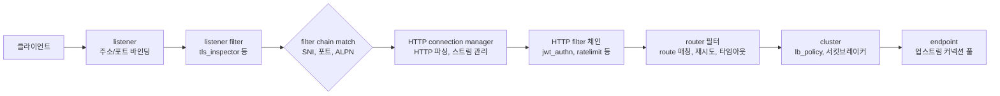
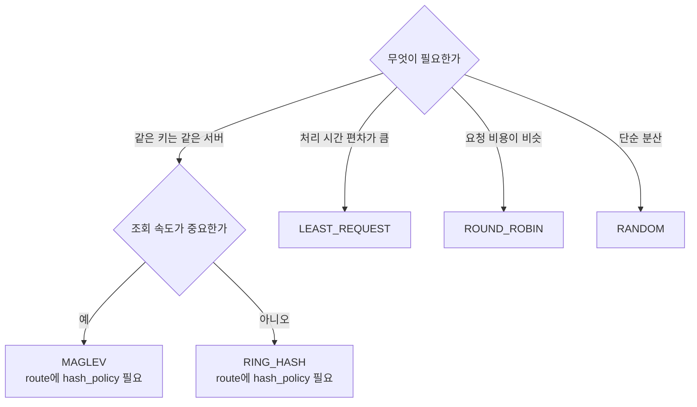
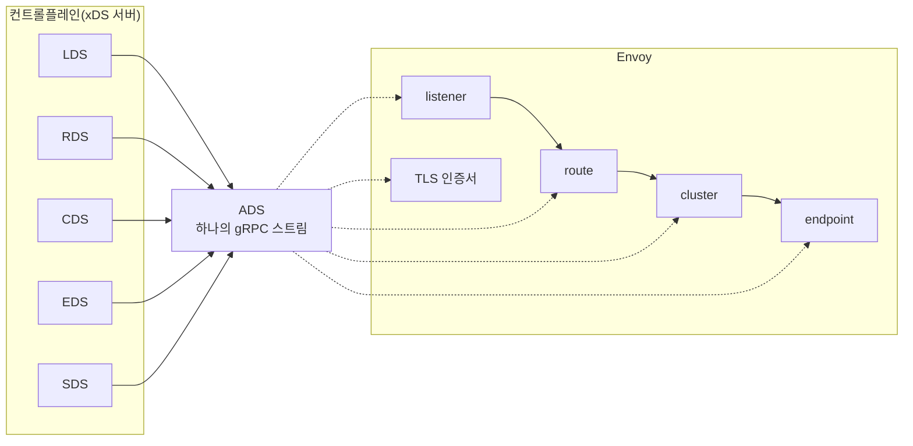
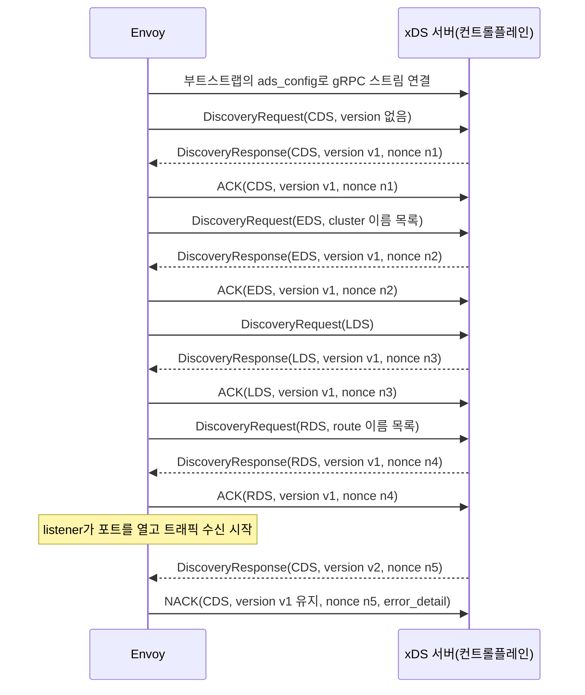
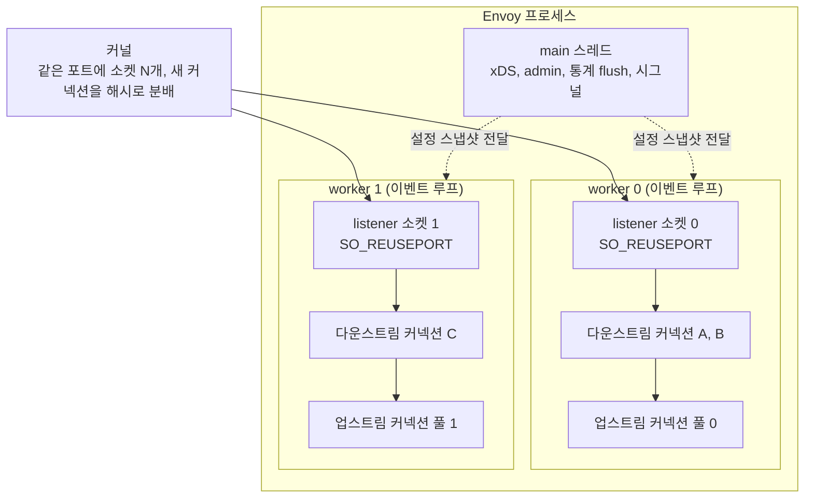
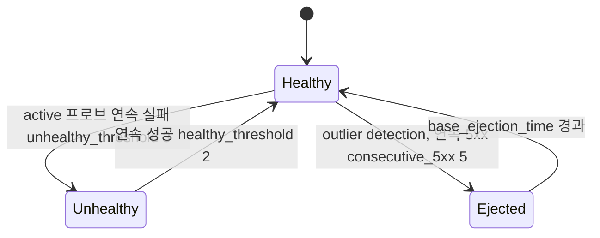
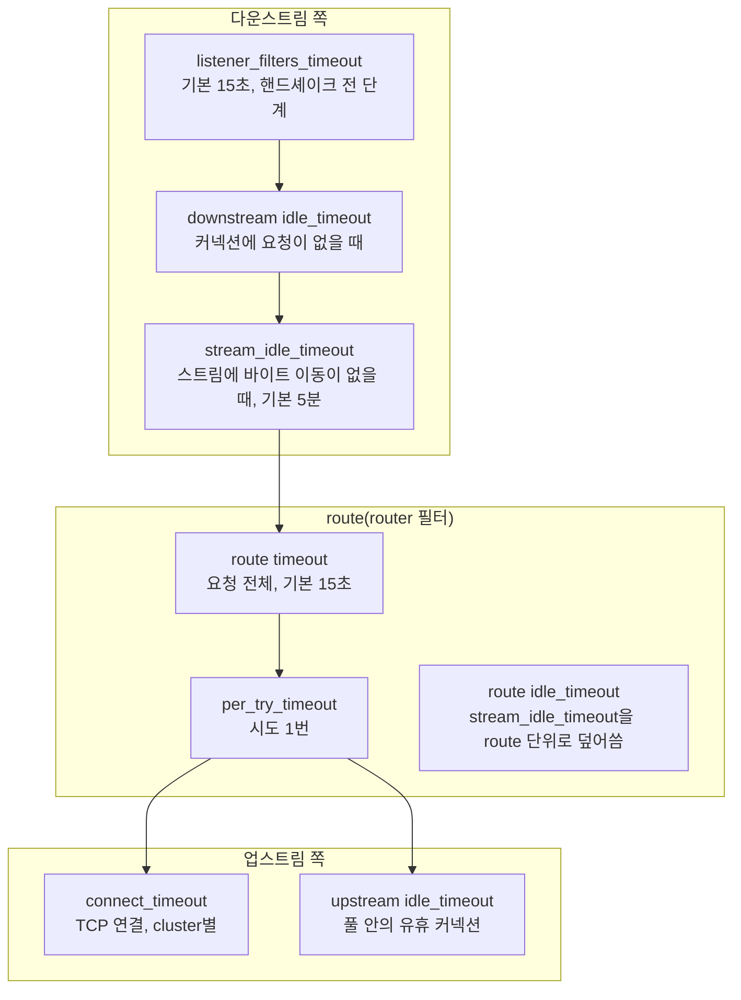
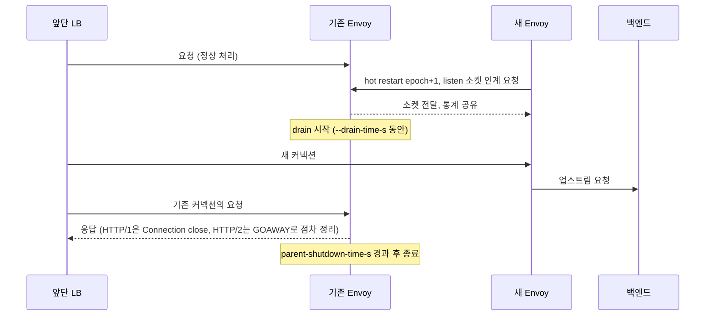
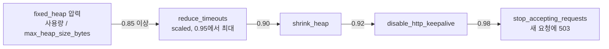
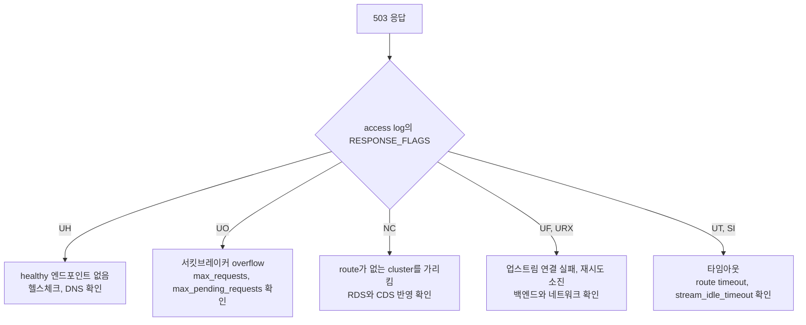

# Envoy

## Envoy를 만지게 되는 상황

HAProxy나 nginx로 충분한 환경이라면 Envoy를 굳이 꺼낼 일이 없다. Envoy가 들어오는 건 대개 두 경로다. 하나는 Istio나 Linkerd 같은 서비스 메시를 도입했더니 사이드카로 Envoy가 깔려 있어서 어쩔 수 없이 만지게 되는 경우, 다른 하나는 gRPC 트래픽을 제대로 분산해야 하는데 기존 LB로는 한계를 느낀 경우다.

gRPC는 HTTP/2 위에서 동작하고, HTTP/2는 하나의 TCP 커넥션에 여러 요청을 멀티플렉싱한다. HAProxy를 L4 모드로 쓰면 커넥션 단위로만 분산하니까, 클라이언트가 한 번 커넥션을 맺으면 그 뒤 모든 gRPC 호출이 같은 백엔드로 쏠린다. Envoy는 HTTP/2를 이해해서 같은 커넥션 안의 개별 스트림을 서로 다른 백엔드로 나눠 보낸다. 이게 처음 Envoy를 진지하게 보게 되는 결정적 이유인 경우가 많다.

Lyft에서 만들어 CNCF에 기부한 프로젝트고, C++로 작성됐다. 설정을 YAML이나 JSON으로 정적으로 줄 수도 있고, gRPC API로 런타임에 동적으로 밀어넣을 수도 있다. 이 동적 설정 기능이 서비스 메시의 컨트롤플레인이 데이터플레인을 제어하는 핵심 통로다.

## L4와 L7을 한 프로세스에서

Envoy는 L4(TCP/UDP) 프록시와 L7(HTTP) 프록시를 같은 바이너리에서 처리한다. 둘의 차이는 어떤 필터 체인을 listener에 붙이느냐로 결정된다.

L4 프록시는 TCP 페이로드를 들여다보지 않고 바이트 스트림을 그대로 흘려보낸다. `tcp_proxy` 필터를 쓴다. MySQL, Redis, 암호화된 패스스루 같은 트래픽에 쓴다.

L7 프록시는 HTTP 메시지를 파싱해서 경로, 헤더, 메서드를 보고 라우팅한다. `http_connection_manager` 필터를 쓰고, 이 안에 다시 라우팅 테이블과 여러 HTTP 필터가 들어간다. 경로 기반 라우팅, 헤더 조작, 재시도, 타임아웃, 인증 같은 게 전부 L7에서 일어난다.

같은 Envoy 인스턴스가 80번 포트는 L7으로, 3306번 포트는 L4로 동시에 처리하게 만들 수 있다. listener를 포트마다 따로 정의하면 된다.

## 설정의 네 기둥: listener, filter, cluster, route

Envoy 설정을 처음 보면 HAProxy의 frontend/backend처럼 한눈에 들어오지 않는다. 개념이 더 잘게 쪼개져 있어서다. 핵심은 네 개다.

- **listener**: 어느 주소/포트에서 요청을 받을지. HAProxy의 frontend에 해당한다.
- **filter chain**: listener로 들어온 트래픽을 어떻게 처리할지. L4면 `tcp_proxy`, L7이면 `http_connection_manager`.
- **route**: L7에서 어떤 요청을 어느 cluster로 보낼지. 경로/헤더 매칭 규칙.
- **cluster**: 실제 백엔드 서버 묶음(upstream). HAProxy의 backend에 해당한다. 여기에 엔드포인트 목록, 로드밸런싱 정책, 헬스체크, 서킷브레이커가 붙는다.

요청은 `listener → filter chain → route → cluster → endpoint` 순서로 흘러간다. listener가 입구, cluster가 출구라고 보면 된다. 실제로는 이 사이에 단계가 몇 개 더 있다. 아래 도식이 L7 요청 하나가 지나가는 전체 경로다.



문서에서 흔히 건너뛰는 앞쪽 두 단계가 실무에서 문제를 만든다. listener filter는 커넥션이 맺어진 직후, 데이터를 읽기 전에 도는 필터다. `tls_inspector`가 대표적이고, TLS ClientHello를 엿봐서 SNI와 ALPN을 뽑아낸다. 이 값이 있어야 바로 다음 단계인 `filter_chain_match`가 "api.example.com이면 이 체인, 아니면 저 체인" 식으로 고를 수 있다. `proxy_protocol` 필터는 앞단 NLB가 붙여준 PROXY 헤더에서 실제 클라이언트 IP를 꺼낸다. 이 필터를 켜놓은 listener에 PROXY 헤더 없이 일반 HTTP 요청을 보내면 Envoy가 커넥션을 바로 끊고 `downstream_cx_proxy_proto_error`가 오른다. v1.31에서 curl로 재현했다. 클라이언트에는 빈 응답으로 보이니, 헬스체크나 직접 호출 테스트가 갑자기 전부 실패하면 이 카운터부터 본다. 반대로 앞단은 PROXY 헤더를 붙이는데 Envoy에 필터가 없으면 첫 줄 `PROXY TCP4 ...`가 HTTP 요청 줄로 파싱돼 400이 난다. 클라이언트가 먼저 말하지 않는 프로토콜이면 헤더가 올 때까지 기다리다가 `listener_filters_timeout`(기본 15초)에서 끊긴다. 아무것도 보내지 않는 클라이언트로 재 보니 정확히 15.0초에 끊겼고 `downstream_pre_cx_timeout`이 올랐다.

filter chain은 커넥션당 하나만 선택된다. 매칭은 요청마다가 아니라 커넥션이 맺어질 때 한 번이다. 한 커넥션 위에서 `Host` 헤더가 바뀌어도 체인은 바뀌지 않는다. 호스트별 분기는 체인 선택이 아니라 route의 `virtual_hosts`가 맡는 일이다. 어느 체인에도 매칭되지 않으면 커넥션이 그냥 닫힌다. `server_names: ["a.example.com"]` 체인 하나만 둔 listener에 평문 HTTP와 다른 SNI의 TLS를 보내봤더니 둘 다 응답 없이 끊겼고 `listener.<주소>.no_filter_chain_match`만 2 올랐다. 클라이언트에는 connection reset이나 핸드셰이크 실패로 보이고 access log에는 아무것도 남지 않아서, 새 도메인을 추가했는데 "Envoy 로그에 요청이 없다"는 증상이면 이 카운터를 확인하면 된다.

```yaml
static_resources:
  listeners:
  - name: listener_http
    address:
      socket_address:
        address: 0.0.0.0
        port_value: 10000
    filter_chains:
    - filters:
      - name: envoy.filters.network.http_connection_manager
        typed_config:
          "@type": type.googleapis.com/envoy.extensions.filters.network.http_connection_manager.v3.HttpConnectionManager
          stat_prefix: ingress_http
          route_config:
            name: local_route
            virtual_hosts:
            - name: backend
              domains: ["*"]
              routes:
              - match:
                  prefix: "/"
                route:
                  cluster: service_backend
          http_filters:
          - name: envoy.filters.http.router
            typed_config:
              "@type": type.googleapis.com/envoy.extensions.filters.http.router.v3.Router

  clusters:
  - name: service_backend
    connect_timeout: 1s
    type: STRICT_DNS
    lb_policy: ROUND_ROBIN
    load_assignment:
      cluster_name: service_backend
      endpoints:
      - lb_endpoints:
        - endpoint:
            address:
              socket_address:
                address: backend.internal
                port_value: 8080
```

처음 이 YAML을 마주하면 `typed_config`와 `"@type"` 라인 때문에 질린다. 이건 Envoy 설정이 내부적으로 protobuf 메시지라서 그렇다. YAML은 protobuf를 사람이 쓰기 위한 표현일 뿐이고, `"@type"`은 이 블록을 어떤 protobuf 메시지로 해석할지 지정하는 타입 URL이다. 손으로 다 외울 수 없으니 공식 문서의 예제를 복사해서 고치는 식으로 작업하게 된다.

버전 표기(`v3`)도 주의해야 한다. Envoy는 API 버전을 올리면서 v2를 완전히 제거했다. 인터넷에 떠도는 오래된 예제가 `v2` 타입 URL을 쓰고 있으면 최신 Envoy에서 그대로 안 뜬다.

## cluster의 타입과 엔드포인트 발견

cluster의 `type`은 엔드포인트를 어떻게 알아내는지를 정한다.

- `STATIC`: IP를 설정에 직접 박는다.
- `STRICT_DNS`: DNS 이름을 주기적으로 조회해서 A 레코드 전부를 엔드포인트로 쓴다. 쿠버네티스 헤드리스 서비스와 잘 맞는다.
- `LOGICAL_DNS`: DNS를 조회하되 첫 응답 하나만 새 커넥션용으로 쓴다. 엔드포인트가 많은 외부 서비스(예: 대형 클라우드 API)에 쓴다.
- `EDS`: Endpoint Discovery Service. 엔드포인트 목록을 xDS API로 외부에서 받아온다. 서비스 메시가 이걸 쓴다.

`STRICT_DNS`를 쓸 때 자주 겪는 문제가 DNS TTL과 Envoy의 갱신 주기 불일치다. 백엔드 파드가 죽고 새 IP로 떴는데 Envoy가 옛 IP를 계속 들고 있으면 503이 난다. `dns_refresh_rate`를 짧게 주거나 헬스체크로 죽은 엔드포인트를 빨리 빼야 한다.

## lb_policy: 엔드포인트를 고르는 방식

cluster의 `lb_policy`는 요청 하나를 어느 엔드포인트에 보낼지 정한다. 기본은 `ROUND_ROBIN`이고, 바꿀 이유가 생기는 건 대개 백엔드 응답 시간이 고르지 않을 때나 같은 키가 같은 서버로 가야 할 때다.

| 정책 | 동작 | 쓰는 경우 | 주의 |
|---|---|---|---|
| `ROUND_ROBIN` | 가중치를 반영해 순서대로 | 요청 비용이 비슷한 stateless 서비스 | 느린 엔드포인트에도 같은 비율로 계속 보낸다 |
| `LEAST_REQUEST` | 무작위로 2개(`choice_count`)를 뽑아 active request가 적은 쪽 | 요청 처리 시간 편차가 큰 서비스, gRPC | 전체에서 최소를 찾는 게 아니라 2개 중 비교하는 방식이다 |
| `RING_HASH` | 해시 링 위에서 키에 가까운 엔드포인트 | 캐시 서버, 세션 친화성 | route에 `hash_policy`가 없으면 사실상 무작위가 된다 |
| `MAGLEV` | 고정 크기 룩업 테이블(`table_size` 기본 65537) | `RING_HASH`와 같은 용도, 조회가 빠르다 | 테이블 크기는 소수여야 하고 엔드포인트 수보다 훨씬 커야 분포가 고르다 |
| `RANDOM` | 무작위 | 헬스체크가 잘 도는 환경의 단순한 분산 | 요청 수가 적으면 쏠려 보인다 |

`ROUND_ROBIN`이 문제가 되는 전형적인 상황은 엔드포인트 한 대가 GC나 노이지 네이버로 느려졌을 때다. 라운드 로빈은 그 서버의 대기 요청이 쌓이든 말든 순번이 오면 보낸다. `LEAST_REQUEST`는 그 서버의 active request가 늘어나는 순간 선택에서 밀린다. 다만 이 정책은 Envoy 한 대가 보는 active request만 센다. 사이드카가 파드마다 있으면 각 사이드카는 자기가 보낸 요청만 알아서, 여러 클라이언트가 한 서버에 몰리는 건 못 본다.



도식은 위 표를 고르는 순서로 다시 그린 것이다. 해시 계열로 내려가면 cluster 설정만으로 끝나지 않고 route에도 `hash_policy`가 필요하다는 점이 갈림길이다.

해시 계열은 설정을 두 군데에 해야 한다. cluster에 정책을 쓰고, route에 무엇을 해시할지 적는다.

```yaml
# cluster
lb_policy: RING_HASH
ring_hash_lb_config:
  minimum_ring_size: 1024

# route
route:
  cluster: cache_backend
  hash_policy:
  - header:
      header_name: x-user-id
```

`hash_policy`를 빼먹으면 에러 없이 뜬다. 같은 `x-user-id: u1` 요청 20번을 엔드포인트 2개짜리 cluster에 보내봤을 때, 정책이 있으면 20번이 전부 한 서버로 갔고 정책이 없으면 9번/11번으로 흩어졌다. 해시 키가 없으니 무작위로 고르고, "같은 사용자가 같은 서버로 안 간다"는 증상만 남는다. 헤더 대신 쿠키(`cookie`), 소스 IP(`connection_properties`)도 키로 쓸 수 있다. 링 크기가 작으면 엔드포인트 사이 분포가 고르지 않으니 `minimum_ring_size`를 엔드포인트 수보다 충분히 크게 둔다.

### 가중치와 locality

엔드포인트 개별 가중치는 `lb_endpoint`의 `load_balancing_weight`로 준다. 카나리 배포에서 새 버전 파드 쪽에 1, 기존 쪽에 9를 주는 식이다. 단, 쿠버네티스에서는 파드 수가 바뀌면 비율이 같이 바뀐다는 점을 계산에 넣어야 한다. 가중치가 파드 단위라서, 신버전 파드가 늘면 의도한 10%가 아니게 된다. 정확한 비율이 필요하면 endpoint 가중치 대신 route의 `weighted_clusters`로 cluster 단위로 나눈다.

```yaml
route:
  weighted_clusters:
    clusters:
    - name: backend_v1
      weight: 90
    - name: backend_v2
      weight: 10
```

locality는 엔드포인트를 리전/존 단위로 묶는 구조다. EDS가 엔드포인트마다 locality를 달아 보내면 Envoy는 요청을 같은 존으로 먼저 보내려 한다(zone aware routing). 켜려면 cluster manager에 `local_cluster_name`이 있어야 하고, 업스트림 cluster가 작으면(기본 `min_cluster_size` 6) 동작하지 않는다. 존 사이 트래픽 비용이 큰 AWS에서는 이 설정으로 크로스 AZ 비용이 눈에 띄게 줄지만, 존별 파드 수가 불균형하면 파드가 적은 존으로 보내진 트래픽이 그쪽에 몰린다. 존마다 파드가 고르게 있는지부터 본다.

헬스체크와 엮이는 동작도 있다. healthy 엔드포인트 비율이 `healthy_panic_threshold`(기본 50%) 밑으로 내려가면 Envoy는 헬스 상태를 무시하고 전체 엔드포인트로 분배한다. outlier detection으로 엔드포인트를 쫓아낸 효과가 이 구간에서는 사라진다. 이걸 직접 확인해 봤다. 엔드포인트 1개짜리 cluster에서 `consecutive_5xx: 2`로 추방을 걸고 500을 계속 보내면 `membership_healthy`는 0이 되는데, 기본값에서는 요청이 여전히 업스트림에 도달해 500이 그대로 돌아왔다. `healthy_panic_threshold`를 0으로 바꾸니 추방된 뒤 503이 즉시 나왔다. 어느 쪽이 맞는지는 서비스에 달렸다. 백엔드 전체가 에러를 내는 상황에서 "그래도 보내본다"가 나은 서비스가 있고, 빨리 실패시키는 게 나은 서비스가 있다.

## xDS: 설정을 런타임에 밀어넣기

Envoy의 진짜 차별점은 설정을 재시작 없이 동적으로 바꾸는 xDS API다. x는 와일드카드고, 각 리소스 종류마다 Discovery Service가 있다.

- **LDS** (Listener Discovery Service): listener
- **RDS** (Route Discovery Service): route
- **CDS** (Cluster Discovery Service): cluster
- **EDS** (Endpoint Discovery Service): endpoint
- **SDS** (Secret Discovery Service): TLS 인증서

이것들을 한 스트림으로 묶은 게 **ADS**(Aggregated Discovery Service)다. ADS를 쓰면 cluster가 만들어지기 전에 route가 그 cluster를 참조하는 순서 꼬임을 막을 수 있다. 서비스 메시에서는 거의 ADS를 쓴다.

동작 방식은 이렇다. Envoy가 부팅하면 부트스트랩 설정에 적힌 컨트롤플레인(xDS 서버)으로 gRPC 스트림을 연다. 컨트롤플레인은 현재 상태를 push하고, 이후 변경이 생길 때마다 새 설정을 push한다. Envoy는 받은 설정을 검증하고 적용한다. 백엔드 파드가 하나 추가되면 컨트롤플레인이 EDS로 새 엔드포인트를 밀어넣고, Envoy는 다음 요청부터 그 파드로도 트래픽을 보낸다. 재시작이 없다.



도식은 다섯 가지 Discovery Service가 각각 Envoy 안의 어느 리소스를 갱신하는지, 그리고 ADS가 이를 한 스트림으로 묶는다는 점을 보여준다.

```yaml
# 부트스트랩에서 컨트롤플레인을 가리키는 부분
dynamic_resources:
  ads_config:
    api_type: GRPC
    transport_api_version: V3
    grpc_services:
    - envoy_grpc:
        cluster_name: xds_cluster
  cds_config:
    ads: {}
  lds_config:
    ads: {}

static_resources:
  clusters:
  - name: xds_cluster
    connect_timeout: 1s
    type: STRICT_DNS
    typed_extension_protocol_options:
      envoy.extensions.upstreams.http.v3.HttpProtocolOptions:
        "@type": type.googleapis.com/envoy.extensions.upstreams.http.v3.HttpProtocolOptions
        explicit_http_config:
          http2_protocol_options: {}
    load_assignment:
      cluster_name: xds_cluster
      endpoints:
      - lb_endpoints:
        - endpoint:
            address:
              socket_address:
                address: control-plane.internal
                port_value: 18000
```

### 스트림 순서와 ACK/NACK

부팅부터 트래픽을 받기까지의 순서를 시퀀스로 보면 ADS가 왜 필요한지 보인다. 도식에서 볼 부분은 Envoy가 응답마다 ACK를 돌려보낸다는 점, 그리고 EDS와 RDS 요청이 CDS와 LDS 응답을 받은 뒤에야 나간다는 점이다.



응답을 받은 Envoy는 검증하고 적용한 뒤 새 `version_info`와 응답의 `nonce`를 담은 요청을 돌려보낸다. 이게 ACK다. 검증에 실패하면 `version_info`를 이전 버전 그대로 두고 `error_detail`을 채워 보낸다. 이게 NACK이고, Envoy는 이전 설정을 계속 쓴다. 도식 마지막 두 줄이 그 경우다. NACK은 트래픽을 끊지 않는다. 그래서 오히려 오래 방치된다. 컨트롤플레인에 잘못된 리소스를 한 번 올려놓고 새 설정이 적용됐다고 착각한 채 몇 시간이 지나는 일이 있다. `cluster_manager.cds.update_rejected`, `listener_manager.lds.update_rejected` 같은 `update_rejected` 카운터를 알람에 걸어두는 편이 낫다. 파일 기반 CDS로 `connect_timeout: 0s`짜리 cluster를 넣어봤더니 로그에 `Proto constraint validation failed`가 한 줄 찍히고 `cds.update_rejected`가 1 올랐으며, 기존 cluster는 그대로 남았다. Istio라면 `istioctl proxy-status`에서 `STALE`로 보이는 프록시도 같은 신호다.

리소스를 적용할 때 Envoy는 바로 쓰지 않고 warming을 거친다. 새 cluster는 EDS로 첫 엔드포인트 목록을 받기 전까지, 새 listener는 참조하는 RDS를 받기 전까지 활성화되지 않는다. 이게 있어서 "열렸는데 라우트가 없는" 구간이 생기지 않는다. 반대로 EDS 응답이 안 오면 cluster가 warming에서 멈추고 부팅이 길어진다. 서비스 메시에서 사이드카가 뜨는 데 오래 걸리고 앱 컨테이너가 먼저 트래픽을 보내다 실패하는 증상이 이 구간이다.

ADS로 묶는 이유가 순서다. xDS를 타입별로 별도 스트림(별도 서버일 수도 있다)으로 받으면 타입 사이의 도착 순서를 보장할 수 없다. 예를 들어 RDS가 `backend_v2`로 보내라는 route를 먼저 받았는데 CDS가 아직 `backend_v2`를 안 보낸 순간에는 그 route가 존재하지 않는 cluster를 가리킨다. Envoy는 이 RDS를 거부하지 않는다. 파일 기반 RDS로 없는 cluster 이름을 넣어봤더니 `rds.update_success`가 올라가며 그대로 적용됐고, 요청은 `503 NC`(no cluster found)로 떨어졌다. NACK이 없으니 컨트롤플레인 쪽에서는 정상 반영으로 보인다. ADS는 하나의 스트림에서 컨트롤플레인이 CDS → EDS → LDS → RDS 순으로 직접 내보내서, 새 cluster를 먼저 올리고 그 다음에 route를 바꾸게 만든다. 반대 방향인 삭제도 순서가 있다. route를 먼저 바꾸고 나서 cluster를 지운다. 이 make-before-break 순서를 컨트롤플레인 구현이 지켜야 해서, 직접 컨트롤플레인을 만들면 가장 먼저 부딪히는 부분이다.

xDS 서버는 직접 구현할 일이 거의 없다. Istio의 istiod, Linkerd의 destination 컨트롤러가 그 역할을 한다. 직접 만든다면 Go의 `go-control-plane` 라이브러리를 쓴다. 다만 디버깅할 때 Envoy가 어떤 xDS 리소스를 받았는지는 자주 확인하게 된다(아래 admin 인터페이스 참고).

## HAProxy, nginx와 무엇이 다른가

세 도구 다 리버스 프록시이자 로드밸런서지만 출발점이 다르다.

nginx는 웹서버다. 정적 파일 서빙, FastCGI, 리버스 프록시를 다 하지만 로드밸런싱은 그중 하나다. 설정 변경하면 보통 reload가 필요하고, reload는 워커를 새로 띄우는 방식이라 동적이긴 해도 외부 API로 실시간 조작하는 모델은 아니다.

HAProxy는 로드밸런서/프록시 전용으로, LB 기능의 밀도가 높다. Runtime API로 서버를 빼고 넣는 건 되지만, 전체 설정 토폴로지를 외부에서 실시간으로 재구성하는 용도는 아니다.

Envoy는 처음부터 "동적으로 제어되는 데이터플레인"으로 설계됐다. xDS로 listener/cluster/route를 통째로 갈아끼울 수 있고, HTTP/2와 gRPC를 1급 시민으로 다룬다. 관측성도 깊어서 cluster별/엔드포인트별 통계를 수백 개씩 뽑아낸다.

정리하면, 단순 L4/L7 분산이면 HAProxy나 nginx가 가볍고 충분하다. gRPC 멀티플렉싱 분산, 또는 컨트롤플레인이 데이터플레인을 동적으로 조종하는 구조가 필요하면 Envoy를 쓴다. 메모리 사용량은 Envoy가 가장 무겁다. 사이드카로 파드마다 한 개씩 붙으면 그 오버헤드가 누적된다.

## 서비스 메시의 데이터플레인으로 쓰이는 이유

Istio나 Linkerd 같은 메시는 트래픽 제어 로직을 애플리케이션 밖으로 빼낸다. 각 파드 옆에 프록시(사이드카)를 붙이고, 파드가 주고받는 모든 트래픽을 그 프록시가 가로채서 라우팅, 재시도, mTLS, 관측을 처리한다.

이 사이드카 자리에 Envoy가 들어간다(Linkerd는 자체 경량 프록시를 쓰지만, Istio는 Envoy를 그대로 쓴다). 이유는 xDS다. 컨트롤플레인이 수천 개의 사이드카에 설정을 일관되게 push하려면 데이터플레인이 동적 설정 프로토콜을 표준으로 지원해야 한다. Envoy의 xDS가 사실상 그 표준이 됐다. 새 프록시를 만드는 것보다 검증된 Envoy를 데이터플레인으로 채택하고 컨트롤플레인만 만드는 게 현실적이라 많은 메시가 이 길을 택했다.

실무에서 Istio를 운영하다 문제가 생기면 결국 Envoy 설정과 통계를 들여다보게 된다. istioctl이 추상화를 제공하지만, 503이 왜 나는지 끝까지 추적하려면 사이드카 Envoy의 admin 인터페이스에서 실제로 어떤 cluster와 route가 적용됐는지 확인해야 하는 경우가 많다.

## 스레드 모델과 --concurrency

Envoy는 프로세스 하나가 스레드 여러 개를 돌리는 구조다. main 스레드는 xDS 구독, admin, 통계 flush, 시그널 처리를 맡고 트래픽은 건드리지 않는다. 트래픽은 worker 스레드가 처리한다. worker마다 독립된 이벤트 루프가 있고, 서로 락을 잡지 않는다. main이 새 설정을 받으면 worker마다 thread-local 스냅샷으로 복사해 넘기는 방식이라 설정 갱신이 요청 처리를 막지 않는다.



도식의 핵심은 세 가지다. 첫째, listener 소켓이 worker마다 따로 열려서 커널이 새 커넥션을 소켓들에 나눠준다. v1.31에서 `--concurrency 4`로 띄우고 `ss -ltn`을 보니 10000번 포트에 listen 소켓이 4개였고, listener에 `enable_reuse_port: false`를 주니 1개로 줄었다. 둘째, 커넥션은 accept한 worker에 끝까지 붙어 있고 다른 worker로 옮겨가지 않는다. 셋째, 업스트림 커넥션 풀도 worker별이다. 엔드포인트가 100개이고 worker가 8개면 이론상 업스트림 커넥션 풀이 800개 생길 수 있다. 업스트림이 HTTP/1.1이거나 커넥션 수 제한이 있는 DB 프록시라면 worker 수가 곧 업스트림 커넥션 수에 곱해진다.

커넥션이 worker에 고정되는 구조는 부하 편중으로 이어진다. 요청이 짧은 HTTP/1.1이면 커넥션이 많아서 평균에 수렴하지만, gRPC나 HTTP/2는 커넥션 몇 개에 요청이 길게 몰린다. 40개 커넥션을 붙여본 간단한 테스트에서도 worker별 `downstream_cx_total`이 13/7/11/9로 고르지 않았다(`listener.<주소>.worker_N.downstream_cx_total`). 커넥션이 수십 개인 gRPC 클라이언트가 붙으면 worker 하나만 CPU 100%를 치는 일이 생긴다. listener의 `connection_balance_config: exact_balance`를 켜면 커넥션 수를 worker 사이에 정확히 맞춘다. 공식 문서는 이 방식에 동기화 비용이 있다고 설명하니, 짧은 커넥션이 초당 아주 많이 들어오는 listener에는 켜기 전에 부하 테스트를 한다. 커넥션 수가 적고 수명이 긴 gRPC listener가 주 대상이다.

### 컨테이너에서 스레드가 과다하게 뜨는 문제

`--concurrency`를 주지 않으면 Envoy는 머신의 하드웨어 스레드 수만큼 worker를 만든다. 컨테이너에서 이게 CPU limit과 어긋난다. 4코어 호스트에서 `docker run --cpus=1`로 Envoy를 띄웠더니 worker가 4개 떴다(`/proc/<pid>/task`의 스레드 이름 `wrk:worker_N` 개수). `--concurrency 1`을 주면 1개, 2를 주면 2개였다. 쿠버네티스에서 `resources.limits.cpu: 1`을 줘도 같은 일이 벌어질 수 있다. 노드가 64코어면 worker가 64개 뜨고, 이 스레드들이 CFS quota 1코어를 나눠 쓴다. 스레드 수가 많아서 느려지는 게 아니라, quota를 다 쓴 시점에 전체 스레드가 한꺼번에 throttle돼서 p99 지연이 주기적으로 튄다. `container_cpu_cfs_throttled_periods_total`이 증가하고 있다면 의심한다. worker가 많아지면 위에서 본 대로 업스트림 커넥션 풀과 메모리도 같이 늘어난다.

Envoy 버전이 올라가며 이 동작이 바뀌었을 수 있고, cpuset 같은 다른 제한 방식에서는 결과가 다를 수 있다. 내가 확인한 건 위의 v1.31 한 경우뿐이니, 쓰는 버전에서 `GET /stats`나 스레드 이름으로 직접 센다. 안전한 방법은 CPU limit을 올림한 값으로 `--concurrency`를 명시하는 것이다. limit이 1.5 CPU면 2다. Istio 사이드카는 `proxy.istio.io/config` 어노테이션의 `concurrency`로 조정하고, 문서 기준 사이드카 기본값은 2라서 이 문제가 덜하다. 노드 코어를 그대로 읽는 쪽은 Envoy를 직접 Deployment로 띄우는 게이트웨이 용도에서 자주 본다.

## 헬스체크

cluster에 active health check를 붙이면 Envoy가 주기적으로 엔드포인트를 직접 찔러보고 죽은 엔드포인트를 풀에서 뺀다.

```yaml
clusters:
- name: service_backend
  connect_timeout: 1s
  type: STRICT_DNS
  lb_policy: ROUND_ROBIN
  health_checks:
  - timeout: 1s
    interval: 5s
    unhealthy_threshold: 3
    healthy_threshold: 2
    http_health_check:
      path: /healthz
  load_assignment:
    cluster_name: service_backend
    endpoints:
    - lb_endpoints:
      - endpoint:
          address:
            socket_address:
              address: backend.internal
              port_value: 8080
```

active 헬스체크와 별개로 **outlier detection**(passive health check)이 있다. 이건 별도 프로브를 보내지 않고, 실제 트래픽에서 특정 엔드포인트가 연속으로 5xx나 커넥션 실패를 내면 일시적으로 풀에서 빼는 방식이다. eject(추방) 시간이 지나면 다시 넣어보고, 또 실패하면 더 오래 뺀다.

```yaml
  outlier_detection:
    consecutive_5xx: 5
    interval: 10s
    base_ejection_time: 30s
    max_ejection_percent: 50
```



도식은 한 엔드포인트가 active 헬스체크와 outlier detection 두 경로로 풀에서 빠지고 돌아오는 상태 전이다. 앞쪽은 프로브 결과로, 뒤쪽은 실제 트래픽 결과로 움직인다.

`max_ejection_percent`를 꼭 챙겨야 한다. 이걸 안 막으면 일시적으로 백엔드 전체가 5xx를 뱉을 때(예: DB 장애로 모든 인스턴스가 동시에 에러) Envoy가 엔드포인트를 100% 빼버리고, 그 순간 보낼 곳이 없어서 장애가 더 커진다. 50%로 막으면 절반은 남겨둔다.

## 서킷브레이커

Envoy의 서킷브레이커는 흔히 생각하는 "에러율 임계치 넘으면 차단"이 아니라, cluster로 향하는 동시 요청/커넥션 수의 상한선이다. 상한을 넘으면 그 위 요청은 즉시 503으로 떨군다(overflow). 백엔드가 느려질 때 요청이 무한정 쌓여서 메모리가 터지거나 전체가 같이 죽는 걸 막는 장치다.

```yaml
  circuit_breakers:
    thresholds:
    - priority: DEFAULT
      max_connections: 1024
      max_pending_requests: 256
      max_requests: 1024
      max_retries: 3
```

`max_pending_requests`가 자주 놓치는 항목이다. 백엔드 처리가 느려지면 대기 큐에 요청이 쌓이는데, 이 값이 너무 크면 큐가 길어져서 응답 지연이 누적되고 사용자는 타임아웃을 본다. 차라리 빨리 503을 주고 클라이언트가 재시도하거나 폴백하게 만드는 편이 나은 상황이 있다. 값을 낮게 잡으면 빨리 떨구고, 높게 잡으면 오래 버틴다. 트래픽 패턴 보고 조정해야 한다.

서킷브레이커가 동작했는지는 `upstream_rq_pending_overflow`, `upstream_cx_overflow` 통계로 확인한다.

## 재시도

재시도는 route 레벨에 설정한다. 어떤 조건일 때 몇 번 재시도할지 정한다.

```yaml
routes:
- match:
    prefix: "/"
  route:
    cluster: service_backend
    retry_policy:
      retry_on: "5xx,reset,connect-failure"
      num_retries: 2
      per_try_timeout: 1s
```

`retry_on` 조건을 신중히 골라야 한다. `5xx`를 넣으면 500도 재시도하는데, 500이 멱등하지 않은 POST에서 나면 같은 작업을 두 번 실행하는 사고가 난다. 보통은 `connect-failure`, `reset`, `retriable-status-codes`(503 같은 명백히 일시적인 것)만 켜고, 멱등하지 않은 메서드는 재시도에서 빼는 식으로 간다. 주의할 점은 `retry_policy`에 메서드 조건이 없다는 것이다. route 하나에 `retry_on: 5xx`를 걸면 GET이든 POST든 똑같이 재시도한다. 메서드로 나누려면 `:method` 헤더 매칭으로 route를 둘로 쪼개서 POST 쪽에는 `retry_policy`를 빼야 한다. 예제의 `5xx`는 업스트림이 응답 없이 끊거나 리셋하는 경우까지 포함하므로 `reset`과 겹친다. 의도를 읽기 쉽게 하려고 적은 것이지 둘 다 있어야 하는 건 아니다.

`per_try_timeout`과 전체 route timeout 관계도 함정이다. route 전체 타임아웃이 1초인데 per_try가 1초면, 첫 시도가 1초를 다 쓰고 나면 재시도할 시간이 없다. 전체 타임아웃은 `per_try_timeout × (num_retries + 1)`보다 넉넉하게 잡아야 재시도가 의미 있게 동작한다. 업스트림이 2초 걸리는 상황에서 `per_try_timeout: 0.5s`, `num_retries: 2`, route timeout 5초로 호출하니 1.58초 만에 `504`가 돌아왔고 access log에는 `URX,UT`가 찍혔다. 0.5초짜리 시도 3번이 전부 타임아웃 난 것이고, `upstream_rq_per_try_timeout`이 3, `upstream_rq_retry`가 2였다. 느린 백엔드를 상대로 per_try를 짧게 걸면 이렇게 요청이 성공하지 못한 채 업스트림 부하만 3배가 된다.

### 재시도 폭풍이 생기는 구조

재시도는 백엔드가 이미 불안할 때 가장 많이 발동한다. 그래서 장애를 키우는 쪽으로 작용한다. 먼저 한 단계에서 얼마나 불어나는지 측정했다. `retry_on: "5xx"`, `num_retries: 2`인 route에서 업스트림이 항상 500을 주면 클라이언트 요청 10개가 업스트림 요청 30개가 됐다(`upstream_rq_total` 30, `upstream_rq_retry` 20, `upstream_rq_retry_success` 0). 성공하는 재시도가 하나도 없는데 부하만 3배다.

문제는 이게 호출 단계마다 곱해진다는 점이다. 서비스 메시에서 A → B → C로 호출이 이어지고 세 곳 모두 사이드카에 `num_retries: 2`가 걸려 있으면, C가 죽었을 때 B의 사이드카는 C로 3번 보내고, B가 500을 A에게 돌려주면 A의 사이드카도 B로 3번 보낸다. 사용자 요청 1개가 C까지 9번 닿는다. 단계가 하나 더 있으면 27번이다. 기본 설정으로 쓴 서비스 메시에서 한 서비스가 느려지자 연관 없는 서비스들의 CPU가 같이 오르는 증상이 대개 이 구조다. 단계별로 재시도를 켜지 말고, 재시도는 한 단계(보통 가장 바깥 게이트웨이나 가장 안쪽 호출)에서만 하는 편이 낫다.


도식에서 볼 것은 화살표의 곱이다. A가 B로 3번, B가 각 호출마다 C로 3번 보내서 C는 최대 9번을 받는다. 각 단계의 재시도는 자기 바로 아래만 보고 결정하기 때문에, 전체 호출 체인에서 몇 배가 되는지 아무도 세지 않는다.

`max_retries`는 cluster 전체의 동시 재시도 상한이고 기본값은 3이다. 트래픽이 적을 때는 이 값이 보호 장치로 충분하다. 트래픽이 큰 cluster에서는 정상일 때의 간헐적 재시도조차 3개를 금방 넘겨서 `upstream_rq_retry_overflow`가 오르니, 그걸 보고 값을 1000 정도로 올려 두는 경우가 있다. 그러면 장애 때 상한이 사실상 없어진다. 이럴 때 `retry_budget`이 맞다. 고정 숫자 대신 동시 요청 수에 비례해서 재시도 상한을 정한다.

```yaml
circuit_breakers:
  thresholds:
  - priority: DEFAULT
    max_connections: 1000
    max_pending_requests: 1000
    max_requests: 1000
    retry_budget:
      budget_percent:
        value: 10
      min_retry_concurrency: 1
```

같은 조건(항상 1초 뒤 500을 주는 업스트림, 동시 요청 20개, `retry_on: 5xx`, `num_retries: 2`)에서 두 설정을 비교했다. 예산 없이 `max_retries: 1000`이면 업스트림 요청이 60개(재시도 40)였고, `budget_percent: 10`이면 22개(재시도 2, `upstream_rq_retry_overflow` 19)였다. 예산은 현재 active request의 10%만큼만 동시에 재시도를 허용하고, 요청이 몰릴수록 허용량이 같이 늘어난다. `retry_budget`을 지정하면 같은 priority의 `max_retries`는 무시된다. 예산을 넘어 재시도가 거부된 요청은 에러를 그대로 받는다. 이게 의도한 동작이다. 어차피 실패할 재시도를 막아서 백엔드가 회복할 시간을 주는 것이다.

retry 간격도 영향을 준다. Envoy는 재시도 사이에 기본적으로 지수 백오프(기본 base 25ms, 상한 250ms)를 둔다. 백오프가 이렇게 짧아서 수많은 클라이언트가 같은 순간에 실패하면 거의 같은 순간에 재시도가 몰린다. `retry_back_off`로 base interval을 늘리거나, `retry_host_predicate`에 `envoy.retry_host_predicates.previous_hosts`를 걸어 이미 실패한 엔드포인트를 피하게 하면 한 엔드포인트가 재시도까지 전부 떠안는 일은 줄어든다.

## 타임아웃은 계층마다 따로 돈다

Envoy에 타임아웃은 하나가 아니다. 커넥션 단계, 요청 단계, 재시도 한 번, 스트림 유휴 상태 각각이 따로 있고 서로 독립적으로 동작한다. 장애가 나면 어느 타이머가 먼저 울렸는지에 따라 응답 코드와 플래그가 다르다.



도식은 위에서 아래로 갈수록 요청이 업스트림에 가까워진다. 타이머마다 감시하는 지점이 다르고, 시작 시점도 제각각이라 값끼리 단순히 더하거나 비교할 수 없다.

어느 타이머가 울렸는지는 응답 코드와 플래그로 구분된다. 응답에 2초 걸리는 업스트림을 두고(마지막 줄만 닿지 않는 IP) 재 본 값이다.

| 설정 | 걸린 시간 | 응답 | 플래그 |
|---|---|---|---|
| route `timeout: 1s` | 1.0초 | 504 | `UT` |
| route `timeout: 0s` + `stream_idle_timeout: 1s` | 1.0초 | 504 | `SI` |
| `per_try_timeout: 0.5s`, `num_retries: 2` | 1.58초 | 504 | `URX,UT` |
| 닿지 않는 IP에 `connect_timeout: 1s` | 1.0초 | 503 | `UF` |

`stream_idle_timeout`이 408이 아니라 504로 나온 점은 기억해 둔다. 내가 확인한 v1.31 기준이다.

겹치는 방식은 이렇다. route `timeout`은 첫 시도부터 마지막 재시도까지 전체를 덮는다. `per_try_timeout`은 시도 하나를 덮는다. 전체가 먼저 끝나면 재시도가 남아 있어도 중단된다. `stream_idle_timeout`은 별개의 축이다. 요청 길이가 아니라 "스트림에 데이터가 움직이지 않은 시간"을 센다. 그래서 route `timeout: 0s`로 전체 제한을 꺼도 `stream_idle_timeout` 기본 5분은 꺼지지 않는다. 서버 스트리밍 gRPC나 SSE에서 이벤트가 5분 넘게 없으면 정상 연결이 끊긴다. 스트리밍 route에서는 `timeout: 0s`만 보고 안심하지 말고 `stream_idle_timeout`(HCM)이나 route의 `idle_timeout`도 같이 올려야 한다.

```yaml
route:
  cluster: stream_backend
  timeout: 0s
  idle_timeout: 3600s
  max_stream_duration:
    max_stream_duration: 7200s
```

`connect_timeout`은 이름 그대로 cluster에서 TCP 연결을 맺는 시간만 제한한다. 닿지 않는 IP로 `connect_timeout: 1s`를 걸었더니 1.0초 뒤 `503 UF`가 났고 `upstream_cx_connect_timeout`과 `upstream_cx_connect_fail`이 각각 1 올랐다. 연결 시간은 요청의 route timeout 안에 포함되므로, route timeout이 `connect_timeout`보다 짧으면 연결을 기다리다 `UT`가 먼저 난다.

업스트림 쪽 idle 타임아웃은 운영에서 가장 자주 문제를 만든다. Envoy가 풀에 유휴 커넥션을 오래 두는데(기본 1시간), 백엔드의 keep-alive 타임아웃이 그보다 짧으면 백엔드가 먼저 커넥션을 닫는다. Envoy가 이 닫힘을 감지하기 전에 요청을 그 커넥션에 실으면 요청이 `UC`(upstream connection termination)로 실패하고 503이 난다. 트래픽이 뜸한 서비스에서 가끔 한 건씩 503이 나고, 재시도가 없으면 그대로 사용자에게 보인다. Node.js의 기본 `keepAliveTimeout`이 5초인 서버를 Envoy 뒤에 두면 이 일이 쉽게 생긴다. 백엔드 keep-alive 타임아웃을 Envoy의 업스트림 idle 타임아웃보다 길게 두면 이 문제가 없다. 백엔드를 못 바꾸면 cluster의 `typed_extension_protocol_options`에 있는 `HttpProtocolOptions`의 `common_http_protocol_options.idle_timeout`을 백엔드 값보다 짧게 낮춘다. 재시도에 `reset`을 넣으면 이런 한 건짜리 실패는 흡수되지만 앞서 본 멱등성 문제가 따라온다.

## hot restart와 drain, 배포 중 502/503

배포하는 순간의 5xx는 대부분 Envoy가 아니라 "누가 언제 닫히는가"의 순서 문제다. Envoy 쪽 도구는 두 가지다.

hot restart는 새 Envoy 프로세스를 `--restart-epoch`를 올려 띄우면 기존 프로세스에서 listen 소켓을 넘겨받아 포트를 끊김 없이 이어받는 방식이다. 기존 프로세스는 새 프로세스가 초기화를 마치면 drain에 들어가고, 이미 열린 커넥션은 `--drain-time-s`(기본 600초) 동안 정리하며 `--parent-shutdown-time-s`(기본 900초) 후에 종료된다. 베어메탈이나 VM에서 systemd와 함께 쓰는 방식이고, 쿠버네티스에서는 파드를 교체하는 모델이라 거의 쓰지 않는다.



도식에서 볼 부분은 기존 프로세스가 곧바로 죽는 게 아니라 drain 동안 기존 커넥션의 요청을 계속 처리한다는 점이다. 이 시간이 앞단의 커넥션 재사용 주기보다 짧으면 끊긴 커넥션에 요청이 실려 502가 난다.

쿠버네티스에서 자주 쓰는 방식은 admin의 `POST /drain_listeners?graceful`이다. graceful을 붙이면 Envoy가 즉시 listener를 닫지 않고 drain 시간 동안 새 커넥션을 계속 받으면서 기존 커넥션을 서서히 정리한다. v1.31에서 `--drain-time-s 20`으로 띄우고 호출해 보니, 호출 1초 뒤에도 같은 커넥션의 요청과 새 커넥션 모두 200으로 처리됐고, 20초가 지나자 새 연결이 `ConnectionRefused`가 됐다. 그 사이 응답 헤더에 `Connection: close`가 붙는 건 이 짧은 확인에서는 못 봤다. drain 방식(`--drain-strategy`)이 기본 `gradual`이면 시간이 흐를수록 close 비율이 올라가는 방식이라 초반에는 안 붙는 게 정상일 수 있다. 응답을 모두 보내는 것보다 빨리 정리해야 한다면 `--drain-strategy immediate`를 쓴다.

배포 중 5xx의 원인은 대개 아래 네 가지로 갈린다.

| 증상 | 원인 | 확인 | 대응 |
|---|---|---|---|
| 파드 종료 직후 `UF`/`UC`로 503 | SIGTERM이 왔는데 엔드포인트 제거(EDS/Endpoints 전파)가 아직 안 퍼져서 클라이언트 Envoy가 죽은 파드로 보냄 | 종료 시각 직후 `upstream_cx_connect_fail` 증가 | preStop에서 몇 초 sleep, 앱은 SIGTERM 후에도 잠시 요청을 받음 |
| 유휴 커넥션에서 한 건씩 `UC` | 백엔드 keep-alive가 Envoy 업스트림 idle보다 짧음 | 트래픽이 뜸한 시간대에만 발생 | 백엔드 타임아웃을 늘리거나 Envoy 업스트림 idle을 줄임 |
| 사이드카가 먼저 종료돼 앱의 외부 호출 실패 | 앱이 종료 처리 중 나가는 호출을 하는데 사이드카가 먼저 내려감 | 앱 로그에 connection refused | 사이드카 종료를 앱 종료 뒤로 미룸(Istio는 `terminationDrainDuration`, `EXIT_ON_ZERO_ACTIVE_CONNECTIONS`) |
| 앞단 ALB/NLB가 502 | Envoy가 drain으로 닫은 커넥션에 앞단이 요청을 실음 | 앞단 로그에 502, Envoy access log엔 없음 | 앞단 idle timeout을 Envoy보다 짧게, 헬스체크 실패로 먼저 빼기 |

이 글에서 재현한 Envoy 응답은 전부 503과 504였다. 502는 업스트림 응답이 HTTP 규격에 맞지 않는 경우(`UPE`) 정도로 알고 있고, 배포 때 502가 보이면 Envoy 앞단의 LB나 CDN이 만든 응답일 가능성부터 확인한다. 파드 종료 쪽에서는 `POST /healthcheck/fail`로 헬스체크 필터 응답을 먼저 실패시켜 앞단에서 빼게 한 다음(health check 필터가 설정돼 있어야 한다), 몇 초 기다렸다가 `drain_listeners`를 부르는 순서가 안전하다.

## overload manager

Envoy는 자기 자원이 한계에 가까워지면 스스로 방어 동작을 취하는 장치가 있다. 메모리가 임계치를 넘기 전에 keep-alive를 끄고, 타임아웃을 줄이고, 마지막에는 요청을 거절한다. 켜 두지 않으면 컨테이너 메모리 limit에서 OOMKilled가 먼저 온다. OOM이 나면 Envoy가 그 순간 처리하던 모든 요청이 한꺼번에 끊긴다.

```yaml
overload_manager:
  refresh_interval: 0.25s
  resource_monitors:
  - name: envoy.resource_monitors.fixed_heap
    typed_config:
      "@type": type.googleapis.com/envoy.extensions.resource_monitors.fixed_heap.v3.FixedHeapConfig
      max_heap_size_bytes: 1500000000
  actions:
  - name: envoy.overload_actions.shrink_heap
    triggers:
    - name: envoy.resource_monitors.fixed_heap
      threshold:
        value: 0.90
  - name: envoy.overload_actions.reduce_timeouts
    triggers:
    - name: envoy.resource_monitors.fixed_heap
      scaled:
        scaling_threshold: 0.85
        saturation_threshold: 0.95
    typed_config:
      "@type": type.googleapis.com/envoy.config.overload.v3.ScaleTimersOverloadActionConfig
      timer_scale_factors:
      - timer: HTTP_DOWNSTREAM_CONNECTION_IDLE
        min_timeout: 10s
      - timer: HTTP_DOWNSTREAM_STREAM_IDLE
        min_timeout: 5s
  - name: envoy.overload_actions.disable_http_keepalive
    triggers:
    - name: envoy.resource_monitors.fixed_heap
      threshold:
        value: 0.92
  - name: envoy.overload_actions.stop_accepting_requests
    triggers:
    - name: envoy.resource_monitors.fixed_heap
      threshold:
        value: 0.98
```

이 설정은 `envoy --mode validate`로 검증을 통과했다. 처음엔 `reduce_timeouts` 액션에서 `Unable to unpack as envoy.config.overload.v3.ScaleTimersOverloadActionConfig`로 실패했다. 이 액션은 `typed_config`로 어느 타이머를 얼마까지 줄일지 명시해야 한다. 액션 이름만 적으면 되는 줄 알고 쓰면 부팅이 안 된다.

동작은 `fixed_heap` 모니터가 힙 사용량 비율(압력)을 계산하고, 액션마다 정한 임계치에서 발동하는 구조다. 압력이 낮은 구간의 `shrink_heap`(메모리 반환 시도)과 `reduce_timeouts`(유휴 타이머를 줄여 놀고 있는 커넥션을 빨리 정리)에서 시작해 `disable_http_keepalive`(응답에 close를 붙여 커넥션 정리), 마지막으로 `stop_accepting_requests`(새 요청에 503)까지 단계적으로 올라간다. `scaled` 트리거는 임계치 구간에서 효과를 선형으로 키우고, `threshold` 트리거는 넘으면 한 번에 켠다.



도식은 위 설정의 임계치를 압력 순서로 놓은 것이다. 오른쪽으로 갈수록 방어가 강해지고, 마지막 단계에서만 요청을 거절한다.

두 가지를 조심한다. `max_heap_size_bytes`는 컨테이너 limit이 아니라 Envoy가 직접 할당한 힙의 상한이다. 프로세스의 RSS는 힙 말고도 스레드 스택, 버퍼, 메모리 단편화를 포함하니, limit이 2GiB이면 `max_heap_size_bytes`는 1.5GB 정도로 여유를 둔다. 모니터가 압력 0%라고 보고하는데 컨테이너가 OOMKilled되면 이 차이다. 그리고 `stop_accepting_requests`가 발동하면 새 요청에 503을 주므로, 헬스체크가 같은 listener로 들어오는 구성이면 앞단이 이 Envoy를 빼버릴 수 있다. 의도한 보호 동작이지만 처음 겪으면 장애처럼 보인다. 압력은 `overload.envoy.resource_monitors.fixed_heap.pressure`, 액션 발동 여부는 `overload.<액션이름>.active` 통계에서 본다. 앞선 테스트에서 이 통계들은 부하가 없을 때 0이었다.

## envoy.yaml 작성 시 자주 밟는 지뢰

**들여쓰기와 타입 URL.** YAML 들여쓰기 한 칸 틀리면 설정이 통째로 무시되거나 부팅이 안 된다. `"@type"` 한 줄 빠지면 그 블록 전체를 파싱 못 한다. 에러 메시지가 protobuf 필드 경로로 나와서 처음엔 어디가 문제인지 잘 안 보인다.

**static과 dynamic 혼용.** `static_resources`에 정의한 cluster와 xDS로 받는 cluster를 섞어 쓸 때, 같은 이름이 충돌하면 NACK(설정 거부)이 난다. route가 아직 안 온 cluster를 참조하는 경우는 NACK이 아니다. RDS로 받은 route는 그대로 적용되고 해당 요청만 `503 NC`가 된다. 부트스트랩에 필요한 최소한(xDS 서버용 cluster 등)만 static으로 두고 나머지는 동적으로 받는 게 깔끔하다.

**HTTP/2 명시.** 업스트림이 gRPC면 cluster에 `http2_protocol_options`를 명시해야 한다. 안 그러면 Envoy가 HTTP/1.1로 붙으려다 깨진다. xDS 서버용 cluster도 gRPC라 같은 설정이 필요하다.

**설정 검증을 부팅 전에.** 배포 전에 `envoy --mode validate -c envoy.yaml`로 설정만 검사할 수 있다. 실제 포트를 안 열고 파싱/검증만 한다. CI에 넣어두면 깨진 설정을 프로덕션 전에 잡는다.

**타임아웃 기본값.** route의 기본 timeout은 15초다. gRPC 스트리밍이나 SSE처럼 오래 열려 있어야 하는 연결은 이 기본값 때문에 15초마다 끊긴다. 스트리밍 route는 `timeout: 0s`로 끄거나 충분히 길게 잡아야 한다. 다만 `stream_idle_timeout`(기본 5분)은 이 값과 별개라서 따로 올려야 한다. 자세한 내용은 위 타임아웃 절을 본다.

## admin 인터페이스로 디버깅

Envoy 디버깅의 출발점은 admin 인터페이스다. 부트스트랩에 admin을 열어둔다.

```yaml
admin:
  address:
    socket_address:
      address: 127.0.0.1
      port_value: 9901
```

운영에서 admin 포트를 외부에 열면 안 된다. `/quitquitquit` 같은 위험한 엔드포인트가 있어서 누구나 프로세스를 죽일 수 있다. localhost나 사이드카 내부에서만 접근하게 막는다.

자주 쓰는 엔드포인트:

- `GET /config_dump` — Envoy가 현재 들고 있는 전체 설정. xDS로 받은 게 실제로 반영됐는지 여기서 확인한다. Istio에서 "내가 설정한 VirtualService가 진짜 적용됐나"를 끝까지 추적할 때 본다.
- `GET /clusters` — 모든 cluster와 엔드포인트, 각각의 health 상태. 어떤 엔드포인트가 outlier로 빠졌는지, healthy한 게 몇 개인지 보인다.
- `GET /listeners` — 떠 있는 listener 목록과 바인딩된 주소.
- `GET /stats` — 통계 전부. 텍스트로 수백~수천 줄 나온다.
- `GET /stats/prometheus` — 프로메테우스 포맷. 모니터링에 이걸 스크랩한다.
- `GET /server_info` — Envoy 버전, 상태(LIVE/DRAINING), 빌드 정보.
- `POST /logging?level=debug` — 런타임에 로그 레벨 변경. 재시작 없이 디버그 로그를 잠깐 켰다가 끈다.

## 통계 읽는 법

`/stats`에서 503의 원인을 좁혀나간다. 이름 규칙이 일정해서 패턴만 알면 읽기 쉽다.

- `cluster.<name>.upstream_rq_503` — 해당 cluster에서 나온 503 수.
- `cluster.<name>.upstream_cx_connect_fail` — 업스트림 커넥션 실패. 백엔드가 죽었거나 방화벽에 막혔을 때 는다.
- `cluster.<name>.upstream_rq_pending_overflow` — 서킷브레이커의 pending 한도 초과로 떨군 요청. 이게 늘면 `max_pending_requests`를 의심한다.
- `cluster.<name>.upstream_rq_retry` — 재시도 횟수. retry storm 의심될 때 본다.
- `cluster.<name>.membership_healthy` / `membership_total` — healthy 엔드포인트 수 / 전체. healthy가 0이면 헬스체크나 DNS를 의심한다.
- `cluster.<name>.upstream_rq_timeout` — 업스트림 타임아웃.

503이 났을 때 Envoy가 응답마다 붙이는 플래그(`UH`=healthy 엔드포인트 없음, `UO`=서킷브레이커 overflow, `NC`=cluster를 못 찾음, `URX`=재시도 한도 초과, `UT`=업스트림 타임아웃, `SI`=stream idle 타임아웃 등)를 access log에 찍어두면 원인 분류가 빨라진다. 플래그는 응답 본문이나 헤더가 아니라 access log의 `%RESPONSE_FLAGS%`에만 나온다.

```yaml
# http_connection_manager 안
access_log:
- name: envoy.access_loggers.stdout
  typed_config:
    "@type": type.googleapis.com/envoy.extensions.access_loggers.stream.v3.StdoutAccessLog
    log_format:
      text_format_source:
        inline_string: "[%START_TIME%] %REQ(:METHOD)% %REQ(:PATH)% %RESPONSE_CODE% %RESPONSE_FLAGS% %DURATION%ms cluster=%UPSTREAM_CLUSTER%\n"
```

이 RESPONSE_FLAGS 몇 글자가 디버깅 시간을 크게 줄인다. `UH`면 백엔드 발견/헬스체크 문제, `UO`면 서킷브레이커 한도(`max_requests`, `max_pending_requests`)가 걸린 것, `NC`면 route가 없는 cluster를 가리키는 것, `URX`나 `UF`면 업스트림 자체 문제로 방향을 바로 잡을 수 있다.



위 도식은 플래그 하나로 어느 설정부터 열어볼지 정하는 순서를 보여준다. 응답 코드는 같은 503이어도 플래그에 따라 고칠 곳이 갈린다.

이 구분은 직접 확인했다. `max_connections`, `max_pending_requests`, `max_requests`를 모두 1로 낮춘 cluster에 2초짜리 느린 요청 4개를 동시에 보내니 둘은 200, 둘은 `503 UO`였고 `upstream_rq_pending_overflow`가 2, `upstream_cx_overflow`가 1 올랐다. outlier 추방은 `UO`로 안 나온다. 추방된 엔드포인트만 남은 cluster는 앞서 본 panic threshold에 따라 503이 되거나 추방을 무시하고 그대로 업스트림으로 간다. 로그에서 `UO`를 보고 outlier detection 설정을 만지면 엉뚱한 곳을 고치게 된다.

access log 출력은 stdout으로 바로 안 나오고 몇 초 늦게 flush되는 경우가 있다. 테스트 직후 `docker logs`에 줄이 없다고 로깅 설정을 의심하지 말고 몇 초 기다린다.
