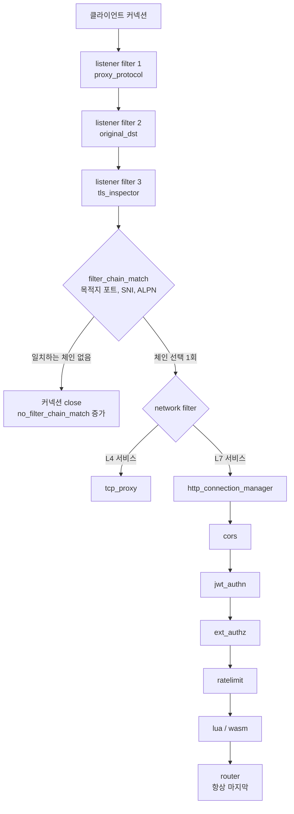
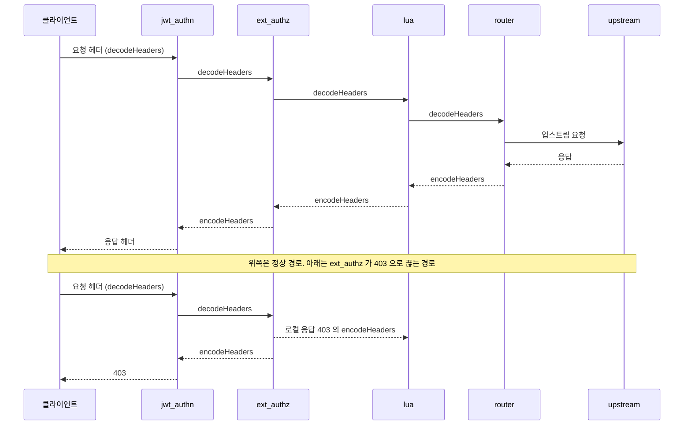
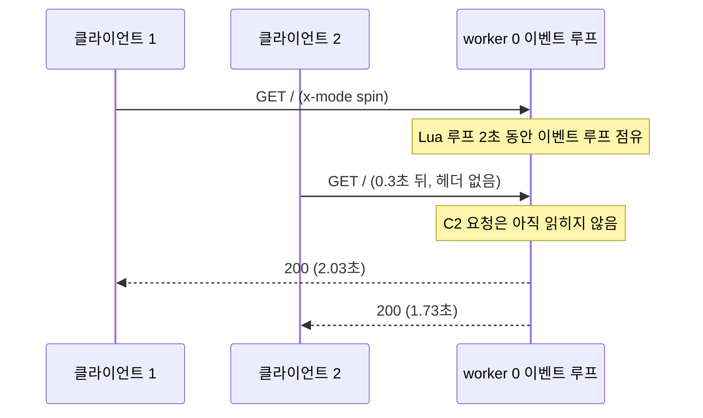
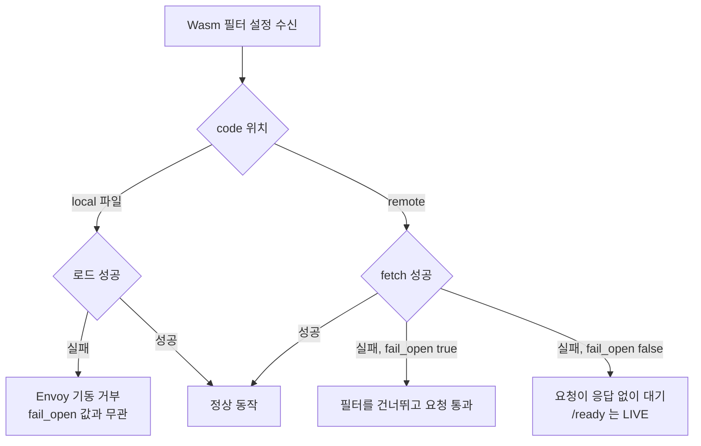

# Envoy 필터 체인과 스레드 모델

[Envoy 기본 문서](Envoy.md)에서 listener, route, cluster의 관계는 한 번 훑었다. 이 문서는 그중 필터가 도는 구간만 깊게 판다. 운영하다 보면 장애의 상당수가 이 구간에서 나온다. 인증이 안 된 요청이 쿼터를 먹고, 새로 넣은 Lua 스크립트 하나 때문에 상관없는 요청이 같이 느려지고, Wasm 모듈을 못 받아온 Envoy가 헬스체크는 통과한 채로 요청을 붙잡고 있는 식이다.

아래 동작은 전부 `envoyproxy/envoy:v1.31-latest`(1.31.10)에서 직접 돌려서 확인했다. 버전이 다르면 결과가 달라질 수 있는 항목에는 본문에서 따로 적었다.

## 커넥션이 필터 체인에 닿기까지

필터는 세 층에 걸려 있다. listener filter는 커넥션이 수락된 직후, 아직 아무 바이트도 해석하기 전에 돈다. network filter는 바이트 스트림을 다루고, HTTP filter는 `http_connection_manager`(HCM) 안에서 요청 하나씩 돈다. 층마다 "무엇을 알고 있는 시점인가"가 다르다는 점이 설정 실수의 출발점이 된다.



위에서 아래로 한 번만 흐른다. `filter_chain_match`는 커넥션당 한 번 실행되고, 이후 같은 커넥션에서 오는 요청은 같은 HCM으로 들어간다. 요청마다 달라지는 판단(경로, 헤더)은 HTTP filter와 route가 맡는다.

listener filter 순서는 설정에 적은 순서대로다. `proxy_protocol`은 NLB가 맨 앞에 붙이는 PROXY 헤더를 읽는다. 이 헤더가 TLS ClientHello보다 먼저 오기 때문에 `tls_inspector`보다 앞에 둔다. `original_dst`는 iptables REDIRECT로 들어온 트래픽의 원래 목적지를 복원하는 필터로, 사이드카 구성에서 쓴다. PROXY 헤더와 `listener_filters_timeout` 동작은 기본 문서에 적어뒀으니 여기서는 SNI 매칭 쪽만 다룬다.

### tls_inspector 없이 SNI로 체인을 고르면

`filter_chain_match.server_names`는 TLS를 열어 보지 않고 매칭한다. SNI는 ClientHello 평문에 들어 있으니 누군가 그걸 꺼내줘야 하는데, 그 역할이 `tls_inspector`다. 이 필터가 없으면 `server_names`로 매칭할 값이 비어 있어서 어느 체인에도 걸리지 않는다. 문제는 이게 설정 오류로 잡히지 않는다는 점이다.

```yaml
listeners:
- name: https
  address: {socket_address: {address: 0.0.0.0, port_value: 10443}}
  # listener_filters 가 없다
  filter_chains:
  - filter_chain_match: {server_names: ["a.example.com"]}
    transport_socket: { ... }   # a 인증서
    filters: [ ... ]
  - filter_chain_match: {server_names: ["b.example.com"]}
    transport_socket: { ... }   # b 인증서
    filters: [ ... ]
```

a.example.com, b.example.com 인증서를 각각 만들어 이 설정으로 띄웠다. Envoy는 경고 한 줄 없이 정상 기동했고, `curl --resolve`로 두 호스트를 호출하면 둘 다 TLS 핸드셰이크 단계에서 실패했다(curl 종료 코드 35). 액세스 로그에는 아무것도 남지 않는다. 남는 건 카운터 하나다.

```
listener.0.0.0.0_10443.no_filter_chain_match: 2
```

`listener_filters`에 `tls_inspector`를 추가하자 같은 요청이 각각 chain-a, chain-b 응답을 받았고, 이때 `tls_inspector.sni_found`가 2로 올라갔다.

```yaml
  listener_filters:
  - name: envoy.filters.listener.tls_inspector
    typed_config:
      "@type": type.googleapis.com/envoy.extensions.filters.listener.tls_inspector.v3.TlsInspector
```

1.31.10은 SNI 매칭이 있어도 이 필터를 자동으로 끼워 주지 않는다. 새 도메인을 추가했는데 요청이 안 들어오는 경우라면 `no_filter_chain_match`부터 본다. `server_names`뿐 아니라 `application_protocols`(ALPN)와 `transport_protocol: tls` 매칭도 같은 필터에 의존한다.

## HTTP filter는 선언한 순서대로 돈다

HCM 안의 HTTP filter는 `http_filters` 배열 순서대로 요청을 받는다. 요청 쪽(decode)은 위에서 아래로, 응답 쪽(encode)은 아래에서 위로 간다. 헤더와 바디가 따로 지나가므로 정확히는 `decodeHeaders → decodeData → decodeTrailers`가 위에서 아래로 내려가고, 응답은 `encodeHeaders → encodeData`가 역순으로 올라온다.



두 번째 경로에서 `lua`가 눈에 띈다. `ext_authz`가 요청을 끊었으니 `lua`는 `decodeHeaders`를 본 적이 없다. 그런데도 로컬 응답의 `encodeHeaders`는 받는다. 로그로 확인했다. 필터 A, B, C를 두고 B가 `respond()`로 403을 만들게 했다.

```
정상 요청          B가 끊은 요청
A decode           A decode
B decode           B decode
C decode           C encode   <- C는 decode를 본 적이 없다
C encode           B encode
B encode           A encode
A encode
```

로컬 응답은 필터 체인의 끝에서부터 encode 방향으로 올라오기 때문이다. 이게 실무에서 문제가 되는 때는 필터가 decode에서 상태를 저장하고 encode에서 꺼내 쓸 때다. 요청 시각을 기록해 응답 지연을 계산하는 Lua 필터가 `envoy_on_response`에서 nil을 만나 에러를 내는 식이다. encode 핸들러는 decode가 안 돌았을 수 있다는 전제로 쓴다.

필터가 요청을 직접 끊는 방법도 알아둔다. `ext_authz`, `jwt_authn`, `local_ratelimit`, Lua의 `respond()`는 모두 로컬 응답을 만든다. 로컬 응답이 나가면 뒤쪽 필터의 decode와 router는 실행되지 않는다. 앞쪽에 둔 필터가 뒤쪽 필터의 동작을 막는 구조라서, 순서가 곧 정책이 된다.

## 순서를 잘못 두면

### ratelimit이 jwt_authn 앞에 있을 때

`local_ratelimit`(토큰 5개)과 `jwt_authn`을 두 순서로 각각 배치하고 같은 요청을 보냈다. `ratelimit`은 전역 서비스를 호출하는 필터인데, 순서 문제는 `local_ratelimit`으로도 똑같이 재현된다. 전역 `ratelimit` 쪽은 직접 돌려보지 않았다.

```yaml
http_filters:
- name: envoy.filters.http.local_ratelimit   # 앞
  typed_config:
    "@type": type.googleapis.com/envoy.extensions.filters.http.local_ratelimit.v3.LocalRateLimit
    stat_prefix: rl
    token_bucket: {max_tokens: 5, tokens_per_fill: 5, fill_interval: 3600s}
    filter_enabled:  {runtime_key: rl_on,  default_value: {numerator: 100, denominator: HUNDRED}}
    filter_enforced: {runtime_key: rl_enf, default_value: {numerator: 100, denominator: HUNDRED}}
- name: envoy.filters.http.jwt_authn         # 뒤
  ...
- name: envoy.filters.http.router
```

토큰 없이 6번 호출한 결과는 이랬다.

| 배치 | 토큰 없는 요청 6회 | 뒤이은 유효 토큰 요청 |
|---|---|---|
| ratelimit → jwt_authn | 401 401 401 401 401 429 | 429 |
| jwt_authn → ratelimit | 401 401 401 401 401 401 | 200 |

앞쪽 배치에서는 인증이 실패한 요청도 토큰을 하나씩 소진했다. 인증 안 된 요청 5개가 쿼터를 다 쓰고 나자 정상 사용자가 429를 받았다. 토큰 없이 요청만 보내도 정상 사용자의 쿼터가 바닥난다. 쿼터를 사용자 단위로 나눠 둔 환경이라도 `remote_address`나 헤더 값 하나를 키로 쓰고 있다면 같은 일이 생긴다. `jwt_authn`이 `ratelimit`보다 앞에 와야 인증을 통과한 요청만 쿼터를 쓴다.

인증 전 요청도 제한하고 싶으면 IP 단위 제한을 `jwt_authn` 앞에 따로 두고, 사용자 단위 제한은 `jwt_authn` 뒤에 둔다. 쿼터 키가 서로 달라야 한다.

`cors`는 `jwt_authn`보다 앞에 둔다. 브라우저가 보내는 preflight(OPTIONS)에는 Authorization 헤더가 없어서, 인증 뒤에 두면 preflight가 401로 끊기고 브라우저에는 CORS 에러로 보인다.

### router 뒤에 필터를 두면

`router`는 요청을 업스트림으로 넘기고 끝나는 터미널 필터다. 그 뒤에 필터를 적으면 조용히 무시될 거라고 예상했는데, 1.31.10에서는 설정 자체가 거부된다.

```yaml
http_filters:
- name: envoy.filters.http.router
- name: envoy.filters.http.lua        # router 뒤
```

```
Error: terminal filter named envoy.filters.http.router of type envoy.filters.http.router
must be the last filter in a http filter chain.
```

정적 설정이면 Envoy가 기동하지 않으니 바로 알게 된다. 조심할 쪽은 xDS로 푸시하는 경우다. 파일 기반 LDS로 정상 listener를 먼저 올리고 router 뒤에 Lua를 둔 버전으로 갈아끼웠더니, 새 설정은 거부되고 이전 설정이 그대로 서빙됐다. 로그에는 `Filesystem config update rejected: Error adding/updating listener(s) l: Error: terminal filter ...`가 남고, 응답은 계속 이전 버전이 나갔다.

```
listener_manager.lds.update_success: 1
listener_manager.lds.update_rejected: 1
listener_manager.lds.version_text: "good"
```

푸시한 쪽 파이프라인은 성공으로 끝나는데 새 필터는 안 켜진 채 이전 설정이 도는 상태가 된다. 새 필터를 배포한 뒤에는 `lds.update_rejected`가 올랐는지, `version_text`가 의도한 버전인지 확인한다.

## worker 스레드에서 도는 필터

필터는 worker 스레드의 이벤트 루프 위에서 실행된다. 커넥션은 한 worker에 붙고, 그 커넥션의 모든 요청이 같은 스레드에서 필터 체인을 지난다. 구조는 [기본 문서의 스레드 모델](Envoy.md#스레드-모델과-concurrency)에 있으니 여기서는 필터가 그 위에서 어떻게 문제를 일으키는지만 본다.

### Lua 필터가 이벤트 루프를 잡고 있을 때

Lua 스크립트는 worker 스레드에서 동기적으로 실행된다. 루프를 오래 돌거나 무거운 문자열 처리를 하면 그 시간 동안 같은 worker의 다른 모든 커넥션이 멈춘다. `--concurrency 1`로 띄우고 `x-mode: spin` 헤더가 오면 `os.clock()`으로 2초 바쁜 대기를 하는 스크립트를 넣었다.

```lua
function envoy_on_request(h)
  local m = h:headers():get("x-mode")
  if m == "spin" then
    local t = os.clock()
    while os.clock() - t < 2 do end
  elseif m == "call" then
    h:httpCall("slow", {[":method"]="GET", [":path"]="/", [":authority"]="slow"}, "", 5000)
  end
end
```



| 요청 | `x-mode: spin` | `x-mode: call` (업스트림이 2초 걸림) |
|---|---|---|
| 느린 요청 본인 | 2.03초 | 2.01초 |
| 0.3초 뒤 보낸 일반 요청 | 1.73초 | 0.0005초 |

`spin`에서는 아무 상관 없는 일반 요청이 1.73초를 기다렸다. 스크립트가 끝나는 2.0초 지점까지 대기한 값이다. `httpCall`은 Lua 코루틴을 양보(yield)하고 이벤트 루프를 놓아주기 때문에, 본인은 2초 걸려도 다른 요청에는 영향이 없었다. 같은 시간이 걸리는 일이라도 블로킹인지 대기인지에 따라 영향 범위가 완전히 다르다.

main 스레드는 영향을 받지 않았다. `spin`이 도는 동안 admin 포트의 `/ready`가 1.2ms에 응답했다. 그래서 헬스체크가 admin 포트를 보고 있으면 이 장애는 헬스체크에 안 잡힌다. 요청 지연 p99만 튀고 Envoy는 정상으로 보인다. 기본값처럼 worker가 여러 개면 막히는 쪽은 그 스레드에 붙은 커넥션뿐이라서 증상이 더 애매하다. 일부 클라이언트만 가끔 느려지는 식으로 나타난다.

Lua 쪽에서 지킬 것은 단순하다. 바디 전체를 훑는 정규식, 큰 JSON 직접 파싱, 루프 안의 문자열 연결은 하지 않는다. 외부 호출이 필요하면 `httpCall`을 쓰고, 그 호출의 타임아웃은 요청 타임아웃보다 짧게 둔다.

Lua 에러 처리도 알아둬야 한다. 런타임 에러가 나면 요청이 막히지 않고 통과한다. `error("boom")`을 던지는 스크립트로 확인했다. 로그에 `script log: ... boom`이 `error` 레벨로 찍혔고 클라이언트는 200을 받았다.

```
[error][lua] script log: [string "function envoy_on_request(h) error("boom") en..."]:1: boom
curl -> 200
```

Lua로 인증 로직을 짜면 스크립트 버그가 곧 인증 우회가 된다. 반면 문법 오류는 설정 로드 단계에서 `script load error ... unexpected symbol near 'then'`로 거부된다. 런타임 에러는 fail-open이고, 문법 오류는 로드 거부라는 차이를 알고 쓴다. 인증이 목적이면 스크립트 안에서 pcall로 감싸 에러를 잡고 직접 `respond()`로 막는다.

## 확장 방식 네 가지

필터를 직접 만들 수 있는 길은 네 갈래다. C++로 Envoy에 넣거나, Lua로 인라인 스크립트를 쓰거나, Wasm 모듈을 올리거나, 외부 서비스를 호출한다. 어느 쪽을 고르느냐는 기능보다 "이게 터지면 어디까지 영향이 가는가"로 정하게 된다.

| 방식 | 지연 비용 | 배포 방식 | 장애 영향 범위 |
|---|---|---|---|
| C++ 내장 필터 | 함수 호출 수준. 추가 지연이 거의 없다 | Envoy를 직접 빌드(Bazel)해서 이미지 교체. 프록시 전체를 롤아웃해야 한다 | 크래시(널 참조, 세그폴트)가 나면 프로세스 전체가 죽는다. 모든 커넥션이 끊긴다 |
| Lua | 인터프리터 호출. 짧은 헤더 조작은 부담이 작지만 위 실험처럼 오래 걸리면 worker가 멈춘다 | 설정에 인라인 또는 파일. LDS 푸시로 재기동 없이 반영된다 | 블로킹은 해당 worker의 모든 커넥션. 런타임 에러는 요청이 통과(fail-open) |
| Wasm | VM 경계 호출과 메모리 복사 비용이 붙는다. C++ 내장보다는 느리다 | `.wasm` 모듈을 이미지에 넣거나 원격에서 받는다. 언어는 Rust, Go, C++ 등을 고른다 | 샌드박스라 모듈의 잘못된 메모리 접근이 프로세스로 번지지 않는다. 로딩 실패 시 `fail_open` 값에 따라 갈린다 |
| ext_authz, ext_proc | 요청마다 네트워크 왕복이 한 번 이상 추가된다. 외부 서비스의 p99가 그대로 더해진다 | 별도 서비스로 배포. Envoy와 무관하게 롤아웃한다 | 외부 서비스 장애가 곧 Envoy 장애다. `failure_mode_allow`로 통과/차단을 정한다 |

수치를 넣지 않은 건 일부러다. 지연은 모듈 크기, 호출 빈도, 네트워크 구성에 따라 달라서 남의 벤치마크를 가져다 쓰면 틀린다. 쓰려는 환경에서 직접 재야 한다.

선택 기준은 대략 이렇다. 헤더 몇 개 넣고 빼는 정도면 Lua가 가장 빠르게 끝나는데, 위의 블로킹 제약을 의식하고 쓴다. 팀이 소유한 로직을 여러 서비스 프록시에 같은 코드로 배포해야 하고 언어를 고르고 싶으면 Wasm이다. 인증 서버처럼 상태를 가진 판단이나 DB 조회가 필요하면 `ext_authz`로 빼는 게 낫다. 필터 안에서 DB를 조회하는 건 어느 방식이든 이벤트 루프를 위험하게 만든다. C++ 내장은 업스트림 프로젝트에 기여하거나 커스텀 빌드를 계속 유지할 인력이 있을 때만 의미가 있다.

외부 서비스 방식에서 서비스에 도달하지 못했을 때의 동작은 `failure_mode_allow`가 정한다.

```yaml
- name: envoy.filters.http.ext_authz
  typed_config:
    "@type": type.googleapis.com/envoy.extensions.filters.http.ext_authz.v3.ExtAuthz
    transport_api_version: V3
    grpc_service:
      envoy_grpc: {cluster_name: authz}
      timeout: 0.5s
    failure_mode_allow: false      # 기본값. 서버에 못 닿으면 차단
```

존재하지 않는 포트를 가리키는 클러스터로 이 설정을 돌렸더니 요청이 403으로 끝났다. `failure_mode_allow: true`로 바꾸면 인증 서버가 죽었을 때 모든 요청이 인증 없이 통과한다. 이 설정은 인증 서버 장애를 전체 인증 우회로 바꾼다. 켠다면 앞에 `jwt_authn` 같은 자체 검증이 이미 있는 경우에만 켠다.

## Wasm 모듈 로딩에 실패하면

Wasm 필터 설정에는 `fail_open` 항목이 있다. 모듈을 못 올렸을 때 요청을 통과시킬지 막을지 고르는 값이다. 모듈 위치가 로컬인지 원격인지에 따라 결과가 달라지는데, 네 가지 조합을 모두 돌려봤다.



로컬 파일에 깨진 바이트(`this is not wasm`)를 넣고 `fail_open: false`, `fail_open: true`로 각각 띄웠다. 두 경우 모두 Envoy가 기동하지 못했다.

```
[error][wasm] Wasm VM failed Failed to load Wasm code
[critical][main] error initializing config: Unable to create Wasm HTTP filter my_plugin
```

`fail_open`은 이 단계에서는 영향이 없었다. 로컬 모듈이 잘못되면 기동 단계에서 바로 터지므로 오히려 안전하다. 배포 직후에 알게 된다.

문제는 원격이다.

```yaml
- name: envoy.filters.http.wasm
  typed_config:
    "@type": type.googleapis.com/envoy.extensions.filters.http.wasm.v3.Wasm
    config:
      name: my_plugin
      fail_open: false
      vm_config:
        runtime: envoy.wasm.runtime.v8
        code:
          remote:
            http_uri: {uri: "http://wasm-store.internal/f.wasm", cluster: wasm_store, timeout: 1s}
            sha256: "<모듈 sha256>"
            retry_policy: {num_retries: 1}
```

`wasm_store` 클러스터가 응답하지 않는 상태로 띄웠다. 로그에는 `Wasm remote code fetch is unstable and may cause a crash`라는 경고가 먼저 찍히고, 재시도 한도를 넘긴 뒤 `Retry limit exceeded for fetching data from remote data source.`가 이어졌다.

- `fail_open: true`: 요청이 그대로 통과해 200을 받았다. Wasm 필터는 건너뛰어졌다.
- `fail_open: false`: 커넥션은 맺어지지만 응답이 오지 않았다. 20초를 기다려도 `code=000`이었다. 그 사이 `/ready`는 `LIVE`를 돌려줬다.

`fail_open: false`가 요청을 403이나 503으로 끊어 줄 거라고 예상했는데 1.31.10에서는 대기 상태로 남았다. 로드 밸런서의 헬스체크가 admin 포트의 `/ready`를 본다면 이 인스턴스는 계속 트래픽을 받고, 받은 요청은 전부 타임아웃까지 매달려 있는다. 다른 버전에서 같은지는 확인하지 않았다.

원격 로딩은 경고 문구 그대로 불안정하다고 보고, 모듈을 이미지에 포함해 로컬 파일로 읽는다. 그러면 로드 실패가 기동 실패로 바뀌어서 롤아웃 단계에서 막힌다. 원격 로딩을 꼭 써야 한다면 `fail_open`을 정하기 전에 해당 필터가 인증·인가를 하는지부터 본다. 헤더 보강이나 메트릭 수집 같은 부가 기능이면 `true`가 맞고, 접근 통제면 `false`가 맞는데 그 경우 위의 대기 현상을 막기 위해 요청 타임아웃을 짧게 거는 수밖에 없다. 로딩 이후 VM이 런타임에 죽는 경우에도 `fail_open`이 적용된다고 문서에 적혀 있으나, 이 문서에서 재현한 건 로딩 실패뿐이다.

Wasm VM은 worker마다 따로 올라간다. 로딩 실패 로그가 main 스레드와 worker 스레드에서 각각 한 번씩 찍혔다. 모듈이 전역 상태를 가지면 worker 수만큼 사본이 생긴다. 카운터를 모듈 안에서 세면 전체 합계가 아니라 worker별 값이다. 전역 값이 필요하면 Envoy 메트릭이나 shared data API를 쓴다.

## 라우트마다 필터를 켜고 끄기

HTTP filter는 listener 단위로 선언되지만, 라우트마다 동작을 바꿀 수 있다. `typed_per_filter_config`에 필터 이름을 키로 두면 해당 라우트에서만 설정이 덮어씌워진다. virtual_host나 route_config 수준에도 같은 항목이 있고, 더 좁은 쪽이 우선한다.

인증이 필요 없는 `/health`에서 `jwt_authn`과 `ext_authz`를 끄고, `/search`에만 따로 쿼터를 거는 구성이다. per-route 메시지 타입은 필터마다 다르다.

```yaml
route_config:
  virtual_hosts:
  - name: v
    domains: ["*"]
    routes:
    - match: {prefix: "/health"}
      direct_response: {status: 200, body: {inline_string: "health\n"}}
      typed_per_filter_config:
        envoy.filters.http.jwt_authn:
          "@type": type.googleapis.com/envoy.extensions.filters.http.jwt_authn.v3.PerRouteConfig
          disabled: true
        envoy.filters.http.ext_authz:
          "@type": type.googleapis.com/envoy.extensions.filters.http.ext_authz.v3.ExtAuthzPerRoute
          disabled: true
    - match: {prefix: "/search"}
      route: {cluster: search}
      typed_per_filter_config:
        envoy.filters.http.ext_authz:
          "@type": type.googleapis.com/envoy.extensions.filters.http.ext_authz.v3.ExtAuthzPerRoute
          disabled: true
        envoy.filters.http.local_ratelimit:
          "@type": type.googleapis.com/envoy.extensions.filters.http.local_ratelimit.v3.LocalRateLimit
          stat_prefix: rl_search
          token_bucket: {max_tokens: 2, tokens_per_fill: 2, fill_interval: 3600s}
          filter_enabled:  {runtime_key: a, default_value: {numerator: 100, denominator: HUNDRED}}
          filter_enforced: {runtime_key: b, default_value: {numerator: 100, denominator: HUNDRED}}
    - match: {prefix: "/"}
      route: {cluster: app}
      typed_per_filter_config:
        envoy.filters.http.ext_authz:
          "@type": type.googleapis.com/envoy.extensions.filters.http.ext_authz.v3.ExtAuthzPerRoute
          disabled: true
http_filters:
- name: envoy.filters.http.jwt_authn
  ...
- name: envoy.filters.http.ext_authz
  ...
- name: envoy.filters.http.local_ratelimit
  disabled: true                    # listener 전체에서는 꺼 둔다
  typed_config:
    "@type": type.googleapis.com/envoy.extensions.filters.http.local_ratelimit.v3.LocalRateLimit
    stat_prefix: rl_default
- name: envoy.filters.http.router
```

세 가지를 확인했다. `/health`는 토큰 없이 200이다. `/other`는 토큰이 없으면 401이고 유효한 토큰이 있으면 200이다. `/search`는 `ext_authz`를 끄지 않고 두면 위에서 본 대로 서버가 없어 403이 난다.

`local_ratelimit`은 HttpFilter 항목에 `disabled: true`를 주고 listener 전체에서 비활성화한 뒤 필요한 라우트에서만 켠다. 이 켜는 방식은 필터가 per-route 메시지를 받아야 하고, `local_ratelimit`은 per-route 설정으로 자기 자신과 같은 메시지를 받는다. 위 구성으로 `/search`에 같은 토큰으로 4번 호출했더니 `200 200 429 429`였고, `/other`는 4번 모두 200이었다. 통계도 `rl_search.http_local_rate_limit.rate_limited: 2`로 `/search` 쪽에만 올랐다.

몇 가지 걸리는 점이 있다. 필터 이름 키는 `http_filters`에 선언한 이름과 정확히 같아야 하는데, 틀려도 오류가 나지 않는다. `envoy.filters.http.jwt_authn`을 `jwt_authnn`으로 오타 낸 설정이 에러 없이 기동했고, `/health`는 계속 401이었다. 라우트 설정을 바꾼 뒤에는 해당 경로를 호출해 의도한 상태코드가 나오는지 직접 본다. 반대 방향도 마찬가지다. `disabled: true`로 켜둔 보안 필터를 우회 경로로 쓰고 싶을 때 `/` 같은 넓은 prefix에 실수로 걸면 라우트 전체가 인증 없이 열린다. 라우트 순서는 위에서부터 첫 매칭이라, `/health` 같은 예외 경로는 `/`보다 앞에 둔다.
