# HAProxy

## HAProxy를 쓰게 되는 상황

서비스 인스턴스가 한 대일 땐 로드밸런서가 필요 없다. 두 대로 늘리는 순간부터 "둘 중 누구한테 요청을 보낼지"를 누군가 결정해야 한다. 클라우드면 ALB/NLB 같은 매니지드 LB를 쓰면 되지만, 온프레미스거나 LB 동작을 세밀하게 제어하고 싶을 때 소프트웨어 LB를 직접 올린다. 그중 오래 검증된 게 HAProxy다.

HAProxy는 단일 바이너리에 설정 파일 하나로 동작한다. nginx도 로드밸런싱을 하지만, nginx는 원래 웹서버라 LB는 부가 기능이다. HAProxy는 처음부터 로드밸런서/프록시 전용으로 만들어져서 health check, 큐잉, 세션 유지, stats 같은 LB에 필요한 기능이 훨씬 촘촘하다. L4(TCP) 모드도 제대로 지원해서 HTTP가 아닌 트래픽(MySQL, Redis, gRPC 스트림)도 분산한다.

처음 HAProxy를 만지면 설정 구조가 낯설다. nginx의 `server`, `location` 같은 블록과 매핑이 안 된다. frontend/backend/listen 이 세 블록 개념만 잡으면 나머지는 옵션 싸움이다.

이 문서의 동작 확인은 Ubuntu 22.04의 HAProxy 2.4.30으로 했다. 버전에 따라 달라질 수 있는 부분은 본문에서 따로 적었다.

## 설정 파일 구조

`haproxy.cfg`는 보통 네 개의 섹션으로 나뉜다.

```
global      # 프로세스 전역 설정 (워커 수, 로그, 보안)
defaults    # frontend/backend가 상속받는 기본값
frontend    # 클라이언트 요청을 받는 입구
backend     # 실제 서버 풀
```

```
global
    log /dev/log local0
    maxconn 50000
    user haproxy
    group haproxy
    daemon

defaults
    log     global
    mode    http
    option  httplog
    option  dontlognull
    timeout connect 5s
    timeout client  30s
    timeout server  30s
    retries 3

frontend web_in
    bind *:80
    bind *:443 ssl crt /etc/haproxy/certs/site.pem
    default_backend web_servers

backend web_servers
    balance roundrobin
    option httpchk GET /health
    server web1 10.0.1.11:8080 check
    server web2 10.0.1.12:8080 check
    server web3 10.0.1.13:8080 check
```

`frontend`는 어디서 요청을 받을지(`bind`)와 어느 백엔드로 보낼지를 정한다. `backend`는 실제 서버 목록과 분산 방식을 정한다. 둘을 묶어서 한 블록으로 쓰는 게 `listen`이다. stats 페이지나 단순한 TCP 프록시처럼 frontend/backend를 나눌 이유가 없을 때 listen을 쓴다.

```
listen mysql_proxy
    bind *:3306
    mode tcp
    balance leastconn
    server db1 10.0.2.11:3306 check
    server db2 10.0.2.12:3306 check
```

요청이 지나가는 길과 설정이 걸리는 자리를 그림으로 보면 이렇다. 실선이 요청 경로이고, 점선은 `defaults`가 각 섹션에 기본값을 내려주는 방향이다. `defaults`는 요청 경로 위에 서 있지 않다.

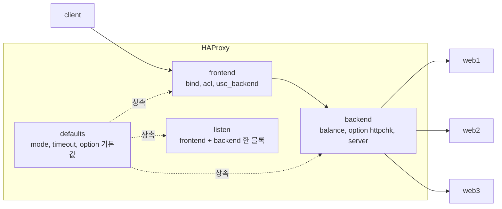

설정에서 가장 많이 실수하는 지점은 `defaults`의 상속이다. `defaults`에 `mode http`를 박아두고 TCP backend를 하나 추가하면, 그 backend는 여전히 http 모드로 동작해서 TCP 트래픽을 깨먹는다. backend 블록 안에 `mode tcp`를 명시해서 덮어써야 한다. listen/frontend/backend는 자기 위에 가장 가까운 defaults를 상속받는데, defaults 블록을 여러 개 두고 그 사이에 섹션을 끼우면 상속 대상이 갈린다. 이걸 모르고 defaults를 파일 맨 위에 하나만 두면 모든 섹션이 같은 값을 받는다.

## L4 모드와 L7 모드

`mode tcp`는 L4, `mode http`는 L7이다. 이 차이가 HAProxy 운영에서 제일 중요한 갈림길이다.

L4(TCP) 모드는 패킷을 들여다보지 않고 연결 단위로만 분산한다. 빠르고, HTTP가 아닌 프로토콜도 처리한다. 대신 HTTP 헤더를 모르니 URL 기반 라우팅, 쿠키 기반 세션 유지, 응답 코드 기반 health check 같은 건 못 한다. TLS도 그냥 통과시킨다(passthrough). 백엔드가 TLS를 직접 처리한다.

L7(HTTP) 모드는 요청을 파싱해서 헤더, 경로, 쿠키를 본다. ACL로 경로별 라우팅을 하고, 쿠키를 심어 세션을 고정하고, `httpchk`로 응답 코드를 검사한다. TLS termination(HAProxy에서 복호화)도 여기서 한다. 대신 파싱 비용이 있고, HTTP만 처리한다.

두 모드가 연결을 어디까지 해석하는지, TLS를 누가 푸는지가 갈리는 지점이다. 오른쪽 L7은 HAProxy가 요청 내용을 읽기 때문에 라우팅과 세션 고정이 가능하다.

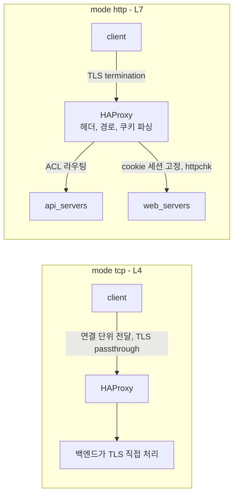

실무 판단은 단순하다. HTTP API/웹이면 L7, 그 외(DB, 메시지 브로커, 순수 TCP 스트림)면 L4. gRPC는 HTTP/2 위에서 돌지만, HAProxy가 HTTP/2 백엔드를 제대로 다루려면 버전과 설정을 신경 써야 해서 초기엔 L4 passthrough로 깔고 가는 경우가 많다.

## 로드밸런싱 알고리즘

`balance` 지시어로 정한다. 실무에서 쓰는 건 사실상 세 개다.

`roundrobin`은 순서대로 돌린다. 백엔드 서버 성능이 균일하고 요청 처리 시간이 비슷하면 이게 기본값이다. 가중치(`weight`)를 줘서 성능 좋은 서버에 더 보낼 수 있다.

```
backend web_servers
    balance roundrobin
    server web1 10.0.1.11:8080 check weight 100
    server web2 10.0.1.12:8080 check weight 50
```

`leastconn`은 현재 활성 연결이 가장 적은 서버로 보낸다. 요청별 처리 시간이 들쭉날쭉할 때(긴 쿼리, WebSocket, DB 연결 풀) roundrobin보다 낫다. roundrobin은 무거운 요청이 한 서버에 몰려도 계속 그 서버에 보내지만, leastconn은 연결 수를 보고 피한다. DB나 long-lived 연결 백엔드엔 leastconn을 기본으로 둔다.

`source`는 클라이언트 IP를 해싱해서 같은 IP를 항상 같은 서버로 보낸다. 쿠키를 못 쓰는 환경에서 세션을 고정하는 용도다. 단점은 NAT 뒤에 있는 클라이언트들이 한 IP로 묶여서 분산이 한쪽으로 쏠린다는 거다. 그래서 세션 유지가 필요하면 source보다 cookie 방식을 먼저 검토한다.

## Health check

`check` 옵션만 붙이면 HAProxy가 해당 서버의 포트로 TCP 연결을 시도해서 살아있는지 본다. 문제는 포트가 열려 있어도 애플리케이션은 죽어 있는 경우다. 프로세스는 떠 있는데 DB 커넥션이 끊겨서 503을 뱉는 상태면 TCP check는 통과시킨다.

이걸 막으려면 L7 health check를 쓴다.

```
backend web_servers
    option httpchk GET /health
    http-check expect status 200
    server web1 10.0.1.11:8080 check inter 2s fall 3 rise 2
    server web2 10.0.1.12:8080 check inter 2s fall 3 rise 2
```

`httpchk GET /health`는 헬스 엔드포인트로 HTTP 요청을 보낸다. `http-check expect status 200`으로 200이 아니면 죽은 걸로 본다. `inter 2s`는 체크 주기, `fall 3`은 연속 3번 실패하면 down, `rise 2`는 연속 2번 성공하면 다시 up으로 올린다.

`fall`을 너무 낮게(예: 1) 잡으면 일시적인 GC 멈춤이나 네트워크 흔들림에 멀쩡한 서버가 빠진다. 너무 높게 잡으면 진짜 죽은 서버를 늦게 빼서 503이 그동안 새어 나간다. 트래픽 패턴 보면서 fall 2~3, inter 2s 근처에서 조정한다. `inter 2s fall 3`이면 서버가 죽은 시점부터 down 처리까지 대략 4~6초 걸리고, 그 사이 요청은 죽은 서버로 계속 간다.

헬스 엔드포인트는 가볍게 만들어야 한다. `/health`가 DB, Redis, 외부 API를 전부 찔러보는 무거운 체크로 짜여 있으면, HAProxy가 2초마다 모든 서버를 두드릴 때 그게 부하가 된다. 더 위험한 건 외부 의존성 하나가 느려지면 전체 헬스 체크가 동시에 타임아웃 나면서 모든 서버가 한꺼번에 down 처리되는 상황이다. liveness(프로세스가 살아있나)와 readiness(요청 받을 준비 됐나)를 구분하고, LB가 보는 엔드포인트는 가볍게 유지한다.

### 서버 상태 전이

stats 화면이나 `show stat`의 status 열에는 UP, DOWN 말고도 NOLB, DRAIN, MAINT가 나온다. 배포 자동화를 짜다 보면 이 상태들의 차이를 알아야 한다. 아래 그림은 한 서버가 거치는 상태와 전이 조건이다.

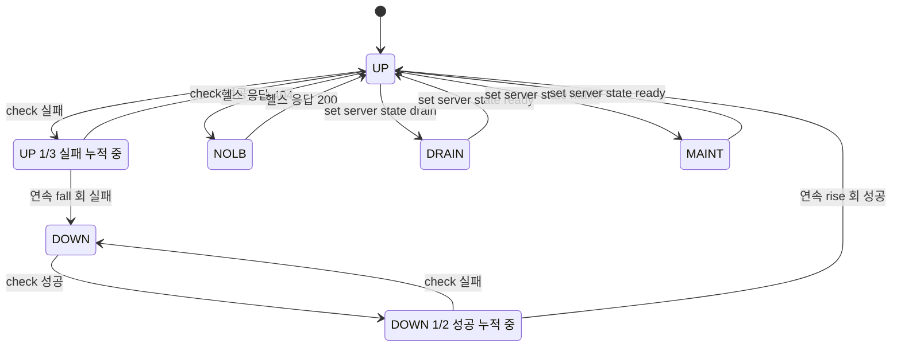

`fall 3`이면 실패가 1번 나올 때마다 stats에 `UP 1/3`, `UP 2/3`으로 찍히다가 3번째에 DOWN이 된다. 실제로 `inter 200ms fall 3`으로 놓고 헬스 엔드포인트가 503을 돌려주게 만들었더니 0.3초 시점에 `UP 1/3`이었고 1.3초 시점에 `DOWN`이었다. 성공 쪽은 `DOWN 1/2`처럼 rise 카운트가 센다. 카운트 도중 한 번이라도 반대 결과가 나오면 처음부터 다시 센다.

NOLB는 `http-check disable-on-404`를 켰을 때 헬스 엔드포인트가 404를 돌려주면 들어가는 상태다. 서버가 죽은 게 아니라 "새 요청은 그만 보내라"는 신호를 앱이 직접 보내는 방식이라서, 앱이 종료 직전에 `/health`를 404로 바꿔 두면 배포 때 연결이 끊기지 않는다. DRAIN은 같은 효과를 운영자가 Runtime API로 거는 것이다. 둘 다 이미 붙어 있는 연결은 끝까지 처리하고, 새 연결만 받지 않는다. 문서상 DRAIN 서버는 cookie 같은 persistence로 이미 고정된 세션에는 계속 요청을 받는다. sticky 세션을 쓰는 백엔드에서 drain을 걸고 바로 배포하면 그 세션이 끊기는 이유가 이것이다.

```
global
    stats socket /run/haproxy/admin.sock mode 660 level admin
```

```bash
echo "set server web_servers/web1 state drain" | socat stdio /run/haproxy/admin.sock
echo "show stat" | socat stdio /run/haproxy/admin.sock | cut -d, -f1,2,5,18
echo "set server web_servers/web1 state ready" | socat stdio /run/haproxy/admin.sock
```

`show stat` 출력의 5번째 필드가 현재 연결 수(`scur`), 18번째가 status다. scur가 0이 될 때까지 기다렸다가 배포하는 스크립트를 많이 쓴다. drain을 걸었다가 `ready`로 되돌리면 HAProxy 로그에 `Server b/s1 is UP (leaving forced drain)`이 남는다.

## 세션 유지 (sticky session)

같은 클라이언트를 같은 백엔드로 계속 보내야 할 때가 있다. 세션을 서버 메모리에 들고 있는 레거시 앱이 대표적이다. L7 모드면 쿠키 방식이 깔끔하다.

```
backend web_servers
    balance roundrobin
    cookie SRVID insert indirect nocache
    server web1 10.0.1.11:8080 check cookie web1
    server web2 10.0.1.12:8080 check cookie web2
```

`cookie SRVID insert`는 HAProxy가 응답에 `SRVID=web1` 같은 쿠키를 심는다. 다음 요청부터 클라이언트가 그 쿠키를 보내면 해당 서버로 직행한다. `indirect`는 클라이언트가 보낸 쿠키를 백엔드로 넘기지 않고 HAProxy가 먹어버린다는 뜻이고, `nocache`는 이 응답이 캐시되지 않게 헤더를 붙인다.

쿠키가 심기고 이후 요청이 같은 서버로 가는 순서를 보면 이렇다. 두 번째 요청에서는 roundrobin 대신 쿠키 값이 서버를 정한다.

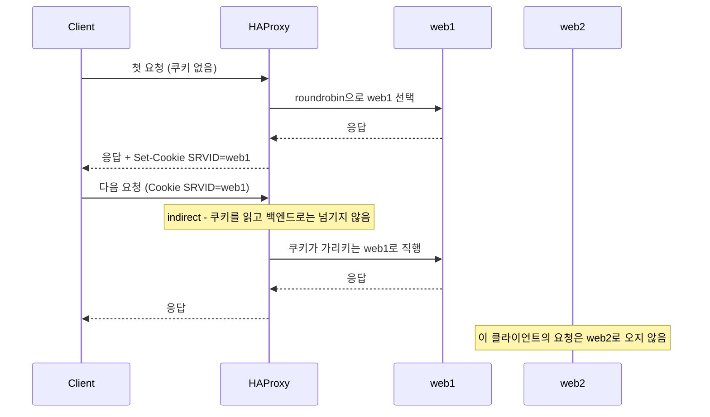

sticky session은 편하지만 분산을 망친다. 한 서버에 세션이 쌓이면 그 서버만 부하가 높아지고, 그 서버가 죽으면 거기 묶인 세션이 전부 날아간다. 가능하면 세션을 Redis 같은 외부 저장소로 빼서 무상태로 만들고 sticky를 안 쓰는 방향이 맞다. 당장 못 바꾸는 레거시를 버티는 임시 수단으로 본다.

## ACL 기반 라우팅

L7 모드에서 요청 내용을 보고 백엔드를 가른다. 경로 prefix로 API와 정적 자원을 나누는 게 흔한 패턴이다.

```
frontend web_in
    bind *:80
    acl is_api      path_beg /api/
    acl is_static   path_beg /static/
    acl host_admin  hdr(host) -i admin.example.com

    use_backend api_servers    if is_api
    use_backend static_servers if is_static
    use_backend admin_servers  if host_admin
    default_backend web_servers
```

`acl`로 조건에 이름을 붙이고 `use_backend ... if`로 매칭되면 그 백엔드로 보낸다. `path_beg`는 경로 prefix, `hdr(host)`는 Host 헤더, `-i`는 대소문자 무시다. 위에서부터 순서대로 평가해서 처음 매칭되는 `use_backend`로 가고, 아무것도 안 걸리면 `default_backend`다.

위 설정의 평가 순서를 그리면 아래와 같다. 위쪽 조건이 참이면 아래 조건은 평가되지 않는다.

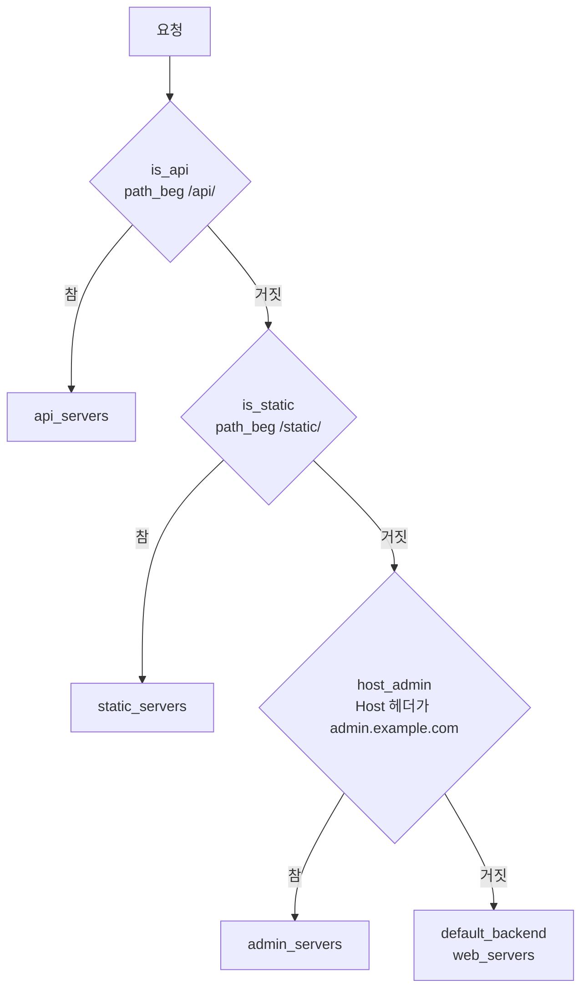

ACL을 많이 쌓으면 순서 때문에 디버깅이 어려워진다. 더 구체적인 조건을 위에 두는 게 안전하고, 의도와 다르게 동작하면 `option httplog`로 어느 백엔드로 갔는지 로그를 찍어 확인한다.

## 클라이언트 IP와 스킴 전달

HAProxy를 거치면 백엔드가 보는 접속 IP는 전부 HAProxy의 IP다. 접근 로그, rate limit, 지역 판별이 다 같은 IP 하나로 뭉개진다. `option forwardfor`가 원래 클라이언트 IP를 `X-Forwarded-For` 헤더에 실어 준다. HTTP를 TLS 종단에서 풀어서 백엔드로 평문으로 넘기는 구성이면 원래 요청이 https였다는 정보도 사라지므로 `X-Forwarded-Proto`를 직접 넣는다.

```
frontend web_in
    bind *:80
    bind *:443 ssl crt /etc/haproxy/certs/site.pem
    option forwardfor
    http-request set-header X-Forwarded-Proto https if { ssl_fc }
    http-request set-header X-Forwarded-Proto http  if !{ ssl_fc }
    default_backend web_servers
```

`X-Forwarded-Proto`는 HAProxy가 자동으로 넣지 않는다. 안 넣으면 앱이 "나는 http로 받았다"고 판단해서 https로 리다이렉트하고, 그 리다이렉트가 다시 HAProxy를 거쳐 같은 판단을 반복하는 무한 리다이렉트가 난다. 리다이렉트 루프가 보이면 이 헤더부터 의심한다.

`option forwardfor`의 동작은 한 가지 더 알아야 한다. 헤더 값을 기존 값 뒤에 이어 붙이지 않고 **새 헤더 줄을 하나 더 추가**한다. 클라이언트가 `X-Forwarded-For: 1.2.3.4`를 직접 보내면 백엔드에는 이렇게 두 줄이 도착한다.

```
X-Forwarded-For: 1.2.3.4      <- 클라이언트가 위조한 값
X-Forwarded-For: 127.0.0.1    <- HAProxy가 붙인 실제 접속 IP
```

백엔드 앱이 헤더의 첫 값을 클라이언트 IP로 읽으면 위조한 값을 그대로 믿는다. 직접 확인해 보니 파이썬 `headers.get()`은 첫 줄인 `1.2.3.4`를 돌려줬다. 인터넷에 바로 노출되는 HAProxy는 `option forwardfor` 앞에서 기존 헤더를 지운다.

```
frontend web_in
    bind *:443 ssl crt /etc/haproxy/certs/site.pem
    http-request del-header X-Forwarded-For
    option forwardfor
```

이렇게 하면 같은 요청이 `X-Forwarded-For: 127.0.0.1` 한 줄만 도착한다. 반대로 HAProxy 앞에 ALB나 다른 프록시가 이미 있으면 지우면 안 된다. 앞단이 넣어 준 클라이언트 IP가 사라지고 앞단 프록시 IP만 남는다. 이 경우는 앞단 프록시 대역에서 온 요청에만 기존 헤더를 믿도록 ACL을 건다. HAProxy가 같은 호스트의 로컬 프록시 뒤에 있을 때 `option forwardfor except 127.0.0.0/8`을 쓰기도 한다.

L4(TCP) 모드는 HTTP 헤더를 못 건드린다. 원래 IP를 넘기려면 서버 줄에 `send-proxy-v2`를 붙여 PROXY protocol로 보낸다. 백엔드가 PROXY protocol을 받도록 설정돼 있지 않으면 첫 바이트부터 프로토콜 오류가 나므로 양쪽을 같이 바꿔야 한다.

## keep-alive와 연결 재사용

HAProxy는 클라이언트 쪽 연결과 서버 쪽 연결을 따로 관리한다. 어느 쪽 연결을 요청마다 끊을지 정하는 게 keep-alive 모드다.

| 옵션 | 클라이언트 쪽 | 서버 쪽 | 쓰는 경우 |
|---|---|---|---|
| `option http-keep-alive` | 유지 | 유지 | 기본 동작. 지연이 가장 낮다 |
| `option http-server-close` | 유지 | 응답마다 끊음 | 백엔드가 keep-alive를 제대로 처리 못 하는 레거시 |
| `option httpclose` | 끊음 | 끊음 | 디버깅, 연결마다 요청 하나만 허용해야 할 때 |

매뉴얼에도 별도 지정이 없으면 양쪽 keep-alive로 동작한다고 적혀 있다. `http-server-close`는 오래된 설정 예제에 자주 보이는데, 그걸 복사해 defaults에 습관처럼 넣어 두면 백엔드 연결을 요청마다 새로 맺는 비용을 괜히 낸다. 백엔드 `TIME_WAIT`가 비정상적으로 많고 HAProxy에서 서버 쪽 신규 연결 수가 요청 수와 같다면 이 옵션이 defaults에 박혀 있는지 먼저 본다.

서버 쪽 연결을 요청 사이에 어떻게 공유할지는 `http-reuse`가 정한다.

| 값 | 동작 |
|---|---|
| `never` | 연결을 공유하지 않는다 |
| `safe` | 한 세션의 첫 요청은 항상 새 연결로 보낸다. 이후 요청부터 기존 idle 연결을 쓴다. 기본값 |
| `aggressive` | 첫 요청도 검증된 idle 연결에 태운다 |
| `always` | 검증 없이 idle 연결을 재사용한다 |

`safe`가 기본인 이유는 서버가 idle 연결을 막 끊은 순간 요청을 보내면 그 요청이 실패하는데, 첫 요청이면 브라우저가 알아서 재시도하기 때문이다. `aggressive`나 `always`로 올리면 백엔드 연결 수가 줄어든다. 대신 백엔드가 idle 연결을 먼저 닫는 순간과 요청이 겹치면 그 요청이 실패할 수 있고, 브라우저가 대신 재시도해 주던 `safe`의 안전장치도 사라진다. 올리기 전에 백엔드의 keep-alive timeout이 얼마인지 확인한다.

## maxconn과 큐

timeout을 만지다 보면 결국 만나는 설정이 `maxconn`이다. 세 군데에 있고 각각 막는 대상이 다르다.

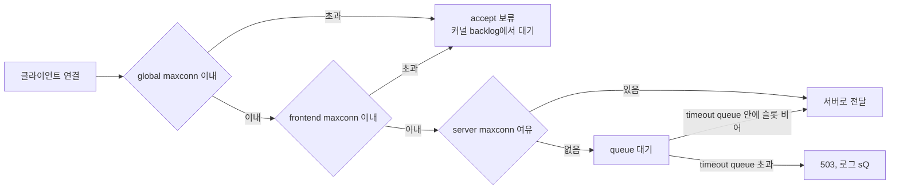

`global maxconn`은 프로세스 전체 동시 연결 상한이다. 연결 하나가 클라이언트 쪽과 서버 쪽으로 파일 디스크립터를 두 개 쓰니 `ulimit -n`이 maxconn의 2배보다 작으면 안 된다. `frontend maxconn`은 그 frontend가 받는 연결 상한인데, 한도를 넘은 연결은 거절되지 않고 기다린다. frontend `maxconn 2`에 백엔드 처리 시간이 1초인 요청을 4개 동시에 보냈더니 모두 200이었고, 두 개는 1초, 나머지 두 개는 2초에 끝났다. 이때 HAProxy 로그에는 네 개 전부 1초 안팎으로 찍혔다. 클라이언트가 기다린 1초는 HAProxy가 연결을 accept하기 전이라 로그에 없다. 로그의 응답 시간은 정상인데 사용자가 느리다고 할 때 의심할 자리다.

`server maxconn`이 사고와 직결되는 값이다. 서버 줄에 maxconn이 없으면 상한이 없어서, HAProxy는 받은 요청을 백엔드로 즉시 다 밀어 넣는다. 평소엔 문제가 없다가 트래픽이 튀는 순간 백엔드의 스레드 풀, DB 커넥션 풀이 한계에 닿는다. 백엔드는 처리가 느려지고, 느려지면 동시 처리 중인 요청이 더 쌓이고, 결국 `timeout server`를 넘긴 요청이 504로 터진다. 백엔드가 이미 허덕이는 상황에서 요청이 계속 들어가니 회복도 못 한다. HAProxy는 멀쩡한데 백엔드 전체가 같이 죽는 전형적인 모양이다.

서버 줄에 maxconn을 걸면 HAProxy가 서버당 동시 요청 수를 막고 나머지를 큐에 세운다.

```
backend api_servers
    balance leastconn
    timeout queue 5s
    server api1 10.0.1.21:8080 check maxconn 200
    server api2 10.0.1.22:8080 check maxconn 200
```

maxconn이 5인 서버에 각각 1초 걸리는 요청 20개를 동시에 보내 봤다. `timeout queue`는 안 적고 `timeout connect 1s`만 있던 설정이다. 처음 5개가 처리되는 동안 나머지는 큐에서 기다렸고, 20개 중 7개만 200이었다. 1초 안에 슬롯을 못 얻은 13개는 503으로 끊겼다. 로그는 이렇게 남았다.

```
f lim_be/<NOSRV> 0/1000/-1/-1/1000 503 217 - - sQ-- 20/20/19/0/0 0/1 "GET /lim/1 HTTP/1.1"
```

`timeout queue`를 안 쓰면 `timeout connect` 값을 대신 쓴다. 매뉴얼에 있는 동작이고 위 실험에서도 큐 대기 시간이 1000ms로 찍혔다. connect timeout 5초가 곧 큐 대기 5초가 되는 설정이 의도한 것인지 확인해야 한다. 큐는 요청을 거절하지 않고 늦출 뿐이라 처리량이 늘지는 않는다. 큐에서 사용자가 기다려 줄 시간보다 오래 잡아 두면 503이 아니라 사용자 포기로 끝난다. `maxconn`은 백엔드가 실제로 감당하는 동시 처리 수에 맞추고, `timeout queue`는 사용자가 기다릴 수 있는 시간에서 평소 처리 시간을 뺀 값으로 잡는다.

로그 맨 뒤의 `0/1`은 `서버 큐 / 백엔드 큐` 크기다. 서버가 아직 정해지지 않은 요청은 백엔드 큐에 서고, cookie로 서버가 고정된 요청은 해당 서버의 큐에 선다. 큐 상태는 `show stat`의 `qcur`, `qmax` 열로 볼 수 있어서 큐가 자주 차는 백엔드는 모니터링에 걸어 둔다.

## 연결 실패와 retries, redispatch

`retries 3`은 서버로 연결을 맺는 데 실패했을 때 몇 번 다시 시도할지를 정한다. 기본 재시도 조건은 `conn-failure`뿐이다. 서버가 연결을 거부하거나 SSL 핸드셰이크가 실패해서 요청을 아예 못 보냈을 때만 재시도하고, 요청을 보낸 뒤 응답이 안 오는 경우는 재시도하지 않는다.

연결 거부를 일부러 만들어서 동작을 봤다. 서버 하나는 죽어 있는 포트, 하나는 정상이고 `roundrobin`이다.

| 설정 | 결과 | 걸린 시간 |
|---|---|---|
| `retries 3`만 | 죽은 서버가 걸린 요청은 모두 503, 로그 `SC`. 정상 서버가 걸린 요청은 200 | 503은 약 3초 |
| `retries 3` + `option redispatch` | 6번 모두 200 | 지연 없음, 로그 마지막 필드 `+1` |

redispatch 없이는 요청의 절반이 같은 죽은 서버에 3번 재시도하고 실패한다. 재시도 사이에 1초씩 기다려서 사용자는 3초 뒤에 503을 받는다. health check가 아직 그 서버를 내리기 전의 몇 초 동안 이런 일이 생긴다. `option redispatch`를 켜면 재시도 때 다른 서버를 고른다. 로그의 `+1`은 재시도 중에 서버가 바뀌었다는 표시다.

연결 실패와 응답 무응답이 서로 다른 길로 가는 것, 그리고 redispatch가 갈라놓는 지점을 아래 그림에서 본다.

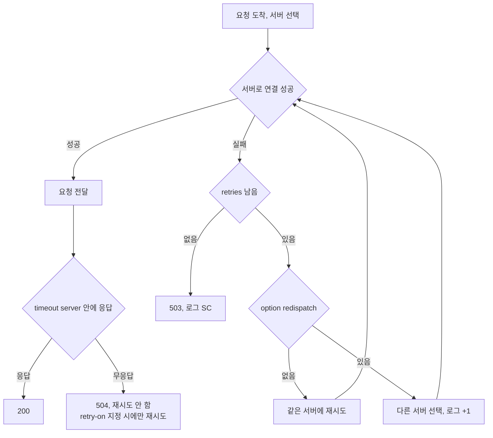

```
defaults
    retries 3
    option redispatch 1
```

`option redispatch`의 숫자는 몇 번째 재시도에서 서버를 바꿀지다. 기본값 -1은 문서상 마지막 재시도에서 바꾸는 동작이다. 2.4.30에서 연결 거부를 재현했을 때는 첫 재시도에서 바로 다른 서버로 넘어갔다. 어느 쪽이든 서버를 바꾸는 시점이 중요하면 숫자를 명시하는 게 확실하다.

응답을 못 받은 경우는 다르다. `timeout server 500`에 백엔드 지연 2초로 실험했을 때 요청은 한 번만 나갔고 0.5초에 504가 돌아왔다. `retry-on`으로 `response-timeout`이나 `503` 같은 조건을 추가할 수 있지만, 이미 서버가 일부를 처리했을 수 있는 요청을 다시 보내는 것이라 결제나 주문 같은 멱등하지 않은 POST에서는 중복 처리가 난다. 매뉴얼도 앱이 재전송에 안전하다고 확신하지 못하면 `conn-failure` 외의 값을 쓰지 말라고 적고 있다. 느린 쿼리가 원인인 타임아웃을 재시도하면 이미 허덕이는 서버에 같은 요청을 한 번 더 얹는 꼴이 된다.

## timeout 튜닝

기본 defaults의 timeout이 운영 사고로 직결되는 경우가 많다. 하나의 요청이 지나가는 동안 timeout이 어느 구간에 걸리는지부터 보자. 아래 그림은 클라이언트가 요청을 보내고 백엔드가 응답하기까지의 순서이고, 각 구간에서 시간이 넘으면 어떤 응답과 로그가 남는지를 같이 적었다.

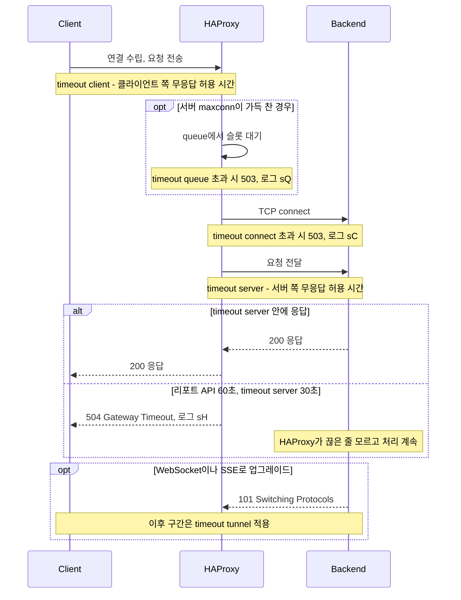

`timeout connect`는 HAProxy가 백엔드 서버에 TCP 연결을 맺는 데 허용하는 시간이다. 같은 데이터센터 안이면 보통 5초면 넉넉하다. 이게 길면 죽은 서버에 연결 시도하다가 응답이 늦어진다.

`timeout client`는 클라이언트가 데이터를 보내거나 받는 사이 idle 허용 시간이다. `timeout server`는 백엔드가 응답하는 동안의 idle 허용 시간이다. 이 둘이 핵심이다. 둘 다 전체 소요 시간이 아니라 무응답 시간이라서, 응답 본문이 조금씩이라도 계속 오는 동안에는 시간이 리셋된다.

흔한 사고는 `timeout server`를 30초로 박아뒀는데 실제로는 60초 걸리는 무거운 리포트 API가 있을 때다. HAProxy가 30초에 504를 끊어버려서 백엔드는 멀쩡히 처리 중인데 클라이언트는 504를 받는다. 위 그림의 else 분기다. 백엔드 쪽은 연결이 끊겼다는 걸 쓰기 시점에야 알기 때문에 그 사이 쿼리는 끝까지 돈다. 사용자가 새로고침을 누르면 같은 무거운 쿼리가 하나 더 돌아서 DB 부하가 두 배가 된다. 이런 엔드포인트는 backend 단위로 timeout을 따로 늘린다.

```
backend report_api
    timeout server 120s
    server report1 10.0.3.11:8080 check
```

반대로 timeout을 무작정 길게 잡으면 죽은 연결이 오래 살아남아 커넥션 슬롯을 잡아먹는다. WebSocket이나 SSE 같은 long-lived 연결은 `timeout tunnel`로 따로 관리한다. 일반 HTTP는 짧게, 스트리밍은 tunnel로 길게 가른다.

타임아웃을 단위 없이 숫자만 쓰면(`timeout server 30`) 밀리초로 해석된다. `30`은 30초가 아니라 30밀리초다. 직접 확인했다. 백엔드가 0.2초 걸리는 응답을 내는 환경에서 `timeout server 30`을 걸었더니 31ms 만에 504가 나왔고, `timeout server 500`에 2초 지연 응답을 보내면 0.501초에 504가 나왔다. 반드시 `s`, `m` 같은 단위를 붙인다. 단위를 빠뜨려서 모든 요청이 즉시 끊기는 사고가 종종 난다. `haproxy -c`는 단위 없는 숫자를 문법 오류로 보지 않으니 문법 검사로는 못 잡는다.

## 로그 읽기

장애 때 stats 다음으로 보는 게 httplog다. 한 줄에 필드가 많아서 처음에는 읽기 어렵다. 앞의 timeout 실험에서 실제로 남은 504 로그를 예로 보자.

```
127.0.0.1:53588 [16/Oct/2026:10:20:16.307] f b/s1 0/0/0/-1/501 504 198 - - sH-- 1/1/0/0/0 0/0 "GET /2 HTTP/1.1"
```

| 위치 | 값 | 의미 |
|---|---|---|
| 클라이언트 | `127.0.0.1:53588` | 접속한 쪽 IP와 포트 |
| frontend, backend/server | `f b/s1` | 요청을 받은 frontend, 보낸 backend와 server |
| 타이머 | `0/0/0/-1/501` | Tq/Tw/Tc/Tr/Tt, 밀리초. 요청 수신, 큐 대기, 연결, 서버 응답, 전체 |
| 상태 코드, 바이트 | `504 198` | 클라이언트에게 돌려준 코드와 응답 바이트 |
| 종료 상태 | `sH--` | 4글자. 누가, 어느 단계에서 끝냈는지 |
| 연결 수 | `1/1/0/0/0` | 프로세스 전체/frontend/backend/server 연결 수, 재시도 횟수 |
| 큐 | `0/0` | 서버 큐 / 백엔드 큐 |

타이머 값이 `-1`이면 그 단계까지 가지 못했다는 뜻이다. 위 로그는 Tr이 -1이고 Tt가 501이다. 서버 응답을 받지 못한 채 `timeout server 500`에서 끊겼다.

타이머 다섯 개가 요청의 어느 구간을 재는지 순서대로 놓으면 이렇다. `-1`은 이 순서에서 그 칸까지 도달하지 못했다는 뜻이다.


종료 상태의 첫 글자는 누가 끊었는지, 둘째 글자는 그때 요청이 어느 단계였는지다. 대문자는 상대가 연결을 끊은 경우이고 소문자는 timeout이다.

| 종료 상태 | 상태 코드 | 재현한 방법 | 읽는 법 |
|---|---|---|---|
| `sH` | 504 | `timeout server`보다 느린 백엔드 | 요청은 보냈는데 응답 헤더가 timeout 안에 안 옴. 백엔드가 느리다 |
| `sQ` | 503 | server maxconn 초과 후 `timeout queue` 만료 | 큐에서 슬롯을 못 얻음. 백엔드 처리량 부족 또는 maxconn이 작다 |
| `SC` | 503 | 닫힌 포트로 연결 | 서버가 연결을 거부. 로그 마지막 필드의 retries로 몇 번 시도했는지 본다 |
| `cD` | 200 | 클라이언트가 응답을 읽지 않고 방치 | 데이터 전송 중 `timeout client` 만료. 상태 코드는 200이어도 응답이 중간에 끊겼다 |
| `CD` | 200 | 요청 처리 중 클라이언트가 먼저 연결을 닫음 | 클라이언트가 먼저 끊음. 모바일이나 다운로드 취소에서 흔하다 |
| `KH` | 502 | `hard-stop-after`로 reload 때 옛 프로세스 종료 | 관리 동작으로 연결이 강제 종료됨 |

`cD`와 `CD`는 상태 코드만 보면 정상 요청과 구분되지 않는다. 직접 50MB 응답을 요청하고 읽지 않았을 때 로그는 `200 1638402 ... cD--`였다. 바이트 수가 본문 크기 50MB가 아니라 1.6MB에서 멈춰 있는 것이 신호다. 상태 코드 200 비율만 모니터링하면 이런 중단은 보이지 않는다. 종료 상태가 `----`가 아닌 로그를 별도로 집계해 두면 문제가 훨씬 일찍 보인다.

셋째, 넷째 글자는 cookie persistence 상태다. cookie를 안 쓰면 `--`로 나온다.

## stats 페이지

HAProxy는 내장 상태 페이지를 제공한다. 각 백엔드/서버의 up/down, 현재 연결 수, 누적 요청, 에러를 한 화면에서 본다. 장애 났을 때 제일 먼저 보는 화면이다.

```
listen stats
    bind *:8404
    mode http
    stats enable
    stats uri /stats
    stats refresh 5s
    stats auth admin:changeme
    stats admin if TRUE
```

`stats auth`로 기본 인증을 걸고, `stats admin if TRUE`를 주면 화면에서 서버를 수동으로 drain/disable 할 수 있다. 배포할 때 특정 서버를 미리 빼고 싶을 때 이 admin 기능이 쓸 만하다. 다만 이 예시는 그대로 운영에 쓰면 위험한 부분이 셋 있다.

첫째, `admin:changeme`는 설정 파일에 평문으로 들어가는 비밀번호다. 이 파일이 Git에 올라가거나 여러 사람이 보는 서버에 있으면 비밀번호가 곧 공개 정보다. 예시 비밀번호를 그대로 둔 채 배포하는 경우도 실제로 있다. 설정 파일 안에서는 환경 변수를 참조할 수 있으니 값은 밖에서 주입한다.

```
listen stats
    bind 10.0.0.5:8404
    mode http
    stats enable
    stats uri /stats
    stats auth admin:"${STATS_PASS}"
    stats admin if { src 10.0.0.0/24 }
```

환경 변수를 넣고 띄워서 인증 없이 요청하면 401, 계정으로 요청하면 200이 나왔다. systemd에서는 `EnvironmentFile=`로 비밀번호를 주입한다.

둘째, 기본 인증은 base64일 뿐이라 평문 HTTP로 열려 있으면 같은 망에서 패킷을 잡아 비밀번호를 그대로 읽는다. `bind`에 `ssl crt`를 붙이거나 SSH 터널, VPN 안에서만 접근하게 한다.

셋째, `stats admin if TRUE`는 조건이 항상 참이다. 인증을 통과한 모든 사용자가 서버를 내릴 수 있고, `stats auth`를 빼먹은 상태에서는 접속할 수 있는 누구나 서버를 내릴 수 있다. 위처럼 `src` ACL로 운영 대역에서만 admin을 허용하는 쪽이 안전하다.

`bind *:8404`는 모든 인터페이스에 여는 것이니 stats 포트는 절대 외부에 노출하면 안 된다. 인증을 걸어도 내부망 주소에 바인딩하거나 방화벽으로 막는다.

운영 자동화엔 웹 화면 대신 Runtime API(소켓)나 Prometheus exporter를 쓴다. HAProxy 2.0 이상은 `prometheus-exporter`를 내장해서 `/metrics` 엔드포인트를 바로 뽑을 수 있다.

## nbthread와 cpu-map

HAProxy 2.x는 한 프로세스 안에서 여러 스레드를 돌린다. 스레드 수는 `nbthread`가 정한다. 안 쓰면 시작할 때 쓸 수 있는 CPU 수를 세서 자동으로 정한다. 4코어 머신에서 `haproxy -vv`를 찍으면 `Built with multi-threading support (MAX_THREADS=64, default=4)`가 나온다.

```
global
    nbthread 4
    cpu-map auto:1/1-4 0-3
```

`cpu-map auto:1/1-4 0-3`은 1번 프로세스의 스레드 1~4번을 CPU 0~3번에 하나씩 묶는다. 스레드가 코어를 옮겨 다니며 캐시를 잃는 일이 줄어든다. 코어 수가 많은 서버에서 HAProxy 하나가 전체 CPU를 쓰지 않게 하려고 일부 코어만 지정하기도 한다.

주의할 점은 컨테이너다. 스레드 수를 세는 기준이 CPU 어피니티라서, 쿠버네티스에서 CPU limit이 2인 파드를 64코어 노드에 올리면 호스트의 코어가 그대로 보여 스레드가 64개 가까이 뜰 수 있다. 실제로 쓸 수 있는 CPU는 limit인 2코어인데 스레드는 수십 개라 CFS throttling이 걸리고 지연이 튄다. 컨테이너에서는 `nbthread`를 limit에 맞춰 명시한다.

옛 문서에 나오는 `nbproc`으로 프로세스를 여러 개 띄우는 방식은 쓰지 않는다. 프로세스마다 stats, stick-table, health check 상태가 따로 놀아서 stats 화면이 프로세스 수만큼 쪼개진다. 스레드는 이 상태를 공유한다.

두 방식의 상태 공유 차이는 아래처럼 갈린다.

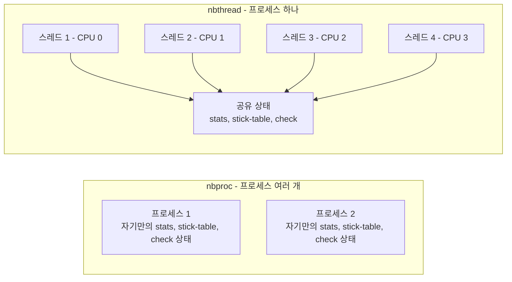

## reload 무중단 처리

설정을 바꾸고 적용할 때 `restart`를 쓰면 안 된다. 프로세스를 죽였다 띄우는 동안 들어오는 연결이 끊긴다. `reload`를 쓰면 HAProxy가 새 설정으로 새 프로세스를 띄우고, 기존 프로세스는 처리 중인 연결을 마저 끝낼 때까지 살려둔다(graceful).

systemd 환경이면 보통 이렇게 동작한다.

```bash
haproxy -c -f /etc/haproxy/haproxy.cfg   # 먼저 문법 검사
systemctl reload haproxy
```

`-c`로 문법을 먼저 검사하는 습관이 중요하다. 잘못된 설정으로 reload 하면 새 프로세스가 못 뜨고, 운영 중인 서비스가 영향받는다. 문법 검사를 통과한 뒤에만 reload 한다.

### master-worker 모드와 listener 인계

Ubuntu 패키지의 systemd 유닛은 HAProxy를 `-Ws` 옵션, 즉 master-worker 모드로 띄운다. master 프로세스가 상주하고 실제 트래픽은 worker가 처리한다. reload는 master에 SIGUSR2를 보내는 것이다. master가 자신을 다시 실행하며 설정을 새로 읽고, 새 worker를 만들고, 옛 worker를 종료 상태로 보낸다.

여기서 열쇠는 listener의 인계다. 새 worker가 같은 포트를 새로 bind 하면 옛 소켓을 닫고 새 소켓을 여는 찰나에 들어온 SYN이 떨어질 수 있다. `expose-fd listeners`는 이 문제를 푼다. 옛 worker의 stats 소켓에서 listening 소켓 자체를 새 worker가 넘겨받아서 포트가 한순간도 닫히지 않는다. 직접 reload 해 보면 새 worker는 `-sf <옛PID> -x /path/to/admin.sock`으로 뜬다. `-x`가 소켓에서 fd를 받아 오는 부분이다.

```
global
    master-worker
    stats socket /run/haproxy/admin.sock mode 660 level admin expose-fd listeners
    hard-stop-after 30s
```

`expose-fd listeners`가 없으면 새 worker가 listener를 직접 bind 해야 해서 그 순간의 SYN 유실 가능성이 남는다. reload가 매끄럽지 않다면 설정 파일의 stats socket 줄에 이 옵션이 있는지부터 본다.

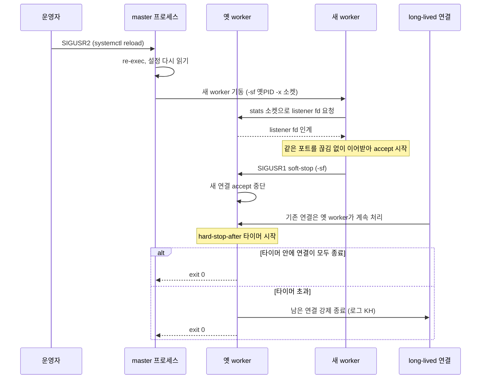

이 그림에서 봐야 할 것은 옛 worker가 새 연결은 받지 않으면서 기존 연결만 붙들고 있는 구간이다. long-lived 연결이 많으면 이 구간이 끝나지 않는다. WebSocket이 잔뜩 붙어 있으면 reload를 할 때마다 옛 worker가 하나씩 쌓이고 메모리를 계속 잡는다. 설정을 자주 바꾸는 환경일수록 `ps`에 haproxy 프로세스가 여러 개 보이는지 주기적으로 본다.

`hard-stop-after`가 이걸 막는다. 지정한 시간이 지나면 남은 연결을 강제로 닫고 옛 worker가 종료된다. 대가로 그 시점에 아직 끝나지 않은 연결이 잘린다. 직접 `hard-stop-after 5s`를 걸고 12초짜리 응답을 받는 중에 reload 했더니 5.5초에 클라이언트가 502를 받았고 HAProxy 로그에 `soft-stop running for too long, performing a hard-stop`이 찍혔다. 요청 로그의 종료 상태는 `KH`였다. 대용량 다운로드나 오래 걸리는 API를 서빙하는 곳에서는 이 값을 가장 긴 정상 요청보다 길게 잡아야 한다. 값을 안 쓰면 연결이 끝날 때까지 옛 worker가 남는다.

트래픽이 많은 환경이면 reload 직후 짧은 에러 스파이크가 stats에 잡히는지 한 번 확인해 둔다.

## Keepalived + VRRP로 이중화

여기까지는 HAProxy 한 대로 여러 백엔드를 분산하는 얘기다. 그런데 HAProxy 자신이 죽으면? 백엔드가 다 살아있어도 입구가 막혀서 전체 서비스가 내려간다. 로드밸런서가 단일 장애점(SPOF)이 된다.

HAProxy를 두 대 올리고 그 앞에 Keepalived로 VRRP를 깔아서 푼다. VRRP는 두 노드가 가상 IP(VIP) 하나를 공유하고, 평소엔 MASTER가 VIP를 들고 트래픽을 받는다. MASTER가 죽으면 BACKUP이 VIP를 가져와서 트래픽을 이어받는다. 클라이언트는 VIP만 보고 있으니 뒤에서 누가 바뀌든 모른다.

```
# keepalived.conf (MASTER 노드)
vrrp_script chk_haproxy {
    script "killall -0 haproxy"
    interval 2
    weight -20
}

vrrp_instance VI_1 {
    state MASTER
    interface eth0
    virtual_router_id 51
    priority 110
    advert_int 1
    authentication {
        auth_type PASS
        auth_pass secret123
    }
    virtual_ipaddress {
        10.0.0.100
    }
    track_script {
        chk_haproxy
    }
}
```

`vrrp_script`로 HAProxy 프로세스가 살아있는지 검사한다. `killall -0 haproxy`는 실제로 죽이는 게 아니라 프로세스 존재만 확인하는 트릭이다. HAProxy가 죽으면 `weight -20`만큼 priority가 깎여서 BACKUP(priority 100)보다 낮아지고, VIP가 BACKUP으로 넘어간다.

HAProxy가 죽은 시점부터 VIP가 넘어가기까지의 순서다. 클라이언트는 같은 VIP로 요청을 보내고, 바뀌는 건 VIP를 들고 있는 노드뿐이다.

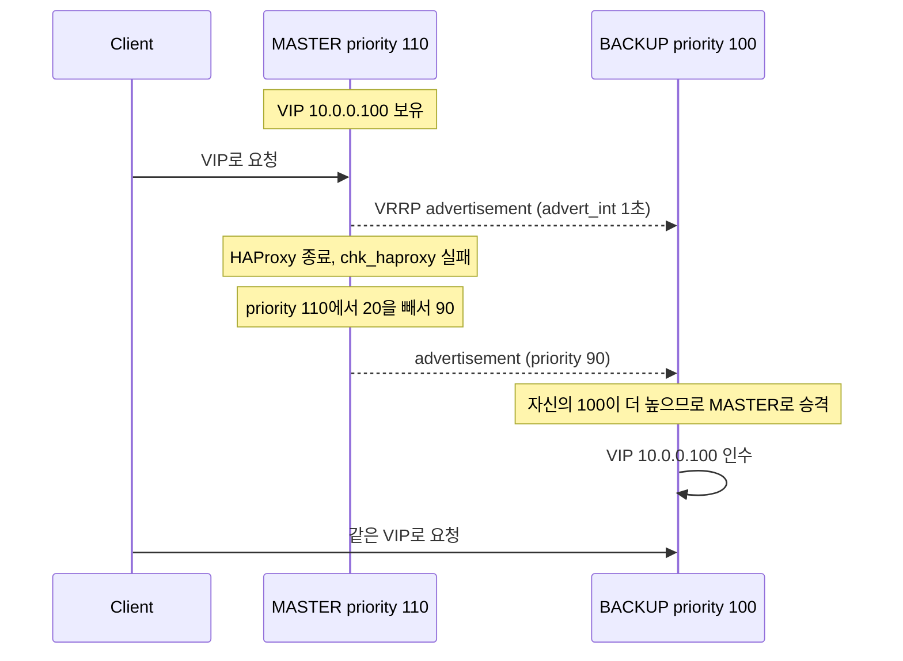

BACKUP 노드는 같은 설정에서 `state BACKUP`, `priority 100`으로 둔다. `virtual_router_id`는 두 노드가 같아야 짝이 맺어진다. 한 네트워크에 VRRP 그룹이 여러 개면 이 ID가 겹치지 않게 한다. `auth_pass secret123`도 예시일 뿐이다. VRRP 인증은 평문 비교라 비밀번호보다는 VRRP 트래픽이 흐르는 망을 분리하는 쪽이 실질적인 방어다.

운영하면서 겪는 함정 두 가지가 있다. 하나는 split-brain이다. 두 노드 사이 통신이 끊기면 양쪽 다 자기가 MASTER라고 믿고 둘 다 VIP를 들어버린다. 같은 IP가 두 곳에 있으면 트래픽이 엉킨다. VRRP 통신 경로를 데이터 트래픽과 분리하고, 가능하면 이중화된 경로로 둔다.

다른 하나는 priority만 보고 chk_haproxy의 검사 방식을 대충 짜는 경우다. `killall -0`은 프로세스 존재만 본다. HAProxy 프로세스는 떠 있는데 설정이 깨져서 실제로 트래픽을 못 받는 상태면 failover가 안 일어난다. 더 정확히 하려면 VIP:포트로 실제 HTTP 요청을 던져보는 스크립트로 바꾼다.

## Nginx, Caddy와 역할 비교

세 도구 다 리버스 프록시를 한다. 그래서 "뭘 써야 하나"를 자주 묻는다.

HAProxy는 로드밸런서/프록시 전용이다. 정적 파일 서빙, 자체 웹서버 기능은 없다(없다고 봐도 된다). 대신 LB 기능이 가장 깊다. L4/L7 둘 다 제대로 하고, health check, 큐잉, 백엔드 상태 관리, stats가 촘촘하다. DB나 TCP 트래픽 분산, 대규모 트래픽 앞단 LB엔 HAProxy가 1순위다.

Nginx는 웹서버가 본진이고 리버스 프록시/LB는 부가 기능이다. 정적 파일 서빙, FastCGI(PHP), 캐싱이 강하다. 하나의 인스턴스에서 정적 자원도 주고 백엔드 프록시도 하는 구성이면 nginx가 편하다. LB 기능은 HAProxy만큼 세밀하진 않지만 웬만한 HTTP 분산엔 충분하다. L4 스트림 모듈도 있긴 하다.

Caddy는 자동 HTTPS가 본진이다. Let's Encrypt 인증서를 알아서 발급/갱신해준다. 설정 파일(Caddyfile)이 짧고 직관적이다. 소규모 서비스나 개발 환경에서 TLS를 신경 안 쓰고 빨리 띄우고 싶을 때 좋다. 대규모 LB 기능이나 세밀한 백엔드 제어는 HAProxy/Nginx에 못 미친다.

순수 LB가 목적이고 TCP까지 다루거나 health check를 정밀하게 제어해야 하면 HAProxy, 정적 서빙과 프록시를 한 인스턴스에서 같이 하면 Nginx, 인증서 자동화가 제일 급하고 설정을 단순하게 가져가고 싶으면 Caddy다. 실제로는 섞어 쓴다. 앞단에 HAProxy로 분산하고, 각 노드에 nginx를 두어 정적 자원과 앱 프록시를 처리하는 식이다.

## 관련 문서

같은 디렉토리의 문서 중 이 글과 이어지는 것들이다.

- [Keepalived](Keepalived.md): VRRP 설정과 failover 동작을 따로 다룬다. 위 이중화 절의 split-brain, 검사 스크립트를 더 자세히 본다.
- [Nginx](Nginx.md): 웹서버 겸 프록시로서의 upstream, keepalive 설정. HAProxy 뒤에 두는 구성과 맞물린다.
- [Envoy](Envoy.md): 같은 L7 프록시지만 동적 설정(xDS) 중심이다. HAProxy의 reload 방식과 비교해 볼 만하다.
- [Envoy 필터 체인과 스레드 모델](Envoy_Filter_Chain_and_Threading.md): 위의 nbthread 절과 같은 주제를 Envoy 쪽에서 다룬다.
- [Traefik](Traefik.md): 컨테이너 환경에서 라우팅 설정을 자동으로 읽는 프록시.
