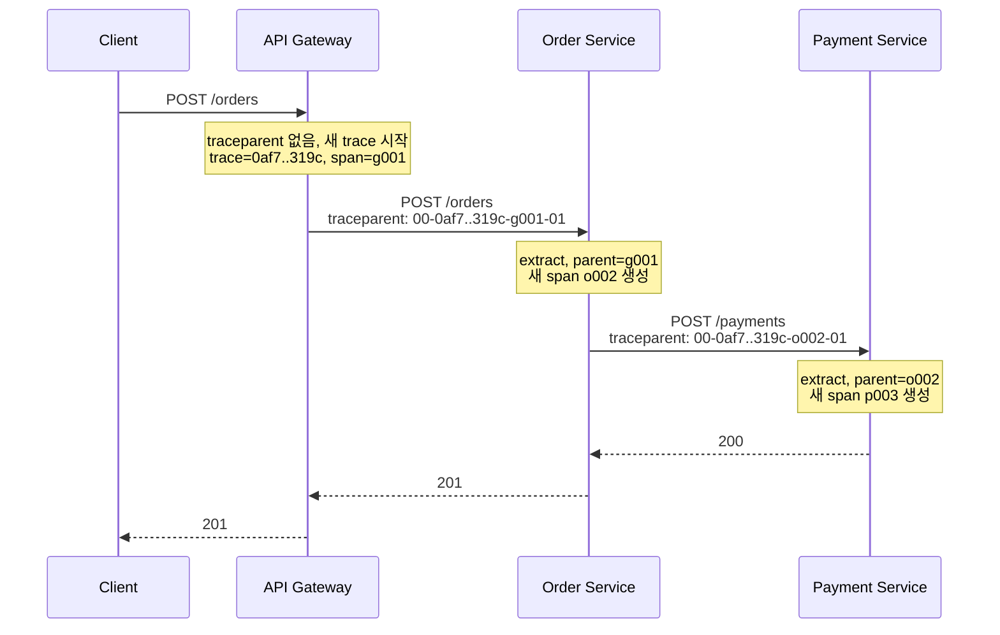
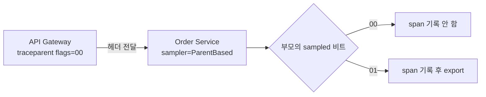
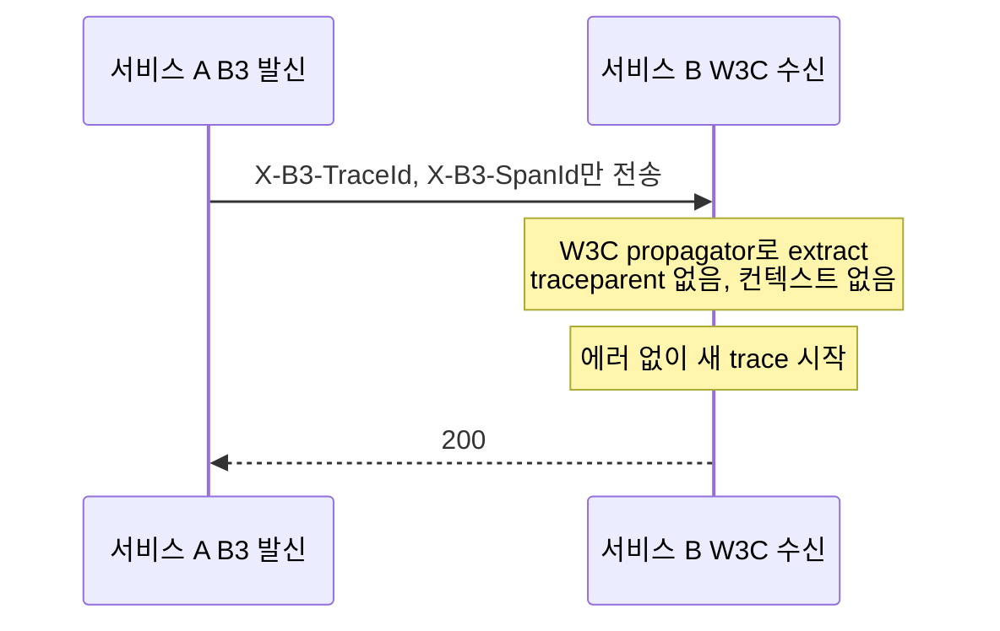
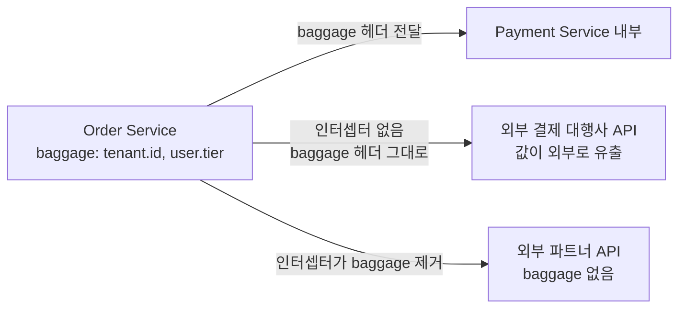
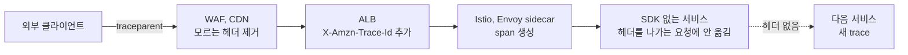
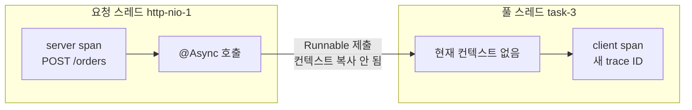
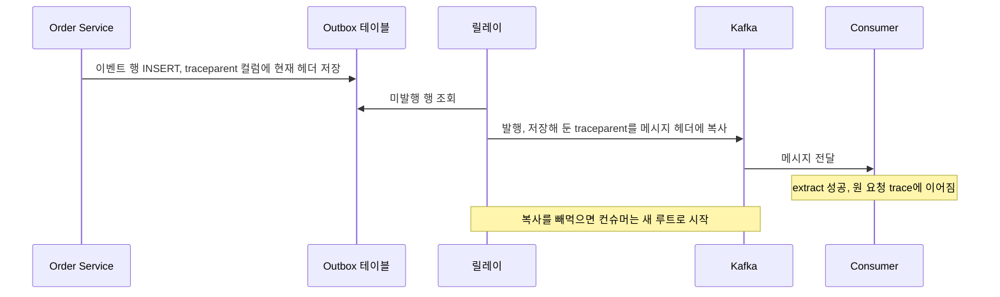
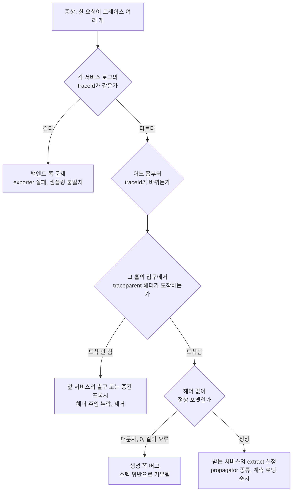
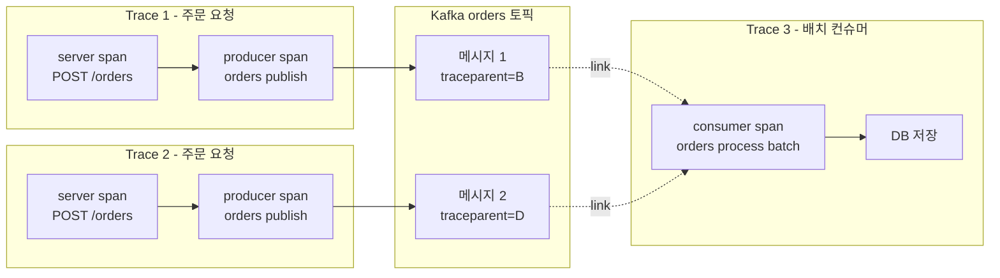
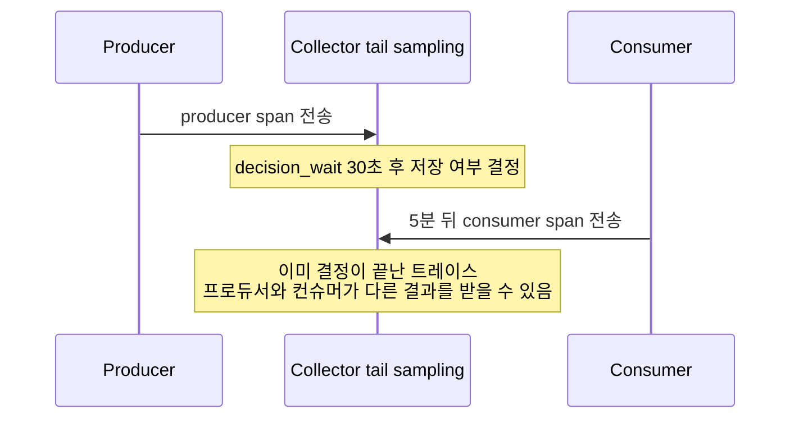

# 분산 추적 컨텍스트 전파

트레이싱 백엔드(Jaeger, Tempo)를 붙이고 나면 한동안은 트레이스가 잘 보인다. 문제는 서비스가 늘고 Kafka가 끼고 게이트웨이가 앞에 서고 나서 생긴다. 한 요청이 트레이스 세 개로 쪼개져 있거나, 게이트웨이 span만 있고 뒤가 없거나, 컨슈머 쪽이 아예 새 트레이스로 시작한다. SDK 설정이 틀린 경우보다 컨텍스트를 옮겨 주는 한 줄이 어딘가에서 빠진 경우가 훨씬 많다.

이 문서는 헤더 포맷, 포맷이 섞일 때 끊기는 지점, 비동기 경로에서 전파가 빠지는 위치, Kafka에서 parent-child와 span link 중 무엇을 쓸지를 다룬다. OpenTelemetry 자체의 개념(Tracer, Exporter, Collector)은 [OpenTelemetry](OpenTelemetry.md)에 있고, 여기서는 전파만 본다.

---

## 컨텍스트 전파가 하는 일

트레이스는 서비스마다 따로 만든 span을 trace ID 하나로 묶은 결과다. 서비스 A가 B를 호출할 때 "내 trace ID는 이것이고, 내 span ID는 저것이다"를 요청에 실어 보내야 B가 만든 span이 A의 span 밑에 붙는다. 이걸 싣고 꺼내는 동작이 inject와 extract다.



도식에서 볼 것은 헤더의 trace ID(`0af7..319c`)는 홉마다 그대로이고, 뒤의 span ID만 호출하는 쪽의 것으로 바뀐다는 점이다. 받는 쪽은 이 span ID를 parent로 삼아 자기 span을 만든다. 어느 홉에서든 헤더를 못 읽으면 그 서비스는 새 trace ID를 만들고, 그 지점부터 트레이스가 둘로 갈라진다.

같은 프로세스 안에서는 이 정보가 "현재 컨텍스트"에 들어 있다. Java는 ThreadLocal, Node.js는 AsyncLocalStorage가 그 저장소다. 프로세스 밖으로 나갈 때는 헤더로, 프로세스 안에서 스레드나 큐를 넘을 때는 컨텍스트를 손으로 옮겨야 한다. 끊김은 거의 이 두 경계에서 생긴다.

---

## W3C Trace Context

### traceparent

```
traceparent: 00-0af7651916cd43dd8448eb211c80319c-b7ad6b7169203331-01
             │   │                                │                │
             │   │                                │                └ trace-flags (01 = sampled)
             │   │                                └ parent-id (16 hex, 호출한 쪽의 span ID)
             │   └ trace-id (32 hex)
             └ version (현재 00)
```

필드는 네 개이고 길이가 고정이라 정규식으로 검증하기 쉽다. 직접 만들거나 파싱하는 코드를 쓸 일이 있으면 다음 규칙은 알고 있어야 한다. OTel JS의 W3C propagator로 각각 돌려 본 결과다.

| 입력 | 결과 |
|---|---|
| 정상 | 컨텍스트 복원 |
| trace-id를 대문자 hex로 씀 | 거부, 새 trace 시작 |
| trace-id 또는 parent-id가 전부 0 | 거부 |
| version이 `ff` | 거부 |
| trace-id가 16 hex(64비트) | 거부 |
| trace-flags가 `00` | 복원은 되지만 sampled=false |
| version `00`인데 뒤에 필드가 더 붙음 | 거부 |
| version `01`인데 뒤에 필드가 더 붙음 | 앞 네 필드만 읽고 복원 |

대문자 거부가 실무에서 제일 자주 걸린다. 로그에서 trace ID를 복사해 테스트 요청을 만들거나, 직접 만든 ID를 `toUpperCase()`로 정규화하는 코드가 있으면 조용히 새 트레이스가 된다. 에러도 안 난다.

거부될 때 에러 없이 새 trace가 시작되는 건 스펙이 그렇게 정했기 때문이다. 헤더가 잘못됐다고 요청을 실패시키면 트레이싱 때문에 장애가 나므로, 무시하고 루트로 시작한다. 대신 "끊긴 이유"는 찾는 사람이 알아내야 한다.

trace-flags의 `01` 비트는 상위가 샘플링하기로 했다는 뜻이다. 기본 sampler인 `ParentBased`는 이 비트를 따른다. 게이트웨이가 `00`으로 보내면 뒤의 서비스는 자기 설정이 `AlwaysOn`이어도 span을 기록하지 않는다. "게이트웨이 span은 있는데 뒤 서비스 span이 하나도 없다"는 증상의 한 원인이다.



도식에서 볼 것은 Order Service의 자기 설정이 아니라 들어온 flags 값이 분기를 정한다는 점이다.

### tracestate

`traceparent`가 모든 벤더가 공유하는 최소 정보라면, `tracestate`는 벤더별 부가 정보다.

```
tracestate: vendor1=opaque-value,vendor2=another
```

쉼표로 구분한 `key=value` 목록이고 최대 32개 항목이다. 변경한 벤더가 자기 항목을 맨 앞으로 옮긴다. 비어 있는 경우가 많고, APM 에이전트가 자기 항목을 넣는 용도로 쓴다. 직접 건드릴 일은 거의 없다. 게이트웨이나 프록시가 `traceparent`만 통과시키고 `tracestate`를 지우는 경우만 알아 두면 된다. 지워져도 트레이스는 이어지지만 벤더 전용 기능이 어긋날 수 있다.

---

## B3와 섞일 때 끊기는 지점

Zipkin 계열(Brave, 옛 Spring Cloud Sleuth)은 B3를 쓴다. 신규 서비스는 W3C가 기본이라, 마이그레이션 중에는 두 포맷이 한 호출 체인에 섞인다.

```
# B3 multi-header
X-B3-TraceId: 463ac35c9f6413ad48485a3953bb6124
X-B3-SpanId: a2fb4a1d1a96d312
X-B3-Sampled: 1

# B3 single-header
b3: 463ac35c9f6413ad48485a3953bb6124-a2fb4a1d1a96d312-1
```

끊기는 경우는 세 가지다.

첫째, 한쪽은 B3만 내보내고 다른 쪽은 W3C만 읽는 경우다. W3C propagator에 `X-B3-*` 헤더만 넣고 extract하면 컨텍스트가 없는 상태로 나온다(직접 돌려 확인했다). 받는 서비스는 에러 없이 새 trace를 시작한다. 트레이스 화면에서는 서비스 A의 트레이스가 마지막 외부 호출 span에서 끝나고, 서비스 B가 별개 트레이스로 보인다.



도식에서 볼 것은 응답이 정상으로 오기 때문에 이 끊김이 어디에서도 에러로 드러나지 않는다는 점이다.

둘째, trace ID 길이다. B3는 64비트(16 hex) trace ID를 허용한다. OTel B3 propagator로 16 hex를 extract하면 앞을 0으로 채워 32 hex(`0000000000000000463ac35c9f6413ad`)로 만든다. 이 서비스가 B3로 다시 내보내면 원래 ID와 다른 값이 되어, 64비트 ID만 아는 Zipkin 계열 서비스의 span과 백엔드에서 합쳐지지 않을 수 있다. 호출 체인 전체가 128비트 ID를 쓰게 맞추는 게 정석이다.

셋째, 두 포맷을 다 켠 composite propagator에서 헤더 둘이 서로 다른 값을 가진 경우다. extract가 등록 순서대로 컨텍스트를 덮어쓰기 때문에 나중에 등록한 propagator가 이긴다. 같은 요청에 `traceparent`(aaaa...)와 `X-B3-TraceId`(bbbb...)를 넣고 순서만 바꿔 돌린 결과는 다음과 같았다.

```
[w3c, b3] 순서 -> bbbbbbbb...   (b3가 이김)
[b3, w3c] 순서 -> aaaaaaaa...   (w3c가 이김)
```

같은 서비스에서 만든 헤더는 값이 같으니 상관없지만, 중간에 B3만 갱신하는 프록시가 끼면 W3C 헤더는 옛 값 그대로, B3 헤더만 새 값이 되어 서로 어긋난다. 마이그레이션 중에는 한 포맷을 기준으로 정하고 나머지는 "읽기만" 하게 두는 편이 낫다.

설정은 이렇게 한다.

```bash
# OTel SDK (Java agent, Node 모두 같은 환경변수)
OTEL_PROPAGATORS=tracecontext,baggage,b3multi
```

Spring Boot(Micrometer Tracing)는 `management.tracing.propagation.type`으로 고른다. 기본은 W3C다. 3.3 이상에서는 `produce`와 `consume`으로 보내는 포맷과 받는 포맷을 따로 지정할 수 있어서, "받기는 둘 다, 보내기는 W3C만"이 가능하다. 그 이전 버전은 `type` 하나만 받으므로 사용하는 버전의 문서를 확인하고 설정한다.

```yaml
management:
  tracing:
    sampling:
      probability: 1.0
    propagation:
      consume: [w3c, b3]
      produce: [w3c]
```

---

## Baggage

Baggage는 trace ID와 별개로, 요청 전체를 따라가는 key-value다. `tenantId`, `userTier`, `experiment` 같은 값을 매 서비스에서 다시 조회하지 않고 쓰려고 쓴다.

```
baggage: tenant.id=acme,user.tier=premium
```

주의할 점이 세 가지 있다.

**1. 자동으로 span attribute가 되지 않는다.** Baggage는 컨텍스트에만 실려 간다. 트레이스 화면에서 `tenant.id`로 검색하려면 span 생성 시점에 attribute로 복사하는 코드가 필요하다. OpenTelemetry.md에 그 예가 있다. Spring Boot는 `management.tracing.baggage.remote-fields`에 필드를 등록해야 전파되고, `management.tracing.baggage.correlation.fields`에 넣어야 MDC(로그)에 들어간다. 등록하지 않은 필드는 헤더에 있어도 버려진다.

**2. 나가는 모든 호출에 실린다.** 결제 대행사나 외부 파트너 API 호출에도 `baggage` 헤더가 같이 나간다. 여기에 사용자 ID, 이메일, 내부 계정 번호를 넣으면 외부로 유출되는 것이다. 코드 리뷰에서 흔히 놓치는 부분이라, baggage 키는 허용 목록을 두고 내부 도메인 호출에만 쓰는 편이 안전하다. 외부 호출 client에서 `baggage` 헤더를 제거하는 인터셉터를 두는 방법도 있다.



도식에서 볼 것은 같은 Order Service에서 나가는 호출이라도 외부 경계에 인터셉터가 있느냐에 따라 값이 밖으로 나가는지가 갈린다는 점이다.

**3. 헤더 크기가 누적된다.** W3C 스펙은 전체 8192바이트, 항목 180개, 항목당 4096바이트까지 지원하도록 요구한다. 그 이상은 전파자가 잘라도 된다. 문제는 스펙 한도보다 인프라 한도가 낮다는 점이다. Spring Boot 내장 Tomcat의 `server.max-http-request-header-size` 기본값이 8KB이고, Nginx는 기본 `large_client_header_buffers`가 4개 × 8KB다. 쿠키와 `Authorization`(JWT)이 이미 수 KB를 차지하는 요청에 baggage를 몇 개 더하면 한도에 닿고, 그때는 트레이싱이 아니라 요청 자체가 400/431로 실패한다. Baggage에 서비스마다 하나씩 값을 추가하는 설계는 호출 깊이에 비례해 커지므로 피한다.

브라우저에서 시작하는 트레이스라면 하나 더 있다. 브라우저 SDK가 `traceparent`, `baggage`를 cross-origin 요청에 붙이면 preflight가 걸린다. 서버 CORS 설정의 `Access-Control-Allow-Headers`에 `traceparent, tracestate, baggage`가 없으면 요청 자체가 막힌다. 증상은 "트레이싱을 켰더니 API가 CORS 에러"다.

---

## 전파가 끊기는 위치

### API Gateway와 프록시

게이트웨이는 트레이스에서 "시작점"이면서 "통과점"이다. 문제는 세 가지 방향으로 나온다.

- **헤더를 지운다.** WAF나 일부 CDN 설정은 모르는 헤더를 제거한다. Nginx `proxy_pass`는 기본적으로 요청 헤더를 넘기지만, `proxy_set_header`로 헤더를 재구성하는 설정에서 빠뜨리는 경우가 있다.
- **자기 포맷으로 바꾼다.** AWS ALB는 `X-Amzn-Trace-Id`를 붙인다. W3C와는 별개 헤더라, 뒤 서비스가 W3C만 읽으면 ALB가 만든 ID는 쓰이지 않는다. 서비스 메시(Istio/Envoy)는 설정에 따라 B3나 W3C 헤더를 생성한다. sidecar는 span을 만들 뿐이고, 앱이 들어온 헤더를 나가는 요청에 옮겨 주는 일은 앱의 SDK가 해야 한다. SDK가 없는 서비스는 메시 안에 있어도 트레이스가 거기서 끊긴다.
- **외부가 보낸 헤더를 믿는다.** 공개 엔드포인트에서 외부 클라이언트가 보낸 `traceparent`를 그대로 받으면, 클라이언트가 trace ID를 고정하거나 `sampled=01`로 샘플링을 강제할 수 있다. 공개 경계에서는 들어온 헤더를 무시하고 새 트레이스를 시작하되, 원래 값은 attribute나 link로 남기는 방식이 많이 쓰인다.



도식은 요청이 거치는 순서대로 헤더가 지워지거나 다른 헤더로 바뀌거나 옮겨지지 않는 지점을 모아 보여 준다. 어느 칸에서든 `traceparent`가 빠지면 그 뒤는 새 트레이스다.

Spring Cloud Gateway는 Reactor 기반이라 컨텍스트가 ThreadLocal로 안 따라간다. Micrometer를 쓰면 `Hooks.enableAutomaticContextPropagation()`을 켜야 필터 안의 코드에서 MDC·현재 span이 이어진다.

### 스레드풀, @Async, setTimeout

Java에서 `ThreadLocal`은 스레드를 넘으면 사라진다. `@Async`, `CompletableFuture.supplyAsync(..., executor)`, 직접 만든 `ExecutorService`가 대표적이다. 이 작업 안에서 외부 호출을 하면 부모 없는 새 트레이스가 생긴다.



Spring Framework 6.1부터는 `ContextPropagatingTaskDecorator`가 있다. Micrometer `context-propagation` 라이브러리가 클래스패스에 있을 때, 작업을 제출하는 스레드의 컨텍스트를 풀 스레드에 옮긴다. Boot가 자동으로 붙여 주는지는 버전마다 달라서, 직접 지정해 두는 쪽이 확실하다.

```java
@Configuration
@EnableAsync
public class AsyncConfig {

    @Bean
    public ThreadPoolTaskExecutor taskExecutor() {
        ThreadPoolTaskExecutor ex = new ThreadPoolTaskExecutor();
        ex.setCorePoolSize(8);
        ex.setMaxPoolSize(16);
        ex.setThreadNamePrefix("async-");
        ex.setTaskDecorator(new ContextPropagatingTaskDecorator());
        return ex;
    }
}
```

`@Async`를 안 거치고 `Executors.newFixedThreadPool`로 직접 만든 풀은 이 설정이 적용되지 않는다. 그 풀을 Spring 빈으로 올리거나, 다음처럼 제출 시점에 span을 잡아 풀 스레드에서 다시 연다.

```java
Span parent = tracer.currentSpan();
executor.submit(() -> {
    try (Tracer.SpanInScope ws = tracer.withSpan(parent)) {
        callExternal();
    }
});
```

OTel Java agent를 쓰면 `Executor` 계열을 자동으로 계측해서 이 문제가 대부분 없다. 같은 서비스를 agent로 띄우면 되고 Micrometer로 띄우면 안 되는 이유가 이것이다. 계측 방식을 바꾸고 나서 "갑자기 끊긴다"면 여기부터 본다.

Node.js는 사정이 다르다. AsyncLocalStorage가 `setTimeout`, Promise, async/await를 따라간다. `setTimeout` 안에서 컨텍스트가 사라진다고 알려진 건 브라우저(zone.js 필요)이거나 Node에서 context manager를 등록하지 않았을 때다. 실제로 끊기는 건 이런 경우다. 아래는 직접 돌려 본 결과다.

```js
// 풀/큐의 처리 루프가 span 밖에서 먼저 시작된 경우
const queue = [];
setInterval(() => { while (queue.length) queue.shift()(); }, 5);

tracer.startActiveSpan('root', (span) => {
  queue.push(() => console.log(api.trace.getActiveSpan()));        // undefined
  const ctx = api.context.active();
  queue.push(() => api.context.with(ctx, () =>
    console.log(api.trace.getActiveSpan()?.spanContext().spanId))); // root의 spanId
});
```

작업이 큐에 담겨 "이미 돌고 있던" 루프에서 실행되면, 실행 컨텍스트는 루프가 시작된 시점의 것이다. 커넥션 풀 라이브러리, 자체 job 큐, 오래 떠 있던 EventEmitter가 이 형태다. 작업을 넣을 때 `context.active()`를 잡아 두었다가 `context.with()`로 감싸 실행한다. `worker_threads`는 컨텍스트가 아예 공유되지 않아서(span이 `undefined`로 나왔다) 워커에 trace 정보를 메시지로 직접 넘겨야 한다.

Node에서 자동 계측이 통째로 안 먹는 흔한 원인은 로딩 순서다. `http`, `express`, `pg` 같은 모듈이 계측 초기화보다 먼저 import되면 패치가 적용되지 않는다. CommonJS는 `node --require ./tracing.js app.js`, ESM은 `--import ./tracing.mjs`로 앱보다 앞에서 올려야 한다.

### 메시지 헤더 누락

HTTP는 계측 라이브러리가 헤더를 알아서 붙이지만, 메시지 브로커는 라이브러리 지원 여부와 계측 켜짐 여부에 달려 있다. Spring Boot에서는 둘 다 기본이 꺼져 있다.

```yaml
spring:
  kafka:
    template:
      observation-enabled: true     # KafkaTemplate이 발행 시 헤더 주입
    listener:
      observation-enabled: true     # @KafkaListener가 수신 시 헤더 추출
  rabbitmq:
    template:
      observation-enabled: true
    listener:
      simple:
        observation-enabled: true
```

한쪽만 켜면 끊긴다. 프로듀서는 켰는데 컨슈머가 안 켜져 있으면 헤더는 메시지에 있지만 아무도 읽지 않는다. 반대로 컨슈머만 켜면 읽을 헤더가 없다. 여러 팀이 한 토픽을 쓰면 이 불일치가 가장 흔하다.

헤더가 메시지에서 사라지는 경로도 있다.

- **Outbox 패턴.** 트랜잭션 안에서 outbox 테이블에 이벤트를 쓰고 별도 릴레이(Debezium, 폴링 배치)가 Kafka로 보내는 구조다. 릴레이가 발행하는 시점의 컨텍스트는 원래 요청과 무관하므로 트레이스가 여기서 끊긴다. outbox 행에 `traceparent` 컬럼을 두고, 요청 처리 중에 현재 헤더 값을 저장한 뒤 릴레이가 그 값을 메시지 헤더에 복사해야 한다.
- **재발행.** 컨슈머가 실패한 메시지를 retry 토픽이나 DLQ로 옮길 때 원본 헤더를 복사하지 않는 코드가 있다. 새 `ProducerRecord`를 만들면서 key와 value만 옮기는 경우다. RabbitMQ에서 dead-letter 처리를 수동 republish로 하면 같은 일이 생긴다.
- **변환 계층.** 스트림 처리나 커넥터 변환처럼 레코드를 새로 만들어 내보내는 코드는 입력 레코드의 헤더를 명시적으로 옮기지 않으면 새 레코드에 헤더가 없다. 사용하는 프레임워크가 헤더를 유지하는지 한 번 찍어 봐야 한다.
- **헤더 키 대소문자.** HTTP 헤더는 대소문자를 구분하지 않지만 Kafka 레코드 헤더 키는 구분한다. `traceparent`와 `Traceparent`는 서로 다른 헤더다. 직접 헤더를 읽고 쓰는 코드를 만들 때 키를 소문자로 통일한다.
- **값의 타입.** Kafka 헤더 값은 `byte[]`다. kafkajs 컨슈머가 받는 `message.headers[k]`는 `Buffer`다. 문자열로 변환하지 않고 propagator에 넘기면 읽지 못한다.



도식에서 볼 것은 요청 시점과 발행 시점이 다른 프로세스라서, `traceparent`를 outbox 행에 실어 두는 단계가 없으면 이을 방법이 없다는 점이다.

### 배치 소비자

`@KafkaListener(batch = "true")`나 kafkajs `eachBatch`는 한 번 호출에 레코드 N개를 받는다. 각 레코드의 `traceparent`는 서로 다른 트레이스를 가리키는데, 처리 span은 하나만 만들 수 있다. 그중 하나를 parent로 고르면 나머지 N-1개의 트레이스는 컨슈머 쪽이 비어 보인다. 이 경우가 아래 span link 절의 대상이다.

---

## 끊긴 곳 찾는 방법

트레이스 화면에서 끊김을 눈으로 찾는 것보다, 어느 홉에서 헤더가 사라졌는지를 직접 보는 게 빠르다.



도식의 첫 분기가 핵심이다. 로그에 `traceId`가 있으면(Micrometer Tracing은 MDC에 `traceId`, `spanId`를 넣는다) 백엔드에 가지 않고도 어느 홉에서 값이 바뀌는지 알 수 있다.

헤더가 실제로 도착하는지는 이렇게 본다.

```bash
# W3C 스펙 예시 ID로 직접 호출한 뒤, 각 서비스 로그나 백엔드에서 이 ID를 검색한다
curl -H 'traceparent: 00-0af7651916cd43dd8448eb211c80319c-b7ad6b7169203331-01' \
     https://api.example.com/orders

# Kafka 메시지 헤더 확인
kafka-console-consumer.sh --bootstrap-server localhost:9092 --topic orders \
  --from-beginning --max-messages 3 --property print.headers=true
```

Kafka 쪽은 헤더가 `traceparent:00-0af7...` 형태로 출력되는지만 보면 된다. 안 나오면 프로듀서 쪽이다.

백엔드에서는 비즈니스 키로 역추적한다. span에 `order.id`를 attribute로 남겨 두었다면, 같은 `order.id`가 서로 다른 trace ID 둘 이상에 나타나는 순간 끊긴 것이다. 어디서 끊겼는지는 그 트레이스들의 가장 마지막 span과 가장 첫 span을 비교하면 나온다.

각 원인별 증상은 이렇다.

| 원인 | 트레이스 화면에서 보이는 모습 | 로그에서 보이는 모습 | 먼저 볼 곳 |
|---|---|---|---|
| 게이트웨이가 헤더 제거 | 게이트웨이 트레이스는 그 서비스 span에서 끝, 뒤 서비스는 루트 span으로 시작 | 게이트웨이와 뒤 서비스의 traceId가 다름 | 게이트웨이 설정, 뒤 서비스 입구에서 헤더 덤프 |
| 외부가 보낸 sampled=00 | 뒤 서비스 span이 전혀 없음. 끊김이 아니라 빈 자리 | traceId는 이어지는데 span 수가 적음 | 게이트웨이의 sampler, 헤더 flags 값 |
| B3와 W3C 혼용 | 한 서비스부터 새 트레이스. 뒤쪽 홉은 정상 | 해당 홉에서 traceId 변경, 입구에 `X-B3-*`만 도착 | `OTEL_PROPAGATORS`, Micrometer propagation 설정 |
| 대문자 hex, 0 ID | 특정 클라이언트가 호출할 때만 루트로 시작 | 입구 헤더는 있는데 traceId가 다름 | 헤더를 만드는 코드 |
| 스레드풀, @Async | 요청 트레이스에 비동기 작업 span이 없고, 같은 시각에 부모 없는 트레이스가 따로 생김 | `async-` 스레드 로그의 traceId가 비거나 다름 | TaskDecorator, 직접 만든 Executor |
| Node 큐, 워커 | 큐에서 꺼낸 작업이 루트 span, 서비스명은 같음 | 작업 로그에 traceId 없음 | 큐에 넣는 지점의 `context.active()` 캡처 |
| 메시지 헤더 누락 | 프로듀서 트레이스는 produce span에서 끝, 컨슈머는 새 루트 | 컨슈머 traceId가 프로듀서와 다름 | `print.headers`, 양쪽 observation 설정 |
| Outbox 릴레이 | 요청 트레이스가 DB 쓰기에서 끝, 이벤트 처리는 별도 트레이스 | 릴레이 로그에 원 요청 traceId 없음 | outbox 테이블 컬럼, 릴레이의 헤더 복사 |
| 배치 소비자 | 컨슈머 span이 레코드 하나의 트레이스에만 붙음 | 배치 처리 로그의 traceId 하나뿐 | span link 사용 여부 |
| 헤더 크기 초과 | 특정 요청만 400/431 | 서버 접근 로그에 요청 거부 | baggage 크기, 서버 헤더 한도 |

---

## Kafka에서 span link를 쓰는 기준

Kafka 경로에서 컨슈머 span을 어디에 붙일지는 둘 중 하나다.

- **parent-child**: 컨슈머 처리 span이 프로듀서 span의 자식이 된다. 한 요청이 하나의 트레이스에 담긴다.
- **span link**: 컨슈머가 자기 트레이스를 새로 시작하고, 프로듀서 span을 "관련 있음"으로만 가리킨다. 부모-자식 관계가 아니다.



도식에서 볼 것은 실선과 점선의 차이다. 실선은 같은 트레이스 안의 부모-자식이고, 점선은 서로 다른 트레이스 사이의 link다. Trace 3은 자기 trace ID를 가지고, 처리한 메시지 둘이 어느 트레이스에서 왔는지를 link 둘로 가리킨다. Jaeger와 Tempo에서 span을 열면 link 목록이 나오고 클릭하면 원 트레이스로 이동한다.

기준은 표로 정리한다.

| 상황 | 선택 | 이유 |
|---|---|---|
| 메시지 1개를 받아 처리, 지연이 짧음 | parent-child | 한 요청을 한 화면에서 보는 게 목적이므로 |
| 배치로 N개를 한 번에 처리 | link | 부모가 하나만 될 수 있어서 나머지가 안 보임 |
| 컨슈머 lag가 수 분 이상이거나 재처리(retry, DLQ 재투입) | link | 트레이스 하나가 몇 시간에 걸쳐 늘어나 duration이 의미를 잃음 |
| 프로듀서와 컨슈머의 샘플링을 따로 정하고 싶음 | link | parent-child면 컨슈머가 프로듀서의 sampled 비트를 따름 |
| 한 메시지를 여러 컨슈머 그룹이 처리 | parent-child | 각자 자식으로 붙어도 트리가 깨지지 않음 |
| 여러 메시지를 합쳐 하나를 만드는 집계, 조인 | link | fan-in은 부모가 여럿이다 |

lag에서 생기는 문제가 구체적으로 무엇인지 알아 두면 판단이 쉽다. Tail sampling을 쓰는 Collector는 한 트레이스의 span이 도착하기를 `decision_wait`(기본 30초) 동안만 기다리고 결정한다. 컨슈머가 5분 뒤에 처리하면 그 span은 이미 결정이 끝난 트레이스에 늦게 도착한다. 프로듀서 쪽은 저장하기로 했는데 컨슈머 span만 버려지거나 그 반대가 된다. 그리고 트레이스 전체 duration에 큐 대기 시간이 합쳐져서 "이 요청은 5분 걸렸다"로 보인다. 큐 대기는 사용자 응답과 무관한 시간이다. link로 분리하면 요청 트레이스의 duration은 응답까지로 끝난다.



도식에서 볼 것은 컨슈머 span이 `decision_wait` 창이 닫힌 뒤에 도착한다는 점이다. lag가 이만큼 길면 parent-child로 한 트레이스에 묶어도 저장 여부가 따로 갈린다.

parent-child를 포기해야 하는 대신 얻는 것과 잃는 것이 있다. link는 트레이스 화면에서 한 번에 안 이어져서, 처음 보는 사람이 "끊겼다"고 오해할 수 있다. 팀에서 한 번 정해 두고 문서로 남겨 두지 않으면 같은 질문이 반복된다.

### Spring Boot(Micrometer Tracing) 구현

단건 리스너는 observation만 켜면 된다. 컨슈머 span이 프로듀서 span의 자식으로 붙는다. 헤더가 제대로 오는지 확인하려면 리스너에서 직접 한 번 찍어 본다.

```java
@KafkaListener(topics = "orders", groupId = "settlement")
public void onOrder(ConsumerRecord<String, String> record,
                    @Header(name = "traceparent", required = false) byte[] traceparent) {
    log.info("traceparent={} traceId={}",
        traceparent == null ? null : new String(traceparent, StandardCharsets.UTF_8),
        tracer.currentSpan() == null ? null : tracer.currentSpan().context().traceId());
    settle(record.value());
}
```

로그의 `traceparent` 안 trace ID와 `traceId`가 같으면 이어진 것이다. `traceparent`가 null이면 프로듀서 쪽이 안 켜진 것이고, `traceparent`는 있는데 `traceId`가 다르면 이 컨슈머의 observation이 꺼진 것이다.

배치 리스너는 레코드마다 헤더가 다르니 OTel API로 link를 직접 건다. Micrometer `Span`에는 link를 거는 메서드가 없어서 OTel API를 쓴다. `micrometer-tracing-bridge-otel`을 쓰면 두 쪽의 컨텍스트가 같은 OTel Context를 공유하므로 섞어 써도 된다.

```java
@Component
public class OrderBatchConsumer {

    private static final TextMapGetter<Headers> GETTER = new TextMapGetter<>() {
        @Override
        public Iterable<String> keys(Headers headers) {
            List<String> keys = new ArrayList<>();
            headers.forEach(h -> keys.add(h.key()));
            return keys;
        }

        @Override
        public String get(Headers headers, String key) {
            Header h = headers.lastHeader(key);
            return h == null ? null : new String(h.value(), StandardCharsets.UTF_8);
        }
    };

    private final Tracer otelTracer;
    private final TextMapPropagator propagator;

    public OrderBatchConsumer(OpenTelemetry openTelemetry) {
        this.otelTracer = openTelemetry.getTracer("order-batch-consumer");
        this.propagator = openTelemetry.getPropagators().getTextMapPropagator();
    }

    @KafkaListener(topics = "orders", batch = "true", groupId = "settlement")
    public void onBatch(List<ConsumerRecord<String, String>> records) {
        SpanBuilder builder = otelTracer.spanBuilder("orders process batch")
            .setNoParent()
            .setSpanKind(SpanKind.CONSUMER)
            .setAttribute("messaging.batch.message_count", records.size());

        for (ConsumerRecord<String, String> r : records) {
            SpanContext sc = Span.fromContext(
                propagator.extract(Context.root(), r.headers(), GETTER)).getSpanContext();
            if (sc.isValid()) {
                builder.addLink(sc);
            }
        }

        Span span = builder.startSpan();
        try (Scope ignored = span.makeCurrent()) {
            records.forEach(r -> settle(r.value()));
        } catch (RuntimeException e) {
            span.recordException(e);
            span.setStatus(StatusCode.ERROR);
            throw e;
        } finally {
            span.end();
        }
    }
}
```

`OpenTelemetry` 빈이 자동 구성되는지는 Boot 버전과 의존성에 달려 있다. 없으면 `GlobalOpenTelemetry.get()`을 쓰거나 직접 빈을 등록한다. 배치 리스너에서 `observation-enabled`가 레코드별로 어떻게 동작하는지는 사용하는 Spring Kafka 버전에서 한 번 실제 헤더와 trace ID를 찍어 확인해야 한다. 위 코드는 observation과 무관하게 동작하도록 `setNoParent()`로 시작한다.

### Node.js(kafkajs) 구현

`@opentelemetry/instrumentation-kafkajs`를 쓰면 발행·수신 헤더 처리는 자동이다. 자동 계측이 없거나 배치에서 link를 걸어야 하면 직접 쓴다. 프로듀서는 span을 연 뒤 그 안에서 inject한다. span 밖에서 inject하면 헤더의 parent-id가 이 span이 아니라 상위 span이 된다.

```js
const { context, propagation, trace, ROOT_CONTEXT, SpanKind, SpanStatusCode } = require('@opentelemetry/api');
const tracer = trace.getTracer('order-service');

async function publish(producer, topic, key, payload) {
  return tracer.startActiveSpan(
    `${topic} publish`,
    { kind: SpanKind.PRODUCER, attributes: { 'messaging.system': 'kafka', 'messaging.destination.name': topic } },
    async (span) => {
      try {
        const headers = {};
        propagation.inject(context.active(), headers);
        await producer.send({ topic, messages: [{ key, value: JSON.stringify(payload), headers }] });
      } catch (err) {
        span.recordException(err);
        span.setStatus({ code: SpanStatusCode.ERROR });
        throw err;
      } finally {
        span.end();
      }
    },
  );
}
```

컨슈머는 헤더 `Buffer`를 문자열로 바꾸는 변환이 먼저다.

```js
function toCarrier(headers = {}) {
  const carrier = {};
  for (const [k, v] of Object.entries(headers)) {
    if (v == null) continue;
    const first = Array.isArray(v) ? v[0] : v;
    carrier[k.toLowerCase()] = first.toString();
  }
  return carrier;
}

// 메시지 1개씩 처리: parent-child
await consumer.run({
  eachMessage: async ({ topic, message }) => {
    const parentCtx = propagation.extract(ROOT_CONTEXT, toCarrier(message.headers));
    await tracer.startActiveSpan(
      `${topic} process`,
      { kind: SpanKind.CONSUMER },
      parentCtx,
      async (span) => {
        try {
          await handle(message);
        } finally {
          span.end();
        }
      },
    );
  },
});
```

배치 처리는 부모를 쓰지 않고 link를 건다.

```js
const MAX_LINKS = 128;  // OTel 기본 span link 상한

await consumer.run({
  eachBatch: async ({ batch }) => {
    const links = [];
    for (const m of batch.messages) {
      const sc = trace.getSpanContext(propagation.extract(ROOT_CONTEXT, toCarrier(m.headers)));
      if (sc) links.push({ context: sc });
    }
    await tracer.startActiveSpan(
      `${batch.topic} process batch`,
      {
        kind: SpanKind.CONSUMER,
        links: links.slice(0, MAX_LINKS),
        attributes: { 'messaging.batch.message_count': batch.messages.length },
      },
      ROOT_CONTEXT,
      async (span) => {
        try {
          for (const m of batch.messages) await handle(m);
        } finally {
          span.end();
        }
      },
    );
  },
});
```

`startActiveSpan`에 `ROOT_CONTEXT`를 넘겨서 현재 컨텍스트와 무관하게 새 트레이스로 시작한다. 링크 개수는 SDK가 `OTEL_SPAN_LINK_COUNT_LIMIT`(기본 128)로 자른다. 배치가 500건이면 128개 이후는 버려지니, 상한을 올리거나 샘플링해서 거는 쪽을 정해야 한다. 상한을 올리면 span 하나의 크기가 커져서 Collector 메모리와 백엔드 저장량이 늘어난다.

단건 처리인데 lag가 길어서 link를 쓰고 싶으면 위 단건 코드에서 `parentCtx` 자리에 `ROOT_CONTEXT`를 넣고 `links: [{ context: trace.getSpanContext(parentCtx) }]`를 옵션에 추가한다. 이때 컨슈머 span의 샘플링은 프로듀서 비트가 아닌 컨슈머의 sampler가 정한다.

RabbitMQ도 구조는 같다. 헤더 위치가 `properties.headers`일 뿐이고, 값이 문자열로 오므로 Kafka처럼 `Buffer` 변환은 필요 없다.

---

## 마지막으로 확인할 것

전파가 끊기는 곳은 SDK 안이 아니라 SDK 바깥의 경계다. 프로세스 경계에는 프록시·브로커·outbox가 있고, 스레드 경계에는 풀·큐·워커가 있다. 새 서비스를 붙이거나 계측 방식을 바꿀 때마다 이 경계에서 `traceparent`가 살아 있는지 한 번 확인하면 대부분의 사고를 미리 막는다. 확인은 스펙 예시 ID로 `curl`을 한 번 날리고 홉마다 로그의 traceId를 비교하는 정도면 충분하다.
