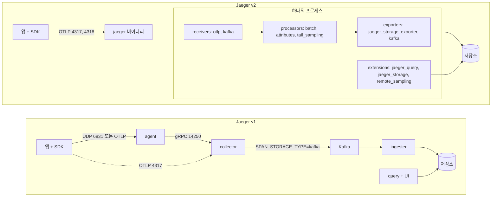
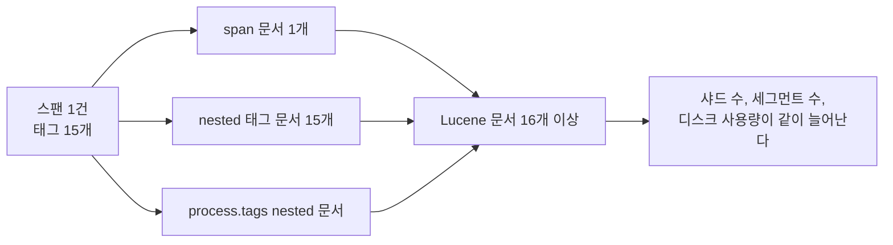
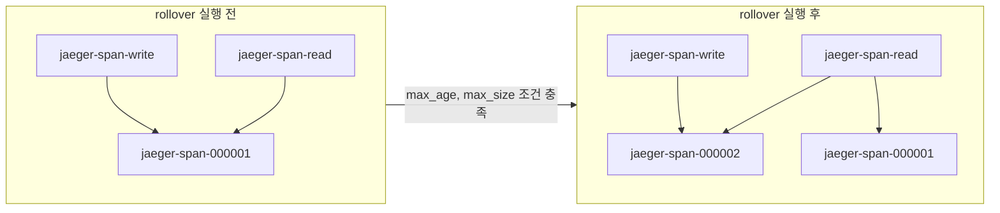

# Jaeger 구성과 저장소 운영

Jaeger는 트레이스를 받아서 저장하고 UI로 보여주는 백엔드다. 계측은 OpenTelemetry SDK가 맡고, Jaeger는 그 뒤쪽만 담당한다. 처음 올릴 때는 `all-in-one` 이미지 하나로 끝나지만, 트래픽이 붙으면 문제는 거의 전부 저장소에서 나온다. ES 디스크가 하루 만에 차거나, UI의 서비스 드롭다운에 수천 개 항목이 뜨거나, 샘플링 비율을 바꾸려고 서비스 전체를 재배포하는 일이 여기서 시작된다.

이 문서는 구성 요소와 v1/v2 차이를 짚고, 저장소별로 운영이 어떻게 달라지는지를 다룬다. 설정은 `jaegertracing/jaeger:2.4.0` 이미지로 직접 띄워서 확인한 것만 적었다.

## 구성 요소

v1은 역할별로 바이너리가 나뉘어 있다.

| 구성 요소 | 하는 일 | 주요 포트 |
|---|---|---|
| agent | 앱 옆에서 UDP로 스팬을 받아 collector로 전달. 샘플링 설정 프록시 역할도 한다. 1.43부터 deprecated | UDP 6831, 6832, TCP 5778 |
| collector | 스팬을 받아 검증하고 저장소나 Kafka에 쓴다. 샘플링 설정 파일을 서빙한다 | 4317, 4318 (OTLP), 14250, 14268, 5778 |
| ingester | Kafka 토픽을 읽어 저장소에 쓴다. Kafka를 중간에 둘 때만 필요하다 | 없음 |
| query | 저장소에서 트레이스를 읽어 API와 UI를 서빙한다 | 16686 |
| all-in-one | 위 전부를 한 프로세스에 넣은 것. 기본 저장소는 메모리다 | 전부 |

agent가 deprecated된 이유는 OTLP 때문이다. OTel SDK는 OTLP로 collector에 바로 보내고, 호스트 단위 수집이 필요하면 OTel Collector를 DaemonSet으로 둔다. Jaeger 전용 클라이언트 라이브러리도 폐기됐으므로 새로 계측하는 앱이 agent의 UDP 포트를 쓸 이유는 없다.

## v1 토폴로지와 v2 단일 바이너리

v2는 OpenTelemetry Collector 프레임워크 위에 Jaeger를 컴포넌트로 올린 구조다. 바이너리 하나가 `receivers`, `processors`, `exporters`, `extensions` 설정으로 collector도 되고 ingester도 되고 query도 된다. 설정 파일 문법이 OTel Collector와 같다.

아래 도식에서 왼쪽은 Kafka까지 넣은 v1 배포, 오른쪽은 v2다. v1에서 별도 프로세스였던 collector, ingester, query가 v2에서는 같은 이미지에 다른 설정 파일을 주는 것으로 바뀐다.



v1과 v2의 차이를 항목별로 정리하면 이렇다.

| 항목 | v1 | v2 |
|---|---|---|
| 바이너리 | collector, ingester, query, agent 각각 | `jaeger` 하나 |
| 설정 | 명령행 플래그, 환경변수 | OTel Collector 형식 YAML |
| 수신 | Jaeger 프로토콜 + OTLP | OTLP가 기본. `jaeger`, `zipkin` receiver도 있다 |
| Kafka | collector가 쓰고 ingester가 읽는 전용 경로 | OTel의 `kafka` exporter, `kafka` receiver |
| 전처리 | 거의 없음 | `batch`, `memory_limiter`, `attributes`, `tail_sampling` 등 |
| agent | 있음 (deprecated) | 없음 |

v2 이미지에 들어 있는 컴포넌트는 정해져 있다. `jaeger components` 명령으로 확인하면 processor는 `adaptive_sampling`, `attributes`, `batch`, `memory_limiter`, `tail_sampling` 다섯 개뿐이다. OTel Collector contrib에 있는 `transform`, `span`, `filter` 프로세서는 2.4.0 이미지에 없다. 설정에 적으면 기동 시점에 거부된다. 스팬 이름을 고치거나 스팬을 걸러내야 하면 앞단에 contrib Collector를 하나 두거나 SDK에서 처리해야 한다.

신규로 구축한다면 v2부터 시작한다. v1 바이너리는 유지보수 종료가 공지된 상태라서, 지금 v1으로 구축하면 곧 마이그레이션을 한 번 더 하게 된다. 이미 v1을 쓰고 있으면 SDK 쪽을 OTLP로 먼저 바꿔 두는 것이 이전 비용을 가장 많이 줄인다.

## 스팬 한 건이 저장소까지 가는 길

스팬이 끝나는 시점부터 UI에 보이기까지 거치는 단계다. 장애가 나면 어느 단계에서 유실됐는지 구분해야 하므로 순서를 알아 두는 편이 낫다.

```
sequenceDiagram
    participant App as 앱 (OTel SDK)
    participant BSP as BatchSpanProcessor
    participant Col as Jaeger collector 역할
    participant K as Kafka (선택)
    participant Ing as Jaeger ingester 역할
    participant ES as 저장소
    participant Q as query + UI

    App->>BSP: span.end() 로 큐에 적재
    Note over BSP: 큐가 차면 이 지점에서 스팬을 버린다
    BSP->>Col: OTLP export (기본 5초 간격 배치)
    Col->>Col: memory_limiter, batch 처리
    alt Kafka 버퍼를 둔 경우
        Col->>K: 토픽 jaeger-spans 에 produce
        K->>Ing: consume
        Ing->>ES: bulk 쓰기
    else 저장소에 직접 쓰는 경우
        Col->>ES: bulk 쓰기
    end
    Note over ES: refresh 전까지 검색되지 않는다
    Q->>ES: 서비스, 오퍼레이션, 태그, 시간 범위로 조회
    ES-->>Q: trace ID 목록과 스팬
```

유실이 생기는 위치는 세 군데다. SDK의 `BatchSpanProcessor` 큐가 가득 차면 앱 안에서 조용히 버려진다(기본 큐 크기는 2048). collector의 `memory_limiter`가 한도에 닿으면 수신을 거부해서 SDK 쪽 export가 실패한다. 저장소가 bulk 쓰기를 거부하면 collector 큐가 차면서 버려진다. 앞 두 곳은 SDK와 collector의 자체 메트릭으로 보이지만, 저장소 쓰기 실패는 collector 로그를 봐야 알 수 있는 경우가 많다.

방금 보낸 트레이스가 UI에서 바로 안 보이는 것은 대개 ES의 refresh 간격(기본 1초)과 배치 대기 시간이 겹친 결과다. 몇 초 기다려도 안 보이면 그때부터 유실을 의심한다.

## 저장소 선택

| 저장소 | 검색 | 쓰기 | 보관 기간 관리 | 확장 | 어울리는 곳 |
|---|---|---|---|---|---|
| Elasticsearch / OpenSearch | 태그 임의 조합, duration 조건 자유 | bulk. 인덱스·샤드 수에 민감 | 인덱스 단위 삭제. 롤오버와 cleaner를 직접 돌려야 한다 | 노드 추가 | 태그로 자주 찾는 팀, 이미 ES를 운영하는 팀 |
| Cassandra | 인덱싱된 조건 위주. 조합에 제약이 있다 | 쓰기가 가장 안정적 | 스키마 생성 시 TTL 고정 | 노드 추가 | 쓰기량이 크고 태그 검색은 단순한 환경 |
| Badger | 단일 노드 로컬 파일 | 단일 프로세스 | `ttl.spans` | 불가 | 개발, 스테이징, 트래픽 작은 사내 서비스 |
| memory | 프로세스 메모리 | 최대 트레이스 수 제한 | 재시작하면 전부 사라짐 | 불가 | 로컬 테스트 |

Kafka는 저장소가 아니라 버퍼다. 저장소 쓰기가 느려지거나 점검으로 멈춰도 collector가 스팬을 버리지 않고 Kafka에 쌓아 둘 수 있다. 대신 운영할 시스템이 하나 늘어나고, 스팬이 UI에 보이기까지 지연이 생긴다. 하루 스팬이 수천만 건 이하이고 ES가 안정적이면 Kafka 없이 시작하는 것이 낫다. 저장소 점검 때마다 스팬이 빠지거나 트래픽 스파이크로 ES가 bulk 거부를 낸 적이 있다면 그때 넣는다.

Cassandra 선택에서 제일 많이 놓치는 것은 보관 기간이 스키마에 박힌다는 점이다. 스키마 생성 스크립트(`jaegertracing/jaeger-cassandra-schema`)가 `TRACE_TTL` 환경변수를 초 단위로 받아 테이블 TTL로 넣는다. 기본값이 172800(2일)이라서 환경변수를 안 주고 스키마를 만들면 이틀 지난 트레이스가 사라진다. 보관 기간을 늘리려면 테이블을 `ALTER` 해야 한다.

## Elasticsearch 연결 설정

v2에서 ES에 붙이는 설정이다. 스키마를 롤오버 방식으로 쓰는 것을 전제로 `use_aliases: true`를 켰고, 자주 검색하는 태그만 필드로 승격했다. 이 구성은 ES 8.13.4와 `jaeger:2.4.0`에서 `jaeger-span-write` 별칭으로 스팬이 들어가는 것까지 확인했다.

```yaml
# jaeger-es.yaml
service:
  extensions: [jaeger_storage, jaeger_query, remote_sampling]
  pipelines:
    traces:
      receivers: [otlp]
      processors: [memory_limiter, attributes/strip, batch]
      exporters: [jaeger_storage_exporter]

extensions:
  jaeger_query:
    storage:
      traces: es_main
  jaeger_storage:
    backends:
      es_main:
        elasticsearch:
          server_urls: ["http://elasticsearch:9200"]
          use_aliases: true
          tags_as_fields:
            all: false
            include: "http.status_code,http.method"
          indices:
            spans:
              date_layout: "2006-01-02"
              rollover_frequency: day
              shards: 3
              replicas: 1
            services:
              shards: 1
              replicas: 1
  remote_sampling:
    file:
      path: /etc/jaeger/sampling.json
    http:
      endpoint: 0.0.0.0:5778

receivers:
  otlp:
    protocols:
      grpc:
        endpoint: 0.0.0.0:4317
      http:
        endpoint: 0.0.0.0:4318

processors:
  memory_limiter:
    check_interval: 1s
    limit_mib: 1500
    spike_limit_mib: 300
  attributes/strip:
    actions:
      - key: db.statement
        action: delete
      - key: http.request.header.authorization
        action: delete
  batch:
    send_batch_size: 5000
    timeout: 2s

exporters:
  jaeger_storage_exporter:
    trace_storage: es_main
```

같은 구성을 compose로 묶은 것이다. 롤오버 별칭은 Jaeger가 만들어 주지 않으므로 `es-rollover-init`을 한 번 돌려야 한다. 이 파일은 구성 요소를 `docker run`으로 같은 순서로 띄워서 확인했고, compose 파일 자체를 `docker compose up`으로 돌려보지는 않았다.

```yaml
# docker-compose.yml
services:
  elasticsearch:
    image: docker.elastic.co/elasticsearch/elasticsearch:8.13.4
    environment:
      discovery.type: single-node
      xpack.security.enabled: "false"
      ES_JAVA_OPTS: -Xms1g -Xmx1g
    volumes:
      - es-data:/usr/share/elasticsearch/data
    healthcheck:
      test: ["CMD-SHELL", "curl -s localhost:9200/_cluster/health | grep -q '\"status\":\"\\(green\\|yellow\\)\"'"]
      interval: 5s
      retries: 30

  es-rollover-init:
    image: jaegertracing/jaeger-es-rollover:latest
    command: ["init", "http://elasticsearch:9200"]
    depends_on:
      elasticsearch:
        condition: service_healthy
    restart: "no"

  jaeger:
    image: jaegertracing/jaeger:2.4.0
    command: ["--config", "/etc/jaeger/config.yaml"]
    ports:
      - "16686:16686"
      - "4317:4317"
      - "4318:4318"
      - "5778:5778"
    volumes:
      - ./jaeger-es.yaml:/etc/jaeger/config.yaml:ro
      - ./sampling.json:/etc/jaeger/sampling.json:ro
    depends_on:
      es-rollover-init:
        condition: service_completed_successfully

volumes:
  es-data:
```

`index_prefix`를 주면 인덱스 이름이 `jaeger-jaeger-span-2026-10-24`처럼 접두사가 한 번 더 붙는다. 접두사 `jaeger`에 `jaeger-span-` 이 이어 붙기 때문이다. 처음 연결했을 때 인덱스 이름이 이상해서 설정이 잘못된 줄 알기 쉽다. 접두사는 한 클러스터를 여러 Jaeger가 공유할 때만 쓰고, 롤오버 도구(`jaeger-es-rollover`)에도 같은 접두사를 `INDEX_PREFIX`로 맞춰 줘야 한다.

## ES 디스크가 차는 이유

Jaeger의 ES 스키마에서 스팬의 `tags`는 `nested` 타입이다. nested 필드는 ES 내부에서 태그 하나가 Lucene 문서 하나로 따로 저장된다. 스팬 하나를 쓰면 문서가 하나가 아니라 `1 + 태그 수`개 생긴다.

직접 확인한 결과다. 태그 3개(`http.method`, `user.id`, `order.id`)를 달아 스팬 20건을 보냈더니, 자동으로 붙는 `span.kind`까지 합쳐 스팬당 태그가 4개였고 `_cat/indices`의 `docs.count`가 100이었다. 20건이 아니라 20 × (1 + 4)다. 태그 없이 보낸 스팬 10건은 `span.kind` 하나만 붙어서 20이었다.



계산해 보면 규모가 감이 온다. 하루 1억 스팬, 평균 태그 15개면 하루에 16억 문서가 생긴다. ES 샤드 하나가 담을 수 있는 Lucene 문서는 약 21억 개이므로 샤드 3개짜리 일 단위 인덱스는 문서 수만으로도 상한 가까이 간다. 문서 수만큼 인버티드 인덱스와 doc values도 늘어서 디스크가 스팬 크기에서 예상한 값보다 훨씬 많이 쓰인다.

디스크가 찰 때 일어나는 일은 순서가 정해져 있다. ES는 디스크 사용률 85%(low watermark)부터 새 샤드 배치를 멈추고, 90%에서 샤드를 옮기기 시작하고, 95%(flood stage)에 닿으면 해당 노드의 인덱스를 읽기 전용으로 바꾼다. 읽기 전용이 되는 순간 Jaeger의 bulk 쓰기가 전부 거부된다. UI에서는 새 트레이스만 안 보이고 기존 데이터는 정상 조회돼서 "조용히 유실되는" 상태가 된다.

줄이는 방법은 세 가지다.

1. 태그를 줄인다. 위 설정의 `attributes/strip`처럼 `db.statement`, 인증 헤더, 쿼리스트링이 붙은 URL처럼 크기가 크거나 검색에 쓰지 않는 값을 collector에서 삭제한다. SQL 전문은 스팬당 수 KB까지 가고, 삭제해도 스팬 이름과 소요 시간으로 쿼리를 찾는 데 지장이 없는 경우가 많다.
2. 자주 검색하는 태그만 `tags_as_fields.include`로 승격한다. 승격된 태그는 nested 문서가 아니라 스팬 문서 안의 일반 필드(`tag.http@status_code`, 점은 `@`로 치환된다)로 저장된다. 같은 스팬을 `http.status_code`만 승격해 보냈을 때 `docs.count`는 3(스팬 1 + nested 태그 2)이었다. 승격 전이었다면 4였을 것이다.
3. `tags_as_fields.all: true`는 쓰지 않는다. 모든 태그 키가 매핑 필드로 생기므로, 태그 키에 값이 섞여 있는 앱이 하나만 있어도 매핑이 폭발한다. ES의 `index.mapping.total_fields.limit` 기본값(1000)에 닿으면 해당 스팬의 쓰기가 실패한다.

## 인덱스 롤오버와 TTL

ES에는 TTL이 없고, 오래된 인덱스를 통째로 지우는 방식으로 보관 기간을 관리한다. Jaeger는 두 가지 방법을 둔다.

일 단위 인덱스(`jaeger-span-2026-10-24`)는 날짜가 이름에 있으므로 `jaeger-es-index-cleaner`가 N일 지난 것을 지운다. 사용법은 `jaeger-es-index-cleaner 7 http://elasticsearch:9200`처럼 일수와 ES 주소를 받는다. 이 도구는 cron이나 Kubernetes CronJob으로 직접 돌려야 한다. 기본 모드는 날짜 접미사 인덱스만 대상으로 하고, 롤오버로 만든 인덱스(`jaeger-span-000001`)를 지우려면 `--rollover` 플래그가 필요하다. 플래그를 빼고 돌리면 에러 없이 "No indices to delete"만 찍힌다. 몇 달 동안 삭제가 한 번도 안 되고 있는데 로그는 정상인 상태가 되기 쉽다.

롤오버 방식은 별칭 두 개를 쓴다.



도식에서 볼 것은 별칭이 가리키는 인덱스다. 쓰기는 항상 `write` 별칭의 인덱스 하나로 들어가고, 조회는 `read` 별칭에 묶인 인덱스 전체를 훑는다. 롤오버를 하면 `write`가 새 인덱스로 넘어가고 `read`에는 새 인덱스가 추가된다. 실제로 `rollover`를 실행하고 `_cat/aliases`를 보면 `jaeger-span-read`가 `000001`과 `000002`를 모두 가리키고 `jaeger-span-write`는 `000002`만 가리킨다.

```bash
# 최초 1회. 인덱스 템플릿, 000001 인덱스, 읽기/쓰기 별칭 생성
docker run --rm --network host jaegertracing/jaeger-es-rollover:latest \
  init http://localhost:9200

# 매일 한 번 cron 으로. 조건을 만족할 때만 새 인덱스로 넘어간다
docker run --rm --network host \
  -e CONDITIONS='{"max_age": "1d", "max_size": "50gb"}' \
  jaegertracing/jaeger-es-rollover:latest rollover http://localhost:9200

# 7일 지난 인덱스를 읽기 별칭에서 뺀다 (인덱스 자체는 안 지운다)
docker run --rm --network host -e UNIT=days -e UNIT_COUNT=7 \
  jaegertracing/jaeger-es-rollover:latest lookback http://localhost:9200

# 읽기 별칭에서 빠진 지 오래된 인덱스를 삭제한다
docker run --rm --network host \
  jaegertracing/jaeger-es-index-cleaner:latest 14 http://localhost:9200 --rollover
```

`lookback`은 삭제가 아니다. 읽기 별칭에서 빼서 UI 조회 범위만 줄이므로, 디스크를 비우려면 `index-cleaner --rollover`를 따로 돌려야 한다. 이 둘을 혼동해서 "7일 보관으로 설정했는데 디스크가 안 줄어든다"고 찾아오는 경우가 있다.

`CONDITIONS`에 `max_docs`를 쓸 때는 nested 문서도 센다는 점을 감안해야 한다. 스팬 1천만 건을 기준으로 잡고 `max_docs: 10000000`을 넣으면, 스팬당 태그가 15개일 때 스팬 62만 건 지점에서 롤오버가 일어난다. `max_age`와 `max_size`를 기준으로 삼는 것이 덜 헷갈린다.

## 서비스와 오퍼레이션 이름에 변수가 들어갈 때

UI 왼쪽의 Service, Operation 드롭다운은 저장소에서 서비스 이름과 오퍼레이션 이름의 distinct 목록을 가져와서 채운다. 이름에 값이 섞이면 목록이 요청 수만큼 늘어난다.

`/orders/1001`, `/orders/1002`처럼 경로 파라미터가 스팬 이름에 들어간 상황을 재현했다. 서로 다른 주문 번호로 스팬 40건을 보내자 `GET /api/operations?service=order-service`가 41개를 돌려줬다(템플릿형 이름 1개 + 번호별 40개). 운영에서 주문이 하루 수십만 건이면 드롭다운이 로딩되지 않고, 오퍼레이션 목록을 만드는 집계 쿼리가 ES에 부담을 준다. ES 스키마에서는 서비스·오퍼레이션 조합이 `jaeger-service-*` 인덱스에 따로 저장되므로 이 인덱스도 같이 커진다.

원인은 계측 코드 쪽에 있다. 스팬 이름은 라우트 템플릿(`GET /orders/{id}`)으로 두고, 실제 값은 속성(`order.id`)으로 넣어야 한다. 프레임워크 자동 계측은 보통 템플릿을 쓰지만, 수동으로 만든 스팬이나 HTTP 클라이언트 쪽 스팬은 URL 전체가 이름에 들어가는 경우가 있다.

서비스 이름도 같은 문제를 겪는다. `service.name`에 파드 이름이나 배포 해시(`order-service-7d9f8b6c5-x2k4q`)를 넣으면 배포할 때마다 서비스가 새로 생겨 드롭다운이 계속 늘어난다. 인스턴스 구분은 `service.instance.id`에 넣고 `service.name`은 고정한다.

계측 코드를 당장 못 고치는 앱이 있으면 앞단 collector에서 이름을 정규화한다. 이 처리는 Jaeger 이미지에 없는 `transform` 프로세서가 필요하므로 OTel Collector contrib를 Jaeger 앞에 둬야 한다.

```yaml
# otelcol-contrib 설정 일부
processors:
  transform/span_name:
    error_mode: ignore
    trace_statements:
      - context: span
        statements:
          - replace_pattern(name, "/orders/[0-9]+", "/orders/{id}")
          - replace_pattern(name, "/users/[0-9a-f-]{36}", "/users/{id}")

service:
  pipelines:
    traces:
      receivers: [otlp]
      processors: [transform/span_name, batch]
      exporters: [otlp/jaeger]
```

이미 쌓인 인덱스는 이름을 고쳐도 남아 있다. 보관 기간이 지나 인덱스가 삭제될 때까지 드롭다운에 옛 이름이 보이는 것은 정상이다.

## Remote sampling

SDK마다 샘플링 비율을 환경변수로 박아 두면 비율을 바꿀 때 서비스를 재배포해야 한다. Jaeger의 remote sampling은 비율을 Jaeger 쪽 파일에 두고 SDK가 주기적으로 가져가는 방식이다. 장애 중에 특정 서비스만 100%로 올리고 싶을 때 쓸모가 있다.

샘플링 설정 파일은 서비스별, 오퍼레이션별로 비율을 정한다.

```json
{
  "service_strategies": [
    {
      "service": "order-service",
      "type": "probabilistic",
      "param": 0.2,
      "operation_strategies": [
        { "operation": "GET /health", "type": "probabilistic", "param": 0.0 }
      ]
    }
  ],
  "default_strategy": { "type": "probabilistic", "param": 0.05 }
}
```

v2에서는 `remote_sampling` extension이 이 파일을 읽어 5778 포트로 서빙한다(위 ES 설정의 `extensions.remote_sampling` 블록). 띄운 뒤 SDK가 호출하는 엔드포인트를 직접 두드려 보면 응답을 확인할 수 있다.

```bash
curl "localhost:5778/api/sampling?service=order-service"
# {"strategyType":0,"probabilisticSampling":{"samplingRate":0.2},
#  "operationSampling":{"defaultSamplingProbability":0.2, ...
#   "perOperationStrategies":[{"operation":"GET /health","probabilisticSampling":{"samplingRate":0}}] ...}}

curl "localhost:5778/api/sampling?service=payment-service"
# {"strategyType":0,"probabilisticSampling":{"samplingRate":0.05}}
```

파일에 없는 서비스는 `default_strategy`의 0.05를 받는다. 서비스 이름 오타가 나면 조용히 기본값으로 떨어지므로, 비율을 바꿨는데 효과가 없으면 SDK의 `service.name`과 파일의 `service` 값이 일치하는지부터 본다.

SDK 쪽은 OTel 표준 환경변수로 연결한다.

```bash
OTEL_TRACES_SAMPLER=jaeger_remote
OTEL_TRACES_SAMPLER_ARG=endpoint=http://jaeger:5778,pollingIntervalMs=60000,initialSamplingRate=0.01
```

`initialSamplingRate`는 첫 폴링이 성공하기 전까지 쓰는 비율이다. Jaeger가 내려가 있거나 5778 포트가 막혀 있으면 SDK는 이 값으로 계속 동작한다. `jaeger_remote` sampler를 구현한 SDK와 아닌 SDK가 있으므로(Java는 별도 확장 모듈이다), 쓰는 언어의 sampler 목록부터 확인해야 한다. 지원이 없으면 `parentbased_traceidratio`로 고정 비율을 쓰거나 collector에서 `tail_sampling`을 쓴다.

remote sampling은 트레이스의 시작 시점에 정하는 head sampling이다. "에러가 난 트레이스만 남긴다"처럼 끝난 뒤에 판단해야 하는 조건은 걸 수 없다. 그 조건에는 v2 이미지에 들어 있는 `tail_sampling` 프로세서가 맞다. 대신 한 트레이스의 스팬이 전부 같은 Jaeger 인스턴스에 도달해야 하므로, collector를 여러 대로 늘리면 앞단에서 trace ID 기준 라우팅이 필요하다.

## Kafka를 버퍼로 둘 때

v2에서는 같은 `jaeger` 이미지를 두 가지 설정으로 띄운다. 앞쪽은 OTLP를 받아 Kafka에 쓰고, 뒤쪽은 Kafka를 읽어 저장소에 쓴다. 두 설정은 `jaeger validate`로 검증했다.

```yaml
# kafka-collector.yaml : OTLP 수신 -> Kafka
service:
  extensions: [remote_sampling]
  pipelines:
    traces:
      receivers: [otlp]
      processors: [memory_limiter, batch]
      exporters: [kafka]

extensions:
  remote_sampling:
    file:
      path: /etc/jaeger/sampling.json
    http:
      endpoint: 0.0.0.0:5778

receivers:
  otlp:
    protocols:
      grpc:
        endpoint: 0.0.0.0:4317

processors:
  memory_limiter:
    check_interval: 1s
    limit_mib: 1500
  batch:

exporters:
  kafka:
    brokers: ["kafka:9092"]
    topic: jaeger-spans
    encoding: otlp_proto
```

```yaml
# kafka-ingester.yaml : Kafka -> 저장소 (query 도 같이 띄운다)
service:
  extensions: [jaeger_storage, jaeger_query]
  pipelines:
    traces:
      receivers: [kafka]
      processors: [batch]
      exporters: [jaeger_storage_exporter]

extensions:
  jaeger_query:
    storage:
      traces: es_main
  jaeger_storage:
    backends:
      es_main:
        elasticsearch:
          server_urls: ["http://elasticsearch:9200"]

receivers:
  kafka:
    brokers: ["kafka:9092"]
    topic: jaeger-spans
    encoding: otlp_proto
    group_id: jaeger-ingester
    initial_offset: earliest

processors:
  batch:

exporters:
  jaeger_storage_exporter:
    trace_storage: es_main
```

Kafka exporter와 receiver의 키 구조는 contrib 버전마다 바뀐다. 이 설정은 0.121 기준이라 `topic`, `encoding`을 최상위에 둔다. 버전이 더 올라가면 `traces:` 블록 아래로 들어가는 형태로 바뀌어 있을 수 있고, 틀리면 `has invalid keys: traces` 같은 에러로 기동이 거부된다. 버전을 올릴 때 `jaeger validate --config`를 먼저 돌려 보면 배포 전에 잡힌다.

ingester의 `group_id`를 인스턴스마다 같게 두면 파티션이 분산되어 처리량이 늘고, 파티션 수가 ingester 수의 상한이 된다. 토픽을 파티션 1개로 만들어 두면 ingester를 몇 대 띄워도 하나만 일한다.

## 운영하면서 걸리는 것들

Badger를 컨테이너에서 쓰면 첫 기동에서 막힌다. 이미지가 UID 10001 비루트 사용자로 실행되기 때문에 호스트 볼륨 디렉토리에 쓰기 권한이 없으면 아래 에러로 죽는다.

```text
failed to initialize storage 'badger_main': Error Creating Dir: "/badger/key" error: mkdir /badger/key: permission denied
```

볼륨 디렉토리 소유자를 10001로 맞추거나(`chown 10001 badger`) 쿠버네티스에서는 `fsGroup: 10001`을 준다. Badger는 한 프로세스만 디렉토리를 열 수 있으므로 replica를 2 이상으로 올리면 두 번째 파드가 락 때문에 죽는다. 보관 기간은 `ttl.spans`로 정한다.

```yaml
jaeger_storage:
  backends:
    badger_main:
      badger:
        directories:
          keys: /badger/key
          values: /badger/data
        ephemeral: false
        ttl:
          spans: 72h
```

`ephemeral: true`로 두면 임시 디렉토리를 만들어 쓰고 프로세스가 끝나면 지워진다. 운영 설정을 복사해 쓰다가 이 값이 남아서 재시작 때마다 데이터가 사라지는 경우가 있다.

ES 보안 설정이 켜진 클러스터(8.x 기본값)에 붙일 때는 `xpack.security.enabled=false`로 만든 개발용 설정을 그대로 가져가면 안 된다. 인증 정보를 넣지 않으면 쓰기가 401로 실패하는데, 앱 쪽에는 에러가 전달되지 않는다. UI가 비어 있으면 collector 로그에서 bulk 응답부터 본다.

마지막으로, 샘플링 비율이 낮으면 트레이스를 찾을 수 없는 것이 아니라 애초에 만들어지지 않았을 수 있다. UI에서 특정 요청의 트레이스가 안 보일 때는 저장소를 뒤지기 전에 그 서비스의 샘플링 응답(`/api/sampling?service=...`)과 로그의 trace ID를 먼저 맞춰 본다.
