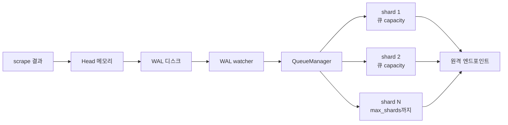
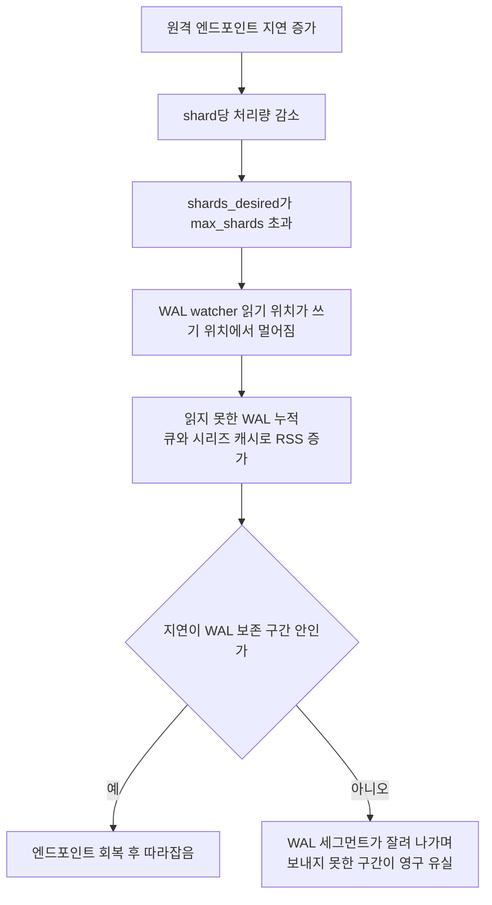
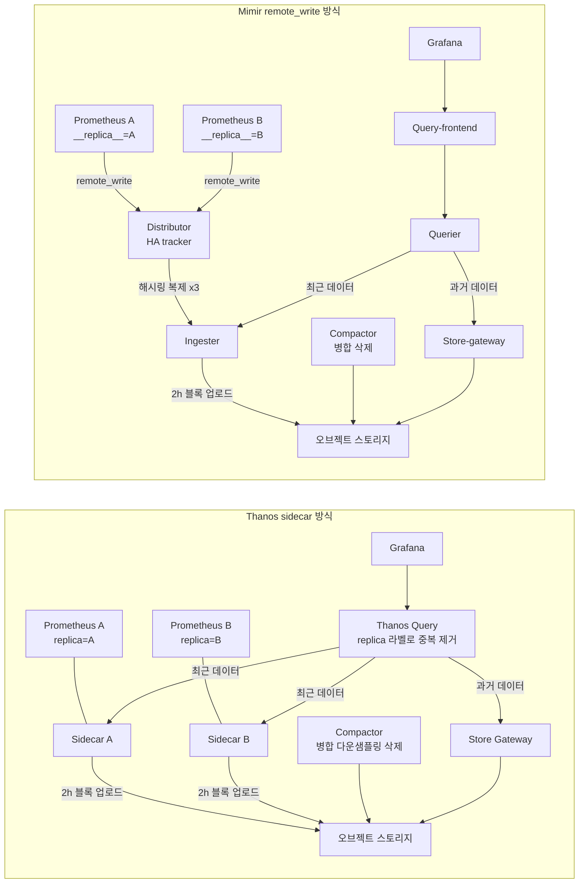
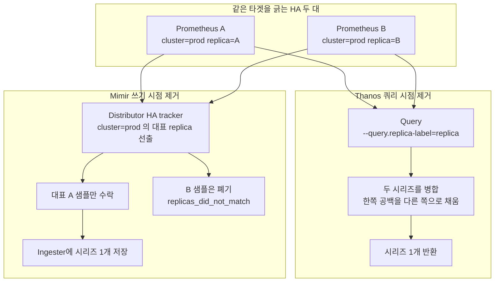
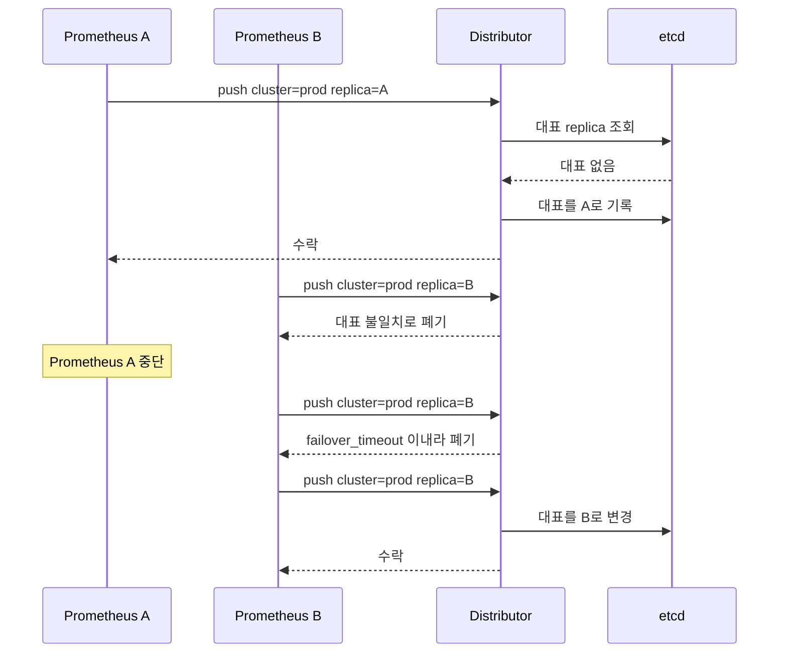

# Prometheus 장기 저장소 Thanos와 Mimir

Prometheus 한 대로 시작하면 처음 몇 달은 아무 문제가 없다. 보존 기간 15일, 대시보드는 잘 뜨고, 알림도 온다. 문제는 "작년 블랙프라이데이 때 p99가 얼마였지"라는 질문이 처음 들어오는 날 시작된다. 15일 지난 데이터는 없고, retention을 1년으로 늘리면 디스크가 모자라고, 서버 한 대가 죽으면 그 시간대는 그래프에 구멍이 난다.

장기 저장소를 붙이는 방법은 크게 둘이다. Prometheus 옆에 sidecar를 붙여 TSDB 블록을 오브젝트 스토리지로 올리는 Thanos 방식, Prometheus가 `remote_write`로 샘플을 밀어 넣고 중앙 클러스터가 저장하는 Mimir 방식이다. 두 방식은 장애가 나는 자리도 다르다. 이 문서는 단일 서버가 어디서 한계에 닿는지, `remote_write` 큐가 막히면 어떤 증상이 나오는지, Thanos와 Mimir가 각각 어떻게 구성되는지, HA 중복 제거와 다운샘플링이 쿼리 결과를 어떻게 바꾸는지를 설정과 사례 위주로 정리한다.

## 단일 Prometheus가 먼저 한계에 닿는 곳

한계는 세 방향에서 온다. 보존 기간, 카디널리티, 가용성이다.

### 보존 기간과 디스크

기본 보존은 `--storage.tsdb.retention.time=15d`다. 샘플 하나가 압축 후 대략 1~2바이트를 차지하므로, 1.5바이트로 잡고 계산하면 다음과 같다.

| 활성 시리즈 | scrape 15초 기준 초당 샘플 | 하루 디스크 | 15일 | 1년 |
|---|---|---|---|---|
| 100만 | 약 66,700 | 약 8.6GB | 약 130GB | 약 3.1TB |
| 500만 | 약 333,000 | 약 43GB | 약 650GB | 약 15.7TB |

1.5바이트는 가정값이다. 라벨이 자주 바뀌는 시리즈는 인덱스가 커져서 이 숫자보다 더 나온다. 중요한 건 1년을 로컬 디스크에 두면 단일 노드의 디스크, 재시작 시 WAL 리플레이, 블록 컴팩션 부하가 한꺼번에 커진다는 점이다. 시리즈가 많은 서버는 WAL 리플레이만으로 재시작에 10분 넘게 걸리는 경우가 있다.

### 카디널리티와 메모리

Head 블록(최근 2시간)은 전부 메모리에 있다. 시리즈당 메모리는 라벨 길이에 따라 다르지만 경험적으로 3~6KB를 잡는다. 100만 시리즈면 3~6GB고, 쿼리 버퍼와 `remote_write` 큐까지 얹으면 실제 RSS는 그 1.5배 가까이 나온다. 라벨에 `user_id`나 `request_path` 원본이 들어가 시리즈가 하루 만에 두 배가 되면 OOM Kill로 끝난다. OOM으로 죽은 서버는 WAL 리플레이를 마칠 때까지 수집을 못 해서 그 시간 동안 데이터에 구멍이 난다.

### 가용성

HA는 서버를 두 대 띄우는 것으로 끝난다고 생각하기 쉽다. 두 대는 서로 독립된 TSDB다. 같은 타겟을 긁어도 scrape 시각이 다르고, 한 대가 10분 재시작하면 그 구간은 한쪽에만 있다. 로드밸런서 뒤에 두고 Grafana가 번갈아 때리면 새로고침할 때마다 그래프 모양이 바뀐다. 구멍을 메우고 둘을 하나로 보여주는 계층이 따로 필요하다.

## remote_write가 샘플을 내보내는 길

`remote_write`는 scrape 결과를 곧바로 보내지 않는다. WAL에 쓴 것을 별도 goroutine이 읽어서 보낸다. 이 구조를 알아야 큐 설정이 왜 필요한지 이해된다.



WAL watcher가 읽은 샘플은 시리즈 해시로 shard에 나뉘고, shard마다 큐가 하나씩 있다. shard는 큐에서 `max_samples_per_send`개를 모아 요청 하나로 보낸다. 원격 엔드포인트가 느려지면 요청 하나가 오래 걸리고, 그만큼 shard 하나가 처리하는 속도가 떨어진다. Prometheus는 이 속도를 보고 shard 수를 `min_shards`와 `max_shards` 사이에서 자동으로 늘린다. 상한에 막히면 더 늘릴 수 없다.

### queue_config 항목

| 항목 | 기본값 | 의미 |
|---|---|---|
| `capacity` | 10000 | shard 하나의 큐 크기. `max_samples_per_send`의 3~10배로 잡으라는 게 공식 문서 권고다 |
| `max_shards` | 50 | shard 상한 |
| `min_shards` | 1 | 시작 shard 수. 재시작 직후 밀린 WAL을 처리할 때 의미가 있다 |
| `max_samples_per_send` | 2000 | 요청 하나에 담는 샘플 수. 버전에 따라 기본값이 달랐으니 쓰는 버전에서 확인한다 |
| `batch_send_deadline` | 5s | 배치가 덜 차도 이 시간이 지나면 보낸다 |
| `min_backoff` / `max_backoff` | 30ms / 5s | 재시도 대기 간격 |
| `retry_on_http_429` | false | 429를 재시도할지. 기본은 버린다 |

필요한 shard 수는 대략 이렇게 어림한다.

```
필요 shard ≈ 초당 샘플 수 × 요청 지연(초) ÷ max_samples_per_send
```

시리즈 100만, scrape 15초면 초당 66,700 샘플이다. 요청 지연이 200ms면 66,700 × 0.2 ÷ 2000 ≈ 7 shard로 충분하다. 같은 부하에서 원격 엔드포인트 지연이 1.5초로 올라가면 50 shard가 필요해진다. 기본 상한이 정확히 50이다. 배치가 가득 차지 않는 shard도 있어서 실제 필요량은 이 계산보다 크다. 지연이 올라간 순간 상한에 걸린다.

### 설정 예시

```yaml
global:
  scrape_interval: 15s
  external_labels:
    cluster: prod-apne2
    __replica__: prom-0

remote_write:
  - url: http://mimir-gateway.mimir.svc:80/api/v1/push
    headers:
      X-Scope-OrgID: payments
    queue_config:
      capacity: 10000
      min_shards: 4
      max_shards: 100
      max_samples_per_send: 2000
      batch_send_deadline: 5s
      min_backoff: 30ms
      max_backoff: 5s
      retry_on_http_429: true
    write_relabel_configs:
      - source_labels: [__name__]
        regex: "go_gc_.*|go_memstats_.*|process_.*"
        action: drop
```

`write_relabel_configs`는 원격으로 보내는 양만 줄인다. 로컬 TSDB에는 그대로 남는다. 장기 저장소에 `go_gc_*` 같은 런타임 메트릭 전부가 필요한 경우는 드물어서, 보낼 양을 줄이는 쪽이 shard를 늘리는 것보다 먼저다.

## 샤드가 모자랄 때 나오는 증상

원격 엔드포인트 지연이 올라가 shard가 상한에 붙으면 다음 순서로 증상이 번진다.



WAL은 Head 컴팩션 때 잘린다. 컴팩션 주기가 2시간이라 읽지 못한 WAL이 안전하게 남아 있는 구간은 2~3시간 안팎이다. 버전과 컴팩션 타이밍에 따라 달라지니 정확한 값은 믿지 말고, 지연 알림을 그보다 훨씬 앞에 둬야 한다.

전형적인 사례를 하나 적는다. Mimir ingester를 노드 교체로 롤링 재시작하는 동안 push 지연이 150ms에서 1.5초 근처까지 올라간다. `max_shards`가 기본 50인 Prometheus 서버는 shard를 모두 쓰고도 모자라서 지연이 수십 분 쌓이고, 큐 버퍼 때문에 RSS가 평소보다 눈에 띄게 올라가 메모리 limit에 가까워진다. 엔드포인트가 회복된 뒤에도 밀린 구간을 처리하는 시간이 따로 필요하다. Prometheus 쪽 대시보드는 멀쩡한데 장기 저장소 쪽 그래프만 평평하게 끊겨 있다. 장기 저장소 쪽에서는 "데이터가 안 온다"로만 보여서 원인이 Prometheus 큐라는 걸 찾는 데 시간이 걸렸다.

볼 지표는 네 개다.

```promql
# 보내지 못하고 밀린 시간(초). 이 값이 계속 오르면 막힌 것이다
prometheus_remote_storage_highest_timestamp_in_seconds
  - ignoring(remote_name, url) group_right(instance)
(prometheus_remote_storage_queue_highest_sent_timestamp_seconds != 0)

# shard가 상한에 막혔는가
prometheus_remote_storage_shards_desired > prometheus_remote_storage_shards_max

# 큐에 쌓인 샘플
prometheus_remote_storage_samples_pending

# 실패와 재시도
rate(prometheus_remote_storage_samples_failed_total[5m])
rate(prometheus_remote_storage_samples_retried_total[5m])
```

알림은 지연과 shard 상한 두 개를 건다.

```yaml
groups:
  - name: remote-write
    rules:
      - alert: RemoteWriteLagging
        expr: |
          (
            prometheus_remote_storage_highest_timestamp_in_seconds
            - ignoring(remote_name, url) group_right(instance)
            (prometheus_remote_storage_queue_highest_sent_timestamp_seconds != 0)
          ) > 300
        for: 10m
        labels:
          severity: page
        annotations:
          summary: "{{ $labels.instance }} remote_write가 {{ $value | humanizeDuration }} 밀렸다"

      - alert: RemoteWriteShardsCapped
        expr: |
          max_over_time(prometheus_remote_storage_shards_desired[10m])
          > max_over_time(prometheus_remote_storage_shards_max[10m])
        for: 10m
        labels:
          severity: warn
```

지연 알림 기준을 WAL 보존 구간의 절반인 1시간이 아니라 5분으로 잡은 이유가 있다. 한 시간 밀린 걸 알게 되면 이미 손쓸 시간이 거의 없다.

### 400은 재시도하지 않는다

shard가 모자란 문제와 별개로, 원격이 돌려주는 상태 코드에 따라 샘플이 조용히 사라지는 경우가 있다. Prometheus는 5xx와 네트워크 오류는 재시도하고, 429는 `retry_on_http_429: true`일 때만 재시도한다. 나머지 4xx는 복구 불가능한 오류로 보고 그 배치를 버린다.

Mimir에서 테넌트가 `max_global_series_per_user` 한도에 닿으면 새 시리즈를 담은 샘플은 400(`err-mimir-max-series-per-user`)으로 거절된다. 이때 Prometheus 로그에는 `non-recoverable error`가 찍히고 `samples_failed_total`만 오른다. 지연도 안 생기고 큐도 안 막혀서 위의 알림 두 개가 전부 조용하다. 실패율 알림을 따로 둬야 한다.

```promql
rate(prometheus_remote_storage_samples_failed_total[5m]) > 0
```

## Thanos 구성

Thanos는 기존 Prometheus를 그대로 두고 옆에 붙인다. 로컬 TSDB가 계속 원본이고, 2시간짜리 블록이 완성될 때마다 오브젝트 스토리지로 올라간다.

| 컴포넌트 | 역할 |
|---|---|
| Sidecar | Prometheus와 같은 Pod. 완성된 블록을 버킷에 업로드하고, 아직 안 올라간 최근 데이터를 StoreAPI로 노출 |
| Receive | `remote_write`를 받는 쪽. 해시링으로 분산하고 자체 TSDB에 쓴 뒤 블록을 업로드 |
| Store Gateway | 버킷의 블록을 읽어 StoreAPI로 노출. 인덱스 헤더를 로컬에 캐시 |
| Compactor | 버킷의 블록을 합치고 다운샘플링하고 보존 기간이 지난 블록을 삭제 |
| Query | 모든 StoreAPI에 fan-out해서 결과를 합치고 replica 라벨로 중복 제거 |

Sidecar 방식은 Prometheus를 바꿔야 하는 부분이 작다. 단, 블록을 sidecar가 읽으려면 Prometheus가 로컬에서 블록을 합치지 않아야 한다.

```yaml
containers:
  - name: prometheus
    image: prom/prometheus:v2.55.1
    args:
      - --config.file=/etc/prometheus/prometheus.yml
      - --storage.tsdb.path=/prometheus
      - --storage.tsdb.retention.time=15d
      - --storage.tsdb.min-block-duration=2h
      - --storage.tsdb.max-block-duration=2h
      - --web.enable-lifecycle
  - name: thanos-sidecar
    image: quay.io/thanos/thanos:v0.37.2
    args:
      - sidecar
      - --tsdb.path=/prometheus
      - --prometheus.url=http://127.0.0.1:9090
      - --objstore.config-file=/etc/thanos/objstore.yml
      - --grpc-address=0.0.0.0:10901
```

```yaml
# objstore.yml
type: S3
config:
  bucket: ygstudy-thanos-blocks
  endpoint: s3.ap-northeast-2.amazonaws.com
  region: ap-northeast-2
```

`external_labels`가 비어 있으면 sidecar가 시작하지 않는다. 버킷 안에서 어느 Prometheus가 만든 블록인지 구분하는 기준이 이 라벨이기 때문이다. 두 서버가 같은 `external_labels`를 쓰면 블록이 서로 겹쳐 컴팩션이 꼬인다.

Compactor는 보존 기간을 해상도별로 따로 건다.

```yaml
args:
  - compact
  - --wait
  - --data-dir=/var/thanos/compact
  - --objstore.config-file=/etc/thanos/objstore.yml
  - --retention.resolution-raw=30d
  - --retention.resolution-5m=180d
  - --retention.resolution-1h=2y
  - --compact.enable-vertical-compaction
  - --deduplication.replica-label=replica
```

주의할 점이 셋 있다.

첫째, Compactor는 버킷당 하나만 띄운다. 두 개가 같은 버킷을 동시에 컴팩션하면 블록이 중복되거나 깨진다. Deployment replicas를 2로 올렸다가 겪는 전형적인 사고라서 StatefulSet replicas 1로 고정해 둔다.

둘째, 컴팩션 중 겹치는 블록이나 손상된 블록을 만나면 Compactor가 스스로 멈춘다. `thanos_compact_halted` 지표가 1이 되고, 그 뒤로는 컴팩션도 다운샘플링도 보존 삭제도 안 한다. 버킷이 조용히 커지다가 비용 알림으로 발견되는 경우가 있어서 이 지표에 알림을 건다.

```promql
thanos_compact_halted == 1
```

셋째, HA Prometheus 두 대가 각자 sidecar로 블록을 올리면 같은 데이터가 두 벌로 저장된다. `--compact.enable-vertical-compaction`과 `--deduplication.replica-label`을 켜야 Compactor가 replica 라벨 기준으로 겹치는 블록을 합친다. 이 두 옵션이 없으면 저장 비용이 그대로 2배다.

Receive는 sidecar를 못 붙이는 환경에서 쓴다. 에지 클러스터나 서버리스처럼 Prometheus가 `remote_write`로만 밀 수 있을 때다. 이 경로는 Mimir와 비슷해진다. 해시링 파일과 복제 수를 지정한다.

```yaml
args:
  - receive
  - --grpc-address=0.0.0.0:10901
  - --remote-write.address=0.0.0.0:19291
  - --receive.hashrings-file=/etc/thanos/hashrings.json
  - --receive.local-endpoint=$(NAME).thanos-receive.monitoring.svc:10901
  - --receive.replication-factor=3
  - --tsdb.path=/var/thanos/receive
  - --tsdb.retention=6h
  - --label=receive_replica="$(NAME)"
  - --objstore.config-file=/etc/thanos/objstore.yml
```

## Mimir 구성

Mimir는 처음부터 `remote_write`를 받는 중앙 클러스터로 설계됐다. Prometheus는 수집과 알림 평가만 하고, 저장과 장기 쿼리는 전부 Mimir가 맡는다. 쓰기 경로와 읽기 경로가 갈린다.

| 컴포넌트 | 역할 |
|---|---|
| Distributor | 쓰기 진입점. 테넌트 검증, 한도 검사, HA 중복 제거, 해시링으로 ingester 선택 후 복제(기본 3개) |
| Ingester | 샘플을 메모리 Head와 WAL에 보관하다가 2시간마다 블록으로 만들어 버킷에 업로드 |
| Querier | 최근 데이터는 ingester에서, 오래된 데이터는 store-gateway에서 읽어 합침 |
| Query-frontend | 긴 범위 쿼리를 날짜 단위로 쪼개고 결과를 캐시 |
| Store-gateway | 버킷의 블록 인덱스를 읽어 querier에 제공 |
| Compactor | 블록 합치기와 보존 기간 삭제. 다운샘플링은 하지 않는다 |

테넌트 한도와 HA 설정은 같은 파일에 들어간다.

```yaml
multitenancy_enabled: true

distributor:
  ha_tracker:
    enable_ha_tracker: true
    ha_tracker_update_timeout: 15s
    ha_tracker_failover_timeout: 30s
    kvstore:
      store: etcd
      etcd:
        endpoints: ["etcd.mimir.svc:2379"]

ingester:
  ring:
    replication_factor: 3

blocks_storage:
  backend: s3
  s3:
    bucket_name: ygstudy-mimir-blocks
    endpoint: s3.ap-northeast-2.amazonaws.com

limits:
  accept_ha_samples: true
  ha_cluster_label: cluster
  ha_replica_label: __replica__
  ingestion_rate: 200000
  ingestion_burst_size: 400000
  max_global_series_per_user: 5000000
  compactor_blocks_retention_period: 1y
```

Mimir에는 다운샘플링이 없다. 1년 범위 쿼리도 원본 해상도 블록을 읽는다. 대신 query-frontend가 범위를 쪼개 병렬로 돌리고 결과를 캐시해서 긴 쿼리를 감당한다. 이 차이는 뒤의 다운샘플링 절에서 다시 다룬다.

## 두 구성을 나란히 놓고 보기

아래 도식은 같은 Prometheus 두 대(HA)를 Thanos sidecar 방식과 Mimir 방식으로 연결했을 때의 데이터 경로다. 왼쪽은 데이터가 Prometheus에서 시작해 블록 단위로 버킷에 올라가고, 오른쪽은 샘플이 Prometheus를 떠나는 순간부터 중앙 클러스터가 책임진다는 점을 보면 된다.



가장 크게 갈리는 지점은 "최근 2시간 데이터가 어디 있는가"다. Thanos에서는 Prometheus 안에 있어서 Prometheus가 죽으면 그 구간을 못 읽는다. Mimir에서는 ingester 3곳에 복제돼 있어서 Prometheus가 죽어도 이미 보낸 데이터는 읽힌다. 반대로 Mimir는 Prometheus와 Mimir 사이 네트워크 구간이 새로운 장애 지점이 되고, 앞 절의 큐 문제가 거기서 나온다.

## HA 중복 제거

Prometheus 두 대가 같은 타겟을 긁으면 같은 시리즈가 두 벌 생긴다. 두 대를 구분하는 라벨은 `external_labels`에 넣는다.

```yaml
# prom-0
global:
  external_labels:
    cluster: prod-apne2
    replica: prom-0

# prom-1
global:
  external_labels:
    cluster: prod-apne2
    replica: prom-1
```

`external_labels`는 로컬 쿼리 결과에는 붙지 않고, `remote_write`·알림·페더레이션·sidecar가 외부로 내보낼 때 붙는다. 그래서 로컬 Prometheus UI에서는 `replica` 라벨이 안 보이는데 Thanos Query에서는 보인다. 처음 보면 헷갈린다.

중복을 제거하는 시점이 Thanos는 쿼리할 때, Mimir는 쓸 때다.



Thanos는 두 벌을 모두 저장하고 읽을 때 합친다. 한쪽이 10분 꺼져 있었다면 그 구간은 다른 쪽 샘플로 메워진다. 저장 비용은 두 배고, 합치는 비용을 Query가 낸다. Mimir는 한 벌만 저장한다. 대신 어느 쪽이 대표인지를 etcd 같은 KV 저장소에 기록해야 하고, 대표가 죽으면 failover 대기 시간이 있다.



마지막 두 push 사이가 구멍이다. `ha_tracker_failover_timeout`(위 설정은 30초)만큼의 구간은 A도 B도 수락되지 않아 샘플이 비어 있다. scrape 15초 기준으로 샘플 두세 개 정도라 rate() 계산에는 보통 영향이 없지만, 짧은 창의 알림에서는 간헐적으로 보이는 경우가 있다.

### 중복 제거가 안 되고 숫자만 두 배가 되는 경우

실제로 겪은 형태는 세 가지다.

**replica 라벨이 두 서버에서 같은 값일 때.** 설정을 복사해서 `replica: prom-0`을 그대로 둔 채 두 번째 서버를 띄운 경우다. 라벨이 같으니 Thanos Query는 한 시리즈라고 보고, 같은 시각에 다른 값이 두 개 들어와 `sum(rate(...))`이 들쭉날쭉하다. 타임스탬프가 서로 달라 out-of-order 에러도 나지 않는다.

**Query에 `--query.replica-label`을 안 줬을 때.** 모든 시리즈가 두 개씩 보이고 `sum()`이 정확히 2배다. 대시보드 숫자가 어느 날부터 2배가 됐다면 새로 붙은 HA 서버를 먼저 의심한다.

**Mimir에서 `__replica__` 라벨이나 `cluster` 라벨이 빠졌을 때.** 테넌트의 `accept_ha_samples`가 켜져 있어도 두 라벨 중 하나가 없는 요청은 HA 샘플로 취급되지 않고 그대로 저장된다. `cortex_discarded_samples_total{reason="replicas_did_not_match"}`가 0인데 시리즈 수가 두 배로 늘었다면 이 경우다.

이 구성에서 Recording rule과 알림 규칙은 두 서버가 각자 평가한다. 결과 시리즈에도 `replica` 라벨이 붙으니 규칙으로 만든 시리즈도 같은 방식으로 중복이 제거되는지 따로 확인한다.

## 다운샘플링과 rate()

Thanos Compactor는 블록이 일정 나이를 넘으면 낮은 해상도 사본을 만든다. 40시간이 지난 블록은 5분 해상도, 10일이 지난 5분 블록은 1시간 해상도다. 원본 해상도 블록도 그대로 남고, 사본은 `--retention.resolution-*` 설정에 따라 따로 삭제된다.

다운샘플링의 목적은 디스크 절감이 아니다. 5분 해상도 블록은 구간마다 count, sum, min, max, counter 다섯 가지 집계를 저장해서 샘플 수만 줄 뿐 용량은 크게 안 준다. 90일짜리 범위 쿼리가 원본 샘플 수억 개를 읽지 않게 하려는 것이다.

문제는 이 집계값이 `rate()`의 입력으로는 성긴 데이터라는 점이다. 해상도 5분 블록에서 `rate(x[5m])`를 계산하면 창 안에 샘플이 하나 이하라 결과가 비거나 점이 듬성듬성 나온다.

| 보는 범위 | Query가 고르는 해상도 | 쓸 수 있는 rate 창 | 증상 |
|---|---|---|---|
| 최근 6시간 | 원본(15초) | `[1m]` 이상 | 정상 |
| 최근 30일 | 5분 | `[20m]` 이상 | `[5m]`이면 빈 그래프 |
| 최근 1년 | 1시간 | `[4h]` 이상 | `[1h]`이면 빈 그래프 |

창을 해상도의 4배 이상으로 잡으라는 게 경험칙이다. Grafana의 `$__rate_interval`은 데이터소스에 설정한 scrape interval을 기준으로 계산하고 다운샘플링 해상도를 모른다. 대시보드 하나를 30일로 늘렸더니 모든 rate 패널이 비는 현상이 이래서 생긴다. 이럴 때는 패널 쿼리의 창을 직접 지정하거나, 데이터소스의 Scrape interval을 해상도에 맞춘다.

값 자체도 달라진다. 30초 동안 트래픽이 평소의 10배로 튄 구간이 있다고 하자. 원본 데이터의 `rate(x[1m])`은 그 스파이크를 그대로 보여주지만, 1시간 해상도에서 `rate(x[4h])`는 4시간 평균에 섞여서 스파이크가 사라진다. 과거 장애 시점의 피크 RPS를 장기 저장소에서 재서 용량을 계산했다가 실제의 몇 분의 1로 나온 사례가 이 형태다. 피크가 필요한 지표는 `max_over_time`용 recording rule을 따로 만들어서 원본 해상도로 저장해 둔다.

Thanos Query는 함수 이름을 보고 어떤 집계를 읽을지 고른다. `rate`, `increase`는 counter 집계를, `max_over_time`은 max를, `min_over_time`은 min을, 그 밖의 함수는 sum과 count로 계산한 평균을 쓴다. 그래서 `quantile_over_time`처럼 평균으로는 정확히 못 구하는 함수는 다운샘플링 구간에서 값이 틀린다. 알림 규칙은 다운샘플링된 데이터를 쓰지 않고 Ruler가 원본 해상도로 평가하니 영향이 없다. 영향을 받는 건 대시보드와 사람이 보는 회고용 쿼리다.

Compactor 보존 설정도 함정이 있다. 5m 사본은 원본이 40시간 이상일 때, 1h 사본은 5m 사본이 10일 이상일 때 만들어진다. `--retention.resolution-raw`를 이보다 짧게(예: 24h) 잡으면 다운샘플링이 시작되기 전에 원본이 지워져서 5m·1h 블록이 영영 안 생긴다. 다운샘플링 블록이 안 보인다면 이 설정부터 본다.

Mimir는 다운샘플링을 안 하니 위 문제가 없다. 대신 1년 범위 쿼리는 원본 해상도 블록을 읽어서 query-frontend 분할과 캐시가 없으면 오래 걸린다.

## 네이티브 히스토그램으로 시리즈 줄이기

장기 저장소의 비용은 시리즈 수에 비례해서 늘어나고, 시리즈를 가장 많이 만드는 건 히스토그램이다. 기존(classic) 히스토그램은 버킷마다 시리즈가 하나씩 생긴다. 버킷 12개짜리 히스토그램이면 `le` 버킷 12개 + `+Inf` + `_sum` + `_count`로 라벨 조합 하나당 15개다. 파드 200개, 라우트 30개면 200 × 30 × 15 = 90,000 시리즈다.

네이티브 히스토그램은 이 전체를 시리즈 하나에 담는다. 같은 조합이 6,000 시리즈가 된다. 버킷 경계도 지수 스키마로 자동 정해져서 버킷을 설계하다 틀릴 일이 줄어든다.

켜는 순서는 서버와 클라이언트 양쪽이다.

```yaml
# Prometheus 실행 인자 (버전에 따라 설정 키로 대체되기도 한다)
args:
  - --enable-feature=native-histograms
```

```go
// 클라이언트(Go client_golang)
hist := prometheus.NewHistogram(prometheus.HistogramOpts{
    Name:                            "http_request_duration_seconds",
    NativeHistogramBucketFactor:     1.1,
    NativeHistogramMaxBucketNumber:  100,
    NativeHistogramMinResetDuration: time.Hour,
})
```

네이티브 히스토그램은 protobuf 형식으로만 노출된다. 텍스트 형식 `/metrics`만 열어 둔 앱에서는 켜도 아무 변화가 없다. 쿼리도 달라진다.

```promql
# classic: le 라벨로 묶는다
histogram_quantile(0.99, sum by (route, le) (rate(http_request_duration_seconds_bucket[5m])))

# native: le가 없다
histogram_quantile(0.99, sum by (route) (rate(http_request_duration_seconds[5m])))
```

`by (le)`를 그대로 두고 네이티브 쿼리를 쓰면 결과가 비어서 마이그레이션 중 대시보드가 한꺼번에 깨진다. 한동안은 앱이 classic과 native를 동시에 노출하게 하고 대시보드를 옮긴 뒤 classic을 끈다.

장기 저장소 쪽 지원은 확인해야 한다. 원격으로 보내려면 `remote_write`가 히스토그램 샘플을 실어 보내야 하고, Mimir는 테넌트별로 네이티브 히스토그램 수신 설정을 켜야 받는다. Thanos는 Receive와 쿼리 경로 지원 범위가 버전마다 달라서 Compactor의 다운샘플링이 네이티브 히스토그램을 어떻게 다루는지 쓰는 버전의 릴리스 노트로 확인한다. 이 부분은 직접 검증한 게 아니라서 도입 전에 스테이징에서 `remote_write` 한 경로를 끝까지 돌려 보는 편이 안전하다.

## 어느 쪽을 고를 것인가

| 기준 | Thanos sidecar | Thanos Receive | Mimir | Prometheus 단독 |
|---|---|---|---|---|
| 기존 Prometheus 변경량 | 인자 2개와 sidecar | `remote_write` 추가 | `remote_write` 추가 | 없음 |
| 최근 2시간 가용성 | Prometheus에 의존 | 복제본에 있음 | ingester 복제본에 있음 | Prometheus에 의존 |
| 다운샘플링 | 있음 | 있음 | 없음 | 없음 |
| 멀티테넌시 | 약함(외부 라벨 기준) | 있음 | 강함(테넌트별 한도) | 없음 |
| 긴 범위 쿼리 | 다운샘플링으로 보완 | 다운샘플링으로 보완 | query-frontend 분할과 캐시 | 로컬 디스크 한계 |
| 운영할 컴포넌트 | 5개 | 5개 이상 | 6개 이상 | 1개 |
| 주된 장애 지점 | Compactor halt, 블록 업로드 | 해시링, 복제 | 큐 막힘, 테넌트 한도, KV 저장소 | 디스크, OOM |
| 어울리는 규모 | 클러스터 수개, 팀 하나 | 에지·다수 소규모 클러스터 | 여러 팀이 한 저장소를 공유 | 시리즈 수백만 이하, 보존 30일 이내 |

고르는 기준을 몇 줄로 줄이면 이렇다.

- 팀이 하나고 Prometheus가 이미 돌고 있으며 필요한 건 1년치 보관이면 Thanos sidecar가 변경량이 가장 적다. Prometheus 설정에 인자 몇 개만 얹는다.
- 클러스터가 여럿이고 각 클러스터에서 Prometheus가 밀어 올리는 형태가 자연스러우면 Mimir나 Thanos Receive다. 방화벽 때문에 중앙에서 sidecar에 접속할 수 없는 환경이 여기에 속한다.
- 여러 팀이 한 저장소를 쓰고, 한 팀의 카디널리티 폭발이 다른 팀 쿼리를 죽이면 안 되면 Mimir의 테넌트별 한도가 필요하다. Thanos에는 같은 수준의 격리가 없다.
- 시리즈가 수백만 개 이하고 보존이 30일이면 장기 저장소를 붙이지 말고 디스크를 늘린다. 컴포넌트가 5개 늘어나는 운영 비용이 이득보다 크다.

다운샘플링이 필요 없고 raw 쿼리 정확도가 중요하면 Mimir, 몇 년치 추세를 싸게 보고 싶으면 Thanos 쪽으로 기운다. 어느 쪽이든 먼저 정리할 건 카디널리티다. 시리즈 수를 못 줄인 채 저장소만 바꾸면 비용 구조는 그대로고 장애 지점만 늘어난다.

## 참고

- Prometheus 공식 문서의 remote write 튜닝: https://prometheus.io/docs/practices/remote_write/
- Thanos 공식 문서: https://thanos.io/tip/thanos/getting-started.md/
- Grafana Mimir 공식 문서: https://grafana.com/docs/mimir/latest/
