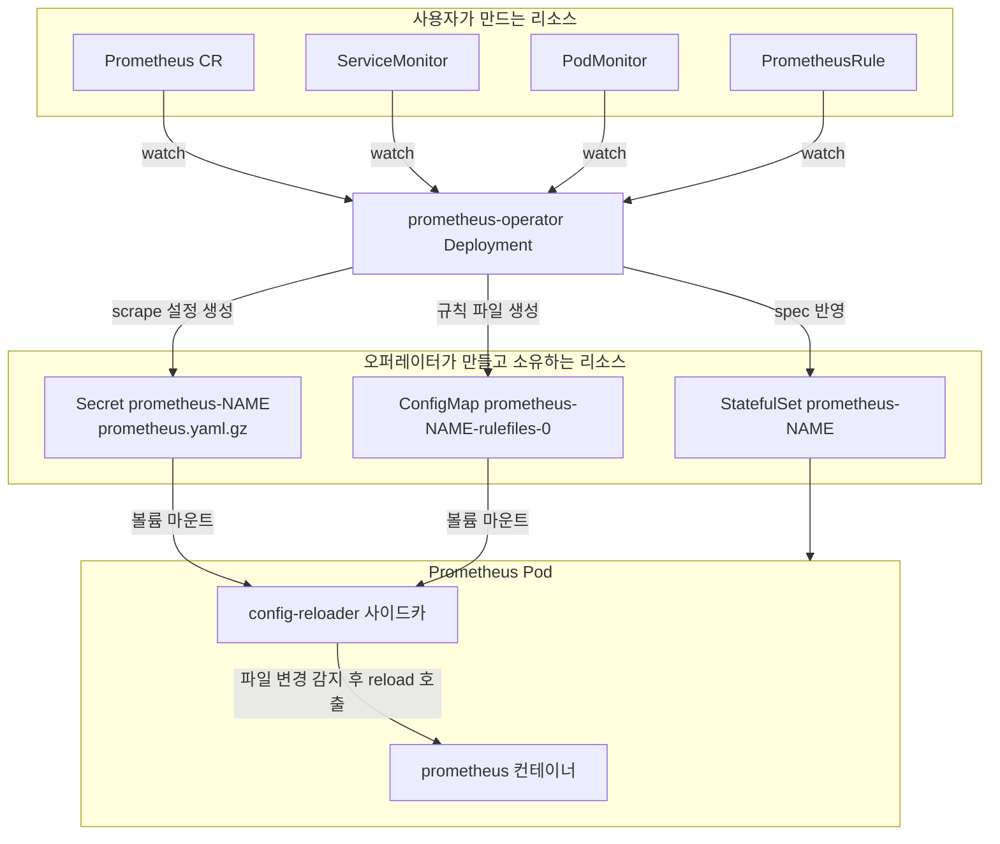
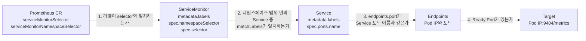
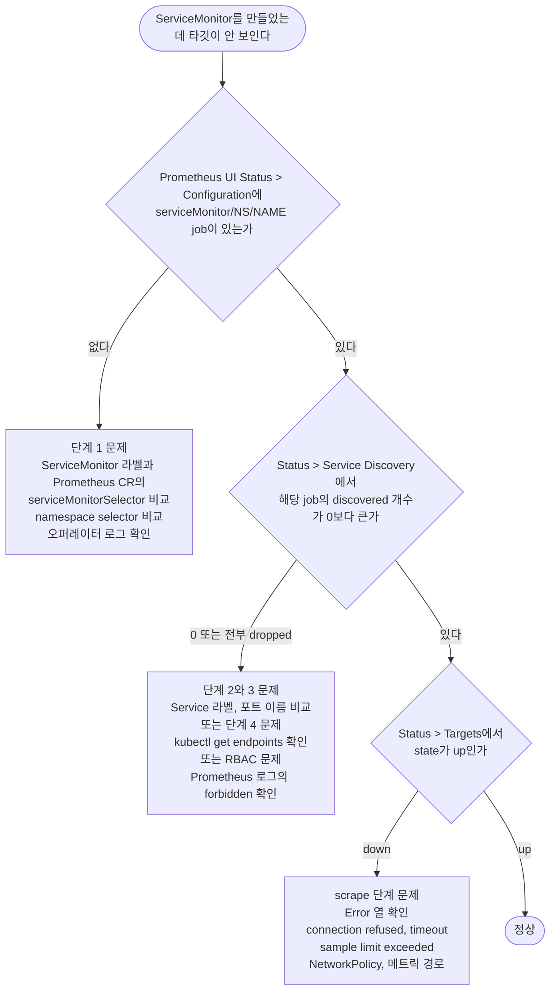
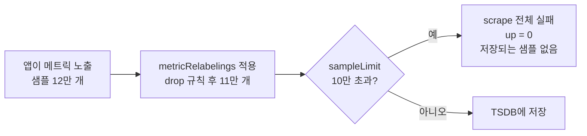
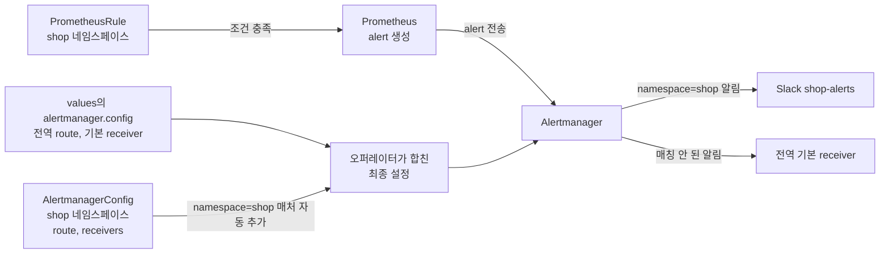

# kube-prometheus-stack과 Prometheus Operator 운영

쿠버네티스에서 Prometheus를 직접 `Deployment`와 `prometheus.yml` ConfigMap으로 운영하면 서비스가 하나 늘 때마다 ConfigMap을 고치고 리로드해야 한다. Prometheus Operator는 이 작업을 CRD로 바꿔 놓았다. 서비스 팀은 `ServiceMonitor`를 자기 네임스페이스에 만들고, 오퍼레이터가 그걸 읽어 `prometheus.yml`을 다시 생성한다. kube-prometheus-stack은 이 오퍼레이터에 Prometheus, Alertmanager, Grafana, kube-state-metrics, node-exporter, 기본 알림 규칙과 대시보드를 한 번에 묶은 Helm 차트다.

설치 자체는 `helm install` 한 줄이라 쉽다. 문제는 설치 이후에 나온다. ServiceMonitor를 만들었는데 타깃에 안 뜨고, 뜨긴 하는데 `down`이고, 알림은 규칙이 있는데 Slack으로 안 간다. 대부분 원인이 정해져 있고, 오퍼레이터가 리소스를 어떻게 이어 붙이는지 알면 순서대로 짚어 갈 수 있다. 이 문서는 그 이어 붙이는 방식과 자주 막히는 지점을 다룬다.

이 문서의 예제는 릴리스 이름 `monitoring`, 네임스페이스 `monitoring`으로 설치했다고 가정한다. 릴리스 이름이 다르면 리소스 이름의 접두어가 바뀐다. 명령어에서 이름이 헷갈리면 `kubectl get prometheus -A`로 실제 이름부터 확인한다.

## 오퍼레이터가 하는 일

오퍼레이터는 `Deployment`로 뜨는 컨트롤러다. `Prometheus`, `Alertmanager`, `ServiceMonitor`, `PodMonitor`, `PrometheusRule` 같은 CR을 감시하다가 변경이 생기면 실제 워크로드와 설정 파일을 다시 만든다. 사용자가 만지는 건 CR뿐이고, `StatefulSet`·`Secret`·`ConfigMap`은 오퍼레이터가 소유한다. 이 리소스를 직접 고치면 다음 reconcile에서 되돌아간다.



위 그림에서 볼 지점은 두 가지다. 첫째, Prometheus 프로세스는 오퍼레이터와 직접 통신하지 않는다. 오퍼레이터가 Secret을 갱신하면 Pod 안의 config-reloader가 마운트된 파일 변경을 보고 Prometheus의 reload 엔드포인트를 호출한다. 그래서 ServiceMonitor를 만든 뒤 설정 반영까지 수십 초 걸리는 일이 흔하다. Secret 마운트가 kubelet 동기화 주기를 따라 갱신되기 때문이다. 둘째, ServiceMonitor가 설정에 들어가는지는 오퍼레이터가 결정한다. Prometheus가 아니라 오퍼레이터 쪽에서 걸러지므로, 안 잡힐 때 Prometheus 로그를 아무리 봐도 단서가 없다.

생성된 설정은 직접 열어볼 수 있다.

```bash
kubectl -n monitoring get secret prometheus-monitoring-kube-prometheus-prometheus \
  -o jsonpath='{.data.prometheus\.yaml\.gz}' | base64 -d | gunzip | less
```

Prometheus UI의 Status > Configuration 페이지도 같은 내용이다. 이쪽이 더 빠르다. ServiceMonitor 하나가 엔드포인트 하나당 `job_name: serviceMonitor/<ns>/<name>/<index>` 형태의 scrape job으로 풀린다.

## 설치와 values

기본 설치는 다음과 같다.

```bash
helm repo add prometheus-community https://prometheus-community.github.io/helm-charts
helm upgrade --install monitoring prometheus-community/kube-prometheus-stack \
  -n monitoring --create-namespace \
  -f values-prod.yaml
```

처음 설치하고 나서 실제로 손대게 되는 값만 모으면 이 정도다.

```yaml
# values-prod.yaml
prometheus:
  prometheusSpec:
    # ServiceMonitor, PodMonitor, PrometheusRule, Probe를 release 라벨 없이도 선택한다
    serviceMonitorSelectorNilUsesHelmValues: false
    podMonitorSelectorNilUsesHelmValues: false
    ruleSelectorNilUsesHelmValues: false
    probeSelectorNilUsesHelmValues: false
    # 모든 네임스페이스의 CR을 대상으로 한다
    serviceMonitorNamespaceSelector: {}
    podMonitorNamespaceSelector: {}
    ruleNamespaceSelector: {}

    scrapeInterval: 30s
    evaluationInterval: 30s
    # 어떤 ServiceMonitor도 이 값 이상으로 샘플을 받지 못한다
    enforcedSampleLimit: 500000

    retention: 15d
    retentionSize: 80GB
    storageSpec:
      volumeClaimTemplate:
        spec:
          storageClassName: gp3
          accessModes: ["ReadWriteOnce"]
          resources:
            requests:
              storage: 100Gi
    resources:
      requests:
        cpu: "1"
        memory: 4Gi
      limits:
        memory: 6Gi

alertmanager:
  alertmanagerSpec:
    alertmanagerConfigSelector:
      matchLabels:
        alertmanagerConfig: main
    alertmanagerConfigNamespaceSelector: {}

# 관리형 클러스터(EKS, GKE)는 컨트롤 플레인 컴포넌트에 접근할 수 없다
kubeControllerManager:
  enabled: false
kubeScheduler:
  enabled: false
kubeEtcd:
  enabled: false
kubeProxy:
  enabled: false

kube-state-metrics:
  metricLabelsAllowlist:
    - pods=[app.kubernetes.io/name,team]
    - deployments=[app.kubernetes.io/name,team]
```

`retentionSize`는 PVC 용량보다 작게 잡는다. 둘을 똑같이 두면 WAL과 블록 압축 중 임시 공간이 모자라 Pod가 디스크 풀로 죽는 경우가 있다. 위 예제는 100Gi 볼륨에 80GB다.

관리형 클러스터에서 위 네 컴포넌트를 끄지 않으면 `KubeControllerManagerDown`, `KubeSchedulerDown` 알림이 설치 직후부터 계속 울린다. 컨트롤 플레인 메트릭 포트가 노드 안에서 열려 있지 않기 때문이다. 알림이 울린다고 대시보드부터 의심하지 말고 이 값부터 본다.

차트를 업그레이드할 때는 CRD가 별도 문제다. Helm은 차트의 `crds/` 디렉터리를 최초 설치 때만 적용하고 `helm upgrade`에서는 건드리지 않는다. 오퍼레이터 버전이 올라가 새 필드를 CR에 쓰기 시작했는데 CRD가 옛 스키마면 필드가 조용히 버려진다. 차트 README의 업그레이드 절에 버전별 CRD 적용 명령이 있고, `Prometheus`·`Alertmanager` CRD는 크기가 커서 `kubectl apply`가 어노테이션 크기 제한(262144 바이트)에 걸리므로 `--server-side`로 적용해야 한다.

## ServiceMonitor가 타깃이 되기까지

ServiceMonitor는 Pod를 직접 가리키지 않는다. Service의 라벨을 보고, Service 뒤의 Endpoints를 따라 Pod IP를 찾는다. 이 사슬에서 한 군데라도 끊기면 타깃이 안 뜬다.



네 단계는 각각 다른 실패 증상을 낸다. 단계 1이 실패하면 오퍼레이터가 ServiceMonitor를 설정에 넣지 않아서 scrape job 자체가 없다. 단계 2와 3이 실패하면 job은 생기지만 relabel의 `keep` 규칙에서 전부 걸러져 Service Discovery 페이지에서 `dropped`로만 보인다. 단계 4가 실패하면 job은 있고 타깃이 0개다. 실제 매니페스트로 보면 이렇다.

```yaml
apiVersion: v1
kind: Service
metadata:
  name: orders-api
  namespace: shop
  labels:
    app: orders-api
spec:
  selector:
    app: orders-api
  ports:
    - name: http
      port: 8080
      targetPort: 8080
    - name: metrics
      port: 9404
      targetPort: 9404
---
apiVersion: monitoring.coreos.com/v1
kind: ServiceMonitor
metadata:
  name: orders-api
  namespace: shop
  labels:
    release: monitoring
spec:
  selector:
    matchLabels:
      app: orders-api
  namespaceSelector:
    matchNames:
      - shop
  endpoints:
    - port: metrics
      path: /metrics
      interval: 30s
      scrapeTimeout: 10s
      sampleLimit: 200000
      metricRelabelings:
        - sourceLabels: [__name__]
          regex: "go_gc_.*"
          action: drop
```

오퍼레이터가 이걸 읽어 만드는 scrape job은 대략 다음 모양이다(일부 생략).

```yaml
- job_name: serviceMonitor/shop/orders-api/0
  scrape_interval: 30s
  scrape_timeout: 10s
  metrics_path: /metrics
  sample_limit: 200000
  kubernetes_sd_configs:
    - role: endpoints
      namespaces:
        names: [shop]
  relabel_configs:
    - source_labels: [__meta_kubernetes_service_label_app, __meta_kubernetes_service_labelpresent_app]
      regex: (orders-api);true
      action: keep
    - source_labels: [__meta_kubernetes_endpoint_port_name]
      regex: metrics
      action: keep
```

`relabel_configs`의 두 `keep`이 곧 단계 2와 단계 3이다. Service 라벨이 안 맞거나 포트 이름이 안 맞으면 이 두 줄에서 타깃이 전부 탈락한다. 오퍼레이터 버전에 따라 `role: endpoints` 대신 `endpointslice`를 쓰도록 바꿀 수 있는 옵션이 있지만, 위 매칭 구조는 같다.

## 타깃이 안 잡히는 네 가지 원인

### release 라벨 selector

kube-prometheus-stack을 기본값으로 설치하면 `Prometheus` CR에 이런 selector가 박힌다.

```yaml
serviceMonitorSelector:
  matchLabels:
    release: monitoring
```

차트의 `serviceMonitorSelectorNilUsesHelmValues`가 기본 `true`라서, selector를 따로 주지 않으면 차트가 릴리스 이름으로 `release` 라벨 조건을 만들어 넣는다. 그래서 라벨 없이 만든 ServiceMonitor는 오퍼레이터가 아예 무시한다. 에러도 이벤트도 없다. 다른 팀이 공개한 Helm 차트의 ServiceMonitor 템플릿을 켜 놓고 "타깃이 왜 안 뜨지"를 한 시간 찾은 경우가 대부분 이것이다.

해결 방법은 둘이다.

- ServiceMonitor에 `release: monitoring` 라벨을 붙인다. 앱 차트마다 `serviceMonitor.additionalLabels` 같은 값을 열어 두는 경우가 많다.
- values에서 `serviceMonitorSelectorNilUsesHelmValues: false`로 바꾼다. 그러면 차트가 `serviceMonitorSelector: {}`를 렌더링하고, 빈 selector는 모든 ServiceMonitor를 선택한다.

후자가 편하지만 클러스터에 아무 팀이나 ServiceMonitor를 만들 수 있게 된다는 뜻이다. 팀이 많으면 `matchLabels: {monitoring: enabled}`처럼 의도가 드러나는 라벨을 selector로 직접 지정하는 쪽이 낫다. 같은 이유로 `PodMonitor`, `PrometheusRule`, `Probe`에도 각각 `...NilUsesHelmValues`가 있다. ServiceMonitor만 고치고 PrometheusRule을 빼먹으면 타깃은 잡히는데 알림 규칙만 로드되지 않는다.

CRD 스펙에서 selector의 `null`과 `{}`는 다르다. `{}`는 전부 선택하고, 필드가 없거나 `null`이면 아무것도 선택하지 않는다. 직접 `Prometheus` CR을 만들 때 selector 필드를 빼먹으면 타깃이 하나도 안 잡힌다.

### namespace selector

네임스페이스 범위를 정하는 곳이 두 군데다. 하나는 `Prometheus` CR의 `serviceMonitorNamespaceSelector`로, 어느 네임스페이스의 ServiceMonitor를 읽을지 정한다. 이 필드를 생략하면 Prometheus와 같은 네임스페이스의 ServiceMonitor만 읽는다. 차트 기본값은 `{}`라서 전체를 읽는다. 직접 만든 `Prometheus` CR이라면 이 필드를 명시해야 한다.

다른 하나는 ServiceMonitor 자신의 `spec.namespaceSelector`로, 어느 네임스페이스의 Service를 찾을지 정한다. 생략하면 ServiceMonitor가 속한 네임스페이스만 본다. `monitoring` 네임스페이스에 ServiceMonitor를 모아 두고 `shop`의 Service를 긁으려면 다음처럼 쓴다.

```yaml
spec:
  namespaceSelector:
    matchNames: [shop]
  # 전체 네임스페이스면 any: true
```

이 둘을 헷갈려서 ServiceMonitor는 `shop`에, Service는 `payment`에 두고 안 잡힌다고 하는 경우가 있다. ServiceMonitor와 Service가 같은 네임스페이스라는 가정이 기본값이다.

### 포트 이름과 Service 구성

`endpoints[].port`는 숫자가 아니라 Service의 `ports[].name`이다. Service의 포트에 `name`이 없으면 이름 매칭이 불가능하다. Service 포트가 하나뿐이라 name을 생략하는 습관 때문에 자주 걸린다. 숫자로 지정하려면 `targetPort`를 쓰는데, 이건 Pod 컨테이너 포트를 가리키고 Service 포트와는 별개다. 이름 매칭이 가장 덜 헷갈린다.

Service의 `selector`가 Pod 라벨과 안 맞으면 Endpoints가 비어 있다. ServiceMonitor는 정상인데 타깃이 0개인 경우다. 이 때는 Prometheus가 아니라 `kubectl get endpoints`에서 먼저 드러난다.

Service 없이 도는 워크로드(CronJob, DaemonSet, 헤드리스로 노출하지 않은 워커)는 `PodMonitor`를 쓴다.

```yaml
apiVersion: monitoring.coreos.com/v1
kind: PodMonitor
metadata:
  name: batch-worker
  namespace: shop
  labels:
    release: monitoring
spec:
  selector:
    matchLabels:
      app: batch-worker
  podMetricsEndpoints:
    - port: metrics
      interval: 60s
```

PodMonitor의 `port`는 컨테이너 `ports[].name`이다. Pod 스펙에 `ports`를 선언하지 않았으면 매칭할 이름이 없다. 컨테이너가 실제로 포트를 열고 있어도 선언이 없으면 안 잡힌다.

### RBAC

Prometheus의 ServiceAccount는 대상 네임스페이스에서 `services`, `endpoints`, `pods`(그리고 EndpointSlice를 쓰면 `endpointslices`)를 `get`·`list`·`watch` 할 수 있어야 한다. kube-prometheus-stack은 ClusterRole을 만들어 기본 제공하므로 일반 설치에서는 문제가 없다. 보안 정책상 클러스터 단위 권한을 못 쓰고 네임스페이스별 `Role`로 제한한 환경에서 주로 걸린다. 새 네임스페이스를 추가하고 RoleBinding을 안 만들었을 때가 전형이다.

증상은 Prometheus 로그에 남는다.

```
level=error component="discovery manager scrape" discovery=kubernetes
msg="Unable to list/watch" err="endpoints is forbidden: User \"system:serviceaccount:monitoring:monitoring-kube-prometheus-prometheus\" cannot list resource \"endpoints\" in API group \"\" in the namespace \"shop\""
```

권한은 `kubectl auth can-i`로 직접 확인한다.

```bash
kubectl auth can-i list endpoints -n shop \
  --as=system:serviceaccount:monitoring:monitoring-kube-prometheus-prometheus
```

RBAC 문제는 한 네임스페이스에서만 난다는 특징이 있다. 다른 네임스페이스의 타깃은 멀쩡하고 `shop`의 job만 타깃이 없다. 그리고 매니페스트에는 흠이 없다.

## 점검 순서

타깃이 안 보일 때는 앞에서부터 순서대로 확인한다. 뒤쪽 단계를 먼저 보면 앞 단계의 원인을 놓치고 엉뚱한 곳을 고친다.



각 단계에서 실제로 치는 명령은 이렇다.

```bash
# 1단계. Prometheus가 어떤 selector를 쓰는지, ServiceMonitor 라벨이 무엇인지
kubectl get prometheus -A -o yaml | grep -A4 -E 'serviceMonitor(Namespace)?Selector'
kubectl -n shop get servicemonitor orders-api --show-labels

# 오퍼레이터가 ServiceMonitor를 읽다가 버린 흔적
kubectl -n monitoring logs deploy/monitoring-kube-prometheus-operator | grep -i -E 'orders-api|skipping|invalid'

# 2단계. Service 라벨, 포트 이름, Endpoints
kubectl -n shop get svc orders-api --show-labels
kubectl -n shop get svc orders-api -o jsonpath='{.spec.ports[*].name}'
kubectl -n shop get endpoints orders-api

# 접근 권한
kubectl auth can-i list endpoints -n shop \
  --as=system:serviceaccount:monitoring:monitoring-kube-prometheus-prometheus

# UI 접속
kubectl -n monitoring port-forward svc/monitoring-kube-prometheus-prometheus 9090
```

port-forward 후 `http://localhost:9090`에서 Status 메뉴의 Configuration, Service Discovery, Targets 세 페이지를 본다. Service Discovery 페이지는 job마다 discovered 라벨과 `dropped` 라벨을 보여 준다. `__meta_kubernetes_service_label_app`이 기대한 값인지, `__meta_kubernetes_endpoint_port_name`이 무엇으로 찍혀 있는지 보면 relabel의 `keep`에서 어디가 틀렸는지 바로 나온다.

Configuration에는 job이 있는데 Pod 안의 설정이 오래된 경우도 있다. config-reloader 사이드카 로그를 확인한다.

```bash
kubectl -n monitoring logs prometheus-monitoring-kube-prometheus-prometheus-0 -c config-reloader
```

리로드가 실패하면 여기에 `reload failed` 류의 메시지가 남는다. 보통은 직접 만든 `additionalScrapeConfigs`의 YAML 오류가 원인이다.

## scrape interval과 sample limit

`Prometheus` CR의 `scrapeInterval`은 오퍼레이터 기준 기본 30초다. 전체 기본값이고, ServiceMonitor의 `endpoints[].interval`이 있으면 그쪽이 우선한다. `scrapeTimeout`이 `interval`보다 크면 설정이 잘못된 것이라, 오퍼레이터가 해당 ServiceMonitor를 설정에서 빼 버리거나 Prometheus가 reload에 실패한다. 버전에 따라 동작이 다르므로 interval을 줄일 때 `scrapeTimeout`도 같이 명시한다.

interval을 짧게 가져갈 때 따라오는 비용을 놓치기 쉽다. 샘플 수가 interval에 반비례해서 늘어난다. 30초를 15초로 줄이면 같은 시계열에서 저장 용량과 메모리 사용이 비슷한 비율로 늘고, 대시보드 쿼리도 무거워진다. `rate()`의 range는 scrape interval의 4배 이상으로 잡는 것이 안전하다. 30초 interval에 `rate(x[1m])`을 쓰면 샘플이 두 개밖에 안 들어와서 scrape 한 번이 늦어지는 순간 그래프에 빈 구멍이 난다.

`sampleLimit`은 한 번의 scrape에서 받는 샘플 수 상한이다. 핵심은 초과했을 때의 동작이다. 초과분만 버리지 않고 해당 scrape 전체를 실패로 처리한다. 타깃은 `down`이 되고 에러 열에 `sample limit exceeded`가 찍힌다. 그래프가 "일부 잘린 채"가 아니라 "통째로 끊겨서" 보인다. 어떤 앱이 사용자 ID 같은 라벨을 붙이는 버그를 배포하면 그 앱의 모니터링이 한꺼번에 사라진다.



한도는 두 단계로 건다. 개별 ServiceMonitor의 `sampleLimit`은 팀이 자기 앱에 거는 값이고, `Prometheus` CR의 `enforcedSampleLimit`은 관리자가 거는 전체 상한이다. enforced 값은 ServiceMonitor 쪽 값을 덮어쓰되, ServiceMonitor 쪽 값이 더 작으면 작은 쪽이 쓰인다. `targetLimit`(job당 타깃 수)과 `labelLimit`(샘플당 라벨 수)도 같은 구조다.

한도에 닿기 전에 알림을 받으려면 한도 대비 사용량을 본다.

```promql
max by (job) (scrape_samples_post_metric_relabeling)
```

한도를 실제로 넘긴 횟수는 `prometheus_target_scrapes_exceeded_sample_limit_total`이 센다. 이 값이 늘면 이미 누군가의 대시보드가 비어 있다는 뜻이다.

## kube-state-metrics와 node-exporter

차트를 설치하면 대시보드 대부분이 이 두 개와 kubelet(cAdvisor)에서 나온 메트릭으로 채워진다. 셋의 역할이 다르다. 헷갈리면 "CPU 사용량이 어느 쪽에 있지"에서 시간을 쓴다.

| 컴포넌트 | 무엇을 보는가 | 형태 | 대표 메트릭 |
|---|---|---|---|
| kube-state-metrics | API 서버의 오브젝트 상태. 실제 자원 사용량은 모른다 | Deployment 1개 | `kube_pod_status_phase`, `kube_deployment_status_replicas_available`, `kube_pod_container_status_restarts_total` |
| node-exporter | 노드 호스트의 CPU, 메모리, 디스크, 네트워크 | DaemonSet. hostNetwork, 포트 9100 | `node_cpu_seconds_total`, `node_filesystem_avail_bytes` |
| kubelet(cAdvisor) | 컨테이너별 CPU, 메모리, 네트워크 사용량 | 노드마다 kubelet의 `/metrics/cadvisor` | `container_cpu_usage_seconds_total`, `container_memory_working_set_bytes` |

kube-state-metrics는 "Deployment가 원하는 레플리카가 몇이고 실제로 몇 개인가"를 알려 주고, 컨테이너가 얼마나 메모리를 쓰는지는 cAdvisor가 알려 준다. OOMKilled 원인을 볼 때 `kube_pod_container_status_last_terminated_reason`으로 종료 사유를 확인하고 `container_memory_working_set_bytes`로 직전 추이를 확인하는 식으로 둘을 조합한다.

kube-state-metrics에서 흔히 부딪히는 것이 라벨 문제다. 2.x부터 Pod와 Deployment의 K8s 라벨은 기본으로 내보내지 않는다. 쿼리에서 `kube_pod_labels{label_team="shop"}`을 쓰는데 결과가 없다면 values의 `metricLabelsAllowlist`에 해당 라벨을 추가해야 한다. 앞의 values 예제처럼 라벨을 명시적으로 허용한다. 모든 라벨을 `*`로 열면 편하지만, 라벨 값이 많은 클러스터에서 시계열이 크게 늘어난다.

node-exporter는 hostNetwork로 노드의 9100 포트를 쓴다. 노드에 이미 node_exporter를 systemd로 띄워 둔 환경에서는 포트가 겹쳐 Pod가 `CrashLoopBackOff`에 빠진다. 로그에 `address already in use`가 찍히면 포트를 바꾸거나 노드의 기존 프로세스를 내려야 한다. 또 보안 그룹이나 방화벽이 노드 간 9100을 막고 있으면 Prometheus Pod가 있는 노드 외의 node-exporter 타깃이 `context deadline exceeded`로 down이 된다.

kubelet 타깃은 오퍼레이터가 `kube-system`에 `kubelet`이라는 Service와 Endpoints를 직접 만들어 노드 주소를 채운다. 이 Service를 찾을 수 없다면 오퍼레이터 시작 옵션이나 RBAC을 의심한다. ServiceMonitor는 이 Service의 `https-metrics` 포트를 긁는다.

## PrometheusRule

알림과 recording rule은 `PrometheusRule`로 관리한다. `spec.groups`는 기존 규칙 파일의 `groups`와 같은 형식이다.

```yaml
apiVersion: monitoring.coreos.com/v1
kind: PrometheusRule
metadata:
  name: orders-api-rules
  namespace: shop
  labels:
    release: monitoring
spec:
  groups:
    - name: orders-api.rules
      interval: 30s
      rules:
        - record: orders_api:http_requests:rate5m
          expr: |
            sum by (namespace, route) (
              rate(http_server_requests_total{job="orders-api"}[5m])
            )
        - alert: OrdersApiHighErrorRate
          expr: |
            sum by (namespace) (rate(http_server_requests_total{job="orders-api", status=~"5.."}[5m]))
              /
            sum by (namespace) (rate(http_server_requests_total{job="orders-api"}[5m]))
              > 0.05
          for: 10m
          labels:
            severity: critical
          annotations:
            summary: "orders-api 5xx 비율 {{ $value | humanizePercentage }}"
```

오퍼레이터는 이 리소스를 `prometheus-<name>-rulefiles-0` 같은 ConfigMap으로 풀어 Pod에 마운트하고, ConfigMap 크기 상한을 넘으면 여러 개로 나눈다. 규칙 문법이 틀리면 해당 PrometheusRule만 로드에서 빠지고 오퍼레이터 로그에 에러가 남는다. 차트의 어드미션 웹훅이 켜져 있으면 `kubectl apply` 시점에서 거부된다. Prometheus UI의 Status > Rules에서 그룹이 보이는지가 최종 확인이다.

예제에서 `sum by (namespace)`를 쓴 데에는 이유가 있다. `sum(...)`만 쓰면 모든 라벨이 사라진다. 이 알림이 뒤에서 나오는 AlertmanagerConfig의 네임스페이스 매처에 걸려야 하는데, `namespace` 라벨이 없으면 매치되지 않는다. 규칙은 정상이고 알림도 `Firing`인데 Slack에는 아무것도 안 오는 상황의 흔한 원인이다.

## Alertmanager 설정을 CRD로 관리하기

Alertmanager CR은 StatefulSet과 설정 Secret을 만든다. 설정을 쓰는 방법이 둘이다. 하나는 Helm values의 `alertmanager.config`에 전역 설정을 직접 쓰는 것이고, 다른 하나는 팀마다 `AlertmanagerConfig` CR을 자기 네임스페이스에 만들어 두고 오퍼레이터가 합치게 하는 것이다.



AlertmanagerConfig는 이런 모양이다.

```yaml
apiVersion: monitoring.coreos.com/v1alpha1
kind: AlertmanagerConfig
metadata:
  name: shop-team
  namespace: shop
  labels:
    alertmanagerConfig: main
spec:
  route:
    receiver: shop-slack
    groupBy: [alertname, namespace]
    groupWait: 30s
    groupInterval: 5m
    repeatInterval: 4h
    routes:
      - receiver: shop-pager
        matchers:
          - name: severity
            value: critical
            matchType: "="
  receivers:
    - name: shop-slack
      slackConfigs:
        - channel: "#shop-alerts"
          sendResolved: true
          apiURL:
            name: slack-webhook
            key: url
    - name: shop-pager
      pagerdutyConfigs:
        - routingKey:
            name: pagerduty-key
            key: routingKey
```

전역 설정은 values에서 관리한다.

```yaml
alertmanager:
  config:
    global:
      resolve_timeout: 5m
    route:
      receiver: "null"
      group_by: [namespace, alertname]
      routes:
        - receiver: "null"
          matchers:
            - alertname = "Watchdog"
    receivers:
      - name: "null"
```

이 구조에서 주의할 점이 세 가지다.

1. 오퍼레이터는 AlertmanagerConfig의 route에 자동으로 `namespace="<AlertmanagerConfig의 네임스페이스>"` 매처를 붙인다. 팀이 다른 팀 알림을 가로채지 못하게 하는 장치다. 대신 `namespace` 라벨이 없는 알림(노드 알림, 클러스터 전체 알림)은 팀 설정에 절대 걸리지 않고 전역 receiver로만 간다. 동작을 끄는 `alertmanagerConfigMatcherStrategy` 옵션이 있지만 격리가 사라지므로 이유가 있을 때만 쓴다.
2. `apiURL`, `routingKey` 같은 비밀값은 값을 직접 쓰지 않고 Secret 참조로 넣는다. 이 Secret은 AlertmanagerConfig와 같은 네임스페이스에 있어야 한다. 다른 네임스페이스의 Secret을 가리키면 오퍼레이터가 해당 설정을 버린다.
3. `Alertmanager` CR의 `alertmanagerConfigSelector`와 `alertmanagerConfigNamespaceSelector`가 Prometheus의 ServiceMonitor selector와 똑같은 방식으로 동작한다. 위 values에서는 `alertmanagerConfig: main` 라벨이 붙은 것만 읽는다. 라벨을 빼먹으면 ServiceMonitor 때와 같은 증상으로, 에러도 없이 무시된다.

AlertmanagerConfig의 API 버전은 오퍼레이터 버전에 따라 `v1alpha1`과 `v1beta1`이 같이 존재할 수 있고 필드 일부가 다르다. 설치된 CRD의 버전을 `kubectl get crd alertmanagerconfigs.monitoring.coreos.com -o jsonpath='{.spec.versions[*].name}'`으로 확인하고 맞춰 쓴다.

합쳐진 최종 설정은 Alertmanager UI의 Status 페이지에서 본다. 라우팅이 기대대로 붙었는지, `namespace` 매처가 들어갔는지가 한눈에 보인다. 알림이 가는지 검증할 때는 `amtool config routes test`나 UI의 알림 목록에서 해당 알림의 receiver를 직접 확인한다.

## 정리해 둘 점

ServiceMonitor, PrometheusRule, AlertmanagerConfig는 모두 "selector에 걸려야 읽힌다"는 같은 규칙을 따른다. 걸리지 않은 리소스는 에러 없이 무시된다. 그래서 새 리소스를 만든 직후 UI에서 실제로 반영됐는지(Configuration, Rules, Alertmanager Status)를 한 번씩 확인하는 습관이 가장 많은 시간을 아낀다. 차트를 업그레이드할 때는 CRD를 먼저 서버 사이드 적용하고, 값은 `helm get values`로 현재 상태를 백업해 두고 바꾼다.
