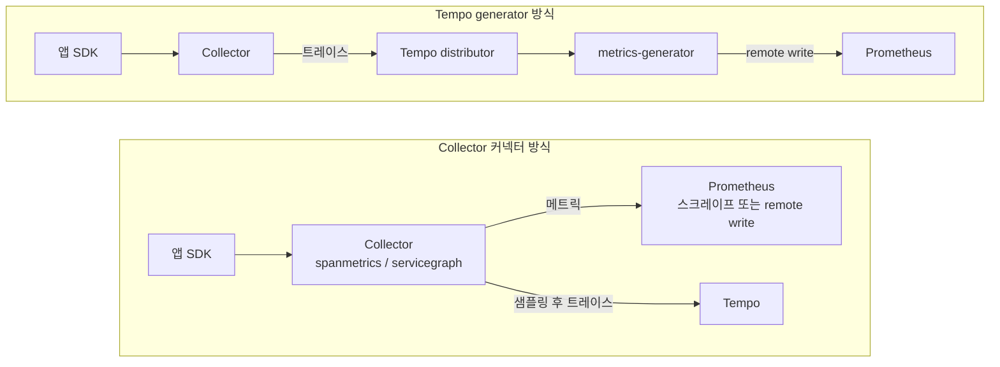
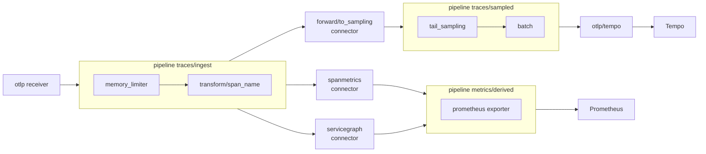
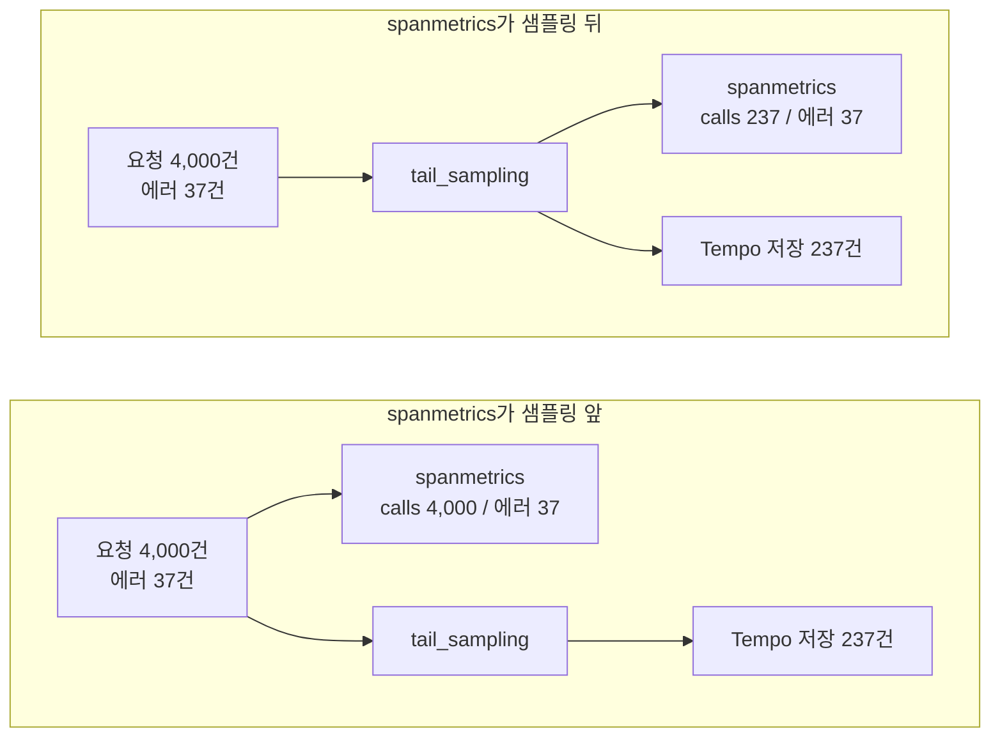
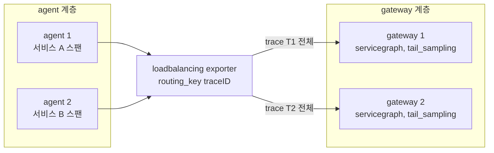
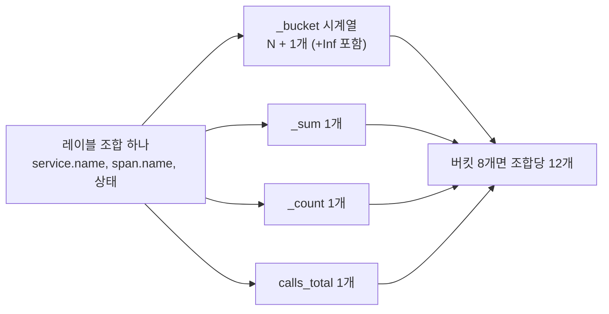
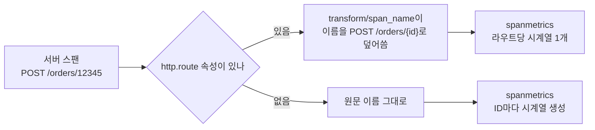
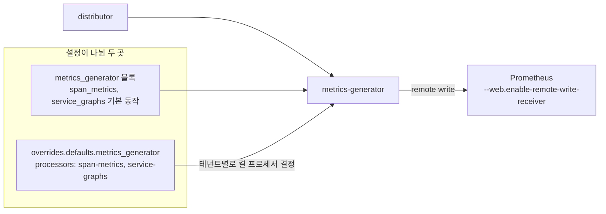
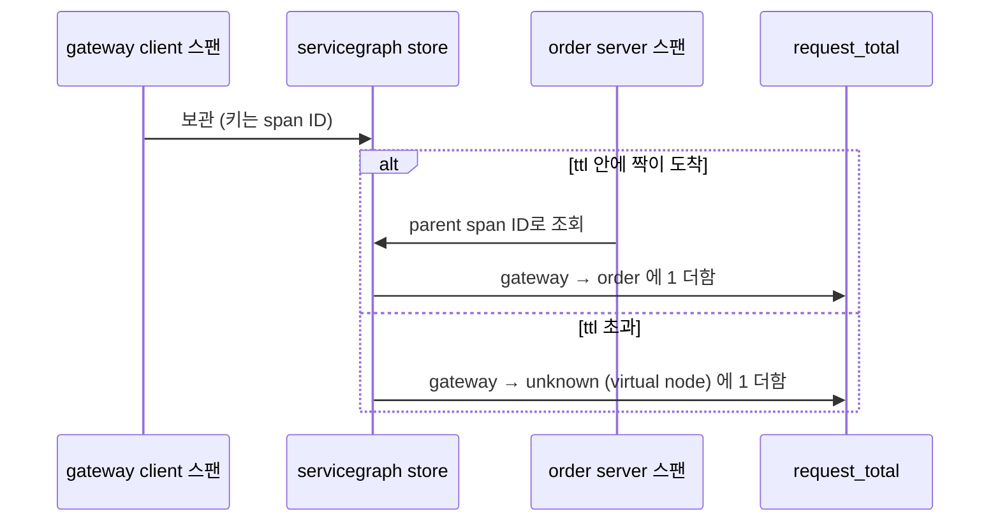
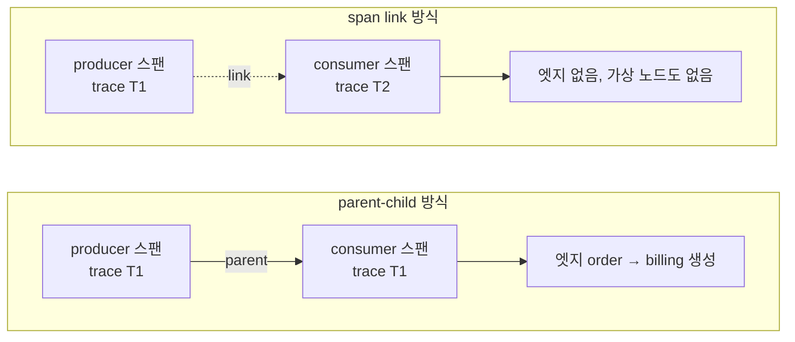

# Span Metrics와 Service Graph

트레이스를 이미 모으고 있으면 RED 메트릭(요청 수, 에러율, 지연)은 앱에 `prom-client`를 따로 붙이지 않아도 스팬에서 뽑을 수 있다. 서비스 간 호출 관계를 그리는 Service Graph도 같은 스팬에서 나온다. 스팬 하나가 "이 호출이 일어났고, 얼마 걸렸고, 실패했는지"를 이미 들고 있기 때문이다.

문제는 이 변환이 어디서 일어나느냐에 따라 숫자가 달라진다는 점이다. 같은 트레이스에서 뽑았는데 에러율이 1%로 나오는 환경도 있고 16%로 나오는 환경도 있다. 이 문서는 OTel Collector의 `spanmetrics`, `servicegraph` 커넥터와 Tempo metrics-generator를 비교하고, 운영에서 숫자가 틀어지는 지점 네 곳(샘플링 순서, 히스토그램 버킷, 카디널리티, 서비스 그래프 엣지)을 다룬다.

본문의 수치는 otelcol-contrib 0.163.2와 Tempo 3.1.1 바이너리를 받아 합성 스팬을 직접 흘려서 얻었다. 메트릭 이름과 설정 키는 버전에 따라 바뀐 이력이 있으니, 쓰는 버전의 `/metrics` 출력을 한 번 눈으로 확인하고 PromQL을 쓰는 편이 안전하다.

## 두 가지 구현과 선택 기준

스팬에서 메트릭을 만드는 구현은 두 갈래다.

| 구분 | Collector 커넥터 | Tempo metrics-generator |
|---|---|---|
| 동작 위치 | Collector 프로세스 안 | Tempo 안(distributor에서 generator로 전달) |
| 메트릭 내보내기 | Prometheus exporter 스크레이프 또는 remote write | Prometheus remote write만 |
| span metrics 이름 | `traces_span_metrics_calls_total`, `traces_span_metrics_duration_milliseconds_*` | `traces_spanmetrics_calls_total`, `traces_spanmetrics_latency_*` |
| 지연 단위 | 밀리초 | 초 |
| service graph 이름 | `traces_service_graph_request_total` 등 | 같은 이름 |
| 샘플링과의 관계 | 파이프라인 배치로 직접 결정 | Tempo에 도착한 스팬만 봄 |
| 스팬 짝짓기(service graph) | Collector 인스턴스 메모리 | trace ID 기준으로 generator에 분배 |
| 카디널리티 제한 | `aggregation_cardinality_limit` | 테넌트별 `max_active_series` |

service graph 메트릭 이름이 두 구현에서 같다는 점이 함정이다. 둘 다 켜고 같은 Prometheus에 넣으면 같은 시계열에 두 소스가 섞여 요청 수가 두 배로 보인다. 이 상태가 몇 주 지나서야 발견되는 경우가 있다. 한쪽만 쓰거나, 쓰더라도 Tempo는 `external_labels`로, Collector는 Prometheus exporter의 `const_labels`로 `source` 레이블을 달아 구분한다.

선택 기준은 단순하다. Tempo 앞에 tail sampling을 두고 있으면 Tempo generator는 샘플링된 스팬만 본다. 이때는 Collector 커넥터를 샘플링 앞에 배치하는 쪽이 맞다. 샘플링을 하지 않거나 Tempo가 모든 스팬을 받는 구성이면 generator가 운영 부담이 적다. 파이프라인 YAML을 직접 관리하지 않아도 되고 trace ID 기준 분배가 이미 되어 있다.



왼쪽은 메트릭을 만드는 지점이 Collector라서 샘플링 앞뒤를 내가 고른다. 오른쪽은 Collector가 무엇을 버렸든 Tempo에 도착한 것만 집계한다.

## Collector 파이프라인 구성

`spanmetrics`와 `servicegraph`는 커넥터다. 한 파이프라인에서는 exporter로, 다른 파이프라인에서는 receiver로 등장한다. 트레이스 파이프라인의 exporters 목록에 넣으면 스팬이 메트릭 파이프라인으로 복사되어 갈라진다.



`traces/ingest`가 스팬을 세 곳으로 복사한다. `spanmetrics`와 `servicegraph`는 샘플링을 거치지 않은 전체 스팬을 받고, `forward`만 tail sampling 파이프라인으로 이어진다. 메트릭 파이프라인은 두 커넥터의 출력을 받아 Prometheus exporter로 내보낸다.

실제로 돌려서 검증한 설정이다.

```yaml
receivers:
  otlp:
    protocols:
      grpc:
        endpoint: 0.0.0.0:4317

processors:
  memory_limiter:
    check_interval: 1s
    limit_mib: 1500
    spike_limit_mib: 300
  batch:
    timeout: 5s
    send_batch_size: 8192
  transform/span_name:
    trace_statements:
      - context: span
        conditions:
          - kind == SPAN_KIND_SERVER and attributes["http.route"] != nil
        statements:
          - set(name, Concat([attributes["http.request.method"], attributes["http.route"]], " "))
  tail_sampling:
    decision_wait: 10s
    num_traces: 200000
    policies:
      - name: errors
        type: status_code
        status_code:
          status_codes: [ERROR]
      - name: slow
        type: latency
        latency:
          threshold_ms: 1000
      - name: baseline
        type: probabilistic
        probabilistic:
          sampling_percentage: 5

connectors:
  forward/to_sampling: {}
  spanmetrics:
    histogram:
      explicit:
        buckets: [50ms, 100ms, 250ms, 500ms, 1s, 2500ms, 5s]
    dimensions:
      - name: http.request.method
      - name: http.route
    metrics_flush_interval: 15s
    metrics_expiration: 10m
    aggregation_cardinality_limit: 2000
    exemplars:
      enabled: true
  servicegraph:
    latency_histogram_buckets: [100ms, 250ms, 500ms, 1s, 2500ms, 5s]
    dimensions: [http.route]
    store:
      ttl: 10s
      max_items: 20000
    virtual_node_peer_attributes: [peer.service, db.system, messaging.system]
    metrics_flush_interval: 15s

exporters:
  otlp/tempo:
    endpoint: tempo:4317
    tls:
      insecure: true
  prometheus:
    endpoint: 0.0.0.0:8889
    enable_open_metrics: true

service:
  pipelines:
    traces/ingest:
      receivers: [otlp]
      processors: [memory_limiter, transform/span_name]
      exporters: [spanmetrics, servicegraph, forward/to_sampling]
    traces/sampled:
      receivers: [forward/to_sampling]
      processors: [tail_sampling, batch]
      exporters: [otlp/tempo]
    metrics/derived:
      receivers: [spanmetrics, servicegraph]
      exporters: [prometheus]
```

몇 가지는 설정만 봐서는 안 보인다.

`traces/ingest`에 `batch`를 넣지 않았다. batch 프로세서가 스팬을 5초씩 붙잡고 있으면 servicegraph가 client 스팬과 server 스팬을 받는 시점이 벌어진다. 이 간격이 store의 ttl을 넘으면 엣지가 사라진다(뒤에서 실험 결과를 다룬다). batch는 Tempo로 나가는 쪽에만 둔다.

`spanmetrics`가 만드는 메트릭은 `metrics_flush_interval`마다 한 번 내보낸다. 기본값은 60초고 위 설정에서는 15초로 줄였다. 기본값 상태에서 스팬 100건을 보내고 30초 뒤에 `/metrics`를 열었더니 `calls_total`이 한 줄도 없었고, 65초쯤 되어서야 나타났다. 처음 붙일 때 "안 나온다"고 오해하기 쉬운 지점이다.

`transform/span_name`은 카디널리티 절에서 설명한다. 이 프로세서는 ingest 파이프라인에 있으므로 Tempo에 저장되는 스팬 이름도 같이 바뀐다.

Prometheus는 exporter를 스크레이프하거나, Collector에서 `prometheusremotewrite` exporter로 밀어 넣는다. 스크레이프 방식에서 exemplar를 쓰려면 Prometheus에 `--enable-feature=exemplar-storage`가 필요하다. Tempo 연동은 [Grafana Tempo](Grafana_Tempo.md)의 Exemplar 절을 본다.

## 샘플링 뒤에 spanmetrics를 두면 숫자가 틀어진다

가장 흔한 사고다. 이미 tail_sampling이 걸린 트레이스 파이프라인 끝에 `spanmetrics`를 exporter로 추가하면 설정은 아무 에러 없이 로드되고 메트릭도 나온다. 다만 그 숫자는 "샘플링을 통과한 요청"의 통계다.

tail sampling 정책이 보통 "에러는 전부, 느린 건 전부, 나머지는 5%"이기 때문에 왜곡 방향이 정해져 있다. 에러와 느린 요청이 정상 요청보다 훨씬 높은 비율로 남는다. 요청 수는 실제보다 적게 잡히고, 에러율과 p99는 실제보다 높게 잡힌다.



두 구성의 차이는 spanmetrics가 tail_sampling 앞에 붙었는지 뒤에 붙었는지뿐이다. Tempo에 저장되는 트레이스는 같다.

같은 파이프라인 두 개를 한 Collector에 올리고(샘플링 앞에 `spanmetrics`, 샘플링 뒤에 `spanmetrics/after`) 4,000개 요청을 흘렸다. 요청 중 에러는 1% 정도로 심었고, 정책은 에러 전부 + 나머지 5%였다.

| 항목 | 샘플링 앞 | 샘플링 뒤 |
|---|---|---|
| gateway 서버 스팬 수 | 4,000 | 237 |
| 에러 스팬 수 | 37 | 37 |
| 에러율 | 0.93% | 15.61% |
| 250ms 이하 비율 | 99.1% (3,963건) | 84.4% (200건) |
| p99 (histogram_quantile) | 약 249ms | 약 968ms |

에러율이 0.93%에서 15.61%로 뛰고 p99는 249ms에서 968ms가 된다. 에러를 전부 남기는 정책이기 때문에 에러 개수 자체는 정확한데 분모가 줄어들어서 비율이 폭발한다. 대시보드에서 에러율 알림을 이 메트릭으로 걸어 두었다면 샘플링 정책을 바꾼 날 알림이 울린다. 서비스에는 아무 일도 없었는데 말이다.

해법은 앞서 본 파이프라인처럼 `forward` 커넥터로 파이프라인을 둘로 나누는 것이다. ingest에서 spanmetrics가 전체 스팬을 받고, 샘플링은 그 뒤 파이프라인에서만 한다.

SDK 쪽 head sampling(`ParentBased(TraceIdRatioBased(0.1))` 같은 설정)도 같은 문제를 일으킨다. SDK가 10%만 내보내면 Collector는 애초에 10%만 본다. spanmetrics는 받은 스팬 개수를 그대로 세므로 요청 수가 10% 수준으로 나온다. 이 경우는 Collector에서 해결할 수 없다. 메트릭이 필요한 서비스는 SDK에서 전부 내보내고 Collector에서 샘플링하거나, RED 메트릭만 SDK 메트릭으로 따로 수집한다.

### 멀티 레플리카에서 생기는 문제

Collector를 agent 계층과 gateway 계층으로 나누고 gateway에서 tail sampling을 한다면, 같은 트레이스의 스팬을 한 gateway 인스턴스로 모아야 해서 `loadbalancing` exporter가 앞단에 들어간다.

```yaml
exporters:
  loadbalancing:
    routing_key: traceID
    protocol:
      otlp:
        tls:
          insecure: true
    resolver:
      dns:
        hostname: otel-gateway-headless.observability.svc.cluster.local
        port: "4317"
service:
  pipelines:
    traces:
      receivers: [otlp]
      exporters: [loadbalancing]
```

`port`는 문자열이어야 한다. 숫자로 쓰면 `expected type 'string', got unconvertible type 'int'`로 기동 자체가 실패한다.

이 구조에서 `spanmetrics`는 어느 계층에 둬도 된다. 스팬 하나하나를 독립적으로 세기 때문이다. 다만 샘플링 앞이어야 한다. `servicegraph`는 다르다. client 스팬과 server 스팬이 같은 프로세스 메모리의 store에서 만나야 엣지가 완성된다. agent 계층에는 한 서비스의 스팬만 들어오므로 client와 server가 갈라진다. `loadbalancing` 뒤, 즉 trace ID로 모인 gateway 계층의 ingest 파이프라인에 두어야 한다.

spanmetrics가 여러 인스턴스에서 같은 서비스의 스팬을 각자 센다면 시계열이 인스턴스별로 갈라진다. 테스트한 0.163.2에서는 `collector_instance_id` 레이블이 붙어 서로 덮어쓰지 않았고, 합산은 `sum by (...)`로 한다. 반대로 이 레이블은 Collector가 재시작될 때마다 새 값이 생기므로 롤링 배포를 자주 하면 시계열이 쌓인다. `metrics_expiration`이 그 정리를 맡는다.



agent는 서비스별 스팬만 보지만, `loadbalancing` exporter를 지나면 한 트레이스의 client·server 스팬이 같은 gateway로 모인다. servicegraph는 이 gateway에 둔다.

## 히스토그램 버킷

spanmetrics의 지연은 히스토그램이고, 버킷 경계를 설정에서 정한다. 이 설정이 어긋나면 p99가 부정확해진다. Prometheus의 `histogram_quantile`은 버킷 안에서 값이 균등하게 퍼져 있다고 가정하고 선형 보간하기 때문이다.

위 실험에서 샘플링 앞 p99가 249ms로 나온 것은 250ms 버킷 경계 바로 아래에 대부분의 요청이 있었기 때문이다. 실제 값이 249ms인 것은 아니다. 합성 데이터의 지연은 20~110ms에 몰려 있고 일부 에러만 800ms 이상이다. 버킷이 (100, 250]이면 보간은 이 구간에 몰린 값을 균등하게 취급한다. 버킷이 성글수록 오차가 커진다.

버킷을 정할 때 따르는 규칙은 두 가지다.

SLO 임계값에 버킷 경계를 하나 둔다. "300ms 이내 99%"가 목표인데 버킷이 250, 500이면 300ms 비율을 정확히 구할 수 없다. 이 경우 `le="250"`과 `le="500"` 사이를 보간한 값을 믿게 된다. 300ms 경계를 추가하면 `rate(bucket{le="300"}) / rate(count)`가 정확한 값이 된다.

버킷 수는 시계열 수에 곱해진다. 명시 버킷이 N개면 레이블 조합 하나당 `N + 1`(`+Inf` 포함)개의 `_bucket` 시계열과 `_sum`, `_count`, 그리고 `calls_total` 하나가 나온다. 버킷 8개면 조합당 12개다. 실험에서 calls 시계열이 202개일 때 `_bucket`이 1,818개(202 × 9), `_sum`과 `_count`가 각 202개였다.



레이블 조합이 하나 늘 때마다 버킷 수에 3을 더한 만큼 시계열이 생긴다는 점을 보면 된다.

Collector 커넥터의 기본 버킷은 2, 4, 6, 8, 10, 50, 100, 200, 400, 800ms, 1, 1.4, 2, 5, 10, 15초로 16개다. `+Inf`와 `_sum`, `_count`, `calls_total`을 더하면 조합당 20개다. 사내 API가 대부분 50ms~2초에 몰려 있다면 2~10ms 사이의 경계 5개는 거의 비어 있는 채로 시계열만 차지한다. 서비스가 사용하는 지연 범위를 `histogram_quantile`로 한 번 본 다음 줄이는 편이 낫다.

Tempo generator의 지연 단위는 초이고 `histogram_buckets: [0.05, 0.1, 0.25, ...]`로 쓴다. 커넥터는 `50ms` 같은 duration 문자열을 받고 메트릭은 밀리초(`_milliseconds`)로 나온다. 대시보드를 한쪽에서 다른 쪽으로 옮길 때 `le` 값과 단위를 같이 바꿔야 한다. 놓치면 p99가 1000배 어긋나는 그래프가 그려진다.

exponential 히스토그램(`histogram.exponential.max_size`)이나 Tempo의 네이티브 히스토그램은 버킷 경계를 신경 쓰지 않아도 되지만, Prometheus가 네이티브 히스토그램을 받도록 설정되어 있어야 한다. 이 문서의 설정은 explicit 버킷만 다룬다.

## dimensions에 넣은 속성이 시계열 수를 결정한다

spanmetrics의 기본 레이블은 `service.name`, `span.name`, `span.kind`, `status.code`다. `dimensions`에 속성을 추가하면 그 속성의 고유값 개수가 곱셈으로 들어온다.

계산은 단순하다. 서버 스팬 이름이 50개 있는 서비스에 `user.id`를 dimension으로 넣고 활성 사용자가 5만 명이면, 최악의 경우 `50 × 2(status) × 50,000 × 12(버킷 8개 기준) = 6,000만` 시계열이다. 실제로는 모든 사용자가 모든 엔드포인트를 호출하지 않으므로 이만큼은 아니지만, 한 엔드포인트만 계산해도 `50,000 × 2 × 12 = 120만`이다. Prometheus 한 대가 감당하는 활성 시계열이 보통 수백만 선이라는 점을 감안하면 한 줄 설정으로 서버를 죽일 수 있다.

실험에서도 확인했다. `user.id`를 dimension에 넣고 2,000건을 흘리자 `user_id="u0"`, `"u1"`, ... 가 레이블 값마다 시계열을 만들었다. `aggregation_cardinality_limit: 100`을 걸자 서비스당 100개 조합까지만 만들고 나머지는 하나로 합쳐졌다.

```text
traces_span_metrics_calls_total{job="gateway",otel_metric_overflow="true",...} 1921
traces_span_metrics_calls_total{job="order",otel_metric_overflow="true",...} 1901
```

이 overflow 시계열에는 `span_name`, `http_route` 같은 구분 레이블이 전부 사라지고 `otel_metric_overflow="true"`만 붙는다. 전체 합계 `sum(rate(...))`는 맞게 나오지만 span_name별 분해는 깨진다. 한도는 서비스(리소스) 단위로 적용됐고, 그 서비스의 모든 시계열 조합을 합쳐서 센다. 안전장치로는 쓸 만하다. 한도를 넘었다는 건 설정이 잘못됐다는 신호이므로 overflow 시계열이 생겼는지를 알림으로 걸어 두는 편이 좋다.

```text
count by (service_name) (traces_span_metrics_calls_total{otel_metric_overflow="true"}) > 0
```

### URL 전체 경로

`user.id`보다 더 자주 터지는 건 `url.path`나 `http.target`이다. `/orders/38291`, `/orders/38292`가 모두 다른 레이블 값이 된다. 사용자 ID는 눈에 띄지만 경로는 "그냥 유용해 보여서" 넣었다가 터진다.

URL을 dimension으로 쓰지 말고 `http.route`(템플릿화된 경로 `/orders/{id}`)를 쓴다. 이 속성은 서버 계측이 라우터에서 알아낸 값이라 고유값이 라우트 정의 개수로 제한된다. 클라이언트 스팬에는 `http.route`가 없고 `url.full`만 있는 경우가 많다. 클라이언트 스팬 쪽은 dimension을 늘리지 않는 편이 낫다.

### span.name이 이미 높은 카디널리티일 때

dimension을 안 늘려도 문제가 생기는 경우가 있다. 일부 계측 라이브러리는 서버 스팬 이름을 `GET /users/12345`처럼 경로 원문으로 남긴다. spanmetrics의 기본 레이블에 `span.name`이 있으니 dimensions를 건드리지 않아도 시계열이 폭발한다.

앞의 설정에서 `transform/span_name`이 이 문제를 처리한다. 서버 스팬에 `http.route`가 있으면 이름을 `"{method} {route}"`로 덮어쓴다. 실험에서 `POST /orders/12345`로 들어온 스팬이 `span_name="POST /orders/{id}"`로 집계되는 것을 확인했다.

덮어쓰기는 ingest 파이프라인에서 하므로 Tempo에 저장되는 트레이스의 스팬 이름도 같이 바뀐다. 트레이스 검색에서 원래 경로가 안 보이는 대신 `url.path` 속성이 남아 있어 조회는 된다. 팀에서 스팬 이름에 의존하는 검색이 있으면 먼저 확인한다.



`http.route`가 있는 서버 스팬만 이름이 정규화된다. 없는 스팬은 원문 경로가 `span.name`으로 남아 시계열이 늘어난다.

### 시계열 수를 직접 세는 법

설정을 배포하고 나서는 Prometheus에서 직접 센다.

```promql
# 메트릭 이름별 시계열 수
topk(10, count by (__name__) ({__name__=~"traces_span_metrics.*|traces_service_graph.*"}))

# span_name 고유값 개수 (폭발의 첫 용의자)
count(count by (span_name) (traces_span_metrics_calls_total))

# 특정 dimension의 고유값 개수
count(count by (http_route) (traces_span_metrics_calls_total))
```

TSDB 상태 API(`/api/v1/status/tsdb`)의 `seriesCountByLabelValuePair`도 어느 레이블 값이 시계열을 많이 만드는지 바로 보여 준다. 배포 전에 한 번만 보면 되는 정보를 사고 나서야 보게 된다.

## Tempo metrics-generator 설정

Tempo에서는 generator 프로세서를 켜고 Prometheus remote write 경로를 지정한다. Tempo 3.1.1에서 `-config.verify=true`로 검증한 설정이다.

```yaml
metrics_generator:
  registry:
    external_labels:
      source: tempo
      cluster: prod-apne2
    collection_interval: 15s
  processor:
    span_metrics:
      histogram_buckets: [0.05, 0.1, 0.25, 0.5, 1, 2.5, 5]
      dimensions: [http.route, http.request.method]
      intrinsic_dimensions:
        span_kind: true
        status_message: false
      filter_policies:
        - include:
            match_type: strict
            attributes:
              - key: kind
                value: SPAN_KIND_SERVER
      enable_target_info: false
    service_graphs:
      wait: 10s
      max_items: 10000
      histogram_buckets: [0.1, 0.25, 0.5, 1, 2.5, 5]
      dimensions: [http.route]
      peer_attributes: [peer.service, db.name, db.system, messaging.system]
      enable_virtual_node_label: true
  storage:
    path: /var/tempo/generator/wal
    remote_write:
      - url: http://prometheus:9090/api/v1/write
        send_exemplars: true

overrides:
  defaults:
    metrics_generator:
      processors: [span-metrics, service-graphs]
      max_active_series: 50000
      collection_interval: 15s
      processor:
        span_metrics:
          dimensions: [http.route]
          histogram_buckets: [0.05, 0.1, 0.25, 0.5, 1, 2.5, 5]
        service_graphs:
          dimensions: [http.route]
```

설정이 두 군데에 나뉜다. `metrics_generator:` 블록은 프로세서의 기본 동작이고, `overrides.defaults.metrics_generator`가 테넌트별로 실제 어떤 프로세서를 켤지 정한다. `processors`에 이름을 안 넣으면 generator 블록을 아무리 잘 써도 메트릭이 한 건도 안 나온다. 처음 구성하면 가장 많이 막히는 지점이다. 프로세서 이름은 `span-metrics`, `service-graphs`처럼 하이픈을 쓰는데, `metrics_generator:` 쪽 키는 `span_metrics`, `service_graphs`로 언더스코어라 헷갈린다.



`overrides` 쪽 `processors`에 이름이 없으면 generator 블록이 아무리 맞아도 메트릭이 나오지 않는다.

`filter_policies`로 서버 스팬만 집계하도록 걸었다. 기본으로 모든 스팬 종류(내부 스팬, 클라이언트 스팬)가 집계되어 시계열이 필요 이상으로 늘어난다. RED 메트릭 용도라면 서버 스팬(메시지 컨슈머면 consumer 스팬도)이면 충분하다.

`max_active_series`는 테넌트별 상한이다. 넘으면 새 시계열이 버려지는 방식이라 커넥터의 overflow처럼 합산되지는 않는다. 새 서비스가 배포된 날 그 서비스의 메트릭만 안 나오는 증상이 이 상한과 관련 있는지 확인한다.

Prometheus는 remote write를 받도록 `--web.enable-remote-write-receiver`를 켜야 한다. 안 켜면 generator 로그에 `remote write` 실패가 반복되고 대시보드는 비어 있다.

메트릭 레이블 이름은 커넥터와 다르다. 커넥터는 `service_name`이고 Tempo는 `service`다.

```promql
# Tempo generator 기준
sum by (service) (rate(traces_spanmetrics_calls_total{span_kind="SPAN_KIND_SERVER"}[5m]))

# 커넥터 기준
sum by (service_name) (rate(traces_span_metrics_calls_total{span_kind="SPAN_KIND_SERVER"}[5m]))
```

generator에도 앞서 본 샘플링 순서 문제가 그대로 적용된다. Collector에서 tail sampling을 한 뒤 Tempo로 보내면 generator는 샘플링된 스팬만 받는다. Collector 쪽에 `spanmetrics`를 따로 두고 Tempo에서는 `span-metrics`를 끄는 구성이 이 경우의 답이다. service graph를 Tempo에서만 켜는 것도 마찬가지로 샘플링의 영향을 받는다. 샘플링으로 client만 남고 server가 버려진 트레이스는 엣지가 불완전해진다. tail sampling은 트레이스 단위로 결정하므로 한 트레이스의 스팬은 같이 남거나 같이 버려져서 짝이 깨지는 일은 적다. 그래도 요청 수가 샘플링 비율만큼 줄어든다는 점은 같다.

## 서비스 그래프 엣지가 빠지는 조건

service graph는 스팬 짝을 찾아서 `client → server` 엣지를 만든다. client 스팬(`SPAN_KIND_CLIENT`)의 span ID가 server 스팬(`SPAN_KIND_SERVER`)의 parent span ID와 같으면 한 쌍이다. 쌍이 완성되면 `traces_service_graph_request_total{client="gateway", server="order"}`에 1이 더해진다. 먼저 도착한 쪽은 store에 보관되고, ttl 안에 짝이 오지 않으면 만료된다.



위쪽 가지가 정상이고 아래쪽 가지가 엣지가 사라지는 경로다. 엣지가 안 보이거나 `unknown`이 나타나면 대부분 아래쪽으로 간 것이다.

### store ttl과 스팬 도착 간격

client 스팬과 server 스팬은 서로 다른 서비스에서 서로 다른 시점에 Collector에 도착한다. 그 간격이 `store.ttl`보다 길면 짝이 만나지 못한다. gateway 스팬을 먼저 보내고 5초 뒤에 order 스팬을 보내는 실험으로 확인했다.

| ttl | 결과 |
|---|---|
| 2s | `gateway → order` 엣지가 없고 `gateway → unknown`(virtual node) 993건 + 에러 7건 |
| 10s | `gateway → order` 엣지가 993건 + 에러 7건으로 정상 |

엣지가 `unknown` 서버로 찍힌다. 같은 서비스의 요청 수는 맞는데 서버 이름만 `unknown`이라서 처음엔 계측이 잘못된 줄 알기 쉽다. 원인은 SDK의 배치 지연, 앞단 batch 프로세서, 서비스별 agent의 전송 주기 차이 같은 것들이다. ttl은 이런 지연의 합보다 길어야 한다. 단, store는 ttl 동안 미완성 엣지를 모두 메모리에 잡고 있으므로 `max_items`와 같이 올린다. 한도를 넘으면 오래된 항목부터 밀려난다.

Tempo generator의 같은 설정은 `service_graphs.wait`(만료까지 기다리는 시간)와 `max_items`다.

### 외부 DB 노드

데이터베이스는 계측된 server 스팬이 없다. client 스팬(`SELECT orders`)만 있고 짝이 올 수 없다. 이런 엣지를 노드로 그리려면 client 스팬의 속성에서 이름을 가져오는 설정이 필요하다. 커넥터의 `virtual_node_peer_attributes`, Tempo의 `peer_attributes`가 그 설정이다. 위 설정처럼 `db.system`이 목록에 있으면 `order → mysql`(connection_type이 `virtual_node`)이 만들어진다.

두 가지를 알아 둔다.

가상 노드 엣지는 ttl이 지나 만료되어야 만들어진다. 짝이 올지 기다린 다음에 포기해야 노드로 확정하기 때문이다. DB 엣지가 서비스 간 엣지보다 ttl만큼 늦게 나타난다. 실험에서 ttl 10s일 때 `order → mysql`이 1,000건 중 636건에서 멈춰 있었다. 만료를 기다리는 중에 스크레이프한 것으로 보이고, ttl 2s에서는 1,000건이 다 잡혔다. 대시보드가 비는 것처럼 보여도 ttl만큼은 기다려 본다.

`db.name`이나 `db.system`이 계측에 따라 다르게 채워진다. 같은 MySQL인데 서비스 A는 `db.system=mysql`, 서비스 B는 `db.name=orders_prod`로 찍히면 노드가 두 개로 갈라진다. peer 속성 목록의 순서가 우선순위라서 목록을 어떻게 짜느냐에 따라 노드 이름이 달라진다. 서비스 그래프에서 같은 DB가 두 노드로 보이면 이 부분을 확인한다.

### 메시징

Kafka나 SQS 같은 메시징은 producer 스팬(`SPAN_KIND_PRODUCER`)과 consumer 스팬(`SPAN_KIND_CONSUMER`)이 짝이다. 두 스팬이 **같은 트레이스**에 있고 consumer의 parent가 producer일 때만 엣지가 만들어진다. 실험에서 이 경우 `order → billing`이 `connection_type="messaging_system"`으로 정상 생성되는 것을 확인했다.

consumer가 새 트레이스를 시작하고 producer와는 span link로만 연결하는 계측이 있다. 메시지 큐에서 오래 대기하는 배치성 소비에서 권장되는 방식이기도 하다. 이 경우를 흉내 내서 producer와 consumer를 서로 다른 트레이스로 500쌍 보냈더니 `traces_service_graph_request_total`에 아무 엣지도 생기지 않았다. 가상 노드도 안 생겼다. 서비스 그래프에서 메시징 구간만 끊겨 있으면 계측이 link 방식인지부터 확인한다. link는 트레이스 뷰에서는 연결이 보이지만 service graph는 parent-child 관계만 보기 때문에 구분이 안 된다.



두 방식의 차이는 consumer가 producer와 같은 트레이스에 있는지다. link는 트레이스 뷰에서만 연결이 보이고 service graph에는 잡히지 않는다.

producer와 consumer 사이에 지연이 큰 경우도 ttl 문제다. 메시지가 큐에서 30초 기다렸다 소비되면 ttl 10초로는 만료된다. 메시징 지연이 큰 시스템이면 ttl을 그 지연에 맞춰야 하는데, 동기 호출 엣지의 메모리도 같이 늘어난다는 점이 부담이다.

### 그 밖의 원인

중간 스팬이 끼어 부모 관계가 끊기는 경우가 있다. 서비스 메시나 프록시가 client 스팬과 server 스팬 사이에 스팬을 하나 더 만들면 server 스팬의 parent가 client 스팬이 아니라 프록시 스팬이 된다. 중간 스팬은 `INTERNAL`이거나 별개 서비스로 집계되어서 엣지가 `gateway → proxy → order`로 갈라지는 경우도 있다. 메시를 쓰는 환경에서 service graph가 서비스가 아닌 사이드카 이름으로 도배되면 이 때문이다.

루트가 서버 스팬인 트레이스는 부모 client 스팬이 없다. 이때 커넥터는 `user → gateway` 같은 가상 노드를 만들어 낸다. 실험에서 `client="user"`로 찍혔다. 외부 호출자를 표시해 주는 기능이지만, 앱 간 호출이 아닌 외부 진입점이 많은 서비스에서는 가상 노드가 많아 보일 수 있다.

Collector가 여러 대면 앞에서 본 대로 `loadbalancing` exporter 뒤에서 servicegraph를 돌려야 한다. client 스팬은 인스턴스 A로, server 스팬은 인스턴스 B로 가면 양쪽 모두 ttl 후 `unknown`으로 만료된다. Tempo generator는 trace ID로 generator 인스턴스를 나누므로 이 문제가 없다.

## 서비스 그래프와 RED 쿼리

실제로 대시보드와 알림에 쓰는 쿼리들이다. 커넥터 기준이다.

```promql
# 서비스별 초당 요청 수 (Rate)
sum by (service_name) (
  rate(traces_span_metrics_calls_total{span_kind="SPAN_KIND_SERVER"}[5m])
)

# 서비스별 에러율 (Errors)
sum by (service_name) (
  rate(traces_span_metrics_calls_total{span_kind="SPAN_KIND_SERVER", status_code="STATUS_CODE_ERROR"}[5m])
)
/
sum by (service_name) (
  rate(traces_span_metrics_calls_total{span_kind="SPAN_KIND_SERVER"}[5m])
)

# 서비스별 p99 (Duration)
histogram_quantile(0.99,
  sum by (service_name, le) (
    rate(traces_span_metrics_duration_milliseconds_bucket{span_kind="SPAN_KIND_SERVER"}[5m])
  )
)

# 250ms 이내 비율 (버킷 경계가 250ms로 있어야 정확)
sum by (service_name) (
  rate(traces_span_metrics_duration_milliseconds_bucket{span_kind="SPAN_KIND_SERVER", le="250"}[5m])
)
/
sum by (service_name) (
  rate(traces_span_metrics_duration_milliseconds_count{span_kind="SPAN_KIND_SERVER"}[5m])
)
```

`sum by (le, ...)` 에서 `le`를 빠뜨리면 `histogram_quantile`이 버킷을 합산해 버려 엉뚱한 값이 나온다. 에러율 쿼리는 분자에 시계열이 없으면 `0`이 아니라 빈 결과가 나온다. 에러가 한 번도 없었던 서비스는 그래프에서 아예 사라진다. 알림에는 `or vector(0)` 같은 처리가 필요한지 확인한다.

서비스 그래프 쿼리다.

```promql
# 엣지별 초당 요청 수
sum by (client, server) (rate(traces_service_graph_request_total[5m]))

# 엣지별 실패 비율
sum by (client, server) (rate(traces_service_graph_request_failed_total[5m]))
/
sum by (client, server) (rate(traces_service_graph_request_total[5m]))

# 엣지별 server 쪽 p95 (초 단위)
histogram_quantile(0.95,
  sum by (client, server, le) (
    rate(traces_service_graph_request_server_seconds_bucket[5m])
  )
)

# unknown 서버로 가는 요청 (ttl 문제 탐지)
sum by (client) (rate(traces_service_graph_request_total{server="unknown"}[5m]))
```

마지막 쿼리를 알림으로 두면 ttl 문제를 가장 빨리 알 수 있다. `server="unknown"`이 0이 아닌 값을 보이면 짝이 안 맞는 트레이스가 흐르고 있다는 뜻이다.

service graph에는 client 쪽과 server 쪽 지연 히스토그램이 따로 있다(`request_client_seconds`, `request_server_seconds`). 둘의 차이가 네트워크와 큐잉 시간이다. 호출한 쪽이 느리다고 하는데 받은 쪽은 빠르다고 하면 중간 구간을 의심한다. 서비스 간 지연 분석에서 가장 쓸 만한 정보인데 대시보드에 잘 안 올라온다.

## 증상으로 거꾸로 찾기

| 증상 | 가장 먼저 볼 것 |
|---|---|
| 에러율이 갑자기 10% 넘게 오름, 서비스는 정상 | spanmetrics가 tail_sampling 뒤에 있는지, 최근 샘플링 정책이 바뀌었는지 |
| 요청 수가 앱 로그 대비 훨씬 적음 | 위와 같음. head sampling 비율도 확인 |
| Prometheus 메모리가 배포 직후 급증 | `count by (span_name)`, dimensions에 추가한 속성의 고유값 수 |
| `otel_metric_overflow="true"` 시계열이 보임 | `aggregation_cardinality_limit` 초과. 어느 서비스인지 `job` 레이블로 확인 |
| 서비스 그래프에 `unknown` 서버 | store ttl이 스팬 도착 간격보다 짧음, Collector 레플리카 간 스팬 분산 |
| 서비스 그래프에 DB 노드가 없음 | `virtual_node_peer_attributes` 또는 `peer_attributes`에 `db.system` 없음 |
| 메시징 구간만 엣지가 끊김 | consumer가 새 트레이스를 시작하는지(span link 방식) |
| Tempo generator 메트릭이 한 건도 없음 | `overrides.defaults.metrics_generator.processors`, remote write 수신 플래그 |
| service graph 요청 수가 두 배 | 커넥터와 Tempo generator를 둘 다 켰는지 |
| p99가 1000배 어긋남 | 밀리초(커넥터)와 초(Tempo) 단위 혼용 |

스팬 수준 메트릭은 앱 코드를 건드리지 않고 RED를 얻는 가장 싼 방법이다. 대신 이 숫자의 정확도는 파이프라인 구성이 정한다. 대시보드 숫자가 이상할 때 앱을 먼저 의심하지 말고 Collector 설정에서 spanmetrics가 어느 위치에 있는지부터 열어 보는 편이 빠르다.

관련 문서는 [OpenTelemetry](OpenTelemetry.md)(Collector 구성과 tail_sampling 메모리), [Grafana Tempo](Grafana_Tempo.md)(Exemplar 연동), [Jaeger](Jaeger.md), [Distributed Trace Context Propagation](Distributed_Trace_Context_Propagation.md)(부모 관계가 끊기는 원인), [Loki 레이블 설계와 카디널리티](Loki_레이블_설계와_카디널리티.md)(같은 카디널리티 문제를 로그 쪽에서 다룬다)를 본다.
