# Spring AOP & 트랜잭션 심화

## 시작하기 전에

이 문서는 `@Transactional`을 한 번이라도 붙여본 사람이 읽는다는 가정으로 쓴다. 동작 원리보다는 실제로 운영하면서 만난 문제들을 정리한다. "트랜잭션이 안 걸려요", "롤백이 안 돼요", "왜 데드락이 나죠" 같은 질문이 반복적으로 들어오는데, 원인은 거의 정해져 있다. 프록시 구조를 모르거나, 전파 옵션을 잘못 골랐거나, 격리 수준이 어떻게 동작하는지 모르거나.

본문에 나오는 실행 결과는 Spring Boot 3.3.5(Spring Framework 6.1.14, Hibernate 6.5.3, HikariCP 5.1.0), H2 2.2.224, Java 17에서 직접 돌려 얻은 값이다. 런타임 동작은 버전에 따라 달라지는 부분이 있어서, 다른 버전을 쓴다면 같은 실험을 한 번 돌려 보는 편이 안전하다.

---

## AOP의 본질: 프록시 객체

Spring AOP는 컴파일 시점에 코드를 바꾸지 않는다. 런타임에 대상 빈을 감싼 프록시 객체를 만들어서 컨테이너에 등록한다. `@Autowired`나 `@RequiredArgsConstructor`로 주입받는 빈은 원본이 아니라 프록시다. 이 사실 하나만 정확히 이해해도 트랜잭션 트러블슈팅의 80%는 해결된다.

프록시는 두 가지 방식으로 만들어진다. 인터페이스가 있으면 JDK Dynamic Proxy를, 없으면 CGLIB로 클래스를 상속해서 만든다. Spring Boot 2.x부터는 기본값이 CGLIB로 바뀌었고, `spring.aop.proxy-target-class=false`로 명시하지 않는 한 항상 CGLIB가 동작한다. CGLIB는 클래스를 상속하기 때문에 `final` 클래스나 `final` 메서드를 프록시할 수 없다. 이게 뒤에서 다룰 함정 중 하나다.

```
호출 흐름:

  Controller → ProxyBean.method() → Interceptor → TargetBean.method()
                     ↑
              여기서 트랜잭션 시작/커밋
```

프록시는 외부에서 들어오는 호출만 가로챈다. 같은 객체 안에서 `this.method()`로 호출하는 순간 프록시를 거치지 않으므로 어떤 어드바이스도 동작하지 않는다.

두 경로를 한 장에 놓고 보면 차이가 분명하다. 위쪽 분기는 클라이언트가 `save()`를 직접 부르는 경우라서 `TransactionInterceptor`가 끼어들고, 아래쪽 분기는 `createOrder()` 안에서 `this.save()`를 부르는 경우라서 프록시 바깥으로 나갔다 들어오는 과정 자체가 없다.

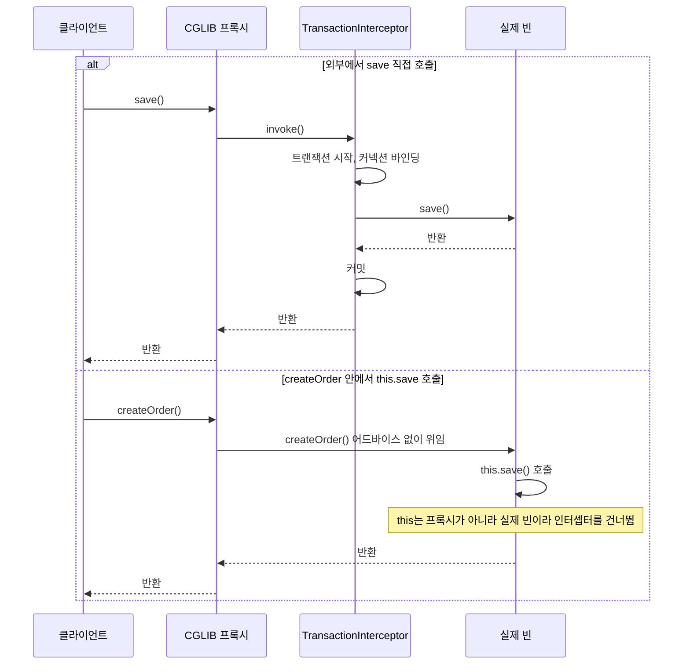

확인은 어렵지 않다. 아래 서비스를 실제로 띄워서 `outer()`와 `inner()`를 각각 호출하면 트랜잭션 활성 여부가 다르게 찍힌다.

```java
@Service
class ProxySvc {
    public void outer() { inner(); }          // this.inner()

    @Transactional
    public void inner() {
        System.out.println("tx=" + TransactionSynchronizationManager.isActualTransactionActive());
    }
}
```

```
class=lab.ProxySvc$$SpringCGLIB$$0
svc.outer() -> inner tx=false
svc.inner() -> inner tx=true
```

주입받은 객체의 클래스 이름에 `$$SpringCGLIB$$`가 붙어 있고, 같은 `inner()`인데도 어디서 부르느냐에 따라 결과가 갈린다.

---

## 프록시가 만들어지는 과정과 ThreadLocal 바인딩

`@Transactional`이 동작하는 구조를 한 번 끝까지 따라가 두면 이후에 나오는 문제들이 전부 같은 뿌리에서 나온다는 걸 알게 된다. 구성 요소는 다섯 개고, 시점이 둘로 나뉜다.

기동 시점에는 `AnnotationAwareAspectJAutoProxyCreator`가 일한다. 이름은 길지만 `BeanPostProcessor`다. Boot가 `internalAutoProxyCreator`라는 이름으로 등록하고, 컨테이너가 빈을 하나 초기화할 때마다 `postProcessAfterInitialization`에서 그 빈에 적용할 Advisor를 찾는다. 트랜잭션 쪽 Advisor는 `BeanFactoryTransactionAttributeSourceAdvisor` 하나이고, 이 Advisor의 포인트컷이 클래스나 메서드에 `@Transactional`이 있는지 물어본다. 하나라도 매칭되면 그 빈은 프록시로 바뀌어 같은 이름으로 컨테이너에 남는다. 원본은 프록시 안쪽에 숨고, 다른 빈이 주입받는 건 프록시다.

호출 시점에는 Advisor의 어드바이스인 `TransactionInterceptor`가 `PlatformTransactionManager`에게 트랜잭션을 요청한다. JPA를 쓰면 `JpaTransactionManager`, JDBC만 쓰면 `DataSourceTransactionManager`다. 트랜잭션 매니저는 커넥션을 얻고, 그 커넥션을 `TransactionSynchronizationManager`의 ThreadLocal에 묶는다.

```mermaid
flowchart LR
    subgraph boot["컨테이너 기동 시"]
        BPP["AnnotationAwareAspectJAutoProxyCreator<br/>BeanPostProcessor"] -->|"빈 초기화 직후 후보 Advisor 조회"| ADV["BeanFactoryTransactionAttributeSourceAdvisor"]
        ADV -->|"포인트컷이 @Transactional 매칭"| PX["CGLIB 프록시 생성<br/>빈 이름으로 등록"]
    end
    subgraph call["메서드 호출 시"]
        TI["TransactionInterceptor"] -->|"getTransaction, commit, rollback"| TM["PlatformTransactionManager<br/>JpaTransactionManager"]
        TM -->|"bindResource"| TSM["TransactionSynchronizationManager<br/>ThreadLocal"]
        TSM --> CH["ConnectionHolder<br/>EntityManagerHolder"]
    end
    PX -.->|"advice로 호출"| TI
```

왼쪽 묶음은 기동할 때 한 번 일어나고, 오른쪽 묶음은 메서드를 부를 때마다 반복된다. 둘을 잇는 점선이 프록시가 `TransactionInterceptor`를 호출하는 지점이다.

실제로 이 구성이 어떻게 보이는지 `ProxySvc.inner()` 안에서 ThreadLocal 내용을 찍어 봤다.

```java
TransactionSynchronizationManager.getResourceMap().forEach((k, v) ->
    System.out.println(k.getClass().getSimpleName() + " -> " + v.getClass().getSimpleName()));
System.out.println("synchronization=" + TransactionSynchronizationManager.isSynchronizationActive()
    + " txName=" + TransactionSynchronizationManager.getCurrentTransactionName());
```

```
advisor=BeanFactoryTransactionAttributeSourceAdvisor advice=TransactionInterceptor
autoProxyCreator=AnnotationAwareAspectJAutoProxyCreator
txManager=JpaTransactionManager
$Proxy105 -> EntityManagerHolder
HikariDataSource -> ConnectionHolder
synchronization=true txName=lab.ProxySvc.inner
```

키가 두 개다. `EntityManagerFactory`(프록시) 키에는 `EntityManagerHolder`가, `DataSource` 키에는 `ConnectionHolder`가 묶여 있다. `JdbcTemplate`이 `DataSourceUtils.getConnection(dataSource)`를 호출하면 이 맵에서 `DataSource` 키로 `ConnectionHolder`를 찾아 같은 커넥션을 쓴다. JPA와 `JdbcTemplate`이 한 트랜잭션에 묶이는 이유가 이것이다. `@Transactional`이 없는 곳에서는 맵이 비어 있어서 `JdbcTemplate`이 호출마다 새 커넥션을 빌리고 auto-commit으로 SQL을 한 건씩 커밋한다.

`TransactionSynchronizationManager`의 저장소는 전부 `ThreadLocal`이다. 리소스 맵, 등록된 동기화 콜백, 현재 트랜잭션 이름, read-only 여부, 격리 수준이 각각 따로 스레드에 붙는다. 이 구조에서 나오는 결론은 하나다. 트랜잭션은 시작한 스레드의 것이고, 다른 스레드는 그 존재를 모른다. 스레드를 넘기는 코드를 쓸 때 어떤 일이 벌어지는지는 뒤쪽의 별도 절에서 다룬다.

---

## Pointcut 표현식 핵심

Pointcut은 어디에 어드바이스를 적용할지 지정하는 표현식이다. 실무에서 가장 많이 쓰는 형태는 세 가지다.

```java
// 패키지 + 클래스 + 메서드 패턴
execution(* com.example.service..*.*(..))

// 어노테이션 기반 (가장 명시적이라 권장)
@annotation(com.example.annotation.AuditLog)

// 두 조건의 교집합
execution(* com.example.service..*.*(..)) && @annotation(org.springframework.transaction.annotation.Transactional)
```

`execution` 표현식을 너무 넓게 잡으면 의도하지 않은 메서드까지 AOP가 적용되면서 성능 저하나 무한 루프 같은 문제가 생긴다. `getter/setter`가 트랜잭션 어드바이스에 걸려서 매 호출마다 트랜잭션 매니저가 동작하는 사례를 종종 본다. 어노테이션 기반 Pointcut을 쓰는 게 가장 안전하다.

---

## Advice 5종과 실행 순서

`@Around`는 메서드 실행 전후를 모두 감싸므로 가장 자주 쓴다. 하지만 `joinPoint.proceed()`를 호출하지 않으면 원본 메서드가 아예 실행되지 않는다. 호출 누락은 "메서드를 호출했는데 아무 일도 안 일어나요" 같은 황당한 버그로 이어진다.

```java
@Aspect
@Component
@Slf4j
public class ExecutionTimeAspect {

    @Around("@annotation(com.example.annotation.MeasureTime)")
    public Object measure(ProceedingJoinPoint pjp) throws Throwable {
        long start = System.nanoTime();
        try {
            return pjp.proceed();
        } finally {
            long elapsedMs = (System.nanoTime() - start) / 1_000_000;
            log.info("{} took {}ms", pjp.getSignature().toShortString(), elapsedMs);
        }
    }
}
```

여러 Aspect가 같은 메서드에 걸리면 `@Order` 값으로 순서를 제어한다. 값이 작을수록 바깥쪽 프록시가 된다. 트랜잭션 Aspect는 기본 `Order.LOWEST_PRECEDENCE - 100`으로 등록되는데, 커스텀 Aspect가 트랜잭션 안쪽에서 동작해야 한다면 더 큰 값을 줘야 한다. 거꾸로 트랜잭션 시작 전에 동작해야 할 검증 Aspect라면 더 작은 값을 줘야 한다. 이 순서를 잘못 잡으면 `@Around`에서 던진 예외가 트랜잭션 롤백에 영향을 못 주는 상황이 생긴다.

호출은 `@Order` 값이 작은 쪽부터 안으로 들어가고, 반환과 예외는 같은 경로를 거꾸로 올라온다. 트랜잭션 인터셉터보다 바깥에 있는 Aspect는 트랜잭션이 끝난 뒤의 결과를 보고, 안쪽에 있는 Aspect는 트랜잭션이 열린 상태에서 동작한다.

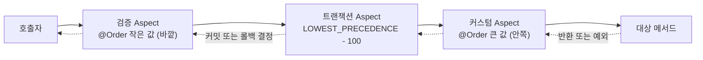

---

## @Transactional이 안 먹는 6가지 케이스

운영에서 가장 자주 겪는 문제다. 하나씩 원인과 진단법까지 본다.

### 1. Self-invocation (같은 객체 내부 호출)

가장 흔한 케이스다. 같은 클래스 내에서 `this.someMethod()`로 호출하면 프록시를 우회하므로 `@Transactional`이 적용되지 않는다.

```java
@Service
public class OrderService {

    public void createOrder(OrderRequest req) {
        validate(req);
        save(req);  // 프록시 거치지 않음 → @Transactional 무시
    }

    @Transactional
    public void save(OrderRequest req) {
        orderRepository.save(toEntity(req));
    }
}
```

진단 방법은 의외로 간단하다. `TransactionSynchronizationManager.isActualTransactionActive()`를 메서드 진입 시점에서 찍어보면 된다. `false`가 나오면 트랜잭션이 시작되지 않은 것이다. 또는 Hibernate 로그 레벨을 `org.hibernate.engine.transaction=DEBUG`로 올려서 트랜잭션 begin 로그가 찍히는지 확인한다.

아래 시퀀스에서 `createOrder`가 `save`를 부르는 화살표가 프록시를 거치지 않고 target 안에서 닫히는 점을 보면 된다.

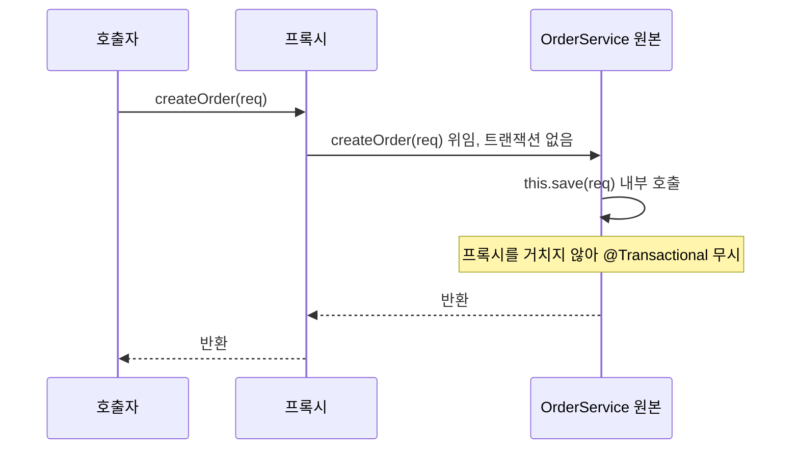

해결 방법은 클래스를 분리하는 게 가장 깔끔하다. 자기 자신을 주입하는 방식은 동작은 하지만 코드를 보는 사람이 의도를 파악하기 어렵다. `AopContext.currentProxy()`를 쓰는 방법도 있는데 `exposeProxy = true` 설정이 필요하고 침투적이라 잘 안 쓴다.

### 2. private/protected 메서드

CGLIB 프록시는 클래스를 상속해서 메서드를 오버라이드하는 방식이라 `private` 메서드는 오버라이드할 수 없다. `protected`나 package-private은 오버라이드가 가능하다. Spring 5.x까지는 트랜잭션 어드바이저가 `public` 메서드만 대상으로 삼았지만, 6.0부터 클래스 기반(CGLIB) 프록시에서는 `protected`와 package-private에도 적용된다. 결과적으로 `private` 메서드에 `@Transactional`을 붙이면 IDE도 경고를 안 띄우는데 동작은 안 한다.

```java
@Service
public class ReportService {

    public void generate(Long id) {
        process(id);
    }

    @Transactional  // 동작 안 함
    private void process(Long id) {
        ...
    }
}
```

진단은 메서드 시그니처를 `public`으로 바꿔보고 동작이 달라지는지 확인하는 게 가장 빠르다. Spring Framework 6.1.14에서 접근 제한자별로 같은 서비스에 `@Transactional`을 붙여 돌려 보면 다음 결과가 나온다.

```
public           tx=true
protected        tx=true
package-private  tx=true
private          tx=false   (public 메서드가 내부에서 호출)
final            tx=false   field=null
```

옛 문서나 블로그에 "public만 된다"고 적힌 건 5.x까지의 동작이다. 인터페이스 기반 JDK 프록시를 쓰는 빈은 여전히 인터페이스에 선언된 `public` 메서드만 가로챈다. `final` 메서드는 예외도 없이 그냥 건너뛴다. 위 출력의 마지막 줄이 더 문제다. 프록시 인스턴스는 생성자를 거치지 않고 만들어지기 때문에 `final` 메서드를 프록시에서 직접 실행하면 `"initialized"`로 초기화한 필드가 `null`로 나온다. 트랜잭션이 빠지는 것에 그치지 않고 NPE까지 따라온다.

### 3. Checked Exception은 기본적으로 롤백 안 됨

이게 가장 위험한 함정이다. `RuntimeException`과 `Error`는 자동 롤백되지만, `IOException`, `SQLException` 같은 Checked Exception은 던져도 트랜잭션이 그대로 커밋된다. EJB 시절의 규약을 그대로 따르는 건데, Java 진영 외에는 거의 모르는 동작이다.

```java
@Transactional
public void importFile(Path path) throws IOException {
    repository.save(...);
    Files.readAllBytes(path);  // IOException → 데이터는 커밋됨
}
```

진단은 어렵다. 예외가 던져졌으니 호출자는 실패했다고 생각하는데 DB에는 데이터가 남는다. 데이터 정합성 사고가 며칠 뒤에 발견되는 경우가 많다. 모든 예외에 대해 롤백하려면 `rollbackFor = Exception.class`를 명시적으로 붙이거나, 사내 Custom Exception 정책으로 RuntimeException 상속을 강제하는 방식을 쓴다.

같은 메서드에서 예외 종류만 바꿔서 로그 테이블 행 수를 확인해 봤다.

```
checked 예외, 기본 설정            -> rows=[checked-default]       커밋됨
checked 예외 + rollbackFor         -> rows=[]                      롤백
IllegalStateException              -> rows=[]                      롤백
AssertionError (Error)             -> rows=[]                      롤백
IllegalStateException + noRollbackFor -> rows=[runtime-noRollbackFor]  커밋됨
```

`Error`까지 롤백 대상이라는 점은 의외로 모르는 사람이 많다. 이 판정이 어떤 순서로 내려지는지는 `rollbackFor` 절에 흐름도로 정리해 뒀다.

### 4. AOP Aspect 순서 문제

트랜잭션 Aspect와 다른 커스텀 Aspect가 같은 메서드에 걸릴 때 순서를 잘못 잡으면 트랜잭션이 의도와 다르게 동작한다. 흔한 케이스는 재시도(retry) Aspect가 트랜잭션 바깥에서 도는 게 아니라 안쪽에서 도는 경우다.

```java
@Aspect
@Order(0)  // 트랜잭션보다 안쪽
public class RetryAspect {
    @Around("@annotation(retry)")
    public Object retry(ProceedingJoinPoint pjp, Retry retry) throws Throwable {
        for (int i = 0; i < retry.maxAttempts(); i++) {
            try { return pjp.proceed(); }
            catch (Exception e) { if (i == retry.maxAttempts() - 1) throw e; }
        }
        return null;
    }
}
```

`@Order(0)`이면 RetryAspect가 바깥쪽이라 트랜잭션이 매번 새로 시작되지만, 위 코드처럼 잘못 이해하고 트랜잭션 안에서 retry를 돌리면 한 번 롤백된 트랜잭션 위에서 재시도하게 되어 의미가 없어진다. 진단은 `@Order` 값을 명시하고 디버거로 어드바이저 체인을 확인한다. `org.springframework.aop.framework.JdkDynamicAopProxy` 또는 `CglibAopProxy`에 브레이크포인트를 걸면 어떤 순서로 인터셉터가 호출되는지 보인다.

두 배치의 차이는 트랜잭션이 retry 루프 안에 있느냐 밖에 있느냐다. 왼쪽은 시도마다 트랜잭션이 새로 열리고, 오른쪽은 첫 시도의 롤백 결과를 그대로 끌고 간다.

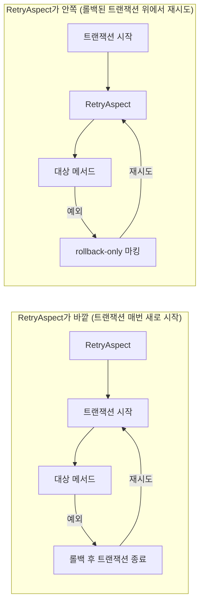

### 5. 프록시 우회 호출 (직접 new 또는 ApplicationContext 우회)

빈을 직접 `new`로 생성해서 사용하면 당연히 프록시가 아니라 원본 객체이므로 어떤 AOP도 동작하지 않는다. 더 미묘한 케이스는 `ApplicationContextAware`로 컨텍스트에서 빈을 꺼낼 때 타입을 인터페이스가 아닌 구현체로 지정한 경우인데, 일반적으로는 같은 프록시 객체가 반환되므로 큰 문제는 없다. 정작 문제가 되는 건 컴포넌트 스캔 범위 밖에서 빈이 생성되는 경우다. 테스트 코드에서 수동으로 객체를 만들어서 검증하면 트랜잭션이 안 걸린다.

```java
// 테스트 코드 — 트랜잭션 동작 안 함
OrderService service = new OrderService(orderRepository);
service.createOrder(req);
```

통합 테스트에서는 `@SpringBootTest`로 컨테이너에서 빈을 가져와야 트랜잭션이 적용된다. 단위 테스트에서 트랜잭션 동작까지 검증하려면 별도의 통합 테스트로 분리해야 한다.

### 6. final 클래스 / final 메서드

CGLIB는 상속을 통해 프록시를 만들기 때문에 `final` 클래스는 프록시 자체가 불가능하고, `final` 메서드는 오버라이드되지 않아서 어드바이스가 적용되지 않는다. Kotlin으로 Spring을 쓸 때 자주 만나는 문제인데, Kotlin 클래스는 기본이 `final`이라 `kotlin-spring` 플러그인을 적용해야 자동으로 `open` 처리된다.

```java
@Service
public final class PaymentService {  // final → 프록시 생성 실패
    @Transactional
    public void pay(Long id) { ... }
}
```

Spring Boot 시작 시 `Could not generate CGLIB subclass of class ... : final classes can not be subclassed` 같은 예외가 뜨면 이 케이스다. JDK Proxy(인터페이스 기반)로 강제하는 방법도 있지만 권장하진 않는다.

---

## 트랜잭션 전파 7종 완벽 정리

전파(Propagation)는 트랜잭션 경계가 중첩될 때 어떻게 동작할지를 결정한다. 7종이 있는데, 실제로는 `REQUIRED`와 `REQUIRES_NEW`만 거의 다 쓴다. 그래도 나머지를 알아야 의도치 않은 동작을 막을 수 있다.

### REQUIRED (기본값)

기존 트랜잭션이 있으면 참여하고, 없으면 새로 만든다. 가장 직관적이지만 함정이 하나 있다. 참여한 트랜잭션이 내부에서 롤백을 결정하면 외부 트랜잭션 전체가 `UnexpectedRollbackException`으로 롤백된다. "분명히 try/catch로 잡았는데 왜 롤백이 되죠"라는 질문의 정답이 이거다.

```java
@Transactional  // 외부
public void outer() {
    try {
        inner();  // 내부에서 예외 → 외부 트랜잭션도 rollback-only로 마킹
    } catch (Exception e) {
        // 예외는 잡았지만 트랜잭션은 이미 롤백 결정됨
    }
    // 커밋 시점에 UnexpectedRollbackException 발생
}

@Transactional
public void inner() { throw new RuntimeException(); }
```

내부 메서드의 예외를 외부에서 무시하고 싶다면 내부를 `REQUIRES_NEW`로 분리하거나, 별도의 빈으로 떼어내야 한다.

아래 시퀀스는 catch로 예외를 삼켜도 커밋 시점에 실패하는 순서를 보여준다. 표식이 찍히는 곳은 inner 프록시이고, 터지는 곳은 outer 프록시의 커밋이다.

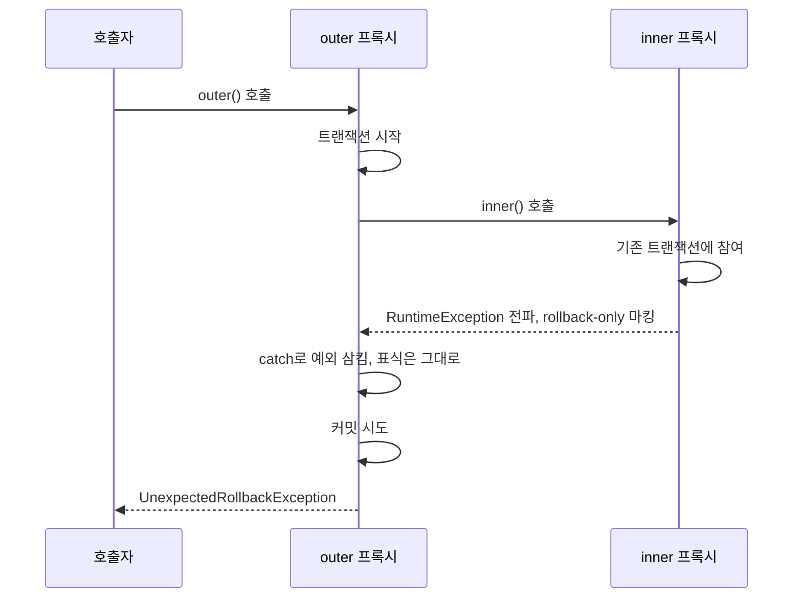

위 코드에서 `inner()`를 다른 빈으로 분리하고 catch 직후 상태를 찍어 보면 이렇다.

```
outer caught: java.lang.RuntimeException: inner boom
rollbackOnly after catch = true
outer threw: UnexpectedRollbackException: Transaction silently rolled back because it has been marked as rollback-only
rows = []      (outer-before, outer-after, inner 전부 롤백)
```

catch 블록 안에서 `TransactionAspectSupport.currentTransactionStatus().isRollbackOnly()`가 이미 `true`다. 예외를 삼켰다고 해서 표식이 지워지지는 않는다. 이 판정 경로는 `rollbackFor` 절의 흐름도에서 이어서 본다.

### REQUIRES_NEW

기존 트랜잭션을 일시 정지(suspend)하고 항상 새 트랜잭션을 시작한다. 새 트랜잭션은 별도의 DB 커넥션을 잡는다. 외부와 완전히 독립적이라 외부 롤백에 영향받지 않는다. 알림 발송, 감사 로그, 이벤트 기록처럼 본 트랜잭션과 무관하게 무조건 남겨야 하는 작업에 쓴다.

주의할 점은 커넥션을 추가로 사용한다는 점이다. 외부 트랜잭션이 커넥션 1개, 내부가 1개를 잡으니 동시에 2개를 점유한다. 커넥션 풀 크기가 작은 환경에서 `REQUIRES_NEW`를 남발하면 데드락이나 풀 고갈로 이어진다. HikariCP 기본값이 10인데, 10개의 외부 트랜잭션이 모두 `REQUIRES_NEW` 내부 호출에 들어가면 그 자리에서 멈춘다. 재현 코드와 풀 크기 계산식은 뒤쪽의 풀 고갈 절에 따로 정리했다.

### NESTED

물리적으로는 같은 트랜잭션이지만 SAVEPOINT를 만들어서 부분 롤백이 가능하게 한다. JDBC `Connection.setSavepoint()`를 사용하므로 JTA 환경에서는 동작하지 않는다. JPA에서는 더 큰 문제가 있는데, 뒤쪽의 SAVEPOINT 동작 절에서 실측 결과와 함께 다룬다.

```java
@Transactional  // 외부
public void importBatch(List<Item> items) {
    for (Item item : items) {
        try {
            saveOne(item);  // NESTED
        } catch (DataIntegrityViolationException e) {
            log.warn("skip: {}", item);  // SAVEPOINT 롤백, 외부는 살아있음
        }
    }
}

@Transactional(propagation = Propagation.NESTED)
public void saveOne(Item item) { ... }
```

배치 처리에서 일부 실패는 건너뛰고 나머지는 커밋해야 할 때 유용하다. 다만 외부 트랜잭션이 롤백되면 SAVEPOINT는 의미가 없어진다.

### 세 전파 옵션의 물리 트랜잭션과 커넥션 수

REQUIRED, REQUIRES_NEW, NESTED는 코드로 보면 어노테이션 값 하나 차이인데 DB 쪽에서 벌어지는 일은 완전히 다르다. 커넥션이 몇 개 필요하고 롤백 범위가 어디까지인지가 갈린다.

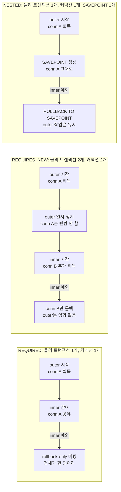

세 묶음에서 커넥션 획득 지점만 눈으로 따라가도 요점이 잡힌다. REQUIRES_NEW만 가운데 칸에서 커넥션을 하나 더 가져가고, outer가 정지된 동안에도 conn A를 붙들고 있다. 이 상태가 풀 고갈의 출발점이다.

커넥션 식별자와 HikariCP의 `active` 수를 찍은 값이다. inner가 예외를 던지고 outer가 catch하는 구조다.

```
REQUIRES_NEW outer  conn#7e741d6b active=1
REQUIRES_NEW inner  conn#1885905b active=2     -> rows=[outer]  (inner만 롤백, outer 커밋)
REQUIRED     outer  conn#7e741d6b active=1
REQUIRED     inner  conn#7e741d6b active=1     -> commit시 UnexpectedRollbackException, rows=[]
```

REQUIRES_NEW는 커넥션 식별자가 다르고 풀의 active가 2로 올라간다. REQUIRED는 식별자가 같고 inner의 예외가 outer 커밋을 막는다. NESTED는 JPA 환경에서는 이 비교를 재현할 수 없었는데, 이유는 SAVEPOINT 절에서 설명한다.

### SUPPORTS

기존 트랜잭션이 있으면 참여하고, 없으면 트랜잭션 없이 실행한다. 트랜잭션이 없는 상태에서도 동작은 하지만, JPA를 쓴다면 영속성 컨텍스트가 트랜잭션 단위로 관리되므로 이상한 동작이 생긴다. 거의 안 쓴다.

### NOT_SUPPORTED

기존 트랜잭션을 일시 정지하고 트랜잭션 없이 실행한다. 트랜잭션 안에서 실행하면 락이 길어지는 느린 조회나 외부 API 호출을 분리할 때 쓴다. 다만 이런 경우 호출하는 메서드 자체에 트랜잭션을 빼는 게 더 깔끔하다.

### MANDATORY

기존 트랜잭션이 반드시 있어야 한다. 없으면 `IllegalTransactionStateException`을 던진다. 항상 다른 트랜잭션의 일부로만 호출되어야 하는 메서드를 강제할 때 쓴다. 라이브러리 내부 메서드에 가끔 본다.

### NEVER

기존 트랜잭션이 있으면 예외를 던진다. 절대로 트랜잭션 안에서 호출되면 안 되는 메서드를 보호할 때 쓴다. 외부 시스템 호출처럼 트랜잭션 길이에 영향을 주면 안 되는 작업에 가끔 쓴다.

---

## 격리 수준 4단계와 이상 현상

격리 수준은 동시에 실행되는 트랜잭션끼리 서로의 데이터를 어디까지 볼 수 있는지를 결정한다. 격리가 강할수록 정합성은 좋아지지만 동시성은 떨어진다. 격리 수준은 ANSI SQL 표준에 정의되어 있고, DB 별로 구현이 미묘하게 다르다.

세 가지 이상 현상이 있다.

**Dirty Read**: 다른 트랜잭션이 아직 커밋하지 않은 데이터를 읽는 것. A가 잔액을 100→200으로 바꾸고 커밋 전인데 B가 200을 읽고 처리한 뒤, A가 롤백하면 B는 존재하지 않는 데이터로 작업한 게 된다.

**Non-Repeatable Read**: 같은 트랜잭션 안에서 같은 행을 두 번 조회했는데 값이 다른 것. 첫 조회와 두 번째 조회 사이에 다른 트랜잭션이 그 행을 UPDATE하고 커밋했기 때문이다.

**Phantom Read**: 같은 트랜잭션 안에서 같은 조건으로 조회했는데 결과 행 수가 다른 것. 다른 트랜잭션이 INSERT/DELETE를 하고 커밋했기 때문이다. Non-Repeatable이 행의 값 변경이라면, Phantom은 행의 존재 자체가 달라진다.

| 격리 수준 | Dirty Read | Non-Repeatable Read | Phantom Read |
|---------|-----------|--------------------|---------------|
| READ_UNCOMMITTED | 발생 | 발생 | 발생 |
| READ_COMMITTED | 방지 | 발생 | 발생 |
| REPEATABLE_READ | 방지 | 방지 | 발생(표준) / 방지(MySQL InnoDB) |
| SERIALIZABLE | 방지 | 방지 | 방지 |

여기서 주의할 점이 두 가지다. 첫째, MySQL InnoDB 의 `REPEATABLE_READ` 는 표준보다 Phantom Read 에 강하다. 일반 SELECT 는 트랜잭션 첫 읽기에서 잡은 스냅샷을 계속 보고, 잠금 읽기(`FOR UPDATE`/`FOR SHARE`)와 UPDATE·DELETE 는 갭 락과 넥스트 키 락으로 범위 자체를 잠근다. 다만 완전히 막히는 건 아니다. 스냅샷은 SELECT 에만 적용되고 DML 에는 적용되지 않아서, 다른 트랜잭션이 커밋한 행을 SELECT 로는 못 보는데 같은 조건의 UPDATE 는 그걸 건드리는 상황이 나온다. 매뉴얼도 한 트랜잭션 안에서 잠금문과 비잠금 SELECT 를 섞지 말라고, 그럴 거면 `SERIALIZABLE` 을 쓰라고 적어 뒀다. 둘째, PostgreSQL의 `READ_UNCOMMITTED`는 사실상 `READ_COMMITTED`로 동작한다. PostgreSQL은 MVCC 기반이라 dirty read 자체가 불가능하다.

```java
@Transactional(isolation = Isolation.REPEATABLE_READ)
public Report calculate() {
    // 같은 행을 여러 번 조회해도 같은 값 보장
}
```

운영에서 격리 수준을 명시적으로 지정하는 경우는 드물다. 대부분 DB 기본값(MySQL은 REPEATABLE_READ, PostgreSQL/Oracle은 READ_COMMITTED)을 따른다. 격리 수준을 올리는 것보다 비관적 락(`SELECT ... FOR UPDATE`)이나 낙관적 락(`@Version`)을 쓰는 게 더 명확한 경우가 많다.

---

## rollbackFor / noRollbackFor 사용 패턴

기본 동작은 명확히 외워둬야 한다.

- `RuntimeException`과 `Error` → 롤백
- `Exception` (Checked) → 커밋

이 동작을 바꾸는 게 `rollbackFor`와 `noRollbackFor`다.

예외가 `TransactionInterceptor`까지 올라온 뒤의 판정 순서는 두 단계다. 먼저 이 예외로 롤백할지 정하고, 롤백으로 정했다면 지금 경계가 실제 물리 트랜잭션을 시작한 경계인지 따진다. 두 번째 단계가 `UnexpectedRollbackException`이 터지는 이유다.

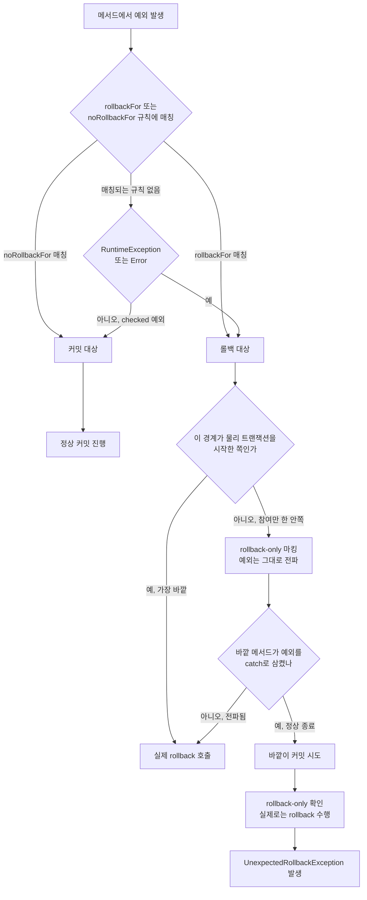

왼쪽 위의 규칙 매칭이 첫 번째 단계고, 오른쪽 아래의 `rollback-only 마킹`부터가 두 번째 단계다. 안쪽 메서드가 롤백을 결정해도 물리 트랜잭션을 시작한 쪽이 아니면 직접 롤백하지 못하고 표식만 남긴다. 바깥이 그 표식을 모르고 커밋하려다 걸리는 게 `UnexpectedRollbackException`이다. 서비스 클래스 하나 안에서 이 예외를 처음 만나면 원인을 찾기 어렵다. 예외가 터진 곳은 바깥 메서드의 마지막 줄인데 원인은 안쪽 메서드 어딘가에 있기 때문이다.

규칙이 여러 개 걸릴 때는 예외 클래스 계층에서 더 가까운 규칙이 이긴다. `rollbackFor = Exception.class`와 `noRollbackFor = IllegalStateException.class`를 같이 붙이고 두 종류를 던져 보면 이렇게 나온다.

```
throw IllegalStateException -> rows=[mixed-ise]   커밋 (더 가까운 noRollbackFor가 이김)
throw IOException           -> rows=[]            롤백
```

```java
// 모든 예외에 대해 롤백 (Checked Exception 포함)
@Transactional(rollbackFor = Exception.class)
public void importBatch() throws IOException { ... }

// 특정 비즈니스 예외는 정상 흐름이므로 커밋
@Transactional(noRollbackFor = NotFoundException.class)
public Optional<User> findOrCreate(Long id) {
    try { return Optional.of(repository.findOrThrow(id)); }
    catch (NotFoundException e) { return Optional.empty(); }
}
```

`noRollbackFor`를 쓰는 패턴은 비즈니스 흐름상 예외지만 데이터는 그대로 둬야 할 때다. 예를 들어 검증 실패 로그를 남겨야 하는데 검증 실패 자체가 RuntimeException으로 던져지는 구조라면 `noRollbackFor`로 로그 INSERT가 살아남게 한다.

실무에서 더 깔끔한 방식은 회사 차원의 베이스 예외 클래스 두 개를 만드는 것이다. `BusinessException extends RuntimeException`은 항상 롤백, `RecoverableException extends RuntimeException`은 `noRollbackFor`로 지정하는 식이다. 매번 `rollbackFor`를 붙이는 것보다 일관성이 있다.

`rollbackFor = Exception.class`는 거의 모든 프로젝트에서 디폴트로 깔아둘 만하다. Java의 Checked Exception 자동 커밋 정책은 사실상 버그 유발 요인이다.

---

## readOnly = true의 실제 효과

`@Transactional(readOnly = true)`는 단순한 힌트가 아니다. 실제로 여러 단계에서 동작이 바뀐다.

**Hibernate Flush Mode**: `FlushType.MANUAL`로 설정되어 영속성 컨텍스트의 dirty checking이 비활성화된다. 트랜잭션 종료 시점에 변경 감지를 위한 스냅샷 비교를 건너뛰므로 메모리와 CPU를 절약한다. 조회만 하는 메서드에서는 무조건 켜는 게 이득이다.

**JDBC Connection 힌트**: Spring이 `Connection.setReadOnly(true)`를 호출한다. 일부 드라이버(예: MySQL Connector/J)는 이를 보고 read replica로 라우팅하거나, 트랜잭션 로그 기록을 줄이는 최적화를 한다. 단 동작은 드라이버마다 다르므로 의존하면 안 된다.

**스프링 데이터 라우팅**: `AbstractRoutingDataSource`로 read-only일 때 슬레이브 DB를 보도록 구성한 환경에서는 이 플래그가 라우팅 키가 된다. read replica가 있는 운영 환경에서는 거의 필수다.

```java
@Transactional(readOnly = true)
public Page<Order> search(SearchCondition cond, Pageable pageable) {
    return orderRepository.findByCondition(cond, pageable);
}
```

함정도 있다. `readOnly = true` 안에서 실수로 엔티티 필드를 수정해도 dirty checking이 안 일어나서 INSERT/UPDATE가 안 나간다. "코드는 잘 돌아가는데 DB에 반영이 안 돼요"라는 질문의 원인 중 하나다. `readOnly = true`는 DB 쪽에 강제력을 갖지 않는다. 마음만 먹으면 INSERT를 할 수 있고, 실제로 INSERT가 발생할 수 있는 메서드(`save()` 호출 등)에서 readOnly를 켜놓으면 예측이 어려워진다.

---

## TransactionTemplate으로 프로그래밍 방식 트랜잭션

`@Transactional`로 안 되는 케이스가 두 가지 있다.

첫째, 트랜잭션 경계를 메서드보다 더 작게 잡고 싶을 때다. 메서드의 일부 구간만 트랜잭션으로 감싸고 싶거나, 한 메서드 안에서 여러 개의 작은 트랜잭션을 돌려야 할 때 사용한다.

둘째, 트랜잭션 시작/종료 시점을 코드로 직접 제어해야 할 때다. 예를 들어 외부 API 호출 결과에 따라 트랜잭션 옵션을 동적으로 바꿔야 한다면 어노테이션으로는 표현이 안 된다.

```java
@Service
@RequiredArgsConstructor
public class BatchService {

    private final TransactionTemplate transactionTemplate;
    private final ItemRepository itemRepository;

    public void process(List<Item> items) {
        for (List<Item> chunk : Lists.partition(items, 1000)) {
            transactionTemplate.execute(status -> {
                try {
                    chunk.forEach(itemRepository::save);
                    return null;
                } catch (Exception e) {
                    status.setRollbackOnly();
                    throw e;
                }
            });
        }
    }
}
```

배치 처리에서 청크 단위로 커밋하는 패턴이 대표적이다. 메서드 전체를 한 트랜잭션으로 묶으면 메모리에 1차 캐시가 쌓여서 OOM이 나는데, 청크마다 커밋하면 1차 캐시가 비워진다. Spring Batch가 내부적으로 하는 일이 이거다.

`TransactionTemplate`은 빈으로 등록해서 주입받는다. 옵션을 바꾸려면 별도의 인스턴스를 만들거나 `setPropagationBehavior()` 같은 setter로 바꿔야 한다. setter는 thread-safe하지 않으므로 옵션이 다른 트랜잭션이 필요하면 인스턴스를 분리하는 게 안전하다.

```java
@Bean("readOnlyTxTemplate")
public TransactionTemplate readOnlyTxTemplate(PlatformTransactionManager tm) {
    TransactionTemplate template = new TransactionTemplate(tm);
    template.setReadOnly(true);
    template.setPropagationBehavior(TransactionDefinition.PROPAGATION_REQUIRES_NEW);
    return template;
}
```

---

## 중첩 트랜잭션과 SAVEPOINT 동작

`PROPAGATION_NESTED`의 동작을 좀 더 자세히 본다. 외부 트랜잭션이 시작된 상태에서 NESTED로 진입하면 Spring은 JDBC 커넥션의 `setSavepoint()`를 호출해서 SAVEPOINT를 만든다. 내부에서 예외가 발생하면 `rollback(savepoint)`로 SAVEPOINT까지만 롤백한다. 외부 트랜잭션은 그대로 유지된다.

```sql
-- 실제 DB에서 일어나는 일
BEGIN;                          -- 외부 트랜잭션 시작
INSERT INTO orders ...;
SAVEPOINT sp1;                  -- NESTED 진입
INSERT INTO order_items ...;    -- 실패
ROLLBACK TO SAVEPOINT sp1;      -- 여기까지만 롤백
INSERT INTO error_logs ...;     -- 외부 트랜잭션은 살아있음
COMMIT;                         -- orders, error_logs는 커밋됨
```

제약이 몇 가지 있다.

JTA 트랜잭션 매니저는 SAVEPOINT를 지원하지 않는다. JTA는 분산 트랜잭션 매니저라 단일 커넥션 단위의 SAVEPOINT 개념이 없다.

JPA 환경은 더 곤란하다. Spring Boot 3.3.5, Hibernate 6.5.3, `JpaTransactionManager` 조합에서 `Propagation.NESTED` 메서드로 진입하면 SAVEPOINT를 만들기도 전에 예외가 난다.

```
NESTED outer caught JpaDialect does not support savepoints - check your JPA provider's capabilities
NESTED => rows=[outer]
```

이 메시지는 `HibernateJpaDialect`가 SAVEPOINT 관리자를 내주지 않는다는 뜻이다. 같은 NESTED 코드를 `DataSourceTransactionManager`로 바꾸면 정상 동작해서, inner 예외 후에도 outer의 앞뒤 INSERT가 모두 커밋된다.

```
outer caught inner boom
nested -> rows=[outer, outer-after]      (inner는 SAVEPOINT까지 롤백)
```

NESTED가 동작하는 곳은 순수 JDBC나 MyBatis처럼 `DataSourceTransactionManager`를 쓰는 환경이다. JPA 프로젝트에서 부분 롤백이 필요하면 NESTED에 기대지 말고 청크를 `TransactionTemplate`으로 분리하거나 `REQUIRES_NEW`를 쓴다.
외부 트랜잭션이 롤백되면 SAVEPOINT가 살아있어 봤자 의미가 없다. NESTED는 외부가 커밋된다는 가정 하에 일부만 부분 롤백할 때 쓴다. 외부와 독립적으로 커밋이 보장되어야 한다면 `REQUIRES_NEW`를 써야 한다.

---

## 트랜잭션 디버깅 도구

문제 진단이 어려울 때 쓰는 도구들이다.

**TransactionSynchronizationManager**: 현재 스레드에 트랜잭션이 활성화되어 있는지, read-only인지 등을 확인한다. 의심되는 메서드 진입부에 한 줄 찍어보면 트랜잭션이 걸려있는지 즉시 알 수 있다.

```java
log.info("tx active: {}, name: {}, readOnly: {}",
    TransactionSynchronizationManager.isActualTransactionActive(),
    TransactionSynchronizationManager.getCurrentTransactionName(),
    TransactionSynchronizationManager.isCurrentTransactionReadOnly());
```

**Hibernate SQL 로그**: `org.hibernate.SQL=DEBUG`로 쿼리 발생을 확인하고, `org.hibernate.engine.transaction=DEBUG`로 트랜잭션 begin/commit 시점을 본다. `org.springframework.transaction.interceptor=TRACE`까지 켜면 어떤 메서드가 어떤 옵션으로 트랜잭션을 시작하는지 모두 보인다.

**P6Spy 또는 datasource-proxy**: 실제 DB로 나가는 SQL과 커밋/롤백 시점을 로깅한다. JPA 캐시 때문에 코드 흐름과 실제 DB 호출 시점이 다른 경우가 많은데, 이런 도구로 보면 명확해진다.

```yaml
logging:
  level:
    org.hibernate.SQL: DEBUG
    org.hibernate.orm.jdbc.bind: TRACE
    org.springframework.transaction.interceptor: TRACE
```

---

## 트랜잭션 시작부터 커넥션 반환까지

커밋 직후에 돌아가는 코드를 다룰 때 가장 많이 틀리는 부분이 커넥션 상태다. 메서드가 끝나는 순간 커넥션이 풀로 돌아간다고 생각하기 쉬운데, 실제로는 콜백이 전부 끝난 뒤에야 돌아간다. 한 번의 호출이 지나가는 순서를 먼저 잡아 둔다.

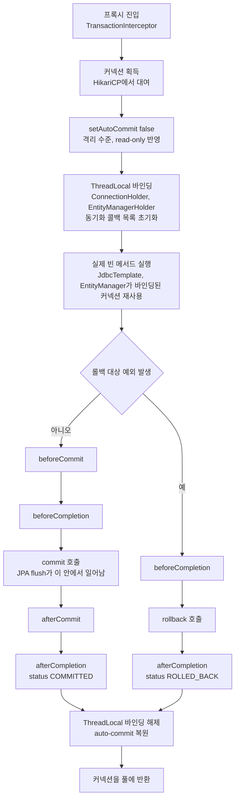

위쪽 세로 줄이 시작 단계이고, `F`에서 갈라진 오른쪽이 정상 경로, 왼쪽이 롤백 경로다. 두 경로는 `ThreadLocal 바인딩 해제`에서 합쳐진다. 커넥션 반환은 가장 마지막 칸이다.

동기화 콜백을 직접 등록해서 각 지점의 상태를 찍어 봤다.

```java
@Transactional
public void lifecycle() {
    TransactionSynchronizationManager.registerSynchronization(new TransactionSynchronization() {
        public void beforeCommit(boolean ro) { log("beforeCommit"); }
        public void beforeCompletion()       { log("beforeCompletion"); }
        public void afterCommit()            { log("afterCommit"); }
        public void afterCompletion(int s)   { log("afterCompletion(status=" + s + ")"); }
    });
    jdbc.update("insert into log(msg) values ('body')");
}
// log()는 isActualTransactionActive()와 Hikari active 수를 함께 찍는다
```

```
method body start:      txActive=true  pool.active=1
beforeCommit:           txActive=true  pool.active=1
beforeCompletion:       txActive=true  pool.active=1
afterCommit:            txActive=true  pool.active=1
afterCompletion(0):     txActive=true  pool.active=1
프록시에서 반환된 뒤:       txActive=false pool.active=0
```

`afterCommit`과 `afterCompletion`이 돌 때도 트랜잭션 활성 플래그는 `true`이고 풀의 active 수는 1이다. DB에는 이미 COMMIT이 나갔는데 스레드에 바인딩된 리소스는 그대로 살아 있다. 이 상태가 뒤에서 다룰 `afterCommit` 함정의 원인이다. 커밋 후 콜백에서 외부 API를 호출하거나 파일을 쓰면 그 시간만큼 커넥션을 더 붙들게 된다는 뜻이기도 하다.

JPA를 쓰면 하나가 더 있다. 엔티티를 수정하고 콜백을 찍어 보면 UPDATE는 `beforeCompletion` 뒤, `afterCommit` 앞에서 나간다.

```
--- commit
body end
beforeCommit
beforeCompletion
Hibernate: update orders set name=? where id=?
afterCommit
afterCompletion status=0
--- rollback
body end
beforeCompletion
afterCompletion status=1
```

dirty checking의 flush는 `beforeCommit` 시점에 아직 일어나지 않았다. `beforeCommit` 콜백에서 `JdbcTemplate`으로 같은 행을 조회하면 수정 전 값이 보인다. 롤백 경로에서는 `beforeCommit`이 호출되지 않고 UPDATE도 나가지 않는다.

---

## 스레드를 넘어가면 트랜잭션이 끊긴다

앞에서 본 대로 `ConnectionHolder`는 ThreadLocal에 묶여 있다. 새 스레드에서 실행되는 코드는 이 맵을 볼 수 없다. 그 스레드에서 `JdbcTemplate`을 부르면 풀에서 새 커넥션을 받고 auto-commit 모드로 SQL을 한 건씩 커밋한다. 호출한 쪽 트랜잭션이 롤백돼도 그쪽에서 나간 SQL은 되돌릴 수 없다.

실험은 세 가지다. `@Transactional` 메서드 안에서 `@Async`, `CompletableFuture.supplyAsync`, `parallelStream`을 각각 써 봤다.

```java
@Transactional
public void asyncAndRollback() throws Exception {
    jdbc.update("insert into log(msg) values ('main')");
    async.asyncInsert("async").get();     // @Async @Transactional
    throw new RuntimeException("main rollback");
}

@Transactional
public void parallel() {
    List.of(1, 2, 3, 4, 5, 6, 7, 8).parallelStream()
        .map(i -> Thread.currentThread().getName() + " active="
            + TransactionSynchronizationManager.isActualTransactionActive())
        .distinct().sorted().forEach(System.out::println);
}
```

```
main : main active=true
@Async: task-1 ownTx=lab.AsyncSvc.asyncInsert
threw main rollback
rows after rollback = [async]

supplyAsync: ForkJoinPool.commonPool-worker-1 active=false

parallelStream: ForkJoinPool.commonPool-worker-1 active=false
parallelStream: main active=true
```

`@Async` 메서드에 `@Transactional`을 붙이면 task 스레드에서 자기 트랜잭션을 따로 연다. 호출한 메서드가 롤백돼도 `async` 행은 남는다. `supplyAsync`는 트랜잭션이 없다. 가장 조심할 건 `parallelStream`이다. 호출한 스레드(`main`)가 작업 일부를 같이 처리하기 때문에 같은 스트림 안에서 어떤 원소는 트랜잭션 안에서, 어떤 원소는 밖에서 실행된다. 결과가 실행마다 달라지고, 테스트에서는 재현이 안 되다가 운영에서 터진다.

비동기 쪽에서 방금 저장한 데이터를 읽는 코드도 같은 이유로 막힌다. 호출한 트랜잭션이 아직 커밋 전이라면 다른 커넥션에서는 그 행이 보이지 않는다. 호출 직후 비동기 작업이 ID로 조회했더니 없더라는 문의가 이 원인인 경우가 많다.

해결은 두 방향이다. 비동기 작업을 커밋 이후에 시작하거나, 비동기 쪽이 자기 트랜잭션을 갖는 걸 전제로 설계한다. 전자는 바로 아래에서 다루는 `AFTER_COMMIT` 리스너에 `@Async`를 붙이는 방식이 일반적이다. 후자는 데이터 자체를 인자로 넘기지 않고 ID만 넘겨서 task 스레드가 자기 트랜잭션에서 다시 읽게 한다. `parallelStream` 안에서 DB를 건드리는 코드는 쓰지 않는 게 낫다.

---

## 커밋 후 처리: afterCommit과 @TransactionalEventListener

주문이 커밋된 뒤에 알림을 보내거나 캐시를 갱신하는 코드를 쓸 때 선택지가 둘이다. `TransactionSynchronizationManager.registerSynchronization()`으로 `afterCommit()`을 직접 등록하거나, 이벤트를 발행하고 `@TransactionalEventListener`로 받는다. 후자는 내부적으로 전자 위에 얹혀 있다. 이벤트를 발행하는 시점에 동기화 콜백을 하나 등록해 두고, 그 콜백이 해당 페이즈에 리스너를 호출한다.

| 구분 | `afterCommit()` 직접 등록 | `@TransactionalEventListener` |
|---|---|---|
| 등록 위치 | 서비스 코드 안 | 서비스는 이벤트만 발행, 리스너는 별도 클래스 |
| 페이즈 선택 | `beforeCommit`, `afterCommit`, `afterCompletion` 메서드로 고정 | `BEFORE_COMMIT`, `AFTER_COMMIT`, `AFTER_ROLLBACK`, `AFTER_COMPLETION` |
| 활성 트랜잭션이 없을 때 | 등록 자체가 예외 | 기본값은 이벤트를 버림, `fallbackExecution = true`면 즉시 실행 |
| 코드 결합도 | 서비스가 후처리를 안다 | 서비스는 후처리를 모른다 |

도식에서 `AFTER_COMMIT` 쪽 콜백이 호출되는 시점과 그때 커넥션 상태를 따라가 보면 DB 쓰기가 왜 REQUIRES_NEW를 요구하는지 보인다.

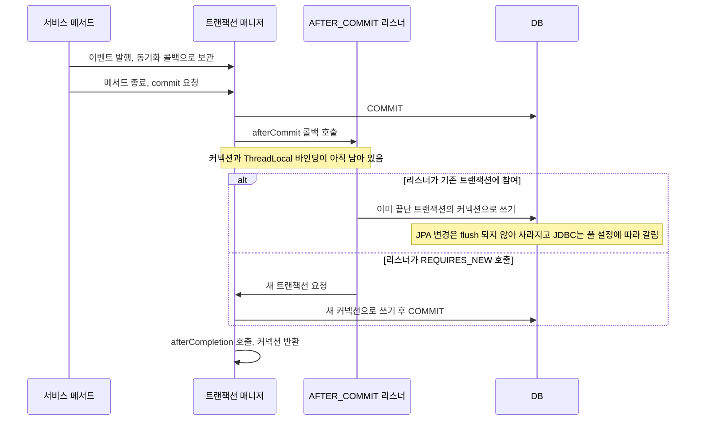

위쪽 분기가 문제가 되는 경로다. 실제로 어떻게 되는지 JPA와 JDBC 양쪽으로 확인했다.

먼저 리스너 메서드에 `@Transactional`(기본 REQUIRED)을 붙이면 Spring이 기동 단계에서 막는다.

```
@TransactionalEventListener method must not be annotated with @Transactional
unless when declared as REQUIRES_NEW or NOT_SUPPORTED
```

붙이지 않고 리스너 안에서 REQUIRED인 서비스 메서드를 부르면 막지 못한다. 엔티티 이름을 바꾸는 서비스를 `afterCommit`에서 호출한 결과다.

```
afterCommit에서 REQUIRED 서비스 호출      -> name=touched-in-main        (바꾼 이름이 사라짐)
afterCommit에서 REQUIRES_NEW 서비스 호출  -> name=renamed-in-afterCommit
```

REQUIRED로 참여한 쪽은 이미 커밋이 끝난 트랜잭션에 올라탄 셈이라 flush가 다시 일어나지 않는다. 변경 감지 기반 수정이 조용히 사라진다. 예외도 안 난다.

`JdbcTemplate`으로 INSERT를 직접 날리면 결과가 더 헷갈린다. 같은 코드가 풀 설정에 따라 다르게 동작한다.

```
HikariCP auto-commit 기본값(true)  -> rows=[main, in-afterCommit]   남음
HikariCP auto-commit=false         -> rows=[main]                    사라짐
```

auto-commit이 `true`인 풀에서는 Spring이 트랜잭션을 정리하며 `setAutoCommit(true)`로 되돌릴 때 JDBC 스펙에 따라 진행 중이던 작업이 커밋된다. 의도한 동작이 아니라 부수 효과로 남는 것이다. `auto-commit=false`로 운영하는 팀이 풀 설정만 바꿨는데 알림 이력 INSERT가 사라지는 경우가 이래서 생긴다. 커밋 후 DB 쓰기가 필요하면 REQUIRES_NEW를 명시하는 수밖에 없다.

```java
@Component
class OrderListener {
    private final AuditWriter auditWriter;   // 별도 빈, 메서드에 REQUIRES_NEW

    @TransactionalEventListener(phase = TransactionPhase.AFTER_COMMIT)
    void on(OrderPlaced e) {
        auditWriter.write(e);    // 새 트랜잭션, 새 커넥션
    }
}

@Service
class AuditWriter {
    @Transactional(propagation = Propagation.REQUIRES_NEW)
    public void write(OrderPlaced e) { ... }
}
```

REQUIRES_NEW 호출은 커넥션을 하나 더 쓴다. 이 시점에는 원래 트랜잭션의 커넥션도 아직 반환 전이다. 풀이 작은 서비스에서 `AFTER_COMMIT` 리스너마다 REQUIRES_NEW를 쓰면 동시 요청 수만큼 커넥션이 두 배로 든다. 풀 고갈 절에서 이 계산을 다룬다.

`BEFORE_COMMIT`은 성격이 다르다. 아직 트랜잭션 안이라서 여기서 던진 예외는 커밋을 막고 롤백시킨다. 정합성에 걸리는 검증이나 같은 트랜잭션에 묶어야 하는 부가 쓰기에 쓴다. 앞 절에서 본 대로 이 시점에는 JPA flush 전이라는 점만 기억하면 된다.

가장 큰 문제는 `AFTER_COMMIT` 리스너가 실패했을 때다. 리스너에서 예외를 던지게 해서 확인했다.

```
BEFORE_COMMIT listener 3
ERROR o.s.t.s.TransactionSynchronizationUtils : TransactionSynchronization.afterCompletion threw exception
java.lang.IllegalStateException: notify failed
publish returned normally
listener throws -> rows=[order-3]
```

예외는 `ERROR` 로그 한 줄로 끝난다. 서비스 메서드는 정상 반환하고, 주문은 커밋돼 있고, 알림은 나가지 않았다. 호출자는 실패를 알 방법이 없다. 재시도 큐도 없으니 이벤트는 그대로 유실된다. 프로세스가 커밋 직후에 죽는 경우도 마찬가지다.

알림 유실이 문제가 되는 업무라면 방향을 바꿔야 한다. 이벤트를 메모리에서 흘려 보내지 말고 같은 트랜잭션에서 outbox 테이블에 행으로 남긴다. 별도 폴러가 그 행을 읽어 발송하고 성공하면 지운다. 커밋 후 리스너는 폴러를 바로 깨워 지연을 줄이는 용도로만 남긴다. 알림이 유실돼도 상관없는 캐시 무효화 같은 작업이라면 `AFTER_COMMIT` 리스너로 충분하다.

---

## OSIV와 커넥션 점유 시간

`spring.jpa.open-in-view`의 기본값은 `true`다. 요청이 들어올 때 `EntityManager`를 열어 스레드에 묶어 두고, 응답이 나갈 때까지 닫지 않는다. 컨트롤러나 뷰에서 지연 로딩을 마음대로 써도 `LazyInitializationException`이 나지 않는 이유다. 대가는 커넥션 점유 시간이다.

서비스 호출 직후 컨트롤러에서 풀의 active 수를 찍는 엔드포인트로 확인했다.

```java
@GetMapping("/active/{id}")
String active(@PathVariable Long id) throws Exception {
    int before = active();
    orderQuery.find(id);          // @Transactional(readOnly = true)
    int afterService = active();  // 서비스 반환 직후, 컨트롤러 안
    Thread.sleep(500);
    return "beforeService=" + before + " afterServiceReturned=" + afterService;
}
```

```
open-in-view=true   -> beforeService=0 afterServiceReturned=1
open-in-view=false  -> beforeService=0 afterServiceReturned=0
```

서비스 트랜잭션이 이미 커밋됐는데도 OSIV가 켜져 있으면 커넥션이 풀로 돌아가지 않는다. 열려 있는 영속성 컨텍스트가 지연 로딩을 위해 커넥션을 쥐고 있기 때문이다. 이 커넥션은 요청이 끝날 때 반환된다.

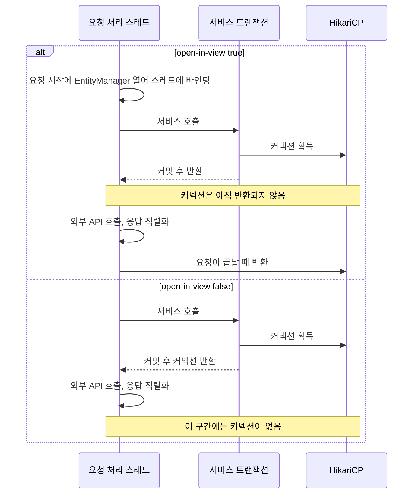

두 분기에서 서비스 호출 이후의 칸이 다르다. 켜져 있으면 컨트롤러에서 외부 API를 부르는 시간과 JSON 직렬화 시간이 전부 커넥션 점유 시간에 들어간다. 평소엔 눈에 안 띄다가 외부 API가 느려지는 날 풀이 먼저 마른다. 응답 지연이 DB 장애처럼 보이는데 DB는 한가한 상황이 이 패턴이다.

끄면 컨트롤러에서 지연 로딩을 건드리는 코드가 전부 터진다. 실제 응답을 찍어 봤다.

```
open-in-view=false
/lazy/1      -> ERROR LazyInitializationException: failed to lazily initialize a collection
                of role: lab.Orders.items: could not initialize proxy - no Session
/fetch/1     -> items=2     (fetch join 쿼리로 조회)
/inservice/1 -> items=2     (서비스 트랜잭션 안에서 size() 호출)
```

대응 방법은 연관 데이터를 트랜잭션 안에서 끝내는 것이다. fetch join이나 `@EntityGraph`로 필요한 연관 엔티티를 한 번에 가져오거나, 서비스 안에서 DTO로 변환해서 반환한다. 엔티티를 컨트롤러까지 들고 올라오지 않으면 문제 자체가 사라진다. 이미 운영 중인 프로젝트라면 끄기 전에 `LazyInitializationException`이 날 곳을 테스트로 먼저 찾아야 한다. 한 번에 다 못 끄겠으면 OSIV를 켠 채로 풀 크기와 컨트롤러의 외부 호출 시간을 먼저 모니터링하는 것이 순서다.

---

## REQUIRES_NEW 중첩과 HikariCP 풀 고갈

`REQUIRES_NEW`가 커넥션을 하나 더 쓴다는 건 앞에서 확인했다. 문제는 바깥 트랜잭션이 안쪽이 끝날 때까지 자기 커넥션을 놓지 않는다는 점이다. 스레드가 여러 개 동시에 이 구조에 들어오면 서로의 안쪽이 필요로 하는 커넥션을 바깥이 잡고 있다.

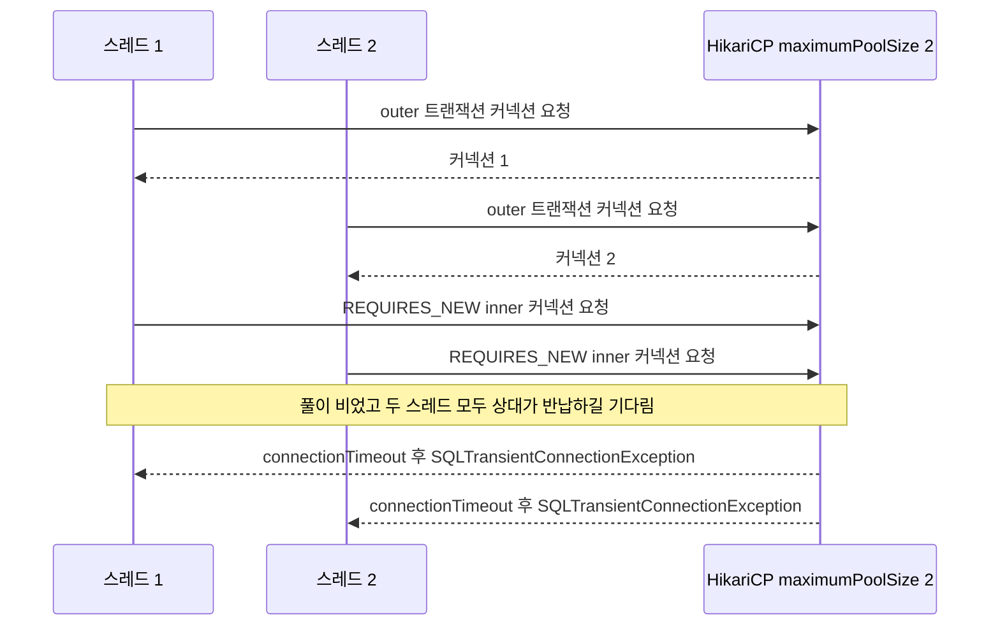

두 스레드가 모두 바깥 단계에서 커넥션을 하나씩 쥔 채 안쪽 커넥션을 기다린다. 어느 쪽도 먼저 반납할 수 없으니 `connectionTimeout`이 지나야 풀린다. 기본값 30초 동안 요청 스레드가 전부 멈춰 있게 된다.

재현 코드는 짧다. 자기 자신을 `REQUIRES_NEW`로 재귀 호출하는 빈이다.

```java
@Service
class Nest {
    @Autowired JdbcTemplate jdbc;
    @Lazy @Autowired Nest self;     // 프록시를 거쳐 호출하려고 자기 자신을 주입

    @Transactional(propagation = Propagation.REQUIRES_NEW)
    public void level(int n) throws Exception {
        jdbc.queryForObject("select 1", Integer.class);   // 커넥션을 실제로 잡음
        Thread.sleep(300);                                // 다른 스레드와 겹치게 함
        if (n > 1) self.level(n - 1);
    }
}
```

스레드 수 T와 중첩 깊이 C(한 스레드가 동시에 쥐는 커넥션 수)를 바꿔 가며 `connection-timeout=2000`으로 돌린 결과다.

| maximumPoolSize | 스레드 수 T | 깊이 C | 필요한 풀 크기 | 결과 |
|---|---|---|---|---|
| 2 | 2 | 2 | 3 | 전부 실패, 약 2.5초 |
| 3 | 2 | 2 | 3 | 전부 성공, 약 1.1초 |
| 1 | 1 | 2 | 2 | 실패. 스레드 하나로도 자기 자신이 막힘 |
| 2 | 1 | 3 | 3 | 실패 |
| 3 | 1 | 3 | 3 | 성공 |
| 10 | 10 | 2 | 11 | 10개 전부 실패 |
| 11 | 10 | 2 | 11 | 10개 전부 성공 |

필요한 풀 크기 열은 `T × (C - 1) + 1`이다. 모든 스레드가 안쪽 단계 바로 앞에서 멈춘 최악의 순간에도 마지막 한 스레드는 안쪽 커넥션을 얻어 끝낼 수 있어야 하기 때문이다. 표의 일곱 줄이 모두 이 식과 맞았다. 풀 크기 10에 동시 요청 10건이 `REQUIRES_NEW` 한 단계를 거치면 11이 필요하니 10으로는 모자란다. 앞에서 말한 "기본값 10이면 10개 요청에서 멈춘다"의 근거가 이 표다.

풀을 11로 늘리는 건 임시방편이다. 동시 요청이 늘면 같은 일이 다시 벌어진다. 근본 해결은 바깥 트랜잭션이 커넥션을 쥔 채 `REQUIRES_NEW`를 부르지 않도록 구조를 바꾸는 것이다.

- 안쪽 작업을 바깥 커밋 이후로 옮긴다. 바로 앞 절에서 본 `AFTER_COMMIT` 리스너나 outbox가 이 용도다.
- 바깥에 트랜잭션이 필요 없다면 `REQUIRES_NEW` 대신 일반 REQUIRED로 둔다.
- 바깥 메서드가 중간에 느린 일을 하는 구조라면 바깥을 `NOT_SUPPORTED`로 빼서 트랜잭션 없이 돌리고, 필요한 구간만 `TransactionTemplate`으로 감싼다.

운영에서 이걸 알아채는 가장 빠른 신호는 Hikari 로그의 `total=N, active=N, idle=0, waiting=M` 줄이다. `active`가 `total`과 같고 `waiting`이 0보다 크면서 DB CPU는 한가하다면 풀 고갈이다.

---

## 트랜잭션 매니저가 둘 이상일 때

DataSource를 두 개 쓰는 서비스(원장 DB와 이력 DB 같은 구성)에서는 트랜잭션 매니저도 두 개가 된다. `@Transactional`에 이름을 안 주면 어떤 매니저를 쓸지가 문제다. H2 인메모리 DB 두 개와 `DataSourceTransactionManager` 두 개(`txA`, `txB`)로 확인했다.

먼저 `@Primary`가 없을 때다. 기동은 정상이고, 처음 트랜잭션을 여는 호출에서 예외가 난다.

```
noName threw NoUniqueBeanDefinitionException: No qualifying bean of type
'org.springframework.transaction.TransactionManager' available: expected single matching bean but found 2: txA,txB
```

이 상태는 시끄럽게 실패해서 오히려 낫다. `txA`에 `@Primary`를 붙이면 예외가 사라지고 이름 없는 `@Transactional`은 전부 `txA`로 간다. 이때 B 쪽 테이블에 쓰는 메서드가 이름을 빼먹었다면 조용한 사고가 난다.

```java
@Transactional                    // @Primary인 txA를 사용
public void writesB_withDefault() {
    jdbcB.update("insert into log(msg) values ('b')");
    throw new RuntimeException("boom");
}
```

```
primary writesB_withDefault threw RuntimeException: boom
primary writesB_withDefault -> B=[b]        롤백되지 않고 남음
primary writesB_named       -> B=[]         @Transactional("txB")면 정상 롤백
```

`txA`가 연 트랜잭션은 A 데이터소스의 커넥션에 걸려 있고, `jdbcB`는 B 데이터소스에서 auto-commit으로 SQL을 보낸다. 어노테이션이 붙어 있어서 트랜잭션이 걸렸다고 믿기 쉽다. 예외가 났는데 DB에 행이 남아 있는 증상이 나오면 이 경우를 의심한다.

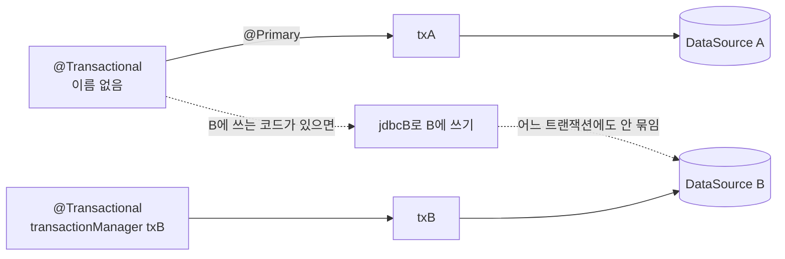

점선이 사고 경로다. 이름 없는 `@Transactional`은 A만 보호하고, B로 가는 `jdbcB`는 트랜잭션 밖에서 실행된다.

두 DB를 한 흐름에서 고칠 때는 더 근본적인 한계가 있다. A를 바깥, B를 안쪽으로 각각 `@Transactional("txA")`, `@Transactional("txB")`를 걸고 안쪽이 끝난 뒤 바깥에서 예외를 던졌다.

```
both threw fail after B committed
both -> A=[]  B=[b]
```

안쪽 B는 자기 매니저로 이미 커밋을 끝냈고, 바깥 A만 롤백됐다. 매니저가 둘이면 두 트랜잭션은 서로 독립이다. JTA 없이 두 DB에 원자성을 기대하면 안 된다. 쓰기 순서를 설계해서 실패해도 허용되는 쪽을 뒤로 보내거나, 한쪽을 outbox로 만들어 재시도 가능하게 하거나, 업무적으로 보상 처리를 둬야 한다.

---

## JPA와 JDBC를 섞을 때 flush 시점

한 트랜잭션 안에서 JPA 엔티티를 수정하고 같은 행을 `JdbcTemplate`으로 읽거나 쓰는 코드는 흔하다. `JpaTransactionManager`가 같은 커넥션을 공유하니 트랜잭션은 하나로 묶인다. 하지만 영속성 컨텍스트는 JDBC가 뭘 하는지 모른다. 엔티티를 수정하고 6가지 순서로 확인했다.

```
엔티티 name을 "changed"로 수정 (flush 전)
jdbc-direct          : JdbcTemplate으로 조회        -> orig      수정이 보이지 않음
native               : em.createNativeQuery로 조회  -> changed   Hibernate가 먼저 flush
jpql-then-jdbc       : JPQL 실행 후 JdbcTemplate    -> changed   JPQL 앞의 auto flush 덕분
flush-then-jdbc      : em.flush() 후 JdbcTemplate   -> changed

엔티티를 수정하지 않고 JDBC로 UPDATE
stale-cache          : em.find 결과 -> orig, JdbcTemplate 조회 -> by-jdbc
                       em.clear() 후 em.find        -> by-jdbc

엔티티 수정 후 JDBC로 같은 행 UPDATE
jdbc-update-no-flush : 커밋 후 name=changed   JDBC가 쓴 by-jdbc를 flush가 덮어씀
```

세 가지 규칙으로 정리된다. `JdbcTemplate`은 flush를 일으키지 않는다. JPQL과 네이티브 쿼리는 실행 전에 flush를 일으키므로 이 둘을 섞은 코드에서는 앞선 수정이 보인다. 그리고 JDBC로 직접 쓴 값은 영속성 컨텍스트의 1차 캐시에 반영되지 않는다.

마지막 줄이 가장 위험하다. 엔티티를 먼저 수정해 둔 채 JDBC로 같은 행을 UPDATE하면 커밋 시점의 flush가 엔티티 값으로 덮어쓴다. 로그를 보면 UPDATE가 둘 다 나갔는데 최종 값은 엔티티 쪽이라, JDBC 쓰기가 사라진 것처럼 보인다.

같은 행을 두 경로로 다루지 않는 게 가장 좋다. 피할 수 없으면 JDBC 쓰기 전에 `em.flush()`를 먼저 하고, JDBC 쓰기 후에는 `em.clear()`나 `em.refresh()`로 1차 캐시를 비운다.
---

## timeout은 SQL 실행 단위로만 동작한다

`@Transactional(timeout = 1)`을 보고 1초가 지나면 트랜잭션이 끊긴다고 기대하는 경우가 있다. 실제 동작은 다르다. 스레드를 인터럽트하거나 커넥션을 닫는 코드는 어디에도 없다. 트랜잭션 시작 시점부터 남은 시간을 계산해 두고, SQL을 실행하는 순간에 그 남은 시간을 검사한다. `JdbcTemplate`은 남은 초를 `Statement.setQueryTimeout`에 넣고, 이미 넘겼다면 `TransactionTimedOutException`을 던진다.

그래서 SQL이 안 나가는 동안은 아무 일도 일어나지 않는다. `timeout = 1`로 걸어 두고 일곱 가지 메서드를 실행한 결과다.

| 메서드 내용 | 결과 | 걸린 시간 |
|---|---|---|
| `Thread.sleep(2500)`만 하고 SQL 없음 | 정상 반환, 커밋 | 2698ms |
| `sleep(2500)` 후 `JdbcTemplate` 쿼리 | `TransactionTimedOutException` | 2502ms |
| `sleep(2500)` 후 JPQL 조회 | `TransactionTimedOutException` | 2768ms |
| 쿼리, `sleep(1500)`, 쿼리 | 두 번째 쿼리에서 `TransactionTimedOutException` | 1502ms |
| 엔티티 수정 후 `sleep(2500)`, 종료 | `JpaSystemException: transaction timeout expired`, 롤백 | 2608ms |
| 1초 넘는 무거운 쿼리 | `QueryTimeoutException` | 1022ms |
| DB 함수 안에서 2.5초 sleep | 정상 반환 | 2501ms |

첫 줄이 핵심이다. SQL 없이 2.5초를 쓴 메서드는 타임아웃 1초를 넘겼는데도 정상 커밋됐다. 외부 API 호출이 이 구간에 있다면 timeout은 방어가 되지 않는다. 에러 메시지의 시각(deadline)과 실제 예외 시점이 같지 않고, 예외는 항상 "다음 SQL을 보내려는 순간"에 난다.

다섯 번째 줄은 JPA 쪽 동작이다. 쿼리를 직접 실행하지 않아도 커밋 시점의 flush가 UPDATE를 보내면서 검사에 걸렸다. 이때는 롤백되고 수정 내용도 DB에 반영되지 않았다(커밋 후 `name=orig`). 엔티티를 수정하지 않았다면 같은 코드가 첫 줄처럼 그냥 통과한다.

마지막 두 줄은 DB 쪽 동작이다. 오래 걸리는 쿼리는 1초 부근에서 취소됐다. 이 케이스에서는 롤백 단계에서도 예외가 나서 원래의 `QueryTimeoutException`이 `Application exception overridden by rollback exception` 로그와 함께 `JpaSystemException`에 가려지는 현상이 보였다. DB가 중간에 끊을 수 없는 작업(H2의 Java 함수 안 sleep)은 타임아웃을 무시하고 끝까지 갔다. 이 두 줄은 H2 구현에 따른 결과라서 MySQL이나 PostgreSQL에서 같은 숫자가 나온다고 일반화할 수는 없다.

`timeout`은 쿼리가 오래 걸려서 트랜잭션이 길어지는 것을 막는 장치이고, 트랜잭션 안의 비DB 작업을 막지는 못한다. 외부 호출은 트랜잭션 밖으로 빼고, 호출 자체에는 HTTP 클라이언트 타임아웃을 건다. 락 대기는 `@Transactional(timeout)`이 아니라 DB의 `innodb_lock_wait_timeout`(MySQL)이나 `lock_timeout`, `statement_timeout`(PostgreSQL) 같은 서버 설정이 담당한다.

---

## 마지막으로

트랜잭션 문제는 거의 항상 다음 중 하나로 귀결된다. 프록시를 거치지 않는 호출이 있거나, 전파 옵션을 잘못 골랐거나, 예외 타입을 잘못 던졌거나. 의심스러우면 일단 트랜잭션이 실제로 시작되는지부터 확인한다. 코드만 읽고 추측하지 말고 로그를 켜서 begin/commit이 찍히는지 본다. 이 한 가지 습관만으로 디버깅 시간이 절반으로 준다.
