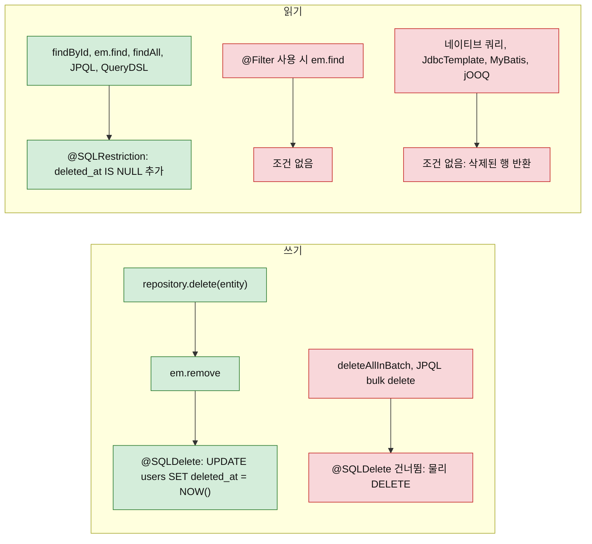
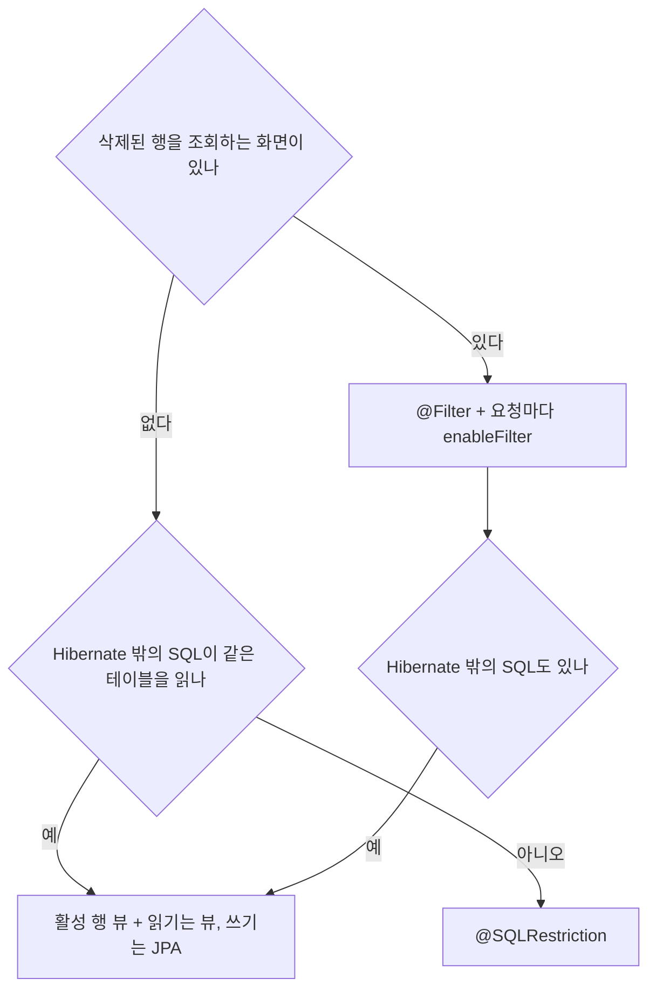
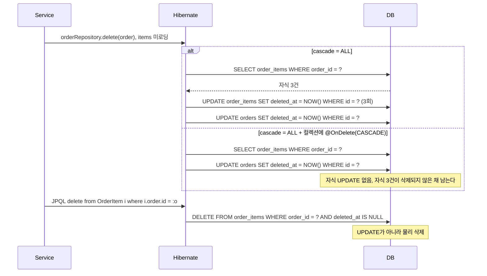

# JPA 소프트 삭제 (deleted_at)

행을 지우지 않고 `deleted_at`에 시각을 남기는 방식이다. SQL 로그와 예외는 Spring Boot 3.3.4(Hibernate 6.5.3.Final, H2 2.2.224 MODE=MySQL)에서 직접 실행해 얻었다. 다른 버전은 확인하지 않았다.

## 기본 설정: @SQLDelete와 조회 필터

`@SQLDelete`는 DELETE를 지정한 SQL로 바꾸고, `@SQLRestriction`은 조회에 조건을 붙인다.

```java
@Entity
@Table(name = "users")
@SQLDelete(sql = "UPDATE users SET deleted_at = NOW() WHERE id = ?")
@SQLRestriction("deleted_at IS NULL")   // Hibernate 6.3+ (Spring Boot 3.x)
public class User {

    @Id
    @GeneratedValue(strategy = GenerationType.IDENTITY)
    private Long id;

    private String username;
    private String email;

    @Column(name = "deleted_at")
    private LocalDateTime deletedAt;
}
```

`deleteById`는 SELECT 뒤에 UPDATE를 낸다. 이미 삭제된 id는 SELECT가 비어 아무 일도 없다.

```sql
select u1_0.id,u1_0.deleted_at,u1_0.username from users u1_0 where u1_0.id=? and (u1_0.deleted_at IS NULL)
UPDATE users SET deleted_at = NOW() WHERE id = ?
```

## 필터가 붙는 경로와 우회하는 경로

읽기 조건은 Hibernate가 SQL을 만들 때만 붙는다. 붉은 쪽이 사고 경로다.



`@Filter` 열은 `enableFilter`를 호출한 세션 기준이다.

| 경로 | @SQLRestriction | @Filter |
|---|---|---|
| `findById`, `em.find` | 조건 붙음 | 조건 안 붙음 |
| JPQL select, QueryDSL | 붙음 | 붙음 |
| JPQL bulk update | 붙음 | 확인하지 않음 |
| 연관 컬렉션 lazy 로딩 | 붙음 | 컬렉션에 `@Filter`를 따로 선언해야 붙음 |
| 네이티브 쿼리, JdbcTemplate | 안 붙음 | 안 붙음 |
| `deleteAllInBatch`, JPQL bulk delete | 조건만 붙고 물리 DELETE | 확인하지 않음 |

## Hibernate 6에서 @Where → @SQLRestriction

Hibernate 6.3부터 `@Where`는 deprecated다.

```java
// Hibernate 5.x / Spring Boot 2.x
@Where(clause = "deleted_at IS NULL")

// Hibernate 6.3+ / Spring Boot 3.x
@SQLRestriction("deleted_at IS NULL")
```

## @MappedSuperclass로 소프트 삭제 기반 클래스 만들기

```java
@MappedSuperclass
public abstract class SoftDeletableEntity {

    @Column(name = "deleted_at")
    private LocalDateTime deletedAt;

    public void softDelete() {
        this.deletedAt = LocalDateTime.now();
    }

    public boolean isDeleted() {
        return deletedAt != null;
    }

    public LocalDateTime getDeletedAt() {
        return deletedAt;
    }
}
```

```java
@Entity
@Table(name = "users")
@SQLDelete(sql = "UPDATE users SET deleted_at = NOW() WHERE id = ?")
@SQLRestriction("deleted_at IS NULL")
public class User extends SoftDeletableEntity {

    @Id
    @GeneratedValue(strategy = GenerationType.IDENTITY)
    private Long id;

    private String username;
    private String email;
}
```

두 애노테이션을 `@MappedSuperclass`에 올리면 6.5.3에서 에러 없이 무시된다. 조회에 삭제 행이 섞이고 `em.remove`는 `delete from sub_things where id=?` 물리 삭제를 냈다.

`softDelete()`는 필드만 바꿔 flush 때 일반 UPDATE가 나간다. Envers 기록이 달라진다(아래 Envers 절).

```java
@MappedSuperclass
@EntityListeners(AuditingEntityListener.class)
public abstract class BaseEntity extends SoftDeletableEntity {

    @CreatedDate
    @Column(name = "created_at", updatable = false)
    private LocalDateTime createdAt;

    @LastModifiedDate
    @Column(name = "updated_at")
    private LocalDateTime updatedAt;
}
```

## Hibernate Filter로 전역 필터 관리

`@Filter`는 세션 단위로 켜고 끈다. 기본값이 꺼짐이라 켜지 않은 세션은 삭제 행까지 읽는다.

```java
@Entity
@Table(name = "users")
@SQLDelete(sql = "UPDATE users SET deleted_at = NOW() WHERE id = ?")
@FilterDef(name = "deletedFilter")
@Filter(name = "deletedFilter", condition = "deleted_at IS NULL")
public class User extends SoftDeletableEntity {
    // ...
}
```

```java
@Component
public class SoftDeleteFilter {

    @PersistenceContext
    private EntityManager em;

    public void enableSoftDeleteFilter() {
        Session session = em.unwrap(Session.class);
        session.enableFilter("deletedFilter");
    }
}
```

컬렉션 필드에도 `@Filter(name = "deletedFilter", condition = "deleted_at IS NULL")`을 선언해야 연관까지 걸러진다. `condition`이 없으면 기동이 실패한다.

## @SQLRestriction, @Filter, 뷰 중 무엇을 쓰나

기준은 삭제 행을 읽는 화면이 있는지, Hibernate 밖의 SQL이 같은 테이블을 읽는지다.



| 방식 | 장점 | 어디서 깨지나 |
|---|---|---|
| `@SQLRestriction` | 켜는 코드가 없다 | 삭제 행 조회가 필요해지면 엔티티를 바꿔야 한다. 네이티브, 외부 SQL은 못 막는다 |
| `@Filter` | 세션마다 켜고 끈다 | 켜는 것을 잊으면 삭제 행이 샌다. `em.find`는 안 막는다 |
| DB 뷰 | MyBatis, jOOQ, 보고서 SQL까지 같은 기준 | 뷰 매핑 엔티티는 읽기 전용이라 쓰기용 엔티티가 따로 필요하다 |
| PostgreSQL row level security | 애플리케이션 밖에서 강제 | 이 문서에서는 실행해 보지 않았다 |

```sql
CREATE VIEW active_users AS
SELECT id, username, email FROM users WHERE deleted_at IS NULL;
```

## JPQL에서 deleted_at IS NULL 조건 누락 문제

6.5.3에서는 JPQL의 JOIN, JOIN FETCH 모두 ON 절에 조건이 붙었다.

```sql
select pl1_0.id,pl1_0.author_id,pl1_0.title from posts_lazy pl1_0
join authors a1_0 on a1_0.id=pl1_0.author_id and (a1_0.deleted_at IS NULL)
```

문제는 조건 누락이 아니라 행 소실이다. 작성자가 삭제된 글 2건 중 1건이 inner join과 join fetch 결과에서 빠졌다. 탈퇴 회원의 주문이 목록과 집계에서 사라진다. 부모가 없어도 보여야 하면 `left join`을 쓴다. Hibernate 5.x의 누락 버그는 재현하지 않았다.

## QueryDSL에서 deleted_at IS NULL 처리

QueryDSL-JPA는 JPQL을 넘기므로 `@SQLRestriction`이 적용된다. `PathBuilder` `selectFrom`의 SQL이다.

```sql
select a1_0.id,a1_0.deleted_at,a1_0.name from authors a1_0 where (a1_0.deleted_at IS NULL)
```

`@Filter` 엔티티나 querydsl-sql처럼 JPA를 거치지 않는 경우에만 조건을 직접 넣는다.

```java
public class UserQueryRepository {

    private final JPAQueryFactory queryFactory;

    private BooleanExpression notDeleted() {
        return user.deletedAt.isNull();
    }

    public List<User> findActiveByEmail(String email) {
        return queryFactory
            .selectFrom(user)
            .where(notDeleted(), user.email.eq(email))
            .fetch();
    }
}
```

## withDeleted 패턴

`@SQLRestriction` 엔티티의 삭제 행은 네이티브 쿼리로만 읽는다.

```java
public interface UserRepository extends JpaRepository<User, Long> {

    @Query(value = "SELECT * FROM users WHERE id = :id", nativeQuery = true)
    Optional<User> findByIdIncludingDeleted(@Param("id") Long id);

    @Query(value = "SELECT * FROM users WHERE email = :email", nativeQuery = true)
    Optional<User> findByEmailIncludingDeleted(@Param("email") String email);
}
```

`@Filter` 구조는 필터를 끄면 된다.

```java
@Transactional(readOnly = true)
public User findUserIncludingDeleted(Long id) {
    Session session = em.unwrap(Session.class);
    session.disableFilter("deletedFilter");
    return userRepository.findById(id)
        .orElseThrow(() -> new EntityNotFoundException("User not found"));
}
```

## N+1과 소프트 삭제 필터 충돌

LAZY 연관을 루프에서 건드리면 N+1이 나고, fetch join으로 풀면 위 JOIN의 행 소실이 따른다.

```java
@Entity
public class Order {
    @ManyToOne(fetch = FetchType.LAZY)
    @JoinColumn(name = "user_id")
    private User user;
}

@Query("SELECT o FROM Order o JOIN FETCH o.user u WHERE o.createdAt > :date")
List<Order> findRecentOrders(@Param("date") LocalDateTime date);
```

## CascadeType.ALL과 @SQLDelete 조합의 함정

자식에도 `@SQLDelete`가 걸린 구조다.

```java
@Entity
@SQLDelete(sql = "UPDATE orders SET deleted_at = NOW() WHERE id = ?")
@SQLRestriction("deleted_at IS NULL")
public class Order extends SoftDeletableEntity {

    @OneToMany(mappedBy = "order", cascade = CascadeType.ALL, orphanRemoval = true)
    private List<OrderItem> items = new ArrayList<>();
}

@Entity
@SQLDelete(sql = "UPDATE order_items SET deleted_at = NOW() WHERE id = ?")
@SQLRestriction("deleted_at IS NULL")
public class OrderItem extends SoftDeletableEntity {

    @ManyToOne
    @JoinColumn(name = "order_id")
    private Order order;
}
```

이전 판은 items가 lazy 미로딩이면 bulk DELETE가 나간다고 썼지만 6.5.3에서는 재현되지 않았다. 미로딩이어도 cascade가 컬렉션을 SELECT한 뒤 자식마다 UPDATE를 냈다. SQL이 갈리는 지점은 `@OnDelete`와 bulk 쿼리다.



`@OnDelete`는 자식 삭제를 DB의 `ON DELETE CASCADE`에 맡긴다. 부모가 UPDATE로 바뀌면 DB cascade가 돌지 않아 자식이 남으니 같이 쓰지 않는다. 자식이 많으면 bulk UPDATE로 직접 처리한다.

```java
@Transactional
public void deleteOrder(Long orderId) {
    orderItemRepository.softDeleteAllByOrderId(orderId);
    orderRepository.deleteById(orderId);
}

@Modifying
@Query("UPDATE OrderItem oi SET oi.deletedAt = CURRENT_TIMESTAMP WHERE oi.order.id = :orderId AND oi.deletedAt IS NULL")
void softDeleteAllByOrderId(@Param("orderId") Long orderId);
```

```sql
update order_items oi1_0 set deleted_at=localtimestamp where oi1_0.order_id=? and oi1_0.deleted_at is null and (oi1_0.deleted_at IS NULL)
UPDATE orders SET deleted_at = NOW() WHERE id = ?
```

## @Version과 @SQLDelete

`@Version`이 있으면 `@SQLDelete`에 `version = ?` 자리가 있어야 한다. Hibernate가 id 다음에 version을 바인딩한다.

| `@SQLDelete` SQL | 결과 |
|---|---|
| `... WHERE id = ?` | `Invalid value "2" for parameter "parameterIndex"`, `DataIntegrityViolationException` |
| `... WHERE id = ? AND version = ?` | 삭제는 되지만 version이 0 그대로 |
| `SET ..., version = version + 1 WHERE id = ? AND version = ?` | version 1로 증가 |

영향 행이 0이어도 기본값은 예외가 없다. 다른 트랜잭션이 version을 올린 뒤 삭제하면 UPDATE는 0건인데 커밋이 정상 종료되고 행은 남았다. `check = ResultCheckStyle.COUNT`를 붙여야 낙관적 락이 동작한다.

```java
@SQLDelete(
    sql = "UPDATE v4_docs SET deleted_at = NOW(), version = version + 1 WHERE id = ? AND version = ?",
    check = ResultCheckStyle.COUNT)
```

```text
ObjectOptimisticLockingFailureException / StaleObjectStateException:
Row was updated or deleted by another transaction (or unsaved-value mapping was incorrect) : [V4#2]
```

## Spring Data의 삭제 메서드와 영속성 컨텍스트

`delete(entity)`와 `deleteById`는 `em.remove`를 불러 `@SQLDelete`를 탄다. `deleteAllInBatch` 계열은 JPQL bulk delete라 타지 않는다.

```sql
-- deleteAllInBatch(entities)
delete from users u1_0 where u1_0.id=? and (u1_0.deleted_at IS NULL)
-- deleteAllByIdInBatch(ids)
delete from users u1_0 where u1_0.id in (?) and (u1_0.deleted_at IS NULL)
-- deleteAllInBatch()
delete from users u1_0 where (u1_0.deleted_at IS NULL)
```

셋 다 활성 행을 물리 삭제했다. 복구할 수 없으니 쓰지 않는다.

`@Modifying` bulk UPDATE는 영속성 컨텍스트를 갱신하지 않는다. 이미 읽은 엔티티는 `findById`가 `deletedAt=null`인 1차 캐시를 돌려줬고 `clearAutomatically = true`를 주자 empty가 됐다.

```java
@Modifying(clearAutomatically = true, flushAutomatically = true)
@Query("update User u set u.deletedAt = CURRENT_TIMESTAMP where u.username = :n")
int bulkSoftDelete(@Param("n") String n);
```

`clearAutomatically`는 전체를 비우므로 `flushAutomatically`와 같이 쓴다.

## 삭제된 대상을 참조하는 @ManyToOne

작성자(Author)를 소프트 삭제한 뒤 글(Post)을 읽은 결과다.

| 연관 설정 | 글 조회 | 결과 |
|---|---|---|
| `LAZY` | 성공, 프록시 | `getName()` 호출 시 `EntityNotFoundException: Unable to find ... with id 1` |
| `EAGER` (기본) | 성공 | left join ON에 조건이 붙어 `author = null` |
| `LAZY` + `@NotFound(IGNORE)` | 성공 | 즉시 조회해서 `author = null` |

예외가 나는 쪽은 LAZY뿐이다. `EAGER`와 `@NotFound(IGNORE)`는 제목만 바꿔도 `author_id`를 null로 덮어썼다.

```sql
update posts_ignore set author_id=?,title=? where id=?
-- 실행 후 author_id = NULL
```

수정 한 번으로 삭제된 작성자와의 연결이 영구히 끊긴다. 연관 대신 `authorId` 컬럼으로 매핑해 읽거나 `@DynamicUpdate`를 검토한다(이번에 실행하지 않았다).

## Envers 감사 로그와의 조합

`@Audited`와 `@SQLDelete`로 생성, 수정, 삭제를 실행한 감사 테이블이다.

```text
rev | revtype | username | deleted_at
 1  |   0 (ADD) | a      | null
 2  |   1 (MOD) | a2     | null
 3  |   2 (DEL) | null   | null
```

`repository.delete`는 Envers에 DEL(revtype 2)로 남지만 값 컬럼이 null이다. `softDelete()`로 필드만 바꿔 flush하면 MOD(revtype 1)에 `deleted_at`이 담긴다. 경로에 따라 DEL과 MOD로 갈리니 한 경로로 통일한다.

## 삭제 행 purge 배치

보관 기간이 지난 행은 JdbcTemplate 같은 네이티브 경로로 지운다. JPA `delete`는 소프트 삭제로 바뀐다. 부모부터 지우면 FK에 걸린다.

```text
Referential integrity constraint violation: "FKBIOXGBV59VETRXE0EJFUBEP1W: PUBLIC.ORDER_ITEMS FOREIGN KEY(ORDER_ID) REFERENCES PUBLIC.ORDERS(ID)"
```

자식 먼저, 청크마다 한 트랜잭션으로 지운다.

```java
@Scheduled(cron = "0 0 3 * * *")
public void purge() {
    int purged;
    do {
        purged = tx.execute(st -> {
            List<Long> ids = jdbc.queryForList(
                "select id from orders where deleted_at < ? order by id limit 1000",
                Long.class, Timestamp.valueOf(LocalDateTime.now().minusDays(30)));
            if (ids.isEmpty()) return 0;
            NamedParameterJdbcTemplate named = new NamedParameterJdbcTemplate(jdbc);
            var p = new MapSqlParameterSource("ids", ids);
            named.update("delete from order_items where order_id in (:ids)", p);
            return named.update("delete from orders where id in (:ids)", p);
        });
    } while (purged > 0);
}
```

청크 크기를 2로 줄여 H2에서 돌린 로그다.

```text
chunk ids=[1, 2] items=4 orders=2
chunk ids=[3, 4] items=4 orders=2
chunk ids=[5] items=2 orders=1
total orders purged=5, 남은 orders=[{ID=6}]
```

활성 행(ID 6)은 남는다. Spring Batch chunk Step은 실행하지 않았다.

## MyBatis, jOOQ와 섞어 쓸 때

`@SQLRestriction`과 `@Filter`는 Hibernate가 SQL을 만들 때만 붙는다. MyBatis, jOOQ, JdbcTemplate은 삭제 행을 그대로 읽는다. 모든 SQL에 `deleted_at IS NULL`을 직접 넣으면 한 곳만 빠져도 샌다. 읽기 SQL은 활성 행 뷰를 보게 하고 쓰기는 JPA로 한다.

## 캐시와 소프트 삭제

`@Cacheable`은 `@SQLDelete`와 무관하다. 삭제 후에도 캐시 값이 나왔다.

```java
@Cacheable("userName")
public String name(Long id) { ... }

@CacheEvict(value = "userName", key = "#id")
@Transactional
public void deleteEvict(Long id) { repo.deleteById(id); }
```

| 삭제 방식 | 삭제 직후 `name(id)` |
|---|---|
| `@CacheEvict` 없이 `deleteById` | 캐시 값이 그대로 나옴. 본문은 실행되지 않음 |
| `@CacheEvict`와 함께 | 본문이 다시 실행되어 `null` |

Hibernate 2차 캐시(`@Cache(READ_WRITE)`, ehcache JCache) 결과다.

| 삭제 경로 | 이후 `em.find` |
|---|---|
| `repository.delete` | 캐시 무효화, SELECT 후 null |
| `em.createNativeQuery(...).executeUpdate()` | SELECT 후 null |
| JPQL bulk update | SELECT 후 null |
| `JdbcTemplate.update` | SELECT 없이 삭제된 엔티티가 반환됨 |

Hibernate 경유 경로는 캐시 영역을 비웠다. 그 밖의 경로는 항목이 만료되거나 밀릴 때까지 삭제된 엔티티가 읽힌다. MyBatis나 배치가 갱신하면 영역을 직접 비운다.

## 복합 유니크 제약과 소프트 삭제

재가입의 중복 오류는 활성 행에만 유니크를 거는 부분 인덱스로 막는다.

```sql
-- MySQL 8.0+에서는 함수 기반 인덱스로 처리
CREATE UNIQUE INDEX uk_users_email_active
ON users (email, (CASE WHEN deleted_at IS NULL THEN 1 ELSE NULL END));

-- PostgreSQL
CREATE UNIQUE INDEX uk_users_email_active
ON users (email) WHERE deleted_at IS NULL;
```

인덱스를 못 바꾸면 삭제 시 값을 변조한다. 데이터는 오염되지만 재가입은 된다.

```java
@SQLDelete(sql = """
    UPDATE users
    SET deleted_at = NOW(),
        email = CONCAT(email, '_deleted_', UNIX_TIMESTAMP())
    WHERE id = ?
""")
```

## @DataJpaTest에서 소프트 삭제 테스트

`@DataJpaTest`로 두 애노테이션을 검증할 수 있다.

```java
@DataJpaTest
class UserRepositoryTest {

    @Autowired
    private UserRepository userRepository;

    @Autowired
    private TestEntityManager entityManager;

    @Test
    void softDelete_thenNotFound() {
        User user = userRepository.save(new User("test@example.com", "testuser"));

        userRepository.delete(user);
        entityManager.flush();
        entityManager.clear();

        Optional<User> result = userRepository.findById(user.getId());
        assertThat(result).isEmpty();
    }

    @Test
    void softDelete_setsDeletedAt() {
        User user = userRepository.save(new User("test@example.com", "testuser"));
        Long userId = user.getId();

        userRepository.delete(user);
        entityManager.flush();
        entityManager.clear();

        User deletedUser = (User) entityManager.getEntityManager()
            .createNativeQuery("SELECT * FROM users WHERE id = :id", User.class)
            .setParameter("id", userId)
            .getSingleResult();

        assertThat(deletedUser.getDeletedAt()).isNotNull();
    }
}
```

`flush()`와 `clear()`가 없으면 1차 캐시가 응답해 캐시를 검증하게 된다. 물리 삭제로 새는 경우는 raw 조회로만 잡힌다.

`@Filter`를 쓰면 테스트에서도 필터를 직접 켠다.

```java
@DataJpaTest
class UserRepositoryFilterTest {

    @Autowired
    private EntityManager em;

    @BeforeEach
    void enableFilter() {
        em.unwrap(Session.class).enableFilter("deletedFilter");
    }

    @Test
    void filterEnabled_excludesSoftDeleted() {
        // 필터가 활성화된 상태에서 조회 테스트
    }
}
```

기본 H2는 `UNIX_TIMESTAMP()`가 없어 `Function not found`가 났고, `MODE=MySQL`이면 2.2.224에서 실행됐다. 더 필요하면 Testcontainers를 쓴다.

```java
@DataJpaTest
@AutoConfigureTestDatabase(replace = AutoConfigureTestDatabase.Replace.NONE)
@Testcontainers
class UserRepositoryMySQLTest {

    @Container
    static MySQLContainer<?> mysql = new MySQLContainer<>("mysql:8.0");

    @DynamicPropertySource
    static void configureProperties(DynamicPropertyRegistry registry) {
        registry.add("spring.datasource.url", mysql::getJdbcUrl);
        registry.add("spring.datasource.username", mysql::getUsername);
        registry.add("spring.datasource.password", mysql::getPassword);
    }
}
```

## 선택 기준과 운영 중 자주 나는 사고

삭제 행을 읽는 화면이 없으면 `@SQLRestriction`, 있으면 `@Filter`를 쓰고, MyBatis나 jOOQ가 같은 테이블을 읽으면 뷰를 둔다.

사고는 조건 누락보다 물리 삭제로 새는 쪽에서 난다. `deleteAllInBatch`는 활성 행을 지우고, `@MappedSuperclass`의 `@SQLDelete`는 무시되어 `em.remove`가 DELETE를 낸다. 에러가 없어서 raw 조회 테스트가 없으면 데이터가 사라진 뒤에 안다.

`@Version` 엔티티에 `check = COUNT`가 없으면 동시 수정과 겹친 삭제가 오류 없이 유실된다.

`deleted_at`에는 인덱스를 건다. `WHERE deleted_at IS NULL`이 모든 조회에 붙는다. 삭제 행이 대부분인 테이블은 복합 또는 부분 인덱스를 검토한다. 실행 계획은 확인하지 않았다.
