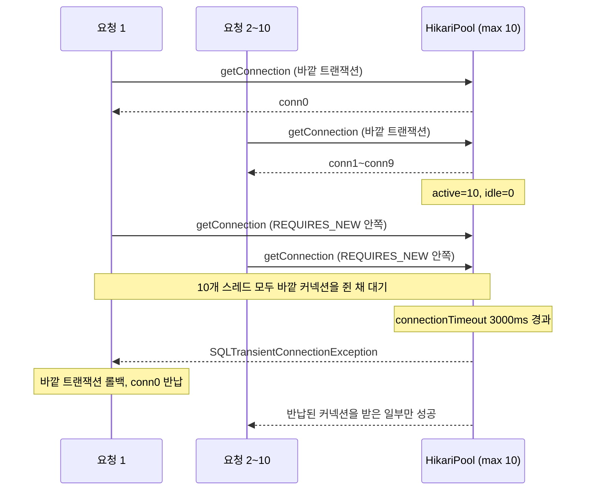
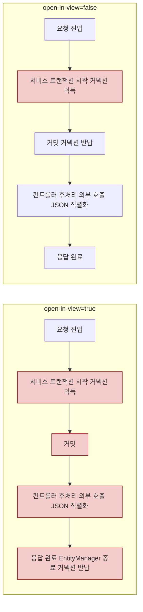
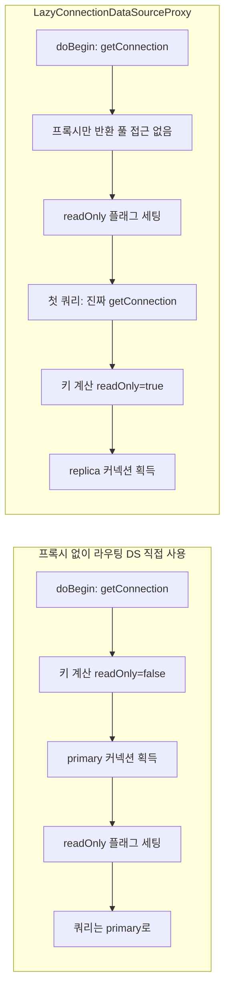
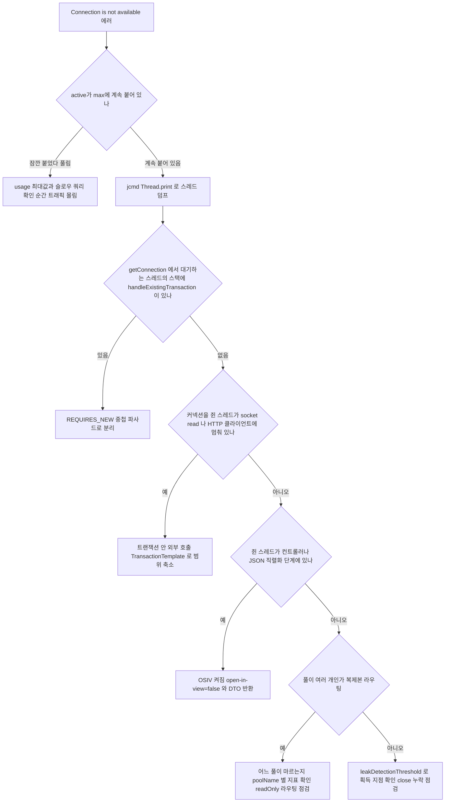

# Spring 트랜잭션과 커넥션 풀이 부딪히는 운영 사고

새벽에 알람이 울리고 로그를 열면 `Connection is not available, request timed out after 30000ms` 가 수백 줄 쌓여 있다. DB CPU는 한가하고 슬로우 쿼리도 없다. 풀 크기를 두 배로 올리면 잠깐 괜찮아지다가 다시 같은 에러가 난다. 이런 장애는 대부분 쿼리가 느려서가 아니라 **트랜잭션이 커넥션을 쥐고 있는 시간**이 요청 흐름에서 예상보다 길어서 생긴다.

[AOP_트랜잭션](AOP_트랜잭션.md)과 [Spring_Transaction_Internals](Spring_Transaction_Internals.md)는 전파 속성과 프록시 동작을 다룬다. 이 문서는 그 동작이 HikariCP와 만나는 지점만 모았다. 아래 수치는 전부 직접 돌린 결과이고, 환경은 JDK 17, Spring Boot 3.3.5(Spring 6.1.14, Hibernate 6.5.3), HikariCP 5.1.0, H2 인메모리다. 절대값보다 "붙었다/안 붙었다"의 차이로 읽어야 한다.

## 트랜잭션이 커넥션을 쥐는 방식

`@Transactional` 메서드에 진입하면 트랜잭션 매니저가 `doBegin` 에서 풀에서 커넥션을 하나 꺼내 스레드에 바인딩하고, 커밋이나 롤백이 끝나야 돌려준다. 메서드 안에서 DB를 쓰는 시간이 20ms여도 메서드가 3초 걸리면 커넥션은 3초 동안 풀 밖에 있다. 풀 입장에서 보이는 건 "커넥션이 나가 있는 시간"뿐이라, 그 시간에 스레드가 쿼리를 날렸는지 HTTP 응답을 기다렸는지는 구분하지 못한다.

처리량 상한은 대략 `풀 크기 / 커넥션 점유 시간` 이다. 풀이 10이고 점유가 100ms면 초당 100건, 점유가 1초로 늘면 초당 10건이다. 아래 다섯 가지는 점유 시간이 늘어나거나, 한 요청이 커넥션을 둘 이상 요구하게 되는 경로다.

## REQUIRES_NEW 중첩으로 풀이 마르는 경우

바깥 트랜잭션이 커넥션을 쥔 채 `REQUIRES_NEW` 메서드를 호출하면 Spring은 바깥 트랜잭션을 중단(suspend)할 뿐 커넥션을 반납하지 않는다. 안쪽은 새 커넥션을 풀에 요구한다. 요청이 풀 크기만큼 동시에 들어와 모두 바깥 커넥션을 잡은 상태가 되면, 모든 스레드가 "남이 반납해 주기"를 기다리는데 반납할 수 있는 스레드가 하나도 없다.

### 재현 코드

주문을 저장하고 감사 로그를 별도 트랜잭션으로 남기는 흔한 구조다.

```java
public class OrderService {
    private final JdbcTemplate jdbc;
    private final AuditService audit;

    @Transactional
    public void place(int id) {
        jdbc.update("insert into orders(id) values (?)", id);
        // ... 주문 처리 로직
        audit.write(id);                 // 여기서 두 번째 커넥션을 요구한다
    }
}

public class AuditService {
    private final JdbcTemplate jdbc;

    @Transactional(propagation = Propagation.REQUIRES_NEW)
    public void write(int id) {
        jdbc.update("insert into audit(id) values (?)", id);
    }
}
```

풀은 `maximumPoolSize=10`, `minimumIdle=10`, `connectionTimeout=3000` 이다. 스레드 10개가 `place()` 를 동시에 호출하게 하고, 모두 바깥 커넥션을 잡은 뒤에 안쪽으로 넘어가도록 `place()` 안에 `CyclicBarrier(10)` 을 넣었다. 배리어 없이 돌리면 스레드들이 서로 어긋나서 같은 코드가 91ms 만에 전부 성공했다. 운영에서는 바깥 메서드가 느릴수록, 즉 바깥 커넥션을 쥔 구간이 길수록 이 어긋남이 사라진다.

타임라인은 이렇게 흘러간다. 요청 1~10이 각자 커넥션을 하나씩 잡아 풀이 가득 차는 지점, 그 뒤 안쪽 `getConnection` 이 전부 대기로 들어가는 지점을 보면 된다.



### 로그와 결과

스레드 10개, 풀 10으로 7번 돌렸을 때 성공 건수는 8, 0, 2, 0, 0, 0, 0 이었다. 거의 전부 실패하고 첫 타임아웃이 난 순간 반납된 커넥션을 먼저 받은 요청만 살아남기 때문에 편차가 크다. 3초 뒤 나온 예외는 이렇다.

```text
org.springframework.transaction.CannotCreateTransactionException: Could not open JDBC Connection for transaction
Caused by: java.sql.SQLTransientConnectionException:
  HikariPool-1 - Connection is not available, request timed out after 3000ms (total=10, active=10, idle=0, waiting=8)
    at ...DataSourceTransactionManager.doBegin
    at ...AbstractPlatformTransactionManager.startTransaction
    at ...AbstractPlatformTransactionManager.handleExistingTransaction
    at ...AbstractPlatformTransactionManager.getTransaction
```

원인을 가리키는 건 `handleExistingTransaction` 프레임이다. 이미 트랜잭션이 있는 스레드가 `startTransaction` 으로 새 트랜잭션을 시작하다가 `doBegin` 에서 막혔다는 뜻이다. `active=10, idle=0` 이면서 `waiting` 이 0보다 큰 상태가 3초 넘게 이어지면 이 패턴을 먼저 의심한다. `waiting` 값은 예외가 난 시점에 따라 9, 8, 6, 0 으로 달랐으니 이 숫자 자체에 의미를 두지 않는다.

### 풀 크기 계산

한 스레드가 동시에 쥘 수 있는 커넥션 수를 `D + 1`(바깥 1개 + 중첩 깊이 D)이라고 하면 두 개의 기준이 있다.

| 기준 | 식 | 스레드 10, D=1 | 실측 |
|---|---|---|---|
| 대기 없이 전부 처리 | `T × (D + 1)` | 20 | 풀 20, 15: 10건 성공 |
| 데드락만 피하는 최소 | `T × D + 1` | 11 | 풀 11: 10건 성공, 풀 10: 거의 전부 실패 |

`T × D + 1` 은 "나머지 커넥션을 전부 바깥이 쥐고 있어도 마지막 하나로 누군가는 안쪽을 끝내고 반납한다"는 계산이다. 이 크기로 잡으면 안쪽 작업이 한 번에 하나씩만 진행되므로, 안쪽이 느리면 요청이 줄을 서서 사실상 직렬 처리가 된다. 여기서 T는 Tomcat 스레드 수만이 아니라 같은 풀을 쓰는 스케줄러, 메시지 컨슈머까지 합친 값이다. 스레드가 200개인 서비스에서 풀을 201로 키우는 건 해결이 아니라서, 아래 방법으로 중첩 자체를 없애는 쪽이 맞다.

### 해결

안쪽 메서드를 바깥 트랜잭션 **밖**에서 호출하도록 호출 순서를 바꾸는 게 가장 확실하다. 트랜잭션 없는 파사드가 두 서비스를 차례로 부른다.

```java
@Service
public class OrderFacade {
    private final OrderService orderService;   // @Transactional
    private final AuditService auditService;   // REQUIRES_NEW

    public void place(int id) {                // 트랜잭션 없음
        orderService.place(id);                // 여기서 커밋하고 커넥션 반납
        auditService.write(id);                // 새 커넥션 1개만 사용
    }
}
```

같은 조건(스레드 10, 풀 10, 배리어 사용)에서 파사드 방식은 두 번 모두 10건 전부 성공했다.

`@TransactionalEventListener(AFTER_COMMIT)` 에서 `REQUIRES_NEW` 를 호출하면 해결될 것 같지만 그렇지 않다. 같은 조건에서 두 번 돌려 2건, 0건만 성공했다. `afterCommit` 콜백은 커밋 직후이지만 커넥션 반납 전에 실행되어 바깥 커넥션이 아직 스레드에 묶여 있다. 이벤트 리스너의 단계별 동작은 [Spring_Transaction_Event_Listener](Spring_Transaction_Event_Listener.md)에서 다룬다.

감사 로그처럼 실패해도 본 트랜잭션에 영향이 없어야 하는 작업이면 같은 트랜잭션에 참여시키는 것(`REQUIRED`)도 선택지다. 롤백되면 감사 로그도 같이 사라지는 게 문제가 아니라면 커넥션이 한 개로 끝난다.

## 트랜잭션 안의 외부 HTTP 호출

결제 승인 API 같은 외부 호출을 `@Transactional` 메서드 안에 두면 응답을 기다리는 동안 커넥션이 풀 밖에 나가 있다. 코드에서는 호출 한 줄이지만 풀에게는 외부 서버 응답 시간만큼의 점유다. 외부 서버가 느려지는 날이면 내 DB는 멀쩡한데 내 풀이 먼저 마른다.

```java
@Transactional
public void wide(int id) {
    jdbc.update("insert into payment(id, status) values (?, 'READY')", id);
    callExternal();                                   // 500ms 응답
    jdbc.update("update payment set status='PAID' where id=?", id);
}
```

풀 5, `connectionTimeout=1000`, 외부 응답 500ms, 동시 요청 20개로 3번 돌린 결과다.

| 방식 | 성공 | 실패 | 최대 active | 소요 |
|---|---|---|---|---|
| 호출을 트랜잭션 안에 둠 | 5 | 15 | 5 | 1027~1217ms |
| 호출을 트랜잭션 밖으로 | 20 | 0 | 1~2 | 810~985ms |

안에 두면 3번 모두 5건만 성공했다. 커넥션 5개가 500ms씩 잡히므로 나머지 15건은 1초 안에 커넥션을 받지 못했다. 밖으로 빼면 트랜잭션이 두 번 짧게 열렸다 닫히므로 active 최대치가 1~2에 머물렀다.

범위를 줄이는 방법은 두 가지다. 호출 후 쓰기만 필요하면 메서드에서 `@Transactional` 을 떼고 트랜잭션이 필요한 구간만 `TransactionTemplate` 으로 감싼다.

```java
public void narrow(int id) {
    tt.executeWithoutResult(s ->
        jdbc.update("insert into payment(id, status) values (?, 'READY')", id));
    callExternal();                                   // 커넥션을 쥐고 있지 않다
    tt.executeWithoutResult(s ->
        jdbc.update("update payment set status='PAID' where id=?", id));
}
```

같은 클래스 안에서 `@Transactional` 메서드를 `this` 로 부르면 프록시를 거치지 않아 트랜잭션이 안 걸린다. 한 클래스 안에서 범위를 쪼갤 때 `TransactionTemplate` 이 편한 이유가 이것이다. 별도 빈으로 쪼개 `@Transactional` 을 유지하는 방식도 되지만 메서드마다 클래스를 만들어야 한다.

범위를 줄이면 원자성이 줄어든다. 위 코드에서 외부 호출이 실패하거나 프로세스가 두 번째 트랜잭션 전에 죽으면 `READY` 상태의 행이 남는다. 상태 컬럼과 재처리 배치, 외부 API의 멱등 키를 같이 두어야 한다. HTTP 클라이언트의 연결·읽기 타임아웃도 반드시 건다. 타임아웃이 없는 호출이 트랜잭션 안에 있으면 커넥션이 무기한 점유될 수 있다.

## OSIV가 커넥션을 쥐는 시간

Spring Boot는 `spring.jpa.open-in-view` 가 기본 `true` 이고, 설정하지 않으면 기동 때 이런 경고를 낸다.

```text
spring.jpa.open-in-view is enabled by default. Therefore, database queries may be performed during view rendering.
Explicitly configure spring.jpa.open-in-view to disable this warning
```

OSIV는 요청이 시작될 때 `EntityManager` 를 열고 응답이 끝날 때 닫는다. 서비스 메서드의 트랜잭션이 커밋돼도 `EntityManager` 가 살아 있으니 컨트롤러와 JSON 직렬화 단계에서 지연 로딩이 된다. 대가가 커넥션이다. 서비스 호출 뒤 컨트롤러에서 300~500ms 대기하는 엔드포인트 두 개로 확인했다.

- `/lazy`: 서비스에서 엔티티를 받아 컨트롤러에서 `getOrders().size()` 로 지연 로딩한다.
- `/dto`: 서비스 트랜잭션 안에서 fetch join으로 다 읽고 숫자만 반환한다. 컨트롤러는 DB를 건드리지 않는다.

서비스 메서드가 반환된 직후의 `active` 값은 이렇다.

| 설정 | `/lazy` | `/dto` |
|---|---|---|
| `open-in-view=true` | 1 | 1 |
| `open-in-view=false` | `LazyInitializationException` (500) | 0 |

`/dto` 는 컨트롤러가 DB를 전혀 쓰지 않는데도 OSIV가 켜져 있으면 서비스 반환 후에 active가 1이었다. 지연 로딩을 쓰는 코드만 영향을 받는 게 아니다. 커넥션이 요청 구간 전체에 걸쳐 묶인다는 쪽으로 읽어야 한다. 원리를 소스에서 끝까지 확인하지는 않았고, 관측한 값이 그렇다는 뜻이다.



붉은 노드가 커넥션을 쥐고 있는 구간이다. 켠 쪽은 `A2` 에서 `A5` 까지 이어지고, 끈 쪽은 `B2` 한 칸이다.

풀 3, `connectionTimeout=1000`, 컨트롤러 대기 500ms, 동시 요청 10개 결과다.

| 설정 | 엔드포인트 | 상태 코드 | 소요 |
|---|---|---|---|
| `true` | `/lazy` | 200 × 9, 500 × 1 | 1537ms |
| `true` | `/dto` | 200 × 9, 500 × 1 | 1525ms |
| `false` | `/dto` | 200 × 10 | 761ms |

켜 둔 쪽의 500은 `HikariPool-1 - Connection is not available, request timed out after 1000ms (total=3, active=3, idle=0, waiting=0)` 였다.

### 끌 때의 LazyInitializationException

```yaml
spring:
  jpa:
    open-in-view: false
```

끄면 컨트롤러에서 엔티티의 컬렉션을 건드리는 코드가 `failed to lazily initialize a collection of role: ...Member.orders: could not initialize proxy - no Session` 으로 깨진다. 이 예외는 켜 둔 동안 가려져 있던 쿼리 위치가 드러난 것이다. 서비스 트랜잭션 안에서 필요한 연관을 모두 읽고 엔티티가 아니라 DTO를 반환하도록 옮긴다.

```java
public interface MemberRepo extends JpaRepository<Member, Long> {
    @Query("select m from Member m left join fetch m.orders where m.id = :id")
    Member withOrders(Long id);
}

@Transactional(readOnly = true)
public int countFetched(Long id) {
    return repo.withOrders(id).getOrders().size();     // 트랜잭션 안에서 끝낸다
}
```

화면마다 필요한 연관이 달라 fetch join이 흩어지면 `@EntityGraph` 나 DTO 프로젝션으로 정리한다. 컬렉션 fetch join을 두 개 이상 겹치면 `MultipleBagFetchException` 이나 행 폭증이 생기니, 그 경우는 컬렉션별로 쿼리를 나누는 편이 낫다. 끈 뒤에 쿼리 수가 늘었는지는 배포 전에 통합 테스트로 한 번 세어 본다.

## readOnly 복제본 라우팅과 커넥션 획득 시점

읽기 전용 트랜잭션을 복제본으로 보내는 흔한 구성은 `AbstractRoutingDataSource` 의 `determineCurrentLookupKey()` 에서 `TransactionSynchronizationManager.isCurrentTransactionReadOnly()` 를 보고 키를 고르는 것이다. 그대로 쓰면 `readOnly = true` 인데도 주 DB로 가는 경우가 생긴다.

```java
var routing = new AbstractRoutingDataSource() {
    @Override protected Object determineCurrentLookupKey() {
        return TransactionSynchronizationManager.isCurrentTransactionReadOnly() ? "replica" : "primary";
    }
};
routing.setTargetDataSources(Map.of("primary", primary, "replica", replica));
routing.setDefaultTargetDataSource(primary);
routing.afterPropertiesSet();

return new LazyConnectionDataSourceProxy(routing);   // 감싸지 않으면 아래 표의 왼쪽 열
```

트랜잭션 매니저는 `doBegin` 에서 커넥션을 얻은 **다음에** readOnly 플래그를 동기화 매니저에 세팅한다. 커넥션을 얻는 시점에는 플래그가 아직 `false` 라서 키가 `primary` 로 정해진다. `LazyConnectionDataSourceProxy` 는 `getConnection()` 에서 실제 커넥션 대신 프록시를 돌려주고, 첫 쿼리가 나갈 때 비로소 라우팅 DS에서 진짜 커넥션을 얻는다. 그 시점엔 플래그가 이미 `true` 다.



두 구성을 `@Transactional(readOnly = true)` 메서드로 비교한 결과다.

| 항목 | 라우팅 DS 직접 | Lazy 프록시로 감쌈 |
|---|---|---|
| JdbcTemplate 읽기 | primary | replica |
| JPA `findById` | primary | replica |
| 쿼리 없는 readOnly 트랜잭션의 키 계산 횟수 | 1 | 0 |
| 트랜잭션 안, 첫 쿼리 전 active 합계 | 1 | 0 |

표의 마지막 두 줄이 복제본 라우팅 말고도 얻는 부분이다. 캐시 히트나 조기 반환으로 쿼리 없이 끝나는 `@Transactional` 메서드는 커넥션을 아예 건드리지 않는다. 앞 절의 "점유 시간"을 줄이는 방향이라, 라우팅이 필요 없는 단일 DB에서도 Lazy 프록시를 쓰는 경우가 있다.

운영에서 걸린 부분이 몇 가지 있다. `setDefaultAutoCommit`, `setDefaultTransactionIsolation` 을 지정하지 않으면 프록시가 기본값을 읽으려고 첫 사용 때 커넥션을 한 번 더 얻는다. `JdbcTemplate` 읽기에서 키 계산이 2번(지정 후 1번) 나온 것으로 확인했다. 커넥션 획득 실패도 `doBegin` 이 아니라 첫 쿼리 위치에서 나므로 스택 트레이스가 가리키는 줄이 달라진다. 바깥이 쓰기 트랜잭션이고 안쪽이 `REQUIRED` + `readOnly = true` 면 안쪽 속성은 참여하는 트랜잭션에서 무시되어 라우팅에 반영되지 않는다. 쓰기 직후 같은 요청에서 복제본을 읽으면 복제 지연 때문에 방금 쓴 값이 안 보일 수 있다는 점도 DB 쪽에서 따로 확인해야 한다.

라우팅 DS 뒤의 풀마다 메트릭이 따로 필요하다. Boot가 자동으로 붙이는 Hikari 메트릭이 어느 풀을 보는지 확인하고, 풀 이름(`poolName`)을 구분해서 직접 바인딩하는 쪽이 헷갈리지 않는다.

## 누수 지점 찾기

`leakDetectionThreshold` 는 커넥션이 풀 밖에 그 시간 넘게 나가 있으면 획득 시점의 스택을 경고로 찍는다. HikariCP는 2000ms 미만 값을 허용하지 않는다. `close()` 를 빼먹은 코드뿐 아니라 길게 도는 트랜잭션도 잡는다. 풀 3, 임계 2000ms, 트랜잭션 안에서 2.6초 걸리는 외부 호출을 하는 메서드를 스레드 5개로 호출했다.

```text
WARN  com.zaxxer.hikari.pool.ProxyLeakTask -- Connection leak detection triggered for conn0: url=jdbc:h2:mem:exp5 user= on thread pool-1-thread-4, stack trace follows
java.lang.Exception: Apparent connection leak detected
	at com.zaxxer.hikari.HikariDataSource.getConnection(HikariDataSource.java:99)
	at org.springframework.jdbc.datasource.DataSourceTransactionManager.doBegin(DataSourceTransactionManager.java:269)
	...
	at org.springframework.transaction.interceptor.TransactionInterceptor.invoke(TransactionInterceptor.java:119)
	...
	at lab.Exp5$ReportService$$SpringCGLIB$$0.build(<generated>)
	at lab.Exp5.lambda$main$0(Exp5.java:57)
INFO  com.zaxxer.hikari.pool.ProxyLeakTask -- Previously reported leaked connection conn2 ... was returned to the pool (unleaked)
```

이 스택은 **커넥션을 얻은 곳**이다. 트랜잭션 메서드 `build` 까지는 알려 주지만 메서드 안 어디서 시간을 쓰는지는 모른다. 마지막 INFO 줄은 같은 커넥션이 나중에 돌아왔다는 뜻이라, 누수가 아니라 느린 트랜잭션이었다는 증거가 된다. 안에서 어디에 멈췄는지는 `jcmd <pid> Thread.print` 로 스레드 덤프를 떠서 해당 스레드의 최상단 프레임을 본다.

같은 실행에서 풀 3에 요청 5개가 몰렸을 때 0.8초 시점의 값은 `active=3, idle=0, waiting=2` 였고, `connectionTimeout=1500` 이 지난 뒤 5건 중 2건이 실패했다. `hikaricp.connections.timeout` 카운터가 2.0으로 이 실패를 그대로 센다. Micrometer에 연결하면 노출되는 지표는 다음과 같다.

| 지표 | 읽는 법 |
|---|---|
| `hikaricp.connections.active` | 나가 있는 커넥션 수. `max` 에 붙어 있는 시간이 길수록 고갈 |
| `hikaricp.connections.pending` | 커넥션을 기다리는 스레드 수. 0이 아닌 상태가 지속되면 이미 줄이 선 것 |
| `hikaricp.connections.timeout` | 대기 끝에 실패한 누적 횟수. 이 카운터의 증가율이 실제 장애 지표 |
| `hikaricp.connections.usage` | 커넥션을 쥐고 있던 시간 분포. 최대값이 평소의 몇 배인지 본다 |
| `hikaricp.connections.acquire` | 풀에서 얻는 데 걸린 시간 |

`pending` 은 순간값이라 알람은 `active == max` 가 N분 이상 이어지는 조건과 `timeout` 증가율에 건다. `active` 가 올라간 시각에 `usage` 최대값도 같이 올랐다면 느린 점유, `usage` 는 평범한데 `pending` 만 쌓이면 요청이 몰린 것이다. Boot에서는 actuator와 Micrometer가 있으면 `HikariDataSourceMeterBinder` 가 자동으로 붙는다. 엔드포인트 설정은 [Spring_Actuator_Micrometer](Spring_Actuator_Micrometer.md)에 있다.

## 풀이 말랐을 때 원인을 좁히는 순서

위 다섯 경로는 스레드 덤프에서 구분된다. 로그만 보고 풀 크기를 올리기 전에 이 순서로 좁힌다.



첫 분기가 중요하다. `active` 가 순간적으로만 찼다 풀리면 요청이 몰린 것이라 풀 크기나 인스턴스 수를 볼 문제고, 계속 붙어 있으면 반납하지 않는 스레드가 있다는 뜻이라 덤프가 답을 갖고 있다. 덤프는 5~10초 간격으로 두세 번 떠서 같은 스레드가 같은 자리에 머무는지 본다. 한 번만 보면 지나가는 요청과 막힌 요청을 구분하지 못한다.
