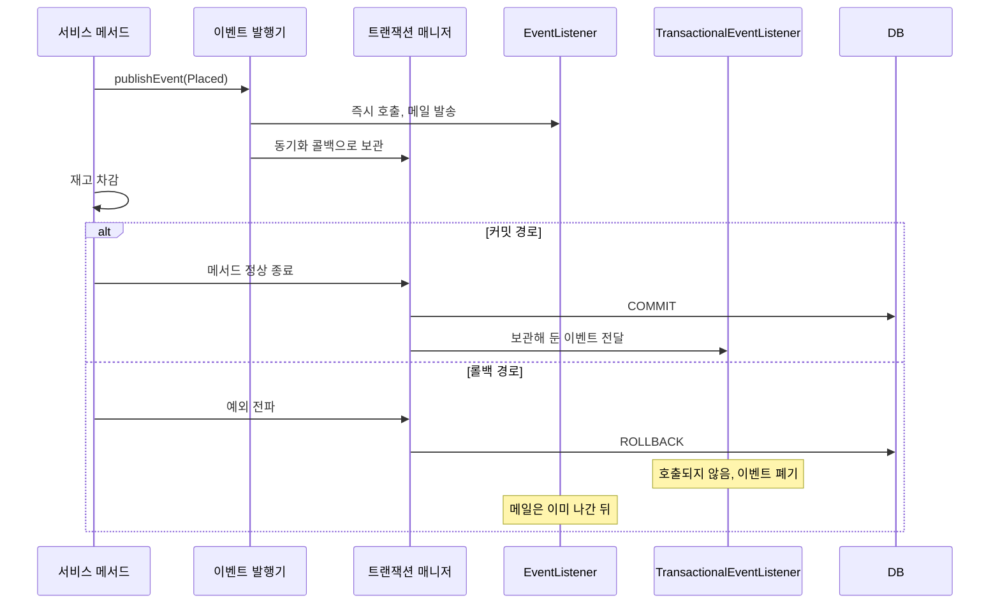
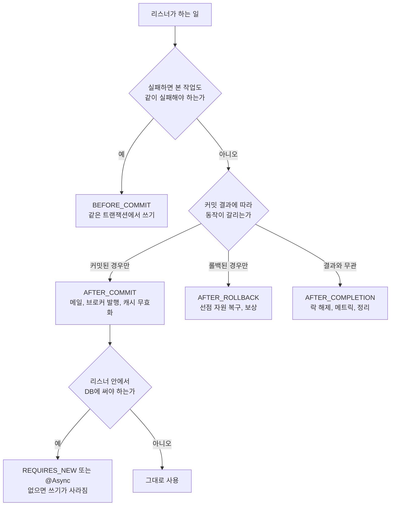
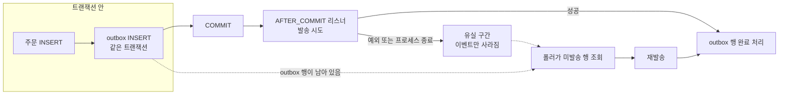

# Spring TransactionalEventListener와 TransactionSynchronization

주문 서비스에서 "주문 접수" 이벤트를 `@EventListener`로 받아 메일을 보내던 코드가 있었다. 재고 차감에서 예외가 터져 주문은 롤백됐는데 고객에게는 접수 메일이 갔다. 이벤트를 발행하는 줄과 커밋되는 시점이 다르다는 걸 놓친 전형적인 사고다. 이 문서는 그 간격을 `@TransactionalEventListener`와 `TransactionSynchronization`으로 어떻게 메우는지, 메우고 나서 어디서 다시 깨지는지를 다룬다.

아래 결과는 전부 Spring Boot 3.3.5(Spring Framework 6.1.14), Hibernate 6, H2 환경에서 직접 돌려 얻은 것이다. 버전이 다르면 AFTER_COMMIT 리스너가 호출되는 단계 같은 세부가 달라질 수 있어서 6.1.14 기준이라는 점을 밝혀 둔다. 커밋 후 처리를 `afterCommit()`과 비교한 표, 풀 고갈 계산은 [AOP_트랜잭션](AOP_트랜잭션.md)에 있고, 여기서는 리스너 쪽 동작을 하나씩 파고든다.

---

## 롤백됐는데 메일이 나간다

같은 이벤트를 두 종류의 리스너가 받게 하고, 서비스 메서드를 커밋 경로와 롤백 경로로 한 번씩 돌렸다.

```java
@Transactional
public void place(String name, boolean fail) {
    repo.save(new Order(name));
    publisher.publishEvent(new Placed(name));
    log.info("publishEvent 반환, 아직 커밋 전");
    if (fail) throw new IllegalStateException("재고 부족");
}

@EventListener
void plainMail(Placed e) { log.info("메일 발송(@EventListener) {}", e.name()); }

@TransactionalEventListener
void txMail(Placed e) { log.info("메일 발송(@TransactionalEventListener) {}", e.name()); }
```

로그는 이렇게 나왔다.

```
===== 커밋
메일 발송(@EventListener) A1
publishEvent 반환, 아직 커밋 전
메일 발송(@TransactionalEventListener) A1
===== 롤백
메일 발송(@EventListener) A2
publishEvent 반환, 아직 커밋 전
호출자: 예외 받음 IllegalStateException: 재고 부족
```

`@EventListener`는 `publishEvent()` 안에서 동기로 실행된다. 메서드가 끝나기도 전이다. 롤백 경로에서 `A2` 메일이 이미 나갔고 DB에는 `A2` 주문이 없다. `@TransactionalEventListener`는 커밋 경로에서만 호출됐고 롤백 경로에서는 한 줄도 없다.

두 경로를 나란히 놓고 보면, 갈리는 지점은 `publishEvent()` 직후다. 커밋 경로에서 `TransactionalEventListener`가 호출되는 시점은 서비스 메서드가 끝나 `COMMIT`이 나간 뒤다.



`@EventListener` 쪽 화살표는 `publishEvent()` 안에서 끝나고, `@TransactionalEventListener`는 트랜잭션 매니저에 보관됐다가 커밋 결과가 나온 뒤에야 호출된다.

### 보관한다는 것의 의미

`@TransactionalEventListener`가 붙은 메서드는 이벤트가 발행될 때 바로 호출되지 않는다. 발행 시점에 현재 스레드의 트랜잭션 동기화 목록에 콜백 하나가 등록되고, 트랜잭션이 끝나는 단계에서 그 콜백이 리스너를 부른다. `TransactionSynchronizationManager`가 스레드별로 들고 있는 목록이다.

이 구조에서 나오는 성질이 몇 개 있다.

- 이벤트 객체는 발행 시점의 참조를 그대로 들고 있는다. 커밋 전에 그 객체의 필드를 바꾸면 리스너는 바뀐 값을 본다. 불변 객체(record)로 만드는 이유가 여기에 있다.
- 발행한 스레드와 트랜잭션이 끝나는 스레드가 같아야 한다. 동기화 목록이 ThreadLocal이라서 다른 스레드에서 `publishEvent()`를 부르면 등록할 트랜잭션이 없다.
- 리스너는 이벤트를 발행한 트랜잭션의 결과에만 묶인다. 바깥 트랜잭션이 롤백돼도 안쪽 `REQUIRES_NEW`가 커밋됐다면 안쪽에서 발행한 이벤트는 호출된다. 실제로 바깥에서 `outer` 주문을 저장하고 안쪽 `REQUIRES_NEW` 메서드에서 이벤트를 발행한 뒤 바깥이 예외를 던지게 했더니, `AFTER_COMMIT inner`가 찍히고 `outer` 주문은 DB에 없었다. 이벤트를 어느 메서드에서 발행하는지가 곧 어느 트랜잭션에 묶이는지다.

---

## phase 4종

`phase` 속성으로 리스너가 호출되는 단계를 고른다. 기본값은 `AFTER_COMMIT`이다. 같은 이벤트에 4개 phase 리스너를 모두 달고 커밋과 롤백을 한 번씩 돌린 결과다.

```
===== 커밋
BEFORE_COMMIT     [tx=true sync=true]
AFTER_COMMIT      [tx=true sync=false]
AFTER_COMPLETION  [tx=true sync=false]
===== 롤백
AFTER_ROLLBACK    [tx=true sync=false]
AFTER_COMPLETION  [tx=true sync=false]
```

`tx`는 `isActualTransactionActive()`, `sync`는 `isSynchronizationActive()` 값이다.

| phase | 호출되는 경우 | 이 시점의 DB 트랜잭션 | 리스너 예외 |
|---|---|---|---|
| BEFORE_COMMIT | 커밋 직전, 롤백 경로에서는 호출 안 됨 | 열려 있음 | 커밋을 막고 롤백, 호출자에게 전파 |
| AFTER_COMMIT | 커밋 성공 후 | 이미 끝남 | 로그만 남고 삼켜짐 |
| AFTER_ROLLBACK | 롤백 후 | 이미 끝남 | 로그만 남고 삼켜짐 |
| AFTER_COMPLETION | 커밋이든 롤백이든 끝난 뒤 | 이미 끝남 | 로그만 남고 삼켜짐 |

BEFORE_COMMIT 리스너에서 예외를 던지게 했더니 호출자가 `IllegalStateException: before failed`를 받았고 해당 주문은 DB에 남지 않았다. 같은 트랜잭션 안이라는 말이 이 뜻이다. 반대로 BEFORE_COMMIT 리스너에서 `auditRepo.save()`를 하면 주문과 감사 로그가 한 번에 커밋된다. 아웃박스 행을 이 단계에서 넣는 방식이 이래서 성립한다.

### 단계별 용도

BEFORE_COMMIT은 "이 쓰기가 실패하면 본 작업도 실패해야 한다"일 때 쓴다. 아웃박스 행 저장, 같은 트랜잭션에 묶어야 하는 감사 로그가 해당한다.

AFTER_COMMIT은 외부로 나가는 부수 효과 전용이다. 메일, 푸시, 메시지 브로커 발행, 캐시 무효화처럼 "DB에 확정된 사실만 알려야 하는" 일이다. 기본값이 이거라서 phase를 안 적은 리스너 대부분이 여기에 들어간다.

AFTER_ROLLBACK은 선점한 자원을 되돌리는 데 쓴다. Redis에서 재고를 먼저 차감해 두고 DB 작업을 했다면, 롤백된 경우에만 재고를 복구해야 한다. 서비스 메서드에서 `catch`로 복구하면 예외 종류마다 분기가 늘어나는데, AFTER_ROLLBACK은 롤백이라는 결과 하나만 보면 된다. 단, 프로세스가 죽으면 이 리스너도 안 돈다.

AFTER_COMPLETION은 결과와 무관한 정리다. 분산 락 해제, 메트릭 기록, 요청 스코프 자원 닫기 같은 것이다. 커밋이든 롤백이든 호출되므로 "성공했는지"는 모른다. 성공 여부가 필요하면 `TransactionSynchronization`을 직접 등록해 `afterCompletion(int status)`로 받아야 한다.

선택 순서는 이렇게 본다. 질문은 세 개다. 실패하면 본 트랜잭션도 실패해야 하는가, 커밋 결과에 따라 달라지는가, 어느 쪽이든 해야 하는가.



E에서 H로 이어지는 부분이 다음 절의 주제다. AFTER_COMMIT을 골랐다고 끝이 아니고, 리스너 안에서 DB를 건드리는지에 따라 한 번 더 갈린다.

---

## AFTER_COMMIT 리스너의 DB 쓰기가 사라진다

AFTER_COMMIT 리스너가 호출되는 시점에 트랜잭션은 이미 커밋됐지만, 스레드에 묶인 트랜잭션 자원(`EntityManagerHolder`, 커넥션 홀더)은 아직 정리되기 전이다. 그 상태에서 리스너가 `@Transactional` 서비스나 `repository.save()`를 부르면 REQUIRED 전파가 "이미 트랜잭션이 있다"고 판단하고 거기에 참여한다. 참여했을 뿐 커밋을 책임지는 쪽은 없다.

같은 이벤트에 쓰기 방식만 다른 리스너를 5개 만들고 한 번에 하나씩 돌렸다.

```java
@TransactionalEventListener(phase = AFTER_COMMIT, condition = "#e.mode == 'required'")
void writeRequired(Placed e) { auditRepo.save(new Audit("required:" + e.name())); }

@TransactionalEventListener(phase = AFTER_COMMIT, condition = "#e.mode == 'jdbc'")
void writeJdbc(Placed e) { jdbc.update("insert into audit(msg) values (?)", "jdbc:" + e.name()); }

@TransactionalEventListener(phase = AFTER_COMMIT, condition = "#e.mode == 'new'")
void writeNew(Placed e) { writer.write("new:" + e.name()); }   // 별도 빈, REQUIRES_NEW

@Async
@TransactionalEventListener(phase = AFTER_COMMIT, condition = "#e.mode == 'async'")
void writeAsync(Placed e) { auditRepo.save(new Audit("async:" + e.name())); }

@Transactional(propagation = Propagation.REQUIRES_NEW)
@TransactionalEventListener(phase = AFTER_COMMIT, condition = "#e.mode == 'onlistener'")
void writeOnListener(Placed e) { auditRepo.save(new Audit("onlistener:" + e.name())); }
```

실행 후 `audit` 테이블 내용이다.

| 방식 | audit에 남았는가 | 비고 |
|---|---|---|
| `repository.save()` (REQUIRED 참여) | 없음 | 예외 없음, `save()`는 정상 반환 |
| `JdbcTemplate.update()` | 있음 | Hikari 기본 auto-commit=true일 때만 |
| 별도 빈의 REQUIRES_NEW | 있음 | 새 트랜잭션, 새 커넥션 |
| `@Async` | 있음 | 다른 스레드, 트랜잭션 자원 없음 |
| 리스너 메서드에 REQUIRES_NEW | 있음 | 기동 시 허용되는 유일한 `@Transactional` 조합 |

첫 줄이 사고 원인이다. `spring.jpa.show-sql=true`로 다시 돌려 보니 `required` 경우에는 `insert into audit` 문 자체가 나가지 않았다. `save()`는 영속성 컨텍스트에 쌓기만 하고, 그걸 flush하는 쪽이 없어서 컨텍스트와 함께 버려진다. 에러도 경고도 없다. 로그에 `audit`이 없고 테스트에서도 AFTER_COMMIT 리스너를 따로 검증하지 않으면 한참 뒤에야 발견된다.

JDBC 행은 더 헷갈린다. 같은 코드를 `-Dspring.datasource.hikari.auto-commit=false`로 돌렸더니 `jdbc:` 행이 사라졌다. 풀 기본값에 기대어 우연히 남던 쓰기였다. 풀 설정을 바꾸는 쪽은 리스너 코드를 모르니, 이런 건 설정 변경 후에 알림 이력만 비는 증상으로 나타난다.

### 어느 쪽을 쓰는가

REQUIRES_NEW와 `@Async`는 서로 다른 것을 얻고 다른 것을 잃는다.

- REQUIRES_NEW는 호출자 스레드에서 동기로 돈다. 리스너가 끝나야 서비스 메서드가 반환된다. 그동안 원래 트랜잭션의 커넥션이 아직 풀로 돌아가지 않아서 요청 하나가 커넥션을 둘 쥔다. 풀 크기만큼 동시 요청이 몰리면 전부 두 번째 커넥션을 기다리며 멈춘다.
- `@Async`는 호출자를 기다리게 하지 않는다. 대신 스레드 풀이 감당하지 못하면 큐에서 기다리거나 거부되고, 예외는 호출자가 아니라 `AsyncUncaughtExceptionHandler`로 간다. 프로세스가 죽으면 큐에 있던 이벤트가 사라진다.
- `@Async` 리스너 안에서는 트랜잭션 자원이 없으니 `repository.save()`가 자기 트랜잭션을 새로 연다. 실험에서도 `async 저장 [tx=false]`로 찍혔다.

리스너에서 지연 로딩 연관 객체를 건드리는 것도 같은 맥락이다. 커밋 후에는 영속성 컨텍스트가 곧 닫히므로 이벤트에는 엔티티를 담지 말고 ID와 필요한 값만 담는다. `@Async`로 넘기면 다른 스레드에서 이미 닫힌 컨텍스트의 프록시를 읽게 된다.

---

## 트랜잭션이 없으면 호출되지 않는다

`@TransactionalEventListener`는 이벤트 발행 시점에 활성 트랜잭션 동기화가 없으면 그 이벤트를 버린다. 예외도 없고 INFO 로그도 없다. 트랜잭션 없이 서비스 메서드를 호출하게 한 결과다.

```
===== 트랜잭션 없음
s4 fallbackExecution 리스너 호출됨 [tx=false sync=false]
호출자: 정상 반환
```

같은 이벤트를 받는 리스너가 둘 있었는데 `fallbackExecution = true`인 쪽만 호출됐다. 기본 리스너는 조용히 건너뛴다. `org.springframework.transaction.event` 패키지를 DEBUG로 올리면 `No transaction is active - skipping ...` 한 줄이 찍히지만, 평소 로그 레벨에서는 보이지 않는다.

이 상황은 개발자가 의도해서 만드는 게 아니다. 서비스 메서드에서 `@Transactional`을 빼먹었거나, 같은 클래스 안에서 `this.place()`로 호출해 프록시를 건너뛰었거나, `private` 메서드에 붙인 경우에 생긴다. 테스트에서 리스너 동작을 확인하는데 `@Transactional` 테스트가 롤백되는 바람에 AFTER_COMMIT이 한 번도 안 불리는 일도 흔하다. 이벤트 자체는 잘 발행되고 있어서 원인을 찾는 데 시간이 걸린다.

`fallbackExecution = true`를 켜면 트랜잭션이 없을 때 즉시 실행된다. 이때는 phase를 보지 않는다. 트랜잭션이 없으니 "커밋 후"라는 개념이 없어서 발행 즉시 호출된다. 그러니 이 옵션은 "트랜잭션 안에서 불리면 커밋 후, 밖에서 불리면 바로" 처리하고 싶은 캐시 무효화 같은 곳에 쓴다. 메일처럼 반드시 커밋 후여야 하는 작업에 켜면, 누군가 트랜잭션 없이 호출한 순간 커밋 개념 없이 나가 버려서 첫 절의 사고로 돌아간다.

---

## AFTER_COMMIT 단계의 예외는 사라진다

AFTER_COMMIT 리스너가 예외를 던지는 경우를 두 방식으로 비교했다. `@TransactionalEventListener`와 `TransactionSynchronizationManager.registerSynchronization()`으로 직접 등록한 `afterCommit()`이다.

```
===== @TransactionalEventListener AFTER_COMMIT 예외
ERROR o.s.t.s.TransactionSynchronizationUtils : TransactionSynchronization.afterCompletion threw exception
java.lang.IllegalStateException: notify failed
호출자: 정상 반환
주문 E는 DB에 있음

===== 직접 등록한 afterCommit() 예외
sync.afterCommit [tx=true sync=true]
sync.afterCompletion status=COMMITTED
호출자: 예외 받음 IllegalStateException: afterCommit boom
```

6.1.14에서는 `@TransactionalEventListener`의 AFTER_COMMIT이 내부적으로 `afterCompletion` 단계에서 실행되고, 거기서 난 예외는 로그만 남기고 삼켜진다. AFTER_ROLLBACK과 AFTER_COMPLETION 리스너에서 던져도 같은 ERROR 로그만 남고 호출자는 원래 결과(롤백이면 원래 예외, 커밋이면 정상 반환)를 그대로 받았다. 서비스 메서드는 정상 반환하고 주문은 커밋됐으며 알림은 나가지 않았다. 같은 이벤트에 AFTER_COMMIT 리스너가 둘이면 앞의 것이 실패해도 뒤의 것은 호출됐다. 실험에서 `@Order(1)`로 실패 리스너를 앞에 두었더니 ERROR 로그 다음에 두 번째 리스너가 정상 실행됐다.

직접 등록한 `afterCommit()`은 반대다. 예외가 호출자까지 올라온다. 호출자는 "주문 실패"로 받아들이는데 DB에는 주문이 커밋돼 있다. 클라이언트나 상위 서비스가 재시도하면 같은 주문이 다시 들어간다. 직접 등록할 때는 `afterCommit()` 안에서 예외가 새어 나가지 않게 try-catch로 감싸 로그와 보상 경로를 직접 정해야 한다.

어느 쪽이든 커밋과 외부 부수 효과 사이에는 원자성이 없다. 유실되는 구간을 그려 보면 어디를 보완해야 하는지 보인다.



실선만 따라가면 리스너만 쓰는 구조이고, `F`에서 끝난다. 점선이 outbox 행이 있는 구조로, 리스너가 실패해도 DB에 행이 남아서 폴러가 다시 집어 간다. 폴러가 주력이고 AFTER_COMMIT 리스너는 지연을 줄이려고 폴러를 바로 깨우는 보조로 쓴다. 재발송이 일어나므로 받는 쪽은 멱등이어야 한다. outbox 테이블 설계와 폴러 구현은 [트랜잭셔널 아웃박스 패턴](../../../Architecture/MSA/트랜잭셔널_아웃박스_패턴.md)에서 다룬다.

유실을 감수해도 되는 작업과 아닌 작업은 갈린다. 캐시 무효화는 TTL이 결국 해결하니 AFTER_COMMIT으로 충분하다. 결제 완료 알림, 정산 데이터 전달, 다른 서비스로 가는 상태 변경 이벤트는 한 건이라도 빠지면 안 되니 outbox가 필요하다. 이벤트 설계 쪽 맥락은 [Domain Event](../../../Architecture/DDD/Domain_Event.md)에 있다.

---

## registerSynchronization으로 직접 등록하기

이벤트를 만들 만큼의 일이 아니거나, 커밋 결과 상태(`COMMITTED`, `ROLLED_BACK`)를 직접 봐야 할 때는 서비스 안에서 등록한다.

```java
@Transactional
public void directSync(boolean fail) {
    repo.save(new Order("direct"));
    TransactionSynchronizationManager.registerSynchronization(new TransactionSynchronization() {
        @Override public void beforeCommit(boolean readOnly) {
            log.info("sync.beforeCommit");
        }
        @Override public void afterCommit() {
            log.info("sync.afterCommit");
        }
        @Override public void afterCompletion(int status) {
            log.info("status={}", status == STATUS_COMMITTED ? "COMMITTED"
                                : status == STATUS_ROLLED_BACK ? "ROLLED_BACK" : "UNKNOWN");
        }
    });
    if (fail) throw new IllegalStateException("fail");
}
```

실행하면 커밋 경로에서는 `beforeCommit`, `afterCommit`, `afterCompletion(COMMITTED)`가 차례로, 롤백 경로에서는 `afterCompletion(ROLLED_BACK)`만 찍혔다. 인터페이스 메서드는 기본 구현이 비어 있어서 필요한 것만 오버라이드한다. 리스너 방식과 다르게 `afterCompletion`이 상태 코드를 받는다.

트랜잭션 밖에서 등록하면 바로 터진다.

```
IllegalStateException: Transaction synchronization is not active
```

`@TransactionalEventListener`가 조용히 버리는 것과 반대다. 호출 경로가 트랜잭션 안일 수도 밖일 수도 있는 공용 코드라면 등록 전에 확인한다.

```java
if (TransactionSynchronizationManager.isSynchronizationActive()) {
    TransactionSynchronizationManager.registerSynchronization(sync);
} else {
    sync.afterCommit();   // 트랜잭션이 없으면 바로 실행
}
```

`isActualTransactionActive()`와 `isSynchronizationActive()`는 다른 값이다. 앞의 것은 실제 DB 트랜잭션이 있는지, 뒤의 것은 동기화 콜백을 받을 수 있는지다. 이 문서의 phase 실험에서도 AFTER_COMMIT 리스너 안에서는 `tx=true`인데 `sync=false`였다. 콜백 안에서 또 콜백을 등록하려 하면 등록할 곳이 없다.

직접 등록이 맞는 곳은 대개 좁다. 서비스 하나에서만 쓰는 후처리, 요청 단위 자원 정리, 상태 코드를 봐야 하는 로직이다. 여러 도메인이 같은 사실에 반응해야 하면 이벤트로 분리하는 편이 낫다. 서비스 코드가 후처리 목록을 알고 있으면 후처리가 하나 늘 때마다 서비스를 고쳐야 한다.

---

## 증상으로 찾는 원인

| 증상 | 원인 | 확인 방법 |
|---|---|---|
| 롤백된 주문의 알림이 나갔다 | `@EventListener` 사용, 커밋 전에 즉시 실행 | 리스너 어노테이션 확인 |
| 리스너가 한 번도 안 불린다 | 트랜잭션 밖에서 발행, 프록시 우회, 테스트의 롤백 | `org.springframework.transaction.event` DEBUG 로그 |
| 리스너에서 저장한 행이 없는데 에러도 없다 | AFTER_COMMIT에서 REQUIRED로 참여 | 리스너 안 쓰기 경로에 REQUIRES_NEW 또는 `@Async` |
| 설정 변경 후 리스너가 저장한 이력이 비었다 | JDBC 쓰기가 풀 auto-commit 기본값에 기대고 있었음 | 풀의 auto-commit 값 |
| 서비스는 성공인데 알림이 안 갔다 | AFTER_COMMIT 예외가 로그로만 남음 | `TransactionSynchronizationUtils` ERROR 로그 |
| 호출자는 실패를 받았는데 데이터는 커밋됐다 | 직접 등록한 `afterCommit()`의 예외가 전파됨 | `afterCommit()` 안 try-catch |
| 서버 재배포 때마다 이벤트가 한두 건 빠진다 | 커밋 직후 프로세스 종료, 인메모리 이벤트는 복구 불가 | outbox 도입 |
| 리스너 기동 시 `must not be annotated with @Transactional` | 리스너에 REQUIRED `@Transactional` | `REQUIRES_NEW` 또는 `NOT_SUPPORTED`만 허용 |
