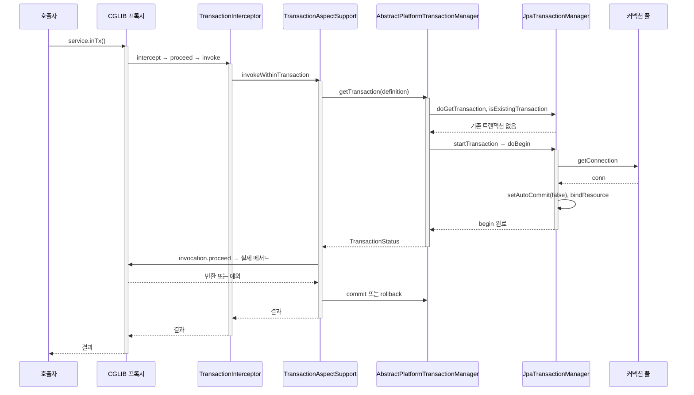
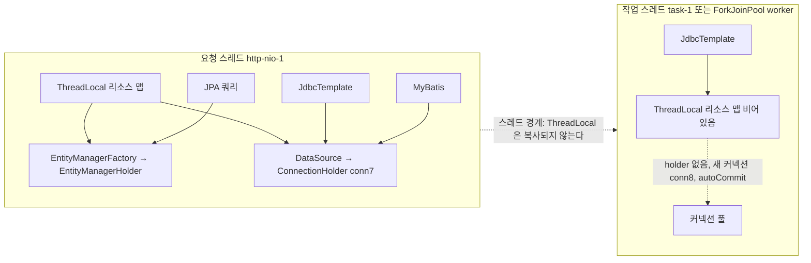
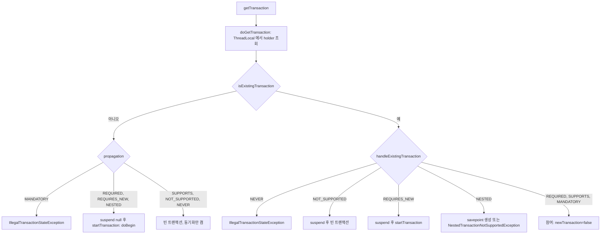
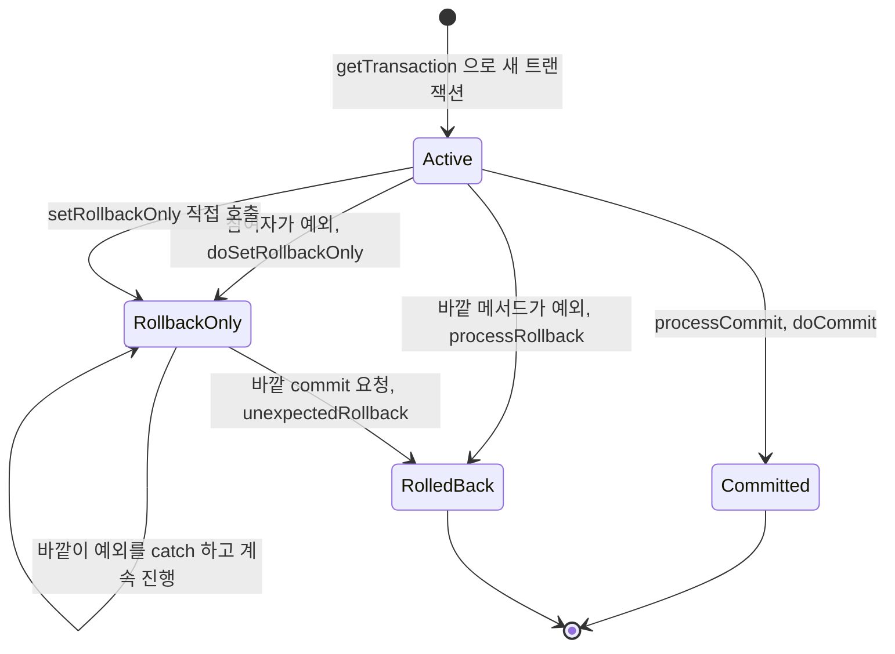
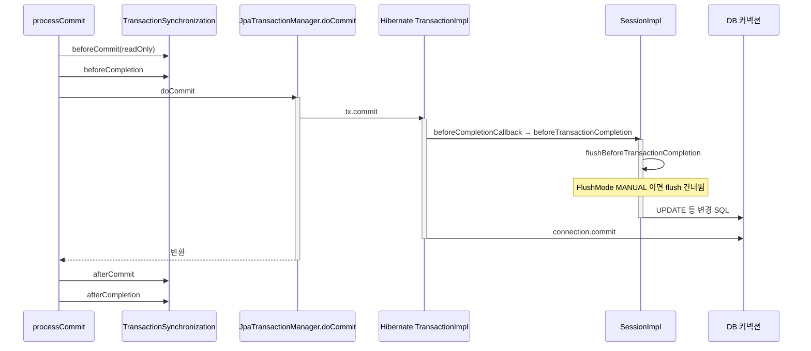
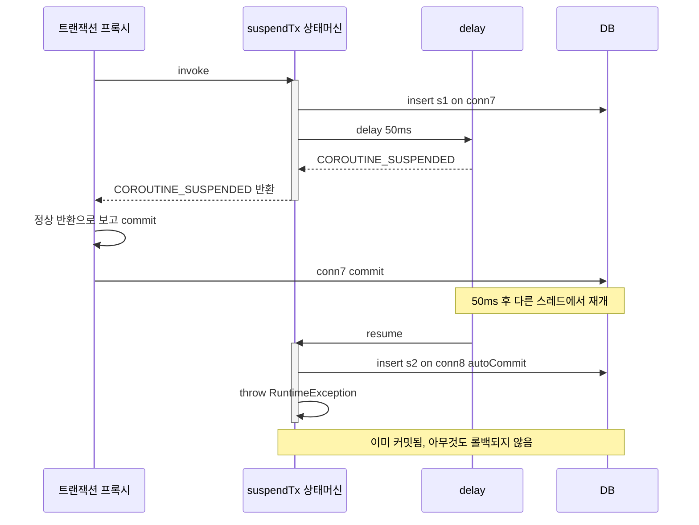

# Spring 트랜잭션 내부 동작 소스 추적

`@Transactional` 이 붙은 메서드가 끝났는데 DB에는 아무것도 없고, 로그에는 `UnexpectedRollbackException` 만 남아 있는 상황을 한 번쯤 만난다. 바깥 메서드는 안쪽 예외를 분명히 `catch` 했다. 이런 증상은 규칙을 외워서는 잘 안 풀리고, `getTransaction` 이 무엇을 보고 어느 분기로 갔는지를 알아야 원인이 보인다.

[AOP_트랜잭션](AOP_트랜잭션.md)은 증상과 대응을 다룬다. 이 문서는 같은 현상을 소스 레벨로 따라간다. 프록시가 호출을 가로챈 시점부터 `setAutoCommit(false)`, ThreadLocal 바인딩, 커밋 직전 flush, 스레드가 바뀌어 트랜잭션을 잃는 지점까지다.

실험 환경은 Spring Framework 6.1.14(Boot 3.3.5), Hibernate 6.5.3.Final, HikariCP, H2 2.2.224, Java 17이다. MyBatis는 mybatis-spring 3.0.3, 코루틴은 Kotlin 1.9.25 / kotlinx-coroutines 1.8.1을 썼다. Hikari 풀 크기는 5이고 `open-in-view=false` 다. 커넥션 획득과 반환을 보려고 `DataSource` 를 감싸는 로깅 프록시를 하나 넣었다. 로그에서 `LAB conn#7 ...` 으로 시작하는 줄이 그 프록시가 찍은 것이고, 나머지는 Spring과 Hibernate가 직접 찍은 로그다. 로그 패턴은 `%logger{0} : %msg%n` 으로 줄여서 클래스 이름만 남겼다. 소스 줄 번호는 전부 6.1.14 기준이라 버전이 다르면 몇 줄씩 밀린다.

## 프록시에서 doBegin까지

`@Transactional` 빈은 CGLIB 프록시로 감싸진다. 호출은 `CglibAopProxy$DynamicAdvisedInterceptor.intercept` 로 들어와 어드바이스 체인을 `ReflectiveMethodInvocation.proceed` 로 돌린다. 체인에 `TransactionInterceptor` 가 있고, 이 클래스가 하는 일은 사실상 한 줄이다.

```java
// TransactionInterceptor.invoke (L112-120)
return invokeWithinTransaction(invocation.getMethod(), targetClass, invocation::proceed);
```

실제 로직은 부모 클래스 `TransactionAspectSupport.invokeWithinTransaction`(L341)에 있다. 여기서 `TransactionAttribute` 를 읽고, 트랜잭션 매니저를 고르고, `createTransactionIfNecessary`(L588)를 부른다. 이 메서드가 트랜잭션 이름을 `클래스.메서드` 로 정해서 `getTransaction` 에 넘긴다. 로그에 `name [lab.jpa.SameConnectionService.inTx]` 가 찍히는 근거가 이 부분이다.

`getTransaction` 은 `AbstractPlatformTransactionManager`(L373)에 있다. 서브클래스가 구현하는 훅은 `doGetTransaction`, `isExistingTransaction`, `doBegin`, `doSuspend`, `doResume`, `doCommit`, `doRollback`, `doSetRollbackOnly`, `doCleanupAfterCompletion` 이고, 나머지 흐름(분기, 동기화 콜백, 예외 변환)은 전부 이 추상 클래스가 쥐고 있다. 매니저를 바꿔도 전파 동작이 비슷한 이유다.



다이어그램은 JPA 기준이라 `doBegin` 안에서 Hibernate가 끼는데, DSTM(`DataSourceTransactionManager`)이면 `JT` 자리에서 Spring이 직접 `getConnection` 과 `setAutoCommit(false)` 를 부른다. 위쪽 5단계(프록시, 인터셉터, `invokeWithinTransaction`, `getTransaction`, `startTransaction`)는 매니저와 상관없이 같다.

JPA 환경에서 `getConnection` 이 호출되는 순간의 스택을 찍어 보면 이 순서가 그대로 나온다.

```text
LoggingDs.getConnection
 ← LogicalConnectionManagedImpl.acquireConnectionIfNeeded
 ← LogicalConnectionManagedImpl.getConnectionForTransactionManagement
 ← LogicalConnectionManagedImpl.begin
 ← JdbcResourceLocalTransactionCoordinatorImpl$TransactionDriverControlImpl.begin
 ← TransactionImpl.begin
 ← HibernateJpaDialect.beginTransaction
 ← JpaTransactionManager.doBegin
 ← AbstractPlatformTransactionManager.startTransaction
 ← AbstractPlatformTransactionManager.getTransaction
 ← TransactionAspectSupport.createTransactionIfNecessary
 ← TransactionAspectSupport.invokeWithinTransaction
 ← TransactionInterceptor.invoke
 ← ReflectiveMethodInvocation.proceed
 ← CglibAopProxy$DynamicAdvisedInterceptor.intercept
 ← lab.jpa.SameConnectionService$SpringCGLIB$0.inTx
```

주목할 점은 JPA에서는 커넥션을 Spring이 직접 얻지 않는다는 것이다. `JpaTransactionManager.doBegin` 이 `EntityManager` 를 만들고 `entityManager.getTransaction().begin()` 을 부르면, Hibernate의 `LogicalConnectionManagedImpl` 이 그제야 `DataSource` 에서 커넥션을 가져온다. `setAutoCommit(false)` 도 Hibernate가 부른다. DSTM의 `doBegin` 은 반대로 Spring 코드가 이 일을 전부 직접 한다. 같은 `getTransaction` 아래에 있어도 커넥션을 쥐는 주체가 다른 셈이다.

## 커넥션이 ThreadLocal에 묶이는 과정

### DataSourceTransactionManager

`doBegin`(L262)의 순서는 이렇다.

1. 트랜잭션 객체에 `ConnectionHolder` 가 없으면 `dataSource.getConnection()` 으로 새 커넥션을 얻어 `ConnectionHolder` 에 담는다.
2. `DataSourceUtils.prepareConnectionForTransaction` 으로 격리 수준과 `readOnly` 를 커넥션에 반영한다. `readOnly=true` 면 `Connection.setReadOnly(true)` 가 여기서 호출된다.
3. 커넥션이 autoCommit 상태면 `mustRestoreAutoCommit` 을 켜고 `setAutoCommit(false)` 를 부른다.
4. `holder.setTransactionActive(true)` 로 활성 표시를 한다.
5. 새로 만든 holder라면 `TransactionSynchronizationManager.bindResource(dataSource, holder)` 로 현재 스레드에 묶는다.

`doGetTransaction` 은 반대로 `getResource(dataSource)` 로 holder를 꺼내고, `isExistingTransaction` 은 `holder.isTransactionActive()` 로 판단한다. "이미 트랜잭션이 있는가" 의 정체는 ThreadLocal 안의 holder에 켜진 플래그 하나다.

DSTM으로 돌린 로그다.

```text
DataSourceTransactionManager : Creating new transaction with name [Svc.begin]: PROPAGATION_REQUIRED,ISOLATION_DEFAULT
DataSourceTransactionManager : Acquired Connection [conn#2] for JDBC transaction
DataSourceTransactionManager : Switching JDBC Connection [conn#2] to manual commit
LAB conn#2 setAutoCommit(false)
body   res=[ConnectionHolder@a38c(conn#2)]
DataSourceTransactionManager : Initiating transaction commit
LAB conn#2 commit()
LAB conn#2 setAutoCommit(true)
DataSourceTransactionManager : Releasing JDBC Connection [conn#2] after transaction
LAB conn#2 close() -> pool
```

`res=[...]` 는 본문에서 `TransactionSynchronizationManager.getResourceMap()` 을 찍은 것이다. 바인딩된 키가 `DataSource` 하나이고 값이 `ConnectionHolder` 다. 정리 단계(`doCleanupAfterCompletion`)는 바인딩을 풀고, `setAutoCommit(true)` 로 되돌리고, `readOnly` 를 되돌리고, 커넥션을 풀에 반환한다. 커넥션 상태를 원래대로 돌려놓고 반환하는 쪽도 Spring이다.

### JpaTransactionManager

JPA는 키가 두 개다. `doBegin` 이 `EntityManager` 를 만들어 Hibernate에 `begin()` 을 시키고(위 스택), 이어서 `HibernateJpaDialect.getJdbcConnection` 으로 Hibernate가 쥔 JDBC 커넥션 핸들을 꺼내 `ConnectionHolder` 로 감싼다. 그리고 두 군데 모두에 바인딩한다.

```text
bindResource(EntityManagerFactory, EntityManagerHolder)
bindResource(DataSource,           ConnectionHolder)    // "Exposing JPA transaction as JDBC"
```

로그에서는 이렇게 보인다.

```text
JpaTransactionManager : Creating new transaction with name [lab.jpa.SameConnectionService.inTx]: PROPAGATION_REQUIRED,ISOLATION_DEFAULT
JpaTransactionManager : Opened new EntityManager [SessionImpl(...<open>)] for JPA transaction
LAB conn#7 getConnection (hikari active=1)
LAB conn#7 setAutoCommit(false)
HibernateJpaDialect   : Exposing JPA transaction as JDBC [...HibernateConnectionHandle@...]
TransactionInterceptor: Getting transaction for [lab.jpa.SameConnectionService.inTx]
body   res=[ConnectionHolder@6983(conn#7), EntityManagerHolder@ca1f]
TransactionInterceptor: Completing transaction for [lab.jpa.SameConnectionService.inTx]
JpaTransactionManager : Initiating transaction commit
JpaTransactionManager : Committing JPA transaction on EntityManager [...]
LAB conn#7 commit()
LAB conn#7 setAutoCommit(true)
JpaTransactionManager : Closing JPA EntityManager [...] after transaction
LAB conn#7 close() -> pool (hikari active=0)
```

`Exposing JPA transaction as JDBC` 줄이 중요하다. JPA 트랜잭션이 시작될 때 `DataSource` 키에도 holder가 올라가기 때문에, 같은 스레드에서 `JdbcTemplate` 이 들어와도 그 커넥션을 그대로 가져간다. 이 줄은 `JpaDialect` 가 JDBC 커넥션 노출을 지원할 때만 나온다. Hibernate는 지원하므로 JPA와 JDBC를 섞어 쓰는 코드가 한 트랜잭션에 묶인다.

두 매니저의 차이를 표로 모았다.

| 항목 | DataSourceTransactionManager | JpaTransactionManager |
|---|---|---|
| 커넥션을 얻는 주체 | Spring `doBegin` 이 `dataSource.getConnection()` | Hibernate `LogicalConnectionManagedImpl` |
| `setAutoCommit(false)` | Spring | Hibernate |
| ThreadLocal 키 | `DataSource` 1개 | `EntityManagerFactory` + `DataSource` 2개 |
| "기존 트랜잭션" 판정 | `ConnectionHolder.isTransactionActive()` | `EntityManagerHolder.isTransactionActive()` |
| `readOnly` 반영 | `Connection.setReadOnly(true)` | `FlushMode.MANUAL` + (커넥션 힌트) |
| 롤백 전용 상태에서 commit 요청 | `processRollback` 으로 전환 | `doCommit` 안에서 Hibernate가 롤백 |
| NESTED(savepoint) | 지원 | `NestedTransactionNotSupportedException` |

마지막 두 행은 뒤에서 로그로 다시 확인한다.

## 같은 스레드의 JdbcTemplate, JPA, MyBatis가 커넥션을 공유하는 이유

세 기술이 서로를 알지 못하는데도 같은 커넥션을 쓰는 이유는 모두 같은 조회 규칙을 따르기 때문이다. `DataSourceUtils.doGetConnection(dataSource)` 는 `TransactionSynchronizationManager.getResource(dataSource)` 로 holder를 찾고, 있으면 `holder.getConnection()` 을 돌려준다. `JdbcTemplate` 은 모든 쿼리마다 이 메서드로 커넥션을 얻는다. MyBatis의 `SpringManagedTransaction.openConnection` 도 `DataSourceUtils.getConnection` 을 부른다. JPA는 위에서 본 대로 자기 커넥션을 `DataSource` 키로 노출해 둔다.

그러니 공유는 우연이 아니라, 트랜잭션 시작 시점에 `DataSource` 키로 holder를 올려 두고 모두가 그 키로 찾는 구조다. 같은 `DataSource` 인스턴스가 아니면 키가 달라서 공유되지 않는다. 읽기용 `DataSource` 를 따로 두거나 `@Transactional` 이 엉뚱한 매니저를 가리키는 경우가 여기에 걸린다.

세 기술이 한 메서드 안에서 쓰는 커넥션을 직접 확인했다.

```java
@Transactional
public void inTx() {
    jdbc.update("insert into item(name) values (?)", "jdbc");
    em.persist(new Item("jpa")); em.flush();
    mapper.insert("mybatis");
    // 각각 H2 session_id() 를 JdbcTemplate / em.createNativeQuery / mapper 로 조회
}
```

```text
jdbc   session_id=3
jpa    session_id=3  (hibernate connection=conn#7)
mybatis session_id=3
rows after = [seed, jdbc, jpa, mybatis]
```

세 쿼리의 `session_id()` 가 같고, Hibernate가 쥔 커넥션도 `conn#7` 하나다. 트랜잭션 없이 같은 코드를 돌리면 그림이 달라진다.

```text
body start syncActive=false txActive=false name=null readOnly=false res=[]
LAB conn#7 getConnection ... close()     // JdbcTemplate 호출 1회
LAB conn#8 getConnection ... close()     // JPA
LAB conn#9 getConnection ... close()     // 네이티브 쿼리
LAB conn#10 getConnection ... close()    // MyBatis
```

호출마다 커넥션을 빌렸다 반납하고, 전부 autoCommit이다. `session_id` 숫자는 풀이 같은 물리 커넥션을 돌려 줘서 같게 나올 수 있지만 `conn#N` 래퍼는 매번 다르다. 트랜잭션이 없으면 "한 작업 단위" 라는 개념 자체가 없다.



왼쪽 스레드에서는 세 기술이 모두 `ConnectionHolder` 하나로 모인다. 오른쪽 스레드는 ThreadLocal이 비어 있어서 같은 `JdbcTemplate` 이라도 풀에서 새 커넥션을 빌려 autoCommit으로 쓴다. 이 경계를 실제로 넘어 본 결과는 "스레드 경계 실험" 절에 있다.

## getTransaction의 분기

`getTransaction` 의 앞부분은 단순하다. `doGetTransaction` 으로 트랜잭션 객체를 만들고(이때 ThreadLocal을 읽는다), `isExistingTransaction` 이 참이면 `handleExistingTransaction`(L426)으로 넘긴다. 아니면 propagation을 본다.

- `MANDATORY` 는 `IllegalTransactionStateException` 을 던진다.
- `REQUIRED`, `REQUIRES_NEW`, `NESTED` 는 `suspend(null)` 을 부르고 `startTransaction` 으로 새 트랜잭션을 연다. 중단할 게 없어서 `suspend(null)` 은 동기화만 정리한다.
- 나머지(`SUPPORTS`, `NOT_SUPPORTED`, `NEVER`)는 실제 트랜잭션 없이 "빈 트랜잭션" 상태를 만들고, 동기화(`TransactionSynchronization`)만 켠다. 이 동기화는 기본값인 `SYNCHRONIZATION_ALWAYS` 일 때 켜진다.



기존 트랜잭션이 있을 때의 분기가 실제로 어떻게 나오는지 JPA 환경에서 바깥 `@Transactional` 메서드가 각 propagation의 안쪽 메서드를 부르도록 해서 확인했다.

| 안쪽 propagation | 바깥 트랜잭션 있음 | 바깥 트랜잭션 없음 |
|---|---|---|
| REQUIRED | `Participating in existing transaction`, 같은 holder | 새 트랜잭션 |
| SUPPORTS | 참여, 같은 holder | `syncActive=true txActive=false res=[]` |
| MANDATORY | 참여 | `IllegalTransactionStateException: No existing transaction found for transaction marked with propagation 'mandatory'` |
| NOT_SUPPORTED | `Suspending current transaction`, 안쪽은 `txActive=false res=[]`, 끝나면 `Resuming` | `syncActive=true txActive=false res=[]` |
| NEVER | `IllegalTransactionStateException: Existing transaction found for transaction marked with propagation 'never'` | `syncActive=true txActive=false res=[]` |
| NESTED | `NestedTransactionNotSupportedException: JpaDialect does not support savepoints - check your JPA provider's capabilities` | 새 트랜잭션 |
| REQUIRES_NEW | 중단 후 새 트랜잭션 (다음 절) | 새 트랜잭션 |

세 가지는 짚어둘 만하다.

**트랜잭션이 없을 때 SUPPORTS, NOT_SUPPORTED, NEVER 는 `syncActive=true` 다.** 실제 트랜잭션은 없는데 동기화 컨텍스트는 켜져 있다. 그래서 이 구간에서 `registerSynchronization` 을 호출해도 예외가 나지 않는다. SUPPORTS 안에서 JDBC 쿼리를 두 번 날리면 첫 쿼리 이후 `res=[ConnectionHolder@0978(conn#7)]` 이 바인딩되고 두 번째 쿼리가 같은 `conn#7` 을 쓴다. 단일 `close` 는 구간 끝에 한 번 나온다. `DataSourceUtils` 는 동기화가 켜져 있으면 `ConnectionSynchronization` 을 등록해 구간이 끝날 때까지 커넥션을 쥐고 있기 때문이다. 단, 커밋은 없으니 autoCommit이고 쿼리마다 바로 반영된다.

**참여(participating)한 쪽의 `readOnly` 와 격리 수준은 무시된다.** 바깥이 일반 트랜잭션일 때 안쪽을 `@Transactional(readOnly = true, isolation = SERIALIZABLE)` 로 불러 봤는데, 안쪽에서 찍은 상태는 `name=...outerAll readOnly=false` 였다. 예외도 없다. `validateExistingTransaction` 의 기본값이 `false` 라서 검증이 꺼져 있는 것이다. 안쪽 메서드의 속성이 적용될 거라고 믿고 짠 코드는 조용히 틀린다. 검증을 켜면 `IllegalTransactionStateException` 으로 드러나지만, 켜기 전에 기존 코드가 얼마나 깨지는지는 따로 봐야 한다.

**NESTED는 JPA 기본 구성에서 못 쓴다.** 바깥 트랜잭션 안에서 `Creating nested transaction with name [lab.jpa.PropagationService$Inner.nested]` 까지 나온 다음 위 예외가 난다. DSTM이면 JDBC savepoint로 동작한다(`useSavepointForNestedTransaction` 경로의 `createAndHoldSavepoint`). 이 점은 AOP_트랜잭션 문서의 NESTED 절과 같은 결과다.

## REQUIRES_NEW에서 ConnectionHolder가 중단되고 재개되는 과정

`suspend(transaction)` 은 세 가지를 한다.

1. 등록된 `TransactionSynchronization` 들을 `doSuspendSynchronization` 으로 떼어 낸다.
2. 서브클래스의 `doSuspend(transaction)` 을 부른다. DSTM은 `unbindResource(dataSource)` 로 holder를 ThreadLocal에서 빼고, JPA는 `EntityManagerFactory` 키와 `DataSource` 키 둘 다 뺀다.
3. 트랜잭션 이름, `readOnly`, 격리 수준, 활성 여부를 비워 두고, 떼어 낸 값들을 `SuspendedResourcesHolder` 에 담아 새 `TransactionStatus` 에 달아 둔다.

그러면 ThreadLocal이 비어서 `doGetTransaction` 은 "기존 트랜잭션 없음" 을 만나고, 새 `doBegin` 이 새 커넥션을 얻어 새 holder를 바인딩한다. 안쪽 트랜잭션이 끝나면 `cleanupAfterCompletion` 이 새 holder를 풀고, 상태에 달린 `suspendedResources` 가 있으면 `resume` 으로 원래 holder를 다시 바인딩한다. 풀어 둔 holder 객체는 그대로 보관됐다 돌아오므로 커넥션과 `EntityManager` 가 바뀌지 않는다.

로그로 보면 holder 해시가 되돌아오는 게 확인된다.

```text
outer before   res=[ConnectionHolder@8770(conn#7), EntityManagerHolder@a54f]
JpaTransactionManager : Found thread-bound EntityManager [...] for JPA transaction
JpaTransactionManager : Suspending current transaction, creating new transaction with name [lab.jpa.PropagationService$Inner.requiresNew]
LAB conn#8 getConnection (hikari active=2)
LAB conn#8 setAutoCommit(false)
inner          res=[ConnectionHolder@81ed(conn#8), EntityManagerHolder@92e5]
LAB conn#8 SQL insert into item(name) values (?)
LAB conn#8 commit()
LAB conn#8 close() -> pool (hikari active=1)
JpaTransactionManager : Resuming suspended transaction after completion of inner transaction
outer after    res=[ConnectionHolder@8770(conn#7), EntityManagerHolder@a54f]
LAB conn#7 commit()
rows=[seed, inner-new]
```

`hikari active=2` 가 이 전파 방식의 비용이다. 바깥 커넥션 `conn#7` 은 풀에 반납되지 않은 채 중단 상태로 쥐어져 있고, 안쪽이 `conn#8` 을 추가로 빌린다. 풀 크기가 5인데 스레드 5개가 모두 바깥 트랜잭션 안에서 REQUIRES_NEW를 만나면 아무도 두 번째 커넥션을 얻지 못한다. 이 계산은 AOP_트랜잭션 문서의 풀 고갈 절에 있다.

## rollback-only 마킹과 UnexpectedRollbackException

### 재현 코드

```java
@Transactional
public void outerCatchesInner(boolean requiresNew, boolean rethrow) {
    jdbc.update("insert into item(name) values (?)", "outer-before");
    try {
        if (requiresNew) inner.requiresNewThrows(); else inner.requiredThrows();
    } catch (IllegalStateException e) {
        // 예외를 삼키고 계속 진행
    }
    jdbc.update("insert into item(name) values (?)", "outer-after");
    if (rethrow) throw new IllegalArgumentException("outer own failure");
}

// Inner
@Transactional
public void requiredThrows() {
    jdbc.update("insert into item(name) values (?)", "inner");
    throw new IllegalStateException("inner boom");
}
```

바깥은 안쪽 예외를 잡았고 이후 코드도 정상 실행됐다. 그런데 바깥 메서드가 끝나는 지점에서 예외가 올라온다. 로그를 DSTM으로 돌린 것부터 본다.

```text
DataSourceTransactionManager : Creating new transaction with name [...outerCatchesInner]
before inner isRollbackOnly=false
DataSourceTransactionManager : Participating in existing transaction
TransactionInterceptor : Getting transaction for [...Inner.requiredThrows]
TransactionInterceptor : Completing transaction for [...Inner.requiredThrows] after exception: java.lang.IllegalStateException: inner boom
DataSourceTransactionManager : Participating transaction failed - marking existing transaction as rollback-only
DataSourceTransactionManager : Setting JDBC transaction [conn#2] rollback-only
outer caught inner boom
after catch isRollbackOnly=true
TransactionInterceptor : Completing transaction for [...outerCatchesInner]
DataSourceTransactionManager : Global transaction is marked as rollback-only but transactional code requested commit
DataSourceTransactionManager : Initiating transaction rollback
DataSourceTransactionManager : Rolling back JDBC transaction on Connection [conn#2]
LAB conn#2 rollback()
RESULT threw org.springframework.transaction.UnexpectedRollbackException: Transaction rolled back because it has been marked as rollback-only
rows=[]
```

### 마킹이 일어나는 곳

안쪽 `requiredThrows` 는 새 트랜잭션이 아니라 바깥에 참여한 것이다. 예외가 나면 `TransactionAspectSupport.completeTransactionAfterThrowing` 이 `rollbackOn(ex)` 를 확인하고 `tm.rollback(status)` 를 부른다. `processRollback` 에서 참여자(`newTransaction=false`) 분기는 실제 롤백을 하지 않는다. 대신 `isGlobalRollbackOnParticipationFailure()`(기본 `true`)를 보고 `doSetRollbackOnly(status)` 로 공유 holder에 "롤백 전용" 표시를 단다. 로그의 `Participating transaction failed - marking existing transaction as rollback-only` 가 이 지점이다.

표시는 바깥과 안쪽이 공유하는 holder에 있으므로, 바깥이 예외를 삼키고 `isRollbackOnly()` 를 읽으면 `true` 다. 삼킨 예외는 이 상태를 되돌리지 못한다. 바깥이 나중에 `commit` 을 요청할 때 `AbstractPlatformTransactionManager.commit` 이 이 표시를 읽는다.



그림의 `RollbackOnly` 에서는 커밋으로 가는 화살표가 없다. 한 번 표시가 붙으면 `Committed` 로 갈 길이 없고, 바깥 메서드가 정상 반환하든 예외로 끝나든 결과는 롤백이다. 정상 반환이면 요청한 쪽은 커밋을 기대했으니 `UnexpectedRollbackException` 이 올라온다.

### commit()이 이 상태를 처리하는 순서

`commit(status)` 는 먼저 `status.isLocalRollbackOnly()` 면 `processRollback(status, false)` 로 보낸다. 그다음 `!shouldCommitOnGlobalRollbackOnly() && status.isGlobalRollbackOnly()` 이면 `processRollback(status, true)` 로 보낸다. 마지막이 `processCommit` 이다. 여기서 매니저마다 갈린다.

- **DSTM**은 `shouldCommitOnGlobalRollbackOnly()` 가 `false` 이다. 그래서 두 번째 조건에 걸려 `processRollback(status, true)` 로 간다. 실제 `doRollback` 이 돌고 나서 `unexpectedRollback=true` 이므로 `UnexpectedRollbackException("Transaction rolled back because it has been marked as rollback-only")` 가 나온다. 로그에 `Global transaction is marked as rollback-only but transactional code requested commit` 이 찍히는 것도 이 경로다.
- **JpaTransactionManager**는 `shouldCommitOnGlobalRollbackOnly()` 를 `true` 로 오버라이드한다. 그래서 `processCommit` 까지 가서 `doCommit` 을 부른다. 그 안에서 Hibernate의 `TransactionDriverControlImpl.commit()` 이 롤백 전용 표시를 보고 `On commit, transaction was marked for roll-back only, rolling back` 을 남기고 스스로 `rollback()` 한 뒤 조용히 반환한다(JPA 준수 모드가 켜져 있으면 `RollbackException`). Spring은 `doCommit` 이 반환된 뒤 `status.isGlobalRollbackOnly()` 로 저장해 둔 `unexpectedRollback` 을 보고 `UnexpectedRollbackException("Transaction silently rolled back because it has been marked as rollback-only")` 를 던진다.

메시지에 `silently` 가 붙느냐로 어느 경로였는지 알 수 있다. JPA 환경에서의 로그다.

```text
JpaTransactionManager : Found thread-bound EntityManager [...] for JPA transaction
JpaTransactionManager : Participating in existing transaction
TransactionInterceptor : Completing transaction for [...Inner.requiredThrows] after exception: java.lang.IllegalStateException: inner boom
JpaTransactionManager : Participating transaction failed - marking existing transaction as rollback-only
JpaTransactionManager : Setting JPA transaction on EntityManager [...] rollback-only
outer caught inner boom
after catch isRollbackOnly=true
LAB conn#7 SQL insert into item(name) values (?)       // outer-after 는 실행된다
TransactionInterceptor : Completing transaction for [...outerCatchesInner]
JpaTransactionManager : Initiating transaction commit
JpaTransactionManager : Committing JPA transaction on EntityManager [...]
LAB conn#7 rollback()                                   // commit 안에서 Hibernate 가 롤백
RESULT threw org.springframework.transaction.UnexpectedRollbackException: Transaction silently rolled back because it has been marked as rollback-only
rows=[seed]
```

DSTM에는 있던 `requested commit` 줄이 여기에는 없고, 대신 `Initiating transaction commit` 과 `Committing JPA transaction` 뒤에 `rollback()` 이 나온다. 같은 코드가 매니저에 따라 다른 경로로 같은 예외에 도달하는 것이다. DSTM의 `failEarlyOnGlobalRollbackOnly=true` 도 켜 봤지만 이 시나리오에서는 로그가 같았다. 이 옵션은 참여 트랜잭션이 정상 종료될 때 바깥이 이미 롤백 전용이면 그 자리에서 바로 예외를 던지게 하는 설정이라, 안쪽이 예외로 끝나는 이 경로에서는 영향이 없다.

### 갈라지는 변형

안쪽을 `REQUIRES_NEW` 로 바꾸면 안쪽은 자기 커넥션 `conn#8` 에서 독립적으로 롤백된다.

```text
JpaTransactionManager : Initiating transaction rollback
JpaTransactionManager : Rolling back JPA transaction on EntityManager [...]
LAB conn#8 rollback()
LAB conn#8 close() -> pool (hikari active=1)
JpaTransactionManager : Resuming suspended transaction after completion of inner transaction
outer caught inner boom
after catch isRollbackOnly=false
...
rows=[seed, outer-before, outer-after]
```

바깥의 `isRollbackOnly` 가 `false` 로 남고 바깥은 정상 커밋한다. 안쪽 작업만 사라지고 바깥은 살아남는다. 바깥이 안쪽 실패를 포기할 수 있는 설계라면 이 구성이 맞고, 아니라면 REQUIRED 그대로 예외를 전파하는 편이 낫다.

`rethrow=true` 로 바깥이 자기 예외(`IllegalArgumentException("outer own failure")`)를 던지게 하면 다른 경로로 간다. `Completing transaction ... after exception: java.lang.IllegalArgumentException: outer own failure` 뒤에 `Initiating transaction rollback` 이 나오고, 호출자에게는 `UnexpectedRollbackException` 이 아니라 앱이 던진 예외가 그대로 간다. rows는 `[seed]` 다. 롤백 전용이 먼저 걸려 있어도 바깥 예외로 끝나면 `processRollback(status, false)` 라서 `unexpectedRollback` 이 켜지지 않는다.

## 커밋 직전 flush와 readOnly

`processCommit` 의 순서는 `prepareForCommit` → `triggerBeforeCommit` → `triggerBeforeCompletion` → `doCommit` → (예외 없으면) `triggerAfterCommit` → `triggerAfterCompletion` → `cleanupAfterCompletion` 이다. JPA의 flush는 이 중 `doCommit` 안에 있다.



변경 감지된 엔티티의 UPDATE는 `beforeCommit` 훅이 전부 끝난 뒤에, 실제 `conn.commit()` 직전에 나간다. 스택으로 확인하면 `SessionImpl.managedFlush` 의 호출자가 `flushBeforeTransactionCompletion`(L2321) ← `beforeTransactionCompletion` ← `JdbcResourceLocalTransactionCoordinatorImpl.beforeCompletionCallback` ← `TransactionDriverControlImpl.commit`(L243-262) ← `TransactionImpl.commit` ← `JpaTransactionManager.doCommit` ← `processCommit` 순이다. flush를 할지 말지는 `mustFlushBeforeCompletion = isTransactionFlushable() && flushMode != MANUAL`(L2333)이 정한다.

### 일반 트랜잭션

```text
flushMode=AUTO defaultReadOnly=false
body end
sync.beforeCommit(readOnly=false)
sync.beforeCompletion
JpaTransactionManager : Initiating transaction commit
JpaTransactionManager : Committing JPA transaction on EntityManager [...]
LAB conn#7 SQL update item set name=? where id=?
LAB conn#7 commit()
LAB conn#7 setAutoCommit(true)
sync.afterCommit
```

`body end` 시점에 이미 `setName("changed")` 는 끝났지만 SQL은 아직 한 줄도 나가지 않았다. 변경 감지 결과는 `beforeCompletion` 훅이 끝나고 `Committing JPA transaction` 이후에야 나간다. 그래서 `beforeCommit` 훅에서 같은 엔티티를 JDBC로 읽으면 변경 전 값이 보인다.

### readOnly = true

```text
LAB conn#7 setReadOnly(true)        // setAutoCommit(false) 보다 먼저
LAB conn#7 setAutoCommit(false)
flushMode=MANUAL defaultReadOnly=true
body end
sync.beforeCommit(readOnly=true)
sync.beforeCompletion
JpaTransactionManager : Committing JPA transaction on EntityManager [...]
LAB conn#7 commit()                 // UPDATE 없음
LAB conn#7 setAutoCommit(true)
sync.afterCommit
LAB conn#7 setReadOnly(false)
```

`HibernateJpaDialect.prepareFlushMode` 가 `readOnly=true` 이면 세션을 `FlushMode.MANUAL` 로 바꾸고 기본 읽기 전용으로 둔다(L202 부근). 그러면 위 `mustFlushBeforeCompletion` 이 `false` 가 되어 `UPDATE` 가 나가지 않는다. 엔티티 `setName("changed")` 는 메모리에서만 일어나고 DB는 그대로(`rows=[seed]`)다. 일반 트랜잭션에서는 `AUTO` 로 돌려놓는다(현재 flush 모드가 COMMIT 미만일 때).

커넥션에도 힌트가 간다. `HibernateJpaDialect.beginTransaction` 이 `readOnly` 나 격리 수준이 지정되었고 릴리스 모드가 `ON_CLOSE` 일 때 `DataSourceUtils.prepareConnectionForTransaction` 으로 `setReadOnly(true)` 를 먼저 부르는 구조다. 로그에서 `setReadOnly(true)` 가 `setAutoCommit(false)` 보다 앞선 것이 이 때문이다. 정리 단계에서는 `setReadOnly(false)` 로 되돌린다.

한 가지는 직접 확인해 봐야 알 수 있었다. `readOnly=true` 트랜잭션에서 JDBC로 `INSERT` 를 해 봤는데 H2에서는 성공했다.

```text
readOnly=true
LAB conn#7 SQL insert into item(name) values (?)
rows=[seed, written-in-readonly]
```

JPA든 DSTM이든 마찬가지였다(DSTM `readOnly` 로그도 `Setting JDBC Connection [conn#2] read-only` → `setReadOnly(true)` 후 INSERT 성공 → `Resetting read-only flag of JDBC Connection [conn#2]`). `setReadOnly(true)` 는 힌트이고, 쓰기를 막을지는 드라이버와 DB가 정한다. H2 2.2.224에서는 막지 않았다. MySQL, PostgreSQL 드라이버가 어떻게 하는지는 이 실험에서 보지 않았으니 가정하지 않는다. `readOnly=true` 가 확실하게 막는 것은 Hibernate의 flush(엔티티 변경 감지)뿐이고, JDBC 쓰기는 별개다.

### flush에서 예외가 나는 위치

flush는 `doCommit` 안이라서 제약 위반 예외도 커밋 단계에서 터진다. 255자 컬럼에 300자를 넣어 봤다.

```java
@Transactional
public void updateTooLong(long id) {
    Item i = em.find(Item.class, id);
    i.setName("x".repeat(300));
    try {
        Probe.log("body end, no exception yet");
    } catch (RuntimeException e) {
        Probe.log("never printed");      // 이 catch 는 절대 실행되지 않는다
    }
}
```

```text
body end, no exception yet
JpaTransactionManager : Committing JPA transaction on EntityManager [...]
LAB conn#7 SQL update item set name=? where id=?
SqlExceptionHelper    : SQL Error: 22001 ... Value too long for column "NAME CHARACTER VARYING(255)"
LAB conn#7 rollback()
JpaTransactionManager : Initiating transaction rollback after commit exception
RESULT threw org.springframework.dao.DataIntegrityViolationException: could not execute statement [...]
rows=[seed]
```

예외 스택의 끝은 `HibernateJpaDialect.convertHibernateAccessException` ← `JpaTransactionManager.doCommit` ← `processCommit` ← `commit` ← `TransactionAspectSupport.commitTransactionAfterReturning` 이다. 메서드 본문의 `try/catch` 는 이미 끝난 뒤라서 본문 안에서 이 예외를 잡을 수 없다. 서비스 메서드를 호출하는 쪽에서만 잡힌다. 서비스 안에서 `em.flush()` 를 명시적으로 부르면 예외가 본문 안으로 당겨진다.

## 로그 읽는 법

두 로거가 서로 다른 정보를 낸다. 같이 켜야 한 트랜잭션의 시작과 끝이 이어진다.

| 설정 | 찍히는 것 |
|---|---|
| `logging.level.org.springframework.transaction.interceptor=TRACE` | `Getting transaction for [클래스.메서드]`, `Completing transaction for [클래스.메서드]` (예외로 끝나면 `after exception: ...` 가 붙는다) |
| `logging.level.org.springframework.orm.jpa=DEBUG` | `Creating new transaction`, `Opened new EntityManager`, `Exposing JPA transaction as JDBC`, `Initiating transaction commit`, `Committing JPA transaction`, `Closing JPA EntityManager` |

인터셉터 TRACE만 켜면 위 두 줄 말고는 아무것도 안 나온다. 메서드 경계는 보여도 새 트랜잭션인지 참여인지는 알 수 없다. `orm.jpa=DEBUG` 만 켜면 반대로 트랜잭션 경계는 보여도 어느 메서드의 것인지는 `name [...]` 에서만 확인된다. 참여 여부가 중요하면 `Participating in existing transaction` 이 보이는지 본다.

JDBC 트랜잭션은 `org.springframework.jdbc.datasource.DataSourceTransactionManager=DEBUG` 가 같은 역할을 한다. `Acquired Connection [...] for JDBC transaction`, `Switching JDBC Connection [...] to manual commit`, `Releasing JDBC Connection [...] after transaction` 이 나온다. `DataSourceUtils` 로그는 `Setting JDBC Connection [...] read-only` 같은 힌트를 보여준다.

읽을 때는 줄 몇 개만 먼저 확인하면 된다.

- `Creating new transaction` 인가 `Participating in existing transaction` 인가. 새 트랜잭션이어야 하는 자리에서 참여로 나오면 propagation이나 프록시 문제가 아니라 바깥이 이미 열려 있다는 뜻이다.
- `Suspending current transaction` 이 있는가. 있으면 `Resuming suspended transaction` 이 짝으로 따라온다.
- 트랜잭션 로그가 아예 없는가. `Getting transaction for` 가 안 나오면 프록시를 거치지 않았다는 뜻이고, self-invocation, `private`/`final`, 빈이 아닌 객체가 흔한 원인이다.
- `Participating transaction failed - marking existing transaction as rollback-only` 가 있는가. 이 한 줄이 나중의 `UnexpectedRollbackException` 의 원인이다. 증상이 나온 메서드가 아니라 이 줄 바로 위의 `Completing transaction for [...] after exception` 이 가리키는 안쪽 메서드가 범인이다.
- 커밋 직전에 `SQL` 이 나오는가. JPA는 `Committing JPA transaction` 이후에 UPDATE가 나가는 게 정상이다.

## 스레드 경계 실험

`TransactionSynchronizationManager` 의 리소스는 `ThreadLocal` 이다. 스레드가 바뀌면 `getResource` 가 `null` 을 돌려주고, 위 분기로 보면 `JdbcTemplate` 은 새 커넥션을 빌려 autoCommit으로 쓴다. 코드가 스레드를 넘는 지점마다 실제로 어떻게 되는지 `@Transactional` 메서드 하나에서 모두 시도했다.

```java
@Transactional
public void run() throws Exception {
    jdbc.update("insert into item(name) values (?)", "main");
    asyncPart.plain("async-plain").get();               // @Async
    asyncPart.tx("async-tx").get();                     // @Async @Transactional
    CompletableFuture.runAsync(
        () -> jdbc.update("insert into item(name) values (?)", "completable")).get();
    IntStream.range(0, 6).parallel().forEach(i -> {
        sleep(100);
        Probe.log("parallel i=" + i + " txActive="
            + TransactionSynchronizationManager.isActualTransactionActive());
    });
    throw new RuntimeException("main rollback");
}
```

```text
main                 res=[ConnectionHolder@862c(conn#7), EntityManagerHolder@b8f1]
[task-1] @Async plain      syncActive=false txActive=false res=[]
LAB conn#8 getConnection ... SQL insert ... close()          // autoCommit
[task-2] @Async @Transactional   Creating new transaction ...
LAB conn#9 setAutoCommit(false) ... commit() ... close()      // 자기 트랜잭션
[ForkJoinPool.commonPool-worker-1] CompletableFuture  syncActive=false txActive=false res=[]
LAB conn#10 getConnection ... SQL insert ... close()          // autoCommit
parallel main i=3 txActive=true
parallel main i=0 txActive=true
parallel ForkJoinPool.commonPool-worker-1 i=1 txActive=false
parallel ForkJoinPool.commonPool-worker-2 i=5 txActive=false
parallel ForkJoinPool.commonPool-worker-3 i=4 txActive=false
parallel ForkJoinPool.commonPool-worker-1 i=2 txActive=false
LAB conn#7 rollback()
RESULT threw java.lang.RuntimeException: main rollback
rows after = [seed, async-plain, async-tx, completable]
```

| 호출 방식 | 실행 스레드 | 트랜잭션 | 바깥 롤백 후 데이터 |
|---|---|---|---|
| 메인 스레드의 JdbcTemplate | main | 바깥 트랜잭션(conn#7) | 롤백되어 없음 |
| `@Async` 일반 메서드 | task-1 | 없음, autoCommit | 남음 |
| `@Async @Transactional` | task-2 | 별도 새 트랜잭션(conn#9) | 남음 |
| `CompletableFuture.runAsync` | ForkJoinPool worker | 없음, autoCommit | 남음 |
| `parallel().forEach` | main + worker | main 몫만 `txActive=true` | 워커 몫은 남음 |

바깥이 `RuntimeException` 으로 롤백했는데 세 건이 DB에 남았다. 세 건 다 바깥 트랜잭션의 소속이 아니었다는 뜻이다. `parallel()` 은 요소가 전부 main에서 돌아 `txActive=true` 로만 나오는 때도 있다. 첫 시도가 그랬고, 요소마다 `sleep(100)` 을 넣고서야 worker가 끼어들었다. 즉 같은 코드가 데이터 크기와 타이밍에 따라 어떤 요소는 트랜잭션 안에서, 어떤 요소는 밖에서 돈다. 테스트에서는 요소가 적어 main이 다 처리하고 운영에서만 깨지는 식으로 나타난다.

앞서 본 ThreadLocal 그림에서 오른쪽 스레드가 이 실험의 `task-1`, `worker-N` 이다.

### 코루틴

코루틴은 스레드를 옮겨 다니는 방식이 더 다양하다. 같은 `@Transactional` 메서드에서 세 가지를 시도했다(JPA 매니저, Kotlin 1.9.25 / coroutines 1.8.1).

**`runBlocking` 만 쓰는 경우**는 호출 스레드에서 그대로 실행되므로 트랜잭션이 유지된다.

```text
runBlocking body [main] txActive=true
LAB conn#7 SQL insert ...
LAB conn#7 rollback()
rows=[seed]                           // 롤백됨
```

**`withContext(Dispatchers.IO)` 를 만나는 경우**는 IO 풀의 워커로 넘어가 트랜잭션을 잃는다.

```text
LAB conn#7 SQL insert "before"
[DefaultDispatcher-worker-1] withContext(IO) syncActive=false txActive=false res=[]
LAB conn#8 getConnection ... SQL insert "on-io" ... close()      // autoCommit
after withContext [main] txActive=true res=[ConnectionHolder@..(conn#7), ...]
LAB conn#7 SQL insert "after-io"
LAB conn#7 rollback()
rows=[seed, on-io]
```

블록이 끝나고 다시 main으로 돌아오면 같은 holder가 보인다. 바깥 트랜잭션은 그대로 살아 있고 IO 블록 안의 쓰기만 밖에 있었던 것이다.

**`@Transactional suspend fun`** 은 위 둘과 다르게 더 나쁘다. 별도 빈(`CoroRunner`)에서 프록시를 거쳐 호출했다. 같은 클래스 안에서 호출하면 self-invocation이라 트랜잭션 자체가 안 열려서 먼저 그렇게 시험하다가 놓쳤다.

```kotlin
@Transactional
open suspend fun suspendTx() {
    jdbc.update("insert into item(name) values (?)", "s1")
    delay(50)
    jdbc.update("insert into item(name) values (?)", "s2")
    throw RuntimeException("after")
}
```

```text
JpaTransactionManager : Creating new transaction with name [lab.jpa.CoroService.suspendTx]
LAB conn#7 SQL insert "s1"
TransactionInterceptor : Completing transaction for [lab.jpa.CoroService.suspendTx]   // 첫 줄 직후
JpaTransactionManager : Committing JPA transaction on EntityManager [...]
LAB conn#7 commit()
LAB conn#7 close() -> pool
suspend resumed syncActive=false txActive=false res=[]                                   // delay 이후
LAB conn#8 getConnection ... SQL insert "s2" ... close()                                 // autoCommit
rows=[seed, s1, s2]                                                                      // 예외가 롤백을 못 한다
```



`suspend fun` 은 컴파일되면 마지막 매개변수로 `Continuation` 을 받고, 중단이 필요하면 `COROUTINE_SUSPENDED` 라는 마커를 반환하는 일반 함수가 된다. 트랜잭션 프록시 입장에서는 메서드가 예외 없이 값을 반환한 것으로 보여서, 첫 중단 지점에서 `commit` 을 요청한다. 이후 재개된 코드는 트랜잭션 밖이다. `RuntimeException("after")` 은 롤백할 대상이 없다. 로그의 `Completing transaction ... suspendTx` 가 `s1` 직후에 나오는 것이 증거다.

이 결과는 JPA 매니저를 쓰는 비리액티브 구성에서의 동작이다. `TransactionAspectSupport.invokeWithinTransaction` 은 매니저가 `ReactiveTransactionManager` 일 때만 코루틴/리액티브 분기를 탄다. R2DBC처럼 리액티브 매니저를 쓰면 `Continuation` 의 `CoroutineContext` 에 트랜잭션을 실어 나르는 별도 경로가 있고, 그 경우는 이 실험이 다루지 않았다. 코루틴과 `@Transactional` 을 함께 쓸 때의 패턴은 [Kotlin_Coroutines_Transaction](../../../Language/Kotlin/Kotlin_Coroutines_Transaction.md)에 정리되어 있다.

## 증상별로 먼저 볼 지점

| 증상 | 먼저 확인할 곳 |
|---|---|
| `UnexpectedRollbackException` 인데 바깥은 예외를 잡았다 | 로그에서 `marking existing transaction as rollback-only` 바로 위의 `Completing transaction for [...] after exception` 이 가리키는 안쪽 메서드 |
| 예외 메시지에 `silently` 가 있다 | JPA 경로. Hibernate가 `doCommit` 안에서 롤백한 것이다 |
| 트랜잭션 로그 자체가 없다 | `Getting transaction for` 가 안 나온다면 프록시를 거치지 않은 호출(self-invocation, 비public/final) |
| `@Async` 나 병렬 처리 후 일부만 남았다 | 그 스레드의 `txActive`. `isActualTransactionActive()` 를 호출 지점에서 찍어 본다 |
| `@Transactional` 안 `suspend` 함수 | 첫 `delay`/IO 호출 직후에 커밋됐는지. `Completing transaction` 위치를 본다 |
| 제약 위반 예외가 `try/catch` 에 안 잡힌다 | JPA flush가 `doCommit` 에서 일어난다. 호출자 쪽에서 잡거나 서비스 안에서 `em.flush()` 를 직접 부른다 |
| `readOnly=true` 인데 쓰기가 들어갔다 | JDBC 쓰기는 DB·드라이버가 정한다. flush만 막힌다 |
| 풀 고갈, 커넥션 대기 | `hikari active` 가 REQUIRES_NEW 구간에서 2가 되는지 |
