# NestJS Pipes

Pipe는 컨트롤러 핸들러에 도달하기 직전에 인자를 가로채는 컴포넌트다. 입력값을 변환하거나(transform), 입력값이 조건을 만족하는지 검사한다(validate). 두 역할 모두 가능하지만 한 파이프 안에서 두 가지를 다 하지는 않는 게 깔끔하다. `ParseIntPipe`는 변환만 하고, `ValidationPipe`는 검증과 변환을 같이 한다.

처음 보면 데코레이터 하나 더 붙이는 정도로 보이지만, 실제로 다루다 보면 헷갈리는 지점이 많다. "왜 `@Query('page', ParseIntPipe)`는 되는데 `@Body()`에 붙이면 안 도는 것처럼 보이지", "글로벌로 ValidationPipe를 등록해 두면 ParseIntPipe와 충돌하나", "ParseArrayPipe로 쿼리스트링 배열을 받았는데 `items=1`처럼 단일 값이 오면 왜 터지지" 같은 문제가 줄줄이 나온다. 대부분 파이프의 실행 시점과 적용 범위, 그리고 빌트인 파이프의 내부 동작을 모르고 쓰기 때문이다.

이 문서는 ValidationPipe 단독 주제는 [Nest_JS_Validation_Pipe.md](Nest_JS_Validation_Pipe.md)에 분리해 두고, 그 외 일반 파이프 전반을 다룬다.


## 파이프의 자리 — 언제 실행되는가

NestJS 요청 처리 흐름에서 파이프는 Guard 이후, 핸들러 직전에 실행된다.

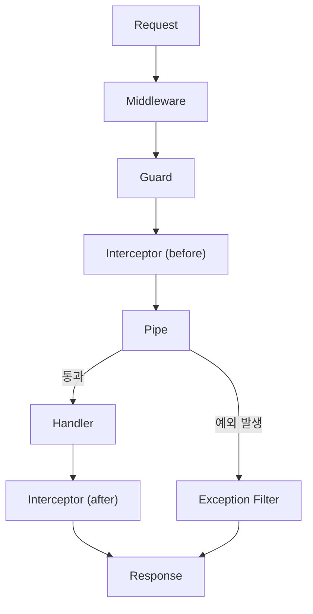

Pipe에서 갈라지는 예외 분기를 보면 된다. 예외가 나면 Handler는 호출되지 않고 Exception Filter가 응답을 만든다. 정상 경로에는 Filter가 끼지 않는다. 파이프는 Interceptor가 `next.handle()`을 부른 뒤에 도는 단계라서, 파이프 예외는 Interceptor를 건너뛰지 않고 그 `catchError`를 지난 다음 Filter로 간다. `ParseIntPipe`를 단 라우트에 `?n=abc`를 보내고 `tap`과 `catchError`가 둘 다 있는 Interceptor를 붙여 봤더니 `catchError`만 호출됐다. 이 문서에서 동작을 설명한 내용은 `@nestjs/common` 11.2.7을 Node 20에서 실행해 확인한 것이다. 10.4.22에서도 돌려 본 항목은 본문에 따로 적었고, 둘이 다른 곳은 버전을 밝혔다.

순서가 중요하다. Guard가 통과시킨 요청만 파이프에 도달한다. 그래서 인증·인가는 Guard에서 끝내고, 파이프에서는 입력값의 형식과 유효성만 본다. 두 책임이 섞이면 디버깅이 어려워진다.

또 하나 자주 헷갈리는 점이 있다. 파이프는 **핸들러의 인자 단위로 실행된다.** 컨트롤러 메서드에 인자가 세 개 있으면 각 인자에 대해 파이프가 별도로 돈다. `@Param('id', ParseIntPipe)`는 `id` 하나만 보고, 다른 인자는 손대지 않는다. 이 점이 미들웨어와 가장 큰 차이다. 미들웨어는 `req.body` 전체를 다루지만, 파이프는 `@Body()`로 꺼낸 값 하나, `@Param('id')`로 꺼낸 값 하나를 본다.

이런 인자 단위 동작 때문에 파이프는 데코레이터의 두 번째 인자로 넘기는 패턴이 가장 흔하다.

```typescript
@Get(':id')
findOne(@Param('id', ParseIntPipe) id: number) {
  return this.userService.findOne(id);
}
```

위 예에서 파이프가 받는 값은 라우트 파라미터 `id`의 문자열이고, 파이프가 반환하는 값은 핸들러 인자 `id`로 들어간다. 파이프가 던지는 예외는 핸들러 호출 전이라 비즈니스 로직이 아예 안 돈다.


## 빌트인 파이프

NestJS는 자주 쓰는 변환·검증을 미리 만들어 둔 빌트인 파이프를 제공한다. `@nestjs/common`에서 직접 import 한다.

### ParseIntPipe

가장 많이 쓰는 파이프다. 문자열을 정수로 변환하고, 변환에 실패하면 400 에러를 던진다.

```typescript
@Get(':id')
findOne(@Param('id', ParseIntPipe) id: number) {
  return id; // number 타입 보장
}
```

`/users/abc`로 요청이 오면 이렇게 막힌다.

```json
{
  "statusCode": 400,
  "message": "Validation failed (numeric string is expected)",
  "error": "Bad Request"
}
```

조심할 점이 있다. `ParseIntPipe`는 먼저 `/^-?\d+$/` 정규식과 `isFinite`로 형식을 확인하고, 통과한 값에만 `parseInt(value, 10)`을 적용한다. 그래서 `"30abc"`처럼 일부만 숫자인 문자열, `"1.5"`, `"1e3"`, 앞뒤에 공백이 붙은 `" 5"`, 빈 문자열 `""`이 모두 400이다. `"-3"`은 `-3`, `"007"`은 `7`이 된다. `0`도 통과한다. "0이 들어오면 거부하고 싶다"는 요구가 있으면 별도 검증을 추가해야 한다.

정규식만 통과하면 자릿수는 보지 않는다. `"9007199254740993"`을 넣으면 에러 없이 `9007199254740992`가 핸들러로 들어간다. 번호가 `Number.MAX_SAFE_INTEGER`를 넘을 수 있는 ID(스노플레이크 ID 같은)를 `ParseIntPipe`로 받으면 마지막 자리가 조용히 바뀐다. 이런 ID는 문자열로 받고 `ParseIntPipe`를 쓰지 않는다. 11.2.7과 10.4.22에서 같은 결과를 확인했다.

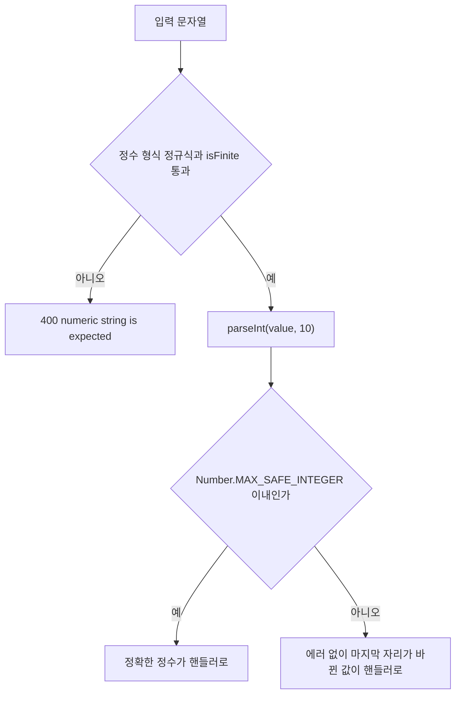

400이 나는 길은 정규식 단계 하나뿐이다. 정규식을 통과한 뒤에는 자릿수를 보는 단계가 없어서, 오른쪽 아래 갈래로 정밀도 손실이 조용히 지나간다.

옵션을 주려면 클래스가 아니라 인스턴스로 넘긴다.

```typescript
@Get(':id')
findOne(
  @Param('id', new ParseIntPipe({ errorHttpStatusCode: HttpStatus.NOT_ACCEPTABLE }))
  id: number,
) {
  return id;
}
```

`errorHttpStatusCode`는 변환 실패 시 응답 상태 코드를 바꾸고, `exceptionFactory`는 던지는 예외 자체를 교체한다. API 응답 포맷을 통일하려면 `exceptionFactory`로 커스텀 예외를 던지는 패턴이 깔끔하다.

### ParseFloatPipe

`ParseIntPipe`의 실수 버전이다. 동작 방식과 옵션은 동일하다. 가격, 좌표, 비율처럼 정수가 아닌 숫자가 쿼리로 올 때 쓴다.

```typescript
@Get('search')
nearby(
  @Query('lat', ParseFloatPipe) lat: number,
  @Query('lng', ParseFloatPipe) lng: number,
) {
  return this.placeService.findNearby(lat, lng);
}
```

형식 확인은 `isNaN(parseFloat(value))`와 `isFinite(value)`로 하고, 변환은 `parseFloat`이다. `"1.5e2"`는 `150`, `".5"`는 `0.5`, `"1."`은 `1`이 된다. `"1,5"`처럼 소수점 자리에 콤마를 쓴 값, `"Infinity"`는 400이다. 지수 표기까지 받는 점이 의도와 다르면 별도 검증을 붙여야 한다.

### ParseBoolPipe

문자열 `"true"`, `"false"`를 boolean으로 변환한다. 쿼리스트링은 무조건 문자열로 오기 때문에 `?active=true`를 받으면 그냥은 `"true"` 문자열이 들어온다.

```typescript
@Get()
list(@Query('active', ParseBoolPipe) active: boolean) {
  return this.userService.list({ active });
}
```

여기서 한 가지 함정이 있다. 소문자 `true`와 `false` 두 문자열(이미 boolean인 값 포함)만 통과한다. `?active=1`, `?active=0`, `?active=TRUE`, `?active=yes`, `?active=on`은 전부 400이다. `1`과 `0`도 받는다고 알고 있는 경우가 많은데, 11.2.7과 10.4.22에서 `"1"`을 넣어 보면 `Validation failed (boolean string is expected)`가 나온다. 폼에서 체크박스를 받는다면 컨트롤러 직전에 어댑터를 두거나, 커스텀 파이프를 만든다.

### ParseArrayPipe

콤마 구분 문자열을 배열로 만드는 파이프다. 쿼리스트링으로 여러 ID를 받을 때 자주 쓴다.

```typescript
@Get()
findByIds(
  @Query('ids', new ParseArrayPipe({ items: Number, separator: ',' }))
  ids: number[],
) {
  return this.userService.findByIds(ids);
}
```

`?ids=1,2,3`이 오면 `[1, 2, 3]`이 된다. 그런데 이 파이프는 실무에서 사고가 잘 나는 편이다. 주의할 점이 세 가지 있다.

첫째, **빈 문자열 처리.** `?ids=`처럼 값이 비어 있으면 빈 배열이 아니라 400이 난다. `optional: true`를 켜도 빈 문자열은 허용되지 않는다. `optional`이 통과시키는 것은 쿼리에 `ids` 키가 아예 없어서 값이 `undefined`(또는 `null`)인 경우뿐이다.

```typescript
new ParseArrayPipe({ items: Number, separator: ',', optional: true })
```

이 설정에서 `/ids`는 핸들러에 `undefined`가 들어가고, `/ids?ids=`는 `[0] item must be a number`로 400이다. `items`를 주지 않은 `ParseArrayPipe`는 `?ids=`에서 `Validation failed (parsable array expected)`로 400이 난다. 빈 값을 빈 배열로 받으려면 앞에 빈 문자열을 `undefined`로 바꿔 주는 어댑터 파이프를 둬야 한다.

둘째, **단일 값 대 배열 값의 형태 차이.** 클라이언트가 `?ids=1`만 보내면 ParseArrayPipe는 `[1]`로 잘 만든다. 그런데 `?ids=1&ids=2`처럼 같은 키를 반복하는 패턴으로 보내면 Express의 쿼리 파서가 이미 `["1", "2"]` 배열로 만든 뒤 파이프에 넘어간다. ParseArrayPipe가 둘 다 처리하긴 하지만, 클라이언트 쪽에서 두 스타일이 섞이면 디버깅이 어려워진다. API 스펙에서 한쪽으로 통일하는 게 낫다.

셋째, **items 옵션으로 변환만 일어나지 검증은 강하지 않다.** `items: Number`로 줘도 내부적으로 각 요소를 `Number()`로 바꾸는 정도다. 음수, 범위 제한 같은 건 따로 안 본다. 검증이 더 필요하면 DTO 안에 배열을 넣고 `@ArrayMinSize()`, `@IsInt({ each: true })` 같은 데코레이터를 쓰는 ValidationPipe 쪽이 낫다.

#### separator 옵션

`separator`의 기본값은 `,`다. 문자열 한 개를 `trim()`한 뒤 `split(separator)`로 나누고, 그 결과에 `items` 변환을 적용한다. 아래 결과는 11.2.7과 10.4.22에서 `ParseArrayPipe.transform`을 직접 호출해 얻은 값이고 두 버전이 같다.

| 옵션 | 입력 | 결과 |
|---|---|---|
| `{ items: Number }` | `"1,2,3"` | `[1, 2, 3]` |
| `{ items: Number }` | `"1;2;3"` | 400, `[0] item must be a number` |
| `{ items: Number, separator: ';' }` | `"1;2;3"` | `[1, 2, 3]` |
| `{ items: Number, separator: ';' }` | `"1,2,3"` | 400, `[0] item must be a number` |
| `{ items: String, separator: '\|' }` | `"a\|b\|c"` | `["a", "b", "c"]` |
| `{ items: String, separator: '\|' }` | `"a,b"` | `["a,b"]` |
| `{ items: String, separator: ',,' }` | `"a,,b,c"` | `["a", "b,c"]` |
| `{ items: Number }` | `"1,2,"` | 400, `[2] item must be a number` |
| `{ items: Number }` | `"1,,2"` | 400, `[1] item must be a number` |
| `{ items: Number }` | `" 1, 2 "` | `[1, 2]` |
| `{ items: String, separator: '\|' }` | `"a\| b "` | `["a", " b"]` |
| `{ items: Number, separator: ';' }` | `["1;2", "3"]` | 400, `[0] item must be a number` |

표에서 읽어야 할 것이 네 가지 있다.

`separator`는 한 글자가 아니어도 된다. 값을 그대로 `split`에 넘기기 때문에 `,,`는 두 글자 전체를 구분자로 쓴다. `"a,,b,c"`에서 `b,c`가 한 요소로 남는 것이 그 결과다.

공백 정리는 입력 전체의 앞뒤에만 한다. 숫자는 내부에서 `JSON.parse`로 읽으니 `" 2"`가 `2`가 되지만, `items: String`이면 요소 앞의 공백이 그대로 남는다. `a| b`를 보내면 `" b"`가 들어온다.

끝에 붙은 구분자는 빈 요소를 만든다. 클라이언트가 배열을 `ids.join(',') + ','` 식으로 만들어 보내면 `1,2,`가 되고, 마지막 빈 문자열이 숫자가 아니라서 400이다.

쿼리에 같은 키가 반복돼서(`?ids=1&ids=2`) Express가 이미 배열로 넘기면 `separator`는 적용되지 않는다. 요소를 다시 자르지 않아서 `["1;2", "3"]`은 첫 요소에서 막힌다. `separator: ';'`로 설정한 라우트에서 `?ids=1;2;3`은 `[1, 2, 3]`, `?ids=1&ids=2`도 `[1, 2]`로 둘 다 받지만, 두 방식을 섞은 `?ids=1;2&ids=3`은 400이다. 앞의 두 가지는 Express 어댑터에 실제 요청을 보내 확인했고, 섞은 경우는 Express가 만들어 주는 `["1;2", "3"]` 배열을 파이프에 직접 넣어 확인했다.

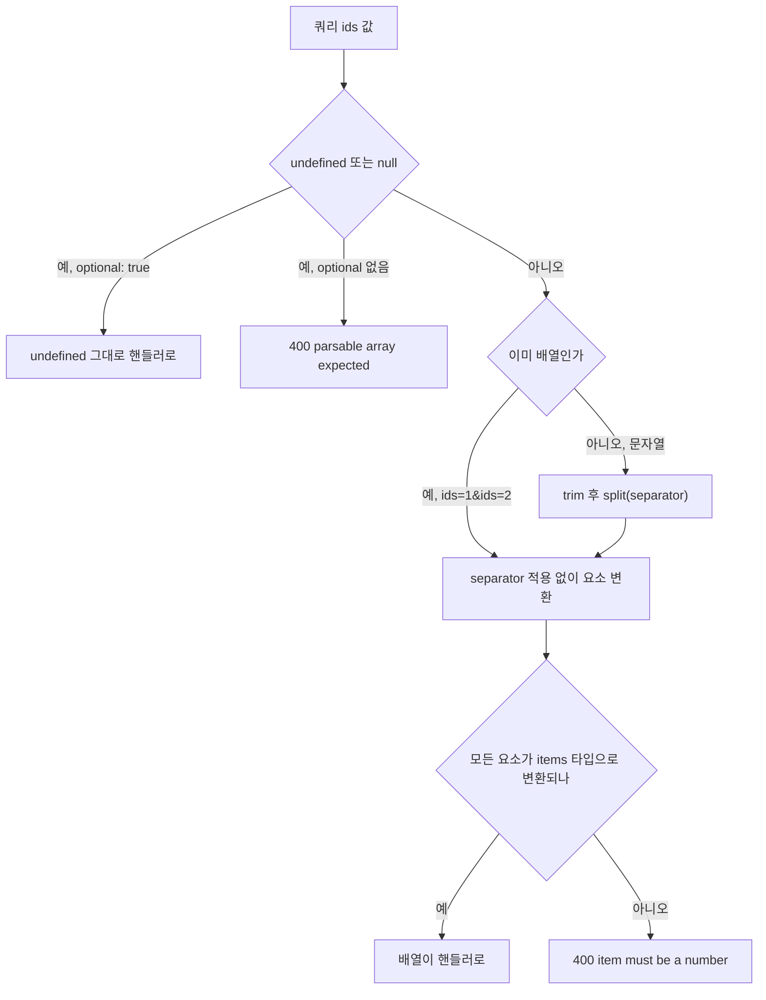

`separator`는 문자열 입력에만 쓰이고, 배열로 도착한 값은 `split`을 건너뛰고 곧바로 요소 변환으로 간다. `1,2,`처럼 끝에 구분자가 붙은 값은 빈 요소가 숫자로 변환되지 않아 오른쪽 아래의 400으로 떨어진다.

### ParseUUIDPipe

UUID 형식 검증 전용이다. 형식만 맞으면 통과시키고, 그 외에는 400을 던진다. 변환은 하지 않는다(문자열 그대로).

```typescript
@Get(':id')
findOne(@Param('id', ParseUUIDPipe) id: string) {
  return this.orderService.findOne(id);
}
```

버전을 지정하지 않으면 모든 UUID 버전을 통과시킨다. 운영 환경에서 v4만 받기로 정했다면 명시한다.

```typescript
@Param('id', new ParseUUIDPipe({ version: '4' })) id: string
```

조심할 점은 대소문자다. 표준 UUID는 소문자가 일반적이지만 ParseUUIDPipe는 대문자 UUID도 통과시킨다. 데이터베이스에 저장할 때 정규화가 필요하면 변환 로직을 별도로 둬야 한다.

### ParseEnumPipe

enum 값으로 받고 싶을 때 쓴다. 문자열이 enum의 멤버 중 하나와 정확히 일치해야 통과한다.

```typescript
enum UserRole {
  Admin = 'admin',
  User = 'user',
  Guest = 'guest',
}

@Get()
list(@Query('role', new ParseEnumPipe(UserRole)) role: UserRole) {
  return this.userService.listByRole(role);
}
```

`?role=admin`은 통과, `?role=root`는 거부한다. 주의할 점은 enum 값이 문자열이어야 의도대로 동작한다는 점이다. 숫자 enum(`Admin = 0` 같은)을 쓰면 쿼리스트링의 `"0"`이 들어왔을 때 비교가 깨질 수 있다. 쿼리에서 받는 enum은 문자열 enum으로 정의하는 게 안전하다.

### ParseDatePipe

문자열을 `Date` 객체로 바꾼다. 날짜 범위 조회에서 `from`, `to`를 받을 때 쓴다. `@nestjs/common` 루트에서 import 할 수 있는 건 11.0.0부터다. 10.x에서는 `import { ParseDatePipe } from '@nestjs/common'`이 TS2724(`has no exported member named 'ParseDatePipe'`)로 컴파일되지 않는다. npm 패키지를 받아 보면 10.4.6까지는 `parse-date.pipe.js` 파일 자체가 없고, 10.4.10부터 22까지는 파일은 있지만 `pipes/index.js`에서 export 하지 않는다. "Nest 10 이상이면 된다"고 알고 있으면 10.x 프로젝트에서 바로 막힌다. 10.x에서 필요하면 직접 만든 파이프를 쓰는 쪽이 낫다.

```typescript
@Get('report')
report(
  @Query('from', new ParseDatePipe()) from: Date,
  @Query('to', new ParseDatePipe({ optional: true, default: () => new Date() })) to: Date,
) {
  return this.reportService.range(from, to);
}
```

내부는 `new Date(value)`가 전부다. 값이 falsy면 `Validation failed (no Date provided)`, 결과가 `Invalid Date`면 `Validation failed (invalid date format)`로 400을 던진다. 옵션은 `optional`, `default`, `errorHttpStatusCode`, `exceptionFactory` 네 개다. 11.2.7에서 확인한 입력별 결과는 이렇다.

| 입력 | 결과 |
|---|---|
| `"2024-03-15"` | `2024-03-15T00:00:00.000Z` (UTC 자정) |
| `"2024-03-15T10:00:00Z"` | `2024-03-15T10:00:00.000Z` |
| `"2024-03-15T10:00:00+09:00"` | `2024-03-15T01:00:00.000Z` |
| `"2024-03-15T10:00:00"` (오프셋 없음) | 서버 타임존 기준 |
| `"2024-03-15 10:00:00"` (공백 구분) | 서버 타임존 기준 |
| `"abc"`, `"2024-13-01"` | 400, invalid date format |
| `"2024-02-30"` | `2024-03-01T00:00:00.000Z` (통과) |
| `"1710460800000"` (문자열) | 400, invalid date format |
| `1710460800000` (number) | `2024-03-15T00:00:00.000Z` |
| `""`, `undefined`, `null` | 400, no Date provided |

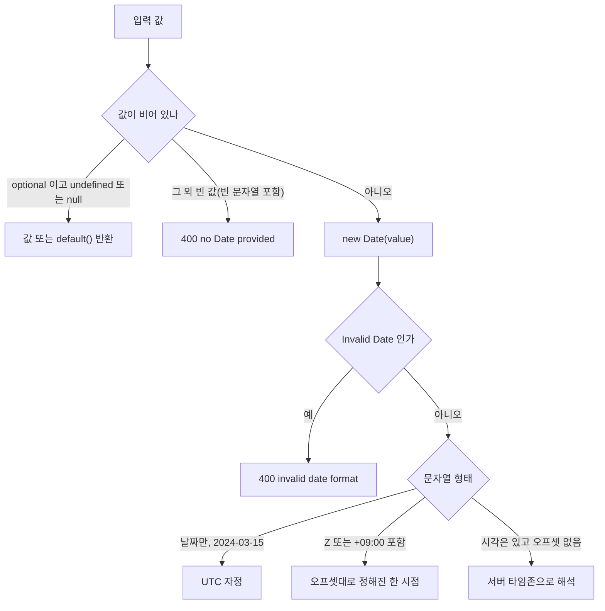

분기에서 마지막 셋이 같은 `Date`를 만드는데 해석 기준이 다르다. 서버 타임존에 기대는 쪽이 맨 아래 갈래다.

타임존이 가장 위험하다. 날짜만 있는 `"2024-03-15"`는 서버 타임존과 상관없이 UTC 자정이지만, 시각이 있고 오프셋이 없는 `"2024-03-15T10:00:00"`은 서버 타임존으로 해석한다. 같은 요청이 `TZ=UTC`에서는 `10:00:00.000Z`, `TZ=Asia/Seoul`에서는 `01:00:00.000Z`, `TZ=America/New_York`에서는 `14:00:00.000Z`가 된다. 개발 PC는 KST, 운영 컨테이너는 UTC인 환경에서 9시간 어긋나는 버그가 이렇게 나온다. 이 파이프에는 오프셋 없는 입력을 UTC로 강제하는 옵션이 없다. 클라이언트가 `Z`나 `+09:00`을 붙여 보내게 계약을 정해야 한다.

`"2024-02-30"`이 에러 없이 3월 1일이 되는 것은 Node 20(V8)의 `Date` 파싱 동작이다. 존재하지 않는 날짜를 거르고 싶으면 파이프 뒤에 한 단계를 더 둬서 원본 문자열과 `toISOString().slice(0, 10)`을 비교해야 한다. 숫자 타임스탬프를 받을 때도 주의한다. 쿼리스트링의 값은 문자열이라 `?ts=1710460800000`은 400이다. `number` 타입일 때만 변환되므로 쿼리에서 타임스탬프를 받으려면 `ParseIntPipe`를 먼저 붙여야 한다.

`optional: true`는 값이 `undefined`나 `null`일 때만 동작한다. `?to=`처럼 빈 문자열이 오면 `optional`이 있어도 `no Date provided`로 400이다. `default`는 `optional: true`와 같이 줘야 쓰이고, 값이 없을 때 `default()`의 반환값이 핸들러로 간다(`/report?from=2024-03-15`에서 `to`가 `default`의 날짜로 채워지는 것을 확인했다). 에러 상태 코드를 바꾸는 `errorHttpStatusCode: 422`도 동작한다.

### DefaultValuePipe

값이 `undefined`나 `null`일 때 기본값을 넣어주는 파이프다. ParsePipe 계열과 같이 쓰는 패턴이 흔하다.

```typescript
@Get()
list(
  @Query('page', new DefaultValuePipe(1), ParseIntPipe) page: number,
  @Query('limit', new DefaultValuePipe(20), ParseIntPipe) limit: number,
) {
  return this.userService.list({ page, limit });
}
```

순서가 중요하다. `DefaultValuePipe`가 먼저 돌아서 `undefined`를 `1`로 바꾸고, 그다음 `ParseIntPipe`가 그 값을 받는다. 순서를 바꾸면 `ParseIntPipe`가 먼저 `undefined`를 받아서 검증 실패가 난다. 핸들러에 적용하는 파이프는 적힌 순서대로 실행된다는 점을 기억해야 한다.

또 하나, `DefaultValuePipe`는 빈 문자열을 기본값으로 바꿔주지 않는다. `?page=` 같은 입력은 `undefined`가 아니라 `""`로 들어오기 때문에 기본값이 적용되지 않고 `ParseIntPipe`에서 막힌다. 쿼리스트링 파싱 단계에서 빈 값을 어떻게 다루는지 확인하고 써야 한다.

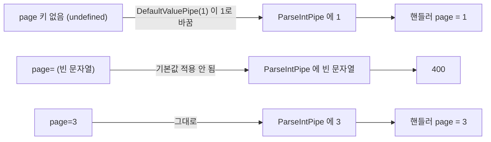

위쪽 줄만 기본값을 받는다. 가운데 줄의 `page=`는 `undefined`가 아니라서 `ParseIntPipe`까지 내려가 400이 된다.

### ParseFilePipe

파일 업로드 검증용이다. 멀티파트로 들어오는 파일의 크기, MIME 타입을 거른다. 다른 파이프와 모양이 좀 다르다.

```typescript
@Post('upload')
@UseInterceptors(FileInterceptor('file'))
upload(
  @UploadedFile(
    new ParseFilePipe({
      validators: [
        new MaxFileSizeValidator({ maxSize: 1024 * 1024 * 5 }),
        new FileTypeValidator({ fileType: /image\/(png|jpeg)/ }),
      ],
    }),
  )
  file: Express.Multer.File,
) {
  return { name: file.originalname, size: file.size };
}
```

내부적으로 `MaxFileSizeValidator`, `FileTypeValidator` 같은 검증기를 등록하는 구조다. 변환은 하지 않고 검증만 한다.

실무에서 자주 부딪히는 문제는 `FileTypeValidator`의 동작이다. 버전에 따라 검사 대상이 다르다. 10.4.15까지는 클라이언트가 보낸 `mimetype`을 정규식에 대 보는 방식이라 헤더를 위조하면 통과했다. 10.4.16부터는 기본이 파일 내용의 매직 넘버 검사다. `file-type` 패키지로 `file.buffer`를 읽어 판별하고, 이 패키지는 `@nestjs/common`의 의존성으로 같이 설치된다. 10.4.22와 11.2.7에서 PNG 바이트를 `text/plain`으로 올리면 통과하고(내용으로 판단), 텍스트를 `image/png`로 올리면 `Validation failed (current file type is image/png, expected type is ...)`로 막혔다. 구버전 문서나 블로그의 "헤더 기반이라 위조에 뚫린다"는 설명은 10.4.15 이하에만 해당한다.

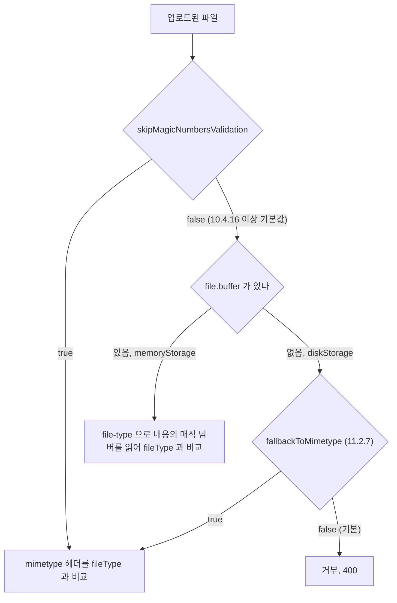

갈림길은 `file.buffer`의 유무다. 같은 PNG 파일이 저장소 설정 하나로 통과와 거부를 오간다.

여기서 걸리는 지점이 두 군데 있다.

`file.buffer`가 있어야 매직 넘버를 읽는다. Multer를 `diskStorage`로 설정하면 `buffer`가 없어서 PNG 정상 파일도 거부된다. 11.2.7은 `file buffer is not available; file type validation could not be performed` 메시지를 주지만, 10.4.22는 `current file type is image/png, expected type is /image\/png/`라고 해서 타입이 일치하는데 불일치라고 말하는 꼴이 된다. 디스크 저장을 쓰면서 `FileTypeValidator`를 붙이면 이 에러를 만난다. 11.2.7에는 `fallbackToMimetype: true` 옵션이 있고(11.0.0 소스에는 없다), 이 옵션을 주면 `buffer`가 없을 때 `mimetype` 헤더로 되돌아간다. 디스크 저장에서 이 옵션을 켠 상태로 텍스트 파일을 `image/png`로 올렸더니 201로 통과했다. 헤더 기반 검사로 돌아간다는 뜻이라 보안 목적이면 `memoryStorage`로 검사한 뒤 저장하는 쪽이 맞다.

`skipMagicNumbersValidation: true`를 주면 헤더 기반으로 돌아간다. 10.4.22와 11.2.7에서 텍스트를 `image/png`로 올렸을 때 통과했다.

또 하나, `MaxFileSizeValidator`는 Multer가 이미 파일을 메모리나 디스크에 받은 뒤에 동작한다. 즉, 100MB 파일을 거부하더라도 100MB는 이미 메모리에 올라와 있다. 진짜 큰 파일을 막으려면 Multer의 `limits.fileSize` 옵션으로 업로드 단계에서 차단해야 한다. ParseFilePipe는 보조 검증이지 1차 방어선이 아니다.

```typescript
FileInterceptor('file', {
  limits: { fileSize: 1024 * 1024 * 10 },
})
```

이 옵션이 깔린 뒤에 ParseFilePipe로 비즈니스 규칙(이미지만 받기, 5MB 이하 등)을 검증한다.


### ParseFilePipeBuilder

`new ParseFilePipe({ validators: [...] })` 대신 메서드 체이닝으로 같은 파이프를 만드는 빌더다. `addMaxSizeValidator`, `addFileTypeValidator`, 직접 만든 검증기를 넣는 `addValidator`가 있고, 마지막에 `build()`를 부른다. `build()`의 인자로 `ParseFilePipe` 옵션(`errorHttpStatusCode`, `fileIsRequired`, `exceptionFactory`)을 넘긴다.

```typescript
@Post('avatar')
@UseInterceptors(FileInterceptor('file'))
uploadAvatar(
  @UploadedFile(
    new ParseFilePipeBuilder()
      .addFileTypeValidator({ fileType: /image\/(png|jpeg)/ })
      .addMaxSizeValidator({ maxSize: 1024 * 1024 })
      .build({ errorHttpStatusCode: HttpStatus.UNPROCESSABLE_ENTITY }),
  )
  file: Express.Multer.File,
) {
  return { name: file.originalname, size: file.size };
}
```

메모리 저장소 기준으로 이 라우트에 실제 요청을 보낸 결과다.

| 요청 | 응답 |
|---|---|
| 67바이트 PNG, `image/png` | 201 |
| 텍스트 `hello world`, `image/png` | 422, `current file type is image/png, expected type is ...` |
| PNG 내용, `text/plain` | 201 |
| PNG에 0바이트 2000개를 붙인 파일 | 422, 11.2.7은 `current file size is 2067, expected size is less than 1000`, 10.4.22는 `expected size is less than 1000` |
| 파일 없음 | 400, `File is required` |

`errorHttpStatusCode`는 검증 실패와 파일 누락 양쪽에 같이 적용된다. `build({ errorHttpStatusCode: 422 })`로 만든 라우트에서 파일 없이 보내도 `File is required`가 422로 나왔다. 위 표의 400은 이 옵션을 안 준 라우트에서 나온 값이다.

파일을 선택 항목으로 받으려면 `build({ fileIsRequired: false })`를 준다. 이때 파일 없이 요청하면 핸들러까지 가고 `file`은 `undefined`다. 파일이 있으면 검증은 그대로 돌아서, 10바이트 제한에 100바이트 파일을 올리면 400이다. 그래서 핸들러 시그니처를 `file?: Express.Multer.File`로 적어야 한다.

빌더에서 자주 틀리는 것이 인스턴스 재사용이다. `build()`는 파이프를 만들고 나서 빌더 안의 검증기 목록을 비운다. 빌더 하나를 변수에 두고 `build()`를 두 번 부르면 두 번째 파이프의 검증기는 0개다.

```typescript
const builder = new ParseFilePipeBuilder().addMaxSizeValidator({ maxSize: 10 });
const first = builder.build();   // 검증기 1개
const second = builder.build();  // 검증기 0개
```

`first`의 `validators.length`는 1, `second`는 0이었다. 검증기가 없는 `ParseFilePipe`는 에러 없이 만들어지고, 100바이트 파일을 10바이트 제한 라우트의 `second`에 올렸을 때 201로 통과했다(`first`는 400). 파일 누락은 `fileIsRequired` 기본값 때문에 여전히 400이다. 공통 파이프를 재사용하려고 상수에 빌더를 두고 라우트마다 `build()`를 호출하면, 첫 라우트만 검증되고 나머지는 검증 없이 통과하는 코드가 된다. 파이프는 `build()` 결과를 상수에 담아 쓰거나, 라우트마다 빌더를 새로 만든다.


## 변환 파이프 — transform이라는 단어의 두 가지 뜻

NestJS 문서에서 "transform"이라는 단어가 두 군데에서 쓰이는데 의미가 다르다. 파이프를 처음 다루면 가장 헷갈리는 지점이다.

첫째, **파이프 자체의 `transform` 메서드**. 모든 파이프는 `PipeTransform` 인터페이스의 `transform(value, metadata)` 메서드를 구현한다. 이 메서드가 반환하는 값이 핸들러 인자가 된다. 변환 파이프든 검증 파이프든 메서드 이름이 같다. 검증만 하는 파이프는 받은 값을 그대로 반환하고, 변환이 필요한 파이프는 바뀐 값을 반환한다.

둘째, **ValidationPipe의 `transform: true` 옵션**. 이건 ValidationPipe가 plain object를 DTO 클래스 인스턴스로 변환할지를 결정하는 옵션이다. ParseIntPipe와는 무관하다.

이름이 겹치다 보니 "ValidationPipe의 transform 옵션을 켜면 ParseIntPipe가 안 도는 건가?" 같은 오해가 생긴다. 두 개는 완전히 다른 레이어다. ParseIntPipe는 핸들러 인자 단위로 돌고, ValidationPipe의 transform 옵션은 DTO 객체 안의 프로퍼티 단위로 돈다.

### 변환 파이프가 반환하는 값의 흐름

```typescript
@Get(':id')
findOne(@Param('id', ParseIntPipe) id: number) {
  return id;
}
```

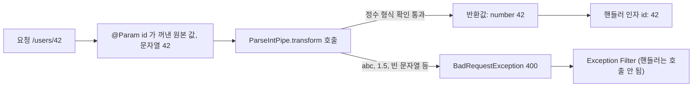

성공 경로는 문자열 `"42"`가 `number` `42`로 바뀌어 핸들러 인자가 되는 한 줄이고, 실패하면 `transform`이 값을 반환하는 대신 예외를 던져서 핸들러까지 가지 못한다. `/users/abc`는 이 아래쪽 분기를 탄다.

이 흐름이 머리에 있어야 다중 파이프 체인이 헷갈리지 않는다. 파이프를 여러 개 붙이면 앞 파이프의 반환값이 다음 파이프의 입력이 된다.

```typescript
@Get()
list(
  @Query('page', new DefaultValuePipe(1), ParseIntPipe, new MinValuePipe(1))
  page: number,
) {
  return this.userService.list({ page });
}
```

- 입력이 없으면 `DefaultValuePipe`가 `1`을 만들고
- `ParseIntPipe`가 받아서 정수로 확인하고(이미 숫자면 그대로)
- `MinValuePipe`(커스텀)가 1 이상인지 검증한다

순서가 잘못되면 의도와 다르게 돈다. `ParseIntPipe`를 `DefaultValuePipe`보다 앞에 두면 `undefined`가 ParseIntPipe로 가서 400이 난다.


## 커스텀 파이프 작성

`PipeTransform` 인터페이스를 구현하면 끝이다. 인터페이스는 `transform(value, metadata)` 하나뿐이다.

```typescript
import { PipeTransform, Injectable, BadRequestException, ArgumentMetadata } from '@nestjs/common';

@Injectable()
export class TrimPipe implements PipeTransform<string, string> {
  transform(value: string, metadata: ArgumentMetadata): string {
    if (typeof value !== 'string') {
      return value;
    }
    return value.trim();
  }
}
```

`@Injectable()`을 붙이면 NestJS의 DI 컨테이너가 관리한다. 클래스 자체로 데코레이터에 넘길 수 있다. 다른 서비스가 필요하면 생성자 주입도 된다.

```typescript
@Injectable()
export class UserExistsPipe implements PipeTransform<string, Promise<User>> {
  constructor(private readonly userService: UserService) {}

  async transform(value: string): Promise<User> {
    const user = await this.userService.findOne(value);
    if (!user) {
      throw new BadRequestException(`User ${value} not found`);
    }
    return user;
  }
}
```

이렇게 만들면 핸들러에서 ID 대신 객체가 바로 들어온다.

```typescript
@Get(':id')
findOne(@Param('id', UserExistsPipe) user: User) {
  return user;
}
```

편해 보이지만 단점이 있다. 파이프 안에서 DB를 조회하면 핸들러 진입 전에 쿼리가 한 번 더 도는 셈이다. 컨트롤러에서 같은 객체를 또 쓰면 또 조회한다. 조회 결과를 핸들러로 넘기는 패턴은 단순한 라우트에서만 쓰고, 복잡한 로직에서는 ID만 받고 서비스 안에서 한 번만 조회하는 게 추적이 쉽다.

### 변환 없이 검증만 하는 파이프

`ParseIntPipe`가 "변환 중심"이라면, 형식만 보고 통과·차단을 정하는 검증 파이프도 자주 쓴다. 휴대전화 번호, 사업자등록번호, 한국 우편번호처럼 도메인 규칙이 들어간 문자열을 핸들러에 들어오기 전에 잘라낸다.

```typescript
import { PipeTransform, Injectable, BadRequestException } from '@nestjs/common';

@Injectable()
export class PhoneNumberPipe implements PipeTransform<string, string> {
  private readonly pattern = /^01[016789]-?\d{3,4}-?\d{4}$/;

  transform(value: string): string {
    if (typeof value !== 'string' || !this.pattern.test(value)) {
      throw new BadRequestException('휴대전화 번호 형식이 올바르지 않다');
    }
    return value.replace(/-/g, '');
  }
}
```

이 파이프는 검증과 함께 하이픈 제거라는 정규화도 같이 한다. "검증만 한다"고 했지만 형식이 다양한 입력을 한 가지 형태로 모으는 정도는 같이 처리해야 핸들러에서 다시 손볼 일이 없다. 검증과 정규화가 완전히 다른 책임이라면 두 파이프로 나누고 체인으로 붙인다.

파이프 인스턴스에 설정값을 주입받고 싶으면 옵션을 받는 팩토리 패턴이 자연스럽다.

```typescript
@Injectable()
export class RegexPipe implements PipeTransform<string, string> {
  constructor(private readonly pattern: RegExp, private readonly message: string) {}

  transform(value: string): string {
    if (!this.pattern.test(value)) {
      throw new BadRequestException(this.message);
    }
    return value;
  }
}

@Get(':slug')
findOne(
  @Param('slug', new RegexPipe(/^[a-z0-9-]{3,30}$/, 'slug는 소문자·숫자·하이픈만 허용'))
  slug: string,
) {
  return this.postService.findBySlug(slug);
}
```

생성자 인자가 있는 파이프는 `new`로 인스턴스화해서 데코레이터에 넘긴다. 클래스 자체로 넘기는 방식은 DI 컨테이너가 인스턴스를 만들기 때문에 인자를 못 받는다. 이 차이를 모르면 옵션을 주고 싶은데 안 통하는 상황이 생긴다.

### ArgumentMetadata 활용

`transform`의 두 번째 인자 `ArgumentMetadata`는 파이프가 어떤 컨텍스트에서 호출되었는지 알려준다.

```typescript
interface ArgumentMetadata {
  type: 'body' | 'query' | 'param' | 'custom';
  metatype?: Type<unknown>;
  data?: string;
}
```

- `type`: `@Body()`, `@Query()`, `@Param()` 중 어디서 왔는지
- `metatype`: 핸들러 인자에 선언된 타입(예: `CreateUserDto`)
- `data`: 데코레이터에 넘긴 값(`@Query('page')`의 `'page'`)

ValidationPipe가 DTO 클래스를 알아내는 비결이 `metatype`이다. 핸들러 시그니처에 `dto: CreateUserDto`라고 적어 두면 NestJS가 reflect-metadata로 그 타입을 읽어 `metatype`에 넣는다. ValidationPipe는 `metatype`이 있으면 plain object를 그 클래스로 변환한 뒤 검증한다.

커스텀 파이프에서 `metatype`을 쓰는 경우는 드물지만, "이 파이프는 primitive 타입에는 적용하지 않는다" 같은 분기를 만들 때 활용한다.

```typescript
@Injectable()
export class SanitizePipe implements PipeTransform {
  transform(value: any, metadata: ArgumentMetadata) {
    const primitives = [String, Boolean, Number, Array, Object];
    if (primitives.includes(metadata.metatype as any)) {
      return value;
    }
    return sanitize(value);
  }
}
```

#### metatype 기반 동적 변환 파이프

`metatype`을 읽어 핸들러 시그니처 타입에 맞춰 값을 동적으로 바꿔주는 파이프도 만들 수 있다. ValidationPipe가 내부에서 하는 일을 더 단순한 형태로 흉내 내는 셈이다.

```typescript
import {
  PipeTransform,
  Injectable,
  ArgumentMetadata,
  BadRequestException,
} from '@nestjs/common';
import { plainToInstance } from 'class-transformer';
import { validate } from 'class-validator';

@Injectable()
export class DtoBindingPipe implements PipeTransform {
  async transform(value: any, metadata: ArgumentMetadata) {
    const { metatype, type } = metadata;
    if (!metatype || this.isPrimitive(metatype)) {
      return value;
    }

    const object = plainToInstance(metatype, value, {
      enableImplicitConversion: type === 'query' || type === 'param',
    });

    const errors = await validate(object, { whitelist: true });
    if (errors.length > 0) {
      throw new BadRequestException(errors.map(e => Object.values(e.constraints ?? {})).flat());
    }
    return object;
  }

  private isPrimitive(metatype: Function): boolean {
    return [String, Boolean, Number, Array, Object].includes(metatype as any);
  }
}
```

핸들러 인자의 metatype이 `CreateUserDto`면 그 클래스의 인스턴스로 변환하고, `Number`면 손대지 않는다. `type` 값을 보고 쿼리·파라미터일 때만 implicit conversion을 켜는 부분이 핵심이다. 쿼리스트링은 모든 값이 문자열로 오기 때문에 `enableImplicitConversion`이 없으면 DTO의 `@IsInt`가 전부 실패한다. 반대로 `@Body()`로 오는 JSON은 이미 타입이 살아 있어서 implicit conversion이 오히려 의도치 않은 변환을 만든다.

이 패턴은 ValidationPipe의 동작 원리를 이해할 때 한 번 손으로 짜보면 큰 도움이 된다. 실서비스에서는 빌트인 ValidationPipe를 그대로 쓰는 게 안전하다.

#### 핸들러 인자 종류별 분기

`metadata.type`을 보고 동일한 파이프가 다르게 행동하게 만들 수도 있다.

```typescript
@Injectable()
export class CoerceArrayPipe implements PipeTransform {
  transform(value: any, metadata: ArgumentMetadata) {
    if (metadata.type === 'query' && value !== undefined && !Array.isArray(value)) {
      return [value];
    }
    return value;
  }
}
```

쿼리에서 `?tags=node&tags=nestjs`가 오면 배열, `?tags=node` 하나만 오면 문자열이 되는 Express의 기본 동작을 한 번 더 감싸 항상 배열로 통일하는 파이프다. `@Body()`에는 적용되지 않게 type을 본다. 메타데이터를 보고 분기하는 패턴은 글로벌 파이프에서 특히 유용하다.


## 파이프 적용 범위

파이프는 네 군데에 붙일 수 있다. 적용 범위가 좁아질수록 우선순위가 명확해진다.

### 글로벌

`main.ts`에서 `app.useGlobalPipes()`로 등록한다. 모든 컨트롤러, 모든 핸들러, 모든 인자에 적용된다.

```typescript
async function bootstrap() {
  const app = await NestFactory.create(AppModule);
  app.useGlobalPipes(new ValidationPipe({ transform: true, whitelist: true }));
  await app.listen(3000);
}
```

ValidationPipe는 거의 항상 글로벌로 등록한다. 모든 DTO에 일관된 검증이 돌게 하려면 이 방법이 가장 깔끔하다. 단, 이렇게 등록한 파이프는 DI 컨테이너 바깥에서 인스턴스화되기 때문에 다른 서비스를 주입받지 못한다. DI가 필요하면 `APP_PIPE` 토큰으로 모듈에 등록한다.

```typescript
import { APP_PIPE } from '@nestjs/core';

@Module({
  providers: [
    {
      provide: APP_PIPE,
      useClass: ValidationPipe,
    },
  ],
})
export class AppModule {}
```

이 방식은 NestJS의 의존성 그래프 안에서 인스턴스가 만들어지기 때문에 다른 프로바이더를 생성자에서 주입받을 수 있다. 다만 옵션을 줘야 한다면 `useFactory`를 써야 한다.

```typescript
{
  provide: APP_PIPE,
  useFactory: () => new ValidationPipe({ transform: true, whitelist: true }),
}
```

글로벌 파이프를 등록하는 세 방법은 "다른 서비스를 주입받아야 하나"와 "옵션을 줘야 하나"로 갈린다.

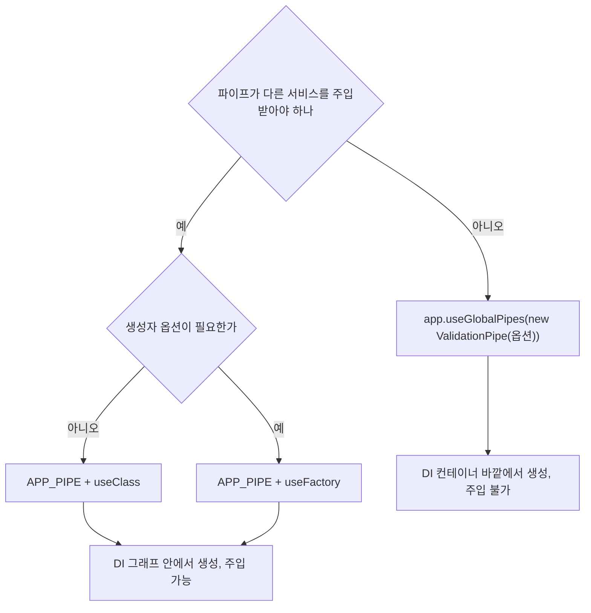

`useGlobalPipes`로 만든 인스턴스만 주입을 못 받는다. `APP_PIPE`로 올린 두 방식은 같은 쪽으로 합쳐진다.

### 컨트롤러

`@UsePipes()`를 컨트롤러 클래스에 붙이면 그 컨트롤러 안의 모든 핸들러에 적용된다.

```typescript
@Controller('users')
@UsePipes(new ValidationPipe({ transform: true }))
export class UsersController {
  // ...
}
```

특정 컨트롤러만 다른 검증 정책을 쓰고 싶을 때 유용하지만, 컨트롤러마다 다른 정책을 쓰는 코드베이스는 일관성이 깨지기 쉽다. 가능하면 글로벌 정책으로 통일하고, 예외만 핸들러 단위에서 다룬다.

### 메서드

`@UsePipes()`를 핸들러에 붙이면 그 핸들러의 모든 인자에 적용된다.

```typescript
@Post()
@UsePipes(new ValidationPipe({ transform: true, forbidNonWhitelisted: true }))
create(@Body() dto: CreateUserDto) {
  return this.userService.create(dto);
}
```

이 핸들러만 더 엄격한 정책을 적용하고 싶을 때 쓴다. 다만 글로벌 ValidationPipe가 이미 있다면 두 파이프가 모두 돈다(중복 호출). 같은 종류의 파이프가 여러 단계에서 호출되면 디버깅이 복잡해지니, 메서드 단위에서 오버라이드할 때는 글로벌 파이프와 충돌하지 않는지 확인해야 한다.

### 파라미터

데코레이터의 두 번째 이후 인자로 파이프를 직접 넘기는 방식이다. 가장 좁은 범위, 가장 흔한 사용법이다.

```typescript
@Get(':id')
findOne(@Param('id', ParseIntPipe) id: number) {
  return id;
}
```

이 방식은 `ParseIntPipe` 같은 인자 단위 변환 파이프에서 거의 유일하게 쓴다. ValidationPipe를 파라미터 단위로 붙이는 경우는 드물다.


## 파이프 실행 순서

같은 인자에 파이프를 여러 개 붙이면 적힌 순서대로 실행된다.

```typescript
@Query('page',
  new DefaultValuePipe(1),
  ParseIntPipe,
  new MinValuePipe(1),
) page: number
```

- `DefaultValuePipe(1)` → `ParseIntPipe` → `MinValuePipe(1)` 순서로 돈다.
- 앞 파이프의 반환값이 뒤 파이프의 입력이 된다.
- 중간에 예외가 나면 뒤 파이프는 실행되지 않는다.

여러 레벨(글로벌, 컨트롤러, 메서드, 파라미터)에 파이프가 등록돼 있으면 등록된 모든 파이프가 다 실행된다. 우선순위가 아니라 누적이다. 순서는 글로벌 → 컨트롤러 → 메서드 → 파라미터다. 그래서 글로벌 ValidationPipe와 파라미터의 ParseIntPipe가 같이 있으면 둘 다 돈다. 다만 ValidationPipe는 `metatype`이 primitive(`Number`, `String` 같은) 거나 없으면 변환·검증을 건너뛰기 때문에 `@Param('id') id: number`에서는 ValidationPipe가 사실상 통과만 시킨다.

인자가 여러 개일 때의 흐름은 글로만 쓰면 헷갈린다. 아래 도식은 글로벌 `G`, 컨트롤러 `C`, 메서드 `M`을 등록하고 `@Param('id', P1, P2)`와 `@Query('q', Pq)` 두 인자를 받는 핸들러를 가정했다. 인자마다 따로 체인을 돌고, 각 체인 안에서는 앞 파이프의 반환값이 다음 파이프의 입력이 되는 부분을 보면 된다.

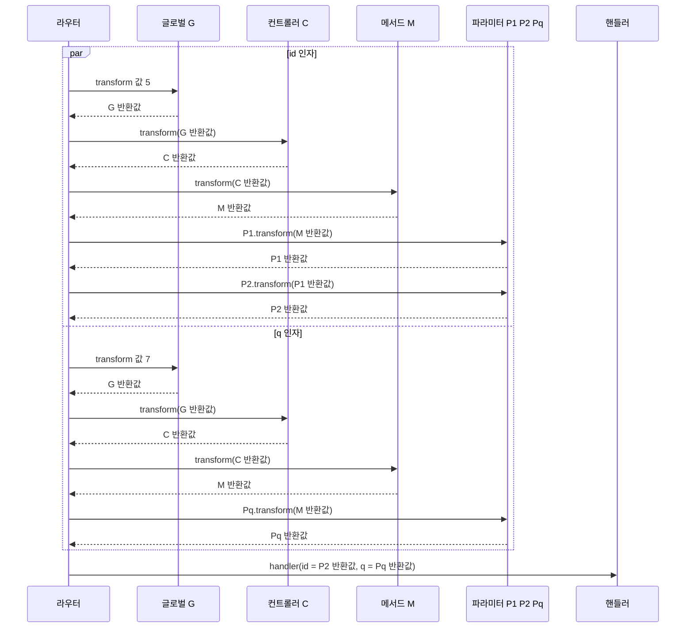

이 도식을 실제 앱으로 확인한 결과다. 각 파이프가 받은 값에 자기 이름을 붙여 반환하게 만들고 `/x/5?q=7`을 호출했더니 핸들러 인자가 `id = "5>G>C>M>P1>P2"`, `q = "7>G>C>M>Pq"`였다. 레벨 순서와 같은 인자 안의 체인 순서가 그대로 나온다.

인자끼리의 순서는 보장되지 않는다. 같은 호출의 로그에서 `q`의 `G`가 `id`의 `G`보다 먼저 시작됐고, 선언 순서(`id`, `q`)의 역순이었다. 레벨마다 `q`와 `id`가 번갈아 도는 식으로 섞여 있었다. 라우터가 `Promise.all(paramsOptions.map(...))`로 인자들의 파이프 체인을 한꺼번에 시작하기 때문에(`router-execution-context.js`의 `createPipesFn`), 동기 파이프만 있으면 마이크로태스크 단위로 교차한다. 인자 A의 파이프가 인자 B의 파이프보다 먼저 돈다는 가정으로 코드를 짜면 안 된다. 한 파이프가 다른 인자에 대한 상태를 들고 있게 만들거나, `id`를 검증한 결과를 `q` 파이프가 읽도록 만드는 구조가 이 가정에 걸린다.

비동기 파이프가 섞이면 한 인자가 실패해도 다른 인자의 파이프는 이미 시작된 상태다. 쿼리 `a`에 30ms 뒤 예외를 던지는 파이프를, 쿼리 `b`에 60ms가 걸리는 파이프를 달고 호출했을 때 로그는 `Pfail:THROW` 다음에 `Pslow:end`가 찍혔다. `b`의 파이프는 취소되지 않고 끝까지 돌았지만 핸들러는 호출되지 않았고 응답은 400이었다. 파이프 안에서 DB 쓰기 같은 부수 효과를 만들면, 다른 인자가 실패한 요청에서도 그 부수 효과는 남는다.

여기서 흔한 오해가 있다. "글로벌 ValidationPipe가 있으면 ParseIntPipe가 필요 없는 거 아닌가?" 아니다. ValidationPipe는 DTO 클래스가 metatype일 때만 검증·변환을 한다. `@Param('id') id: number`처럼 primitive 타입이면 ValidationPipe는 손대지 않는다. 그래서 라우트 파라미터를 숫자로 받으려면 여전히 ParseIntPipe가 필요하다.


## ValidationPipe와의 차이

빌트인 파이프와 ValidationPipe는 같은 인터페이스를 구현하지만 책임이 다르다.

`ParseIntPipe`, `ParseUUIDPipe` 같은 파이프는 **단일 값**을 본다. 입력은 문자열, 출력은 변환된 값이거나 동일한 값이다. metatype은 거의 보지 않는다. 핸들러 인자 단위로 적용하는 게 자연스럽다.

`ValidationPipe`는 **객체 전체**를 본다. metatype을 읽어 plain object를 DTO 클래스로 만들고, 클래스의 데코레이터 메타데이터로 각 프로퍼티를 검증한다. `@Body()` 한 자리에서 수십 개 필드를 한꺼번에 다룬다. 글로벌로 등록하는 게 자연스럽다.

언제 어느 쪽을 쓰는지 정리하면 이렇다.

- `@Param('id')`나 `@Query('page')`처럼 **단일 primitive 값**: 빌트인 파이프(ParseIntPipe 등)
- `@Body()`나 `@Query()`로 받는 **객체 형태의 데이터**: DTO + ValidationPipe
- 쿼리스트링이지만 **여러 필드가 같이 오는 검색 조건**: DTO 형태로 묶고 ValidationPipe

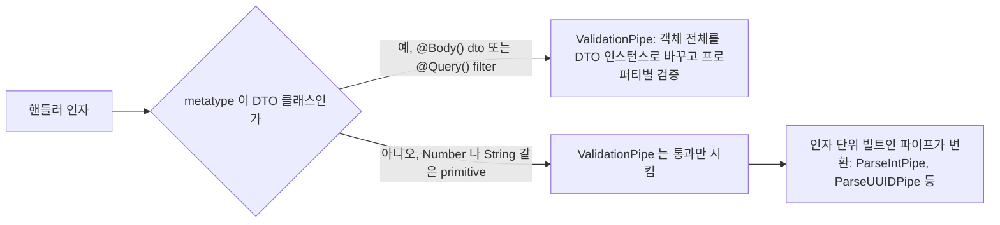

단일 값은 아래쪽 갈래, 객체는 위쪽 갈래로 간다. `@Param('id') id: number`에 `ParseIntPipe`를 따로 붙여야 하는 이유가 이 분기다.

쿼리스트링도 필드가 많으면 DTO로 묶는 게 낫다. `@Query('page', ParseIntPipe) page, @Query('limit', ParseIntPipe) limit, @Query('sort') sort, ...` 식으로 인자가 많아지면 시그니처가 더러워진다. `PaginationQueryDto`를 만들고 `@Query() query: PaginationQueryDto`로 받는 패턴이 깔끔하다. 단, 쿼리스트링은 모든 값이 문자열로 들어오기 때문에 ValidationPipe의 `transform: true`와 `enableImplicitConversion: true`가 필요하다. 이 부분은 [Nest_JS_Validation_Pipe.md](Nest_JS_Validation_Pipe.md)에 자세히 다뤄 두었다.


## 파이프와 DTO 결합 패턴

빌트인 파이프와 ValidationPipe + DTO를 한 핸들러에서 어떻게 섞어 쓰는지가 실무에서 가장 많이 헷갈리는 지점이다. 패턴 몇 가지를 정리한다.

### 경로 파라미터 + Body DTO

가장 흔한 모양이다. 라우트 파라미터는 빌트인 파이프로, 본문은 DTO로 받는다.

```typescript
@Patch(':id')
update(
  @Param('id', ParseIntPipe) id: number,
  @Body() dto: UpdateUserDto,
) {
  return this.userService.update(id, dto);
}
```

`id`는 ParseIntPipe가 변환·검증한다. `dto`는 글로벌 ValidationPipe가 metatype을 보고 `UpdateUserDto`로 변환·검증한다. 둘이 충돌하지 않는다. ValidationPipe는 metatype이 primitive면 건너뛰고, ParseIntPipe는 인자 단위라 본문 객체에는 손대지 않는다.

### 쿼리 DTO + Body DTO

검색 조건과 본문이 같이 오는 케이스. 쿼리스트링은 모두 문자열이라 implicit conversion이 필요하다.

```typescript
@Post('search')
search(
  @Query() filter: UserFilterQueryDto,
  @Body() criteria: AdvancedSearchDto,
) {
  return this.userService.search(filter, criteria);
}
```

```typescript
export class UserFilterQueryDto {
  @IsOptional()
  @Type(() => Number)
  @IsInt()
  @Min(1)
  page?: number = 1;

  @IsOptional()
  @IsIn(['active', 'archived'])
  status?: 'active' | 'archived';
}
```

`@Type(() => Number)`이 핵심이다. 쿼리에서 `?page=2`로 들어온 `"2"`를 `2`로 바꿔 준다. `enableImplicitConversion: true`만 켜도 되지만, 명시적으로 적어 두면 DTO만 봐도 의도가 드러난다. 둘 중 한 가지 스타일로 통일하는 게 좋다.

### PartialType으로 PATCH DTO 만들기

수정 API에서 모든 필드를 다 보내지 않는 경우, 기존 DTO를 그대로 옵셔널로 바꿔 쓰는 패턴이다.

```typescript
import { PartialType } from '@nestjs/mapped-types';

export class CreateUserDto {
  @IsString()
  @MinLength(2)
  name: string;

  @IsEmail()
  email: string;
}

export class UpdateUserDto extends PartialType(CreateUserDto) {}
```

`UpdateUserDto`는 `CreateUserDto`의 모든 필드를 옵셔널로 만든다. ValidationPipe가 metatype을 보고 그대로 검증한다. 별도 파이프 작업이 필요 없다.

### 중첩 DTO 검증

DTO 안에 다른 DTO가 들어가는 경우, ValidationPipe가 중첩 객체까지 검증하려면 `@ValidateNested()`와 `@Type()`이 필요하다.

```typescript
export class AddressDto {
  @IsString()
  city: string;

  @IsString()
  street: string;
}

export class CreateOrderDto {
  @IsInt()
  userId: number;

  @ValidateNested()
  @Type(() => AddressDto)
  shippingAddress: AddressDto;

  @ValidateNested({ each: true })
  @Type(() => OrderItemDto)
  @ArrayMinSize(1)
  items: OrderItemDto[];
}
```

`@Type()`이 없으면 class-transformer가 중첩 객체를 plain object로 두기 때문에 `@ValidateNested()`가 못 본다. 배열이면 `each: true`가 필요하다. 이 셋(@ValidateNested, @Type, each)을 하나라도 빠뜨리면 중첩 부분만 무검증으로 통과해서 디버깅이 까다롭다.

### DTO + 인자 단위 추가 검증

DTO 검증은 글로벌 ValidationPipe가 하지만, 한 인자에만 추가 검증을 더 얹고 싶을 때가 있다.

```typescript
@Post()
create(
  @Body(new ParseFormatPipe()) dto: CreateUserDto,
) {
  return this.userService.create(dto);
}
```

`@Body()`에 파이프를 직접 넣으면, 글로벌 ValidationPipe가 돈 뒤 추가로 이 파이프가 돈다. 입력값 전체에 도메인 규칙을 더 얹는 패턴에 쓰인다. 다만 글로벌 ValidationPipe가 이미 객체를 DTO 인스턴스로 변환한 뒤이기 때문에, 추가 파이프가 받는 값은 plain object가 아니라 DTO 인스턴스다. 이 점이 잘못 알려져서 plain object를 가정하고 작성한 파이프가 의도와 다르게 도는 일이 있다.

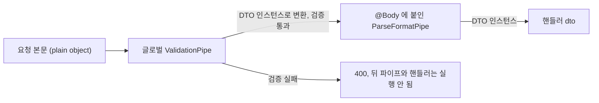

`ParseFormatPipe`가 받는 값은 왼쪽의 plain object가 아니라 `GV`를 지난 DTO 인스턴스다.

### 같은 DTO 다른 검증 정책

같은 `UserDto`를 어떤 핸들러에서는 엄격하게, 다른 핸들러에서는 느슨하게 검증하고 싶을 때가 있다. 글로벌 ValidationPipe는 옵션이 고정이라 핸들러 단위로 옵션을 바꾸려면 메서드에 별도 ValidationPipe를 단다.

```typescript
@Post('strict')
@UsePipes(new ValidationPipe({ whitelist: true, forbidNonWhitelisted: true }))
createStrict(@Body() dto: CreateUserDto) { /* ... */ }

@Post('lenient')
createLenient(@Body() dto: CreateUserDto) { /* ... */ }
```

이렇게 하면 글로벌과 메서드의 ValidationPipe가 둘 다 돈다(중복). 같은 객체를 두 번 검증하는 셈이라 비효율적이지만, 옵션이 다르면 결과도 다르다. 정책이 정말로 핸들러마다 다르다면 어쩔 수 없지만, 한두 군데만 다르면 코드베이스 일관성을 위해 글로벌 정책을 기준으로 두고 DTO 쪽에서 데코레이터로 차이를 만드는 편이 깔끔하다.


## 실무에서 자주 보는 문제

### 글로벌 ValidationPipe가 있는데 ParseIntPipe가 동작 안 한다

대부분 등록 순서나 옵션 문제가 아니라, 핸들러 시그니처를 잘못 적은 경우다.

```typescript
// 잘못된 예
@Get(':id')
findOne(@Param('id') id: number) {
  // id는 사실 문자열. number 타입 선언은 컴파일러만 속을 뿐
  return typeof id; // "string"
}
```

타입스크립트의 타입 선언은 런타임에 사라진다. `id: number`라고 적어도 ParseIntPipe를 명시하지 않으면 실제 런타임 값은 그냥 라우트 파라미터의 문자열이다. ValidationPipe도 metatype이 `Number`(primitive)이면 손대지 않는다. 명시적으로 ParseIntPipe를 붙여야 한다.

### 옵셔널 쿼리에 ParseIntPipe를 붙이면 400이 난다

`?page=`가 안 들어오면 값은 `undefined`다. ParseIntPipe는 `undefined`를 거부한다. 옵셔널이 명확하면 DefaultValuePipe와 같이 쓰거나, 파이프에 `optional: true` 옵션을 준다.

```typescript
@Query('page', new ParseIntPipe({ optional: true })) page?: number
```

이 옵션이 켜져 있으면 값이 없을 때 그냥 `undefined`를 그대로 통과시킨다. 단, `?page=`처럼 빈 문자열은 여전히 거부한다. 빈 문자열을 옵셔널로 처리하려면 별도의 어댑터 파이프를 앞에 둬야 한다.

### 커스텀 파이프에서 비동기 작업이 핸들러를 느리게 만든다

파이프 안에서 DB 조회나 외부 API 호출을 하면, 그 시간만큼 핸들러 진입이 늦어진다. 핸들러에서 같은 데이터를 또 조회하면 두 번 조회되는 일도 생긴다. 파이프는 가능하면 입력값의 형식 검증·변환에 한정하고, 도메인 데이터 조회는 서비스 계층에서 한 번에 처리하는 패턴이 추적과 캐싱 모두에 유리하다.

### 파이프 안의 에러가 ExceptionFilter에서 잡히지 않는 것처럼 보인다

파이프 안에서 던지는 예외는 정상적으로 ExceptionFilter로 전파된다. 잡히지 않는 것처럼 보이는 경우는 보통 두 가지다. 첫째, 파이프 안에서 비동기 함수의 reject를 await 없이 흘려보냈을 때. 둘째, 글로벌 ExceptionFilter가 컨트롤러 단위 필터에 가려졌을 때. ExceptionFilter는 [Nest_JS_Exception_Filters.md](Nest_JS_Exception_Filters.md)에 별도로 다룬다.

### ParseArrayPipe로 받은 배열의 검증이 약하다

ParseArrayPipe의 `items` 옵션은 각 요소를 지정한 타입으로 변환하는 정도다. "1 이상의 정수만", "최대 100개" 같은 검증은 하지 않는다. 정밀한 검증이 필요하면 DTO로 받는다.

```typescript
import { IsInt, ArrayMaxSize, ArrayMinSize, Min } from 'class-validator';
import { Transform, Type } from 'class-transformer';

export class FindByIdsQuery {
  @Transform(({ value }) => (typeof value === 'string' ? value.split(',').map(Number) : value))
  @IsInt({ each: true })
  @Min(1, { each: true })
  @ArrayMinSize(1)
  @ArrayMaxSize(100)
  @Type(() => Number)
  ids: number[];
}

@Get()
findByIds(@Query() query: FindByIdsQuery) {
  return this.userService.findByIds(query.ids);
}
```

`@Transform`으로 콤마 구분 문자열을 배열로 바꾸고, `@IsInt({ each: true })`와 `@Min(1, { each: true })`로 각 요소를 검증한다. ValidationPipe가 글로벌로 등록돼 있어야 동작한다.


## 파이프 디버깅

파이프가 의도대로 동작하는지 확인할 때 가장 빠른 방법은 `transform` 메서드에 임시 로그를 찍는 것이다.

```typescript
@Injectable()
export class DebugPipe implements PipeTransform {
  transform(value: any, metadata: ArgumentMetadata) {
    console.log('value:', value, 'metadata:', metadata);
    return value;
  }
}
```

이 파이프를 의심되는 인자에 붙이면 어떤 값이 들어오는지, metatype은 무엇인지 바로 확인할 수 있다. 글로벌 파이프와 메서드 파이프가 모두 적용된 상태에서 순서가 헷갈리면, 각 단계에 다른 라벨의 DebugPipe를 두고 출력 순서를 보면 흐름이 명확해진다.

또 한 가지, ValidationPipe가 던진 에러 메시지가 단편적으로 보일 때는 `disableErrorMessages: false`(기본값)를 유지하고, 응답 본문에 실제로 어떤 메시지 배열이 담겼는지 확인한다. 운영 환경에서 메시지를 숨기려고 `disableErrorMessages: true`로 켜두면 디버깅 단계에서 원인 추적이 어려워진다. 개발 환경과 운영 환경의 설정을 분리해 두는 게 안전하다.


## 참고

- [Nest_JS_Validation_Pipe.md](Nest_JS_Validation_Pipe.md) — ValidationPipe와 DTO 검증 상세
- [Nest_JS_요청_라이프사이클.md](Nest_JS_요청_라이프사이클.md) — 미들웨어·Guard·Pipe·Interceptor 실행 순서
- [Nest_JS_Exception_Filters.md](Nest_JS_Exception_Filters.md) — 파이프가 던진 예외 처리
- [Nest_JS_Decorator.md](Nest_JS_Decorator.md) — 파라미터 데코레이터와 파이프 결합
