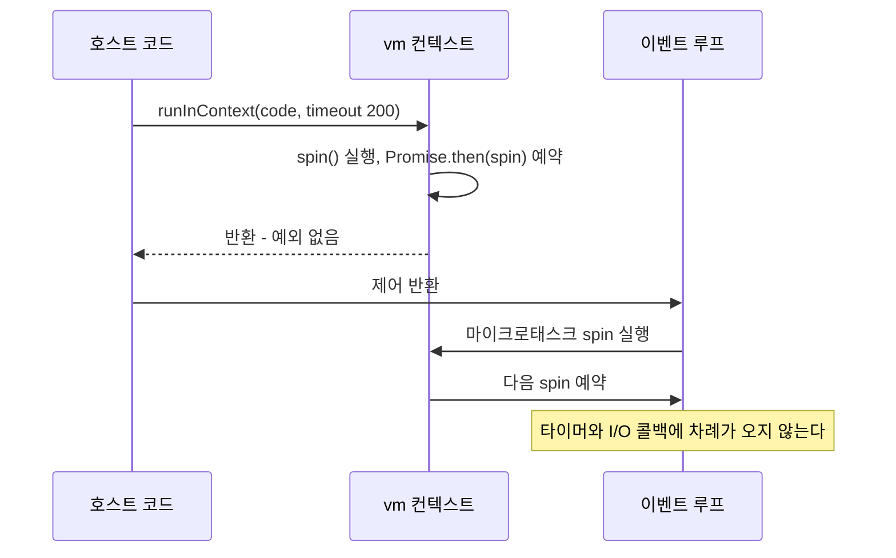
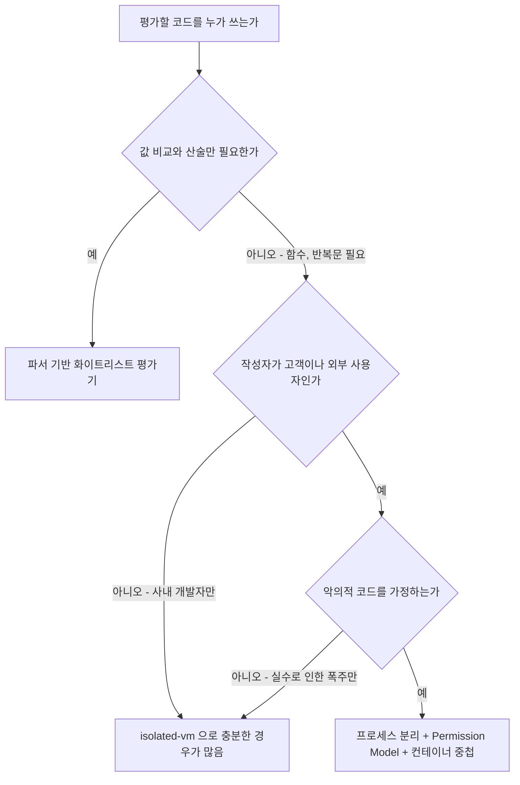

# Node.js vm 모듈과 동적 코드 실행의 한계

`node:vm` 은 이름 때문에 샌드박스로 오해받는다. `vm.runInNewContext(code, sandbox)` 를 처음 보면 "새 컨텍스트에서 돌리니까 호스트와 분리된다"고 읽힌다. 분리되는 것은 전역 객체 하나뿐이다. 공식 문서에도 vm 은 보안 메커니즘이 아니라고 적혀 있고, 신뢰할 수 없는 코드를 돌리는 용도로 쓰지 말라고 명시돼 있다.

사용자가 입력한 수식, 템플릿, 할인 규칙을 `eval` 이나 `new Function` 으로 돌리던 코드를 "vm 으로 바꿨으니 안전하다"고 리뷰에서 통과시키는 경우가 실제로 있다. 이 문서는 그 판단이 왜 틀리는지를 Node v20.20.0 에서 직접 돌린 결과로 보여준다. 이어서 `timeout` 옵션이 막지 못하는 것, 대안 세 가지(isolated-vm, 별도 프로세스 + Permission Model, 파서 기반 화이트리스트)가 막는 범위를 비교한다. 문서의 실행 결과는 전부 v20.20.0 기준이고 다른 버전은 돌려보지 않았다.

---

## 1. eval, new Function, vm 이 보는 스코프

세 가지 모두 문자열을 코드로 바꿔 실행한다. 차이는 그 코드가 무엇에 손댈 수 있는가인데, 어느 것도 호스트의 `process` 를 숨겨 주지 않는다.

```js
// CommonJS 모듈 안에서 실행
const secret = 'module-local';
console.log('direct eval  :', eval('typeof secret + "/" + typeof require'));
console.log('indirect eval:', (0, eval)('typeof secret + "/" + typeof require + "/" + typeof process'));
console.log('new Function :', new Function('return typeof secret + "/" + typeof require + "/" + typeof process')());
```

```
direct eval  : string/function
indirect eval: undefined/undefined/object
new Function : undefined/undefined/object
```

direct eval 은 호출 지점의 지역 변수와 모듈 스코프의 `require` 까지 본다. `require('child_process')` 한 줄이면 끝난다. indirect eval 과 `new Function` 은 모듈 지역 변수를 못 보지만 `process` 는 전역이라 그대로 보이고, `process.mainModule.require` 로 `require` 를 다시 얻는다. "`new Function` 은 지역 스코프를 못 보니까 안전하다"는 설명을 간혹 듣는데, 지역 변수가 안 보이는 것과 `process` 가 안 보이는 것은 별개다.

vm 은 전역 객체를 새로 만든다. 새 컨텍스트에는 `process`, `require`, `console` 이 없어서 `typeof process` 가 `undefined` 로 나오고, 그래서 안전해 보인다. 문제는 그 컨텍스트에서 호스트로 나가는 길이 따로 있다는 점이다.

---

## 2. 탈출 코드를 실제로 돌린 결과

`this.constructor.constructor('return process')()` 는 vm 탈출의 가장 오래된 형태다. `this` 의 생성자(`Object`)의 생성자(`Function`)를 얻고, 그 `Function` 으로 `process` 를 반환하는 함수를 만들어 호출한다. 이 `Function` 이 호스트 realm 의 것이면 그 함수의 전역은 호스트 전역이라 `process` 가 보인다.

```js
const vm = require('node:vm');
console.log(vm.runInNewContext("this.constructor.constructor('return process')().pid"));
console.log(process.pid);
```

```
3190380
3190380
```

샌드박스 인자를 아예 안 줬는데도 호스트 `process.pid` 가 그대로 나왔다. 같은 형태로 몇 가지를 더 돌려본 결과다.

| 샌드박스 | 실행한 코드 | 결과 |
|---|---|---|
| `{}` | `this.constructor.constructor('return process')().pid` | 호스트 pid 반환, 탈출 |
| `{}` | `({}).constructor.constructor('return process')().pid` | `ReferenceError: process is not defined` |
| `Object.create(null)` | `this.constructor.constructor('return process')().pid` | `ReferenceError: process is not defined` |
| `{ log: console.log }` | `log.constructor('return process')().pid` | 호스트 pid 반환, 탈출 |
| `{ x: { a: 1 } }` | `x.constructor.constructor('return process')().pid` | 호스트 pid 반환, 탈출 |
| `{ x: JSON 복사본 }` | 위와 동일 | 호스트 pid 반환, 탈출 |
| `{ x: Object.freeze(obj) }` | 위와 동일 | 호스트 pid 반환, 탈출 |
| 컨텍스트 안에서 `globalThis.x = {...}` 로 만든 값 | 위와 동일 | `ReferenceError: process is not defined` |

막힌 세 줄(두 번째, 세 번째, 마지막)은 이유가 같다. 코드가 손에 쥔 객체가 전부 컨텍스트 소유라서 `constructor` 를 타고 올라가도 컨텍스트 자체의 `Function` 에 도착하고, 그 전역에는 `process` 가 없다. 두 번째 줄의 `({})` 는 코드 안에서 만든 리터럴이라 컨텍스트 소유다.

첫 줄이 뚫리는 이유가 이 표의 핵심이다. `{}` 는 호스트에서 만든 객체이고, vm 은 이 객체를 컨텍스트 전역의 뒷받침으로 쓴다. 전역에서 `this.constructor` 를 찾으면 프로토타입 체인을 타고 올라가 호스트의 `Object` 에 닿는다. `Object.create(null)` 로 체인을 끊으면 이 길은 막힌다.

네 번째 줄부터는 다르다. 샌드박스에 호스트 함수나 객체를 하나라도 넣으면 그 값의 `constructor` 가 호스트 `Function` 이다. `Object.create(null)` 샌드박스에 `x`, `log` 를 속성으로 넣어도 똑같이 pid 가 나왔다. JSON 으로 복사해도, `Object.freeze` 를 걸어도 마찬가지다. 복사본은 여전히 호스트 realm 에서 만든 객체이고, freeze 는 속성 변경을 막을 뿐 `constructor` 조회를 막지 않는다.

탈출 후에 할 수 있는 일은 `process` 를 가진 코드가 할 수 있는 전부다.

```js
vm.runInNewContext(
  "this.constructor.constructor('return process')().mainModule.require('child_process').execSync('id').toString()"
);
// uid=0(root) gid=0(root) groups=0(root)
```

아래 도식은 입력이 들어와서 호스트 객체에 닿기까지의 분기다. vm 쪽 분기에서 "호스트 값이 하나라도 있는가"가 갈림길이고, 실무에서는 거의 항상 `order`, `user`, `config` 같은 데이터를 넘기기 때문에 왼쪽으로 빠진다.

```mermaid
flowchart TD
    IN["사용자 입력 - 수식, 템플릿, 규칙"] --> E1["eval"]
    IN --> E2["new Function"]
    IN --> E3["vm.runInNewContext"]

    E1 -->|direct eval| LOCAL["호출 지점 지역 변수와 require"]
    E1 -->|indirect eval| GLOBAL["호스트 전역 process"]
    E2 --> GLOBAL
    E3 --> Q{"샌드박스가 일반 객체이거나 호스트 값을 담고 있나"}

    Q -->|예| LEAK["x.constructor.constructor 로 호스트 Function 획득"]
    Q -->|"아니오 - null 프로토타입, 컨텍스트 안에서 만든 값만"| INNER["컨텍스트 자체 Function, process 없음"]

    LEAK --> GLOBAL
    LOCAL --> RCE
    GLOBAL --> RCE["process.mainModule.require, child_process, env, fs"]
```



"아니오" 쪽이 실제로 쓸 만하냐고 물으면 그렇지 않다. 데이터를 하나도 못 넘기는 평가기는 계산기로도 못 쓴다. 컨텍스트 안에서 데이터를 리터럴로 다시 만들어 넣으면 이 경로가 막히는 것은 위 표에서 확인했다. 확인한 것은 거기까지다. 다른 경로가 없다는 증명은 아니고, vm 이 보안 경계가 아니라는 공식 입장이 그 부분을 책임져 주지 않는다.

---

## 3. 사고가 나는 경로

### 템플릿 엔진

자체 템플릿 엔진을 만들면서 `{{ 표현식 }}` 을 `new Function` 으로 컴파일하는 구현은 흔하다. `with` 로 데이터를 스코프에 올리면 `{{ user.name }}` 처럼 쓸 수 있어서 편하다.

```js
function render(tpl, data) {
  const body = 'with (data) { return `' + tpl.replace(/\{\{(.+?)\}\}/g, '${$1}') + '` }';
  return new Function('data', body)(data);
}

render('안녕 {{user.name}}', { user: { name: 'kim' } });
// 안녕 kim

render('{{process.mainModule.require("child_process").execSync("id").toString().trim()}}', { user: {} });
// uid=0(root) gid=0(root) groups=0(root)
```

템플릿 문자열을 개발자만 쓰면 문제가 없다. 사고는 "운영자가 관리자 화면에서 알림 문구를 수정한다", "고객사가 이메일 템플릿을 직접 편집한다" 같은 기능이 붙을 때 난다. 그 시점에는 템플릿이 입력값이 되고, 엔진 코드는 이미 몇 년 전에 작성돼 아무도 안 본다. `vm.runInNewContext(expr, data)` 로 바꿔 놓았어도 2장의 표 네 번째 줄 이하와 같아서 `data` 에 담긴 객체 하나로 뚫린다.

### 수식, 규칙 엔진

"VIP 이면서 주문 금액 10만원 이상이면 10% 할인" 같은 조건을 DB 에 문자열로 저장하고 평가하는 구조도 같은 경로다.

```js
const rule = "order.total > 100000 && order.user.grade === 'vip'";
const ok = vm.runInNewContext(rule, { order }, { timeout: 100 });
```

`timeout` 까지 붙인 방어적인 코드처럼 보이지만 `order` 는 호스트 객체다. `order.constructor.constructor('return process')()` 가 규칙에 들어가면 위의 표와 같은 결과가 나온다. 규칙을 편집할 수 있는 사람이 "내부 직원뿐"이라는 가정이 깨지는 순간(권한 버그, 관리자 계정 탈취, 규칙을 가져오는 import 기능)이 곧 RCE 가 된다.

---

## 4. timeout 은 동기 구간만 끊는다

`vm.runInContext` 의 `timeout` 옵션은 스크립트의 동기 실행 시간을 제한한다. 무한 루프는 확실히 끊긴다.

```js
vm.runInNewContext('while(true){}', {}, { timeout: 200 });
// ERR_SCRIPT_EXECUTION_TIMEOUT, 202ms 후 예외
```

여기까지는 문서 설명대로다. 문제는 그 다음이다. 프라미스 체인으로 마이크로태스크를 계속 예약하는 코드를 돌려봤다.

```js
const ctx = vm.createContext({});
vm.runInContext('function spin(){ Promise.resolve().then(spin) } spin()', ctx, { timeout: 200 });
console.log('runInContext returned');
setTimeout(() => console.log('이 타이머는 실행되지 않는다'), 100);
```

실행 결과, `runInContext` 는 약 206ms 에 예외 없이 반환됐고 `setTimeout` 콜백은 끝내 실행되지 않았다. 프로세스는 `timeout 5 node t3.js` 의 5초 제한으로 종료됐다(종료 코드 124). 스크립트의 동기 부분은 끝났으니 `timeout` 이 할 일이 없고, 그 뒤에 이벤트 루프가 마이크로태스크 큐를 비우는 동안은 `timeout` 의 감시 밖이다.



HTTP 서버에서 이 코드가 돌면 증상은 "요청이 전부 타임아웃인데 CPU 는 100%, 로그는 조용하다"로 나타난다. 헬스체크도 응답을 못 하므로 오케스트레이터가 프로세스를 죽이기 전까지 서비스가 멈춘다.

`createContext` 에는 이 경우를 위한 `microtaskMode: 'afterEvaluate'` 옵션이 있다. 마이크로태스크를 `runInContext` 호출 안에서 비우게 해서 `timeout` 이 적용되도록 한다.

```js
const ctx = vm.createContext({}, { microtaskMode: 'afterEvaluate' });
vm.runInContext('function spin(){ Promise.resolve().then(spin) } spin()', ctx, { timeout: 200 });
// ERR_SCRIPT_EXECUTION_TIMEOUT, 202ms 후 예외. 호스트 타이머도 이후 정상 실행됨
```

이 옵션을 켜니 같은 코드가 202ms 에 `ERR_SCRIPT_EXECUTION_TIMEOUT` 으로 끊기고 호스트 타이머도 돌았다. 대신 이 옵션에는 구멍이 하나 남는다. 호스트가 `setTimeout` 을 샌드박스에 넣어 주면 콜백은 `runInContext` 가 끝난 뒤에 실행되므로 `timeout` 의 밖이다.

```js
const ctx = vm.createContext({ setTimeout });
vm.runInContext('setTimeout(() => { while(true){} }, 50)', ctx, { timeout: 100 });
console.log('run 종료');          // 출력됨
setInterval(() => console.log('tick'), 100).unref();   // tick 이 한 번도 출력되지 않음
```

`run 종료` 는 찍히고 그 뒤 `tick` 은 한 번도 안 찍혔다. 50ms 후 샌드박스 콜백이 진입해서 이벤트 루프를 점유했기 때문이다. 이 경우 `timeout` 은 어떤 옵션 조합으로도 작동하지 않으므로, 코드가 시간 기반 API 에 접근할 수 있으면 동기 루프를 끊는 수단이 없다고 봐야 한다.

메모리는 더 단순하다. vm 에는 메모리 상한 옵션이 없다.

```js
// node --max-old-space-size=64
vm.runInNewContext('const a=[]; while(true) a.push(new Array(1e5).fill(1))', {}, { timeout: 5000 });
```

`timeout` 5초가 오기 전에 힙이 먼저 차서 예외가 아니라 V8 의 fatal error 로 프로세스가 abort 됐다(종료 코드 134). `try/catch` 로 잡히지 않는다.

---

## 5. 대안 세 가지

앞의 문제를 구조적으로 해결하려면 둘 중 하나다. 호스트와 다른 힙에서 실행하거나, 아예 코드를 실행하지 않고 표현식을 해석만 한다.

### isolated-vm

별도 V8 Isolate 에서 실행한다. 호스트 객체와 힙을 공유하지 않으므로 `constructor` 체인으로 호스트 `Function` 을 얻을 방법이 없다. 설치는 네이티브 모듈이라 prebuild 바이너리를 받는다. 이 문서의 테스트는 isolated-vm 5.0.4 를 Node v20.20.0 에서 별도 플래그 없이 돌렸다.

```js
const ivm = require('isolated-vm');

const isolate = new ivm.Isolate({ memoryLimit: 32 });
const ctx = await isolate.createContext();

await ctx.eval('typeof process');                                     // 'undefined'
await ctx.eval("this.constructor.constructor('return typeof process')()"); // 'undefined'
await ctx.eval('while(true){}', { timeout: 200 });                    // Error: Script execution timed out.

await ctx.global.set('log', new ivm.Callback((s) => console.log('host log:', s)));
await ctx.eval("log.constructor('return typeof process')()");         // 'undefined'
```

vm 에서 뚫렸던 형태가 전부 `undefined` 로 끝났다. 주입한 `log` 에 `constructor` 체인을 태워도 호스트 `Function` 이 아니라 Isolate 내부의 것이다. 호스트와는 `ivm.Callback`, `ivm.Reference`, `ivm.ExternalCopy` 로만 통신하고, 값은 복사되거나 참조 핸들로 전달된다.

메모리와 프라미스 체인도 막는다.

```js
await ctx.eval('const a=[]; while(true) a.push(new Array(1e5).fill(1))', { timeout: 5000 });
// Error: Isolate was disposed during execution due to memory limit
// isolate.isDisposed === true, 호스트 프로세스는 살아 있음

const c2 = await new ivm.Isolate({ memoryLimit: 32 }).createContext();
await c2.eval('function spin(){ Promise.resolve().then(spin) } spin()', { timeout: 200 });
// Error: Script execution timed out. 호스트 타이머는 정상 실행
```

vm 에서 프로세스가 abort 되던 메모리 폭주가 Isolate 만 dispose 되고 끝났다. 프라미스 스핀은 `microtaskMode` 같은 옵션 없이 기본으로 끊겼다.

한계도 있다. 네이티브 모듈이라 Node 메이저 버전이 올라갈 때마다 prebuild 가 따라오는지 확인해야 한다. 같은 프로세스 안이므로 V8 자체의 취약점(타입 혼동 같은)은 막지 못한다. `Callback` 으로 호스트 함수를 열어 주면 그 함수가 하는 일은 샌드박스 코드가 할 수 있는 일이 되므로, 넘기는 함수는 파일을 읽는 것 같은 부수효과가 없어야 한다.

### 별도 프로세스와 Permission Model

코드를 자식 프로세스로 넘기고 Permission Model 로 그 프로세스의 권한을 줄인다. vm 탈출이 되더라도 탈출한 곳이 권한 없는 프로세스다. 자식은 부모가 `SIGKILL` 로 끊을 수 있어서 `timeout` 이 못 끊는 마이크로태스크 스핀과 메모리 폭주도 정리된다.

```js
// runner.js
const { spawn } = require('node:child_process');

function runUntrusted(code, ms = 1000) {
  return new Promise((resolve) => {
    const child = spawn(process.execPath, [
      '--experimental-permission',
      '--allow-fs-read=/tmp/vmx/worker.js',
      '--max-old-space-size=64',
      '/tmp/vmx/worker.js',
    ], { stdio: ['pipe', 'pipe', 'pipe'], env: {} });

    let out = '';
    child.stdout.on('data', (d) => (out += d));
    const timer = setTimeout(() => child.kill('SIGKILL'), ms);
    child.on('exit', (c, sig) => { clearTimeout(timer); resolve({ code: c, sig, out: out.trim() }); });
    child.stdin.end(code);
  });
}
```

```js
// worker.js - 자식 프로세스 안에서 vm 으로 실행
const vm = require('node:vm');
let src = '';
process.stdin.on('data', (d) => (src += d)).on('end', () => {
  try { process.stdout.write(JSON.stringify({ ok: String(vm.runInNewContext(src, {}, { timeout: 500 })) })); }
  catch (e) { process.stdout.write(JSON.stringify({ err: e.code || e.name })); }
});
```

네 가지를 넣어봤다.

```
정상     { code: 0, sig: null, out: '{"ok":"3"}' }
탈출 RCE { code: 0, sig: null, out: '{"err":"ERR_ACCESS_DENIED"}' }
탈출 fs  { code: 0, sig: null, out: '{"err":"ERR_ACCESS_DENIED"}' }
Promise  { code: null, sig: 'SIGKILL', out: '{"ok":"undefined"}' }
```

탈출은 성공해서 `process` 를 얻었지만 `child_process` 와 `fs.readFileSync('/etc/passwd')` 가 `ERR_ACCESS_DENIED` 로 막혔다. 프라미스 스핀은 부모가 1초 뒤 `SIGKILL` 을 보내 정리했다.

주의할 점이 있다. Node 20 의 플래그 이름은 `--experimental-permission` 이고 `--permission` 은 `bad option` 이다. 그리고 20.20.0 에서는 네트워크 권한이 없다. 같은 조건에서 탈출한 코드가 `net.connect(80, '127.0.0.1')` 을 호출했을 때 막히지 않았다. 환경변수도 막히지 않아서 `FAKE_SECRET=abc` 를 넣은 부모 환경에서 탈출 코드가 `process.env.FAKE_SECRET` 으로 `abc` 를 읽었다. 위 `runner.js` 가 `env: {}` 를 주는 이유가 이것이다. 자식에게 비밀이 담긴 환경변수를 상속하지 않아야 한다. Permission Model 의 플래그 변화와 한계는 [Node.js Permission Model 심화](../Permission_Model.md) 에 정리해 두었다.

`--disallow-code-generation-from-strings` 도 돌려봤다. 이 플래그를 주면 `eval` 과 `new Function` 이 `EvalError: Code generation from strings disallowed for this context` 로 막히고, 앞의 `this.constructor.constructor('return process')()` 탈출도 같은 `EvalError` 로 막혔다. `vm.runInNewContext('1+2')` 같은 정상 호출은 계속 `3` 을 반환했다. 탈출 경로 중 `Function` 생성자를 거치는 것은 닫히지만, 샌드박스에 넣은 호스트 함수가 직접 부수효과를 일으키는 경로는 이 플래그와 무관하다. 방어 한 겹이지 경계는 아니다.

### 파서 기반 화이트리스트 평가

수식과 규칙 엔진은 대부분 "값을 읽고 비교하고 계산"하는 정도만 필요하다. 이 정도는 코드를 실행할 필요가 없고 AST 를 직접 걷는 평가기로 충분하다. 허용하는 노드 타입만 정해 두고, 목록에 없는 노드는 전부 거부한다.

```js
// safe_eval.js
const acorn = require('acorn');
const FORBIDDEN = new Set(['constructor', '__proto__', 'prototype']);
const BIN = {
  '+': (a, b) => a + b, '-': (a, b) => a - b, '*': (a, b) => a * b, '/': (a, b) => a / b, '%': (a, b) => a % b,
  '>': (a, b) => a > b, '>=': (a, b) => a >= b, '<': (a, b) => a < b, '<=': (a, b) => a <= b,
  '===': (a, b) => a === b, '!==': (a, b) => a !== b,
};

function evaluate(node, scope) {
  switch (node.type) {
    case 'Literal': return node.value;
    case 'Identifier':
      if (!Object.hasOwn(scope, node.name)) throw new Error(`unknown identifier: ${node.name}`);
      return scope[node.name];
    case 'MemberExpression': {
      const obj = evaluate(node.object, scope);
      const key = node.computed ? evaluate(node.property, scope) : node.property.name;
      if (typeof key !== 'string' && typeof key !== 'number') throw new Error('bad key');
      if (FORBIDDEN.has(key) || !Object.hasOwn(Object(obj), key)) throw new Error(`blocked member: ${key}`);
      return obj[key];
    }
    case 'BinaryExpression': {
      const f = BIN[node.operator];
      if (!f) throw new Error(`blocked operator: ${node.operator}`);
      return f(evaluate(node.left, scope), evaluate(node.right, scope));
    }
    case 'LogicalExpression': {
      const l = evaluate(node.left, scope);
      if (node.operator === '&&') return l && evaluate(node.right, scope);
      if (node.operator === '||') return l || evaluate(node.right, scope);
      throw new Error(`blocked operator: ${node.operator}`);
    }
    case 'ConditionalExpression':
      return evaluate(node.test, scope) ? evaluate(node.consequent, scope) : evaluate(node.alternate, scope);
    default: throw new Error(`blocked node: ${node.type}`);
  }
}

function safeEval(expr, scope) {
  if (expr.length > 500) throw new Error('expression too long');
  return evaluate(acorn.parseExpressionAt(expr, 0, { ecmaVersion: 2022 }), scope);
}
```

`CallExpression`, `NewExpression`, 화살표 함수, 템플릿 리터럴을 허용 노드에 넣지 않았다. 함수 호출이 없으면 `constructor('return process')` 를 부를 방법이 없다. 이 코드로 돌린 결과다.

```
order.total > 100 && order.user.grade === 'vip'   => true
order.total * 0.9                                  => 108
order.constructor.constructor('return process')()  REJECT blocked node: CallExpression
order['constru' + 'ctor']                          REJECT blocked member: constructor
process.pid                                        REJECT unknown identifier: process
order.total.toFixed(2)                             REJECT blocked node: CallExpression
(() => 1)()                                        REJECT blocked node: CallExpression
order.hasOwnProperty('total')                      REJECT blocked node: CallExpression
order.__proto__                                    REJECT blocked member: __proto__
```

네 번째 줄이 이 방식의 핵심이다. 문자열을 이어 붙여 속성 이름을 조립해도 키는 평가 후에 검사하므로 `constructor` 가 걸린다. 블랙리스트 정규식으로 `constructor` 문자열을 찾는 방식은 이 우회에 뚫리는데, 평가기가 계산된 키를 직접 검사하면 우회가 안 된다. `Object.hasOwn` 으로 자기 속성만 읽게 한 것도 프로토타입 체인을 못 타게 하려는 것이다.

대가는 기능 제약이다. `toFixed` 같은 메서드 호출이 안 되고, 필요하면 허용 함수를 이름으로 등록하는 `CallExpression` 처리를 직접 추가해야 한다. 이때 함수 이름 화이트리스트에 `Function`, `eval`, 호스트 함수 중 부수효과가 있는 것이 들어가지 않게 주의한다. 반복문이 없는 표현식만 허용하는 구조라 무한 루프가 생기지 않고, 표현식 길이 제한으로 파싱 비용도 상한이 생긴다. 직접 평가기를 쓰기 부담스러우면 jsep 이나 expr-eval 같은 라이브러리를 쓰는 방법이 있다. 이 문서에서는 두 라이브러리를 돌려보지 않았으므로 어떤 우회가 있는지는 모른다. 라이브러리를 쓰더라도 사용하는 버전의 알려진 취약점을 확인해야 한다.

---

## 6. 격리 수단별 차단 범위

지금까지 실행한 결과를 한 표로 모은다. "컨테이너" 열은 이 문서에서 실행하지 않았다. 커널 수준 격리의 일반적인 성질을 적은 것이라 위 세 열과 근거의 강도가 다르다.

| 항목 | vm | isolated-vm | child_process + Permission | 컨테이너 |
|---|---|---|---|---|
| 호스트 객체 탈출(`constructor` 체인) | 호스트 값이 하나라도 있으면 뚫림 | 막힘(실행 확인) | 탈출은 됨, 탈출 후 권한이 제한됨(실행 확인) | 해당 없음, 프로세스 밖에서 제한 |
| 파일 읽기 | 탈출하면 가능 | 호스트 API 없음 | 허용 경로 밖은 `ERR_ACCESS_DENIED`(실행 확인) | 마운트한 경로만 |
| 자식 프로세스 실행 | 탈출하면 가능 | 호스트 API 없음 | 막힘(실행 확인) | 컨테이너 안에서는 가능, 밖으로는 불가 |
| 네트워크 | 탈출하면 가능 | 호스트 API 없음 | Node 20.20.0 에서 막히지 않음(실행 확인) | 네트워크 정책으로 제어 |
| 환경변수 | 탈출하면 읽힘 | 호스트 API 없음 | `env: {}` 로 넘기지 않아야 함(실행 확인) | 넘긴 것만 |
| 동기 무한 루프 | `timeout` 으로 끊김 | `timeout` 으로 끊김 | 부모가 `SIGKILL` | CPU 제한 |
| 마이크로태스크 무한 체인 | 기본은 못 끊음, `afterEvaluate` 로 끊김 | 끊김(실행 확인) | 부모가 `SIGKILL`(실행 확인) | CPU 제한 |
| 메모리 폭주 | 프로세스 abort(exit 134) | Isolate 만 dispose(실행 확인) | `--max-old-space-size` 초과 시 자식만 종료 | 메모리 제한 |
| V8 자체 취약점 | 못 막음 | 못 막음 | 프로세스 경계로 피해 범위 제한 | 커널 경계로 피해 범위 제한 |

선택은 입력의 성격으로 갈린다.



표를 읽을 때 눈에 띄는 것은 vm 열이다. 탈출만 안 되면 `timeout` 으로 충분해 보이지만, 탈출이 되는 순간 나머지 칸이 전부 "가능"으로 바뀐다. 반대로 isolated-vm 은 탈출 자체를 막아서 아래 칸이 의미 없어진다. 그래서 vm 을 쓰는 코드를 리뷰할 때는 `timeout` 이 있는지가 아니라 샌드박스에 무엇을 넣었는지를 먼저 본다.

---

## 7. 현장에서 마주치는 판단들

**기존 코드에 vm 이 이미 있을 때.** 사용자 입력이 아니라 서버 설정 파일이나 내부 스크립트를 실행하는 용도라면 지금 당장 바꿀 이유는 없다. 입력 출처를 추적해서 외부 사용자가 편집 가능한 경로가 하나라도 있는지부터 본다. 템플릿이나 규칙 편집 UI 가 나중에 붙을 때 다시 문제가 된다.

**`Object.create(null)` 만 믿는 경우.** 2장 표에서 `Object.create(null)` 줄만 보고 "이걸로 막힌다"는 결론을 내는 코드가 있다. 그 뒤에 `{ order }` 같은 값을 하나 넣는 순간 다시 뚫린다. 데이터를 넣는 용도로 vm 을 쓰는 거의 모든 사용처가 여기에 해당한다.

**`vm2` 같은 서드파티 샌드박스.** 이 문서에서는 설치해서 돌려보지 않았다. 쓰는 중이라면 사용 중인 버전의 보안 공지와 패키지 유지 상태부터 확인한다.

**로깅.** 평가 실패와 거부된 입력은 로그로 남긴다. `blocked node: CallExpression` 이 반복해서 찍히면 그 규칙을 편집한 계정을 확인할 단서가 된다. 평가에 사용한 원문과 편집자를 같이 기록하지 않으면 사고 뒤에 추적할 수 없다.
