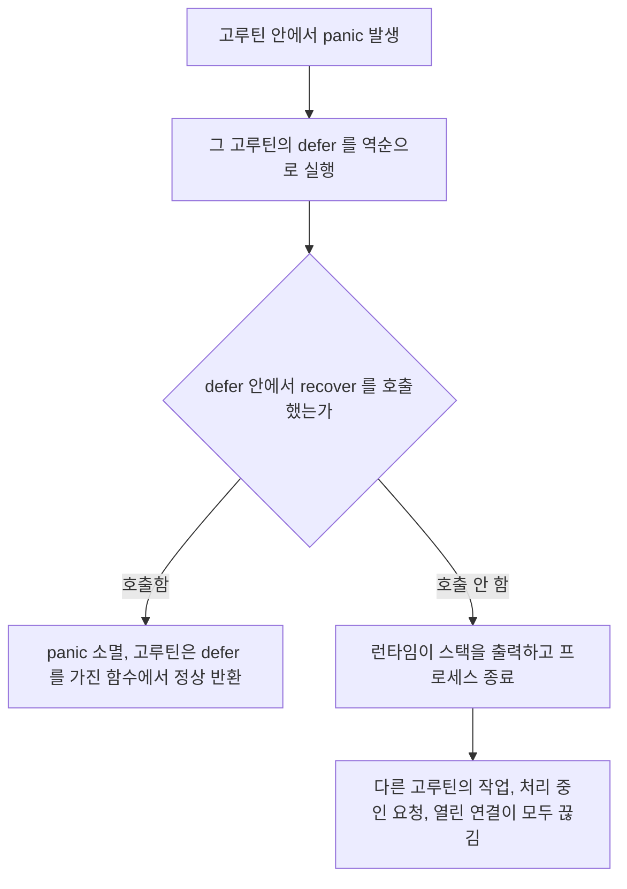
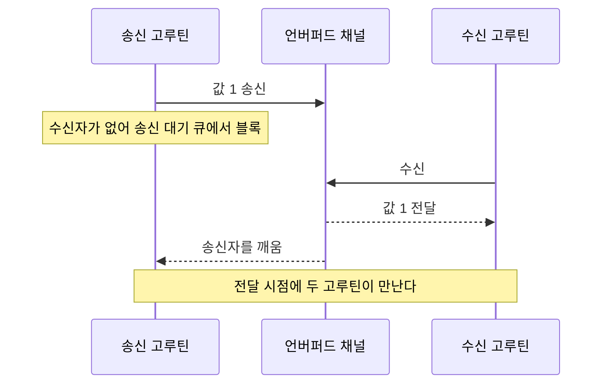
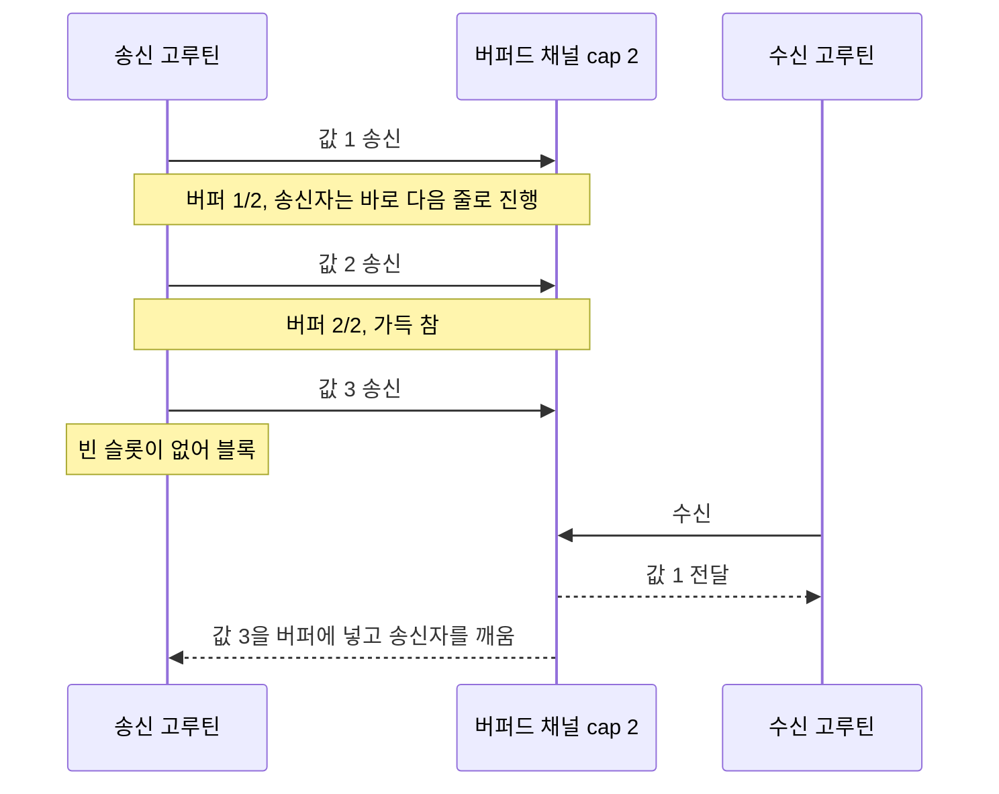
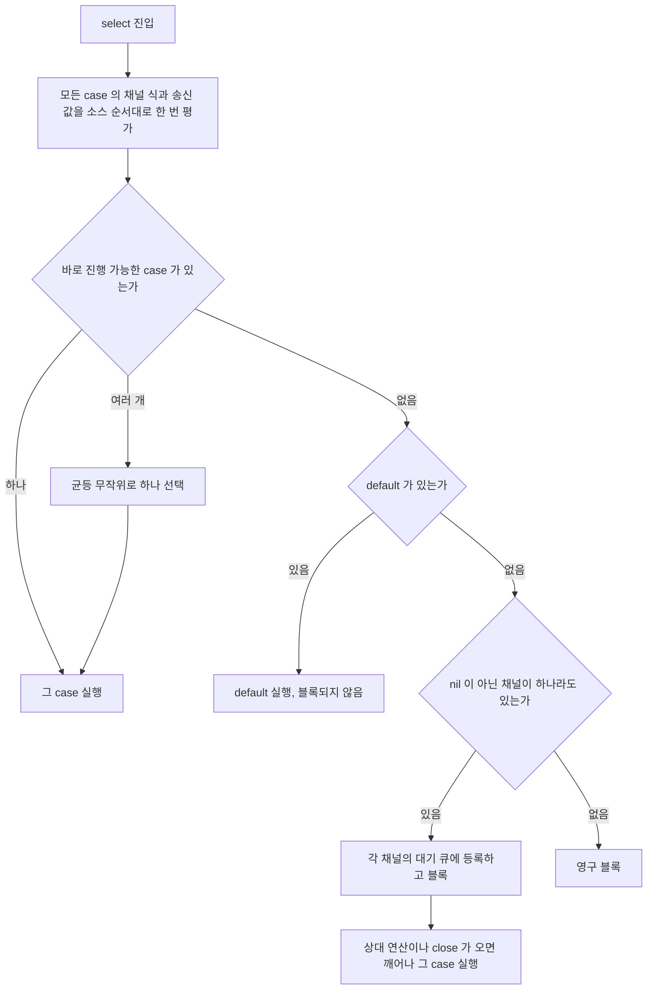
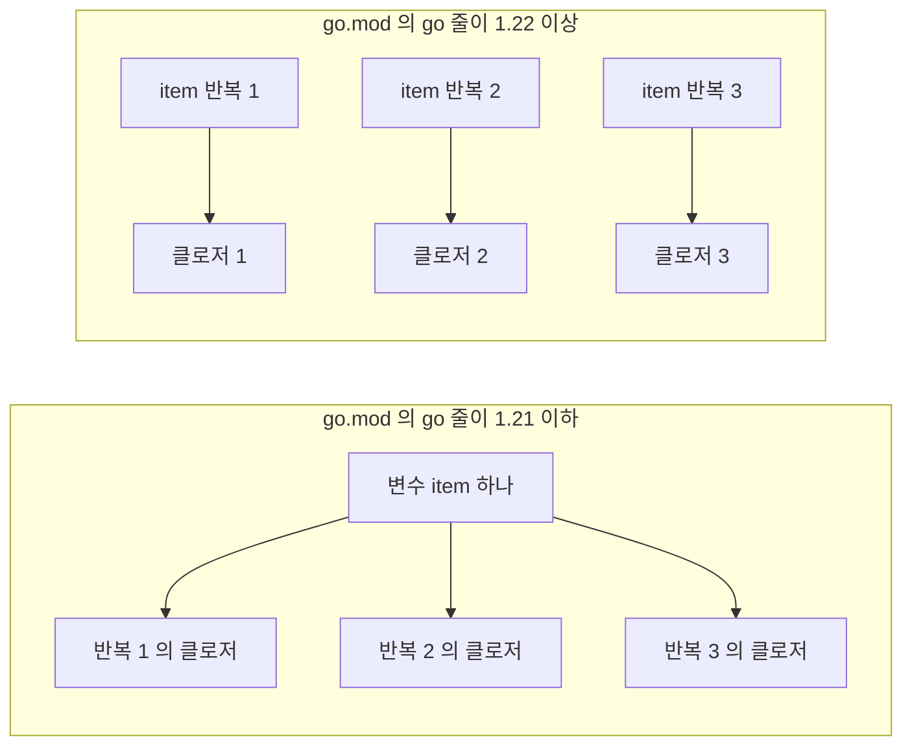
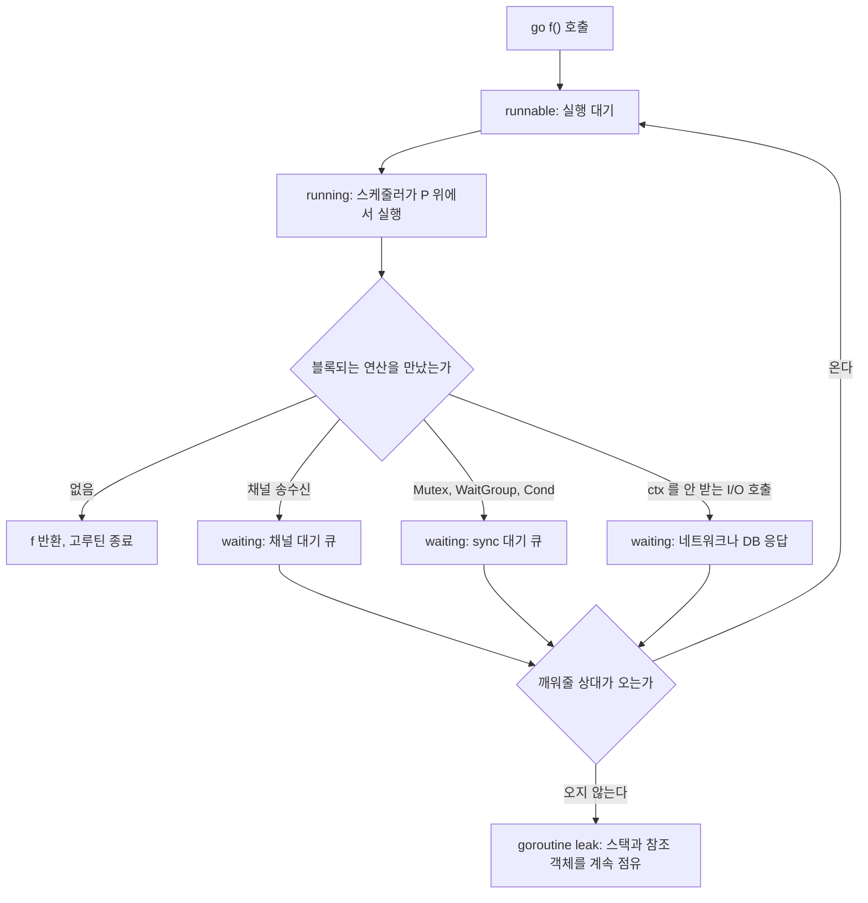

# Go 동시성 - 고루틴과 채널

Go의 동시성 모델은 CSP(Communicating Sequential Processes)에 기반한다. 공유 메모리 대신 메시지 전달을 기본으로 설계됐는데, 실무에서는 이 원칙을 지키는 경우보다 지키지 않는 경우가 더 많다. 어떤 상황에서 채널을 써야 하고 어떤 상황에서 Mutex를 써야 하는지를 잘못 판단하면 goroutine leak이나 deadlock으로 돌아온다.

## 고루틴 생성 비용

고루틴은 OS 스레드가 아니다. Go 런타임이 관리하는 경량 스레드로, 초기 스택 크기가 2KB에서 시작해 필요에 따라 커진다. OS 스레드가 보통 1~8MB 스택으로 시작하는 것과 다르다.

고루틴 생성 자체는 수 마이크로초 수준이다. 수천 개를 띄워도 메모리와 스케줄링 부담이 OS 스레드 수백 개보다 낮다. 그래서 Go에서는 HTTP 요청당 고루틴 하나를 만드는 패턴이 자연스럽다.

```go
go func() {
    // 이 함수는 새 고루틴에서 실행된다
    doWork()
}()
```

단, 고루틴을 아무 제한 없이 생성하면 문제가 생긴다. 각 고루틴이 결국 메모리를 쓰고, 스케줄러 부담도 누적된다. 초당 수만 개를 만드는 상황이면 worker pool 패턴을 고려해야 한다.

```go
// worker pool - 고루틴 수를 제한한다
func workerPool(jobs <-chan Job, numWorkers int) {
    var wg sync.WaitGroup
    for i := 0; i < numWorkers; i++ {
        wg.Add(1)
        go func() {
            defer wg.Done()
            for job := range jobs {
                process(job)
            }
        }()
    }
    wg.Wait()
}
```

## 고루틴 안의 panic은 밖에서 못 잡는다

`recover`는 같은 고루틴에서 실행 중인 defer 함수 안에서만 panic을 받는다. 부모 고루틴에 `defer recover()`를 걸어도 자식 고루틴의 panic은 잡히지 않는다. 자식에서 복구되지 않은 panic은 그 고루틴의 defer를 전부 실행한 뒤 프로세스 전체를 종료시킨다. 종료 코드는 2다.

```go
func main() {
    defer func() {
        if r := recover(); r != nil {
            fmt.Println("복구", r) // 이 줄은 실행되지 않는다
        }
    }()

    go func() {
        var m map[string]int
        m["a"] = 1 // nil 맵 쓰기 panic
    }()

    time.Sleep(time.Second)
}
```



도식에서 보면 판정은 panic이 난 고루틴의 defer 체인 안에서만 이뤄진다. `net/http` 서버는 요청마다 만드는 핸들러 고루틴에 recover를 걸어 두기 때문에 핸들러 안의 panic은 로그만 남기고 넘어간다. 문제는 핸들러가 직접 `go func()`로 띄운 고루틴이다. 그쪽은 http 서버의 보호 밖이라 panic 한 번에 서버 프로세스가 내려간다. 비동기로 알림을 보내거나 이벤트를 발행하는 코드에서 nil 포인터 하나가 서비스 전체 장애로 번지는 경우가 이렇게 생긴다.

고루틴을 띄우는 지점마다 recover를 직접 쓰면 빠뜨리게 된다. 래퍼 하나로 모으는 편이 낫다.

```go
func SafeGo(name string, fn func()) {
    go func() {
        defer func() {
            if r := recover(); r != nil {
                slog.Error("goroutine panic",
                    "name", name,
                    "panic", r,
                    "stack", string(debug.Stack()))
                metrics.GoroutinePanic.WithLabelValues(name).Inc()
            }
        }()
        fn()
    }()
}
```

`debug.Stack()`은 recover를 호출한 defer 안에서 불러야 panic이 난 지점의 스택이 남는다. 바깥에서 부르면 이미 풀린 스택이라 원인 위치를 알 수 없다.

errgroup으로 띄우는 작업은 함수가 `error`를 반환하므로 panic을 에러로 바꿔서 돌려주는 형태가 맞다.

```go
func recoverToError(fn func() error) (err error) {
    defer func() {
        if r := recover(); r != nil {
            err = fmt.Errorf("panic: %v\n%s", r, debug.Stack())
        }
    }()
    return fn()
}

g.Go(func() error {
    return recoverToError(func() error { return process(ctx, it) })
})
```

recover로 모든 걸 막을 수는 없다. 맵 동시 쓰기(`fatal error: concurrent map writes`), 메모리 고갈, 모든 고루틴이 잠든 deadlock은 panic이 아니라 런타임의 fatal error라서 recover가 받지 못한다. 그리고 panic을 삼키고 계속 돌리면 공유 상태가 중간까지만 바뀐 채 남을 수 있다. 래퍼에서 로그와 메트릭을 남기고, 워커 루프라면 해당 워커를 새로 띄울지 결정하는 것까지가 래퍼의 몫이다.

## 채널 방향성

채널은 선언할 때 방향을 지정할 수 있다. 함수 시그니처에서 방향을 명시하면 컴파일러가 잘못된 사용을 잡아준다.

```go
func producer(out chan<- int) { // 송신 전용
    out <- 42
}

func consumer(in <-chan int) { // 수신 전용
    val := <-in
    fmt.Println(val)
}

func main() {
    ch := make(chan int, 1) // 양방향 채널
    go producer(ch)
    consumer(ch)
}
```

`chan<- int`는 송신만 가능하고, `<-chan int`는 수신만 가능하다. 방향을 명시하지 않으면 어디서든 송신과 수신이 모두 가능하기 때문에 의도하지 않은 방향으로 사용해도 컴파일러가 잡지 못한다. 함수 인자로 채널을 넘길 때는 항상 방향을 명시하는 게 맞다.

### 버퍼드 채널 vs 언버퍼드 채널

언버퍼드 채널은 송신자와 수신자가 동시에 준비됐을 때만 값이 전달된다. 버퍼드 채널은 버퍼가 가득 찰 때까지 블로킹 없이 송신할 수 있다.

```go
// 언버퍼드: 수신자가 없으면 블로킹
ch1 := make(chan int)

// 버퍼드: 버퍼 크기만큼 쌓을 수 있다
ch2 := make(chan int, 10)
```

버퍼드 채널을 잘못 쓰면 오히려 문제를 숨긴다. 버퍼 크기를 넉넉하게 잡아서 당장 블로킹이 안 일어나는 것처럼 보이지만, 수신 속도가 송신 속도를 따라가지 못하면 결국 가득 찬다. 버퍼 크기는 벤치마크를 기반으로 결정해야 한다.

### 블록되는 순서

두 방식의 차이는 송신자가 어느 시점에 멈추느냐다. 언버퍼드 채널은 수신자가 올 때까지 송신자가 멈추고, 버퍼드 채널은 버퍼가 찰 때까지 송신자가 멈추지 않는다. 아래 시퀀스에서 송신 쪽 Note가 붙은 위치를 비교하면 된다.





언버퍼드 채널의 송신이 끝났다는 건 수신자가 값을 받았다는 뜻이다. 그래서 `ch <- v` 다음 줄에서 "상대가 받았다"를 전제로 코드를 쓸 수 있다. 버퍼드 채널은 이 보장이 없다. 송신이 리턴했어도 값은 버퍼에 있을 뿐이고, 수신자가 죽었다면 영영 처리되지 않는다. 종료 시점에 버퍼에 남은 값을 어떻게 비울지 정하지 않고 버퍼를 키우면 프로세스를 내릴 때 작업이 유실된다.

### 닫힌 채널에서 수신하면

`close(ch)` 이후 수신은 블록되지 않는다. 버퍼에 남은 값이 있으면 그걸 먼저 순서대로 돌려주고, 다 비우면 그 타입의 zero value와 `ok == false`를 즉시 돌려준다.

```go
ch := make(chan int, 2)
ch <- 1
ch <- 2
close(ch)

v, ok := <-ch // 1, true
v, ok = <-ch  // 2, true
v, ok = <-ch  // 0, false
v, ok = <-ch  // 0, false  몇 번을 받아도 같다
```

`ok`를 안 받는 `v := <-ch`는 정상적으로 보낸 0과 닫혀서 나온 0을 구분하지 못한다. 이걸 `for { v := <-ch; handle(v) }` 형태로 돌리면 채널이 닫힌 뒤 `handle(0)`이 CPU를 다 쓰며 무한 반복된다. 값을 끝까지 소비하는 루프는 `for v := range ch`로 쓴다. range는 버퍼를 비운 뒤 닫힘을 감지해서 스스로 끝난다. select 안에서는 닫힌 채널의 case가 항상 준비 상태라 같은 문제가 생기고, 앞의 `fanIn`처럼 `ok`가 false일 때 변수를 nil로 바꿔 case를 꺼야 한다.

| 연산 | nil 채널 | 열린 채널 | 닫힌 채널 |
|---|---|---|---|
| 송신 | 영구 블록 | 전달되거나 블록 | panic |
| 수신 | 영구 블록 | 값을 받거나 블록 | 남은 값 소진 후 zero value, ok는 false |
| close | panic | 정상 | panic |

닫는 쪽은 송신자여야 한다. 수신자가 닫으면 송신자가 닫힌 채널에 보내다 panic이 난다. 송신자가 여럿이면 어느 쪽도 데이터 채널을 닫을 수 없다. 이때는 `sync.WaitGroup`으로 송신자가 전부 끝난 것을 확인한 별도 고루틴이 한 번만 닫거나, 데이터 채널은 두고 `done` 채널이나 context로 종료를 알린다.

### len과 cap으로 흐름을 제어하면 안 된다

`len(ch)`는 호출한 순간의 버퍼 개수일 뿐이다. 읽고 나서 그 값에 따라 행동하는 사이에 다른 고루틴이 채널을 바꾼다.

```go
// 틀린 코드
if len(queue) < cap(queue) {
    queue <- job // 송신자가 둘 이상이면 그 사이 가득 차서 여기서 블록된다
}

// 틀린 코드
for len(queue) > 0 {
    handle(<-queue) // 다른 수신자가 마지막 값을 가져가면 여기서 영구 블록
}
```

가득 찼을 때 버리거나 다른 처리로 넘기려면 non-blocking 송신을 쓴다.

```go
select {
case queue <- job:
default:
    metrics.Dropped.Inc()
}
```

비우는 쪽도 같은 방식이다.

```go
func drain(queue <-chan Job) {
    for {
        select {
        case j := <-queue:
            handle(j)
        default:
            return
        }
    }
}
```

`len(ch) == 0`을 "생산자가 끝났다"는 신호로 쓰는 코드도 있는데, 생산자가 아직 보내기 전일 수도 있어서 성립하지 않는다. 끝남은 close나 WaitGroup으로 표현한다. 언버퍼드 채널은 `len`과 `cap`이 항상 0이라 판단 근거가 될 수도 없다. `len(ch)`를 쓸 곳은 큐 적체를 보는 게이지 메트릭 정도다. 이 값으로 분기하는 코드가 있다면 레이스로 본다.

## select

select는 여러 채널 연산 중 준비된 것을 처리한다. 여러 채널이 동시에 준비됐으면 무작위로 하나를 선택한다.

case를 고르는 순서는 아래 흐름으로 정해진다. 준비된 case가 여러 개일 때 소스 코드 위쪽이 우선하지 않는다는 점과, default가 없을 때 nil 채널만 남으면 깨워줄 쪽이 없다는 점을 보면 된다.



닫힌 채널의 수신 case는 항상 진행 가능으로 취급되고, 닫힌 채널로의 송신 case도 진행 가능으로 잡혔다가 선택되는 순간 panic이 난다. 우선순위를 두고 싶으면 select를 두 겹으로 쓴다. 바깥에서 `ctx.Done()`만 default와 함께 먼저 확인하고, 통과하면 안쪽 select에서 나머지를 기다린다.

```go
func fanIn(ch1, ch2 <-chan string) <-chan string {
    out := make(chan string)
    go func() {
        defer close(out)
        for {
            select {
            case v, ok := <-ch1:
                if !ok {
                    ch1 = nil // nil 채널은 select에서 무시된다
                    break     // continue 면 아래 종료 검사를 건너뛴다
                }
                out <- v
            case v, ok := <-ch2:
                if !ok {
                    ch2 = nil
                    break
                }
                out <- v
            }
            if ch1 == nil && ch2 == nil {
                return
            }
        }
    }()
    return out
}
```

채널이 닫혔을 때 nil로 만드는 패턴은 자주 쓰인다. nil 채널에서 수신하면 영원히 블로킹되기 때문에 select 안에서 해당 case가 선택되지 않는다.

**`break`가 아니라 `continue`를 쓰면 여기서 고루틴이 샌다.** Go의 `break`는 `select` 하나만 빠져나가므로 그 아래 종료 검사가 그대로 실행된다. `continue`는 for 루프 맨 위로 튀어 그 검사를 건너뛴다. 마지막 채널이 닫혀 양쪽이 nil이 된 직후 `continue`로 돌아가면, 다음 `select`는 고를 수 있는 case가 하나도 없어 영원히 대기한다. `defer close(out)`이 실행되지 않으니 소비자의 `range out`도 끝나지 않는다.

두 채널에 값을 하나씩 넣고 닫은 뒤 실행하면 이렇게 갈린다.

```
continue :  2초 타임아웃 — out 이 끝내 안 닫힘. 그때까지 받은 값=[a1 b1]
break    :  정상 종료 — out 이 닫혔다. 받은 값=[b1 a1]
```

값은 둘 다 제대로 흘러나온 뒤라 겉보기엔 멀쩡하다. 끝나지 않을 뿐이다. 테스트에서 타임아웃을 걸지 않으면 이 부류는 통과한 것처럼 보인다.

timeout 처리는 `time.After`나 `context`로 한다.

```go
func fetchWithTimeout(ctx context.Context, ch <-chan Result) (Result, error) {
    select {
    case result := <-ch:
        return result, nil
    case <-ctx.Done():
        return Result{}, ctx.Err()
    }
}
```

`time.After`는 타이머 고루틴이 GC되지 않고 남는 경우가 있어서, 루프 안에서 반복 호출하면 메모리 누수가 생긴다. 루프 안에서는 `time.NewTimer`를 쓰고 명시적으로 `Reset`하거나 `Stop`해야 한다.

## WaitGroup

고루틴 여러 개가 끝날 때까지 기다려야 할 때 WaitGroup을 쓴다.

```go
func processAll(items []Item) {
    var wg sync.WaitGroup

    for _, item := range items {
        wg.Add(1)
        go func(it Item) {
            defer wg.Done()
            process(it)
        }(item)
    }

    wg.Wait()
}
```

`wg.Add(1)`은 고루틴을 띄우기 전에 호출해야 한다. 고루틴 안에서 호출하면 `Wait`이 먼저 리턴되는 레이스 컨디션이 생긴다.

루프 변수 캡처 문제도 자주 발생한다. Go 1.22 이전에는 루프 변수를 고루틴 클로저가 캡처하면 루프가 끝난 시점의 값을 보는 버그가 있었다. 위 예제처럼 함수 인자로 명시적으로 넘겨야 안전하다. Go 1.22부터는 루프 변수 캡처 시맨틱이 바뀌어서 각 반복마다 새 변수가 생기지만, 구버전 호환을 고려하면 명시적으로 넘기는 습관을 유지하는 게 낫다.

### Go 1.22 루프 변수 의미 변경과 마이그레이션

1.21 이하 의미에서는 `for` 문이 변수를 하나만 만들고 반복마다 값을 덮어쓴다. 클로저가 그 변수를 잡으면 고루틴이 실제로 실행되는 시점의 값을 본다.

```go
// go.mod 가 go 1.21 이하
for _, item := range items {
    wg.Add(1)
    go func() {
        defer wg.Done()
        process(item) // 고루틴이 늦게 돌면 대부분 마지막 item 이 들어간다
    }()
}
```

마지막 항목만 여러 번 처리되고 나머지는 건너뛰어진다. 에러가 나지 않아서 테스트 데이터가 항목 한두 개일 때는 통과하다가 운영에서 건수가 늘면 드러난다. 1.22부터는 반복마다 새 변수가 생겨서 위 코드가 의도대로 돈다. 3절짜리 `for i := 0; i < n; i++`도 같다. 반복마다 `i`의 복사본을 만들고, 본문에서 `i`를 바꾸면 그 값이 post 문(`i++`) 실행 전에 다음 반복의 변수로 복사된다. 본문 안에서 `i += 2`처럼 카운터를 건드리는 기존 코드는 그대로 동작한다.



왼쪽은 클로저 세 개가 변수 하나를 공유하고, 오른쪽은 각자 자기 변수를 갖는다. 1.21 이하 코드가 남아 있는 프로젝트에서 이 변경을 받을 때 걸리는 지점은 다음과 같다.

첫째, 동작을 정하는 것은 툴체인 버전이 아니라 `go.mod`의 `go` 줄이다. Go 1.23 툴체인으로 빌드해도 모듈이 `go 1.21`이면 옛 의미로 컴파일된다. 툴체인만 올리고 버그가 사라졌다고 판단하면 틀린다. 반대로 `go` 줄을 1.22로 올리는 순간 그 모듈의 모든 루프가 한꺼번에 새 의미로 바뀐다. 모듈 단위라서, 메인 모듈이 1.22여도 `go 1.21` 줄을 가진 라이브러리 모듈의 루프는 옛 의미 그대로다. 모노레포에서 모듈마다 `go` 줄이 다르면 같은 코드 패턴이 모듈에 따라 다르게 돈다.

둘째, 한 번에 올리기 부담스러우면 파일 단위로 시작할 수 있다. 소스 파일 맨 위에 `//go:build go1.22`를 두면 그 파일만 새 의미가 적용된다.

셋째, 옛 의미에 기대어 우연히 맞던 코드가 있는지 찾아야 한다. 루프 변수의 주소를 모아서(`ptrs = append(ptrs, &item)`) 전부 같은 주소를 가리키는 걸 전제로 쓴 코드나, 클로저가 이후 반복에서 바뀌는 값을 읽도록 의도한 코드가 해당한다. 드물지만 있다. 별도 브랜치에서 `go` 줄을 올리고 `go build -gcflags=-d=loopvar=2 ./...`를 돌리면 컴파일러가 새 의미로 바뀐 루프 위치를 출력한다. 툴체인 버전에 따라 출력 형식이 다를 수 있으니 실제로 돌려서 확인하고, 나온 루프를 전부 읽어 의도를 확인한 뒤 `go` 줄을 올린다. `go vet`의 `loopclosure` 검사는 고루틴·defer 안의 캡처만 잡으므로 이 목록을 대신하지 못한다.

넷째, `it := item`, `tt := tt` 같은 복사 줄은 새 의미에서 불필요하지만 해롭지는 않다. 그대로 두어도 되고, 정리하려면 `copyloopvar` 린터가 찾아준다. `go` 줄이 1.22 미만인 모듈에서 이 줄을 먼저 지우면 버그가 되살아나므로, 지우는 커밋은 `go` 줄을 올린 다음에 넣는다. 서브테스트에서 `t.Parallel()`을 쓰는 테이블 테스트가 이 복사 줄이 가장 많이 남아 있는 곳이다.

### Go 1.25 WaitGroup.Go

`wg.Add(1)` → `go func()` → `defer wg.Done()` 세 줄은 순서를 틀리기 쉬운 반복 코드다. Go 1.25에서 `sync.WaitGroup`에 `Go` 메서드가 들어와 이 세 줄을 하나로 줄인다.

```go
func processAll(items []Item) {
    var wg sync.WaitGroup
    for _, item := range items {
        wg.Go(func() {
            process(item) // go.mod 가 go 1.22 이상이면 item 은 반복마다 새 변수
        })
    }
    wg.Wait()
}
```

`wg.Go(f)`는 내부에서 `Add(1)`을 먼저 호출하고 고루틴을 띄우며, `f`가 끝나면(panic으로 끝나도) `Done`을 호출한다. `Add`를 고루틴 안에 넣어 `Wait`이 먼저 리턴하는 실수가 구조적으로 사라진다. 주의할 점이 둘 있다. `f`는 인자도 반환값도 없어서 에러를 돌려받지 못한다. 에러가 필요하면 errgroup을 쓴다. 그리고 `f` 안에서 panic이 나면 recover가 없는 한 앞 절처럼 프로세스가 죽는다. `Go` 메서드는 panic을 대신 처리해주지 않는다.

1.24 이하 툴체인에서는 이 메서드가 없어서 컴파일되지 않는다. 개발 머신은 최신인데 CI 이미지나 Docker 베이스 이미지가 옛 버전이면 로컬에서만 빌드되는 상황이 생긴다. 도입 전에 빌드 이미지의 Go 버전부터 확인한다.

### 에러를 모아야 할 때

에러를 수집해야 한다면 `errgroup`이 편하다.

```go
import "golang.org/x/sync/errgroup"

func processAll(ctx context.Context, items []Item) error {
    g, ctx := errgroup.WithContext(ctx)

    for _, item := range items {
        it := item
        g.Go(func() error {
            return process(ctx, it)
        })
    }

    return g.Wait() // 첫 번째 에러를 반환한다
}
```

`errgroup.Wait`는 첫 번째 에러만 반환한다. 모든 에러를 수집해야 한다면 직접 구현해야 한다.

## errgroup 심화

### SetLimit과 TryGo

`SetLimit`은 동시에 실행할 수 있는 고루틴 수를 제한한다. `golang.org/x/sync v0.1.0`부터 제공하고, Go 1.18 이상이면 쓸 수 있다.

```go
g := new(errgroup.Group)
g.SetLimit(5) // 동시에 최대 5개만 실행

for _, item := range items {
    it := item
    g.Go(func() error { // 한도 초과 시 슬롯이 빌 때까지 블로킹
        return process(it)
    })
}

if err := g.Wait(); err != nil {
    return err
}
```

`g.Go`에 `SetLimit`을 적용했을 때의 동작은 worker pool과 비슷하다. 단, worker pool은 고루틴을 재사용하고 `SetLimit`은 매번 새 고루틴을 만들어 한도를 기다린다. 처리 항목이 수만 개를 넘어가면 재사용하는 worker pool이 더 적합하다.

`SetLimit(-1)`이 기본값이고, 이때는 제한이 없다. `SetLimit(0)`은 패닉을 낸다.

`TryGo`는 한도에 도달했을 때 블로킹 대신 즉시 `false`를 반환한다.

```go
g := new(errgroup.Group)
g.SetLimit(5)

var skipped []Item
for _, item := range items {
    it := item
    if !g.TryGo(func() error {
        return process(it)
    }) {
        // 한도 초과. 나중에 처리하거나 건너뛴다
        skipped = append(skipped, it)
    }
}

if err := g.Wait(); err != nil {
    return err
}
// skipped 처리
```

`TryGo`는 큐에 집어넣는 용도보다는 "지금 당장 못 하면 건너뛴다"는 시나리오에 맞다. 배치 처리 중 일부를 다음 라운드로 미루거나, 백그라운드 작업이 너무 쌓이면 새 요청을 드롭할 때 쓴다.

`g.Go`와 `g.TryGo`는 같은 그룹에서 섞어 써도 된다. 단, `SetLimit`을 설정한 뒤 `g.Go`가 블로킹 중인 상태에서 다른 고루틴이 `TryGo`를 부르면 경쟁이 생긴다. 어느 쪽이 다음 슬롯을 잡을지는 런타임 스케줄러 순서에 따른다.

### 모든 에러 수집

`errgroup.Wait`는 첫 번째 에러 하나만 돌려준다. 나머지 에러는 조용히 버린다. 배치 처리에서 어떤 항목이 실패했는지 전부 알아야 한다면 직접 수집해야 한다.

```go
type multiError struct {
    mu   sync.Mutex
    errs []error
}

func (m *multiError) add(err error) {
    if err == nil {
        return
    }
    m.mu.Lock()
    m.errs = append(m.errs, err)
    m.mu.Unlock()
}

func (m *multiError) err() error {
    if len(m.errs) == 0 {
        return nil
    }
    return fmt.Errorf("%d errors: %v", len(m.errs), m.errs)
}

func processAll(ctx context.Context, items []Item) error {
    var g errgroup.Group
    g.SetLimit(10)

    var me multiError
    for _, item := range items {
        it := item
        g.Go(func() error {
            if err := process(ctx, it); err != nil {
                me.add(fmt.Errorf("item %v: %w", it.ID, err))
            }
            return nil // errgroup에는 nil을 돌려 조기 종료를 막는다
        })
    }

    g.Wait() // nil만 받으므로 에러 체크는 의미 없다
    return me.err()
}
```

핵심은 고루틴 함수가 `errgroup`에 `nil`을 반환하는 것이다. `errgroup`은 첫 비nil 에러를 받으면 컨텍스트를 취소하고 `Wait`가 즉시 리턴하게 만든다. 에러를 전부 모으려면 고루틴이 errgroup 밖의 컬렉터로 에러를 쌓고 errgroup에는 nil을 돌려야 한다.

표준 라이브러리 `errors.Join`(Go 1.20+)을 쓰면 에러를 감싸는 코드를 줄일 수 있다.

```go
func processAll(ctx context.Context, items []Item) error {
    var (
        g    errgroup.Group
        mu   sync.Mutex
        errs []error
    )
    g.SetLimit(10)

    for _, item := range items {
        it := item
        g.Go(func() error {
            if err := process(ctx, it); err != nil {
                mu.Lock()
                errs = append(errs, fmt.Errorf("item %v: %w", it.ID, err))
                mu.Unlock()
            }
            return nil
        })
    }

    g.Wait()
    return errors.Join(errs...) // Go 1.20+. nil 슬라이스면 nil을 반환한다
}
```

`errors.Join`은 전달받은 에러가 모두 nil이면 nil을 반환하고, 아니면 줄바꿈으로 이어 붙인 에러를 만든다. `errors.Is`, `errors.As`로 중첩된 에러를 순회할 수 있다.

## Mutex vs 채널 선택 기준

Go 공식 문서에 "공유 메모리로 통신하지 말고 통신으로 메모리를 공유하라"는 말이 있다. 하지만 실제로 둘 중 뭘 써야 하는지 판단이 필요한 상황이 자주 온다.

**Mutex를 쓰는 경우:**

공유 상태를 단순히 보호할 때다. 캐시, 카운터, 맵처럼 여러 고루틴이 같은 데이터를 읽고 쓰는 경우에 Mutex가 더 직관적이다.

```go
type Cache struct {
    mu    sync.RWMutex
    items map[string]Item
}

func (c *Cache) Get(key string) (Item, bool) {
    c.mu.RLock()
    defer c.mu.RUnlock()
    item, ok := c.items[key]
    return item, ok
}

func (c *Cache) Set(key string, item Item) {
    c.mu.Lock()
    defer c.mu.Unlock()
    c.items[key] = item
}
```

읽기가 많고 쓰기가 적으면 `sync.RWMutex`를 쓴다. `RLock`은 여러 고루틴이 동시에 잡을 수 있다.

**채널을 쓰는 경우:**

작업을 고루틴 간에 전달할 때, 결과를 수집할 때, 종료 신호를 보낼 때다.

```go
// 종료 신호 전달 - done 채널 패턴
func worker(done <-chan struct{}) {
    for {
        select {
        case <-done:
            return
        default:
            doWork()
        }
    }
}

func main() {
    done := make(chan struct{})
    go worker(done)

    time.Sleep(5 * time.Second)
    close(done) // 모든 수신자에게 신호가 간다
}
```

채널로 종료 신호를 보낼 때는 `close`를 쓴다. `close`는 채널을 수신 대기 중인 모든 고루틴에 동시에 신호를 보내지만, 값을 보내는 방식은 하나의 고루틴만 받는다.

실무에서는 `context.Context`가 종료 신호 역할을 대부분 담당한다.

```go
func worker(ctx context.Context) {
    for {
        select {
        case <-ctx.Done():
            return
        default:
            doWork()
        }
    }
}
```

판단 기준을 단순하게 정리하면 이렇다. 상태를 보호하면 Mutex, 데이터나 신호를 전달하면 채널이다. 채널로 상태를 보호하려 하면 코드가 복잡해진다.

## goroutine leak 패턴과 방지법

고루틴 누수는 고루틴이 종료되지 않고 계속 메모리를 점유하는 상태다. 서비스가 오래 돌면 메모리가 계속 늘어나는 형태로 나타난다.

### 생명주기에서 누수가 생기는 지점

고루틴은 함수가 반환해야 끝난다. 누가 대신 죽여주는 방법은 없다. 그래서 대기 상태에 들어간 뒤 깨워줄 상대가 사라지면 그 고루틴은 끝나지 않는다. 아래 흐름에서 마지막 분기(상대가 오는가)가 누수와 정상 종료를 가르는 자리이고, 대기하는 이유는 크게 세 가지다.



채널 대기는 수신자가 없는 송신, 송신자도 close도 없는 수신이 원인이고 아래 두 절에서 다룬다. 락 대기는 Unlock 없이 반환한 경로(early return에서 `defer`를 빠뜨린 경우)나 `wg.Done`이 한 번 모자란 `wg.Wait`에서 생긴다. 이쪽은 pprof 스택에 `sync.runtime_SemacquireMutex`나 `sync.(*WaitGroup).Wait`가 찍힌다. 세 번째는 ctx가 전파되지 않은 호출이다. 타임아웃 없는 HTTP 클라이언트나 `context.Background()`로 시작한 DB 쿼리는 상대 서버가 응답하지 않으면 요청이 끝나도 고루틴이 남는다. 이 경우는 코드를 읽어도 블록 지점이 보이지 않아서 pprof의 `net/http`나 `database/sql` 프레임으로 찾게 된다.

### 채널 수신 대기 누수

수신 대기 중인 고루틴에 아무도 값을 보내지 않으면 영원히 블로킹된다.

```go
// 누수 패턴
func leak() {
    ch := make(chan int)
    go func() {
        val := <-ch // 아무도 보내지 않으면 여기서 영원히 블로킹
        fmt.Println(val)
    }()
    // ch에 아무것도 보내지 않고 함수가 끝난다
    // 고루틴은 살아있다
}
```

수정 방법은 context나 done 채널로 탈출 경로를 만드는 것이다.

```go
func noLeak(ctx context.Context) {
    ch := make(chan int)
    go func() {
        select {
        case val := <-ch:
            fmt.Println(val)
        case <-ctx.Done():
            return // 컨텍스트가 취소되면 종료
        }
    }()
}
```

### 채널 송신 대기 누수

버퍼가 없거나 가득 찬 채널에 아무도 수신하지 않을 때 블로킹된다.

```go
// 누수 패턴 - 에러 반환 후 채널 무시
func startWorker() <-chan Result {
    ch := make(chan Result) // 언버퍼드
    go func() {
        result := doExpensiveWork()
        ch <- result // 수신자가 없으면 여기서 블로킹
    }()
    return ch
}

func main() {
    ch := startWorker()
    // ch를 무시하고 함수가 리턴하면 고루틴이 남는다
    if someCondition {
        return
    }
    result := <-ch
    use(result)
}
```

버퍼드 채널로 방지할 수 있다.

```go
func startWorker(ctx context.Context) <-chan Result {
    ch := make(chan Result, 1) // 버퍼 1로 블로킹 방지
    go func() {
        result := doExpensiveWork()
        select {
        case ch <- result:
        case <-ctx.Done(): // 컨텍스트 취소 시 종료
        }
    }()
    return ch
}
```

### HTTP 핸들러에서의 누수

```go
// 누수 패턴
func handler(w http.ResponseWriter, r *http.Request) {
    ch := make(chan string)
    go func() {
        result := fetchData() // 오래 걸리는 작업
        ch <- result
    }()
    // 클라이언트가 연결을 끊어도 고루틴은 계속 실행된다
    result := <-ch
    w.Write([]byte(result))
}
```

`r.Context()`를 넘기면 클라이언트 연결이 끊겼을 때 컨텍스트가 취소된다.

```go
func handler(w http.ResponseWriter, r *http.Request) {
    ch := make(chan string, 1)
    ctx := r.Context()
    go func() {
        result := fetchDataWithContext(ctx)
        select {
        case ch <- result:
        case <-ctx.Done():
        }
    }()

    select {
    case result := <-ch:
        w.Write([]byte(result))
    case <-ctx.Done():
        http.Error(w, "request cancelled", http.StatusRequestTimeout)
    }
}
```

### 누수 감지

`runtime.NumGoroutine()`으로 고루틴 수를 모니터링하거나, `goleak` 라이브러리로 테스트 시 누수를 감지한다.

```go
import "go.uber.org/goleak"

func TestHandler(t *testing.T) {
    defer goleak.VerifyNone(t) // 테스트 종료 후 고루틴 누수 체크

    // ... 테스트 코드
}
```

프로덕션에서는 pprof의 goroutine 프로파일을 보는 게 직접적이다.

```bash
# 실행 중인 서버의 고루틴 덤프
curl http://localhost:6060/debug/pprof/goroutine?debug=2
```

같은 스택 트레이스를 가진 고루틴이 수백 개 이상이면 누수를 의심한다.
