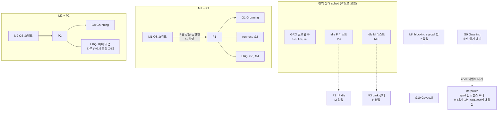
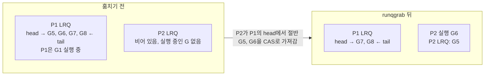
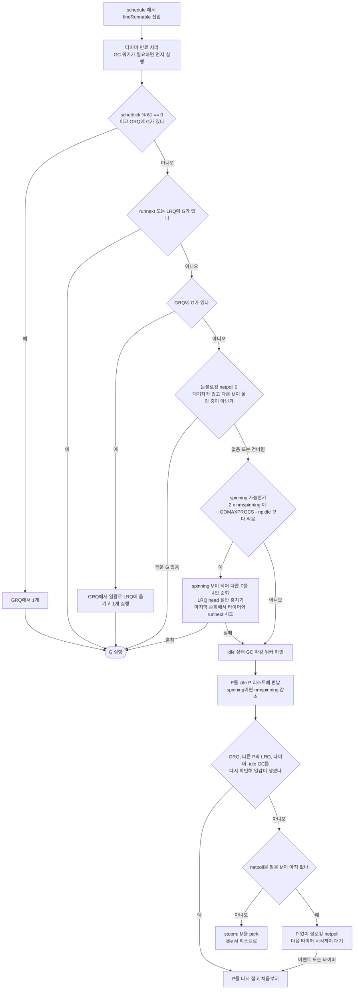
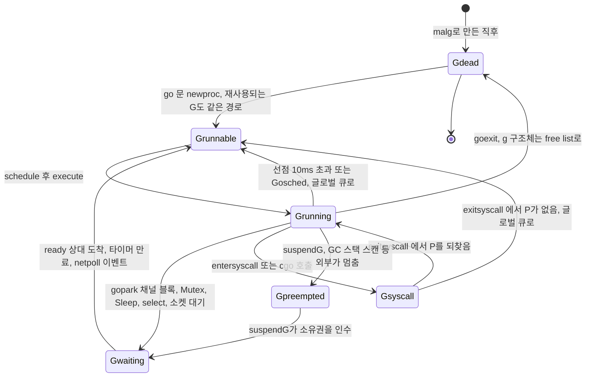
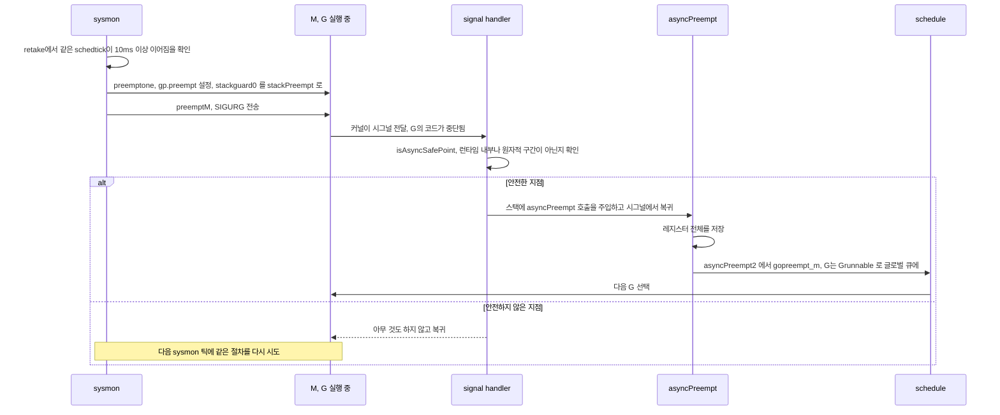
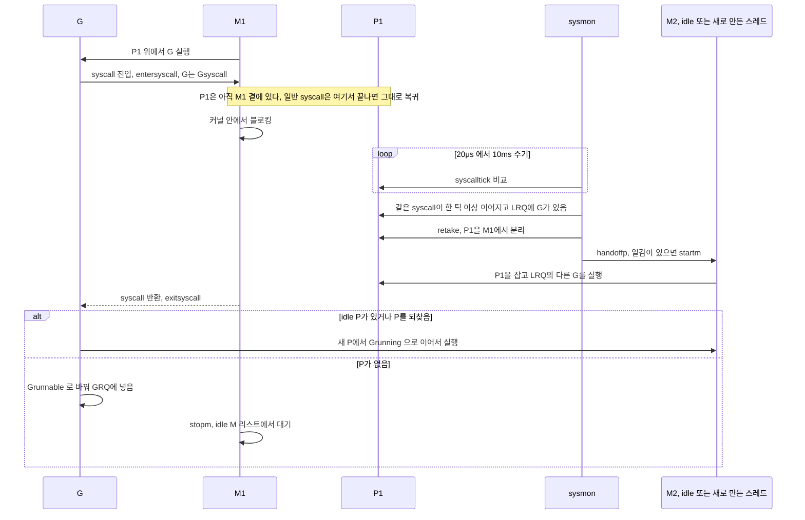
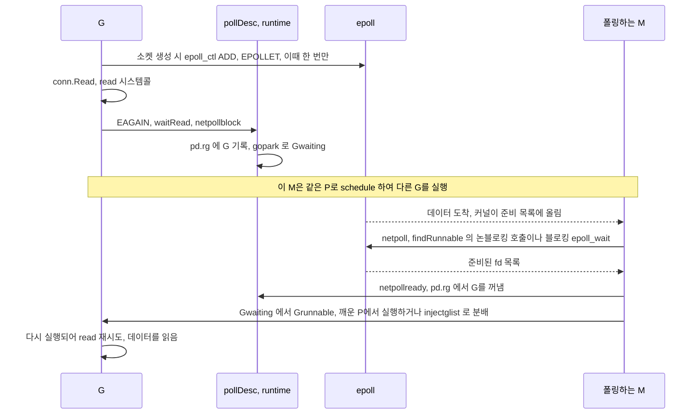

# Go 런타임 스케줄러 내부 구조

Go는 goroutine을 OS 스레드 위에서 M:N으로 멀티플렉싱한다. N개의 goroutine을 M개의 OS 스레드에서 돌리고, 어떤 goroutine을 어느 스레드에 올릴지는 OS가 아니라 Go 런타임이 정한다. goroutine이 수만 개로 늘었을 때 지연이 튀거나, 컨테이너에서 p99가 이유 없이 나빠지거나, 스레드 수가 갑자기 늘어나는 문제는 대부분 이 스케줄러의 동작 규칙에서 나온다.

이 문서의 동작 설명은 Go 1.24.13, 1.25.14, 1.26.10, 1.27.3의 `runtime` 소스를 직접 읽고 확인했다. 버전에 따라 달라지는 곳에는 조건을 붙였다. 재현 예제는 4 vCPU 리눅스 VM(x86_64, cgroup v2)에서 실제로 돌려 출력을 옮겼다. 수치는 머신마다 다르므로 형태와 경향만 참고한다.

## GMP와 P를 잡는 규칙

스케줄러는 세 가지 구조체로 이뤄진다. 정의는 `runtime/runtime2.go`에 있다.

**G (Goroutine)**는 실행 단위다. 스택 경계, 멈췄을 때 저장하는 레지스터(`sched`), 상태(`atomicstatus`), 지금 붙어 있는 M을 담는다. 종료된 G는 해제되지 않고 free list로 돌아가 다음 `go` 문에서 재사용된다.

**M (Machine)**은 OS 스레드 하나다. M은 만들어지면 거의 종료되지 않는다. 할 일이 없으면 idle M 리스트에 들어가 잠든다. 스레드 수 상한은 기본 10,000개이고 `runtime/debug.SetMaxThreads`로 바꾼다. M 수는 `GOMAXPROCS`와 관계없이 syscall이나 cgo 때문에 늘어난다.

**P (Processor)**는 Go 코드를 실행할 권한이자 스케줄링 컨텍스트다. 로컬 실행 큐(LRQ, 256칸 링 버퍼), `runnext` 슬롯, 메모리 할당 캐시(`mcache`), 타이머 힙을 들고 있다. P 수는 `GOMAXPROCS`다. 프로세스 시작 때 정해지고 끝까지 고정되는 값이 아니다. `runtime.GOMAXPROCS(n)`을 부르면 STW(stop-the-world)를 걸고 P를 다시 배치하고, Go 1.25부터는 런타임이 주기적으로 바꾸기도 한다(아래 GOMAXPROCS 절).

규칙은 하나다. **M은 P를 잡고 있을 때만 Go 코드를 실행한다.** P 없이 M이 할 수 있는 일은 syscall 안에서 기다리기, cgo 호출, 블로킹 netpoll, 잠자기 정도다. 그래서 동시에 Go 코드를 돌리는 스레드는 P 수를 넘지 못한다.

아래 그림은 이 관계를 한 장에 모은 것이다. 실선은 M이 P를 잡은 관계이고, M3과 M4는 P가 없는 M, P3은 M이 없는 P다.



그림에서 볼 점은 세 가지다. idle P 리스트와 idle M 리스트가 따로 있다는 것, 둘이 짝지어지는 순간이 `startm`(idle M을 깨우거나 새 스레드를 만들어 P를 쥐여 주는 함수)이라는 것, 그리고 G9처럼 I/O를 기다리는 G는 어느 큐에도 없고 netpoller의 `pollDesc`에만 매달려 있다는 것이다. 큐에 없는 G는 `schedtrace`의 `runqueue`에 잡히지 않는다. 이 점은 누수 추적에서 다시 나온다.

## 실행 큐와 runnext

### LRQ와 GRQ

**로컬 실행 큐(LRQ)**는 P마다 하나인 256칸 링 버퍼다. 쓰는 쪽은 소유 P 하나뿐이고(tail에 추가), 읽는 쪽은 소유 P와 훔치러 오는 다른 P들이다(head를 CAS로 전진). 락이 없다. 큐가 가득 차면 새 G 하나만 밀려나는 게 아니라 큐의 절반(128개)과 새 G를 한꺼번에 글로벌 큐로 옮긴다(`runqputslow`).

**글로벌 실행 큐(GRQ)**는 모든 P가 공유하고 `sched.lock`을 잡아야 만진다. 그래서 LRQ보다 느리다. GRQ에서 꺼낼 때는 한 개만 가져오지 않고 일부를 LRQ로 옮겨 온다. 락 비용을 여러 G에 나눠 내기 위해서다.

LRQ의 G만 계속 실행하면 GRQ의 G가 굶는다. 이를 막으려고 P는 스케줄 횟수(`schedtick`)가 61의 배수일 때 LRQ보다 먼저 GRQ를 한 번 본다. 두 G가 서로를 계속 만들어 내는 패턴에서 GRQ가 영원히 밀리는 일을 막는 장치다.

다음 표는 G가 어느 큐로 들어가는지 정리한 것이다.

| 상황 | 들어가는 곳 |
|---|---|
| `go f()` | 현재 P의 `runnext` (원래 있던 G는 LRQ 뒤로 밀림) |
| 채널·Mutex 등으로 깨운 G (`goready`) | 깨운 쪽 P의 `runnext` |
| 10ms 초과로 선점된 G, `runtime.Gosched()` | GRQ |
| syscall에서 돌아왔는데 P가 없는 G | GRQ (idle P가 있으면 그 P가 바로 실행) |
| netpoll이 돌려준 G | `injectglist`가 idle P에 나눠 주고 남는 건 GRQ 또는 현재 P |

### runnext 슬롯

`runnext`는 P에 붙은 1칸짜리 슬롯이다. `go` 문으로 만든 G와 채널 연산으로 깨운 G가 LRQ의 뒤가 아니라 여기에 먼저 들어간다. 슬롯에 이미 G가 있으면 그 G가 LRQ 뒤로 밀려난다. P가 다음 G를 고를 때는 `runnext`부터 본다.

이 슬롯에서 나온 G는 앞 G의 time slice를 이어받는다(`inheritTime`). `execute`가 `schedtick`을 올리지 않는다는 뜻이다. 둘이 같은 10ms를 나눠 쓰는 셈이다.

unbuffered 채널로 두 goroutine이 주고받는 ping-pong을 보면 이 설계의 이유가 보인다. G1이 보내서 G2를 깨우면 G2는 `runnext`에 들어간다. G1이 다음 receive에서 막히면 이 P는 곧바로 G2를 실행한다. LRQ에 G가 255개 쌓여 있어도 G2는 그 뒤에 줄 서지 않는다. 같은 P, 같은 캐시에서 이어서 돌기 때문에 스레드를 깨울 일도 없다.

대가는 굶김이다. 둘이 서로를 `runnext`로 깨우는 쌍은 `schedtick`이 오르지 않으니 LRQ에 있는 다른 G는 이 P에서 차례가 오지 않고, 61틱 규칙도 발동하지 않는다. 막는 장치는 sysmon이다. 같은 `schedtick`이 10ms 넘게 이어지면 `retake`가 그 P에서 도는 G를 선점한다. 소스 주석에도 "runnext로 이어진 G들은 하나의 time slice를 공유한다"고 적혀 있다. LRQ에서 기다리는 G는 다른 idle P가 훔쳐 갈 수 있으므로 문제는 모든 P가 바쁠 때 생긴다.

`runnext`는 훔치기에서도 특별하다. 다른 P가 `runnext`의 G를 훔치는 건 마지막 수단이라 4번째 순회에서만 시도하고, 그것도 대상 P가 실행 중이면 3μs를 기다렸다가 가져간다. 깨운 G가 곧 실행될 참인데 다른 P가 낚아채 캐시를 버리는 일을 피하려는 것이다.

### work stealing

P의 LRQ가 비면 다른 P의 LRQ에서 **앞쪽(head)**에서 절반을 가져온다(`runqgrab`). 홀수면 올림이다. 4개가 있으면 2개, 3개가 있으면 2개를 가져간다. 가져온 것 중 마지막 G는 바로 실행하고 나머지는 자기 LRQ에 넣는다.



예전 이 문서는 뒤쪽에서 가져가는 이유가 "곧 실행될 G를 건드리지 않기 위해서"라고 적었는데 틀린 설명이다. 소유 P도 head에서 꺼내므로 훔쳐 가는 G가 오히려 곧 실행될 G다. 실제 이유는 동기화다. tail은 소유 P만 쓰고, head는 소유 P든 도둑이든 `CasRel(&runqhead, h, h+n)` 한 번으로 소비를 확정한다. 도둑이 tail을 건드리지 않으니 락이 필요 없다. 오래 기다린 G부터 다른 P에 나눠 주는 효과도 있다.

훔치기 순서는 무작위(`stealOrder`)로 P를 돌고, 이 순회를 최대 4번 반복한다. 마지막 4번째 순회에서만 상대 P의 타이머와 `runnext`까지 노린다. idle 상태인 P는 건너뛴다.

## findRunnable이 일감을 찾는 순서

P에서 G가 끝나거나 막히면 `schedule()`이 `findRunnable()`을 부른다. 아래는 소스의 `findRunnable` 순서를 분기로 옮긴 것이다. GC 워커와 타이머 확인이 앞에 있지만 그림에서는 줄였다.



이 흐름에서 읽어야 할 곳이 몇 군데 있다.

61틱 검사가 LRQ보다 앞이다. LRQ가 차 있어도 가끔은 GRQ를 먼저 본다는 뜻이다. 논블로킹 `netpoll(0)`은 훔치기보다 앞에 있다. 소켓이 이미 준비된 G를 다른 P의 LRQ에서 훔치는 것보다 값싸게 얻을 수 있기 때문이다. 이 폴링은 한 번에 한 스레드만 한다(`sched.pollingNet`). 코어가 많은 머신에서 커널 락 경합을 피하려는 것이다.

일감이 없다고 바로 잠들지 않는다. P를 반납한 뒤에 GRQ·다른 P의 LRQ·타이머를 한 번 더 본다. 반납하는 사이 다른 M이 일감을 넣었는데 아무도 못 깨우는 사고를 막으려고 `nmspinning`을 내린 직후에 다시 확인하는 순서가 주석으로 길게 설명돼 있다.

### spinning M과 wakep

spinning M은 "P는 쥐고 있지만 실행할 G가 없어 다른 P를 뒤지는 중인 스레드"다. 새 G가 생기거나 깨어났을 때 idle P가 있으면 `wakep()`이 호출된다. 소스를 읽으면 조건이 두 개다.

- 이미 spinning 중인 M이 하나도 없어야 한다(`nmspinning`을 0에서 1로 CAS). 동시에 깨우는 건 한 개뿐이다.
- idle P가 있어야 한다. 없으면 `nmspinning`을 되돌리고 끝난다.

깨어난 spinning M이 일감을 찾으면 `nmspinning`을 내리면서 다시 `wakep()`을 불러 다음 스레드를 깨운다. 일감이 많을 때 스레드가 하나씩 연쇄로 깨어나는 구조다. 한꺼번에 여럿을 깨우면 잠깐 일감을 두고 다투다가 대부분이 빈손으로 돌아가 다시 잠든다.

`findRunnable`에서 M이 새로 spinning이 되려면 `2 * nmspinning < GOMAXPROCS - npidle`이어야 한다. spinning M 수는 **바쁜 P 수의 절반 미만**으로 제한된다. GOMAXPROCS의 절반이 아니고 idle이 아닌 P 수가 기준이다. 소스 주석은 이유를 "GOMAXPROCS가 훨씬 큰데 프로그램 병렬도가 낮을 때 CPU를 낭비하지 않으려는 것"이라고 적었다.

여기에는 절충이 있다. spinning을 줄이면 새 G가 생겼을 때 잠든 스레드를 futex로 깨우는 시간만큼 지연이 생기고, 늘리면 훔칠 게 없는데도 CPU를 태운다. GOMAXPROCS가 64처럼 큰 컨테이너에서 요청이 적을 때 CPU 프로파일에 `findRunnable`, `stealWork`, `runqgrab`이 크게 보이면 spinning 비용을 의심한다. `schedtrace`의 `spinningthreads`가 0이 아닌 채로 오래 유지되는지도 같이 본다.

## Goroutine 상태 전이

G의 상태는 `g.atomicstatus`에 있고 아래가 일반적인 전이다. GC가 스택을 읽는 동안 붙이는 `_Gscan` 비트와 스택 복사 중 상태(`Gcopystack`)는 뺐다.



`Gsyscall` 상태의 G는 `Gwaiting`이 아니다. 런타임이 "이 G는 커널 안에 있고 Go 코드를 안 돌린다"고 알고 있는 별도 상태라서 GC가 스택을 읽을 때 기다리지 않고 지나간다.

`Gpreempted`는 시간 초과 선점의 결과가 아니다. 10ms를 넘겨 선점된 G는 `Grunnable`이 되어 글로벌 큐로 간다. `Gpreempted`는 GC 같은 쪽에서 `suspendG`로 이 G를 멈춰 세울 때(`preemptStop`) 잠깐 거치는 상태다. goroutine 덤프를 읽을 때 이 상태가 보이는 일은 거의 없다.

덤프에서 흔히 보는 `chan receive`, `select`, `IO wait`, `semacquire`, `sleep`은 모두 `Gwaiting`의 대기 이유(`waitReason`)다. 같은 `Gwaiting`이라도 이유를 보면 누가 깨워 줄지가 보인다.

## goroutine 생성 비용과 스택

### 생성 비용

`go` 키워드의 비용은 OS 스레드 생성과 비교하면 매우 낮다. 구조체 하나를 free list에서 꺼내 쓰고, 스택도 보통 재사용하기 때문이다. 이 문서 환경(QEMU 가상 4코어, linux/amd64, Go 1.24.13과 1.27.3 모두)에서 `go wg.Done()` 후 완료까지의 벤치마크는 `testing.Benchmark`로 1.1~1.3μs/op가 나왔다. 두 번 돌려 얻은 값이고 물리 머신이나 부하 상황에 따라 달라진다. 예전 문서에 있던 "2~5μs"는 출처가 없어 지웠다.

메모리는 일을 하지 않고 채널에서 대기만 하는 goroutine 10만 개를 만들어 `runtime.MemStats`로 쟀다. 한 개당 `StackInuse`가 약 2.1KB, `Sys` 증가분이 약 2.6~2.7KB였다. 100만 개면 스택만 2GB를 넘는다. 스케줄러 큐 관리와 GC의 스택 스캔 비용도 개수에 비례한다.

```go
// 요청마다 goroutine을 무제한으로 만든다
for req := range requests {
    go handle(req)
}

// 세마포어로 동시에 살아 있는 goroutine을 100개로 제한한다
sem := make(chan struct{}, 100)
for req := range requests {
    sem <- struct{}{}
    go func(r Request) {
        defer func() { <-sem }()
        handle(r)
    }(req)
}
```

### 스택 성장과 초기 크기

스택은 고정이 아니라 필요할 때 두 배로 늘어난다. Go 1.3까지는 세그먼트를 연결 리스트로 이었다. 함수 호출이 세그먼트 경계에서 반복되면 늘리고 줄이기를 되풀이하는 "hot split"이 문제였다. Go 1.4부터는 연속된 스택이다. 가득 차면 두 배 크기의 새 메모리에 통째로 복사하고, 스택 안의 포인터를 새 주소로 고친다. 상한은 64비트에서 기본 1GB이고 `debug.SetMaxStack`으로 바꾼다. 줄이는 쪽은 GC 때 일어난다. 사용량이 용량의 1/4 미만이면 절반으로 줄인다.

"goroutine은 2KB로 시작한다"는 말은 Go 1.19부터 사실이 아니다. 런타임은 GC가 돌 때 스캔한 스택들의 평균 사용량을 계산해서 그 값을 다음 goroutine의 초기 스택 크기로 쓴다(`gcComputeStartingStackSize`). 깊은 호출 스택을 쓰는 goroutine이 많은 서버라면 초기값이 4KB, 8KB로 올라가서 처음 몇 번의 복사를 건너뛴다. 반대로 평균이 낮으면 2KB로 남는다. `GODEBUG=adaptivestackstart=0`이면 끈다.

직접 확인한 코드는 아래다. 스택을 16KB쯤 쓰는 goroutine 5,000개를 살려 둔 채 GC를 두 번 돌리고, 그 뒤에 만든 얕은 goroutine 2만 개의 스택 크기를 잰다.

```go
package main

import (
	"fmt"
	"runtime"
	"sync"
)

//go:noinline
func deep(n int, ready *sync.WaitGroup, stop chan struct{}) {
	var pad [256]byte
	pad[0] = byte(n)
	if n > 0 {
		deep(n-1, ready, stop)
	} else {
		ready.Done()
		<-stop
	}
	_ = pad
}

func perG() uint64 {
	const n = 20000
	var m0, m1 runtime.MemStats
	runtime.ReadMemStats(&m0)
	var wg sync.WaitGroup
	wg.Add(n)
	stop := make(chan struct{})
	for i := 0; i < n; i++ {
		go func() { wg.Done(); <-stop }()
	}
	wg.Wait()
	runtime.ReadMemStats(&m1)
	close(stop)
	return (m1.StackInuse - m0.StackInuse) / n
}

func main() {
	fmt.Println("GC 전 :", perG(), "B")

	var wg sync.WaitGroup
	wg.Add(5000)
	stop := make(chan struct{})
	for i := 0; i < 5000; i++ {
		go deep(50, &wg, stop)
	}
	wg.Wait()
	runtime.GC()
	runtime.GC()
	fmt.Println("GC 뒤 :", perG(), "B")
}
```

Go 1.24.13과 1.27.3에서 둘 다 `GC 전 : 2048 B`, `GC 뒤 : 3540 B` 근처가 나왔고, `GODEBUG=adaptivestackstart=0`을 주면 `GC 뒤`가 약 2020 B로 남았다. 평균이 4KB가 아니라 3.5KB쯤인 것은 일부가 이전 크기의 재사용 스택으로 시작하기 때문이다.

### 스택 포인터와 escape

스택이 늘어날 때 런타임은 스택을 통째로 복사하고 그 안에 있는 포인터를 새 주소로 고쳐 쓴다. 스택 맵으로 어느 슬롯이 포인터인지 알기 때문에 **스택 안에서 스택을 가리키는 포인터**는 고칠 수 있다. 고칠 수 없는 것은 스택 **밖에서** 스택을 가리키는 포인터다. 힙 객체, 전역 변수, 다른 goroutine의 스택에 스택 변수의 주소가 들어 있으면 스택이 옮겨진 뒤 그 주소는 해제된 메모리를 가리킨다. 런타임이 직접 관리하는 몇 군데(채널 대기 중인 `sudog`의 원소 포인터 등)만 예외로 따로 보정한다.

그래서 컴파일러는 변수의 주소가 그 변수를 만든 함수의 스택 프레임 밖으로 나갈 수 있으면 그 변수를 처음부터 힙에 할당한다. 이것이 escape analysis다. 예전 문서는 이 이유를 `go:noescape` 어노테이션이 없어서 그렇다고 적었는데 맞지 않다. `//go:noescape`는 본문이 없는(어셈블리로 구현된) 함수에 붙여서 "인자가 밖으로 새지 않는다"고 컴파일러에게 알려 주는 표시다. 분석할 본문이 없을 때 컴파일러는 보수적으로 escape한다고 본다.

```go
var global *int

func storeOut(p **int) {
    x := 42
    *p = &x        // p가 어디를 가리키는지 모르므로 x는 호출 밖으로 샐 수 있다
}

func storeGlobal() {
    y := 7
    global = &y    // 전역에 주소를 넣는다
}

func local() int {
    z := 1
    q := &z        // 같은 프레임 안에서만 쓰인다
    *q++
    return z
}
```

`go build -gcflags=-m`으로 확인하면 `moved to heap: x`, `moved to heap: y`는 나오고 `z`는 나오지 않는다. 인라이닝된 뒤에는 호출한 함수 쪽에 `moved to heap: x`가 찍힌다.

## 선점

Go 1.13까지는 협력적 선점뿐이었다. goroutine이 함수 호출 프롤로그 같은 safe point에 도달해야 스케줄러가 끼어들 수 있었다. 함수 호출 없이 도는 루프는 P를 독점했고, GC가 STW를 걸려고 해도 그 루프가 안 멈춰서 프로그램 전체가 멈추는 사고가 났다.

Go 1.14부터 비동기 선점이 들어갔다. sysmon이 한 G가 같은 `schedtick`으로 10ms 넘게 돌고 있는 것을 보면 그 스레드에 SIGURG를 보낸다. 시그널 핸들러가 G의 현재 위치가 안전한지 확인하고, 안전하면 스택에 `asyncPreempt` 호출을 끼워 넣고 복귀한다.



`preemptone`은 시그널과 별개로 `stackguard0`도 `stackPreempt` 값으로 바꾼다. 시그널이 안전하지 않은 지점에서 무시돼도 G가 다음 함수 프롤로그에 도달하면 그 검사에 걸려서 협력적 경로로 스케줄러에 들어간다. 두 경로가 다 열려 있다.

GC의 STW도 같은 선점 장치를 쓴다. 예전 문서는 STW가 비동기 선점이 아니라 협력적 방식만 쓴다고 적었는데, Go 1.14 이후로는 `preemptall`이 각 P에 `preemptone`을 걸어서 시그널 경로도 같이 쓴다. 타이트 루프 때문에 STW가 안 끝나는 문제는 이때 사라졌다.

비동기 선점이 안 닿는 곳이 있다. syscall이나 cgo 안에 있는 G는 Go 코드를 실행 중이 아니라서 시그널로 멈출 수 없다(이 경우는 syscall 절의 `retake`가 P를 빼앗는다). 런타임 내부 코드나 원자적 연산 중간처럼 `isAsyncSafePoint`가 안 된다고 판단한 곳에서도 시그널이 무시된다.

### 재현 CPU 루프가 있을 때 GOMAXPROCS=1에서의 비동기 선점

P가 하나뿐일 때 함수 호출 없는 루프 하나가 P를 쥐면 다른 goroutine은 실행될 수 없다. `main`이 `time.Sleep` 뒤에 깨어나는지로 선점이 동작하는지 볼 수 있다.

```go
package main

import (
	"fmt"
	"runtime"
	"time"
)

var counter uint64

func main() {
	runtime.GOMAXPROCS(1)

	go func() {
		for {
			counter++ // 함수 호출도 채널 연산도 없다
		}
	}()

	time.Sleep(10 * time.Millisecond)

	start := time.Now()
	time.Sleep(50 * time.Millisecond)
	fmt.Printf("main 복귀: sleep 50ms 요청, 실제 %v\n", time.Since(start).Round(time.Millisecond))
}
```

```bash
go build -o app . && ./app
GODEBUG=asyncpreemptoff=1 timeout 3 ./app; echo "exit=$?"
```

이 환경에서 Go 1.27.3은 세 번 돌려 `실제 61ms`, `62ms`, `64ms`가 나왔고, Go 1.24.13은 `110ms`, `84ms`, `84ms`가 나왔다. 50ms를 요청했는데 더 걸리는 이유는 타이머가 만료돼도 하나뿐인 P가 이 루프에 묶여 있어서 다음 선점 시점까지 기다리기 때문이다. 선점 간격이 10ms 단위이므로 그만큼의 오차가 쌓인다. `GODEBUG=asyncpreemptoff=1`로 비동기 선점을 끄면 아무 것도 출력하지 않고 `timeout`이 3초 뒤 끊어서 `exit=124`가 나온다. Go 1.13 이하의 동작을 그대로 재현하는 셈이다.

## syscall과 P handoff

### Gsyscall에서 P가 분리되는 시점

blocking syscall을 부르는 G는 커널 안에서 M과 함께 멈춘다. 그 M이 P를 쥔 채로 멈추면 다른 G는 실행될 수 없다. 이 문제를 푸는 방식이 `entersyscall`과 sysmon의 `retake`다.

일반 syscall(`syscall.Syscall`, cgo 호출 등)은 `entersyscall`로 시작한다. 이 함수는 G를 `Gsyscall`로 바꾸고 M이 P를 **기억해 두기만** 한다. 그 시점에는 P를 떼서 다른 M에게 넘기지 않는다. Go 1.25까지는 P 상태가 `_Psyscall`로 바뀌고 M의 `oldp`에 기록된다. Go 1.26부터는 `_Psyscall` 상태가 사라졌고(`runtime2.go`에 `_Psyscall_unused`만 남았다) P는 `_Prunning`인 채로, G만 `Gsyscall`이다. 어느 쪽이든 sysmon이 `retake`하기 전까지 P는 이 M 곁에 남아 있다.

이렇게 한 이유는 대부분의 syscall이 마이크로초 안에 끝나기 때문이다. 끝나면 `exitsyscall`이 같은 P를 그대로 되찾고, 스케줄러는 끼어들지 않는다. 매 syscall마다 P를 넘기고 되받으면 그 비용이 syscall보다 커진다.

반면 블로킹이 확정된 syscall은 처음부터 P를 넘긴다. `entersyscallblock`이 그 경로다. 시작하자마자 `handoffp`를 부른다. 사용자 코드가 부르는 syscall은 `entersyscallblock`을 쓰지 않는다. 이건 런타임 내부에서 오래 막힐 걸 아는 곳(`notetsleepg` 등)이 쓴다.

그렇다면 오래 걸리는 syscall에서 P는 누가 빼앗는가. 20μs~10ms 주기로 도는 sysmon이다. `retake`는 P를 훑다가 아래 조건에서 P를 떼어 `handoffp`로 넘긴다.

- 같은 syscall이 sysmon의 이전 관찰(`syscalltick`) 이후에도 이어져 최소 한 틱(20μs 이상)이 지났다.
- 그리고 P의 LRQ에 G가 있거나, spinning·idle P가 하나도 없거나, syscall이 10ms를 넘었다.

LRQ가 비어 있고 놀고 있는 P가 있으면 빼앗지 않는다. 빼앗아도 할 일이 없기 때문이다. 다만 10ms가 넘으면 sysmon이 깊게 못 자는 원인이 되므로 그때는 빼앗는다.



`handoffp`도 무조건 새 스레드를 만들지 않는다. P의 LRQ나 GRQ에 G가 있거나, GC 워커·트레이스 리더가 필요하거나, spinning·idle M이 하나도 없을 때만 `startm`으로 M을 깨우거나 새로 만든다. 일감이 없으면 P는 그냥 idle P 리스트로 간다. 그래서 blocking syscall이 많다는 사실만으로 스레드가 늘지 않고, **P에 줄 일이 있는 상태에서** blocking syscall이 겹칠 때 늘어난다.

예전 문서가 쓴 "sysmon이 syscall에 묶인 M이 P를 20μs 이상 보유하면 빼앗는다"는 절반만 맞다. 20μs는 sysmon의 최소 폴링 주기이고, 위의 LRQ·idle P 조건이 붙는다.

### 재현 syscall 대량 호출로 threads 늘리기

고루틴 200개가 각각 raw syscall로 영원히 막히는 코드다. `syscall.Read`는 `entersyscall`로 들어가고 pipe의 쓰는 쪽을 닫지 않으므로 반환되지 않는다.

```go
package main

import (
	"fmt"
	"os"
	"strconv"
	"syscall"
	"time"
)

func main() {
	n := 200
	if len(os.Args) > 1 {
		n, _ = strconv.Atoi(os.Args[1])
	}

	var fds [2]int
	if err := syscall.Pipe(fds[:]); err != nil {
		panic(err)
	}

	for i := 0; i < n; i++ {
		go func() {
			buf := make([]byte, 1)
			syscall.Read(fds[0], buf) // 쓰는 쪽이 없어서 영원히 블로킹
		}()
	}

	time.Sleep(3 * time.Second)
	fmt.Println("done")
}
```

```bash
go build -o app . && GODEBUG=schedtrace=1000 ./app 200 2>&1 | head -3
```

Go 1.24.13에서 나온 출력이다.

```
SCHED 0ms: gomaxprocs=4 idleprocs=1 threads=5 spinningthreads=1 needspinning=0 idlethreads=0 runqueue=0 [1 0 0 0]
SCHED 1007ms: gomaxprocs=4 idleprocs=4 threads=202 spinningthreads=0 needspinning=0 idlethreads=0 runqueue=0 [0 0 0 0]
SCHED 2007ms: gomaxprocs=4 idleprocs=4 threads=202 spinningthreads=0 needspinning=0 idlethreads=0 runqueue=0 [0 0 0 0]
```

`gomaxprocs=4`인데 `threads=202`다. 200개의 M이 전부 커널 안에서 막혀 있고 P 4개는 모두 놀고 있다(`idleprocs=4`). `GOMAXPROCS=1`로 돌려도 같은 `threads=202`가 나온다. GOMAXPROCS는 Go 코드를 동시에 돌리는 스레드 수를 막을 뿐 syscall에 묶인 스레드 수는 막지 않는다. Go 1.27.3에서는 같은 줄 뒤에 `schedticks=[ ... ]` 필드가 붙는다.

같은 코드의 `syscall.Read`를 `os.Pipe()`의 `r.Read`로 바꾸면 달라진다. `os.File`이 pipe를 non-blocking으로 열고 netpoller에 등록하기 때문에 goroutine은 `Gwaiting`으로 parking되고 스레드는 붙들리지 않는다. 같은 200개로 돌렸을 때 `threads=6`, `idlethreads=4`가 나왔다. 일반 파일 읽기는 epoll에 등록할 수 없어서 `syscall` 경로를 타고, 파일 I/O가 몰리는 서버에서 스레드가 늘어나는 흔한 원인이 된다.

### cgo와 LockOSThread

cgo 호출은 `cgocall` 안에서 `entersyscall`을 부른다. C 함수가 끝날 때까지 그 M은 한 개의 스레드를 점유한다. 동시에 실행 중인 cgo 호출 수가 곧 필요한 스레드 수이므로, C 라이브러리 호출이 느려지는 순간 요청이 쌓이고 스레드가 같이 쌓인다. GOMAXPROCS를 낮춰도 소용이 없다.

스레드 수가 상한을 넘으면 프로세스가 죽는다. 기본 상한은 10,000개이고, 넘으면 `runtime: program exceeds 10000-thread limit`을 찍고 `fatal error: thread exhaustion`으로 종료한다. 이건 `recover`로 잡을 수 있는 panic이 아니라 `throw`다. 한도를 100으로 낮춰 위의 syscall 예제를 돌려 같은 경로를 확인했다.

```go
debug.SetMaxThreads(100) // import "runtime/debug", 위 예제의 main 맨 앞에 추가
```

```
runtime: program exceeds 100-thread limit
fatal error: thread exhaustion
```

운영에서 이 상황을 만나면 대개 외부 DB 드라이버나 파일시스템 지연으로 syscall·cgo 호출이 한꺼번에 막힌 경우다. 동시 호출 수를 세마포어로 제한하는 편이 `SetMaxThreads`를 올리는 것보다 낫다.

`runtime.LockOSThread()`는 현재 goroutine을 현재 M에 묶는다. 스레드 로컬 상태에 의존하는 라이브러리(OpenGL 컨텍스트, 일부 `setns` 호출)를 위한 것이다. 스케줄러 입장에서는 비용이 크다. 묶인 G가 막히면 M이 `stoplockedm`에서 P를 `handoffp`로 넘기고 스스로 잠든다. 나중에 그 G가 깨어나면 깨운 쪽 M이 `startlockedm`으로 P를 묶인 M에게 넘기고 자신은 잠든다. 일반 G의 park/unpark는 같은 M 안에서 끝나는데, 묶인 G는 깨어날 때마다 스레드 두 개를 futex로 깨우고 재운다. 채널 통신이 잦은 goroutine을 `LockOSThread`로 묶으면 지연이 눈에 띄게 늘어난다. 묶은 채로 goroutine이 끝나면 그 스레드는 재사용되지 않고 종료된다.

## 네트워크 I/O와 netpoller

Go의 소켓은 모두 non-blocking이다. `conn.Read`가 막히는 것처럼 보여도 스레드는 막히지 않는다. 순서를 정확히 보자. fd는 만들어질 때 한 번 epoll에 등록된다(`netpollopen`, `EPOLLIN|EPOLLOUT|EPOLLRDHUP|EPOLLET`). 에지 트리거라서 읽을 때마다 다시 등록하지 않는다. `EAGAIN`을 받은 뒤에 등록하는 게 아니다.



그림에서 `EP`를 부르는 `S`가 누구인지가 예전 문서의 오류였다. "netpoller가 별도 OS 스레드에서 `epoll_wait`를 돈다"는 설명은 틀렸다. 전용 스레드는 없고 epoll을 부르는 곳이 세 군데다.

| 호출하는 곳 | 방식 | 언제 |
|---|---|---|
| `findRunnable` | `netpoll(0)` 논블로킹 | LRQ·GRQ가 비어 훔치기에 들어가기 직전. 한 번에 한 스레드만 |
| `findRunnable` 끝 | 블로킹 `netpoll(delay)` | 모든 P가 idle일 때 M 하나가 P 없이 대기. `delay`는 다음 타이머까지 |
| sysmon | `netpoll(0)` 논블로킹 | 마지막 폴링이 10ms 넘게 지났을 때 |

모든 P가 바쁘면 `findRunnable`의 폴링이 안 돌 수 있다. 그때를 대비해 sysmon이 10ms마다 대신 폴링한다. 새 타이머가 등록되거나 일감이 생기면 블로킹 중인 M을 깨우는 `netpollBreak`(내부 eventfd)가 쓰인다.

수만 개의 연결을 다루면서도 스레드가 수십 개로 유지되는 이유가 이 구조다. 대기 중인 G는 `Gwaiting`에서 큐에도 스레드에도 매달리지 않고 `pollDesc`에만 남는다. 일반 파일은 epoll이 거부하므로(`EPERM`) 이 경로를 타지 못하고 위 syscall 절의 경로를 탄다.

## 타이머

Go 1.13까지 타이머는 전역 버킷(최대 64개)에 있었고 버킷마다 `timerproc` goroutine이 따로 돌았다. 락 경합과 goroutine 깨우기 비용이 컸다. Go 1.14에서 P별 타이머 힙으로 옮겼다([Go 1.14 릴리스 노트](https://go.dev/doc/go1.14)). 타이머는 P가 `schedule`, `findRunnable`, 훔치기 과정에서 직접 처리한다. 모든 P가 idle일 때는 위의 블로킹 `netpoll`이 다음 타이머까지를 대기 시간으로 삼는다. 그래서 `time.Sleep`으로 자는 프로세스에도 타이머 전용 스레드가 따로 없다. 만료된 타이머가 `time.Sleep`의 G를 깨우면 `goready`를 거쳐 `runnext`로 들어간다.

Go 1.23에서는 타이머와 Ticker의 채널 동작이 바뀌었다([Go 1.23 릴리스 노트](https://go.dev/doc/go1.23#timer-changes)). 바뀐 점은 두 가지다. 채널이 버퍼 없는 것처럼 동작해서 `Stop`·`Reset`을 부른 뒤에 옛 값을 받는 일이 없다. 아무도 참조하지 않는 타이머는 `Stop`을 부르지 않아도 GC 대상이 된다.

go.mod의 `go` 줄과 툴체인 조합으로 직접 돌려 확인한 결과다. 같은 코드를 `go 1.22`와 `go 1.23`으로 바꿔 돌렸다.

| 확인 항목 | `go 1.22` (툴체인 1.24.13) | `go 1.23` 이상 |
|---|---|---|
| `cap(t.C)` | 1 | 0 |
| `time.After`를 1,000,000번 호출하고 GC한 뒤 힙 | +253MB | +0MB |
| 만료된 `Timer`에 `Reset` 후 `select` | 옛 값을 받음 | 받지 못함 |

Go 1.23~1.26은 go.mod의 `go` 줄이 1.23보다 낮으면 옛 동작을 유지한다(`GODEBUG=asynctimerchan=1`이 기본값이 된다). Go 1.27에서는 `asynctimerchan` 설정이 제거됐고, 툴체인 1.27.3으로 `go 1.22` go.mod를 빌드해도 `cap(t.C)`가 0으로 나왔다. 툴체인을 올렸는데 go.mod의 `go` 줄이 옛 값이면 동작이 다를 수 있으므로 이 줄을 같이 본다.

두 가지를 조심한다. 첫째, `len(t.C)`로 "만료됐는지"를 폴링하던 코드는 새 동작에서 항상 0이라서 조용히 깨진다. 둘째, `time.After`의 누수 설명이 바뀐다. 예전에는 `select` 루프 안의 `time.After(time.Hour)`가 만료될 때까지 타이머와 채널이 살아 있어 메모리가 쌓였다(위 표의 +253MB). 1.23 이상에서는 GC가 회수한다. 그래도 호출마다 새 타이머를 할당하므로 요청마다 도는 핫 루프에서는 `time.NewTimer`를 만들어 `Reset`으로 재사용하는 편이 할당이 적다.

## sysmon이 하는 일

sysmon은 P 없이 도는 특수 스레드로 런타임 시작 때 한 개 만들어진다. sleep 간격은 20μs에서 시작하고 50번 연속으로 할 일이 없으면 두 배씩 늘려 최대 10ms까지 간다. 일을 하나라도 하면 다시 20μs로 돌아간다. 모든 P가 idle이거나 GC 대기 중이면 깊은 잠에 들었다가 syscall 진입이나 타이머로 깨어난다.

하는 일을 소스에서 확인한 대로 정리하면 아래다.

| 일 | 조건 | 비고 |
|---|---|---|
| 선점 | 같은 `schedtick`이 10ms 이상 | SIGURG(비동기) + `stackPreempt`(협력) |
| syscall 중인 P 회수 | 위 syscall 절의 조건 | `handoffp` |
| netpoll | 마지막 폴링 후 10ms 초과 | 논블로킹 |
| 강제 GC | 마지막 GC 후 `forcegcperiod`(2분) 경과 | 힙 크기와 무관 |
| scavenger 깨우기 | 요청이 있을 때 | |
| GOMAXPROCS 갱신 | Go 1.25 이상, 최대 초당 1회 | `updatemaxprocs` |

예전 문서는 sysmon이 "힙 사용량이 임계치를 넘으면 GC를 시작한다"고 적었는데 틀렸다. 힙 크기 기반의 GC 시작은 GC pacer가 `GOGC`와 `GOMEMLIMIT`으로 목표 힙을 계산해 정하고, 그 임계에 도달하는 순간 메모리를 할당하던 goroutine이 직접 GC를 시작한다. sysmon의 강제 GC는 할당이 거의 없어 pacer 임계에 영영 안 닿는 프로세스를 위한 안전장치다. `GODEBUG=gctrace=1`에서 마지막에 `(forced)`가 붙은 줄이 이 경우다. 반대로 예전 문서의 의사 코드에 있던 매 루프마다 `checkdead()`를 부른다는 부분도 맞지 않다. `checkdead`는 sysmon 시작 시점과 M이 idle로 들어가는 곳 등에서 호출된다.

## GC와 스케줄러

GC 마킹 단계에서 스케줄러는 P를 일부 GC 워커에게 내준다. 목표는 전체 P 용량의 25%다(`gcBackgroundUtilization = 0.25`). 몇 개 P를 어떻게 쓰는지는 GOMAXPROCS로 정해진다.

| 모드 | 동작 | 언제 |
|---|---|---|
| dedicated | P 하나를 마킹 종료까지 통째로 점유 | `GOMAXPROCS x 0.25`를 반올림한 개수 |
| fractional | 한 P에서 시간의 일부만 마킹, 나머지는 사용자 G | 반올림 오차가 30%를 넘는 `GOMAXPROCS`가 3 이하이거나 6일 때 |
| idle | 할 일이 없는 idle P를 마킹에 씀 | `findRunnable`이 일감을 못 찾았을 때 |

GOMAXPROCS가 4면 dedicated 워커 1개가 P 하나를 마킹이 끝날 때까지 쥔다. 사용자 G가 쓸 수 있는 P가 3개로 줄어든다. 컨테이너에서 CPU limit을 2로 잡아 GOMAXPROCS가 2가 되면 dedicated 대신 fractional 워커(0.25씩)가 P마다 붙어서 마킹 시간이 길어지는 대신 P 하나가 통째로 사라지지는 않는다.

GC 중에 지연이 튀는 원인은 네 가지다.

1. STW 구간. 마킹 시작(sweep termination)과 끝(mark termination)에서 모든 P가 safe point에 서야 한다. 한 P가 `isAsyncSafePoint`가 아닌 곳에 있으면 그만큼 기다린다. `/sched/pauses/stopping/gc:seconds`가 이 대기를 따로 보여 준다.
2. mutator assist. 마킹 중 많이 할당하는 goroutine은 할당량에 비례해 직접 마킹 일을 떠맡는다(`gcAssistAlloc`). 요청 처리 코드가 스케줄러 눈에는 계속 `Grunning`인데 시간이 늘어난다. 지연이 큰데 스케줄 지연 지표(`/sched/latencies`)는 멀쩡하면 assist를 의심한다.
3. dedicated·idle 워커의 P 점유. 위 표대로 P가 줄어든다.
4. 쓰기 장벽. 마킹 중에는 포인터 쓰기마다 추가 작업이 생긴다.

`GODEBUG=gctrace=1`의 `cpu` 칼럼이 이를 보여 준다. 실제로 찍힌 줄이다(Go 1.27.3, `GOMAXPROCS=4`).

```
gc 2 @0.067s 1%: 0.11+2.6+0.062 ms clock, 0.45+1.0/0.002/0+0.25 ms cpu, 3->4->2 MB, 4 MB goal, 0 MB stacks, 0 MB globals, 4 P
```

`clock`의 가운데 2.6ms가 마킹이 걸린 시간이고, `cpu`에서 `1.0/0.002/0`이 assist/background/idle 순서다. assist 값이 background보다 훨씬 크면 워커가 못 따라가 사용자 goroutine이 마킹을 대신하고 있다는 뜻이다.

## GOMAXPROCS와 컨테이너

### 버전별 기본값

`GOMAXPROCS`는 Go 코드를 동시에 돌리는 스레드 수, 곧 P의 수다. CPU 바운드 작업은 코어 수까지는 늘리는 만큼 처리량이 오르고 그 이상은 컨텍스트 스위치만 늘린다. I/O 바운드 작업은 netpoller 덕에 값이 작아도 많은 연결을 처리하므로 올려도 처리량이 거의 안 변한다.

컨테이너에서 문제였던 것은 기본값이었다. Go 1.24 이하의 기본값은 `runtime.NumCPU()`로, 호스트의 코어 수이고 cgroup의 CPU limit을 읽지 않는다. 32코어 호스트에서 limit을 2로 건 파드가 GOMAXPROCS=32로 돌았고, 그래서 `uber-go/automaxprocs`가 필요했다. **Go 1.25부터는 런타임이 직접 cgroup CPU limit을 읽고 주기적으로 갱신한다.**

| 조건 | 기본 GOMAXPROCS | 갱신 |
|---|---|---|
| Go 1.24 이하 툴체인, 또는 go.mod `go` 줄이 1.24 이하 | `NumCPU` (cgroup 무시) | 없음 |
| Go 1.25 이상 툴체인이고 go.mod `go` 줄이 1.25 이상 | `min(NumCPU, CPU affinity, ceil(cgroup quota/period))`, 단 코어가 2개 이상이면 최소 2 | 최대 초당 1회 |
| 위 조건에서 `GODEBUG=containermaxprocs=0` | `NumCPU` | |
| 위 조건에서 `GODEBUG=updatemaxprocs=0` | 시작 시 한 번 계산 | 없음 |
| `GOMAXPROCS` 환경 변수 또는 `runtime.GOMAXPROCS(n)` 호출 | 지정한 값 | 자동 갱신 중단 |

가장 자주 걸리는 곳이 둘째 행이다. `containermaxprocs`와 `updatemaxprocs`의 기본값은 **go.mod의 `go` 줄이 1.24 이하이면 0이다**(`runtime.GOMAXPROCS` 문서의 "default for language version 1.24 and below"). 툴체인만 1.25로 올리고 go.mod를 그대로 두면 옛 동작이 유지된다. cgroup v2에서 `cpu.max`를 `200000 100000`(2 CPU)으로 건 뒤 실제로 확인했다.

| 바이너리 | NumCPU | 시작할 때 GOMAXPROCS |
|---|---|---|
| 툴체인 1.24.13, go.mod `go 1.24` | 4 | 4 |
| 툴체인 1.25.14, go.mod `go 1.24` | 4 | 4 |
| 툴체인 1.25.14, go.mod `go 1.25` | 4 | 2 |

같은 `go 1.25` 바이너리를 `cpu.max`를 `300000 100000`으로 바꿔 가며 보면 몇 초 안에 2에서 3으로 갱신됐다. `GOMAXPROCS=4` 환경 변수를 주면 `cpu.max`가 바뀌어도 4로 고정됐다. `cpu.max`를 `50000 100000`(0.5 CPU)으로 걸어도 최소 2라서 GOMAXPROCS는 2였다. 소수는 올림이다.

정리하면 automaxprocs는 Go 1.24 이하에서만 필요하다. 1.25 이상에서 쓰면 라이브러리가 `runtime.GOMAXPROCS(n)`을 부르는 순간 "직접 지정"으로 간주되어 런타임의 자동 갱신이 꺼진다. limit이 바뀌는 환경(vertical autoscaling 등)이 아니면 차이는 없지만, 굳이 둘 이유도 없다. 런타임 기본값으로 돌아가려면 `runtime.SetDefaultGOMAXPROCS()`를 부른다.

### CPU limit 쓰로틀링

GOMAXPROCS를 limit에 맞춰도 p99가 튀는 경우가 남아 있다. 컨테이너의 CPU limit은 CFS quota다. 기간(기본 100ms)마다 정해진 CPU 시간 예산을 모든 스레드가 같이 쓰고, 예산이 바닥나면 그 기간이 끝날 때까지 **cgroup 안의 모든 스레드가 멈춘다.** limit이 1 CPU면 기간당 100ms 예산이다. GOMAXPROCS가 4이면 스레드 4개가 병렬로 돌아 25ms 만에 예산을 다 쓰고, 남은 75ms 동안 요청을 처리하던 스레드까지 같이 얼어붙는다. 1ms짜리 요청이 70ms 걸리는 식이다.

CPU 평균 사용률은 limit보다 낮아도 일어난다. 짧은 순간의 병렬 버스트가 기간 예산을 넘기면 된다. 아래 코드로 재현했다. 200ms마다 goroutine 3개가 40ms씩 CPU를 쓰는 배치 부하를 깔고, 그 옆에서 1ms짜리 작업을 5ms 간격으로 600번 돌려 걸린 시간을 쟀다.

```go
package main

import (
	"fmt"
	"sort"
	"time"
)

var sink uint64

func spin(d time.Duration) {
	end := time.Now().Add(d)
	for time.Now().Before(end) {
		sink++
	}
}

func main() {
	go func() {
		for {
			for i := 0; i < 3; i++ {
				go spin(40 * time.Millisecond)
			}
			time.Sleep(200 * time.Millisecond)
		}
	}()

	var lat []time.Duration
	for i := 0; i < 600; i++ {
		start := time.Now()
		spin(time.Millisecond)
		lat = append(lat, time.Since(start))
		time.Sleep(4 * time.Millisecond)
	}
	sort.Slice(lat, func(i, j int) bool { return lat[i] < lat[j] })
	p := func(q float64) time.Duration { return lat[int(float64(len(lat)-1)*q)].Round(100 * time.Microsecond) }
	fmt.Printf("p50=%v p99=%v max=%v\n", p(0.5), p(0.99), lat[len(lat)-1].Round(100*time.Microsecond))
}
```

`cpu.max`를 `100000 100000`(1 CPU)으로 건 cgroup 안에서 GOMAXPROCS만 바꿔 돌렸다(go.mod `go 1.24`로 빌드, 이 환경의 `cpu.stat` 증가분).

| GOMAXPROCS | p50 | p99 | max | `nr_throttled` 증가 |
|---|---|---|---|---|
| 4 | 1ms | 58.4ms | 152.4ms | 55 |
| 2 | 1ms | 42.1ms | 84.5ms | 20 |
| 1 | 1ms | 5.7ms | 108.7ms | 0 |

p50은 전부 1ms로 같다. 평균만 보는 대시보드로는 이 문제가 안 보인다. 병렬도를 limit에 맞춘 쪽(GOMAXPROCS=1)은 쓰로틀링이 한 번도 일어나지 않았고 p99가 크게 내려갔다. max의 108.7ms는 한 번 튄 값으로 이 실험에서는 원인을 따로 확인하지 않았다.

확인은 cgroup의 `cpu.stat`을 본다. cgroup v2는 `/sys/fs/cgroup/cpu.stat`(컨테이너 안에서), v1은 `/sys/fs/cgroup/cpu/cpu.stat`이다.

```bash
cat /sys/fs/cgroup/cpu.stat
# nr_periods 226
# nr_throttled 75       <- 이 값이 시간이 지나며 계속 오르면 쓰로틀링 중
# throttled_usec 11902503
```

`nr_throttled`가 `nr_periods`에 비해 계속 늘어나면 CPU limit 때문에 얼어붙고 있는 것이다. 이 값이 오르는 서비스는 GOMAXPROCS를 limit 이하로 낮추거나, limit을 올리거나, CPU limit을 아예 빼고 request만 두는 방안을 비교한다. GOMAXPROCS를 `ceil(limit)`으로 맞추는 Go 1.25의 기본값도 소수 limit에서는 올림이라 limit이 1.5면 GOMAXPROCS=2가 되어 여전히 버스트로 쓰로틀링될 수 있다.

## 스케줄러 진단

### schedtrace 읽기

`GODEBUG=schedtrace=1000`은 1초마다 스케줄러 상태를 stderr에 찍는다.

```
SCHED 1007ms: gomaxprocs=4 idleprocs=4 threads=202 spinningthreads=0 needspinning=0 idlethreads=0 runqueue=0 [0 0 0 0]
```

| 필드 | 의미 | 읽는 법 |
|---|---|---|
| `gomaxprocs` | P 수 | |
| `idleprocs` | idle P 수 | 0이면 모든 P가 바쁘다 |
| `threads` | 전체 OS 스레드 수 | 계속 늘면 syscall·cgo에 스레드가 묶이는 중 |
| `spinningthreads` | spinning M 수 | `idleprocs`가 0이 아닌데 0이 아닌 값이 오래 이어지면 빈손 순회로 CPU를 쓰는 중 |
| `idlethreads` | park된 M 수 | `threads`에서 이 값과 실행 중인 M을 뺀 나머지가 syscall 등에서 막힌 스레드 |
| `runqueue` | GRQ의 G 수 | 높게 유지되면 P가 모자란다 |
| `[a b c d]` | 각 P의 LRQ 길이 | 한쪽만 길면 훔치기가 안 따라가는 중 |

위 syscall 예제 출력을 이 표로 읽으면 `threads=202`, `idlethreads=0`, `idleprocs=4`다. 스레드 202개가 모두 막혀 있고 P는 놀고 있다. `os.Pipe` 버전은 `threads=6`, `idlethreads=4`로 스레드가 거의 안 늘었다. Go 1.27에서는 줄 끝에 P별 `schedticks=[...]`가 붙는다. `scheddetail=1`을 더하면 G, M, P 각각의 상태를 자세히 찍어서 pprof goroutine 덤프와 함께 보면 어떤 G가 어떤 이유로 대기 중인지 맞춰 볼 수 있다.

주의할 점이 있다. `Gwaiting` 상태의 G는 어느 큐에도 없어서 `runqueue`와 `[a b c d]`의 합이 전체 goroutine 수가 아니다. goroutine 개수는 `runtime.NumGoroutine()`이나 pprof로 본다.

### 실행 트레이스와 스케줄 지연 지표

한 goroutine이 실행 가능해진 시점부터 실제로 P에서 돌기까지의 시간이 스케줄 지연이다. 두 가지 경로로 본다.

`runtime/trace`는 개별 이벤트를 기록한다. 코드에서 켜거나, `net/http/pprof`를 붙였다면 `/debug/pprof/trace?seconds=5`로 받는다.

```go
f, _ := os.Create("trace.out")
trace.Start(f)
defer trace.Stop()
```

```bash
go tool trace trace.out                         # 브라우저에서 timeline, goroutine 분석
go tool trace -pprof=sched trace.out > sched.pprof   # 스케줄 지연 프로파일
go tool pprof -top sched.pprof
```

웹 UI의 "Goroutine analysis"에서 함수별 goroutine의 "Scheduler wait" 시간이 보이고, timeline에서는 P별로 어떤 G가 얼마나 오래 돌았는지, GC 구간이 P를 얼마나 점유했는지 보인다. `-pprof=sched`는 이 대기 시간을 pprof 형식으로 뽑는다. 이 문서의 환경에서 20ms를 소비하는 goroutine 64개를 GOMAXPROCS=4로 돌린 트레이스에서 `go tool pprof -top`이 `Type: delay`로 약 1.4초를 `main.spin`과 호출한 함수 쪽에 귀속해서 보여 줬다.

운영 중 상시 수집하려면 트레이스는 무겁다. `runtime/metrics`의 `/sched/latencies:seconds` 히스토그램을 쓴다.

```go
s := []metrics.Sample{{Name: "/sched/latencies:seconds"}}
metrics.Read(s)
h := s[0].Value.Float64Histogram() // h.Counts[i] 는 h.Buckets[i] 이상 h.Buckets[i+1] 미만 개수
```

같은 실험에서 이 히스토그램의 p99 버킷 상한이 약 470ms로 읽혔다. 64개 × 20ms를 P 4개로 나누면 마지막 G의 이론상 대기가 약 320ms이므로 방향이 맞다. 히스토그램은 버킷 경계로 쪼개져 있으니 정확한 값이 아니라 분포의 모양을 보는 용도다. 같은 계열에 `/sched/goroutines:goroutines`, `/sched/gomaxprocs:threads`, `/sched/pauses/stopping/gc:seconds`(Go 1.24 확인)가 있다. Prometheus 클라이언트의 Go 컬렉터가 이 계열을 이미 내보내는 경우가 많다.

### goroutine 누수 탐지

goroutine 누수는 만든 goroutine이 끝나지 않고 쌓이는 문제다. 채널에서 영구히 막히거나, 종료 조건 없는 루프이거나, context 취소를 안 받는 경우가 대부분이다.

pprof로 덤프를 뜨고 몇 분 뒤 다시 떠서 비교하면 어떤 스택에서 늘어나는지 보인다.

```go
import _ "net/http/pprof"

go http.ListenAndServe(":6060", nil)
```

```bash
curl "http://localhost:6060/debug/pprof/goroutine?debug=2"
curl -s "http://localhost:6060/debug/pprof/goroutine" | head -1
```

수치만 추적하려면 `runtime.NumGoroutine()` 또는 `/sched/goroutines:goroutines`를 주기적으로 찍는다. 요청량과 상관없이 계속 오르면 누수다.

```go
func monitorGoroutines() {
    var prev int
    for range time.Tick(10 * time.Second) {
        n := runtime.NumGoroutine()
        if n > prev+100 {
            log.Printf("goroutine 급증: %d -> %d", prev, n)
        }
        prev = n
    }
}
```

흔한 패턴은 둘이다.

```go
// 받는 쪽이 없으면 보내는 goroutine이 영원히 막힌다
ch := make(chan Result)
go func() {
    ch <- compute()
}()

// 취소 신호를 같이 기다린다
go func() {
    select {
    case ch <- compute():
    case <-ctx.Done():
    }
}()
```

```go
// 누수. ticker.Stop() 은 채널을 닫지 않는다. 아무도 닫아 주지 않으니
// 이 루프는 Stop 을 불러도 영원히 ticker.C 에서 기다린다
ticker := time.NewTicker(time.Second)
go func() {
    for range ticker.C {
        doWork()
    }
}()

// 종료 신호를 받는 쪽을 만든다
ticker := time.NewTicker(time.Second)
go func() {
    defer ticker.Stop()
    for {
        select {
        case <-ticker.C:
            doWork()
        case <-ctx.Done():
            return
        }
    }
}()
```

예전 문서는 Ticker를 `Stop`하지 않아서 goroutine이 안 끝난다고 설명했는데 원인이 다르다. Ticker 자체는 Go 1.23 이상에서 참조가 없으면 GC가 회수한다. goroutine이 안 끝나는 이유는 `ticker.C`가 닫히지 않아서 `for range`가 끝날 수 없기 때문이다. `Stop`을 불러도 마찬가지다.

테스트에서는 `go.uber.org/goleak`이 테스트 종료 시점에 남은 goroutine을 실패로 잡아 준다.

```go
func TestMain(m *testing.M) {
    goleak.VerifyTestMain(m)
}

func TestSomething(t *testing.T) {
    defer goleak.VerifyNone(t)
}
```
