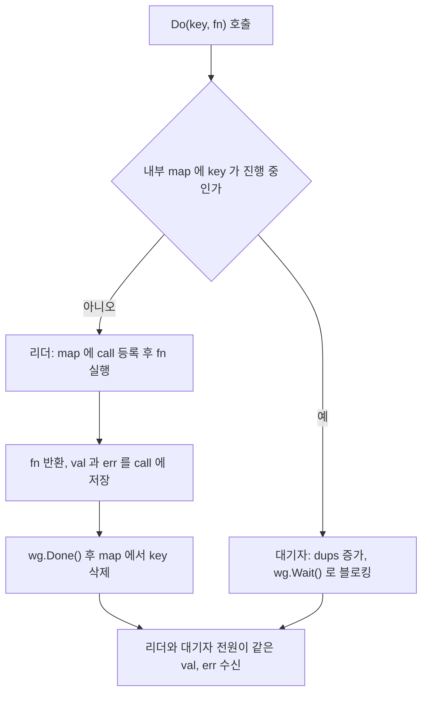
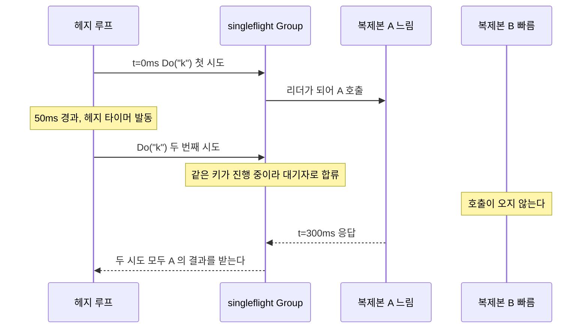
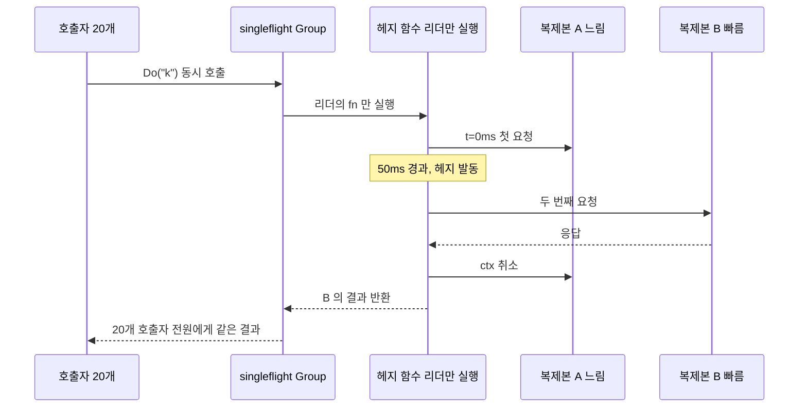

# singleflight — 중복 요청 병합

`golang.org/x/sync/singleflight`는 동일한 키로 동시에 들어온 호출을 하나로 묶어 실행하고, 결과를 대기 중인 모든 호출에 공유한다.

같은 키의 호출을 합쳐서 백엔드 부하를 줄이는 도구라서, 느린 복제본을 피하려고 같은 요청을 한 번 더 보내는 [헤지 요청](../../Backend/Resilience/Hedged_Requests.md)과는 방향이 반대다. 둘을 같이 쓰면 헤지된 요청이 합쳐져 버리는 경우가 있고, 이 문서 중간의 "헤지 요청과 같이 쓸 때" 절에서 다룬다.

## cache stampede가 실제로 어떻게 터지나

캐시 만료 시점에 트래픽이 몰리면 같은 DB 쿼리가 수백 번 동시에 실행된다. 캐시가 없으니 전부 DB로 떨어지고, DB가 응답이 느려지면 요청이 더 쌓이고, 결국 DB가 죽는다. 이게 thundering herd 문제다.

mutex로 막으려는 시도가 있지만, mutex는 한 번에 하나씩 직렬화한다. 100개 요청이 들어오면 첫 번째가 끝나야 두 번째가 시작하고, 결국 100번 DB를 친다. singleflight는 다르다. 100개 요청 중 첫 번째만 실제로 실행하고, 나머지 99개는 그 결과를 기다렸다가 그대로 받는다.

## Do()의 동작

```go
var g singleflight.Group

func fetchUser(id string) (*User, error) {
    v, err, shared := g.Do("user:"+id, func() (interface{}, error) {
        return db.QueryUser(id)
    })
    if err != nil {
        return nil, err
    }
    return v.(*User), nil
}
```

세 번째 반환값 `shared`는 이 결과가 다른 호출과 공유됐는지 나타낸다. `true`면 내 호출이 새로 실행된 게 아니라 기존 호출에 편승한 것이다. 캐시 갱신 여부 판단이나 메트릭 기록에 활용한다.

`Do()`는 블로킹이다. 같은 키로 진행 중인 호출이 있으면 그게 끝날 때까지 현재 고루틴이 대기한다. 대기 중에 컨텍스트 취소를 처리해야 한다면 `DoChan()`을 써야 한다.

호출 하나가 거치는 경로는 아래 흐름도와 같다. 리더가 되느냐 대기자가 되느냐는 `Do()`에 들어온 순간 그 키가 내부 map에 있느냐로만 갈린다.



`fn`이 끝나 map에서 key가 지워지는 순간부터는 새 호출이 다시 리더가 된다. 결과를 캐싱하지는 않는다. `fn`이 끝난 뒤에 들어온 호출은 합쳐지지 않고 백엔드를 다시 친다.

## 에러 전파 — 가장 많이 실수하는 부분

singleflight에서 실제 호출이 에러를 반환하면, 그 에러가 대기 중인 모든 호출에 그대로 전달된다. 의도한 동작이지만, 운영에서 예상 밖으로 작동하는 경우가 있다.

DB가 일시적으로 죽었을 때다. 실제 호출 하나가 에러를 반환하면 대기 중이던 99개 전부가 에러를 받는다. 순간적으로 대량의 요청이 동시에 실패한다. `Do()` 하나가 에러를 내면 그게 99배로 증폭된다고 보면 된다.

`Do()` 내부에서 재시도하는 코드를 짜면 의미가 없다. 실제 호출이 에러를 반환하는 순간 대기자들이 에러를 받고 흩어지기 때문이다. 재시도는 `Do()` 바깥 레이어에서 처리한다.

```go
// 이렇게 쓰면 재시도가 대기자들에게 적용되지 않는다
v, err, _ := g.Do("key", func() (interface{}, error) {
    for i := 0; i < 3; i++ {
        result, err := fetch()
        if err == nil {
            return result, nil
        }
    }
    return nil, lastErr  // 여기서 에러가 나면 대기자 전부에게 전파된다
})
```

반환된 값은 포인터로 공유된다. 받은 `*User`를 수정하면 같은 결과를 받은 다른 고루틴에도 영향을 준다. 공유 결과를 받았을 때는 반드시 복사해서 쓴다.

## DoChan()으로 컨텍스트 취소 처리

`Do()`는 블로킹이라 컨텍스트 취소를 직접 지원하지 않는다. HTTP 핸들러에서 클라이언트가 연결을 끊어도 `Do()`가 반환할 때까지 고루틴이 살아있다. `DoChan()`은 채널을 즉시 반환하므로 `select`로 처리한다.

```go
func fetchWithContext(ctx context.Context, id string) (*User, error) {
    ch := g.DoChan("user:"+id, func() (interface{}, error) {
        return db.QueryUser(id)
    })

    select {
    case <-ctx.Done():
        return nil, ctx.Err()
    case res := <-ch:
        if res.Err != nil {
            return nil, res.Err
        }
        return res.Val.(*User), nil
    }
}
```

컨텍스트가 취소돼도 실제 호출은 계속 실행된다. 다른 대기자가 있을 수 있기 때문이다. 취소는 이 고루틴이 결과를 포기하는 것이지, 실제 작업을 중단하는 게 아니다.

`singleflight.Result` 구조체에는 `Val`, `Err`, `Shared` 세 필드가 있다. `Do()`의 세 반환값과 같은 내용이다.

## 리더의 context 취소가 대기자 전체에 퍼진다

`DoChan()`을 쓰면 취소 문제가 끝난다고 생각하기 쉬운데, 실제로 깨지는 곳은 `fn` 안에서 어떤 context를 쓰느냐다. 위 `fetchWithContext` 예제의 `db.QueryUser(id)`는 context를 안 받아서 문제가 안 보였다. `db.QueryUser(ctx, id)`처럼 호출자의 context를 `fn` 안으로 넘기면, 그 context는 **리더의 것**이다. 리더가 타임아웃으로 취소되면 `fn`이 `context.DeadlineExceeded`를 반환하고, 그 에러는 같은 키를 기다리던 모든 호출자에게 공유된다. 대기자들의 context는 멀쩡한데도 실패한다.

아래 코드는 리더만 50ms 타임아웃을 주고, 대기자 둘은 `context.Background()`로 호출한다. 백엔드 호출은 200ms 걸린다. Go 1.26.9, `golang.org/x/sync` v0.24.0에서 돌린 결과다.

```go
leaderCtx, cancel := context.WithTimeout(context.Background(), 50*time.Millisecond)
defer cancel()

call := func(name string, ctx context.Context, delay time.Duration) {
    time.Sleep(delay)
    v, err, shared := g.Do("k", func() (any, error) { return fetch(ctx) })
    fmt.Printf("%s v=%v err=%v shared=%v\n", name, v, err, shared)
}
go call("leader", leaderCtx, 0)
go call("waiter1", context.Background(), 10*time.Millisecond)
go call("waiter2", context.Background(), 20*time.Millisecond)
```

```text
leader  v=<nil> err=context deadline exceeded shared=true
waiter1 v=<nil> err=context deadline exceeded shared=true
waiter2 v=<nil> err=context deadline exceeded shared=true
backend calls: 1
```

대기자 둘이 자기 context와 상관없이 리더의 타임아웃을 그대로 받았다. 운영에서는 "클라이언트 하나가 연결을 끊었더니 같은 상품을 보던 사용자 전부에게 500이 나갔다"는 형태로 나온다. 리더가 되는 호출은 먼저 도착한 아무 요청이라서 재현 조건을 잡기도 어렵다.

우회는 두 가지를 같이 해야 한다. `fn` 안에서는 호출자 context에서 취소를 떼어낸 별도 context를 쓰고, 각 호출자의 대기는 `DoChan()`의 `select`에서 자기 context로만 한다.

```go
func (c *UserCache) get(ctx context.Context, id string) (*User, error) {
    ch := c.g.DoChan("user:"+id, func() (any, error) {
        // 리더의 취소와 분리하고, 호출 자체의 상한은 따로 건다
        dctx, cancel := context.WithTimeout(context.WithoutCancel(ctx), time.Second)
        defer cancel()
        return c.db.QueryUser(dctx, id)
    })

    select {
    case <-ctx.Done():
        return nil, ctx.Err()
    case res := <-ch:
        if res.Err != nil {
            return nil, res.Err
        }
        return res.Val.(*User), nil
    }
}
```

같은 시나리오(리더 50ms 타임아웃, 대기자 둘은 취소 없음)에서 리더만 `context deadline exceeded`로 나가고 대기자 둘은 둘 다 `ok`를 받았다. 백엔드 호출은 한 번이다.

`context.WithoutCancel`은 Go 1.21에 들어왔고 취소와 데드라인만 떼고 context 값(트레이스 ID 등)은 유지한다. 그 이전 버전이면 `context.Background()`에 필요한 값만 옮겨 담아야 한다.

이 방식에는 대가가 하나 있다. 마지막 대기자까지 떠나도 `fn`은 취소되지 않고 끝까지 돈다. 호출자 한 명이 50ms 뒤에 포기하는 시나리오를 돌렸더니 호출자가 떠난 직후에도 `fn` 고루틴이 실행 중이었고(`running=1`), 300ms 뒤에는 끝나 있었다. 그래서 `fn` 안의 `WithTimeout` 상한이 반드시 필요하다. 이 상한이 없으면 DB가 멈춘 상황에서 아무도 기다리지 않는 쿼리가 계속 쌓인다.

## Forget()으로 재시도 허용하기

`Do()`는 진행 중인 호출이 있으면 새 호출을 막는다. 타임아웃이 긴 호출이 막혀 있을 때, 정상 경로로 새 호출을 시작하고 싶은 경우가 있다.

```go
func fetchWithRetryWindow(id string) (*User, error) {
    key := "user:" + id

    timer := time.AfterFunc(500*time.Millisecond, func() {
        // 500ms 경과 후 이 키의 진입 제한을 해제한다
        g.Forget(key)
    })
    defer timer.Stop()

    v, err, _ := g.Do(key, func() (interface{}, error) {
        return db.QueryUser(id)
    })
    if err != nil {
        return nil, err
    }
    return v.(*User), nil
}
```

`Forget(key)`를 호출하면 이후 같은 키로 들어오는 요청은 새 호출을 시작한다. 단, 이미 대기 중인 호출들은 원래 호출 결과를 그대로 받는다. `Forget()`은 대기 중인 호출을 깨우지 않는다.

`Forget()`을 너무 공격적으로 쓰면 singleflight의 효과가 사라진다. 짧은 간격으로 계속 호출하면 매 요청이 새 호출을 시작하게 된다. 타임아웃 대응이나 명시적인 캐시 무효화 신호가 왔을 때만 쓰는 게 맞다.

## Redis 캐시와 함께 쓰는 패턴

캐시 읽기 → 없으면 DB 조회 → 캐시 쓰기 패턴에서 캐시 만료 직후 트래픽 폭발을 막는 용도로 singleflight를 쓴다.

```go
type UserCache struct {
    g     singleflight.Group
    redis *redis.Client
    db    *sql.DB
}

func (c *UserCache) Get(ctx context.Context, id string) (*User, error) {
    // 캐시 히트는 singleflight 바깥에서 처리한다
    if cached, err := c.redis.Get(ctx, "user:"+id).Bytes(); err == nil {
        var u User
        if err := json.Unmarshal(cached, &u); err == nil {
            return &u, nil
        }
    }

    // 캐시 미스는 singleflight로 묶는다
    v, err, _ := c.g.Do("user:"+id, func() (interface{}, error) {
        user, err := c.db.QueryUser(ctx, id)
        if err != nil {
            return nil, err
        }
        data, _ := json.Marshal(user)
        c.redis.Set(ctx, "user:"+id, data, 5*time.Minute)
        return user, nil
    })
    if err != nil {
        return nil, err
    }

    // 공유 결과는 복사해서 반환한다
    result := *v.(*User)
    return &result, nil
}
```

캐시 히트를 `Do()` 안에서 처리하면 안 된다. singleflight가 동작 중인 상태에서 캐시가 채워져도 대기 중인 고루틴들이 Redis에서 읽지 못하고 DB 결과를 기다린다. 캐시 확인은 항상 바깥에서 먼저 한다.

DB 쿼리 중복 제거도 같은 패턴이다. `LIMIT 1`이 아닌 무거운 집계 쿼리를 대시보드 같은 여러 위젯이 동시에 요청할 때, 쿼리 결과를 singleflight로 묶으면 DB 부하를 크게 줄인다.

## 그룹별 singleflight 분리

`singleflight.Group`은 모든 키를 하나의 그룹에서 관리한다. 리소스 종류가 다른 호출을 같은 그룹에 넣으면 키 충돌 위험이 있다.

```go
// 키 프리픽스로 구분하는 방식 — 프리픽스를 빠뜨리면 버그가 생긴다
var g singleflight.Group
g.Do("user:123", ...)
g.Do("product:123", ...)

// 그룹을 분리하면 키 충돌이 없다
var (
    userGroup    singleflight.Group
    productGroup singleflight.Group
)
userGroup.Do("123", ...)
productGroup.Do("123", ...)
```

엔티티마다 별도 그룹을 두는 게 관리하기 쉽다. 쓰기 경로와 읽기 경로는 반드시 분리한다. 쓰기가 느릴 때 읽기가 대기하는 상황이 생기기 때문이다.

`singleflight.Group`은 값 타입이 아니라 포인터로 쓴다. 값으로 복사하면 내부 뮤텍스가 복사되면서 동기화가 깨진다. 구조체 필드로 쓸 때는 항상 포인터로 임베드하거나 직접 `singleflight.Group` 필드로 선언한다(포인터 없이 선언해도 제로값이 유효하다).

## 헤지 요청과 같이 쓸 때

같은 키의 호출을 합치는 singleflight와, 느린 복제본을 피하려고 같은 요청을 복제본 두 곳에 보내는 헤지는 한 호출 경로 안에서 만나면 서로를 무력화한다. 어느 쪽이 바깥에 있느냐로 결과가 갈린다.

바깥에 헤지, 안쪽에 `Do()`를 두고 두 시도가 같은 키를 쓰면 이렇게 된다. 첫 시도가 리더가 되어 느린 복제본 A를 부른다. 헤지 타이머가 터져 두 번째 시도가 `Do("k")`를 부르면 그 키가 이미 진행 중이라 대기자로 합류한다. 복제본 B에는 요청이 나가지 않고, 헤지는 발동한 것처럼 보이는데 아무 일도 하지 않는다.



반대로 `Do()`가 바깥, 헤지가 `fn` 안쪽이면 리더 한 명만 헤지를 실행한다. 대기자가 몇 명이든 복제본 호출은 A 한 번, B 한 번이고 결과는 전원이 공유한다.



복제본 A가 300ms, B가 10ms, 헤지 지연이 50ms인 가짜 백엔드에 호출자 20개를 1ms 간격으로 넣어서 구조별로 돌렸다.

| 구조 | A 호출 | B 호출 | 응답 | 최대 지연 |
|---|---|---|---|---|
| singleflight만 | 1 | 0 | 전부 A | 301ms |
| 바깥 헤지, 같은 키 | 1 | 0 | 전부 A | 300ms |
| 바깥 헤지, 복제본별 키 | 1 | 1 | 전부 B | 107ms |
| 안쪽 헤지 | 1 | 1 | 전부 B | 99ms |
| 헤지만 | 20 | 20 | 전부 B | 99ms |

"바깥 헤지, 같은 키"는 `singleflight만`과 지연이 같다. 헤지 코드를 넣었는데 p99가 안 움직이면 이 구조를 의심한다. 로그에는 헤지 발동 기록이 찍히므로 발동률 지표만 봐서는 못 잡고, 두 번째 복제본이 실제로 요청을 받았는지를 복제본 쪽에서 세어야 보인다.

바깥 헤지를 꼭 유지해야 하면 시도마다 키를 달리한다(`"k#A"`, `"k#B"`). 같은 복제본으로 가는 요청끼리만 합쳐지고 헤지는 살아 있다. 다만 호출자마다 헤지 타이머가 따로 돌기 때문에 합쳐지는 정도가 도착 간격에 좌우된다. 위 실험은 20명이 20ms 안에 몰려 들어와서 A, B 모두 1번으로 합쳐졌다. 호출이 끝난 키는 지워지므로 도착이 흩어지면 늦게 온 호출자가 새 호출을 시작해서 그만큼 복제본 호출이 늘어난다.

안쪽 헤지는 부하 면에서 낫지만 앞 절의 함정을 그대로 가진다. 리더의 context로 헤지를 돌리면 리더 취소 한 번에 A와 B 양쪽 호출이 취소되고 대기자 전원이 에러를 받는다. 리더에 70ms 데드라인을 주고 A 300ms, B 100ms, 헤지 지연 20ms로 돌렸더니 B가 응답하기 전에 리더가 취소되어 A와 B 양쪽에 요청이 나간 뒤 리더와 대기자 모두 `context deadline exceeded`를 받았다. 안쪽에 헤지를 둘 때도 `WithoutCancel`로 분리한 context를 쓴다. 헤지 예산(추가 요청 상한)을 호출자 수가 아니라 리더 호출 수 기준으로 세게 되는 점도 같이 바뀐다. [헤지 요청 문서](../../Backend/Resilience/Hedged_Requests.md)의 예산 계산을 그대로 가져오면 실제 추가 부하를 과대 추정한다.

## 꼬리 지연과 스탬피드 대응 비교

singleflight, 헤지, 캐시 스탬피드 방어는 전부 "가끔 터지는 부하"를 다루지만 막는 대상이 다르다. 같은 서비스에 하나를 넣었다고 나머지가 해결되지 않는다.

| 방식 | 막는 문제 | 추가 부하 | 실패 시 영향 |
|---|---|---|---|
| singleflight | 같은 키의 동시 중복 호출. 프로세스 안에서만 합친다 | 없다. 호출이 줄어든다. 인스턴스가 N대면 키당 최대 N번은 나간다 | 리더 에러가 대기자 전원에 전파된다. 리더가 느리면 대기자도 같이 느리다 |
| 헤지 요청 | 한 복제본의 일시적 느림(꼬리 지연) | 지연 시간을 넘긴 요청 수만큼 늘어난다 | 복제본이 모두 느리거나 공유 자원이 원인이면 효과가 없고 부하만 는다. 멱등하지 않은 호출은 중복 실행 |
| TTL 지터 | 많은 키가 같은 시각에 만료되는 동기화 | 없다 | 같은 키 하나에 몰리는 경우는 못 막는다 |
| 확률적 조기 갱신 | 인기 키 하나가 만료되는 순간의 폭주 | 만료 전에 갱신이 한 번 더 나간다 | 갱신 호출이 실패하면 기존 값을 유지하다가 만료 때 같은 문제를 만난다 |
| 분산 락 후 재조회 | 여러 인스턴스에 걸친 같은 키의 중복 갱신 | 락 획득 왕복이 추가된다 | 락 서버 장애와 락 만료 시간 설정 실수가 새 장애 원인이 된다 |

singleflight는 한 프로세스 안의 동시 호출만 합친다. 파드가 20개면 캐시가 만료된 순간 DB에 20번이 나간다. 이 정도가 문제가 되면 분산 락이나 조기 갱신을 같이 쓴다. 헤지는 합치는 쪽이 아니라 늘리는 쪽이라 DB가 이미 포화 상태면 쓰지 않는다. 캐시 미스 경로가 헤지 대상이 되는 구조라면 안쪽 헤지로만 둔다.

## 쓰기 전에 확인할 것들

singleflight는 멱등성이 보장된 읽기 작업에만 쓴다. 쓰기나 side effect가 있는 작업에 쓰면, 대기 중이던 99개 호출 전부가 한 번의 결과를 공유한다. 이게 올바른 동작인지 먼저 확인해야 한다.

키 설계가 중요하다. 요청 파라미터가 달라도 같은 결과를 공유할 수 있으면 키를 넓게 잡고, 파라미터마다 결과가 달라야 한다면 키를 충분히 세분화한다. 너무 세분화하면 중복 제거 효과가 없어진다.

에러가 자주 나는 환경에서는 에러가 모든 대기자에게 퍼진다는 점을 반드시 고려해야 한다. 한 번의 에러가 순간적으로 많은 요청을 동시에 실패시킨다. 이런 환경에서는 서킷 브레이커와 함께 쓰는 게 안전하다.