# Cookie VS Session

## HTTP가 로그인 상태를 기억하지 못하는 문제

HTTP는 Stateless 프로토콜이다. 서버는 이전 요청을 기억하지 않는다. 로그인 후 다음 요청에서도 서버가 "이 사람이 로그인했다"는 사실을 알려면 별도의 상태 저장 수단이 필요하다. 쿠키와 세션이 그 수단이다.

둘은 경쟁 관계가 아니다. 세션 방식도 세션 ID를 운반할 때 쿠키를 쓴다. 갈리는 지점은 로그인 정보 자체를 어디에 두느냐다. 쿠키에 값을 직접 넣으면 브라우저가 들고 있는 값을 서버가 믿어야 하고, 세션에 두면 브라우저는 열쇠(세션 ID)만 들고 있고 값은 서버 저장소에 있다.

첫 번째 도식은 쿠키에 `role=user`를 직접 담은 경우다. 개발자 도구에서 값을 `admin`으로 바꿔 보내면 서버는 구분할 방법이 없다. 두 번째 도식은 같은 로그인을 세션으로 처리한 경우로, 브라우저가 보내는 것은 임의 문자열 하나뿐이고 사용자 정보는 서버 저장소 조회로만 얻는다.

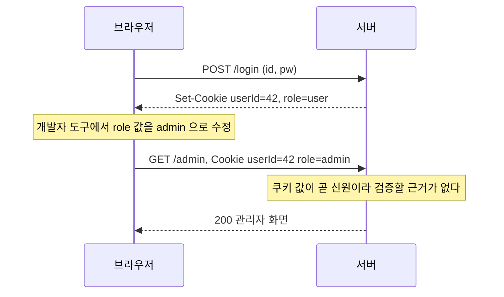

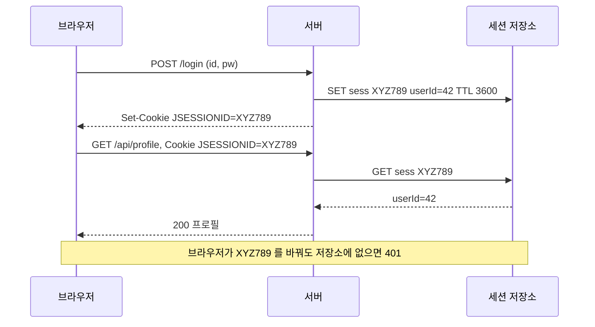

쿠키 단독 방식을 서버 서명으로 보완하는 구조(서명 쿠키, JWT)도 있다. 값을 위조할 수는 없게 되지만 서버가 강제로 무효화할 수 없고, 크기가 쿠키 한도에 묶인다. 이 문서 끝의 JWT 비교에서 다룬다.

---

## 쿠키(Cookie)

### 정의

서버가 HTTP 응답의 `Set-Cookie` 헤더로 클라이언트에 저장시키는 작은 데이터 파일이다. 이후 브라우저는 동일 도메인에 요청할 때마다 `Cookie` 헤더에 이 값을 자동으로 포함한다. 데이터가 클라이언트 측에 저장된다는 것이 세션과 핵심적인 차이다.

### 쿠키의 종류

세션 쿠키는 `Max-Age`나 `Expires` 속성이 없어 브라우저를 닫으면 삭제된다. 영구 쿠키는 만료일이 지정되어 디스크에 저장된다. 보안 쿠키는 `Secure` 플래그를 붙여 HTTPS 연결에서만 전송된다. 실무에서는 이 세 가지를 조합해 쓰는 경우가 많다. 세션 ID는 세션 쿠키로, 자동 로그인 토큰은 영구 쿠키 + `Secure`로 관리한다.

### 쿠키의 특징

쿠키는 이름, 값, 만료일, 경로 정보로 구성된다. 개당 4KB(이름+값 4096바이트) 제한이 있다. 개수 제한은 브라우저마다 다르다. RFC 6265가 브라우저에 요구하는 최소치는 도메인당 50개, 전체 3000개다. "도메인당 20개, 총 300개"라는 수치가 자주 보이는데 이건 이전 규격(RFC 2109)의 권장값이다. 용량 제한이 작기 때문에 민감하지 않은 경량 데이터를 저장하는 데 적합하다. 브라우저가 모든 요청에 자동으로 실어 보내므로 저장하는 데이터가 많아질수록 이미지·CSS 요청까지 헤더가 무거워진다. 4KB 한도를 넘겼을 때 생기는 일은 뒤의 "쿠키 크기 한도와 431/400"에서 다룬다.

### 쿠키 동작 과정

첫 방문 시 서버가 응답 헤더에 `Set-Cookie`를 포함해 쿠키를 내려준다. 이후 브라우저는 해당 도메인으로 요청할 때마다 `Cookie` 헤더에 저장된 값을 자동으로 실어 보낸다.

```http
# 첫 로그인 응답
HTTP/1.1 200 OK
Set-Cookie: sessionId=abc123; Path=/; HttpOnly; Secure; SameSite=Strict; Max-Age=3600
Set-Cookie: theme=dark; Path=/; Max-Age=2592000

# 이후 요청
GET /dashboard HTTP/1.1
Host: example.com
Cookie: sessionId=abc123; theme=dark
```

`theme` 쿠키는 영구 쿠키로 30일 유지되고, `sessionId`는 1시간 후 만료되는 보안 쿠키다.

아래 도식은 위 헤더가 오가는 순서다. 두 쿠키가 같은 응답으로 저장되고, 1시간 뒤에는 `sessionId`만 요청에서 빠지는 지점을 보면 된다.

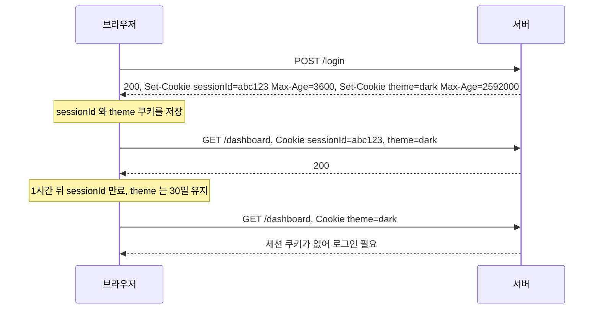

### 쿠키 보안 위험 및 대응

XSS 공격에서는 악성 스크립트가 `document.cookie`로 쿠키를 탈취한다. `HttpOnly` 플래그를 설정하면 JavaScript에서 쿠키에 접근할 수 없어 이 공격을 차단한다.

CSRF 공격은 사용자 모르게 다른 사이트에서 쿠키를 이용한 요청을 위조한다. `SameSite=Strict`로 설정하면 외부 사이트에서 발생한 요청에는 쿠키가 포함되지 않는다. 단, `Strict`는 외부 링크를 통한 접근에도 쿠키를 보내지 않아 사용자 경험에 영향을 줄 수 있다. 이 경우 `SameSite=Lax`가 타협점이 된다.

네트워크 스니핑은 패킷을 가로채 쿠키를 탈취한다. `Secure` 플래그로 HTTPS 연결에서만 쿠키를 전송하도록 강제한다.

---

<div class="ygd-cookie-attacks-and-flags-tabs" id="ygd-cookie-attacks-and-flags-tabs">
<style>
.ygd-cookie-attacks-and-flags-tabs{--ygd-ink:rgb(45,42,40);--ygd-muted:rgb(100,95,90);--ygd-card:rgb(253,251,250);--ygd-bg2:rgb(241,237,233);--ygd-line:rgb(180,172,164);--ygd-accent:rgb(46,100,120);--ygd-onaccent:rgb(255,255,255);--ygd-bad:rgb(176,48,48);--ygd-bad-bg:rgb(252,232,230);--ygd-good:rgb(30,110,70);--ygd-good-bg:rgb(224,242,230);--ygd-warn:rgb(150,90,0);--ygd-warn-bg:rgb(252,240,215);--ygd-ok-bg:rgb(228,238,243);--ygd-hl:rgba(46,100,120,0.14);--ygd-iconink:rgb(255,255,255);--ygd-focus:rgb(20,90,200);max-width:760px;margin-left:auto;margin-right:auto;margin-top:1.2em;margin-bottom:1.2em;box-sizing:border-box;padding:12px;border:1px solid var(--ygd-line);border-radius:12px;background:var(--ygd-card);color:var(--ygd-ink);font-size:14px;line-height:1.6}
body[data-md-color-scheme="slate"] .ygd-cookie-attacks-and-flags-tabs{--ygd-ink:rgb(240,237,233);--ygd-muted:rgb(170,163,155);--ygd-card:rgb(37,34,36);--ygd-bg2:rgb(52,48,50);--ygd-line:rgb(120,113,108);--ygd-accent:rgb(120,185,205);--ygd-onaccent:rgb(24,22,24);--ygd-bad:rgb(255,140,130);--ygd-bad-bg:rgb(84,38,40);--ygd-good:rgb(120,215,160);--ygd-good-bg:rgb(28,66,46);--ygd-warn:rgb(240,190,100);--ygd-warn-bg:rgb(76,54,20);--ygd-ok-bg:rgb(34,58,68);--ygd-hl:rgba(120,185,205,0.20);--ygd-iconink:rgb(30,28,30);--ygd-focus:rgb(255,210,100)}
.ygd-cookie-attacks-and-flags-tabs .ygd-p{margin:0 0 10px 0;font-size:14px;line-height:1.6;color:var(--ygd-ink)}
.ygd-cookie-attacks-and-flags-tabs .ygd-muted{color:var(--ygd-muted)}
.ygd-cookie-attacks-and-flags-tabs .ygd-tabs{display:flex;gap:6px;margin:0 0 10px 0}
.ygd-cookie-attacks-and-flags-tabs .ygd-tabs .ygd-btn{flex:1 1 0;min-width:0;text-align:center}
.ygd-cookie-attacks-and-flags-tabs .ygd-tn{display:block;font-weight:700}
.ygd-cookie-attacks-and-flags-tabs .ygd-btn{font:inherit;font-size:14px;line-height:1.3;min-height:40px;padding:6px 10px;border:1px solid var(--ygd-line);border-radius:8px;background:var(--ygd-bg2);color:var(--ygd-ink);cursor:pointer;margin:0;overflow-wrap:anywhere}
.ygd-cookie-attacks-and-flags-tabs .ygd-btn:disabled{opacity:0.5;cursor:not-allowed}
.ygd-cookie-attacks-and-flags-tabs .ygd-btn:focus-visible{outline:3px solid var(--ygd-focus);outline-offset:2px}
.ygd-cookie-attacks-and-flags-tabs .ygd-btn[aria-selected="true"],.ygd-cookie-attacks-and-flags-tabs .ygd-btn[aria-pressed="true"]{background:var(--ygd-accent);border-color:var(--ygd-accent);color:var(--ygd-onaccent)}
.ygd-cookie-attacks-and-flags-tabs .ygd-grp{margin:0 0 8px 0}
.ygd-cookie-attacks-and-flags-tabs .ygd-rl{display:block;font-weight:700;margin:0 0 4px 0}
.ygd-cookie-attacks-and-flags-tabs .ygd-seg{display:flex;flex-wrap:wrap;gap:6px}
.ygd-cookie-attacks-and-flags-tabs .ygd-cookie{margin:8px 0 10px 0;padding:8px 10px;border:1px solid var(--ygd-line);border-radius:8px;background:var(--ygd-bg2);font-family:var(--md-code-font-family,monospace);font-size:14px;line-height:1.5;overflow-wrap:anywhere}
.ygd-cookie-attacks-and-flags-tabs .ygd-fon{color:var(--ygd-good);font-weight:700}
.ygd-cookie-attacks-and-flags-tabs .ygd-foff{color:var(--ygd-bad)}
.ygd-cookie-attacks-and-flags-tabs .ygd-svg{display:block;width:100%;max-width:100%;height:auto}
.ygd-cookie-attacks-and-flags-tabs .ygd-svg text{fill:var(--ygd-ink);font-size:12px;font-family:inherit}
.ygd-cookie-attacks-and-flags-tabs .ygd-svg .ygd-at{font-weight:700}
.ygd-cookie-attacks-and-flags-tabs .ygd-life{stroke:var(--ygd-line);stroke-width:1.5;stroke-dasharray:4 4}
.ygd-cookie-attacks-and-flags-tabs .ygd-abox{fill:var(--ygd-bg2);stroke:var(--ygd-line);stroke-width:1.5}
.ygd-cookie-attacks-and-flags-tabs .ygd-lbg{fill:var(--ygd-card);opacity:0.92}
.ygd-cookie-attacks-and-flags-tabs .ygd-st{transition:opacity 0.3s}
.ygd-cookie-attacks-and-flags-tabs .ygd-dim{opacity:0.45}
.ygd-cookie-attacks-and-flags-tabs .ygd-hl{fill:var(--ygd-hl);opacity:0}
.ygd-cookie-attacks-and-flags-tabs .ygd-now .ygd-hl{opacity:1}
.ygd-cookie-attacks-and-flags-tabs .ygd-k-ok{color:var(--ygd-accent);--ygd-nbg:var(--ygd-ok-bg)}
.ygd-cookie-attacks-and-flags-tabs .ygd-k-bad{color:var(--ygd-bad);--ygd-nbg:var(--ygd-bad-bg)}
.ygd-cookie-attacks-and-flags-tabs .ygd-k-guard,.ygd-cookie-attacks-and-flags-tabs .ygd-k-cut{color:var(--ygd-good);--ygd-nbg:var(--ygd-good-bg)}
.ygd-cookie-attacks-and-flags-tabs .ygd-k-warn{color:var(--ygd-warn);--ygd-nbg:var(--ygd-warn-bg)}
.ygd-cookie-attacks-and-flags-tabs .ygd-k-skip{color:var(--ygd-muted);--ygd-nbg:var(--ygd-card)}
.ygd-cookie-attacks-and-flags-tabs .ygd-ln{fill:none;stroke:currentColor;stroke-width:2}
.ygd-cookie-attacks-and-flags-tabs .ygd-k-cut .ygd-ln{stroke-dasharray:6 4}
.ygd-cookie-attacks-and-flags-tabs .ygd-k-skip .ygd-ln{stroke-dasharray:3 5}
.ygd-cookie-attacks-and-flags-tabs .ygd-hd,.ygd-cookie-attacks-and-flags-tabs .ygd-ico,.ygd-cookie-attacks-and-flags-tabs .ygd-dot{fill:currentColor;stroke:none}
.ygd-cookie-attacks-and-flags-tabs .ygd-x{fill:none;stroke:currentColor;stroke-width:3;stroke-linecap:round}
.ygd-cookie-attacks-and-flags-tabs .ygd-note{fill:var(--ygd-nbg);stroke:currentColor;stroke-width:1.5}
.ygd-cookie-attacks-and-flags-tabs .ygd-k-skip .ygd-note{stroke-dasharray:4 3}
.ygd-cookie-attacks-and-flags-tabs .ygd-svg .ygd-icot{fill:var(--ygd-iconink);font-weight:700;font-size:11px}
.ygd-cookie-attacks-and-flags-tabs .ygd-svg .ygd-k-skip text{fill:var(--ygd-muted)}
.ygd-cookie-attacks-and-flags-tabs .ygd-dot{display:none}
.ygd-cookie-attacks-and-flags-tabs .ygd-now .ygd-dot{display:block;animation:ygd-cookie-attacks-and-flags-tabs-fly 0.9s ease-out forwards}
@keyframes ygd-cookie-attacks-and-flags-tabs-fly{from{transform:translateX(0);opacity:1}75%{opacity:1}to{transform:translateX(var(--ygd-dx));opacity:0}}
.ygd-cookie-attacks-and-flags-tabs .ygd-desc{margin:10px 0;padding:10px 12px;border-left:4px solid var(--ygd-accent);border-radius:6px;background:var(--ygd-bg2);font-size:15px;line-height:1.65;min-height:8.5em}
.ygd-cookie-attacks-and-flags-tabs .ygd-no{display:block;font-weight:700;font-size:14px;color:var(--ygd-accent);margin-bottom:2px}
.ygd-cookie-attacks-and-flags-tabs .ygd-ctrl{display:flex;flex-wrap:wrap;gap:6px}
@media (prefers-reduced-motion:reduce){.ygd-cookie-attacks-and-flags-tabs .ygd-st{transition:none}.ygd-cookie-attacks-and-flags-tabs .ygd-now .ygd-dot{display:none;animation:none}}
</style>
<p class="ygd-p ygd-muted">비유: 쿠키는 출입증이고, 플래그는 그 출입증을 누가 읽고 어디로 보낼 수 있는지 정한 사용 규칙이다. 비유일 뿐이므로 실제 동작은 단계 설명을 따른다.</p>
<div class="ygd-tabs" role="tablist" aria-label="쿠키 공격 유형">
<button type="button" class="ygd-btn" role="tab" id="ygd-cookie-attacks-and-flags-tabs-tab0" aria-controls="ygd-cookie-attacks-and-flags-tabs-panel"><span class="ygd-tn">XSS</span>HttpOnly</button>
<button type="button" class="ygd-btn" role="tab" id="ygd-cookie-attacks-and-flags-tabs-tab1" aria-controls="ygd-cookie-attacks-and-flags-tabs-panel"><span class="ygd-tn">CSRF</span>SameSite</button>
<button type="button" class="ygd-btn" role="tab" id="ygd-cookie-attacks-and-flags-tabs-tab2" aria-controls="ygd-cookie-attacks-and-flags-tabs-panel"><span class="ygd-tn">네트워크 스니핑</span>Secure</button>
</div>
<div role="tabpanel" id="ygd-cookie-attacks-and-flags-tabs-panel" aria-labelledby="ygd-cookie-attacks-and-flags-tabs-tab0">
<p class="ygd-p ygd-lead"></p>
<div class="ygd-grp"><span class="ygd-rl">플래그 상태</span><div class="ygd-seg ygd-modes" role="group" aria-label="플래그 상태"></div></div>
<div class="ygd-grp ygd-scens"><span class="ygd-rl">시나리오</span><div class="ygd-seg ygd-scenseg" role="group" aria-label="시나리오"></div></div>
<div class="ygd-cookie"></div>
<svg class="ygd-svg" viewBox="0 0 360 300" role="img" aria-label="쿠키 공격 경로 다이어그램"></svg>
<div class="ygd-desc" aria-live="polite"><span class="ygd-no"></span><span class="ygd-tx"></span></div>
<div class="ygd-ctrl">
<button type="button" class="ygd-btn ygd-play">재생</button>
<button type="button" class="ygd-btn ygd-next">다음 단계</button>
<button type="button" class="ygd-btn ygd-reset">처음으로</button>
</div>
</div>
<script>
(function(){
var root=document.getElementById('ygd-cookie-attacks-and-flags-tabs');
if(!root){return;}
var NS='http://www.w3.org/2000/svg',AX=[56,180,304],RH=68,TOP=48;
function $(c){return root.querySelector('.'+c);}
var mq=window.matchMedia?window.matchMedia('(prefers-reduced-motion: reduce)'):null;
function A(f,t,l,k,d){return {t:'a',f:f,to:t,l:l,k:k,d:d};}
function N(at,l,k,d){return {t:'n',at:at,l:l,k:k,d:d};}
var cf1=A(0,1,['숨은 폼이 든','악성 페이지'],'ok','사용자는 대상 사이트에 로그인해 쿠키를 갖고 있다. 그 상태에서 외부 사이트가 대상 사이트로 보낼 폼을 숨겨 둔 페이지를 연다.');
var lk1=A(0,1,['대상 사이트로 가는','링크 클릭'],'ok','사용자가 외부 사이트에 있는 링크를 눌러 대상 사이트로 이동한다.');
var NOS='세션 쿠키가 있는 로그인 상태에서 시작한다고 가정한다.';
var tabs=[
{name:'XSS',flag:'HttpOnly',lead:'XSS 에서는 악성 스크립트가 document.cookie 로 쿠키를 탈취한다. HttpOnly 를 설정하면 JavaScript 에서 쿠키에 접근할 수 없다.',actors:['취약한 사이트','브라우저','공격자 서버'],scen:[{id:'x',label:''}],
modes:[
{label:'HttpOnly 꺼짐',flag:'',none:'HttpOnly 없음',s:{x:{sum:'HttpOnly 가 없으면 페이지에서 실행되는 스크립트가 쿠키를 읽어 공격자 서버로 보낼 수 있다. 재생하거나 다음 단계를 눌러 경로를 따라가 보자.',steps:[
A(0,1,['XSS 스크립트가','든 페이지'],'ok','사용자가 로그인한 상태에서, 공격자가 심어 둔 스크립트가 페이지와 함께 브라우저로 내려온다. 스크립트는 사이트 안에서 실행된다.'),
N(1,['document.cookie 읽기','sessionId 노출'],'bad','HttpOnly 가 없는 쿠키는 document.cookie 로 읽힌다. 스크립트가 세션 쿠키 값을 그대로 손에 넣는다.'),
A(1,2,['쿠키 값 전송'],'bad','스크립트가 읽은 값을 공격자 서버로 보낸다.'),
N(2,['쿠키 탈취 완료'],'bad','공격자가 sessionId 를 확보한다. 쿠키 탈취가 성립한 것이다.')]}}},
{label:'HttpOnly 켜짐',flag:'; HttpOnly',none:'',s:{x:{sum:'HttpOnly 를 켜도 스크립트 실행 자체는 막히지 않지만, document.cookie 에서 해당 쿠키가 보이지 않는다. 차단 지점은 2단계다.',steps:[
A(0,1,['XSS 스크립트가','든 페이지'],'ok','스크립트가 실행되는 것까지는 HttpOnly 가 막지 못한다. HttpOnly 는 XSS 자체가 아니라 쿠키 읽기를 막는 플래그다.'),
N(1,['document.cookie 읽기','쿠키 접근 차단'],'guard','HttpOnly 쿠키는 JavaScript 에서 접근할 수 없다. 공격 경로가 여기서 끊긴다.'),
A(1,2,['보낼 쿠키 값 없음'],'skip','스크립트가 손에 넣은 세션 쿠키 값이 없으므로 공격자 서버로 보낼 것도 없다.'),
N(2,['탈취 실패'],'skip','공격자는 sessionId 를 얻지 못한다. 정상 요청에서는 브라우저가 이 쿠키를 서버로 계속 자동 전송한다.')]}}}]},
{name:'CSRF',flag:'SameSite',lead:'CSRF 는 다른 사이트에서 사용자 모르게 쿠키를 이용한 요청을 위조한다. SameSite=Strict 는 외부 사이트에서 발생한 요청에 쿠키를 포함하지 않는다.',actors:['외부 사이트','브라우저','대상 사이트'],scen:[{id:'forge',label:'위조 요청 (POST)'},{id:'link',label:'외부 링크 클릭 (GET)'}],
modes:[
{label:'SameSite 제한 없음',flag:'',none:'SameSite 없음',s:{
forge:{sum:'SameSite 제한이 없으면 외부 사이트가 시작한 요청에도 브라우저가 쿠키를 자동으로 붙인다. '+NOS,steps:[cf1,
A(1,2,['위조 POST','쿠키 자동 첨부'],'bad','외부 사이트에서 시작된 요청이어도 SameSite 제한이 없으면 브라우저가 대상 사이트의 쿠키를 그대로 실어 보낸다.'),
N(2,['정상 요청으로 처리'],'bad','서버는 쿠키만 보고 사용자 본인의 요청으로 판단한다. 사용자 모르게 요청이 실행된다.')]},
link:{sum:'제한이 없으면 외부 링크로 들어와도 쿠키가 전송되어 로그인이 유지된다. 다만 위조 요청도 같은 방식으로 통과한다.',steps:[lk1,
A(1,2,['GET /dashboard','쿠키 전송'],'ok','제한이 없으니 외부에서 이동해 와도 쿠키가 함께 전송된다.'),
N(2,['로그인 상태로 표시'],'ok','사용자는 로그인된 화면을 바로 본다.')]}}},
{label:'SameSite=Strict',flag:'; SameSite=Strict',none:'',s:{
forge:{sum:'Strict 는 외부 사이트에서 발생한 요청에 쿠키를 포함하지 않는다. 차단 지점은 2단계다.',steps:[cf1,
A(1,2,['위조 POST','쿠키 제외'],'cut','외부 사이트에서 발생한 요청이라 Strict 쿠키는 붙지 않는다. 요청은 도착하지만 인증 정보가 빠진다.'),
N(2,['세션 없음 요청 거부'],'guard','서버는 세션을 찾지 못해 인증되지 않은 요청으로 처리한다. 위조 요청이 사용자 권한으로 실행되지 않는다.')]},
link:{sum:'Strict 는 외부 링크로 들어오는 접근에도 쿠키를 보내지 않는다. 안전하지만 로그인한 사용자가 로그아웃된 것처럼 보일 수 있다.',steps:[lk1,
A(1,2,['GET /dashboard','쿠키 제외'],'cut','Strict 는 외부 사이트에서 시작된 이동이면 단순 링크 클릭이라도 쿠키를 보내지 않는다. 차단 지점이 여기다.'),
N(2,['로그아웃된 것처럼 보임'],'warn','세션 쿠키가 없어 로그인 화면이 뜰 수 있다. 사용자 경험에 영향을 주는 비용이다.')]}}},
{label:'SameSite=Lax',flag:'; SameSite=Lax',none:'',s:{
forge:{sum:'Lax 도 다른 사이트가 보낸 POST 같은 위조 요청에는 쿠키를 붙이지 않는다. 차단 지점은 2단계다.',steps:[cf1,
A(1,2,['위조 POST','쿠키 제외'],'cut','Lax 는 외부 사이트가 보낸 이런 POST 요청에는 쿠키를 붙이지 않는다. 요청은 도착하지만 인증 정보가 빠진다.'),
N(2,['세션 없음 요청 거부'],'guard','서버는 세션을 찾지 못해 인증되지 않은 요청으로 처리한다. 위조 요청이 사용자 권한으로 실행되지 않는다.')]},
link:{sum:'Lax 는 외부 링크 클릭 같은 이동에는 쿠키를 보낸다. 그래서 Strict 의 사용자 경험 문제를 피하는 타협점이 된다.',steps:[lk1,
A(1,2,['GET /dashboard','쿠키 전송'],'ok','Lax 는 외부 링크를 눌러 이동하는 GET 요청에는 쿠키를 보낸다. Strict 와 갈리는 지점이 여기다.'),
N(2,['로그인 상태 유지'],'ok','사용자는 로그인된 화면을 그대로 본다. 대신 GET 으로 상태를 바꾸는 엔드포인트는 이 경로로 호출될 수 있으니 만들지 않는 편이 안전하다.')]}}}]},
{name:'스니핑',flag:'Secure',lead:'네트워크 스니핑은 패킷을 가로채 쿠키를 탈취한다. Secure 플래그는 HTTPS 연결에서만 쿠키를 전송하도록 강제한다.',actors:['브라우저','도청자','서버'],scen:[{id:'x',label:''}],
modes:[
{label:'Secure 꺼짐',flag:'',none:'Secure 없음',s:{x:{sum:'Secure 가 없으면 HTTP 평문 연결로도 쿠키가 전송되고, 같은 경로의 도청자가 패킷에서 쿠키를 읽을 수 있다.',steps:[
A(0,2,['http:// 요청','Cookie 평문 포함'],'bad','암호화되지 않은 HTTP 연결로 요청이 나가고, 쿠키가 평문으로 Cookie 헤더에 실린다.'),
N(1,['패킷에서 Cookie','값 읽음'],'bad','경로 중간에서 패킷을 가로챌 수 있는 공격자가 쿠키 값을 읽는다.'),
A(1,2,['탈취한 쿠키로','요청'],'bad','공격자가 읽은 쿠키를 자기 요청에 실어 서버로 보낸다.'),
N(2,['공격자를 사용자로 인식'],'bad','쿠키 값이 같으므로 서버는 사용자 본인의 요청으로 처리한다.')]}}},
{label:'Secure 켜짐',flag:'; Secure',none:'',s:{x:{sum:'Secure 를 켜면 HTTP 요청에는 쿠키가 실리지 않고, HTTPS 연결로만 전송된다. 차단 지점은 1단계다.',steps:[
A(0,2,['http:// 요청','쿠키 제외'],'cut','Secure 쿠키는 HTTPS 연결이 아니면 전송되지 않는다. 평문 HTTP 요청에는 쿠키가 빠진다.'),
A(0,2,['https:// 요청','Cookie 암호화 전송'],'ok','쿠키는 HTTPS 연결에서만 전송된다. 구간이 암호화되어 있어 중간에서 값을 읽을 수 없다.'),
N(1,['암호화된 패킷만 보임'],'guard','도청자가 같은 경로의 패킷을 볼 수 있어도 쿠키 값은 읽지 못한다.'),
N(2,['사용자 요청만 처리'],'ok','서버에는 사용자 본인의 요청만 도착한다.')]}}}]}
];
var svg=$('ygd-svg'),desc=$('ygd-tx'),dno=$('ygd-no'),panel=document.getElementById('ygd-cookie-attacks-and-flags-tabs-panel');
var tabBtns=root.querySelectorAll('[role="tab"]');
var ti=0,mi=0,si=0,cur=-1,timer=null,playing=false,groups=[],steps=[],cdata=null;
function mk(n,a,p){var e=document.createElementNS(NS,n);for(var k in a){e.setAttribute(k,a[k]);}if(p){p.appendChild(e);}return e;}
function tx(p,x,y,s,cls,an){var t=mk('text',{x:x,y:y,'text-anchor':an||'middle'},p);if(cls){t.setAttribute('class',cls);}t.textContent=s;return t;}
function tw(s){var w=0;for(var i=0;i<s.length;i++){w+=s.charCodeAt(i)>255?12:6.6;}return w;}
function maxw(l){var m=0;for(var i=0;i<l.length;i++){m=Math.max(m,tw(l[i]));}return m;}
function reduced(){return mq&&mq.matches;}
function build(){
var t=tabs[ti],m=t.modes[mi],sc=t.scen[si];
cdata=m.s[sc.id];steps=cdata.steps;groups=[];
while(svg.firstChild){svg.removeChild(svg.firstChild);}
var n=steps.length,H=TOP+(n-1)*RH+66,i,j;
svg.setAttribute('viewBox','0 0 360 '+H);
for(j=0;j<3;j++){mk('line',{x1:AX[j],y1:40,x2:AX[j],y2:H-4,'class':'ygd-life'},svg);}
for(j=0;j<3;j++){mk('rect',{x:AX[j]-52,y:6,width:104,height:34,rx:8,'class':'ygd-abox'},svg);tx(svg,AX[j],28,t.actors[j],'ygd-at');}
var lab=[];
for(i=0;i<n;i++){
var s=steps[i],y=TOP+i*RH+54;
var g=mk('g',{'class':'ygd-st ygd-k-'+s.k},svg);
mk('rect',{x:2,y:y-46,width:356,height:60,rx:8,'class':'ygd-hl'},g);
if(s.t==='a'){
var x1=AX[s.f],x2=AX[s.to],dir=x2>x1?1:-1,tip=x2-dir*4;
mk('line',{x1:x1+dir*4,y1:y,x2:tip-dir*8,y2:y,'class':'ygd-ln'},g);
mk('polygon',{points:tip+','+y+' '+(tip-dir*9)+','+(y-5)+' '+(tip-dir*9)+','+(y+5),'class':'ygd-hd'},g);
if(s.k==='cut'){var cx=x1+dir*34;mk('path',{d:'M'+(cx-5)+','+(y-5)+' L'+(cx+5)+','+(y+5)+' M'+(cx-5)+','+(y+5)+' L'+(cx+5)+','+(y-5),'class':'ygd-x'},g);}
var bw=maxw(s.l)+10,mx=(x1+x2)/2,fb=s.l.length>1?y-30:y-16;
mk('rect',{x:mx-bw/2,y:fb-12,width:bw,height:(y-13)-(fb-12),rx:3,'class':'ygd-lbg'},g);
for(j=0;j<s.l.length;j++){tx(g,mx,fb+j*14,s.l[j]);}
if(s.k!=='skip'){var d=mk('circle',{cx:x1+dir*4,cy:y,r:4.5,'class':'ygd-dot'},g);d.style.setProperty('--ygd-dx',(s.k==='cut'?dir*30:(tip-dir*10)-(x1+dir*4))+'px');}
lab.push((i+1)+'단계 '+s.l.join(' '));
}else{
var ic=(s.k==='guard')?'✕':((s.k==='bad'||s.k==='warn')?'!':''),h=s.l.length>1?40:28,w=maxw(s.l)+(ic?42:24);
var nx=Math.max(4,Math.min(AX[s.at]-w/2,356-w)),ny=y-(h===40?34:28);
mk('rect',{x:nx,y:ny,width:w,height:h,rx:8,'class':'ygd-note'},g);
var tx0=nx+12;
if(ic){mk('circle',{cx:nx+16,cy:ny+h/2,r:9,'class':'ygd-ico'},g);tx(g,nx+16,ny+h/2+4,ic,'ygd-icot');tx0=nx+31;}
for(j=0;j<s.l.length;j++){tx(g,tx0,ny+(h===40?16:18)+j*15,s.l[j],'','start');}
lab.push((i+1)+'단계 '+s.l.join(' '));
}
groups.push(g);
}
svg.setAttribute('aria-label',t.name+' 공격 경로, '+m.label+(sc.label?', '+sc.label:'')+'. '+lab.join('. '));
}
function paint(){
var n=steps.length,i;
for(i=0;i<n;i++){
groups[i].setAttribute('class',groups[i].getAttribute('class').replace(/ ygd-(dim|now)/g,'')+(cur>=0&&i>cur?' ygd-dim':'')+(i===cur?' ygd-now':''));
}
if(cur<0){dno.textContent='개요';desc.textContent=cdata.sum;}
else{dno.textContent='단계 '+(cur+1)+' / '+n;desc.textContent=steps[cur].d;}
var p=$('ygd-play');
p.textContent=playing?'일시정지':(cur>=n-1?'다시 재생':'재생');
$('ygd-next').disabled=cur>=n-1;
$('ygd-reset').disabled=cur<0&&!playing;
}
function stop(){playing=false;if(timer){clearTimeout(timer);timer=null;}}
function advance(){
if(!playing){return;}
if(cur<steps.length-1){cur++;paint();timer=setTimeout(advance,3200);}
else{stop();paint();}
}
function play(){
if(playing){stop();paint();return;}
if(cur>=steps.length-1){cur=-1;}
if(reduced()){cur=steps.length-1;paint();return;}
playing=true;advance();
}
function ctl(){
var t=tabs[ti],i;
for(i=0;i<tabBtns.length;i++){
var on=i===ti;
tabBtns[i].setAttribute('aria-selected',on?'true':'false');
tabBtns[i].setAttribute('tabindex',on?'0':'-1');
}
panel.setAttribute('aria-labelledby','ygd-cookie-attacks-and-flags-tabs-tab'+ti);
$('ygd-lead').textContent=t.lead;
var ms=$('ygd-modes');ms.innerHTML='';
t.modes.forEach(function(m,j){
var b=document.createElement('button');b.type='button';b.className='ygd-btn';b.textContent=m.label;
b.setAttribute('aria-pressed',j===mi?'true':'false');
b.addEventListener('click',function(){mi=j;stop();ctl();build();paint();});
ms.appendChild(b);
});
var sg=$('ygd-scens');
sg.style.display=t.scen.length>1?'block':'none';
var ss=$('ygd-scenseg');ss.innerHTML='';
t.scen.forEach(function(sc,j){
var b=document.createElement('button');b.type='button';b.className='ygd-btn';b.textContent=sc.label;
b.setAttribute('aria-pressed',j===si?'true':'false');
b.addEventListener('click',function(){si=j;cur=-1;stop();ctl();build();paint();});
ss.appendChild(b);
});
var m=t.modes[mi],ck=$('ygd-cookie');
ck.textContent='Set-Cookie: sessionId=abc123; Path=/';
var sp=document.createElement('span');
if(m.flag){sp.className='ygd-fon';sp.textContent=m.flag;}
else{sp.className='ygd-foff';sp.textContent='  ('+m.none+')';}
ck.appendChild(sp);
}
function pick(j){ti=j;mi=0;si=0;cur=-1;stop();ctl();build();paint();}
for(var q=0;q<tabBtns.length;q++){
(function(j){
tabBtns[j].addEventListener('click',function(){pick(j);});
tabBtns[j].addEventListener('keydown',function(e){
var k=e.key,to=-1;
if(k==='ArrowRight'){to=(j+1)%3;}else if(k==='ArrowLeft'){to=(j+2)%3;}else if(k==='Home'){to=0;}else if(k==='End'){to=2;}
if(to>=0){e.preventDefault();pick(to);tabBtns[to].focus();}
});
})(q);
}
$('ygd-play').addEventListener('click',play);
$('ygd-next').addEventListener('click',function(){stop();if(cur<steps.length-1){cur++;}paint();});
$('ygd-reset').addEventListener('click',function(){stop();cur=-1;paint();});
ctl();build();paint();
})();
</script>
</div>

### 쿠키가 요청에 실리는 조건

쿠키가 안 붙는 문제는 서버 로그에 흔적이 없다. 요청은 정상적으로 도착하고 `Cookie` 헤더만 비어 있다. 로그인 API는 200을 주는데 다음 요청이 401이 되는 증상이 이 부류다. 브라우저가 쿠키마다 조건을 통과시키는 순서를 도식으로 정리하면 어디서 빠졌는지 따라가기 쉽다. 순서는 이해를 위한 것이고 브라우저 내부 구현 순서와 같지는 않다.

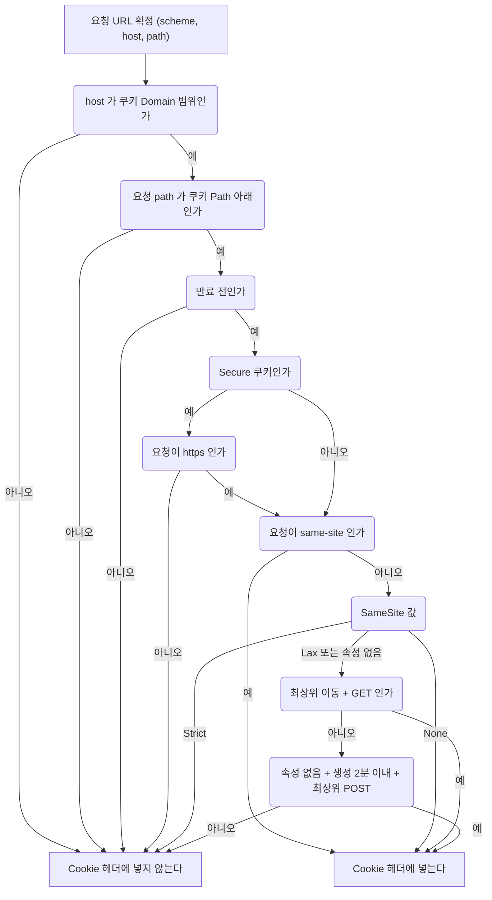

Chrome 158(headless)에서 쿠키 네 종류를 심고, 같은 사이트와 다른 사이트에서 요청을 보내 서버가 받은 `Cookie` 헤더를 기록했다. 호스트는 `app.example.test`, `api.example.test`, `app.other.test`를 로컬로 매핑해서 썼다. Firefox와 Safari는 확인하지 않았다.

| 요청 | Strict | Lax | None | 속성 없음 |
|------|:---:|:---:|:---:|:---:|
| 같은 사이트(api → app fetch) | 전송 | 전송 | 전송 | 전송 |
| 다른 사이트에서 링크 클릭(GET 이동) | 차단 | 전송 | 전송 | 전송 |
| 다른 사이트 폼 POST, 쿠키 생성 2분 이내 | 차단 | 차단 | 전송 | 전송 |
| 다른 사이트 폼 POST, 쿠키 생성 125초 후 | 차단 | 차단 | 전송 | 차단 |
| 다른 사이트의 `img`, `fetch` | 차단 | 차단 | 전송 | 차단 |

표에서 조용히 깨지는 지점이 세 군데 나온다.

속성 없는 쿠키는 Chrome이 Lax로 취급하는데, 쿠키를 만든 지 2분이 안 지났으면 최상위 cross-site POST에는 붙는다. 외부 결제창에서 POST로 돌아오는 흐름을 개발할 때는 잘 되다가, 사용자가 결제창에 3분 머물면 세션이 풀리는 식으로 나타난다. 재현이 어려워서 원인을 한참 못 찾는 유형이다. 결제 복귀 URL처럼 외부에서 POST로 들어오는 경로에는 세션 쿠키에 기대지 말고 주문 번호 같은 토큰을 파라미터로 넘겨 서버에서 다시 조회하는 편이 낫다.

`SameSite=None`은 `Secure` 없이는 쿠키 자체가 저장되지 않는다. `none_nosecure=1; SameSite=None`을 내려 봤더니 저장소에 남은 것은 `Secure`를 붙인 쪽뿐이었다. 응답은 200이고 `Set-Cookie` 헤더도 정상으로 보여서 개발자 도구 Network 탭만 보면 놓친다. Application 탭의 Cookies에 없는지 확인해야 한다.

`SameSite=Strict`는 같은 사이트 안에서는 서브도메인이 달라도 붙는다. site 기준이 호스트가 아니라 등록 가능 도메인(eTLD+1)이기 때문이다. 반대로 외부 링크로 들어오는 첫 요청에는 안 붙으므로, 메일이나 메신저 링크를 눌렀을 때 "로그아웃된 것처럼" 보이는 문제가 생긴다. 세션 쿠키는 Lax, 결제·계정 삭제 같은 민감 쿠키만 Strict로 나누는 구성을 많이 쓴다.

### 서브도메인 간 쿠키 공유

`Domain` 속성이 없으면 쿠키는 그 쿠키를 내려준 호스트에만 붙는다(host-only). `Domain=example.test`를 쓰면 그 도메인과 모든 하위 도메인으로 확장된다. `app.example.test`에서 두 종류를 심고 호스트를 바꿔 요청한 결과다.

| 쿠키 | app.example.test | api.example.test | example.test | app.other.test |
|------|:---:|:---:|:---:|:---:|
| `h` (Domain 없음) | 전송 | 없음 | 없음 | 없음 |
| `d` (Domain=example.test) | 전송 | 전송 | 전송 | 없음 |

`app`과 `api`가 따로 있는 구조에서 SSO를 단순하게 만들려고 `Domain=example.test`로 여는 경우가 많다. 열기 전에 알아야 할 것이 세 가지 있다.

첫째, 이름이 같은 쿠키가 두 개 생길 수 있다. 앞의 `d`처럼 상위 도메인에 `Domain` 쿠키가 있는 상태에서 하위 호스트가 같은 이름의 host-only 쿠키를 내려주면 브라우저는 둘을 모두 보관한다. `s=apex-domain`을 `example.test`에서, `s=app-hostonly`를 `app.example.test`에서 심고 `app`으로 요청했더니 서버가 받은 헤더는 `Cookie: s=apex-domain; s=app-hostonly`였다. 경로 길이가 같으면 먼저 만들어진 쿠키가 앞에 오고, 대부분의 쿠키 파서는 먼저 나온 값을 쓴다. 방금 로그인해서 새 세션 쿠키를 받았는데 서버는 옛 쿠키를 읽어서 계속 로그아웃 상태로 보인다. 로그인 시 서버에서 `Domain`이 다른 같은 이름의 쿠키를 만료시키는 `Set-Cookie`를 함께 내려야 풀린다.

아래 도식은 이 증상이 생기는 순서다. 서버가 읽는 쪽이 새 쿠키가 아니라 먼저 나온 옛 쿠키라는 점을 보면 된다.

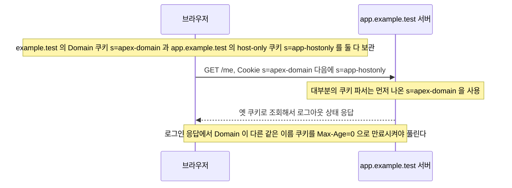

둘째, `Domain`을 연 쿠키는 그 아래 모든 서브도메인에 실린다. 사용자 콘텐츠를 올리는 서브도메인이나 외부 업체에 위임한 서브도메인이 있으면 거기서 돌아가는 스크립트가 같은 쿠키를 받는다. `HttpOnly`는 스크립트 읽기만 막을 뿐, 그 서브도메인 서버의 `Cookie` 헤더로는 그대로 들어온다.

셋째, 같은 사이트라고 해서 같은 오리진은 아니다. `api.example.test`에서 `app.example.test`로 보내는 fetch는 `Sec-Fetch-Site: same-site`라서 `Strict` 쿠키까지 붙지만, 응답을 JS가 읽으려면 CORS 허용(`Access-Control-Allow-Credentials` 포함)이 별도로 필요하다. "쿠키가 갔는데 응답이 안 보인다"는 증상이 여기서 나온다.

### 리버스 프록시 뒤에서 Secure 쿠키가 안 붙는 문제

운영 환경에서는 TLS를 로드 밸런서나 nginx에서 끝내고 앱 서버에는 HTTP로 전달하는 구성이 흔하다. 앱 입장에서는 들어오는 연결이 평문 HTTP다. 쿠키 라이브러리가 `Secure` 쿠키를 내려도 되는 연결인지 판단할 때 이 정보를 쓴다.

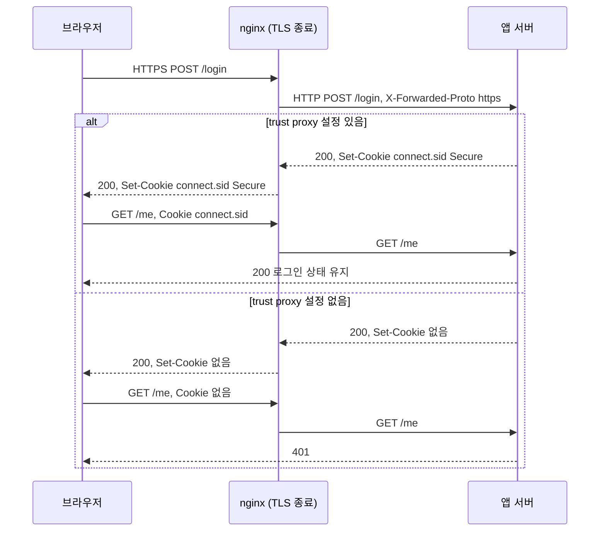

`express-session`(1.19.0)과 Express 5.3.0에서 `cookie.secure: true`를 주고 같은 요청을 보내 봤다. 프록시가 `X-Forwarded-Proto: https`를 달아 줬는데 `trust proxy`가 꺼져 있으면 응답은 200이고 `Set-Cookie` 헤더는 아예 없다. `app.set('trust proxy', 1)`을 켜면 `Secure` 쿠키가 정상으로 내려온다. 헤더를 안 달아 주는 경우는 켜 놔도 안 내려온다.

```javascript
app.set('trust proxy', 1);   // 앞단 프록시 1단을 신뢰하고 X-Forwarded-Proto 를 해석한다
```

```nginx
location / {
    proxy_pass http://app:3000;
    proxy_set_header X-Forwarded-Proto $scheme;
    proxy_set_header Host $host;
}
```

이 문제는 로컬에서 재현되지 않는다. 로컬은 `NODE_ENV`가 `production`이 아니라 `secure: false`로 돌고, 프록시가 없어서 연결이 그냥 HTTP다. 스테이징에서 처음 터진다. 로그인 API는 성공 로그가 찍히고 이후 요청이 전부 401이라 세션 저장소나 CORS를 먼저 의심하게 되는데, 응답 헤더에 `Set-Cookie`가 있는지부터 보면 5분 안에 끝난다.

ALB는 `X-Forwarded-Proto`를 기본으로 붙여 주지만 nginx는 직접 설정해야 한다. `trust proxy`에 `true`를 넣으면 클라이언트가 보낸 `X-Forwarded-*`까지 믿게 되므로 프록시 단수(1)나 대역을 지정한다. Spring Boot에서는 `server.forward-headers-strategy`(`native` 또는 `framework`)가 같은 역할을 한다.

### 쿠키 크기 한도와 431/400

브라우저는 쿠키 하나가 4096바이트를 넘으면 `Set-Cookie`를 무시한다. 5000바이트짜리와 4000바이트짜리를 같이 내려줬더니 5000바이트 쪽은 저장되지 않았고 4000바이트 쪽만 남았다. 에러는 나지 않는다. 쿠키에 사용자 권한 목록이나 장바구니를 직렬화해서 넣는 코드가 데이터가 늘다가 어느 날부터 값이 저장되지 않는 식으로 드러난다.

문제는 저장되는 쿠키가 여러 개 쌓일 때다. 쿠키 하나는 한도 안에 있어도 합계가 서버나 프록시의 헤더 한도를 넘으면 요청이 앱에 도달하지 못한다. 한도는 서버마다 다르다.

| 서버 | 기본 한도 | 직접 확인한 결과 |
|------|------|------|
| Node.js 20 (`http`) | 요청 헤더 전체 16KB (`--max-http-header-size`) | Cookie 약 12KB는 200, 약 20KB는 431 |
| nginx 1.18 | `large_client_header_buffers 4 8k`, 헤더 한 줄이 버퍼 하나에 들어가야 함 | Cookie 7000바이트는 200, 9000바이트는 400, 4000바이트짜리 3개(한 줄 12KB)도 400 |

nginx는 431이 아니라 `400 Bad Request`와 "Request Header Or Cookie Too Large" 본문을 돌려준다. 브라우저는 모든 쿠키를 `Cookie` 헤더 한 줄로 합쳐 보내므로, 쿠키가 8KB를 넘으면 쿠키 개수와 상관없이 걸린다.

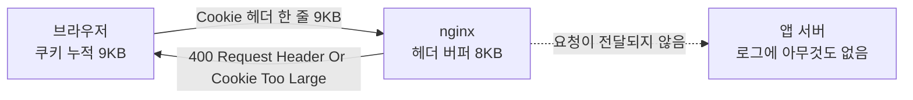

이 오류는 해당 사용자만 겪고, 앱 로그에는 남지 않으며, 쿠키를 지우면 바로 풀린다. 고객센터에는 "특정 브라우저에서만 사이트가 안 열린다"로 들어온다. 원인은 대개 아래 셋이다.

- 같은 이름이 도메인 설정만 바뀌어 여러 개 쌓였다 (앞 절의 `Domain` 이중 쿠키).
- 세션 대신 클라이언트 쪽 세션(`cookie-session` 류)이나 JWT를 쿠키에 담았는데 클레임이 늘었다.
- 서브도메인마다 서로 다른 서비스가 쿠키를 심었다. `Domain=example.com`으로 열어 둔 사이트에서는 모든 서브도메인의 서비스 쿠키가 한 헤더에 합쳐진다.

버퍼를 키우는 것(`large_client_header_buffers 4 16k`)은 임시방편이다. 쿠키에는 세션 ID 정도만 두고 나머지는 서버 저장소로 옮기는 쪽이 근본 해결이다. 이미 쌓인 쿠키는 로그인 응답에서 안 쓰는 이름을 `Max-Age=0`으로 만료시켜 청소한다.

### 서드파티 쿠키 차단 환경에서 로그인이 풀리는 경우

다른 사이트 안에 iframe으로 들어가는 구조(결제 위젯, 외부 로그인 상태 확인, 채팅 위젯)에서는 쿠키가 서드파티 컨텍스트로 다뤄진다. `app.example.test` 페이지 안에 `idp.other.test`를 iframe으로 넣고, idp가 세 종류의 쿠키를 내리게 해 봤다.

| idp가 내린 쿠키 | iframe(top이 app.example.test) | iframe(top이 www.third.test) | idp를 직접 방문 |
|------|:---:|:---:|:---:|
| `SameSite=Lax` | 저장 안 됨 | 저장 안 됨 | 없음 |
| `SameSite=None; Secure` | 전송 | 전송 | 전송 |
| `SameSite=None; Secure; Partitioned` | 전송 | 없음 | 없음 |

`Lax` 쿠키는 iframe 응답으로는 저장조차 되지 않는다. 속성을 안 붙이고 개발하던 위젯이 Lax 기본값 때문에 로그인 상태를 못 읽는 경우가 이것이다. `SameSite=None; Secure`로 고치면 이 환경에서는 동작한다.

이 환경은 서드파티 쿠키 차단이 꺼진 상태다. headless Chrome에서 차단 모드를 재현하지 못해서 차단 상태에서의 동작은 직접 확인하지 못했다. 브라우저와 사용자 설정에 따라 갈리는 영역이고, Safari는 기본으로 막고 Firefox는 기본으로 top 사이트별로 분리하며 Chrome은 설정과 시크릿 모드에서 막는 경우가 있다. 이런 브라우저에서는 `SameSite=None` 쿠키도 iframe에서 받거나 보내지 못한다. 증상은 일부 사용자의 위젯만 로그아웃 상태로 보이는 형태이고, 개발 PC의 Chrome에서는 재현되지 않는다.

CHIPS의 `Partitioned` 속성은 이 상황의 대안이다. 쿠키가 "iframe을 품은 top 사이트 + 쿠키 도메인" 쌍으로 따로 저장된다. 위 표에서 `Partitioned` 쿠키는 같은 top(`app.example.test`) 아래의 iframe에만 갔고, 다른 top(`www.third.test`)이나 idp 직접 방문에서는 보이지 않았다. 같은 위젯이라도 임베드한 사이트마다 따로 로그인해야 한다는 뜻이다. 위젯 안에서 한 번 로그인하면 모든 사이트에서 유지되는 구조를 기대했다면 맞지 않는다. 그런 용도라면 Storage Access API로 권한을 요청하거나, 위젯 대신 리다이렉트 방식의 로그인으로 바꿔야 한다.

아래 도식은 iframe 안에서 idp가 내린 쿠키가 속성에 따라 어떻게 처리되는지 위 표를 갈래로 다시 그린 것이다. `Partitioned`만 top 사이트에 따라 보이는 범위가 갈린다.

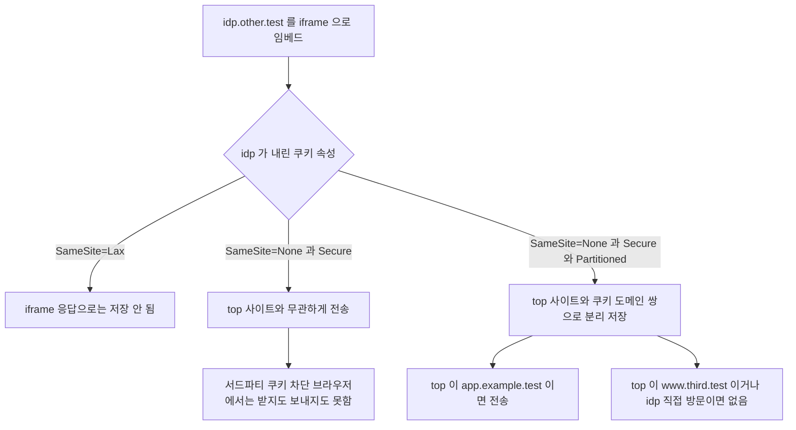

## 세션(Session)

### 정의

사용자 상태 정보를 서버 측에 저장하는 방식이다. 서버는 클라이언트별로 고유한 Session ID를 발급하고, 이 ID를 쿠키로 클라이언트에 내려준다. 이후 클라이언트는 Session ID만 서버에 전달하고, 서버는 이를 키로 저장소에서 사용자 정보를 조회한다.

### 세션의 특징

데이터는 서버에 있으므로 클라이언트에서 위변조할 수 없다. 저장 용량은 서버 용량 범위 내에서 제한이 없다. 서버 메모리나 Redis 같은 외부 저장소를 사용하기 때문에, 동시 접속자가 많아지면 저장소 부하가 증가한다.

서버를 수평 확장할 때 세션 공유 문제가 생긴다. 특정 서버에만 세션이 있으면 로드 밸런서가 다른 서버로 요청을 보낼 때 세션을 찾지 못한다. Redis 같은 중앙 세션 저장소를 두거나, Sticky Session을 사용해야 한다.

저장 위치에 따라 서버 여러 대에서 벌어지는 일이 갈린다. 아래 도식은 같은 요청(`JSESSIONID=XYZ789`)이 로드 밸런서를 거쳐 서버 A나 B로 갔을 때, 세션을 어디서 찾느냐에 따라 달라지는 결과를 정리한 것이다.

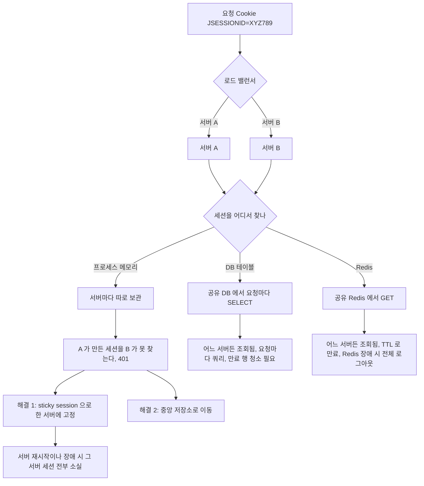

Sticky Session은 세션 문제를 푼 것이 아니라 피한 것이다. 로드 밸런서가 쿠키나 소스 IP로 같은 사용자를 같은 서버에 묶어 두는 방식이라, 롤링 배포로 서버를 한 대씩 재시작하면 그 서버에 묶여 있던 사용자가 전부 로그아웃된다. 배포할 때마다 "로그인이 풀린다"는 문의가 오는 서비스를 본 적이 있는데 메모리 세션과 sticky 조합이 원인이었다. 그리고 한 서버에 트래픽이 쏠려도 분산이 안 된다.

DB 테이블에 세션을 두는 방식은 쓰기 부하를 놓치기 쉽다. 마지막 접근 시각을 갱신하는 요청마다 UPDATE가 나가서, 읽기만 하는 API도 세션 테이블에는 쓰기가 된다. 사용자 수가 늘면 세션 테이블이 메인 DB의 병목이 된다. 세션 전용 Redis로 빼는 이유가 이것이다.

Redis로 옮기면 Redis가 단일 장애점이 된다. Redis가 내려가면 서버는 멀쩡한데 모든 사용자가 동시에 로그아웃된다. 세션 유실이 허용되지 않는 서비스라면 복제와 장애 조치를 구성하고, 유실이 허용된다면 재로그인으로 복구되는 수준인지 미리 정해 두어야 한다.

<div class="ygd-session-scaling-tabs" id="ygd-session-scaling-tabs">
<style>
.ygd-session-scaling-tabs{--ygd-fg:#1f2328;--ygd-muted:#57606a;--ygd-bg:#ffffff;--ygd-node:#f6f8fa;--ygd-line:#b6bcc4;--ygd-accent:#2563eb;--ygd-on-accent:#ffffff;--ygd-ok:#15803d;--ygd-bad:#b91c1c;--ygd-panel:#f6f8fa;--ygd-border:#d0d7de;max-width:760px;margin-left:auto;margin-right:auto;margin-top:1.2em;margin-bottom:1.2em;padding:14px;border:1px solid var(--ygd-border);border-radius:10px;background:var(--ygd-bg);color:var(--ygd-fg);font-size:15px;line-height:1.6;box-sizing:border-box}
body[data-md-color-scheme="slate"] .ygd-session-scaling-tabs{--ygd-fg:#e6edf3;--ygd-muted:#a5afba;--ygd-bg:#161b22;--ygd-node:#21262d;--ygd-line:#5b6470;--ygd-accent:#6ea8fe;--ygd-on-accent:#0b1220;--ygd-ok:#4ade80;--ygd-bad:#f87171;--ygd-panel:#1c2128;--ygd-border:#3a424c}
.ygd-session-scaling-tabs *{box-sizing:border-box}
.ygd-session-scaling-tabs .ygd-tabs{display:flex;flex-wrap:wrap;gap:6px;margin-bottom:10px}
.ygd-session-scaling-tabs .ygd-tab{flex:1 1 auto;min-height:40px;padding:6px 12px;border:1px solid var(--ygd-border);border-radius:8px;background:var(--ygd-panel);color:var(--ygd-fg);font-size:14px;font-family:inherit;cursor:pointer;transition:background .15s,color .15s}
.ygd-session-scaling-tabs .ygd-tab[aria-selected="true"]{background:var(--ygd-accent);color:var(--ygd-on-accent);border-color:var(--ygd-accent);font-weight:700}
.ygd-session-scaling-tabs .ygd-tab:focus-visible,.ygd-session-scaling-tabs .ygd-btn:focus-visible{outline:3px solid var(--ygd-accent);outline-offset:2px}
.ygd-session-scaling-tabs .ygd-svg{display:block;width:100%;max-width:560px;height:auto;margin:0 auto}
.ygd-session-scaling-tabs .ygd-edge{stroke:var(--ygd-line);stroke-width:2;stroke-dasharray:4 4;fill:none}
.ygd-session-scaling-tabs .ygd-route{stroke:var(--ygd-accent);stroke-width:2.5;fill:none}
.ygd-session-scaling-tabs .ygd-route-bad{stroke:var(--ygd-bad)}
.ygd-session-scaling-tabs .ygd-mk{fill:var(--ygd-accent)}
.ygd-session-scaling-tabs .ygd-mk-bad{fill:var(--ygd-bad)}
.ygd-session-scaling-tabs .ygd-node rect{fill:var(--ygd-node);stroke:var(--ygd-line);stroke-width:2;transition:stroke .2s}
.ygd-session-scaling-tabs .ygd-t{fill:var(--ygd-fg);font-size:12px;font-weight:700;text-anchor:middle}
.ygd-session-scaling-tabs .ygd-sub{fill:var(--ygd-muted);font-size:11px;text-anchor:middle}
.ygd-session-scaling-tabs .ygd-lbl{fill:var(--ygd-muted);font-size:11px;text-anchor:start}
.ygd-session-scaling-tabs .ygd-st-ok rect{stroke:var(--ygd-ok)}
.ygd-session-scaling-tabs .ygd-st-ok .ygd-sub{fill:var(--ygd-ok)}
.ygd-session-scaling-tabs .ygd-st-miss rect{stroke:var(--ygd-bad)}
.ygd-session-scaling-tabs .ygd-st-miss .ygd-sub{fill:var(--ygd-bad)}
.ygd-session-scaling-tabs .ygd-st-down{opacity:.6}
.ygd-session-scaling-tabs .ygd-st-down rect{stroke:var(--ygd-bad);stroke-dasharray:5 4}
.ygd-session-scaling-tabs .ygd-st-down .ygd-sub{fill:var(--ygd-bad)}
.ygd-session-scaling-tabs .ygd-badge rect{fill:var(--ygd-node);stroke-width:2}
.ygd-session-scaling-tabs .ygd-badge .ygd-t{font-size:11px}
.ygd-session-scaling-tabs .ygd-bd-ok rect{stroke:var(--ygd-ok)}
.ygd-session-scaling-tabs .ygd-bd-ok .ygd-t{fill:var(--ygd-ok)}
.ygd-session-scaling-tabs .ygd-bd-bad rect{stroke:var(--ygd-bad)}
.ygd-session-scaling-tabs .ygd-bd-bad .ygd-t{fill:var(--ygd-bad)}
.ygd-session-scaling-tabs .ygd-dot{fill:var(--ygd-accent);stroke:var(--ygd-bg);stroke-width:2}
.ygd-session-scaling-tabs .ygd-panel{margin-top:10px;padding:10px 12px;min-height:7.2em;border:1px solid var(--ygd-border);border-left:4px solid var(--ygd-accent);border-radius:8px;background:var(--ygd-panel);font-size:15px}
.ygd-session-scaling-tabs .ygd-stepno{display:block;margin-bottom:2px;color:var(--ygd-muted);font-size:14px;font-weight:700}
.ygd-session-scaling-tabs .ygd-controls{display:flex;flex-wrap:wrap;gap:8px;margin-top:10px}
.ygd-session-scaling-tabs .ygd-btn{min-height:40px;padding:6px 16px;border:1px solid var(--ygd-accent);border-radius:8px;background:var(--ygd-accent);color:var(--ygd-on-accent);font-size:14px;font-weight:700;font-family:inherit;cursor:pointer}
.ygd-session-scaling-tabs .ygd-btn-sub{background:transparent;color:var(--ygd-accent)}
.ygd-session-scaling-tabs .ygd-btn:disabled{opacity:.5;cursor:default}
.ygd-session-scaling-tabs .ygd-note{margin-top:10px;color:var(--ygd-muted);font-size:14px}
.ygd-session-scaling-tabs .ygd-note b{color:var(--ygd-fg)}
@media (prefers-reduced-motion:reduce){.ygd-session-scaling-tabs .ygd-tab,.ygd-session-scaling-tabs .ygd-node rect{transition:none}}
</style>
<div class="ygd-tabs" role="tablist" aria-label="세션 공유 방식 비교">
<button type="button" class="ygd-tab" role="tab" data-tab="local" id="ygd-session-scaling-tabs-tab-local" aria-controls="ygd-session-scaling-tabs-panel">서버별 로컬 메모리</button>
<button type="button" class="ygd-tab" role="tab" data-tab="sticky" id="ygd-session-scaling-tabs-tab-sticky" aria-controls="ygd-session-scaling-tabs-panel">Sticky Session</button>
<button type="button" class="ygd-tab" role="tab" data-tab="redis" id="ygd-session-scaling-tabs-tab-redis" aria-controls="ygd-session-scaling-tabs-panel">Redis 중앙 저장소</button>
</div>
<svg class="ygd-svg" viewBox="0 0 360 236" role="img" aria-label="서버 수평 확장 시 세션 공유 흐름도">
<defs>
<marker id="ygd-session-scaling-tabs-arrow" markerWidth="8" markerHeight="8" refX="7" refY="4" orient="auto"><path class="ygd-mk" d="M0,0 L8,4 L0,8 z"/></marker>
<marker id="ygd-session-scaling-tabs-arrow-bad" markerWidth="8" markerHeight="8" refX="7" refY="4" orient="auto"><path class="ygd-mk-bad" d="M0,0 L8,4 L0,8 z"/></marker>
</defs>
<line class="ygd-edge" x1="180" y1="44" x2="180" y2="84"/>
<line class="ygd-edge" x1="160" y1="118" x2="100" y2="170"/>
<line class="ygd-edge" x1="200" y1="118" x2="260" y2="170"/>
<g class="ygd-redis-edges"><line class="ygd-edge" x1="100" y1="226" x2="150" y2="270"/><line class="ygd-edge" x1="260" y1="226" x2="210" y2="270"/></g>
<g class="ygd-routes"></g>
<g class="ygd-node ygd-n-client"><rect x="130" y="10" width="100" height="34" rx="6"/><text class="ygd-t" x="180" y="32">클라이언트</text></g>
<g class="ygd-badge ygd-n-badge" style="display:none"><rect x="248" y="14" width="104" height="26" rx="6"/><text class="ygd-t" x="300" y="31"></text></g>
<text class="ygd-lbl ygd-n-cl" x="190" y="69"></text>
<g class="ygd-node ygd-n-lb"><rect x="130" y="84" width="100" height="34" rx="6"/><text class="ygd-t" x="180" y="106">로드 밸런서</text></g>
<text class="ygd-lbl ygd-n-lbnote" x="246" y="105"></text>
<g class="ygd-node ygd-n-a"><rect x="20" y="170" width="140" height="56" rx="6"/><text class="ygd-t" x="90" y="192"></text><text class="ygd-sub" x="90" y="211"></text></g>
<g class="ygd-node ygd-n-b"><rect x="200" y="170" width="140" height="56" rx="6"/><text class="ygd-t" x="270" y="192"></text><text class="ygd-sub" x="270" y="211"></text></g>
<g class="ygd-node ygd-n-r"><rect x="110" y="270" width="140" height="46" rx="6"/><text class="ygd-t" x="180" y="290">Redis 저장소</text><text class="ygd-sub" x="180" y="307"></text></g>
<circle class="ygd-dot" r="5" cx="0" cy="0" style="display:none"/>
</svg>
<div class="ygd-panel" id="ygd-session-scaling-tabs-panel" role="tabpanel" aria-live="polite"><span class="ygd-stepno"></span><span class="ygd-text"></span></div>
<div class="ygd-controls">
<button type="button" class="ygd-btn ygd-play">재생</button>
<button type="button" class="ygd-btn ygd-btn-sub ygd-next">다음 단계</button>
<button type="button" class="ygd-btn ygd-btn-sub ygd-reset">처음으로</button>
</div>
<div class="ygd-note"></div>
<script>
(function(){
var root=document.getElementById('ygd-session-scaling-tabs');
if(!root)return;
var NS='http://www.w3.org/2000/svg';
var MID='ygd-session-scaling-tabs-';
function $(s){return root.querySelector(s);}
function reduced(){return !!(window.matchMedia&&window.matchMedia('(prefers-reduced-motion: reduce)').matches);}
var E={cl:[[180,44],[180,84]],la:[[160,118],[100,170]],lb:[[200,118],[260,170]],ar:[[100,226],[150,270]],br:[[260,226],[210,270]]};
var LOCAL_IDLE='로컬 세션: 없음';
var SC={
local:{
label:'서버별 로컬 메모리',h:236,redis:false,
aria:'서버별 로컬 메모리 세션: 서버 A에만 세션이 있어 서버 B로 가면 401이 나는 흐름도',
note:'<b>비유</b> 지점마다 고객 장부를 따로 쓰는 은행. 다른 지점에 가면 내 기록이 없다. <b>핵심</b> 세션이 한 서버의 메모리에만 있으면 서버를 늘리는 순간 인증이 깨진다.',
init:{a:{c:'idle',s:LOCAL_IDLE},b:{c:'idle',s:LOCAL_IDLE},t:'서버를 여러 대로 늘렸을 때, 세션이 각 서버의 메모리에만 있으면 어떤 일이 생기는지 본다. 재생을 눌러 보자.'},
steps:[
{t:'로그인 요청이 로드 밸런서를 거쳐 서버 A로 간다. 서버 A가 자기 메모리에 세션 XYZ789를 만든다.',a:{c:'ok',s:'로컬 세션: XYZ789'},lb:'A로 전달',cl:'POST /login',route:[['cl',0],['la',0]]},
{t:'서버 A가 Set-Cookie로 JSESSIONID=XYZ789를 내려주고 로그인은 성공한다. 브라우저는 이후 요청마다 이 쿠키를 자동으로 보낸다.',cl:'Set-Cookie 응답',badge:{k:'ok',t:'200 OK'},route:[['la',1],['cl',1]]},
{t:'다음 요청이 로드 밸런서에서 서버 B로 간다. 서버 B의 메모리에는 세션 XYZ789가 없다.',b:{c:'miss',s:'XYZ789 없음'},lb:'B로 전달',cl:'Cookie: JSESSIONID=XYZ789',route:[['cl',0],['lb',0]]},
{t:'서버 B는 세션을 찾지 못해 401을 반환한다. 사용자는 로그인했는데도 인증 실패를 본다.',cl:'응답',badge:{k:'bad',t:'401 Unauthorized'},route:[['lb',1],['cl',1]]}
]},
sticky:{
label:'Sticky Session',h:236,redis:false,
aria:'Sticky Session: 같은 서버로 요청을 고정해 세션을 찾지만 서버 장애 시 세션이 사라지는 흐름도',
note:'<b>비유</b> 담당 지점을 정해 두고 항상 그 지점으로만 보내는 방식. 그 지점이 문을 닫으면 장부도 함께 사라진다. <b>핵심</b> 세션을 공유하는 것이 아니라 요청을 한 서버에 묶는 방법이다.',
init:{a:{c:'idle',s:LOCAL_IDLE},b:{c:'idle',s:LOCAL_IDLE},t:'Sticky Session은 같은 사용자의 요청을 항상 같은 서버로 보낸다. 세션을 찾는 문제는 풀리지만 서버가 죽으면 어떻게 되는지 본다.'},
steps:[
{t:'로그인 요청이 서버 A로 가고, 서버 A가 자기 메모리에 세션 XYZ789를 만든다. 로드 밸런서는 이 사용자를 A에 연결해 둔다.',a:{c:'ok',s:'로컬 세션: XYZ789'},lb:'A로 고정',cl:'POST /login',route:[['cl',0],['la',0]]},
{t:'이후 요청도 로드 밸런서가 같은 서버 A로 보낸다. 서버 A에 세션이 있으므로 정상으로 응답한다.',lb:'A로 고정',cl:'Cookie: JSESSIONID=XYZ789',badge:{k:'ok',t:'200 OK'},route:[['cl',0],['la',0],['la',1],['cl',1]]},
{t:'서버 A에 장애가 나면 A의 메모리에 있던 세션도 함께 사라진다. 서버를 다시 띄워도 메모리 세션은 돌아오지 않는다.',a:{c:'down',t:'서버 A 장애',s:'세션 소실'},route:[]},
{t:'고정할 서버가 없어져 로드 밸런서가 서버 B로 보낸다. B에는 세션이 없어 401이 나고, 사용자는 다시 로그인해야 한다.',b:{c:'miss',s:'XYZ789 없음'},lb:'B로 전달',cl:'Cookie: JSESSIONID=XYZ789',badge:{k:'bad',t:'401 Unauthorized'},route:[['cl',0],['lb',0],['lb',1],['cl',1]]}
]},
redis:{
label:'Redis 중앙 저장소',h:326,redis:true,
aria:'Redis 중앙 세션 저장소: 어느 서버로 요청이 가도 Redis에서 세션을 조회하는 흐름도',
note:'<b>비유</b> 모든 지점이 본사의 중앙 장부를 조회하는 방식. 어느 지점에 가도 같은 기록이 나온다. <b>핵심</b> 서버는 세션을 갖지 않고 Redis가 세션을 맡으므로, 접속자가 늘면 부하는 저장소 쪽에 쌓인다.',
init:{a:{c:'idle',s:'세션은 Redis에 보관'},b:{c:'idle',s:'세션은 Redis에 보관'},r:{c:'idle',s:'비어 있음'},t:'서버는 세션을 직접 갖지 않고 Redis 같은 중앙 저장소에 둔다. 요청이 어느 서버로 가도 조회되는 경로를 본다.'},
steps:[
{t:'로그인 요청을 받은 서버 A가 세션을 자기 메모리가 아니라 Redis에 저장한다. 응답에는 Set-Cookie로 Session ID만 담긴다.',a:{c:'ok',s:'Redis에 세션 저장'},r:{c:'ok',s:'XYZ789 보관'},lb:'A로 전달',cl:'POST /login',route:[['cl',0],['la',0],['ar',0]]},
{t:'다음 요청이 서버 B로 가도 괜찮다. B는 Cookie의 Session ID를 키로 Redis에서 사용자 정보를 조회한다.',b:{c:'ok',s:'Redis에서 XYZ789 조회'},lb:'B로 전달',cl:'Cookie: JSESSIONID=XYZ789',route:[['cl',0],['lb',0],['br',0]]},
{t:'Redis에서 세션이 조회되어 서버 B가 200으로 응답한다. 어느 서버로 가든 결과가 같다.',lb:'B로 전달',cl:'응답',badge:{k:'ok',t:'200 OK'},route:[['br',1],['lb',1],['cl',1]]},
{t:'서버 A가 장애로 내려가도 세션은 Redis에 남아 있다. 다른 서버가 이어서 처리하므로 로그인 상태가 유지된다.',a:{c:'down',t:'서버 A 장애',s:'세션은 Redis에 남음'},lb:'B로 전달',cl:'Cookie: JSESSIONID=XYZ789',badge:{k:'ok',t:'200 OK'},route:[['cl',0],['lb',0],['br',0],['br',1],['lb',1],['cl',1]]}
]}
};
var KEYS=['local','sticky','redis'];
KEYS.forEach(function(k){
var sc=SC[k];var prev={a:sc.init.a,b:sc.init.b,r:sc.init.r||{c:'idle',s:''}};
sc.init.r=prev.r;
sc.steps.forEach(function(st){
['a','b','r'].forEach(function(n){if(!st[n])st[n]=prev[n];prev[n]=st[n];});
});
});
var tab='local',step=-1,playing=false,timer=null,raf=null;
function setNode(sel,o,name){
var g=$(sel);
g.setAttribute('class','ygd-node '+sel.replace('.','')+' ygd-st-'+o.c);
var tx=g.querySelectorAll('text');
if(name!==null)tx[0].textContent=o.t||name;
tx[tx.length-1].textContent=o.s;
}
function seg(r){var p=E[r[0]];return r[1]?[p[1],p[0]]:[p[0],p[1]];}
function drawRoute(route,bad){
var g=$('.ygd-routes');
g.textContent='';
route.forEach(function(r){
var s=seg(r);var isBad=bad&&r[1];
var l=document.createElementNS(NS,'line');
l.setAttribute('x1',s[0][0]);l.setAttribute('y1',s[0][1]);
l.setAttribute('x2',s[1][0]);l.setAttribute('y2',s[1][1]);
l.setAttribute('class','ygd-route'+(isBad?' ygd-route-bad':''));
l.setAttribute('marker-end','url(#'+MID+(isBad?'arrow-bad':'arrow')+')');
g.appendChild(l);
});
}
function stopAnim(){
if(raf){cancelAnimationFrame(raf);raf=null;}
$('.ygd-dot').style.display='none';
}
function animate(route){
stopAnim();
if(reduced()||!route.length)return;
var segs=route.map(seg);
var lens=segs.map(function(s){var dx=s[1][0]-s[0][0],dy=s[1][1]-s[0][1];return Math.sqrt(dx*dx+dy*dy);});
var total=lens.reduce(function(a,b){return a+b;},0);
var dur=1200,t0=null,dot=$('.ygd-dot');
dot.style.display='';
function frame(now){
if(t0===null)t0=now;
var t=Math.min(1,(now-t0)/dur);
var d=t*total,i=0;
while(i<segs.length-1&&d>lens[i]){d-=lens[i];i++;}
var f=lens[i]?Math.min(1,d/lens[i]):1;
var s=segs[i];
dot.setAttribute('cx',s[0][0]+(s[1][0]-s[0][0])*f);
dot.setAttribute('cy',s[0][1]+(s[1][1]-s[0][1])*f);
if(t<1){raf=requestAnimationFrame(frame);}else{raf=null;dot.style.display='none';}
}
raf=requestAnimationFrame(frame);
}
function render(){
var sc=SC[tab];
var st=step<0?sc.init:sc.steps[step];
var last=sc.steps.length-1;
var svg=$('.ygd-svg');
svg.setAttribute('viewBox','0 0 360 '+sc.h);
svg.setAttribute('aria-label',sc.aria);
$('.ygd-n-r').style.display=sc.redis?'':'none';
$('.ygd-redis-edges').style.display=sc.redis?'':'none';
setNode('.ygd-n-a',st.a,'서버 A');
setNode('.ygd-n-b',st.b,'서버 B');
setNode('.ygd-n-r',st.r,null);
var bd=$('.ygd-n-badge');
if(st.badge){
bd.style.display='';
bd.setAttribute('class','ygd-badge ygd-n-badge ygd-bd-'+st.badge.k);
bd.querySelector('text').textContent=st.badge.t;
}else{bd.style.display='none';}
$('.ygd-n-cl').textContent=st.cl||'';
$('.ygd-n-lbnote').textContent=st.lb||'';
var route=st.route||[];
drawRoute(route,!!(st.badge&&st.badge.k==='bad'));
animate(route);
$('.ygd-stepno').textContent=step<0?'준비':(step+1)+' / '+(last+1)+' 단계';
$('.ygd-text').textContent=st.t;
$('.ygd-note').innerHTML=sc.note;
$('.ygd-next').disabled=step>=last;
$('.ygd-play').textContent=playing?'일시정지':(step>=last?'다시 재생':(step<0?'재생':'이어서 재생'));
root.querySelectorAll('.ygd-tab').forEach(function(b){
var on=b.getAttribute('data-tab')===tab;
b.setAttribute('aria-selected',on?'true':'false');
b.setAttribute('tabindex',on?'0':'-1');
});
$('.ygd-panel').setAttribute('aria-labelledby',MID+'tab-'+tab);
}
function clearTimer(){if(timer){clearTimeout(timer);timer=null;}}
function stop(){playing=false;clearTimer();}
function advance(){
var last=SC[tab].steps.length-1;
if(step<last){step++;}
if(step>=last){playing=false;clearTimer();}
else if(playing){timer=setTimeout(advance,4200);}
render();
}
function play(){
if(playing){stop();render();return;}
var last=SC[tab].steps.length-1;
if(step>=last)step=-1;
playing=true;
advance();
}
function selectTab(k){
stop();stopAnim();tab=k;step=-1;render();
}
root.querySelectorAll('.ygd-tab').forEach(function(b,i){
b.addEventListener('click',function(){selectTab(b.getAttribute('data-tab'));});
b.addEventListener('keydown',function(e){
var n=null;
if(e.key==='ArrowRight')n=(i+1)%KEYS.length;
else if(e.key==='ArrowLeft')n=(i+KEYS.length-1)%KEYS.length;
if(n!==null){e.preventDefault();selectTab(KEYS[n]);root.querySelectorAll('.ygd-tab')[n].focus();}
});
});
$('.ygd-play').addEventListener('click',play);
$('.ygd-next').addEventListener('click',function(){stop();advance();});
$('.ygd-reset').addEventListener('click',function(){stop();stopAnim();step=-1;render();});
render();
})();
</script>
</div>

### 세션 동작 과정

```http
# 최초 로그인 요청
POST /login HTTP/1.1
Host: example.com
Content-Type: application/json

{"username": "user1", "password": "pass"}

# 서버 응답 — 세션 ID를 쿠키로 전달
HTTP/1.1 200 OK
Set-Cookie: JSESSIONID=XYZ789; Path=/; HttpOnly; Secure; SameSite=Strict

# 이후 인증 요청 — 브라우저가 쿠키 자동 전송
GET /api/profile HTTP/1.1
Host: example.com
Cookie: JSESSIONID=XYZ789

# 서버: Redis에서 XYZ789 키로 사용자 정보 조회 후 응답
HTTP/1.1 200 OK
Content-Type: application/json

{"userId": 42, "username": "user1"}
```

서버는 `JSESSIONID=XYZ789`를 받아 Redis에서 해당 키의 데이터를 조회한다. 세션이 없거나 만료됐으면 401을 반환한다.

<div class="ygd-session-auth-flow-playback" id="ygd-session-auth-flow-playback">
<style>
.ygd-session-auth-flow-playback{--ygd-card:#FAF8F6;--ygd-fg:#2B2724;--ygd-muted:#665F59;--ygd-line:#CFC8C1;--ygd-border:#DDD6CF;--ygd-req:#2A6A8A;--ygd-res:#2B7A4B;--ygd-err:#B93A2C;--ygd-box:#EAF0F3;--ygd-box-on:#D3E4EC;--ygd-accent:#2A6A8A;--ygd-btn-fg:#FFFFFF;--ygd-panel:#F1EDE9;max-width:760px;margin-left:auto;margin-right:auto;margin-top:16px;margin-bottom:16px;box-sizing:border-box;border:1px solid var(--ygd-border);border-radius:12px;background:var(--ygd-card);color:var(--ygd-fg);padding:14px;font-family:inherit;line-height:1.5}
body[data-md-color-scheme="slate"] .ygd-session-auth-flow-playback{--ygd-card:#2A2628;--ygd-fg:#F0EDE9;--ygd-muted:#B7B0A8;--ygd-line:#5A5458;--ygd-border:#4A4448;--ygd-req:#7CC0DC;--ygd-res:#7FD1A0;--ygd-err:#FF8F80;--ygd-box:#353035;--ygd-box-on:#2E4652;--ygd-accent:#7CC0DC;--ygd-btn-fg:#14181B;--ygd-panel:#332F32}
.ygd-session-auth-flow-playback *{box-sizing:border-box}
.ygd-session-auth-flow-playback .ygd-intro{margin:0 0 12px 0;font-size:14px;line-height:1.6;color:var(--ygd-muted)}
.ygd-session-auth-flow-playback .ygd-row{display:flex;flex-wrap:wrap;align-items:center;gap:8px;margin:0 0 10px 0}
.ygd-session-auth-flow-playback .ygd-row-label{font-size:14px;color:var(--ygd-muted);margin-right:2px}
.ygd-session-auth-flow-playback .ygd-btn{appearance:none;-webkit-appearance:none;font-family:inherit;font-size:14px;line-height:1.2;min-height:40px;padding:8px 14px;border-radius:8px;border:1px solid var(--ygd-line);background:var(--ygd-card);color:var(--ygd-fg);cursor:pointer;margin:0}
.ygd-session-auth-flow-playback .ygd-btn:hover{border-color:var(--ygd-accent)}
.ygd-session-auth-flow-playback .ygd-btn:focus-visible{outline:3px solid var(--ygd-accent);outline-offset:2px}
.ygd-session-auth-flow-playback .ygd-btn[disabled]{opacity:.5;cursor:not-allowed}
.ygd-session-auth-flow-playback .ygd-btn-primary{background:var(--ygd-accent);border-color:var(--ygd-accent);color:var(--ygd-btn-fg);font-weight:700;min-width:96px}
.ygd-session-auth-flow-playback .ygd-btn[aria-pressed="true"]{border-color:var(--ygd-accent);box-shadow:inset 0 0 0 1px var(--ygd-accent);font-weight:700}
.ygd-session-auth-flow-playback .ygd-svg{display:block;width:100%;height:auto;max-width:100%}
.ygd-session-auth-flow-playback .ygd-lifeline{stroke:var(--ygd-line);stroke-width:1.5;stroke-dasharray:4 4}
.ygd-session-auth-flow-playback .ygd-actor-box{fill:var(--ygd-box);stroke:var(--ygd-line);stroke-width:1.5;transition:fill .3s,stroke .3s}
.ygd-session-auth-flow-playback .ygd-actor.ygd-on .ygd-actor-box{fill:var(--ygd-box-on);stroke:var(--ygd-accent);stroke-width:2.5}
.ygd-session-auth-flow-playback .ygd-actor-name{fill:var(--ygd-fg);font-size:14px;font-weight:700;text-anchor:middle}
.ygd-session-auth-flow-playback .ygd-msg{transition:opacity .3s}
.ygd-session-auth-flow-playback .ygd-msg.ygd-pending{opacity:.5}
.ygd-session-auth-flow-playback .ygd-msg.ygd-done{opacity:.95}
.ygd-session-auth-flow-playback .ygd-msg.ygd-active{opacity:1}
.ygd-session-auth-flow-playback .ygd-k-req{color:var(--ygd-req)}
.ygd-session-auth-flow-playback .ygd-k-res{color:var(--ygd-res)}
.ygd-session-auth-flow-playback .ygd-k-err{color:var(--ygd-err)}
.ygd-session-auth-flow-playback .ygd-line{stroke:currentColor;stroke-width:1.8;fill:none}
.ygd-session-auth-flow-playback .ygd-msg.ygd-active .ygd-line{stroke-width:3}
.ygd-session-auth-flow-playback .ygd-dash .ygd-line{stroke-dasharray:6 4}
.ygd-session-auth-flow-playback .ygd-head{fill:currentColor}
.ygd-session-auth-flow-playback .ygd-lbl{fill:var(--ygd-fg);font-size:13px;text-anchor:middle;stroke:var(--ygd-card);stroke-width:3px;paint-order:stroke}
.ygd-session-auth-flow-playback .ygd-msg.ygd-active .ygd-lbl{font-weight:700}
.ygd-session-auth-flow-playback .ygd-sub{fill:var(--ygd-muted);font-size:11px;text-anchor:middle;stroke:var(--ygd-card);stroke-width:3px;paint-order:stroke}
.ygd-session-auth-flow-playback .ygd-packet{fill:currentColor;stroke:var(--ygd-card);stroke-width:2px;opacity:0}
.ygd-session-auth-flow-playback .ygd-panel{margin-top:10px;padding:12px 14px;border-radius:10px;background:var(--ygd-panel);border-left:4px solid var(--ygd-accent);min-height:9em}
.ygd-session-auth-flow-playback .ygd-step-title{margin:0 0 4px 0;font-size:15px;font-weight:700;color:var(--ygd-fg)}
.ygd-session-auth-flow-playback .ygd-step-text{margin:0;font-size:15px;line-height:1.65;color:var(--ygd-fg)}
@media (prefers-reduced-motion: reduce){
.ygd-session-auth-flow-playback *{transition:none !important;animation:none !important}
}
</style>
<p class="ygd-intro">비유: 코트 보관소에서 코트는 맡겨 두고 번호표만 들고 다니는 것과 같다. 번호표가 Session ID, 맡긴 코트가 서버 쪽 저장소의 사용자 정보다. 보관 기한이 지나 코트가 치워졌다면 번호표가 있어도 찾을 수 없다.</p>
<div class="ygd-row">
<button type="button" class="ygd-btn ygd-btn-primary" data-ygd="play">재생</button>
<button type="button" class="ygd-btn" data-ygd="prev">이전</button>
<button type="button" class="ygd-btn" data-ygd="next">다음</button>
<button type="button" class="ygd-btn" data-ygd="reset">처음으로</button>
</div>
<div class="ygd-row" role="group" aria-label="마지막 분기 선택">
<span class="ygd-row-label">마지막 분기:</span>
<button type="button" class="ygd-btn" data-ygd="sc-ok" aria-pressed="true">세션 있음</button>
<button type="button" class="ygd-btn" data-ygd="sc-fail" aria-pressed="false">세션 없음 또는 만료</button>
</div>
<svg class="ygd-svg" viewBox="0 0 445 474" role="img" aria-label="브라우저, 웹 서버, Redis가 로그인부터 인증 요청까지 주고받는 세션 인증 시퀀스 다이어그램. 로그인 요청, 세션 생성과 Redis 저장, Set-Cookie 응답, Cookie 자동 전송, Redis 조회 순서로 진행되고 세션이 없거나 만료되면 401로 분기한다.">
<line class="ygd-lifeline" x1="50" y1="48" x2="50" y2="470"/>
<line class="ygd-lifeline" x1="240" y1="48" x2="240" y2="470"/>
<line class="ygd-lifeline" x1="395" y1="48" x2="395" y2="470"/>
<g class="ygd-actor" data-actor="B"><rect class="ygd-actor-box" x="2" y="8" width="96" height="40" rx="8"/><text class="ygd-actor-name" x="50" y="33">브라우저</text></g>
<g class="ygd-actor" data-actor="S"><rect class="ygd-actor-box" x="192" y="8" width="96" height="40" rx="8"/><text class="ygd-actor-name" x="240" y="33">웹 서버</text></g>
<g class="ygd-actor" data-actor="R"><rect class="ygd-actor-box" x="347" y="8" width="96" height="40" rx="8"/><text class="ygd-actor-name" x="395" y="33">Redis</text></g>
<g class="ygd-msg ygd-pending ygd-k-req" data-i="1"><line class="ygd-line" x1="50" y1="86" x2="232" y2="86"/><polygon class="ygd-head" points="240,86 231,81 231,91"/><text class="ygd-lbl" x="145" y="73">1. POST /login</text><text class="ygd-sub" x="145" y="105">아이디와 비밀번호 전달</text></g>
<g class="ygd-msg ygd-pending ygd-k-req" data-i="2"><line class="ygd-line" x1="240" y1="146" x2="387" y2="146"/><polygon class="ygd-head" points="395,146 386,141 386,151"/><text class="ygd-lbl" x="317" y="133">2. 세션 생성·저장</text><text class="ygd-sub" x="317" y="165">XYZ789 → 사용자 정보</text></g>
<g class="ygd-msg ygd-pending ygd-dash ygd-k-res" data-i="3"><line class="ygd-line" x1="240" y1="206" x2="58" y2="206"/><polygon class="ygd-head" points="50,206 59,201 59,211"/><text class="ygd-lbl" x="145" y="193">3. 200 OK + Set-Cookie</text><text class="ygd-sub" x="145" y="225">JSESSIONID=XYZ789</text></g>
<g class="ygd-msg ygd-pending ygd-k-req" data-i="4"><line class="ygd-line" x1="50" y1="266" x2="232" y2="266"/><polygon class="ygd-head" points="240,266 231,261 231,271"/><text class="ygd-lbl" x="145" y="253">4. GET /api/profile</text><text class="ygd-sub" x="145" y="285">Cookie: JSESSIONID=XYZ789</text></g>
<g class="ygd-msg ygd-pending ygd-k-req" data-i="5"><line class="ygd-line" x1="240" y1="326" x2="387" y2="326"/><polygon class="ygd-head" points="395,326 386,321 386,331"/><text class="ygd-lbl" x="317" y="313">5. 세션 조회</text><text class="ygd-sub" x="317" y="345">키: XYZ789</text></g>
<g class="ygd-msg ygd-pending ygd-dash ygd-k-res" data-i="6"><line class="ygd-line" x1="395" y1="386" x2="248" y2="386"/><polygon class="ygd-head" points="240,386 249,381 249,391"/><text class="ygd-lbl" x="317" y="373">6. 사용자 정보</text><text class="ygd-sub" x="317" y="405">XYZ789 키의 세션 데이터</text></g>
<g class="ygd-msg ygd-pending ygd-dash ygd-k-res" data-i="7"><line class="ygd-line" x1="240" y1="446" x2="58" y2="446"/><polygon class="ygd-head" points="50,446 59,441 59,451"/><text class="ygd-lbl" x="145" y="433">7. 200 OK</text><text class="ygd-sub" x="145" y="465">사용자 정보 JSON</text></g>
<circle class="ygd-packet ygd-k-req" cx="50" cy="86" r="6"/>
</svg>
<div class="ygd-panel" aria-live="polite"><p class="ygd-step-title"></p><p class="ygd-step-text"></p></div>
<script>
(function(){
var root=document.getElementById('ygd-session-auth-flow-playback');
if(!root)return;
var q=function(s){return root.querySelector(s)};
var qa=function(s){return Array.prototype.slice.call(root.querySelectorAll(s))};
var reduce=window.matchMedia&&window.matchMedia('(prefers-reduced-motion: reduce)').matches;
var M=[
{x1:50,x2:240,y:86,a:'BS'},
{x1:240,x2:395,y:146,a:'SR'},
{x1:240,x2:50,y:206,a:'SB'},
{x1:50,x2:240,y:266,a:'BS'},
{x1:240,x2:395,y:326,a:'SR'},
{x1:395,x2:240,y:386,a:'RS'},
{x1:240,x2:50,y:446,a:'SB'}
];
var STEPS=[
{t:'재생 대기',x:'재생을 누르면 로그인부터 인증 요청까지 7단계가 차례로 진행된다. 마지막 단계는 위의 분기 선택에 따라 200 또는 401로 끝난다.'},
{t:'1/7 로그인 요청',x:'브라우저가 POST /login 으로 아이디와 비밀번호를 웹 서버에 보낸다. 이 시점에는 브라우저가 가진 Session ID 가 없다.'},
{t:'2/7 세션 생성과 Redis 저장',x:'서버가 고유한 Session ID(예: XYZ789)를 만들고, 이를 키로 사용자 정보를 Redis에 저장한다. 실제 데이터는 서버 쪽 저장소에만 있다. 세션 고정 공격을 막으려면 로그인 성공 시 반드시 새 Session ID 를 발급해야 한다.'},
{t:'3/7 Set-Cookie 로 Session ID 전달',x:'서버가 200 OK 와 함께 Set-Cookie: JSESSIONID=XYZ789 를 내려준다. HttpOnly 는 JavaScript 접근을, Secure 는 HTTP 평문 전송을, SameSite=Strict 는 외부 사이트에서 시작된 요청의 쿠키 전송을 막는다.'},
{t:'4/7 Cookie 자동 전송',x:'이후 GET /api/profile 요청에 브라우저가 Cookie: JSESSIONID=XYZ789 를 자동으로 붙여 보낸다. 클라이언트는 사용자 정보가 아니라 Session ID 만 서버에 전달한다.'},
{t:'5/7 Redis 조회',x:'서버는 받은 Session ID 를 키로 Redis 에서 세션을 조회한다. 서버가 여러 대여도 Redis 같은 중앙 저장소를 쓰면 같은 세션을 찾을 수 있다.'},
{ok:{t:'6/7 세션 있음',x:'Redis 가 XYZ789 키에 저장된 사용자 정보를 돌려준다. 세션이 존재하므로 서버는 요청한 사용자를 식별할 수 있다.'},
 fail:{t:'6/7 세션 없음 또는 만료',x:'Redis 에서 XYZ789 키를 찾지 못한다. 세션이 없거나 만료된 경우이며, 서버는 요청한 사용자를 식별할 수 없다.'}},
{ok:{t:'7/7 200 OK 응답',x:'서버가 200 OK 와 사용자 정보 JSON 을 응답한다. 이후의 인증 요청도 같은 방식으로 Cookie 전송, Redis 조회 순서를 반복한다.'},
 fail:{t:'7/7 401 응답',x:'서버가 401 을 반환한다. 세션이 없거나 만료됐으므로 클라이언트는 다시 로그인해서 새 세션을 받아야 한다.'}}
];
var BR={
6:{ok:{k:'res',l:'6. 사용자 정보',s:'XYZ789 키의 세션 데이터'},fail:{k:'err',l:'6. 세션 없음',s:'키 없음 또는 만료'}},
7:{ok:{k:'res',l:'7. 200 OK',s:'사용자 정보 JSON'},fail:{k:'err',l:'7. 401 Unauthorized',s:'인증 실패'}}
};
var KIND=['req','req','res','req','req','res','res'];
var idx=0,sc='ok',playing=false,timer=null,raf=null;
var STEP_MS=3600;
var btnPlay=q('[data-ygd="play"]'),btnPrev=q('[data-ygd="prev"]'),btnNext=q('[data-ygd="next"]'),btnReset=q('[data-ygd="reset"]');
var btnOk=q('[data-ygd="sc-ok"]'),btnFail=q('[data-ygd="sc-fail"]');
var pk=q('.ygd-packet'),tEl=q('.ygd-step-title'),xEl=q('.ygd-step-text');
var msgs=qa('.ygd-msg'),actors=qa('.ygd-actor');
function setKind(g,k){
g.classList.remove('ygd-k-req','ygd-k-res','ygd-k-err');
g.classList.add('ygd-k-'+k);
}
function fly(i){
if(raf){cancelAnimationFrame(raf);raf=null}
pk.style.opacity=0;
if(reduce||i<1)return;
var m=M[i-1],t0=null;
pk.setAttribute('class','ygd-packet ygd-k-'+KIND[i-1]);
pk.setAttribute('cy',m.y);
pk.setAttribute('cx',m.x1);
pk.style.opacity=1;
function step(ts){
if(t0===null)t0=ts;
var p=Math.min((ts-t0)/650,1);
pk.setAttribute('cx',m.x1+(m.x2-m.x1)*p);
if(p<1){raf=requestAnimationFrame(step)}else{raf=null;pk.style.opacity=0}
}
raf=requestAnimationFrame(step);
}
function render(){
[6,7].forEach(function(n){
var b=BR[n][sc],g=msgs[n-1];
KIND[n-1]=b.k;
setKind(g,b.k);
g.querySelector('.ygd-lbl').textContent=b.l;
g.querySelector('.ygd-sub').textContent=b.s;
});
msgs.forEach(function(g,k){
var n=k+1;
g.classList.remove('ygd-pending','ygd-done','ygd-active');
g.classList.add(n<idx?'ygd-done':(n===idx?'ygd-active':'ygd-pending'));
});
var on=idx>0?M[idx-1].a:'';
actors.forEach(function(a){
var c=a.getAttribute('data-actor');
a.classList.toggle('ygd-on',on.indexOf(c)>-1);
});
var s=STEPS[idx];
if(s.ok)s=s[sc];
tEl.textContent=s.t;
xEl.textContent=s.x;
btnPrev.disabled=idx===0;
btnNext.disabled=idx===7;
btnPlay.textContent=playing?'일시정지':(idx===7?'다시 재생':'재생');
btnOk.setAttribute('aria-pressed',sc==='ok'?'true':'false');
btnFail.setAttribute('aria-pressed',sc==='fail'?'true':'false');
}
function stop(){
playing=false;
if(timer){clearTimeout(timer);timer=null}
}
function go(n,animate){
idx=n;
render();
if(animate)fly(idx);else{if(raf){cancelAnimationFrame(raf);raf=null}pk.style.opacity=0}
}
function tick(){
if(!playing)return;
if(idx>=7){stop();render();return}
go(idx+1,true);
if(idx>=7){stop();render();return}
timer=setTimeout(tick,STEP_MS);
}
btnPlay.addEventListener('click',function(){
if(playing){stop();render();return}
if(idx>=7)go(0,false);
playing=true;
render();
timer=setTimeout(tick,idx===0?200:STEP_MS);
});
btnNext.addEventListener('click',function(){stop();if(idx<7)go(idx+1,true);else render()});
btnPrev.addEventListener('click',function(){stop();if(idx>0)go(idx-1,false);else render()});
btnReset.addEventListener('click',function(){stop();go(0,false)});
btnOk.addEventListener('click',function(){sc='ok';render()});
btnFail.addEventListener('click',function(){sc='fail';render()});
render();
})();
</script>
</div>

### 세션 저장 방식

메모리 기반 세션은 별도 설정 없이 사용할 수 있고 속도가 빠르지만, 서버 재시작 시 모든 세션이 날아간다. 개발 환경에서는 괜찮지만 운영 환경에서는 쓰지 않는다. 파일 기반 세션은 재시작 후에도 세션이 유지되지만 I/O가 느리고 서버 확장 시 공유 파일 시스템이 필요해진다. 데이터베이스 기반 세션은 안정적이지만 쿼리 오버헤드가 있다. 현재는 대부분 Redis를 사용한다. 메모리 기반으로 빠르고, 클러스터를 구성하면 수평 확장도 된다.

네 가지 방식의 장단점을 한눈에 비교하면 아래와 같다. 운영 환경에서 남는 선택지가 어디로 좁혀지는지 보면 된다.

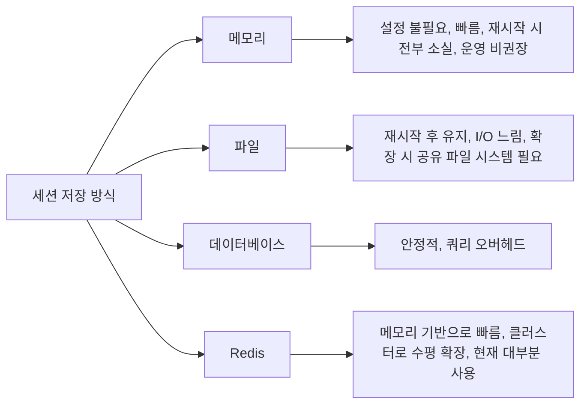

### 세션 보안 및 관리

세션 하이재킹은 유효한 Session ID를 탈취해 피해자로 위장하는 공격이다. HTTPS를 강제하고, Session ID를 충분히 길고 무작위로 생성해야 한다. 일정 시간 요청이 없으면 세션을 만료시키는 타임아웃 설정도 필수다.

세션 고정 공격은 공격자가 미리 만든 Session ID를 피해자에게 사용하게 만든 뒤, 피해자가 로그인하면 그 세션을 탈취하는 방식이다. 로그인 성공 시 반드시 새 Session ID를 발급해야 이 공격을 막는다.

공격자는 비밀번호를 몰라도 된다. 익명 상태에서 받은 Session ID를 피해자가 쓰게 만들고, 피해자가 로그인하는 순간 그 ID에 사용자 정보가 붙는 것을 기다린다. 아래 도식은 로그인 후에도 ID가 그대로인 경우와 로그인 시점에 ID를 바꾸는 경우를 한 흐름에 나란히 둔 것이다.

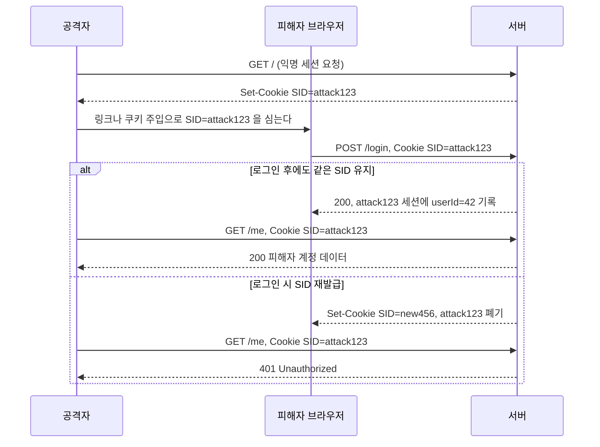

Express 코드로 두 경우를 그대로 돌려 봤다. curl 쿠키 파일 두 개를 공격자용과 피해자용으로 만들고, 공격자 파일에 익명 세션을 받아 둔 뒤 같은 쿠키를 피해자 파일에 복사해서 피해자 쪽으로 로그인한다. `req.session.userId = 1`만 한 로그인 핸들러는 공격자가 옛 쿠키로 `/me`를 호출했을 때 `{"userId":1}`을 돌려줬고, `req.session.regenerate()`로 ID를 바꾼 핸들러는 `{"userId":null}`을 돌려줬다.

세션 고정은 로그인 직후만의 문제가 아니다. 권한이 올라가는 모든 지점이 해당한다. 일반 사용자가 관리자 인증(2차 인증, 재인증)을 통과해 권한이 올라갈 때도 같은 이유로 ID를 바꿔야 한다. 로그아웃 시에는 서버 저장소에서 세션을 지우고 쿠키도 만료시킨다. 쿠키만 지우면 탈취된 ID는 TTL이 끝날 때까지 서버에서 유효하다.

### 세션 만료: sliding과 absolute

"세션 1시간"이라는 요구사항은 두 가지로 읽힌다. 마지막 요청 후 1시간(sliding, idle timeout)인지, 로그인 후 1시간(absolute)인지다. 둘은 동작이 다르고 보안 의미도 다르다. sliding만 쓰면 요청이 계속 오는 한 세션이 영원히 산다. 탈취된 ID로 주기적으로 요청을 보내는 스크립트가 있으면 만료되지 않는다. absolute만 쓰면 사용자가 작업 중에 갑자기 로그아웃된다. 보통은 둘을 같이 건다.

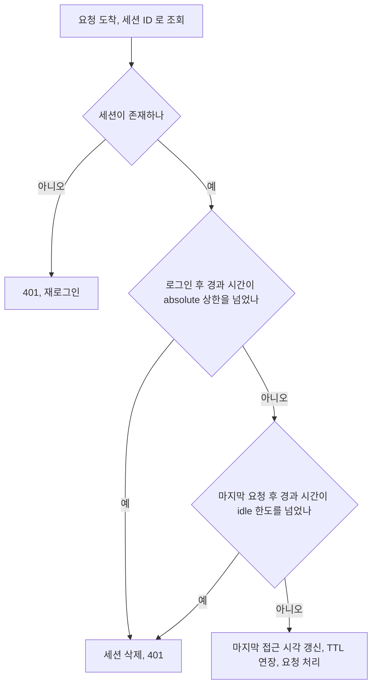

`express-session`에서 이 차이는 `rolling` 옵션에서 갈린다. `cookie.maxAge`를 4초로 두고 로그인한 뒤 2.5초에 한 번 요청을 보내고, 로그인 후 4.5초에 다시 요청해 봤다.

| `rolling` | 활동 중 `Set-Cookie` 재발행 | 로그인 후 4.5초(중간에 요청 1회) |
|-----------|:---:|------|
| `false` (기본값) | 없음 | `{"userId":null}`, 브라우저가 쿠키를 버림 |
| `true` | 매 응답 | `{"userId":1}`, 만료 시각이 밀림 |

기본값인 `rolling: false`는 요청이 있어도 쿠키 만료 시각을 안 바꾸므로 브라우저 쪽에서는 사실상 absolute로 동작한다. "활동하면 연장되는 세션"을 기대하고 `maxAge`만 줬다가, 사용자가 쓰는 도중에 로그아웃된다는 문의가 오는 경우가 있다. sliding이 필요하면 `rolling: true`를 명시해야 한다.

둘을 함께 걸려면 `rolling: true`에 absolute 상한을 직접 검사하는 미들웨어를 추가한다. idle 3초, absolute 5초로 줄여서 1.5초마다 요청을 보내 확인했다.

```javascript
const IDLE = 30 * 60 * 1000;          // sliding: 마지막 요청 후 30분
const ABSOLUTE = 12 * 60 * 60 * 1000; // absolute: 로그인 후 12시간

app.use(session({
    store: new RedisStore({ client: redisClient }),
    secret: process.env.SESSION_SECRET,
    resave: false,
    saveUninitialized: false,
    rolling: true,
    cookie: { httpOnly: true, secure: true, sameSite: 'lax', maxAge: IDLE }
}));

// 로그인 핸들러에서 req.session.loginAt = Date.now() 를 함께 저장한다
function enforceAbsolute(req, res, next) {
    if (req.session.loginAt && Date.now() - req.session.loginAt > ABSOLUTE) {
        return req.session.destroy(() => res.status(401).json({ error: 'Session expired' }));
    }
    next();
}
```

축소 값으로 돌린 결과, 요청을 계속 보내는 동안 1.5초·3초·4.5초에는 `{"userId":1}`이었고 6초에 `{"error":"Session expired"}`가 나왔다. 활동이 있어도 absolute 상한은 넘지 못한다. 이후 요청은 `{"userId":null}`이다.

Spring에서 `server.servlet.session.timeout`(또는 `setMaxInactiveInterval`)은 idle timeout만 담당한다. absolute 상한은 같은 방식으로 세션 속성에 로그인 시각을 저장하고 필터에서 직접 검사해야 한다.

---

<div class="ygd-session-fixation-toggle" id="ygd-session-fixation-toggle">
<style>
.ygd-session-fixation-toggle{--ygd-bg:#fdfbfa;--ygd-card:#f3efec;--ygd-fg:#2b2622;--ygd-muted:#6b655e;--ygd-line:#b9b2aa;--ygd-att:#b3261e;--ygd-vic:#1d5f8f;--ygd-srv:#5b4a8a;--ygd-ok:#1b6b3a;--ygd-bad:#b3261e;--ygd-sel-bg:#3d7387;--ygd-sel-fg:#ffffff;--ygd-focus:#c26a00;max-width:760px;margin-left:auto;margin-right:auto;box-sizing:border-box;padding:14px;border:1px solid var(--ygd-line);border-radius:12px;background:var(--ygd-bg);color:var(--ygd-fg);font-size:14px;line-height:1.6;overflow:hidden}
body[data-md-color-scheme="slate"] .ygd-session-fixation-toggle{--ygd-bg:#232022;--ygd-card:#322e31;--ygd-fg:#f0ede9;--ygd-muted:#b3ada5;--ygd-line:#5a5559;--ygd-att:#ff8a80;--ygd-vic:#7cc0ee;--ygd-srv:#b9a8ee;--ygd-ok:#6fd49a;--ygd-bad:#ff8a80;--ygd-sel-bg:#7cc0ee;--ygd-sel-fg:#1b1a1c;--ygd-focus:#ffb454}
.ygd-session-fixation-toggle *{box-sizing:border-box}
.ygd-session-fixation-toggle .ygd-title{font-size:16px;font-weight:700;margin:0 0 10px;color:var(--ygd-fg)}
.ygd-session-fixation-toggle .ygd-modes,.ygd-session-fixation-toggle .ygd-ctrls{display:flex;flex-wrap:wrap;gap:8px;margin:0 0 10px}
.ygd-session-fixation-toggle .ygd-btn{font:inherit;font-size:14px;line-height:1.3;min-height:40px;padding:8px 14px;border:1px solid var(--ygd-line);border-radius:8px;background:var(--ygd-card);color:var(--ygd-fg);cursor:pointer;margin:0}
.ygd-session-fixation-toggle .ygd-btn:hover{border-color:var(--ygd-muted)}
.ygd-session-fixation-toggle .ygd-btn:focus-visible{outline:3px solid var(--ygd-focus);outline-offset:2px}
.ygd-session-fixation-toggle .ygd-btn[aria-pressed="true"]{background:var(--ygd-sel-bg);color:var(--ygd-sel-fg);border-color:var(--ygd-sel-bg);font-weight:700}
.ygd-session-fixation-toggle .ygd-btn:disabled{opacity:.5;cursor:default}
.ygd-session-fixation-toggle .ygd-svg{display:block;width:100%;max-width:520px;height:auto;margin:0 auto 10px}
.ygd-session-fixation-toggle .ygd-life{stroke:var(--ygd-line);stroke-width:1.5;stroke-dasharray:4 4}
.ygd-session-fixation-toggle .ygd-hd{fill:var(--ygd-bg);stroke-width:2}
.ygd-session-fixation-toggle .ygd-hd-att{stroke:var(--ygd-att)}
.ygd-session-fixation-toggle .ygd-hd-vic{stroke:var(--ygd-vic)}
.ygd-session-fixation-toggle .ygd-hd-srv{stroke:var(--ygd-srv)}
.ygd-session-fixation-toggle .ygd-hdt{fill:var(--ygd-fg);font-size:13px;font-weight:700;text-anchor:middle}
.ygd-session-fixation-toggle .ygd-chip{fill:var(--ygd-card);stroke:var(--ygd-line);stroke-width:1.5;transition:stroke .3s}
.ygd-session-fixation-toggle .ygd-chip.ygd-ok{stroke:var(--ygd-ok)}
.ygd-session-fixation-toggle .ygd-chipt{fill:var(--ygd-fg);font-size:12px;text-anchor:middle}
.ygd-session-fixation-toggle .ygd-store{fill:var(--ygd-card);stroke:var(--ygd-line);stroke-width:1.5;transition:stroke .3s}
.ygd-session-fixation-toggle .ygd-store.ygd-bad{stroke:var(--ygd-bad);stroke-width:2.5}
.ygd-session-fixation-toggle .ygd-store.ygd-ok{stroke:var(--ygd-ok);stroke-width:2.5}
.ygd-session-fixation-toggle .ygd-stitle{fill:var(--ygd-muted);font-size:10.5px;text-anchor:middle}
.ygd-session-fixation-toggle .ygd-stext{fill:var(--ygd-fg);font-size:11.5px;text-anchor:middle}
.ygd-session-fixation-toggle .ygd-arrow{opacity:.5;transition:opacity .3s}
.ygd-session-fixation-toggle .ygd-arrow.ygd-past{opacity:.85}
.ygd-session-fixation-toggle .ygd-arrow.ygd-now{opacity:1}
.ygd-session-fixation-toggle .ygd-tone-att{color:var(--ygd-att)}
.ygd-session-fixation-toggle .ygd-tone-vic{color:var(--ygd-vic)}
.ygd-session-fixation-toggle .ygd-tone-srv{color:var(--ygd-srv)}
.ygd-session-fixation-toggle .ygd-tone-ok{color:var(--ygd-ok)}
.ygd-session-fixation-toggle .ygd-tone-bad{color:var(--ygd-bad)}
.ygd-session-fixation-toggle .ygd-aline{stroke:currentColor;stroke-width:2}
.ygd-session-fixation-toggle .ygd-now .ygd-aline{stroke-width:3;stroke-dasharray:7 5;animation:ygd-session-fixation-toggle-flow .8s linear infinite}
.ygd-session-fixation-toggle .ygd-ahead{fill:currentColor}
.ygd-session-fixation-toggle .ygd-plate{fill:var(--ygd-bg)}
.ygd-session-fixation-toggle .ygd-albl{fill:var(--ygd-fg);font-size:12px;text-anchor:middle}
.ygd-session-fixation-toggle .ygd-badge{fill:none;stroke:var(--ygd-muted);stroke-width:1.5}
.ygd-session-fixation-toggle .ygd-bnum{fill:var(--ygd-muted);font-size:11px;font-weight:700;text-anchor:middle}
.ygd-session-fixation-toggle .ygd-now .ygd-badge{fill:currentColor;stroke:currentColor}
.ygd-session-fixation-toggle .ygd-now .ygd-bnum{fill:var(--ygd-bg)}
@keyframes ygd-session-fixation-toggle-flow{from{stroke-dashoffset:0}to{stroke-dashoffset:-12}}
.ygd-session-fixation-toggle .ygd-panel{padding:10px 12px;border-radius:8px;background:var(--ygd-card);border-left:4px solid var(--ygd-sel-bg);margin:0 0 10px}
.ygd-session-fixation-toggle .ygd-step{font-size:14px;font-weight:700;color:var(--ygd-fg);margin:0 0 2px}
.ygd-session-fixation-toggle .ygd-desc{font-size:14px;color:var(--ygd-fg)}
.ygd-session-fixation-toggle .ygd-note{font-size:14px;color:var(--ygd-muted)}
@media (prefers-reduced-motion:reduce){.ygd-session-fixation-toggle .ygd-now .ygd-aline{animation:none;stroke-dasharray:none}.ygd-session-fixation-toggle .ygd-arrow,.ygd-session-fixation-toggle .ygd-chip,.ygd-session-fixation-toggle .ygd-store{transition:none}}
</style>
<div class="ygd-title">세션 고정 공격: 로그인 시 Session ID를 유지할 때와 재발급할 때</div>
<div class="ygd-modes" role="group" aria-label="로그인 시 Session ID 처리 방식 선택">
<button type="button" class="ygd-btn ygd-mode" data-mode="bad" aria-pressed="true">재발급 안 함 (취약)</button>
<button type="button" class="ygd-btn ygd-mode" data-mode="good" aria-pressed="false">regenerate 재발급 (안전)</button>
</div>
<svg class="ygd-svg" viewBox="0 0 360 368" role="img" aria-label="공격자, 서버, 피해자 세 주체 사이에서 Session ID가 오가는 순서를 보여주는 세션 고정 공격 시퀀스 다이어그램">
<line class="ygd-life" x1="60" y1="66" x2="60" y2="364"></line>
<line class="ygd-life" x1="180" y1="100" x2="180" y2="364"></line>
<line class="ygd-life" x1="300" y1="66" x2="300" y2="364"></line>
<rect class="ygd-hd ygd-hd-att" x="12" y="6" width="96" height="26" rx="6"></rect>
<text class="ygd-hdt" x="60" y="24">공격자</text>
<rect class="ygd-hd ygd-hd-srv" x="132" y="6" width="96" height="26" rx="6"></rect>
<text class="ygd-hdt" x="180" y="24">서버</text>
<rect class="ygd-hd ygd-hd-vic" x="252" y="6" width="96" height="26" rx="6"></rect>
<text class="ygd-hdt" x="300" y="24">피해자</text>
<rect class="ygd-chip ygd-chipA" x="12" y="42" width="96" height="24" rx="5"></rect>
<text class="ygd-chipt ygd-chipAt" x="60" y="58">ID: 없음</text>
<rect class="ygd-chip ygd-chipV" x="252" y="42" width="96" height="24" rx="5"></rect>
<text class="ygd-chipt ygd-chipVt" x="300" y="58">ID: 없음</text>
<rect class="ygd-store" x="122" y="42" width="116" height="58" rx="6"></rect>
<text class="ygd-stitle" x="180" y="57">세션 저장소</text>
<text class="ygd-stext ygd-s1" x="180" y="74">비어 있음</text>
<text class="ygd-stext ygd-s2" x="180" y="90"></text>
<g class="ygd-arrows"></g>
</svg>
<div class="ygd-ctrls">
<button type="button" class="ygd-btn ygd-play">재생</button>
<button type="button" class="ygd-btn ygd-prev">이전</button>
<button type="button" class="ygd-btn ygd-next">다음</button>
<button type="button" class="ygd-btn ygd-reset">처음으로</button>
</div>
<div class="ygd-panel" aria-live="polite">
<div class="ygd-step"></div>
<div class="ygd-desc"></div>
</div>
<div class="ygd-note">비유: 호텔 카드키로 생각할 수 있다. 공격자가 미리 받아 둔 카드키를 손님에게 건넸는데 프런트가 체크인 때 그 카드키를 그대로 활성화하면 공격자의 카드도 객실을 연다. 체크인 때 새 카드키를 내주고 기존 카드키를 폐기하면 공격자의 카드는 열리지 않는다.</div>
<script>
(function(){
var root=document.getElementById('ygd-session-fixation-toggle');
if(!root)return;
var NS='http://www.w3.org/2000/svg';
var X={A:60,S:180,V:300};
var Y0=128,DY=38,TOTAL=7;
var mode='bad',step=0,timer=null;
function q(s){return root.querySelector(s);}
function qa(s){return root.querySelectorAll(s);}
function el(tag,attrs,parent){var e=document.createElementNS(NS,tag);for(var k in attrs){e.setAttribute(k,attrs[k]);}if(parent){parent.appendChild(e);}return e;}
function est(s){var w=0;for(var i=0;i<s.length;i++){w+=s.charCodeAt(i)>255?12:7;}return w;}
var COMMON=[
{f:'A',t:'S',label:'접속 요청',tone:'att',who:'공격자 → 서버',text:'공격자가 먼저 서버에 접속해 세션을 만들게 한다. 아직 아무도 로그인하지 않은 상태다.'},
{f:'S',t:'A',label:'abc123 발급',tone:'srv',who:'서버 → 공격자',text:'서버가 Session ID abc123을 발급한다. 이 세션은 아직 로그인 정보가 없고, 공격자는 abc123을 알고 있다.'},
{f:'A',t:'V',label:'abc123 심기',tone:'att',who:'공격자 → 피해자',text:'공격자가 미리 만든 abc123을 피해자가 쓰게 만든다. 심는 방법은 환경마다 다르며, 여기서는 피해자 브라우저가 abc123을 갖게 된 상황부터 본다.'},
{f:'V',t:'S',label:'로그인 + abc123',tone:'vic',who:'피해자 → 서버',text:'피해자가 abc123을 가진 채 아이디와 비밀번호로 로그인을 요청한다. 서버는 자격 증명을 검증한다.'}
];
var BAD=[
{f:'S',t:'V',label:'로그인 성공',tone:'srv',who:'서버 → 피해자',text:'인증에 성공했지만 서버가 Session ID를 바꾸지 않는다. 기존 abc123 세션에 피해자의 로그인 정보가 기록되고, 이 ID를 아는 공격자도 그 세션을 쓸 수 있게 된다.'},
{f:'A',t:'S',label:'abc123 요청',tone:'att',who:'공격자 → 서버',text:'공격자가 갖고 있던 abc123으로 요청을 보낸다. 서버는 이 ID에 로그인 정보가 있으므로 정상 사용자의 요청으로 본다.'},
{f:'S',t:'A',label:'피해자 데이터',tone:'bad',who:'서버 → 공격자',text:'서버가 피해자 계정으로 응답한다. 공격자는 비밀번호를 몰라도 세션을 탈취했다. 로그인 성공 시 새 Session ID를 발급하지 않은 것이 원인이다.'}
];
var GOOD=[
{f:'S',t:'V',label:'xyz789 발급',tone:'ok',who:'서버 → 피해자',text:'인증에 성공하면 서버가 regenerate로 새 Session ID xyz789를 발급하고 기존 abc123 세션은 폐기한다. 피해자는 이후 xyz789로 요청한다.'},
{f:'A',t:'S',label:'abc123 요청',tone:'att',who:'공격자 → 서버',text:'공격자가 여전히 abc123으로 요청을 보낸다. 하지만 이 ID에는 더 이상 로그인 정보가 없다.'},
{f:'S',t:'A',label:'401 인증 필요',tone:'ok',who:'서버 → 공격자',text:'서버는 로그인되지 않은 요청으로 보고 거부한다. 공격자가 심은 ID가 무효가 되어 공격이 실패한다. 그래서 로그인 성공 시 반드시 새 ID를 발급해야 한다.'}
];
function steps(){return COMMON.concat(mode==='bad'?BAD:GOOD);}
function st(){
var a='없음',v='없음',l1='비어 있음',l2='',cls='';
if(step>=2){a='abc123';l1='abc123 · 익명';}
if(step>=3){v='abc123';}
if(step>=5){
if(mode==='bad'){l1='abc123 · 피해자';cls='bad';}
else{v='xyz789';l1='xyz789 · 피해자';l2='abc123 · 폐기';cls='ok';}
}
return {a:a,v:v,l1:l1,l2:l2,cls:cls};
}
function build(){
var g=q('.ygd-arrows');
while(g.firstChild){g.removeChild(g.firstChild);}
var list=steps();
var y=Y0;
for(var i=0;i<list.length;i++){
var s=list[i];
var x1=X[s.f],x2=X[s.t];
var d=x2>x1?1:-1;
var grp=el('g',{'class':'ygd-arrow ygd-tone-'+s.tone},g);
el('circle',{'class':'ygd-badge',cx:14,cy:y,r:9},grp);
var bn=el('text',{'class':'ygd-bnum',x:14,y:y+4},grp);
bn.textContent=String(i+1);
el('line',{'class':'ygd-aline',x1:x1,y1:y,x2:x2-d*7,y2:y},grp);
el('polygon',{'class':'ygd-ahead',points:x2+','+y+' '+(x2-d*9)+','+(y-5)+' '+(x2-d*9)+','+(y+5)},grp);
var cx=(x1+x2)/2;
var w=est(s.label)+12;
el('rect',{'class':'ygd-plate',x:cx-w/2,y:y-22,width:w,height:17,rx:3},grp);
var lt=el('text',{'class':'ygd-albl',x:cx,y:y-9},grp);
lt.textContent=s.label;
y+=DY;
}
q('.ygd-svg').setAttribute('aria-label','공격자, 서버, 피해자 사이의 세션 고정 공격 시퀀스 다이어그램. '+(mode==='bad'?'로그인 시 Session ID를 재발급하지 않아 공격자가 세션을 탈취하는 경우.':'로그인 시 regenerate로 Session ID를 재발급해 공격자의 ID가 무효가 되는 경우.'));
}
function show(){
var list=steps();
var arrows=qa('.ygd-arrow');
for(var i=0;i<arrows.length;i++){
var c=(i+1<step)?'ygd-past':(i+1===step?'ygd-now':'');
arrows[i].setAttribute('class','ygd-arrow ygd-tone-'+list[i].tone+(c?' '+c:''));
}
var s=st();
q('.ygd-chipAt').textContent='ID: '+s.a;
q('.ygd-chipVt').textContent='ID: '+s.v;
q('.ygd-chipV').setAttribute('class','ygd-chip ygd-chipV'+(s.v==='xyz789'?' ygd-ok':''));
q('.ygd-s1').textContent=s.l1;
q('.ygd-s2').textContent=s.l2;
q('.ygd-store').setAttribute('class','ygd-store'+(s.cls?' ygd-'+s.cls:''));
var label=mode==='bad'?'재발급 안 함(취약)':'regenerate 재발급(안전)';
if(step===0){
q('.ygd-step').textContent='시작 · '+label;
q('.ygd-desc').textContent=mode==='bad'?'로그인에 성공해도 서버가 Session ID를 그대로 둔다. 재생 또는 다음을 눌러 공격자, 피해자, 서버의 순서를 따라가 보자.':'로그인에 성공하면 서버가 새 Session ID를 발급한다. 재생 또는 다음을 눌러 공격자, 피해자, 서버의 순서를 따라가 보자.';
}else{
q('.ygd-step').textContent='단계 '+step+' / '+TOTAL+' · '+list[step-1].who;
q('.ygd-desc').textContent=list[step-1].text;
}
q('.ygd-prev').disabled=step<=0;
q('.ygd-next').disabled=step>=TOTAL;
}
function stop(){
if(timer){clearInterval(timer);timer=null;}
q('.ygd-play').textContent='재생';
}
function advance(){
if(step<TOTAL){step++;show();}
if(step>=TOTAL){stop();}
}
function play(){
if(timer){stop();return;}
if(step>=TOTAL){step=0;}
q('.ygd-play').textContent='일시정지';
advance();
if(step<TOTAL){timer=setInterval(advance,2400);}else{stop();}
}
q('.ygd-play').addEventListener('click',play);
q('.ygd-next').addEventListener('click',function(){stop();advance();});
q('.ygd-prev').addEventListener('click',function(){stop();if(step>0){step--;show();}});
q('.ygd-reset').addEventListener('click',function(){stop();step=0;show();});
var modes=qa('.ygd-mode');
for(var m=0;m<modes.length;m++){
modes[m].addEventListener('click',function(){
mode=this.getAttribute('data-mode');
for(var k=0;k<modes.length;k++){modes[k].setAttribute('aria-pressed',modes[k]===this?'true':'false');}
stop();step=0;build();show();
});
}
build();
show();
})();
</script>
</div>

## 쿠키와 세션의 차이점

| 구분 | 쿠키 | 세션 |
|------|------|------|
| 저장 위치 | 클라이언트 측 | 서버 측 |
| 보안 | 클라이언트에 저장되어 변조 가능 | 서버에 저장되어 상대적으로 안전 |
| 용량 제한 | 개당 4KB, 개수는 브라우저마다 다름(RFC 6265 최소치 도메인당 50개) | 서버 용량에 따라 제한 없음 |
| 라이프사이클 | 만료 기간 설정 가능 | 서버 TTL이나 삭제 시 종료. 브라우저를 닫아도 서버 세션은 TTL까지 남는다 |
| 서버 자원 | 서버 자원 사용하지 않음 | 서버 메모리 사용 |
| 요청 크기 | 모든 요청 헤더에 포함되어 커질수록 431/400 위험 | 세션 ID 하나만 전송 |

---

## Q&A: 세션이 더 안전한데 왜 쿠키를 사용할까?

세션은 서버 메모리를 소비한다. 동시 접속자가 수만 명이면 세션 데이터 저장소가 그만큼의 부하를 받는다. 쿠키는 데이터를 클라이언트에 두므로 서버 자원이 필요 없다. 사용자 선호도(테마, 언어 설정 등)는 탈취당해도 피해가 크지 않고, 서버 요청마다 조회할 필요도 없다. 이런 데이터는 쿠키에 저장하는 편이 낫다. 수평 확장 시에도 세션은 공유 저장소가 필요하지만 쿠키는 클라이언트가 관리하니 서버 측 고려사항이 없다.

아래 도식은 위 설명을 데이터를 어디에 둘지 고르는 분기로 정리한 것이다. 기준은 탈취나 변조 시 피해와 서버의 조회 필요 여부다.

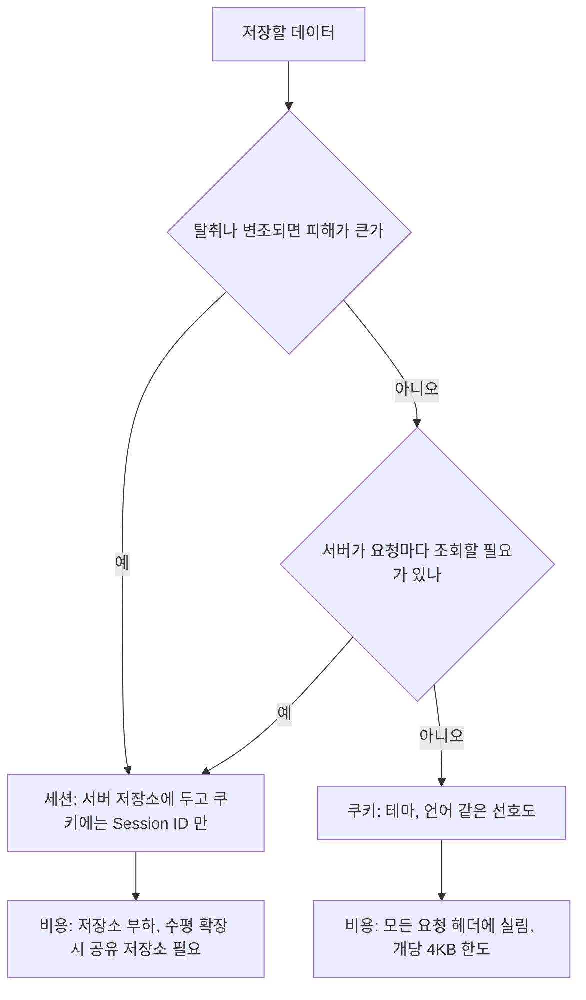

---

## 코드 예제

### Set-Cookie 헤더

```http
HTTP/1.1 200 OK
Set-Cookie: sessionId=abc123; Path=/; HttpOnly; Secure; SameSite=Strict; Max-Age=3600
Set-Cookie: theme=dark; Path=/; Max-Age=2592000
```

#### 쿠키 속성 설명

| 속성 | 설명 |
|------|------|
| `HttpOnly` | JavaScript에서 접근 불가 (XSS 방어) |
| `Secure` | HTTPS에서만 전송 |
| `SameSite=Strict` | 동일 사이트 요청에만 전송 (CSRF 방어) |
| `SameSite=Lax` | 다른 사이트에서 링크를 눌러 이동하는 GET만 허용. `img`, `fetch`, POST는 차단 |
| `SameSite=None` | 다른 사이트 요청에도 전송. `Secure`가 없으면 쿠키가 저장되지 않음 |
| `Domain=example.com` | 하위 도메인까지 전송. 생략하면 내려준 호스트에만 전송 |
| `Partitioned` | 임베드한 top 사이트별로 쿠키를 분리 저장(CHIPS). `Secure` 필요 |
| `Max-Age=3600` | 1시간 후 만료 (초 단위) |
| `Path=/` | 모든 경로에서 전송 |

### Express.js 쿠키 & 세션 설정

```javascript
const express = require('express');
const session = require('express-session');
const RedisStore = require('connect-redis').default;
const { createClient } = require('redis');

const app = express();

// 프록시가 TLS 를 끝내는 구성에서 빠지면 secure 쿠키의 Set-Cookie 가 아예 나가지 않는다
app.set('trust proxy', 1);

const redisClient = createClient({ url: 'redis://localhost:6379' });
redisClient.connect();

app.use(session({
    store: new RedisStore({ client: redisClient }),
    secret: process.env.SESSION_SECRET,
    resave: false,
    saveUninitialized: false,
    rolling: true,  // 요청이 있으면 만료 시각을 민다(sliding). 기본값 false 는 사실상 absolute 로 동작한다
    cookie: {
        httpOnly: true,
        secure: process.env.NODE_ENV === 'production',
        sameSite: 'lax',  // strict 는 메일·메신저 링크로 들어온 첫 요청에 쿠키가 빠진다
        maxAge: 60 * 60 * 1000  // 1시간
    }
}));

// 로그인 — regenerate로 새 Session ID 발급 (세션 고정 공격 방어)
app.post('/login', async (req, res) => {
    const { username, password } = req.body;
    const user = await authenticate(username, password);

    if (!user) return res.status(401).json({ error: 'Unauthorized' });

    req.session.regenerate((err) => {
        if (err) return res.status(500).json({ error: 'Session error' });

        req.session.userId = user.id;
        req.session.role = user.role;
        // 로그인 시점 User-Agent 저장 — 하이재킹 탐지용
        req.session.userAgent = req.headers['user-agent'];
        res.json({ message: 'Logged in' });
    });
});

// 인증 미들웨어 — User-Agent 불일치 시 세션 무효화 (하이재킹 탐지)
function requireAuth(req, res, next) {
    if (!req.session.userId) {
        return res.status(401).json({ error: 'Unauthorized' });
    }
    if (req.session.userAgent && req.session.userAgent !== req.headers['user-agent']) {
        req.session.destroy();
        return res.status(401).json({ error: 'Session invalidated' });
    }
    next();
}

// 로그아웃 — 세션 완전 삭제
app.post('/logout', (req, res) => {
    req.session.destroy((err) => {
        res.clearCookie('connect.sid');
        res.json({ message: 'Logged out' });
    });
});

// 영구 쿠키 설정 (사용자 선호도)
app.post('/preferences', (req, res) => {
    res.cookie('theme', req.body.theme, {
        maxAge: 30 * 24 * 60 * 60 * 1000,  // 30일
        httpOnly: false,  // 클라이언트 JS에서 읽을 수 있도록
        sameSite: 'lax'
    });
    res.json({ message: 'Preference saved' });
});
```

`requireAuth`의 User-Agent 비교는 하이재킹 탐지로는 약하다. 쿠키를 훔친 쪽은 User-Agent 헤더도 그대로 복사해서 보내면 통과한다. 오히려 브라우저가 자동 업데이트되어 버전 문자열이 바뀌면 정상 사용자가 로그아웃된다. 탐지 신호로 쓸 거라면 차단이 아니라 로그로 남기고 IP 대역 변화 같은 다른 신호와 합쳐서 보는 편이 오탐이 적다.

`/logout`의 `res.clearCookie('connect.sid')`는 쿠키를 만들 때 쓴 `path`, `domain` 옵션과 같은 값을 줘야 지워진다. `Domain`을 연 쿠키를 옵션 없이 지우면 브라우저에 그대로 남는다.

### Spring Boot 세션 설정

```yaml
# application.yml (Spring Boot 3.x)
spring:
  session:
    timeout: 3600          # 초 단위, 마지막 요청 후 만료(idle)
  data:
    redis:
      host: localhost
      port: 6379
server:
  forward-headers-strategy: native   # 프록시 뒤에서 X-Forwarded-Proto 해석
  servlet:
    session:
      cookie:
        secure: true
        same-site: lax
```

블로그나 예제에서 `spring.session.store-type: redis`와 `spring.data.redis.host`를 한 파일에 같이 쓴 설정이 자주 보인다. Spring Boot의 설정 메타데이터(`spring-configuration-metadata.json`)를 직접 열어 보니 `spring.session.store-type`은 2.7.18에만 있고 3.3.5에는 없다. `spring.data.redis.host`는 반대로 3.3.5에만 있다(2.7.18은 `spring.redis.host`). 어느 버전에서도 두 키가 같이 유효하지 않다. 그리고 `spring.security.session.creation-policy`는 두 버전 모두에 없는 키라서 쓰면 조용히 무시된다. 세션 생성 정책은 아래 Java 설정의 `sessionCreationPolicy`가 담당한다. Redis 세션은 Spring Session Data Redis 의존성이 클래스패스에 있으면 자동으로 선택된다.

```java
@Configuration
@EnableWebSecurity
public class SecurityConfig {

    @Bean
    public SecurityFilterChain filterChain(HttpSecurity http) throws Exception {
        http
            .sessionManagement(session -> session
                .sessionCreationPolicy(SessionCreationPolicy.IF_REQUIRED)
                .sessionFixation(fixation -> fixation.newSession()) // 세션 고정 공격 방어
                .maximumSessions(1)
                .maxSessionsPreventsLogin(false) // 새 로그인 시 기존 세션 만료
            )
            .csrf(csrf -> csrf.csrfTokenRepository(
                CookieCsrfTokenRepository.withHttpOnlyFalse()
            ));

        return http.build();
    }
}

@PostMapping("/login")
public ResponseEntity<?> login(@RequestBody LoginRequest req, HttpServletRequest request) {
    User user = authService.authenticate(req.getUsername(), req.getPassword());
    request.changeSessionId();  // 직접 만든 로그인 API 는 ID 를 스스로 바꿔야 한다
    HttpSession session = request.getSession();
    session.setAttribute("userId", user.getId());
    session.setAttribute("loginAt", System.currentTimeMillis());  // absolute 상한 검사용
    session.setMaxInactiveInterval(3600);  // 1시간(idle)
    return ResponseEntity.ok(new LoginResponse(user));
}
```

로그인 컨트롤러에서 `session.setAttribute`만 호출하고 `sessionFixation(newSession())` 설정이 세션 고정을 막아 준다고 믿는 코드가 흔하다. 이 컨트롤러는 Spring Security의 인증 필터를 거치지 않고 세션 속성만 직접 채운다. 세션 고정 방어는 인증 필터가 인증을 성공 처리할 때 실행되는 구조라서, 이 경로에서는 ID가 바뀌지 않는다고 보고 `changeSessionId()` 호출을 직접 넣었다. 이 부분은 Spring 앱을 띄워서 돌려 보지는 않았고 필터 구조를 근거로 한 판단이다. 시큐리티의 `formLogin`이나 `AuthenticationManager` 경로로 로그인을 처리한다면 설정만으로 충분하다. 어느 쪽인지는 로그인 전후에 `JSESSIONID` 값이 달라지는지 개발자 도구로 직접 확인해야 한다.

아래 도식은 위 판단을 로그인 경로별로 나눈 것이다. 세션 고정 방어가 실행되는 경로와 건너뛰는 경로가 갈리는 지점을 보면 된다.

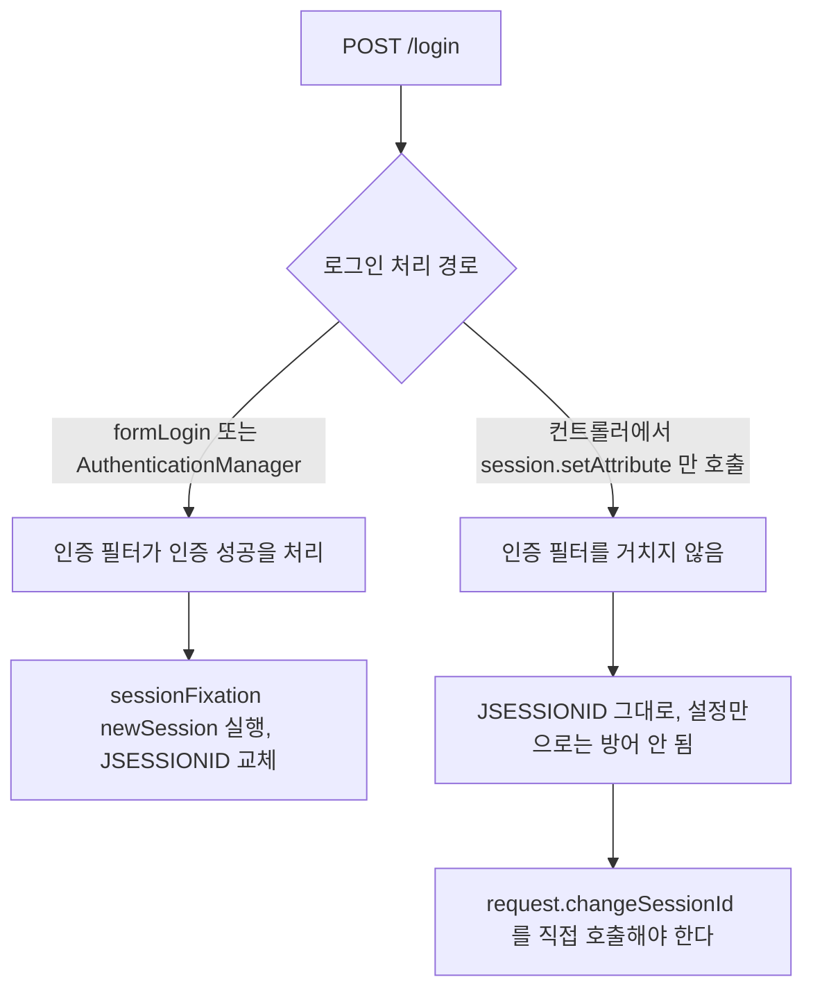

### JWT vs Session 비교

```javascript
// ── 세션 기반 인증 흐름 ──────────────────────────────
// 1. 클라이언트: POST /login {username, password}
// 2. 서버: 세션 생성 → sessionId를 쿠키에 설정
// 3. 클라이언트: 이후 요청마다 쿠키 자동 전송
// 4. 서버: Redis에서 sessionId로 사용자 정보 조회

// ── JWT 기반 인증 흐름 ──────────────────────────────
const jwt = require('jsonwebtoken');

app.post('/login', async (req, res) => {
    const user = await authenticate(req.body);
    const token = jwt.sign(
        { userId: user.id, role: user.role },
        process.env.JWT_SECRET,
        { expiresIn: '1h' }
    );
    // JWT를 HttpOnly 쿠키에 저장 (XSS 방어)
    res.cookie('token', token, { httpOnly: true, secure: true, sameSite: 'lax', maxAge: 60 * 60 * 1000 });
    res.json({ message: 'Logged in' });
});

// req.cookies 는 cookie-parser 가 채운다. 없으면 undefined.token 에서 TypeError 가 나 500 이 된다
app.use(require('cookie-parser')());

app.get('/api/me', (req, res) => {
    const token = req.cookies.token;
    try {
        const payload = jwt.verify(token, process.env.JWT_SECRET, { algorithms: ['HS256'] });
        res.json({ userId: payload.userId });
    } catch (e) {
        res.status(401).json({ error: 'Unauthorized' });
    }
});
```

| 항목 | 세션 | JWT |
|------|------|-----|
| 저장 위치 | 서버 (Redis 등) | 클라이언트 (쿠키/헤더) |
| 서버 자원 | 사용 | 미사용 |
| 즉시 무효화 | 가능 (세션 삭제) | 어려움 (만료 대기) |
| 확장성 | 공유 저장소 필요 | 무상태 — 확장 용이 |
| 정보 크기 | 제한 없음 | 최소화 권장 (Base64 인코딩) |

JWT의 "즉시 무효화 어려움" 문제를 우회하려고 JWT를 HttpOnly 쿠키에 저장하는 하이브리드 패턴을 쓰는 경우가 있다. JWT를 쿠키에 넣으면 XSS로 탈취되는 문제는 줄어들지만, CSRF에는 여전히 취약하다. `SameSite=Strict`로 어느 정도 방어할 수 있지만, 크로스 도메인 API를 써야 하는 구조라면 `SameSite=None; Secure`를 써야 하고 그러면 CSRF 방어가 약해진다.

토큰 무효화 문제도 그대로다. 로그아웃 시 서버에서 토큰을 폐기할 방법이 없으므로, Redis에 블랙리스트를 두거나 짧은 만료 시간(15분~1시간)으로 설정하고 Refresh Token으로 갱신하는 구조가 필요하다. Refresh Token을 별도로 관리해야 하는 시점에서, 단순 세션 방식 대비 복잡도가 크게 높아진다.

아래 도식은 짧은 만료의 Access JWT와 Refresh Token을 함께 쓸 때의 흐름이다. 서버에 저장소가 다시 생기는 지점이 Refresh Token 조회라는 것을 보면 된다.

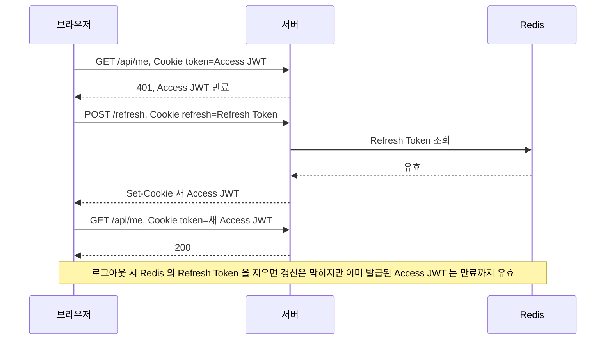

---

## 참고 자료
- [슬기로운 개발생활:티스토리](https://dev-coco.tistory.com/61#recentComments)
- [code-lab1.tistory.com](https://code-lab1.tistory.com/298)
- [MDN Web Docs - HTTP Cookies](https://developer.mozilla.org/ko/docs/Web/HTTP/Cookies)
