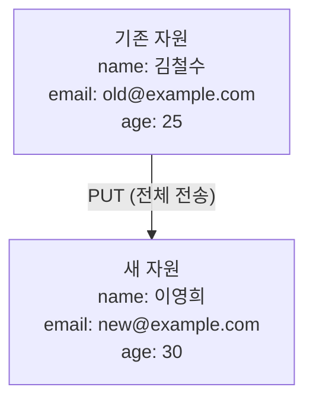
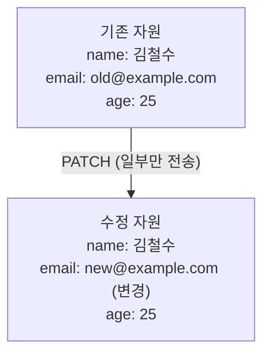
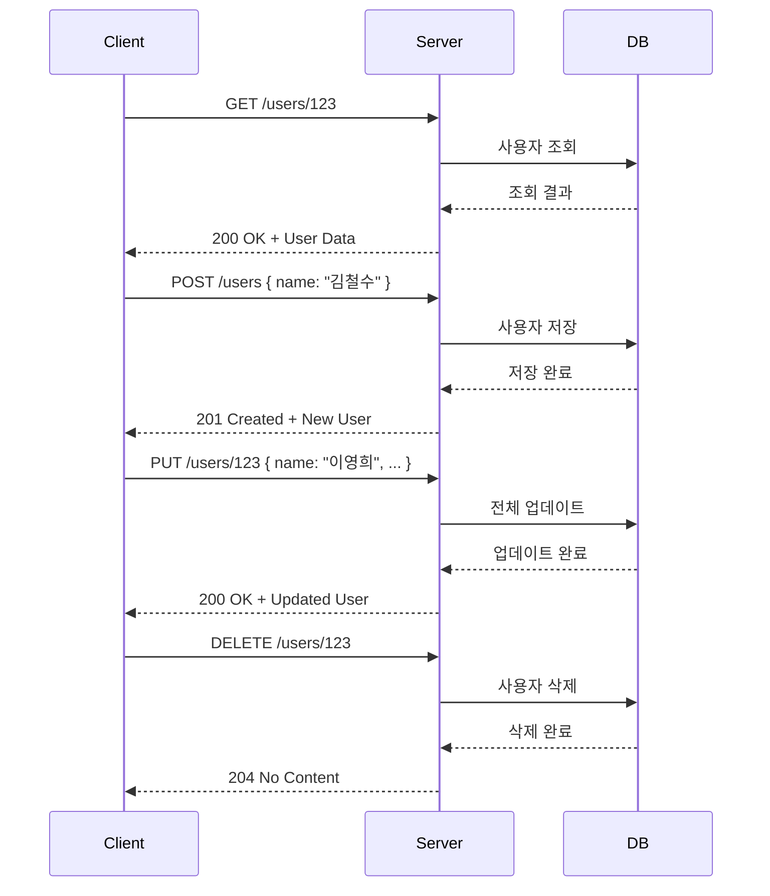
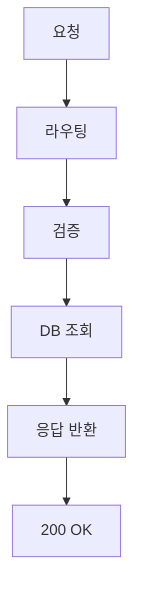
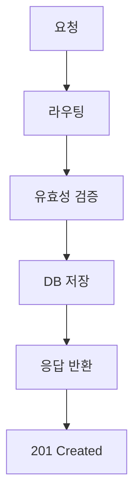
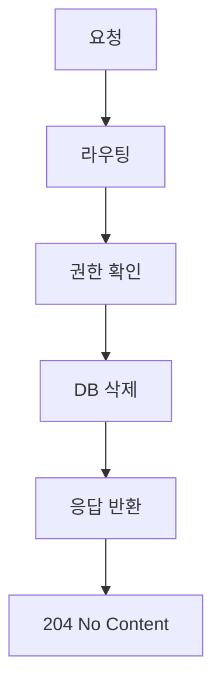

# REST와 RESTful API
## REST (Representational State Transfer)

### REST란?

REST는 Representational State Transfer의 약자로, 웹의 장점을 최대한 활용할 수 있는 아키텍처 스타일이다.

#### REST 구성 요소

- 자원(URI): URI로 식별되는 모든 정보
  - 예: `/users/123`, `/posts/456`
- 표현(Representation): 자원의 특정 시점의 상태 표현 방법
  - 예: `JSON`, `XML`, `HTML`
- 상태 전달(State Transfer): 클라이언트 ↔ 서버 간 자원 표현 주고받기
  - 예: `GET`, `POST`, `PUT`, `DELETE`

### REST의 6가지 기본 원칙

1. 자원의 식별 (Identification of Resources)
    - 모든 자원은 고유한 URI로 식별
    - 예: `/users/123`, `/products/cart`

2. 표현을 통한 자원 조작 (Manipulation through Representations)
    - HTTP 메서드로 자원 CRUD
    - GET, POST, PUT, PATCH, DELETE

3. 무상태성 (Stateless)
    - 각 요청이 독립적으로 처리됨
    - 서버는 클라이언트 상태 저장하지 않음

4. 캐시 가능성 (Cacheable)
    - 응답은 캐시 가능 여부 명시
    - 성능 향상 및 확장성 개선

5. 계층화 시스템 (Layered System)
    - Client → Proxy → Gateway → Server
    - 클라이언트는 중간 계층 존재 모름

6. 코드 온 디맨드 (Code on Demand) - 선택사항
    - 서버 → 실행 가능 코드 → 클라이언트
    - 예: JavaScript, Applet

## RESTful API

### RESTful이란?

REST의 원칙을 따르는 웹 서비스를 RESTful하다고 한다.

#### RESTful API 핵심 특징

- HTTP 프로토콜 기반
- 표준 데이터 형식 (JSON, XML)
- URL + HTTP 메서드로 자원 접근
- 명확하고 일관된 인터페이스

RESTful API는 자원을 명사로 표현하고, 동작은 HTTP 메서드로 표현한다.

---

### HTTP 메서드와 REST

#### 주요 HTTP 메서드 체계

- GET → 조회 (Read) → `/users/123`
  - 자원을 읽어옴, 서버 상태 변경 없음
- POST → 생성 (Create) → `/users`
  - 새로운 자원 생성, 서버 상태 변경
- PUT → 전체 교체 (Replace) → `/users/123`
  - 자원 전체를 새 데이터로 교체
- PATCH → 부분 수정 (Update) → `/users/123`
  - 자원의 일부분만 수정
- DELETE → 삭제 (Delete) → `/users/123`
  - 자원을 제거

아래 요청은 GET 조회와 POST 생성의 예시다.

```http
GET /users/123 HTTP/1.1
Host: api.example.com

POST /users HTTP/1.1
Host: api.example.com
Content-Type: application/json

{
  "name": "홍길동",
  "email": "hong@example.com"
}
```

GET은 멱등성이 보장되지만 POST는 그렇지 않다. PUT은 전체 교체, PATCH는 부분 수정에 사용한다.

#### PUT vs PATCH 비교

<table markdown="1">
<tr markdown="1">
<th width="50%" align="center" markdown="1">PUT (전체 교체)</th>
<th width="50%" align="center" markdown="1">PATCH (부분 수정)</th>
</tr>
<tr markdown="1">
<td valign="top" markdown="1">

아래 도식은 PUT이 기존 자원의 모든 필드를 새 값으로 덮어쓰는 흐름을 보여준다.



자원의 **전체**를 교체하므로 모든 필드를 전송해야 하고, 멱등성이 있다. 전체 데이터를 교체하거나 모든 필드를 알고 있을 때 쓴다.

</td>
<td valign="top" markdown="1">

아래 도식은 PATCH가 바꿀 필드만 보내고 나머지 필드는 그대로 두는 흐름을 보여준다.



자원의 일부만 수정하고, 변경할 필드만 전송한다. 멱등성이 보장된다. 특정 필드만 수정하거나 부분 업데이트할 때 쓴다.

두 요청의 본문 차이는 아래 예시에서 확인할 수 있다.

```http
PUT /users/123 HTTP/1.1
Content-Type: application/json

{
  "name": "이영희",
  "email": "new@example.com",
  "age": 30
}

PATCH /users/123 HTTP/1.1
Content-Type: application/json

{
  "email": "new@example.com"
}
```

</td>
</tr>
</table>

### RESTful API 설계 원칙

#### URI 설계 규칙

- 컬렉션 조회: `GET /users`
- 단일 자원 조회: `GET /users/123`
- 자원 생성: `POST /users`
- 자원 전체 수정: `PUT /users/123`
- 자원 부분 수정: `PATCH /users/123`
- 자원 삭제: `DELETE /users/123`
- 계층적 자원 표현: `GET /users/123/posts`, `GET /users/123/posts/456`

URI는 명사, 복수형, 소문자로 쓰고 단어 구분에는 하이픈(-)을 쓴다.

동사를 쓰거나 모든 작업을 POST로 보내는 아래 형태는 안티패턴이다.

- 동사 사용: `GET /getUsers`, `POST /createUser`
- 동사 + 명사: `GET /users/getById/123`, `POST /users/update/123`
- 모든 작업을 POST로: `POST /users/get`, `POST /users/delete`

동사, 대문자, 언더스코어(_), 파일 확장자도 URI에서 피한다.

#### HTTP 상태 코드 활용

- 2XX - 성공
    - 200 OK: 요청 성공 (조회, 수정)
    - 201 Created: 자원 생성 성공
    - 204 No Content: 성공했지만 반환 데이터 없음 (삭제)
- 3XX - 리다이렉션
    - 301 Moved Permanently: 영구 이동
    - 302 Found: 임시 이동
- 4XX - 클라이언트 오류
    - 400 Bad Request: 잘못된 요청 (유효성 검사 실패)
    - 401 Unauthorized: 인증 필요 (로그인 필요)
    - 403 Forbidden: 권한 없음 (접근 거부)
    - 404 Not Found: 자원 없음
    - 409 Conflict: 충돌 (중복된 데이터)
- 5XX - 서버 오류
    - 500 Internal Server Error: 서버 내부 오류
    - 502 Bad Gateway: 게이트웨이 오류
    - 503 Service Unavailable: 서비스 이용 불가

---

#### 응답 형식 표준화

<table markdown="1">
<tr markdown="1">
<th width="50%" align="center" markdown="1">성공 응답</th>
<th width="50%" align="center" markdown="1">에러 응답</th>
</tr>
<tr markdown="1">
<td valign="top" markdown="1">

성공 응답은 status와 data로 감싸고, 메타 정보는 필요할 때만 붙인다.

```http
HTTP/1.1 200 OK

{
  "status": "success",
  "data": {
    "id": 123,
    "name": "김철수",
    "email": "..."
  }
}
```

</td>
<td valign="top" markdown="1">

에러 응답은 status, 에러 메시지, 에러 코드를 담고, 상세 정보는 필요할 때만 붙인다.

```http
HTTP/1.1 404 Not Found

{
  "status": "error",
  "message": "...",
  "code": "NOT_FOUND",
  "details": [...]
}
```

</td>
</tr>
</table>

---

### RESTful하지 않은 API의 안티패턴

#### 안티패턴 #1 모든 작업을 POST로 처리

```
POST /api/getUsers
POST /api/updateUser
POST /api/deleteUser
```
문제점: HTTP 메서드의 의미 상실, 캐싱 불가능

#### 안티패턴 #2 URI에 동사 사용

```
GET  /api/getUserById/123
POST /api/createUser
POST /api/updateUserName
```
문제점: REST 원칙 위반, 일관성 없는 인터페이스

#### 안티패턴 #3 일관성 없는 응답 형식

```
API A: { "user": {...} }
API B: { "data": {...} }
API C: { "result": {...} }
```
문제점: 클라이언트 코드 복잡도 증가

#### 안티패턴 #4 버전 관리 없음

```
/api/users  → 갑자기 응답 형식 변경
```
문제점: 기존 클라이언트 앱 오류 발생

---

### RESTful API의 장점

1. 단순성 & 직관성
    - GET /users/123 → 사용자 조회
    - DELETE /users/123 → 사용자 삭제
    - HTTP 표준 활용
    - URL만으로 기능 파악
    - 학습 곡선 낮음

2. 확장성 & 성능
    - Client → Load Balancer → Server1, Server2, Server3
    - 무상태성 → 수평 확장 용이
    - 캐싱 → 성능 최적화
    - 계층화 → 부하 분산

3. 플랫폼 독립성
    - iOS App, Android App, Web Browser, Desktop App → REST API
    - HTTP 기반 → 모든 플랫폼 지원
    - 언어/프레임워크 무관
    - 클라이언트 통합 용이

4. 표준화 & 일관성
    - HTTP 메서드: GET, POST, PUT, DELETE
    - 상태 코드: 200, 201, 400, 404, 500
    - 헤더: Content-Type, Authorization
    - 국제 표준 준수
    - 일관된 인터페이스
    - 문서화 용이

---

### RESTful API 동작 흐름

아래 도식은 클라이언트가 GET, POST, PUT, DELETE로 요청하고 서버가 DB를 거쳐 응답하는 순서를 보여준다.



#### 각 메서드별 처리 흐름

<table markdown="1">
<tr markdown="1">
<th width="33%" markdown="1">조회 (GET)</th>
<th width="33%" markdown="1">생성 (POST)</th>
<th width="33%" markdown="1">삭제 (DELETE)</th>
</tr>
<tr markdown="1">
<td valign="top" markdown="1">

아래 도식은 GET 요청이 라우팅과 검증을 거쳐 DB 조회 후 200 OK로 끝나는 순서를 보여준다.



</td>
<td valign="top" markdown="1">

아래 도식은 POST 요청이 유효성 검증 후 DB에 저장되고 201 Created로 끝나는 순서를 보여준다.



</td>
<td valign="top" markdown="1">

아래 도식은 DELETE 요청이 권한 확인 후 DB에서 삭제되고 204 No Content로 끝나는 순서를 보여준다.



</td>
</tr>
</table>

---

### RESTful API 실무 사례

#### 버전 관리

URL 경로에 버전을 명시하는 방식이다.

```http
GET /api/v1/users
GET /api/v2/users
```

헤더로 버전을 관리하는 방식도 있다.

```http
Accept: application/vnd.api.v1+json
```

하위 호환성을 유지해야 v1 클라이언트는 계속 동작하고, v2 클라이언트는 새 기능을 쓸 수 있다.

#### 페이지네이션

대량 데이터는 페이지 단위로 나눠서 내려준다. 페이지 번호 방식은 page와 limit을 쓴다.

```http
GET /users?page=1&limit=10
GET /users?page=2&limit=10
```

오프셋 방식은 offset과 limit을 쓴다.

```http
GET /users?offset=0&limit=10
GET /users?offset=10&limit=10
```

응답에는 데이터와 함께 페이지 정보를 담는다.

```json
{
  "data": [...],
  "pagination": {
    "page": 1,
    "limit": 10,
    "total": 100,
    "totalPages": 10
  }
}
```

서버 부하와 네트워크 트래픽이 줄고 사용자 경험이 나아진다.

#### 필터링 및 정렬

쿼리 파라미터로 필터링, 정렬, 검색을 처리한다. 필터링은 조건을 파라미터로 받는다.

```http
GET /users?status=active
GET /users?role=admin&status=active
GET /users?age_min=18&age_max=65
```

정렬은 sort와 order를 쓴다.

```http
GET /users?sort=name&order=asc
GET /users?sort=createdAt&order=desc
```

검색은 키워드나 카테고리 조건을 넘긴다.

```http
GET /users?search=김철수
GET /products?category=electronics&price_max=100000
```

필터링, 정렬, 페이지네이션은 한 요청에 함께 쓴다.

```http
GET /users?status=active&sort=name&order=asc&page=1&limit=10
```

#### 에러 처리 표준화

에러 응답은 code, message, details를 가진 error 객체로 통일한다.

```json
{
  "error": {
    "code": "VALIDATION_ERROR",
    "message": "입력 데이터가 올바르지 않습니다",
    "details": [
      {
        "field": "email",
        "message": "올바른 이메일 형식이 아닙니다"
      },
      {
        "field": "password",
        "message": "비밀번호는 8자 이상이어야 합니다"
      }
    ]
  }
}
```

에러 코드는 아래 다섯 종류로 나눈다.

- VALIDATION_ERROR: 유효성 검사 실패
- AUTHENTICATION_ERROR: 인증 실패
- AUTHORIZATION_ERROR: 권한 부족
- NOT_FOUND: 자원 없음
- SERVER_ERROR: 서버 내부 오류

---

### 요약

- 자원 중심 설계: 명사 사용, 복수형, 계층 구조
- 표준 HTTP 활용: GET, POST, PUT, PATCH, DELETE와 200, 201, 400, 404, 500
- 무상태성 유지: 각 요청은 독립적이고 확장성이 높아진다
- 일관성 있는 응답: 표준화된 형식, 명확한 에러 메시지
- 버전 관리: 하위 호환성 유지, 점진적 업그레이드

---

### 요약
RESTful API는 현대 웹 서비스 개발의 사실상 표준이 되었다.

<table markdown="1">
<tr markdown="1">
<td width="50%" valign="top" markdown="1">

#### RESTful API를 선택해야 하는 이유

- 직관적인 설계: 누구나 쉽게 이해
- 뛰어난 확장성: 대규모 서비스 가능
- 범용성: 모든 플랫폼 지원
- 표준화: 일관된 개발 경험
- 비용 효율적: 개발/유지보수 용이

</td>
<td width="50%" valign="top" markdown="1">

#### 설계 시 기억할 것

- 자원은 명사로
- HTTP 메서드 올바르게
- 일관된 응답 형식
- 적절한 상태 코드
- 버전 관리 계획
- 문서화 필수
- 보안 고려
- 성능 최적화

</td>
</tr>
</table>

---

### 참고 자료

#### 공식 문서

- AWS RESTful API 가이드: https://aws.amazon.com/ko/what-is/restful-api/
- REST API 설계 가이드 (restfulapi.net): https://restfulapi.net/
- Roy Fielding의 원본 논문: REST 아키텍처 스타일의 창시자

#### 표준과 스펙

- HTTP 상태 코드 (MDN): https://developer.mozilla.org/ko/docs/Web/HTTP/Status
- HTTP 메서드 (MDN): https://developer.mozilla.org/ko/docs/Web/HTTP/Methods

#### 추가 학습 주제

- GraphQL (REST의 대안)
- gRPC (고성능 RPC 프레임워크)
- WebSocket (실시간 통신)
- API 보안 (OAuth 2.0, JWT)

