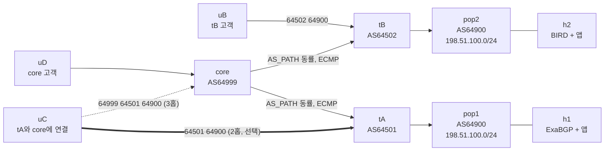
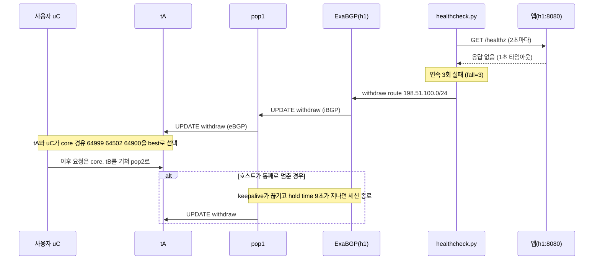
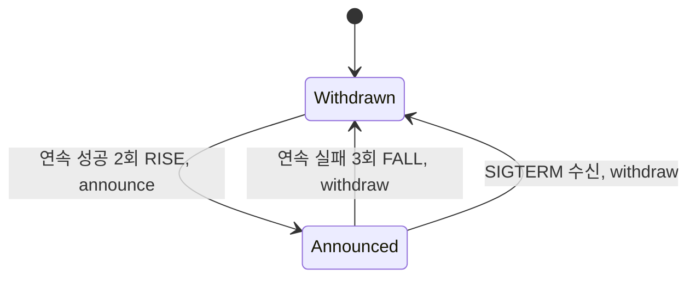
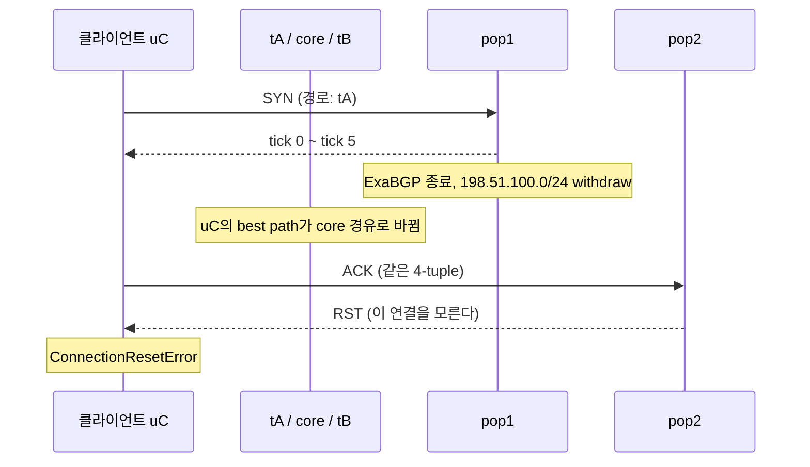
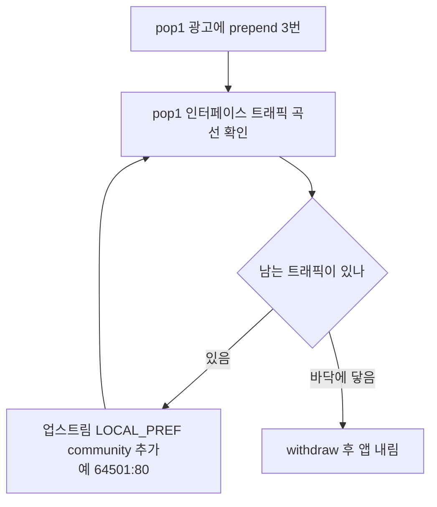
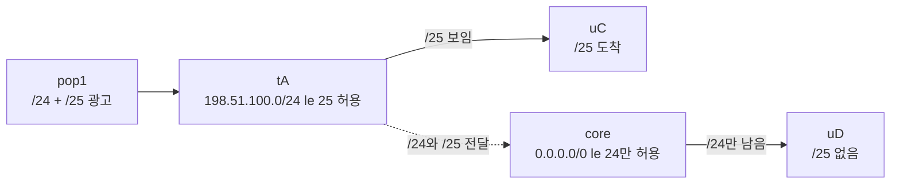

# BGP 애니캐스트와 트래픽 엔지니어링

[멀티캐스트와 애니캐스트](Multicast_and_Anycast.md)는 같은 주소를 여러 곳에서 광고하면 사용자가 가까운 곳으로 간다는 개념까지만 다뤘다. 운영하면 걸리는 곳은 그 뒤다. 앱은 죽었는데 BGP 광고가 남아 있는 PoP, 연결 도중에 다른 PoP로 넘어가는 TCP, 트래픽을 옮겨 보려고 쪼갰다가 필터에서 사라진 /25, 공격이 들어올 때 쓰는 RTBH와 Flowspec이 그런 것들이다.

이 문서는 FRR 8.1, ExaBGP 5.0.15, BIRD 2.0.8을 네임스페이스 10개에 띄워 직접 돌린 결과로 쓴다. community 값 설계와 prepend, MED의 비교 규칙은 [BGP community와 라우팅 정책](BGP_Community_and_Routing_Policy.md)에 있다. 여기서는 같은 수단이 anycast에서 어떻게 다르게 작동하는지만 본다.

## 같은 /24를 여러 PoP에서 광고한다

anycast prefix를 쓰는 대표 사례는 세 가지다.

- DNS 리졸버와 권한 서버. 요청 하나가 UDP 패킷 한두 개로 끝나서 경로가 바뀌어도 잃는 것이 거의 없다.
- CDN 엣지. TCP와 QUIC 트래픽이 섞여 있어서 이 문서의 세션 끊김 문제가 그대로 걸린다.
- DDoS scrubbing. 공격 트래픽이 출발지 위치에 따라 여러 PoP에 나뉘어 들어오므로 한 곳의 회선만 채우는 공격이 어렵다.

구성은 단순하다. 모든 PoP가 같은 /24를 같은 origin AS로 자기 업스트림에 광고한다. 서비스 IP는 서버의 `lo`에 /32로 붙이고, 서버에서 ExaBGP나 BIRD가 PoP 라우터와 BGP 세션을 열어 /24를 올린다. 광고의 주체가 앱 바로 옆 프로세스이기 때문에 앱 상태에 따라 광고를 끌 수 있다. 라우터가 정적으로 /24를 내보내면 앱이 죽어도 광고는 그대로다.

실험 토폴로지는 아래와 같다. 화살표는 트래픽 방향이다. pop1과 pop2는 둘 다 AS64900이고 198.51.100.0/24를 광고한다. 사용자 세 명은 위치가 다르다. uB는 pop2 쪽 업스트림 tB의 고객, uC는 tA와 core에 동시에 붙은 이중 연결, uD는 core의 고객이다.



uC에서 pop1까지는 일부러 멀게 만들었다. pop1과 tA 사이 링크 양쪽 끝에 `tc netem delay 40ms`를 걸어 왕복 80ms로 둔 것이다. BGP 광고 자체에는 지연이 들어 있지 않다.

사용자별로 `curl`을 30번씩 보내 어느 PoP가 응답하는지 세면 이렇게 나온다.

| 사용자 | pop1 | pop2 | 이유 |
|---|---|---|---|
| uB | 0 | 30 | tB 고객이라 `64502 64900` 하나뿐 |
| uC | 30 | 0 | tA 직결 경로(2홉)가 core 경유(3홉)보다 짧다 |
| uD | 14 | 16 | core에서 두 경로가 동률이라 ECMP로 갈린다. 이 숫자는 L4 해시(`fib_multipath_hash_policy=1`)로 쟀고, 기본값 0에서는 아래 절처럼 한쪽으로 쏠린다 |

## 가까운 PoP는 AS_PATH 길이로 정해진다

uC의 BGP 테이블이다.

```
uC# show bgp ipv4 unicast 198.51.100.0/24
  64999 64501 64900
    10.0.7.2 from 10.0.7.2 (10.255.0.5)
      Origin IGP, valid, external
  64501 64900
    10.0.10.2 from 10.0.10.2 (10.255.0.3)
      Origin IGP, valid, external, best (AS Path)
```

`best (AS Path)`로 tA 직결이 이긴다. uC는 이 경로가 80ms짜리 링크를 지나는지 모른다. uC로 `ping`을 보내면 왕복 80.3ms가 나온다. pop1 광고에 prepend를 걸어 uC를 pop2로 밀어 보냈더니 같은 `ping`이 0.049ms였다. 물리 거리나 지연이 아니라 홉 수를 보는 규칙이라 생기는 차이다. 지리적으로 가까운 쪽이 이긴다는 보장이 없다는 말을 실제 숫자로 보면 이 정도 격차가 날 수 있다.

AS_PATH 길이보다 앞서는 규칙도 있다. 업스트림이 고객 경로에 높은 LOCAL_PREF를 주면 AS_PATH가 아무리 길어도 그 경로가 이긴다. 이 랩의 tA가 그렇게 설정돼 있고, 뒤의 prepend 실험에서 확인한다. 그래서 anycast 광고가 어디로 흘러갈지는 내 광고가 아니라 상대 AS의 정책이 정한다.

### 동률이면 라우터 ID와 해시가 정한다

uD는 core 하나만 보고 있고, core에는 tA 경유와 tB 경유가 같은 길이로 들어온다.

```
core# show bgp ipv4 unicast 198.51.100.0/24
  64501 64900
    10.0.3.1 from 10.0.3.1 (10.255.0.3)
      Origin IGP, valid, external, multipath, best (Router ID)
  64502 64900
    10.0.4.1 from 10.0.4.1 (10.255.0.4)
      Origin IGP, valid, external, multipath
```

best를 고른 기준이 `Router ID`다. 동률일 때 마지막으로 가르는 값이라 사용자 경험과 관계가 없다. `maximum-paths 2`와 `bgp bestpath as-path multipath-relax`를 켜 두면 둘 다 커널 라우팅 테이블에 올라가고 ECMP가 된다. 이웃 AS가 서로 다른 경로를 같은 multipath 후보로 묶으려면 `multipath-relax`가 필요해서 이 랩에서는 켰다.

그 다음은 커널 해시 정책이 갈라 준다. Linux 기본값은 `fib_multipath_hash_policy=0`이고, 이 값에서는 출발지와 목적지 IP만 해시에 쓴다. uD에서 20번 연결했을 때 전부 pop2로 갔다. 정책을 1(L4 포함)로 바꾸니 40번 중 pop1 22, pop2 18로 갈렸다.

정책 0에서는 같은 클라이언트 IP가 항상 같은 PoP로 간다. 세션이나 캐시가 PoP 안에 있는 서비스에는 이쪽이 낫다. 대신 대형 NAT 뒤의 사용자는 한 PoP에 몰린다. 정책 1에서는 한 클라이언트의 연결들이 PoP 두 곳으로 흩어져서, PoP별 로컬 상태가 있으면 로그인 직후 다음 요청이 다른 PoP로 가서 세션이 없다는 증상이 나온다. 중간 구간 라우터의 정책은 내가 못 고르니, anycast 서비스는 어느 쪽이 걸려도 동작해야 한다.

## 앱이 죽었는데 광고가 남아 있으면

BGP 세션이 살아 있는 한 광고는 남는다. 세션을 유지하는 것은 호스트의 ExaBGP나 BIRD 프로세스이고 앱과는 별개 프로세스다. 앱이 죽어도 광고는 그대로이고, 사용자는 죽은 PoP로 계속 간다.

증상은 앱이 어떻게 죽었는지에 따라 다르다.

- 프로세스가 사라졌을 때: 포트가 닫혀 있어서 커널이 RST를 보낸다. 리스너 없는 포트로 `curl`을 보내니 0.088초에 `rc=7`(연결 거부)로 끝났다. 왕복이 80ms인 경로라 한 번 왕복한 값이다. 클라이언트가 바로 실패를 알아서 재시도하거나 다른 주소로 넘어간다.
- 프로세스는 있는데 응답이 없을 때: GC 정지, 데드락, 스레드 풀 고갈이 이쪽이다. 커널이 3-way handshake를 대신 끝내기 때문에 연결은 되고 응답만 안 온다. 클라이언트 타임아웃까지 기다려야 하고, 이쪽이 훨씬 길고 나쁘다.

실험에서는 `kill -STOP`으로 h1의 HTTP 서버를 멈춰 두 번째 상황을 만들었다. 이때 uC가 pop1으로 보낸 요청은 `curl -m 1`이 전부 `rc=28`(타임아웃)로 끝났다. 헬스체크가 withdraw를 보낸 뒤에야 uC는 pop2로 옮겨 갔다. 아래 순서대로 흘러간다.



헬스체크 스크립트가 withdraw를 보내는 경로가 위쪽이고, 호스트 전체가 멈춰 스크립트조차 못 돌 때는 아래 `alt` 블록처럼 BGP hold timer가 마지막 방어선이다.

### ExaBGP로 헬스체크 연동

아래 스크립트가 만드는 광고 상태는 둘뿐이고, 헬스체크 결과가 연속으로 쌓여야 넘어간다. 내리는 문턱(FALL 3)이 올리는 문턱(RISE 2)보다 높고, SIGTERM만 횟수와 무관하게 바로 withdraw로 간다.



스크립트는 표준 출력으로 ExaBGP 명령을 내보내는 프로세스일 뿐이다. 앱 상태를 확인해서 `announce`와 `withdraw` 한 줄을 쓴다.

```python
#!/usr/bin/env python3
import os
import signal
import sys
import time
import urllib.request

PREFIX = os.environ.get("HC_PREFIX", "198.51.100.0/24")
URL = os.environ.get("HC_URL", "http://127.0.0.1:8080/healthz")
INTERVAL = 2
TIMEOUT = 1
FALL = 3   # 연속 실패 3번이면 withdraw
RISE = 2   # 연속 성공 2번이면 announce

announced = False


def send(cmd):
    sys.stdout.write(cmd + "\n")
    sys.stdout.flush()


def announce():
    global announced
    send(f"announce route {PREFIX} next-hop self")
    announced = True


def withdraw():
    global announced
    send(f"withdraw route {PREFIX} next-hop self")
    announced = False


def healthy():
    try:
        with urllib.request.urlopen(URL, timeout=TIMEOUT) as r:
            return r.status == 200
    except Exception:
        return False


def on_term(signum, frame):
    if announced:
        withdraw()
    time.sleep(0.5)
    sys.exit(0)


signal.signal(signal.SIGTERM, on_term)
signal.signal(signal.SIGINT, on_term)

ok = fail = 0
while True:
    if healthy():
        ok, fail = ok + 1, 0
        if not announced and ok >= RISE:
            announce()
    else:
        ok, fail = 0, fail + 1
        if announced and fail >= FALL:
            withdraw()
    time.sleep(INTERVAL)
```

ExaBGP 설정은 이 스크립트를 process로 붙이고, PoP 라우터와 iBGP로 연결한다. `hold-time 9`를 건 이유는 뒤에서 본다.

```
process healthcheck {
    run /usr/bin/python3 /etc/exabgp/healthcheck.py;
    encoder text;
}

neighbor 10.0.8.2 {
    router-id 10.255.1.1;
    local-address 10.0.8.1;
    local-as 64900;
    peer-as 64900;
    hold-time 9;
    family { ipv4 unicast; }
    api { processes [ healthcheck ]; }
}
```

호스트 쪽에서는 `exabgp /etc/exabgp/exabgp.conf`로 띄운다. PoP 라우터(FRR)는 `neighbor 10.0.8.1 remote-as 64900`으로 받고 eBGP 이웃인 업스트림에는 `next-hop-self`가 기본으로 적용되어 `10.0.1.1`을 next hop으로 내보낸다.

스크립트에서 신경 쓴 부분과 돌려 보고 알게 된 부분은 이렇다.

- announce를 RISE번 연속 성공한 뒤에 한다. 앱보다 ExaBGP가 먼저 뜨는 부팅 순서에서 아직 준비 안 된 PoP로 트래픽이 들어오는 것을 막는다. 처음 켰을 때 광고가 올라가는 데 약 4초 걸렸다.
- SIGTERM을 받으면 withdraw하고 끝낸다. 배포나 재시작 때 먼저 광고가 빠진다. 이 부분이 없으면 앱을 내리는 동안 사용자가 죽은 PoP로 간다.
- 스크립트가 죽어도 광고는 즉시 사라지지 않는다. `kill -9`로 죽였더니 ExaBGP가 스크립트를 다시 띄웠고, 그동안 광고는 유지됐다. 계속 죽도록 만들면(내용을 `sys.exit(1)`로 바꿨다) 5번째 죽음에서 `Too many death for healthcheck (5) terminating program`을 남기고 ExaBGP가 통째로 종료했다. 세션이 끊기면서 pop1에서 광고가 사라졌고 uC는 pop2로 갔다. 스크립트 고장이 결국 광고 철회로 끝나는 방향이라 안전하다. 반대로 systemd가 ExaBGP를 `Restart=always`로 계속 살리면 세션이 열렸다 닫히기를 반복하며 광고가 깜박인다.
- 스크립트는 `nobody` 권한으로 돈다. ExaBGP 5의 `exabgp.daemon.user` 기본값이 `nobody`다. 로그 파일을 `/tmp/ay/h1/`에 쓰려다 `Permission denied`가 나고 나서 알았다. 스크립트에서 `birdc`나 `ip` 같은 root 명령을 부르려면 별도 설계가 필요하다.
- `exabgp.api.ack`의 기본값이 `true`라서 명령마다 `done`이 스크립트 stdin으로 돌아온다. 이 스크립트는 상태가 바뀔 때만 쓰기 때문에 읽지 않아도 문제가 없었다. 반복문마다 announce를 쓰는 구조로 바꾸면 stdin을 읽어야 한다. 이 경우는 돌려 보지 않았다.

### BIRD로 같은 일 하기

BIRD는 광고할 경로를 static 프로토콜로 두고, 헬스체크가 그 프로토콜을 `enable`과 `disable`로 껐다 켠다.

```
router id 10.255.1.2;
log stderr all;

protocol device {}

protocol static anycast {
    disabled yes;
    ipv4;
    route 198.51.100.0/24 blackhole;
}

protocol bgp pop2 {
    local 10.0.9.1 as 64900;
    neighbor 10.0.9.2 as 64900;
    hold time 9;
    ipv4 {
        import none;
        export where proto = "anycast";
        next hop self;
    };
}
```

`blackhole`은 BIRD 내부 테이블에만 들어가고 커널에 설치되지 않는다. `kernel` 프로토콜을 두지 않았기 때문이다. 이 경로의 용도는 광고뿐이고, 서비스 IP는 호스트 `lo`에 붙어 있다. 부팅 직후 앱이 준비되기 전에 광고되지 않도록 `disabled yes`로 시작했다.

```bash
#!/bin/bash
BIRDC="${BIRDC:-birdc -s /run/bird/bird.ctl}"
URL="${HC_URL:-http://127.0.0.1:8080/healthz}"
FALL=3
RISE=2
ok=0
fail=0

state() { $BIRDC show protocols anycast | awk '$1 == "anycast" {print $4}'; }

while sleep 2; do
  if curl -fs -m 1 -o /dev/null "$URL"; then
    ok=$((ok + 1)); fail=0
    if [ "$ok" -ge "$RISE" ] && [ "$(state)" != up ]; then
      $BIRDC enable anycast >/dev/null
    fi
  else
    fail=$((fail + 1)); ok=0
    if [ "$fail" -ge "$FALL" ] && [ "$(state)" = up ]; then
      $BIRDC disable anycast >/dev/null
    fi
  fi
done
```

처음에는 스크립트 안에 `up=0`, `up=1` 변수로 광고 상태를 기억하게 짰다. 이 방식에는 구멍이 있다. 설정 변경 때문에 `birdc configure`를 치면 static 프로토콜이 설정 파일의 `disabled yes` 상태로 되돌아간다. 실제로 `up` 상태에서 `configure`를 치자 바로 `down`이 됐다. 변수는 여전히 `up=1`이라 스크립트는 켜야 할 시점을 영영 못 찾고, PoP는 소리 없이 광고가 빠진 채로 남는다. 위 스크립트처럼 매 루프에서 `birdc`에 실제 상태를 물어보면 `configure` 뒤 2~3초 안에 스스로 복구했다.

### withdraw가 걸리는 시간

uC(pop1 쪽) 또는 uB(pop2 쪽)가 `curl -m 1`을 0.5초 간격으로 보내게 해 두고 장애를 건 시점부터 새 PoP로 응답이 오기까지를 쟀다.

| 장애 | 감지 수단 | 정상 응답까지 |
|---|---|---|
| h1 앱 멈춤 (`kill -STOP`) | ExaBGP 헬스체크, fall=3 | 7.6초 |
| h1 호스트 정지 (ExaBGP와 앱 모두 `kill -STOP`) | hold time 9초 | 7.6초 |
| h2 앱 멈춤 (`kill -STOP`) | BIRD 헬스체크, fall=3 | 9.1초 |

두 번째 행은 앱까지 같이 멈춰서 헬스체크가 필요 없는 상황이다. 광고를 거둬들이는 쪽이 세션 타이머뿐이라는 뜻이다. 이 랩은 양쪽 모두 `hold time 9`를 걸었다. 걸지 않으면 FRR 기본값이 hold 180초, keepalive 60초다. 호스트가 멈춘 뒤 최대 3분 동안 광고가 남을 수 있다. BFD로 더 줄이는 방법은 [Graceful Restart와 BFD](BGP_Graceful_Restart_BFD_Convergence.md)에 있다. 같은 문서에서 다룬 Graceful Restart는 이 구성에서는 켜지 않는 것이 맞다. 세션이 끊겨도 경로를 stale로 남겨 두는 기능이라 withdraw 의도와 반대로 작동한다. 이 랩에서는 켜지 않았고 그 상태에서만 확인했다.

랩의 수렴은 사실상 지연이 없다. FRR 8.1의 eBGP 광고 간격이 0초라서 UPDATE가 바로 나간다. RFC 4271은 eBGP의 `MinRouteAdvertisementIntervalTimer` 기본값으로 30초를 권고한다. 실제 인터넷에서는 withdraw가 여러 AS를 거치며 그 값을 따르는 장비를 만날 수 있어서, 위 표는 하한으로 읽어야 한다.

헬스체크가 DB나 외부 API 상태까지 보게 만들면 공통 의존성이 죽을 때 모든 PoP가 동시에 withdraw하는 경우가 있다. 서비스 IP가 인터넷에서 통째로 사라지는 것이라 앱이 반쯤 죽은 것보다 나쁘다. 이 랩에서 돌려 보지는 않았다. 헬스체크는 해당 PoP의 로컬 프로세스만 보는 쪽이 안전하다.

## TCP 연결이 도중에 다른 PoP로 넘어간다

anycast의 모든 경로 변화는 이미 맺어진 연결에도 영향을 준다. uC에서 pop1의 포트 9000에 연결해 1초마다 한 줄씩 받게 해 두고, 5초 뒤 h1의 ExaBGP를 `SIGTERM`으로 내렸다. 정상 종료이고 스크립트가 withdraw를 보낸다.

```
  0.1s pop1 tick 0
  1.1s pop1 tick 1
  2.1s pop1 tick 2
  3.1s pop1 tick 3
  4.1s pop1 tick 4
  5.1s pop1 tick 5
  5.4s ERROR ConnectionResetError: [Errno 104] Connection reset by peer
```

pop1 서버는 멀쩡하다. withdraw로 경로가 바뀐 뒤 클라이언트가 보낸 ACK가 core, tB를 거쳐 pop2로 갔고, pop2는 이 연결을 모르기 때문에 RST를 돌려줬다.



"BGP 경로는 수 분에서 수 시간 단위로 안정적이라 TCP가 안 끊긴다"는 설명은 경로가 안 바뀔 때만 맞다. PoP를 점검하려고 광고를 내리는 순간 그 PoP의 연결은 전부 끊긴다. withdraw의 목적이 사용자를 옮기는 것이라서, 이미 맺어진 연결을 지키면서 옮기는 방법은 BGP에는 없다. 연결 하나가 길게 살아 있는 서비스(스트리밍, 웹소켓, 큰 파일 다운로드)는 클라이언트가 재연결하고 이어받게 만들어야 한다. 점검은 신규 연결이 줄어드는 시간을 두고(prepend로 먼저 트래픽을 빼고) 기존 연결이 마무리되기를 기다린 뒤 내리는 순서가 현실적이다.

### ECMP 해시가 흔들리는 폭

경로가 안 바뀌어도 ECMP 구간의 nexthop 수가 바뀌면 연결이 흔들린다. 이 구간은 PoP 사이일 수도 있고, 한 PoP 안에서 서버 여러 대가 같은 /24를 광고하는 구성일 수도 있다. 서버 한 대가 헬스체크로 빠졌는데 그 서버와 상관없는 연결까지 다른 서버로 옮겨 가는 문제다.

Linux 5.15에서 더미 인터페이스 3개를 nexthop으로 둔 ECMP 경로를 만들고, 출발 포트 1000개를 `ip route get ... ipproto tcp sport N dport 443`으로 조회해 어느 nexthop이 고르는지 기록했다. nexthop 하나를 빼고 나서 빠진 쪽이 아닌 흐름이 몇 개나 움직였는지 센다.

| 방식 | 제거한 nexthop | 제거 대상이 아닌 흐름 | 그중 움직인 흐름 |
|---|---|---|---|
| 일반 multipath 경로 | 1번 | 672 | 142 (21%) |
| 일반 multipath 경로 | 2번 | 683 | 0 |
| 일반 multipath 경로 | 3번 | 645 | 175 (27%) |
| resilient nexthop group | 1, 2, 3번 각각 | 685 / 663 / 652 | 0 |

어느 nexthop이 빠지느냐에 따라 움직이는 양이 달라진다. 일반 multipath는 해시 공간을 nexthop 수로 나눠 앞에서부터 할당하기 때문에 중간이 아닌 쪽이 빠지면 경계가 이동한다. nexthop을 3개에서 4개로 늘렸을 때도 새 nexthop으로 갈 269개 말고 219개가 더 움직였다(전체 488/1000).

resilient group은 해시 버킷을 고정해 두고 빠진 nexthop의 버킷만 다른 쪽에 나눠 준다. 설정은 이렇다.

```bash
ip nexthop add id 1 via 10.9.1.2 dev d1
ip nexthop add id 2 via 10.9.2.2 dev d2
ip nexthop add id 3 via 10.9.3.2 dev d3
ip nexthop add id 10 group 1/2/3 type resilient buckets 128 idle_timer 120 unbalanced_timer 600
ip route add 198.51.100.0/24 nhid 10
```

nexthop을 다시 넣었을 때 균형을 즉시 되돌리지 않는다. 복귀 직후 `ip route get`으로 보면 분포가 그대로 두 곳에 몰려 있고, `unbalanced_timer`와 `idle_timer`가 지나면서 유휴 버킷부터 옮긴다. 연결이 안 끊기는 대신 복귀한 서버가 일을 받기까지 시간이 걸린다.

이 실험은 리눅스 커널 경로에 대한 것이다. FRR이 zebra에서 경로를 `nhid 26`처럼 커널 nexthop 객체로 설치하는 것은 확인했지만 그 객체가 resilient 유형인지는 확인하지 않았다. 하드웨어 라우터와 스위치의 ECMP는 장비마다 고정 버킷(resilient hashing)을 지원하는 정도가 다르고, 이 랩에서는 돌려 보지 못했다. 사용하는 장비에서 직접 nexthop 하나를 빼 보고 움직이는 흐름을 확인하는 수밖에 없다.

## 들어오는 트래픽을 옮기는 수단 비교

anycast에서 인바운드 TE는 "어떤 사용자를 어느 PoP가 받느냐"를 조정하는 일이다. 점검, 용량 부족, 특정 PoP 회선 장애 때문에 쓴다. 쓸 수 있는 수단은 상대 라우터의 비교 순서에서 어디를 건드리느냐로 갈린다. pop1의 광고에 걸어서 uB, uC, uD가 어디로 가는지 30번씩 보낸 결과다.

| 수단 | 건드리는 칸 | 실험 결과 | 안 먹는 경우 |
|---|---|---|---|
| prepend 3번 (pop1이 tA에 광고할 때) | AS_PATH 길이 | uC 30/30 pop2, uD 30/30 pop2. tA는 그대로 pop1 (LOCAL_PREF 200) | 상대가 고객 경로에 LOCAL_PREF를 먼저 준 경우 |
| community `64501:80` | tA의 LOCAL_PREF | tA가 core 경유로 바꿔 uB, uC, uD 전부 pop2 | 업스트림이 해당 community를 지원 안 하거나 입구에서 지움. 문서에 없는 값은 아무 일도 없고 경고도 없다 |
| 더 구체적인 prefix (/25) | 최장 일치 | tA와 uC에만 보이고 core와 uD에는 안 보임 | /24보다 긴 prefix를 거르는 모든 곳 |
| MED | MED | 이 랩에서는 돌리지 않음 | 이웃 AS가 다른 경로끼리는 비교하지 않는다 (Community 문서의 실험에서 `best (Older Path)`) |

네 수단이 상대 라우터의 비교 순서에서 어느 칸에 걸리는지 나란히 놓으면 아래와 같다. 왼쪽일수록 먼저 적용되어 오른쪽 수단을 이긴다.


MED는 anycast에서는 쓸 자리가 거의 없다. PoP가 서로 다른 업스트림에 붙어 있고, MED는 같은 이웃 AS가 보낸 경로끼리만 비교하는 것이 기본이기 때문이다.

### 드레인할 때 prepend만으로 부족하다

pop1을 점검하려고 prepend를 3번 걸었다. uC는 `64501 64900 64900 64900 64900`(5홉)과 `64999 64502 64900`(3홉) 중 후자를 골라 pop2로 갔고, uD도 전부 pop2로 갔다. 이만큼만 보면 드레인이 끝난 것 같다. tA 쪽을 보면 다르다.

```
tA# show bgp ipv4 unicast 198.51.100.0/24
  64900 64900 64900 64900
    10.0.1.1 from 10.0.1.1 (10.255.0.1)
      Origin IGP, localpref 200, valid, external, best (Local Pref)
  64999 64502 64900
    10.0.3.2 from 10.0.3.2 (10.255.0.5)
      Origin IGP, valid, external
```

tA는 고객 경로(pop1)에 `localpref 200`을 줬고 prepend는 AS_PATH 비교에서만 의미가 있어서 `best (Local Pref)`가 그대로 pop1이다. tA의 고객 중 tA에만 연결된 사용자는 계속 pop1으로 온다. 이 랩에는 그런 사용자가 없어서 tA의 포워딩을 `show ip route`로 확인했다. next hop이 `10.0.1.1`(pop1)이었다.

community `64501:80`을 붙이면 tA의 LOCAL_PREF가 80으로 내려가고 core 경유 경로가 best가 된다. 같은 실험에서 uB, uC, uD 모두 pop2였다. 앱을 내리기 전에는 prepend를 걸어 두고 pop1의 인터페이스 트래픽이 줄어드는 곡선을 보고, 남는 양이 있으면 업스트림 문서에서 LOCAL_PREF community를 찾아 추가한다. 곡선이 바닥에 닿은 것을 보고 withdraw한다. 이 순서를 안 지키면 prepend만 걸고 안심했다가 남은 트래픽이 끊긴다.

위 순서를 절차로 그리면 아래와 같다. 가운데 판단 노드에서 community를 더하는 쪽이 되돌아가는 고리라는 점을 보면 된다.



## /24보다 작은 prefix는 필터에서 버려진다

인바운드 TE에서 가장 확실한 수단은 더 구체적인 prefix다. 최장 일치는 AS_PATH나 LOCAL_PREF보다 먼저 적용되기 때문이다. 문제는 대부분의 업스트림과 IXP가 IPv4에서 /24보다 긴 prefix를 받지 않는다는 점이다. 광고하는 쪽에서는 성공한 것처럼 보이고 받는 쪽에서 조용히 사라진다.

h1의 ExaBGP에 `static { route 198.51.100.0/25 next-hop self; }`를 추가했다. tA는 고객 prefix-list를 `198.51.100.0/24 le 25`로 열어 두었고, core는 `0.0.0.0/0 le 24`만 받게 했다.

```
tA# show bgp ipv4 unicast 198.51.100.0/25
BGP routing table entry for 198.51.100.0/25, version 21
core# show bgp ipv4 unicast 198.51.100.0/25
% Network not in table
uC# show bgp ipv4 unicast 198.51.100.0/25
BGP routing table entry for 198.51.100.0/25, version 20
uD# show bgp ipv4 unicast 198.51.100.0/25
% Network not in table
```

필터가 어디서 /25를 막는지 경로로 그리면 이렇다. 점선 뒤쪽에서는 /24만 보인다.



tA를 지나는 uC에는 /25가 도착하고, core를 지나는 uD에는 안 온다. 여기에 pop1의 prepend 3번을 같이 걸고 다시 쟀다.

```
uC# ip route get 198.51.100.10 from 10.200.3.1
198.51.100.10 from 10.200.3.1 via 10.0.10.2 dev v9a      (tA, pop1 쪽)
uC# ip route get 198.51.100.200 from 10.200.3.1
198.51.100.200 from 10.200.3.1 via 10.0.7.2 dev v8a      (core, pop2 쪽)
```

uC는 30번 모두 pop1(`198.51.100.10`은 /25 범위), uD는 30번 모두 pop2였다. 같은 /24 안에서 주소에 따라 다른 PoP로 간다. 더 구체적인 prefix가 prepend를 이겨서 pop1이 드레인되지 않은 것처럼 보이고, 같은 서비스의 다른 주소는 pop2로 간다. 업스트림마다 필터가 다르면 사용자마다 보이는 경로가 달라지는 것이 이 구성의 디버깅 난점이다. 문제가 있다는 신고를 받으면 상대 AS의 looking glass에서 /25가 보이는지부터 확인한다.

더 구체적인 prefix가 필요하면 /24 두 개로 쪼갤 수 있는 /23 이상을 확보하는 방법밖에 없다. /23 전체를 anycast로 모든 PoP에서 광고하고, 끌어오고 싶은 PoP에서만 /24 한 쪽을 추가로 광고한다. IPv6는 /48이 비슷한 하한으로 통한다. 상대 필터 정책은 업스트림 문서에 적혀 있으니 계약 전에 읽는다.

## DDoS 대응에 쓰는 RTBH와 Flowspec

anycast는 공격 트래픽을 출발지 위치에 따라 여러 PoP로 나눈다. 다만 공격의 분포는 정상 사용자의 분포와 다르다. 어느 PoP 하나에 공격이 몰려 회선이 차면 그 PoP를 withdraw해서 다른 PoP로 넘기는 선택이 눈에 띄지만, 공격도 같이 따라 넘어간다. 다른 PoP가 그 양을 못 받으면 연쇄로 죽는다. withdraw는 공격을 옮길 뿐 막지 못한다.

그래서 쓰는 것이 RTBH와 Flowspec이다. RTBH의 community, 업스트림 정책, 데이터 플레인 확인은 [Community 문서의 RTBH 절](BGP_Community_and_Routing_Policy.md)에서 다뤘다. 여기서는 anycast 호스트에서 ExaBGP로 보낼 때 걸린 세 가지만 적는다.

```
static { route 198.51.100.10/32 next-hop self community [65535:666]; }
```

- `next-hop 192.0.2.1`처럼 폐기용 주소를 호스트에서 지정하면 PoP 라우터가 그 주소로 가는 경로가 없어서 경로가 `192.0.2.1 (inaccessible) ... invalid`가 된다. 호스트에서는 `next-hop self`를 쓰고 업스트림이 자기 정책에서 next hop을 바꾸게 한다.
- community에 `no-export`를 같이 붙여 보내면 PoP 라우터가 `Not advertised to any peer`로 표시하고 업스트림으로 내보내지 않았다. `no-export`는 받는 쪽이 지키는 약속인데 PoP 라우터 자신도 이 경로를 iBGP로 받은 것이라 막은 것이다. 호스트에서는 `65535:666`만 붙이고 `no-export`가 필요하면 엣지 라우터의 정책에서 다룬다. 후자는 이 랩에서 시도하지 않았다.
- `no-export` 없이 보내자 `Advertised to non peer-group peers: 10.0.1.2`가 되어 tA로 나갔지만, tA에는 RTBH 정책이 없어서 `% Network not in table`이었다. 업스트림이 /32를 받아 주는지는 평소에 테스트해 두어야 한다.

anycast 주소를 RTBH로 막으면 영향 범위도 따져야 한다. 한 PoP에서 /32를 광고하면 업스트림 tA가 그 주소를 자기 경계에서 버리고, tA를 지나는 사용자는 pop2가 멀쩡해도 서비스에 닿지 못한다. 공격받는 PoP 하나를 살리려고 그 업스트림을 쓰는 사용자 전체를 희생하는 선택이라서, 공격이 한 PoP로 몰리고 그 PoP의 업스트림 고객 비중이 작을 때만 맞다.

Flowspec은 목적지 하나를 통째로 버리지 않고 조건을 지정한다. ExaBGP에서는 이렇게 쓴다. FRR 쪽에서는 `address-family ipv4 flowspec`에서 이웃을 activate해야 하고, ExaBGP 쪽 `family`에도 `ipv4 flow;`를 넣어야 한다.

```
family { ipv4 unicast; ipv4 flow; }
flow {
    route drop-memcached-reflection {
        match {
            destination 198.51.100.10/32;
            protocol udp;
            source-port =11211;
        }
        then { discard; }
    }
}
```

pop1에서 받은 결과다.

```
pop1# show bgp ipv4 flowspec detail
BGP flowspec entry: (flags 0x418)
	Destination Address 198.51.100.10/32
	IP Protocol = 17
	Source Port = 11211
	FS:rate 0.000000
	received for 00:00:02
	not installed in PBR
```

`rate 0.000000`이 discard다. 컨트롤 플레인에서 받는 것까지만 확인했고 `not installed in PBR`이라서 이 랩에서는 실제 트래픽이 버려지는지는 확인하지 못했다. 업스트림 장비가 Flowspec을 받아 하드웨어에 올리는지는 계약과 장비에 달려 있다. 한 가지 더, 한쪽만 `ipv4 flowspec`을 켜 두면 세션은 올라가고 그 AFI만 `NoNeg`로 협상에서 빠진다. 실제로 FRR 쪽만 activate한 채로 ExaBGP를 재시작했더니 ExaBGP 로그에 `exabgp is not configured for ipv4/flow`가 찍혔고 FRR의 flowspec 열이 `NoNeg`였다.

scrubbing 사업자로 우회하는 경우는 /24에서 더 구체적인 경로로 이길 수 없다. 사업자가 같은 길이의 /24를 광고하고 AS_PATH와 정책 경쟁을 하거나 내가 광고를 내려야 한다. 어느 쪽인지는 계약에 따라 다르고, 이 랩에서는 다루지 않았다.

## 이 랩이 보여 주지 못하는 것

netem은 pop1 링크에 40ms를 더한 가짜 지연이라 실제 인터넷 경로와 다르고, 결과의 방향성만 쓸 수 있다. 수렴 시간은 FRR의 eBGP 광고 간격 0초 위에서 잰 값이다. RTBH와 Flowspec은 컨트롤 플레인까지만 봤고 데이터 플레인 폐기는 확인하지 못했다. MED 실험은 돌리지 않았고 [Community 문서의 결과](BGP_Community_and_Routing_Policy.md)를 인용했다. 하드웨어 라우터의 ECMP 해시 동작도 이 랩에는 없다. 경로 광고 자체를 신뢰할 수 있는지는 [RPKI ROV](BGP_Route_Security_RPKI_ROV.md), 접점 선택은 [IXP 피어링](BGP_IXP_Peering_Route_Server.md)에서 다룬다.

RFC 4271 (BGP-4), RFC 1997 (communities), RFC 7999 (BLACKHOLE), RFC 8955 (Flowspec)이 이 문서의 동작 근거다.

- [RFC 4271](https://datatracker.ietf.org/doc/html/rfc4271)
- [RFC 7999](https://datatracker.ietf.org/doc/html/rfc7999)
- [RFC 8955](https://datatracker.ietf.org/doc/html/rfc8955)
