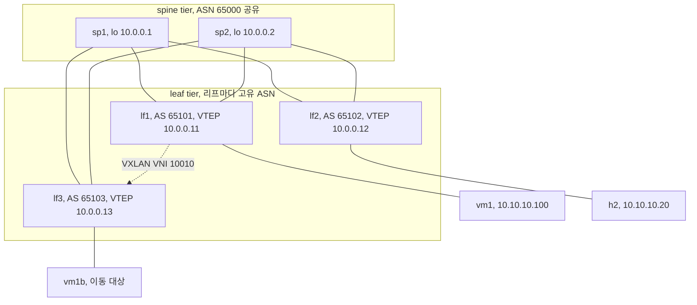
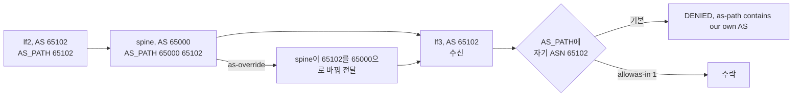
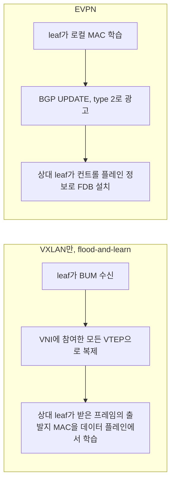
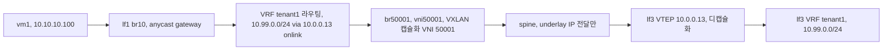
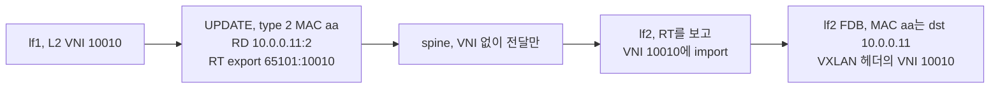
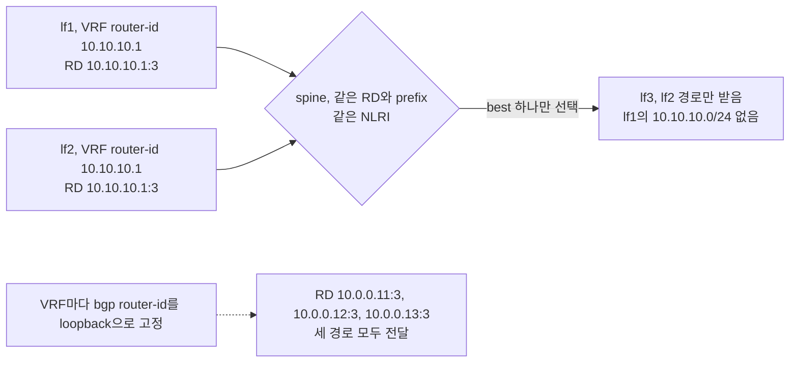
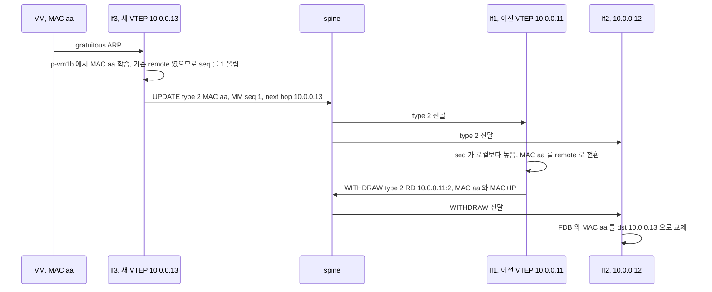
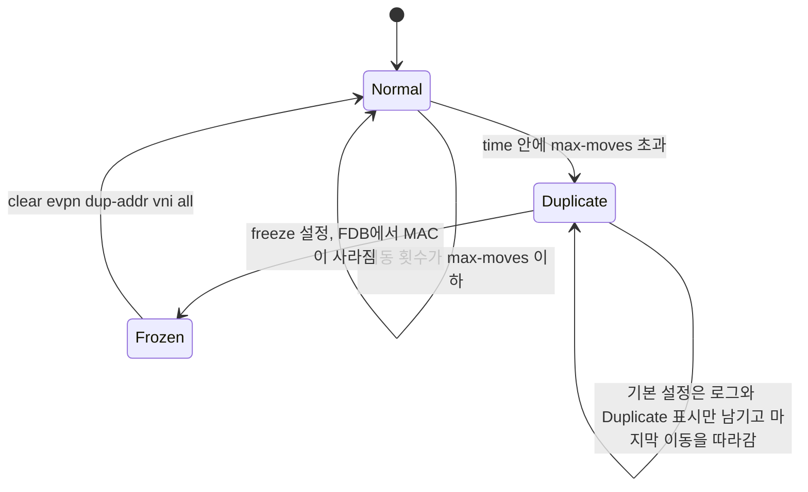
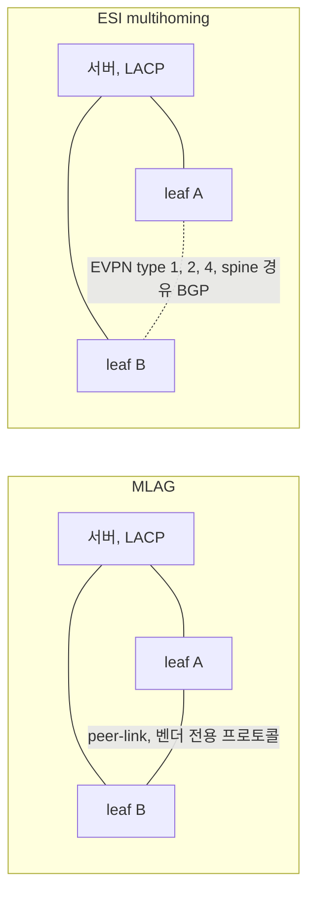
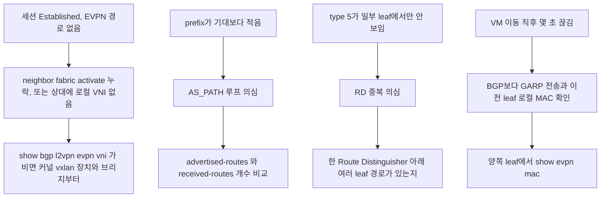

# 데이터센터 패브릭의 BGP

[쿠버네티스에서 쓰는 BGP](BGP_in_Kubernetes_Calico_Metal_LB_Cilium.md)는 노드와 ToR 사이의 세션 하나를 다뤘다. 그 ToR 위쪽이 어떻게 생겼는지는 거기서 "코어"라는 한 단어로 넘어갔다. 실제 데이터센터에서는 ToR이 leaf가 되고, leaf 위에 spine이 있고, 그 전체가 BGP 하나로 돌아가는 Clos 패브릭이다. 서버 팀이 "VM을 다른 랙으로 옮겼는데 3초 동안 안 붙는다", "L2 구간을 랙 사이로 늘려 달라"는 요청을 받으면 결국 이 패브릭 안의 BGP 이야기가 된다.

이 문서는 패브릭 안에서 BGP를 어떻게 쓰는지를 다룬다. spine-leaf에서 eBGP만 쓰는 이유, ASN을 어떻게 나눌지와 그 선택이 만드는 AS_PATH 문제, IPv4 주소 없이 세션을 올리는 unnumbered, 그 위에 EVPN을 얹어 VXLAN의 MAC 학습을 BGP로 넘기는 구조, 그리고 VM이 이동할 때와 MAC이 흔들릴 때 어떤 UPDATE가 오가는지를 순서대로 본다. 세션 보안과 타이머는 [BGP 세션 보안](BGP_Session_Security_TCP_AO_GTSM.md), [Graceful Restart와 BFD](BGP_Graceful_Restart_BFD_Convergence.md)에 있어서 여기서는 반복하지 않는다.

## 확인한 범위

출력은 전부 직접 돌린 것이다. network namespace 8개(spine 2, leaf 3, 호스트 3)에 FRR 8.1을 데몬째로 띄우고, 리프에는 커널 VXLAN 장치·브리지·VRF를 만들었다. 라우터 사이 링크는 veth다.

| 항목 | 값 |
|---|---|
| FRR | 8.1 (Ubuntu 22.04 패키지) |
| 커널 | 5.15.0-202 |
| 구성 | spine 2대(ASN 65000 공유), leaf 3대, L2 VNI 10010 하나, L3 VNI 50001 하나(VRF tenant1) |
| VXLAN 장치 방식 | VNI마다 vxlan 장치를 따로 만드는 방식 |
| 확인하지 못한 것 | ESI multihoming(커널·장치 방식 제약, 아래 절에서 설명), FRR 외 NOS의 동작 |

벤더 NOS(Arista, Cisco, Juniper)의 설정 문법과 기본값은 직접 확인하지 못했다. FRR에서 본 동작을 쓸 때는 "FRR 8.1에서 이랬다"는 범위까지만 말한다. 같은 랩을 다시 만들려면 마지막 절의 설정과 커널 명령을 그대로 쓰면 된다.

## spine-leaf에서 eBGP만 쓰는 이유

토폴로지는 단순하다. leaf는 서버를 받고, spine은 leaf끼리만 이어 준다. 모든 leaf가 모든 spine과 링크를 하나씩 가지므로 leaf 사이 경로는 항상 "leaf → spine → leaf" 두 홉이고, 경로 수는 spine 수와 같다.



실선 여섯 개가 전부 eBGP 세션이다. IGP는 없다. 이 설계는 RFC 7938에 정리돼 있고, 이유는 네 가지로 압축된다.

- **프로토콜이 하나다.** iBGP로 패브릭을 짜면 loopback 도달성을 위한 IGP가 따로 필요하고, 노드가 늘면 route reflector를 세워야 한다. eBGP만 쓰면 링크 하나가 세션 하나이고 세션 설정이 그대로 도달성 정보가 된다.
- **장애 범위가 세션 단위로 닫힌다.** OSPF는 area 안의 모든 라우터가 같은 LSDB를 갖는다. BGP는 광고한 것만 퍼지고, prefix-list나 community로 링크마다 무엇이 지나갈지 정한다.
- **AS_PATH가 루프를 막는다.** spine이 ASN을 공유하면 leaf → spine → 다른 leaf → 같은 tier의 spine으로 되돌아오는 경로가 AS_PATH 루프 검사에 걸려서 만들어지지 않는다.
- **EVPN을 같은 세션에 태운다.** 아래 EVPN 절에서 보듯 overlay용 세션을 따로 맺지 않고 address-family 하나를 더 켠다.

leaf에서 spine 두 개로 가는 ECMP는 `maximum-paths`로 열린다. lf1이 lf2의 loopback으로 가는 경로를 보면 두 spine이 모두 next hop이다.

```text
lf1# show ip route 10.0.0.12/32
Routing entry for 10.0.0.12/32
  Known via "bgp", distance 20, metric 0, best
  * fe80::a8ed:79ff:fef0:e6c7, via to-sp2, weight 1
  * fe80::d846:baff:fe7c:8215, via to-sp1, weight 1
    AS-Path          : 65000 65102
```

두 경로의 AS_PATH가 `65000 65102`로 같아서 `maximum-paths`만으로 묶였다. spine이 서로 다른 ASN이면 AS_PATH 내용이 달라 기본 설정으로는 하나만 선택된다. 이때는 `bgp bestpath as-path multipath-relax`가 필요하다. 이 문서의 랩은 spine이 ASN을 공유하는 쪽이라 그 옵션 없이 동작을 봤다.

eBGP를 쓰면 대신 장애 감지가 느리다. 기본 hold time은 180초이고 링크가 살아 있는 채로 패킷만 사라지는 침묵 장애를 BGP 혼자서는 못 잡는다. 패브릭에서는 BFD를 거의 필수로 붙이는데 수치와 동작은 [Graceful Restart와 BFD](BGP_Graceful_Restart_BFD_Convergence.md)에 측정해 둔 것을 본다.

## ASN을 어떻게 나눌까

spine tier는 ASN 하나를 공유한다. 논쟁이 되는 쪽은 leaf다. 선택지는 leaf마다 고유 ASN을 주는 것, 랙 단위로 묶는 것, 전체가 같은 ASN을 쓰는 것이다.

| 방식 | ASN 소비 | leaf 간 경로의 AS_PATH | 필요한 추가 설정 |
|---|---|---|---|
| leaf마다 고유 | leaf 수만큼 | `spine, 상대 leaf`로 서로 다름 | 없음 |
| 랙 단위(ToR 쌍이 공유) | 랙 수만큼 | 같은 랙의 쌍끼리는 자기 ASN이 경로에 있음 | 쌍이 서로 받으려면 allowas-in 또는 as-override |
| leaf 전체 공유 | 1개 | 모든 leaf 사이에서 자기 ASN이 경로에 있음 | 모든 leaf에 allowas-in 또는 spine에 as-override |

ASN이 모자라는 걱정은 보통 하지 않아도 된다. 2바이트 private 범위(64512~65534)는 1,023개이고, 4바이트 private 범위(4200000000~4294967294, RFC 6996)를 쓰면 leaf를 몇천 대로 늘려도 남는다. 고유 ASN 방식이 싫은 진짜 이유는 ASN 번호를 leaf마다 배정하고 문서화하고 자동화에 넣는 일이다. leaf를 교체하거나 추가할 때마다 번호가 하나 필요하고, 랙 단위로 주는 팀은 ToR 쌍이 같은 번호를 갖게 해서 번호 대장을 랙 대장과 일치시킨다.

### 같은 ASN을 쓰면 경로가 사라진다

lf2와 lf3를 둘 다 65102로 두고 세션을 올렸다. 세션은 Established이고 prefix도 받는다. 그런데 lf3은 lf2의 경로를 못 본다.

```text
lf3# show bgp ipv4 unicast
*> 10.0.0.1/32      to-sp1       0 65000 i
*> 10.0.0.2/32      to-sp2       0 65000 i
*= 10.0.0.11/32     to-sp2       0 65000 65101 i
*> 10.0.0.13/32     0.0.0.0      0 32768 i
```

`10.0.0.12/32`가 없다. 디버그 로그에는 이유가 나온다.

```text
to-sp2 rcvd UPDATE about 10.0.0.12/32 IPv4 unicast -- DENIED due to: as-path contains our own AS;
to-sp2 rcvd UPDATE about RD 10.0.0.12:2 [2]:[0]:[48]:[02:00:00:00:00:20] label 10010 l2vpn evpn -- DENIED due to: as-path contains our own AS;
to-sp2 rcvd UPDATE about RD 10.0.0.12:2 [3]:[0]:[32]:[10.0.0.12] l2vpn evpn -- DENIED due to: as-path contains our own AS;
```

unicast만이 아니다. lf2의 MAC(type 2)과 BUM 목록(type 3)도 같은 이유로 버려진다. 세션 상태에는 아무 흔적이 없어서 `show bgp summary`만 보면 정상으로 보인다. PfxRcd가 기대보다 적은 것만 단서다.



받는 쪽에서 풀 수도 있고 보내는 쪽(spine)에서 풀 수도 있다. 도식에서 `allowas-in`은 C에서 검사를 건너뛰는 것이고, `as-override`는 spine이 AS_PATH를 고쳐서 아예 검사에 안 걸리게 만드는 것이다.

### allowas-in

leaf의 peer group에 건다. 숫자는 자기 ASN이 경로에 몇 번까지 나와도 받을지다.

```text
router bgp 65102
 address-family ipv4 unicast
  neighbor fabric allowas-in 1
 exit-address-family
 address-family l2vpn evpn
  neighbor fabric allowas-in 1
 exit-address-family
```

적용하고 `clear bgp * soft in`을 하면 `10.0.0.12/32`가 `65000 65102`로 들어오고 EVPN 쪽도 lf2의 MAC이 remote로 학습된다. 두 address-family에 모두 걸어야 한다. unicast만 걸고 EVPN을 빼먹으면 underlay는 멀쩡한데 overlay만 반쪽이 되고 원인을 찾느라 한참 걸린다.

부작용은 루프 방어가 약해진다는 점이다. 숫자를 크게 잡으면 spine이 되돌려 보낸 자기 경로도 받는다. 1이면 대부분 충분하고 그 이상이 필요하면 설계를 다시 본다.

### as-override

spine이 leaf로 내려보낼 때 AS_PATH 안의 그 leaf의 ASN을 자기 ASN으로 바꾼다. leaf 쪽 설정은 건드리지 않는다.

```text
router bgp 65000
 address-family ipv4 unicast
  neighbor to-lf3 as-override
```

적용 뒤 lf3은 `10.0.0.12/32`를 `65000 65000`으로 받는다. 경로 길이는 유지되고 ASN만 바뀐다. FRR 8.1에서 확인한 제약이 하나 있다. `address-family l2vpn evpn` 안에 같은 명령을 넣어도 `show running-config`에 남지 않았고, lf2의 EVPN 경로는 여전히 거부됐다(`clear bgp *` 뒤에도 마찬가지였다). unicast에서는 되고 EVPN에서는 이 버전에서 쓸 수 없었다. EVPN 패브릭에서 ASN을 공유해야 한다면 leaf 쪽 allowas-in을 쓰는 것이 이 버전에서는 확실했다. 버전이 올라가면 달라질 수 있어서 쓰기 전에 `show running-config`로 설정이 남는지 본다.

## BGP unnumbered

leaf-spine 링크마다 /31을 나누면 링크 수만큼 주소를 관리해야 한다. 3-stage Clos에서 leaf 48대, spine 4대면 링크가 192개다. unnumbered는 인터페이스에 자동으로 붙는 IPv6 link-local 주소로 세션을 맺고, IPv4 prefix는 IPv6 next hop으로 광고한다(RFC 5549, 현재는 RFC 8950이 대체). IPv4 주소를 링크에 쓰지 않으니 /31 대장이 사라진다.

```text
router bgp 65101
 bgp router-id 10.0.0.11
 neighbor fabric peer-group
 neighbor fabric remote-as external
 neighbor to-sp1 interface peer-group fabric
 neighbor to-sp2 interface peer-group fabric
```

`neighbor to-sp1 interface`는 IP 대신 인터페이스 이름을 쓴다. `remote-as external`은 상대 ASN을 몰라도 자기와 다르기만 하면 맺는다는 뜻이라 leaf ASN을 spine 설정에 일일이 적지 않아도 된다. 이 랩에서는 RA 설정을 따로 하지 않았는데도 세션이 올라왔다.

협상 결과는 capability에 보인다.

```text
lf1# show bgp neighbors to-sp1
BGP neighbor on to-sp1: fe80::a02f:12ff:fe4b:2cd1, remote AS 65000, local AS 65101, external link
  Neighbor capabilities:
      IPv4 Unicast: RX advertised and received
      L2VPN EVPN: RX advertised and received
    Extended nexthop: advertised and received
                   IPv4 Unicast
```

`Extended nexthop: advertised and received`가 핵심이다. IPv4 prefix를 IPv6 next hop으로 주고받으려면 양쪽이 이 capability를 가져야 한다. 일부러 꺼서 시험하지는 않았지만, 상대가 FRR이 아닌 장비일 때 세션은 올라오는데 prefix가 안 오면 가장 먼저 보는 줄이다. 경로는 앞의 `show ip route` 출력처럼 `fe80::...`를 next hop으로 갖고, 커널 FIB에도 IPv6 next hop으로 들어간다.

운영에서 부딪히는 것은 두 가지다. router-id는 IPv4 주소가 없는 인터페이스에서 자동으로 뽑히지 않을 수 있으니 loopback /32를 두고 `bgp router-id`를 명시한다. 이웃 주소가 link-local이라 IP 기준으로 거는 ACL이나 모니터링 대시보드는 인터페이스 이름 기준으로 바꿔야 한다.

## EVPN이 하는 일

VXLAN만 있으면 L2 프레임을 UDP 4789로 감싸 보낼 수는 있는데, 어느 VTEP 뒤에 어느 MAC이 있는지는 데이터 플레인에서 flood-and-learn으로 알아내야 한다. 모든 leaf가 모든 VNI의 BUM(broadcast, unknown unicast, multicast)을 받는 구조라 패브릭이 커질수록 부담이 커진다. EVPN은 이 학습을 BGP가 맡게 한다. VTEP이 로컬에서 MAC을 배우면 UPDATE로 알리고, 상대는 그것으로 FDB를 채운다.

두 방식에서 MAC이 퍼지는 길을 나란히 놓으면 차이는 학습이 일어나는 층이다. 왼쪽은 데이터 플레인, 오른쪽은 컨트롤 플레인이다.



EVPN 경로는 route type으로 나뉘고, 각각 용도가 다르다.

| type | NLRI 구성 | 용도 | 이 랩의 실제 값 |
|---|---|---|---|
| 1 | ESI, Ethernet Tag | ES(multihoming 링크) 도달성, 장애 시 mass withdraw | 사용 안 함 |
| 2 | MAC, 선택적으로 IP | 호스트 MAC(과 IP)을 어느 VTEP이 갖고 있는지 | `[2]:[0]:[48]:[02:00:00:00:00:aa]:[32]:[10.10.10.100]` |
| 3 | 원본 VTEP IP | BUM 복제 대상 VTEP 목록 | `[3]:[0]:[32]:[10.0.0.11]` |
| 4 | ESI, 원본 VTEP IP | 같은 ES를 공유하는 VTEP 발견, DF 선출 | 사용 안 함 |
| 5 | IP prefix | VRF 안의 서브넷·외부 경로 광고 | `[5]:[0]:[24]:[10.99.0.0]` |

이 문서의 구성에서는 2, 3, 5가 나온다. 1과 4는 ESI multihoming을 켰을 때만 쓰인다.

**type 3**는 세션이 올라오자마자 leaf마다 하나씩 나온다. BUM 복제 목록이어서 head-end replication일 때 FDB의 all-zeros 항목으로 바뀐다.

```text
lf1# bridge fdb show dev vni10010 | grep 00:00:00:00:00:00
00:00:00:00:00:00 dst 10.0.0.12 self permanent
00:00:00:00:00:00 dst 10.0.0.13 self permanent
```

lf1이 ARP 요청 같은 BUM을 받으면 위 두 VTEP에게 유니캐스트 UDP로 복제해 보낸다. 이 목록에 type 3가 빠지면 그 VTEP은 broadcast를 못 받아서 ARP가 안 풀린다.

**type 2**는 호스트가 말을 해야 나온다. MAC만 있는 경로와 MAC에 IP가 붙은 경로가 따로 있다. IP가 붙은 쪽은 ARP/ND 학습 결과이고 L3 VNI의 RT와 router MAC(`Rmac`)을 같이 실어 보낸다(symmetric IRB).

**type 5**는 호스트가 아니라 prefix다. VRF 안에서 `redistribute connected`나 `network`로 올린 경로가 type 5로 나가고, 받은 쪽은 VRF 라우팅 테이블에 `onlink` 경로로 넣는다.

```text
lf1# show ip route vrf tenant1
C>* 10.10.10.0/24 is directly connected, br10, 00:01:40
B>* 10.99.0.0/24 [20/0] via 10.0.0.13, br50001 onlink, weight 1, 00:00:34
```

`10.99.0.0/24`는 lf3의 VRF에만 붙인 dummy 인터페이스다. lf1에서는 L3 VNI 장치(`br50001`)를 타고 lf3 VTEP으로 가는 경로로 들어왔다. 서로 다른 서브넷의 VM 사이 라우팅이 이 경로를 탄다.

vm1이 `10.99.0.1` 쪽으로 보내는 패킷이 어떤 장치를 지나는지 순서대로 따라가 보면 L3 VNI가 어디에 끼는지 보인다. spine은 underlay IP 라우팅만 하고 VXLAN 안은 보지 않는다.



### show bgp l2vpn evpn route 읽기

세션이 올라온 뒤 lf1의 테이블 일부다.

```text
lf1# show bgp l2vpn evpn route
Route Distinguisher: 10.0.0.11:2
*> [2]:[0]:[48]:[02:00:00:00:00:aa]:[32]:[10.10.10.100]
                    10.0.0.11                          32768 i
                    ET:8 RT:65101:10010 RT:65101:50001 Rmac:ba:3f:85:3a:fc:e1
*> [3]:[0]:[32]:[10.0.0.11]
                    10.0.0.11                          32768 i
                    ET:8 RT:65101:10010
Route Distinguisher: 10.0.0.12:2
*> [2]:[0]:[48]:[02:00:00:00:00:20]
                    10.0.0.12                              0 65000 65102 i
                    RT:65102:10010 ET:8
```

줄마다 읽는 순서가 있다. `Route Distinguisher`는 경로를 낸 leaf와 VNI를 구분하는 값이고, NLRI는 `[type]:[Ethernet Tag]:[MAC 길이]:[MAC]:[IP 길이]:[IP]` 순서다. 두 번째 줄의 next hop은 BGP 세션 상대가 아니라 **VTEP 주소**다. lf2의 경로는 spine을 통해 들어왔는데 next hop이 spine이 아니라 `10.0.0.12`다. `Path`의 `65000 65102`에서 spine ASN은 AS_PATH에 붙지만 next hop은 바뀌지 않았다. FRR 8.1이 EVPN 경로의 next hop을 eBGP에서도 유지한 덕분이다. 그래서 spine에는 VNI, vxlan 장치, VRF를 하나도 만들지 않았고 `address-family l2vpn evpn`에서 `neighbor fabric activate`만 켜 뒀다. 다른 NOS에서는 spine이 next hop을 고치는지 확인한다. 고치면 VXLAN 터널의 목적지가 spine이 돼서 트래픽이 spine으로 샌다.

`ET:8`은 encapsulation type이 VXLAN이라는 뜻이다. `RT`는 이 경로를 받을 VNI를 고르는 키이고, `Rmac`은 symmetric IRB에서 상대 leaf의 L3 VNI 쪽 MAC이다. MAC+IP 경로에 RT가 두 개(`65101:10010`, `65101:50001`) 붙는 이유는 L2 VNI와 L3 VNI에 모두 import되게 하려는 것이다.

## VNI, RD, RT 매핑

세 값을 헷갈리는 사람이 많다. 역할이 다르다.

| 값 | 무엇을 구분하나 | 이 랩의 자동 값 |
|---|---|---|
| VNI | 데이터 플레인에서 VXLAN 헤더 안의 24비트 세그먼트 번호 | L2 10010, L3 50001 |
| RD | 컨트롤 플레인에서 같은 NLRI를 서로 다른 것으로 만드는 접두사 | `router-id:인덱스`, 예 `10.0.0.11:2` |
| RT | 어느 VNI(VRF)가 이 경로를 import할지 | export는 `ASN:VNI`, 예 `65101:10010` |

세 값이 경로 하나에서 어디에 붙는지는 도식으로 보는 편이 빠르다. VNI는 데이터 플레인에만, RD와 RT는 BGP UPDATE에만 있다.



RD가 leaf마다 달라야 하는 이유는 같은 MAC이 두 leaf에 보일 수 있어서다. NLRI가 같아지면 BGP는 하나만 best로 고르고 나머지를 광고하지 않는다. VM 이동 중에 두 leaf가 같은 MAC을 올리는 순간이 있다. RD가 다르니 두 경로가 모두 살아서 RR이나 spine을 지나가고, 받는 쪽이 MAC mobility sequence로 승자를 고른다.

### auto RT와 leaf별 ASN

auto RT는 `ASN:VNI`이다. leaf마다 ASN이 다르면 lf1은 `65101:10010`을 export하고 lf2는 `65102:10010`을 export한다. 자기 RT는 서로 다른데 import가 된다. 이 랩에서 vm1이 lf2의 h2와 통신했고 `show evpn mac`에 remote MAC이 들어왔다. FRR 8.1이 auto로 만든 import RT를 VNI 부분만 보고 맞추는 것으로 보인다.

한 leaf에만 명시 RT를 줬더니 그 leaf가 상대를 못 보기 시작했다.

```text
router bgp 65101
 address-family l2vpn evpn
  vni 10010
   route-target both 64512:10010
```

적용 전에는 lf1의 `show evpn mac vni 10010`에 h2 MAC이 있었는데 적용 뒤에 사라졌다. lf1이 `64512:10010`만 import하게 돼서 lf2가 내보내는 `65102:10010`을 안 받는다. 명시 RT를 쓸 거면 패브릭 전체 leaf에 같은 값을 한꺼번에 넣는다. auto RT에서 일부만 명시로 옮기는 중간 상태가 장애 구간이다. 벤더 NOS의 auto RT 매칭 규칙은 FRR과 같다고 가정하지 않고 문서에서 확인한다.

### type 5의 RD가 겹친 사고

VRF 안의 BGP 인스턴스는 router-id를 따로 갖는다. `bgp router-id`를 안 주면 VRF에 붙은 인터페이스 주소 중 가장 큰 값을 쓰고, auto RD는 그 router-id로 만들어진다. 이 랩의 lf1과 lf2가 정확히 그렇게 됐다. 두 leaf 모두 VRF 안의 SVI에 anycast gateway 주소 `10.10.10.1`을 갖는다.

```text
sp1# show bgp l2vpn evpn route type prefix
Route Distinguisher: 10.10.10.1:3
*  [5]:[0]:[24]:[10.10.10.0]
                    10.0.0.11                0             0 65101 ?
*> [5]:[0]:[24]:[10.10.10.0]
                    10.0.0.12                0             0 65102 ?
Route Distinguisher: 10.99.0.1:3
*> [5]:[0]:[24]:[10.10.10.0]
                    10.0.0.13                0             0 65103 ?
```

lf1과 lf2의 RD가 둘 다 `10.10.10.1:3`이다. 같은 RD에 같은 prefix면 같은 NLRI라서 spine은 하나(lf2)만 best로 고르고 lf3에게는 그것만 내려보낸다. lf3의 테이블에는 lf1의 `10.10.10.0/24`가 없었다. lf3의 RD는 `10.99.0.1:3`으로 또 달랐다. VRF에 있는 가장 큰 주소가 `ext0`의 `10.99.0.1`이기 때문이다. VRF에 주소를 하나 더 붙이면 RD가 바뀌는 것이다.

위 출력을 흐름으로 그리면 lf1의 경로가 어디서 사라지는지 보인다. lf1과 lf2의 RD가 같아서 spine이 둘을 같은 NLRI로 취급한다.



각 leaf의 VRF 인스턴스에 router-id를 loopback 주소로 고정했다.

```text
router bgp 65101 vrf tenant1
 bgp router-id 10.0.0.11
```

lf3이 받는 RD가 `10.0.0.11:3`, `10.0.0.12:3`, `10.0.0.13:3`으로 갈라졌고 세 경로가 모두 보였다. anycast gateway를 쓰는 패브릭이면 이 문제를 거의 확실히 만난다. VRF 안의 주소가 모든 leaf에서 같으니 router-id 자동 선택이 같은 값으로 수렴하기 때문이다. 처음부터 VRF마다 `bgp router-id`를 주거나 RD를 `rd vpn export`로 직접 정한다.

## anycast gateway

모든 leaf가 같은 gateway IP와 같은 MAC을 가진다. 이 랩에서는 `br10`에 `10.10.10.1/24`와 `00:00:5e:00:01:01`을 고정해 모든 leaf에 같게 줬다.

```bash
ip link add br10 type bridge
ip link set br10 address 00:00:5e:00:01:01
ip link set br10 master tenant1
ip addr add 10.10.10.1/24 dev br10
```

VM은 gateway의 MAC을 ARP로 한 번 배운다. VM이 다른 leaf로 옮겨도 그 leaf가 같은 MAC으로 응답하니 VM의 ARP 캐시가 그대로 유효하다. 이동 직후에 gateway가 안 보이는 구간이 없다. 이 방식이 없으면 VRRP나 HSRP처럼 active leaf 하나를 gateway로 두는 구조가 되고, VM이 이동할 때마다 hairpin을 타거나 gateway ARP를 다시 풀어야 한다. vm1에서 `10.99.0.1`(lf3의 VRF에 있는 prefix)로 ping을 보내면 lf1이 L3 VNI로 직접 라우팅해서 lf3으로 보낸다. 첫 번째 응답의 RTT는 111ms였고 두 번째는 0.1ms 안팎이었다. 첫 패킷이 ARP와 FDB 학습을 기다린 것으로 본다.

## 설정 전체

커널 쪽 구성이 없으면 FRR은 아무것도 못 한다. FRR은 vxlan 장치가 있어야 그 VNI를 알고, 그 장치가 브리지에 붙어 있어야 L2 VNI로 인식한다. lf1의 커널 설정이다.

```bash
ip link add tenant1 type vrf table 1001 && ip link set tenant1 up

# L2 VNI 10010
ip link add br10 type bridge
ip link set br10 address 00:00:5e:00:01:01 master tenant1
ip addr add 10.10.10.1/24 dev br10 && ip link set br10 up
ip link add vni10010 type vxlan id 10010 local 10.0.0.11 dstport 4789 nolearning
ip link set vni10010 master br10 up
bridge link set dev vni10010 neigh_suppress on learning off

# L3 VNI 50001
ip link add br50001 type bridge
ip link set br50001 master tenant1 up
ip link add vni50001 type vxlan id 50001 local 10.0.0.11 dstport 4789 nolearning
ip link set vni50001 master br50001 up
```

`nolearning`과 `learning off`가 빠지면 커널이 flood-and-learn으로 MAC을 배운다. EVPN이 알려 준 FDB와 섞여서 MAC이 엉뚱한 VTEP으로 가는 증상이 나온다. `neigh_suppress`는 VTEP이 이미 아는 IP의 ARP 요청을 로컬에서 대신 응답하게 해서 ARP 요청이 패브릭을 도는 일을 줄인다.

FRR 설정이다.

```text
vrf tenant1
 vni 50001
exit-vrf
router bgp 65101
 bgp router-id 10.0.0.11
 no bgp ebgp-requires-policy
 neighbor fabric peer-group
 neighbor fabric remote-as external
 neighbor to-sp1 interface peer-group fabric
 neighbor to-sp2 interface peer-group fabric
 address-family ipv4 unicast
  network 10.0.0.11/32
  maximum-paths 4
 exit-address-family
 address-family l2vpn evpn
  neighbor fabric activate
  advertise-all-vni
 exit-address-family
router bgp 65101 vrf tenant1
 bgp router-id 10.0.0.11
 address-family ipv4 unicast
  redistribute connected
 exit-address-family
 address-family l2vpn evpn
  advertise ipv4 unicast
 exit-address-family
```

`no bgp ebgp-requires-policy`는 랩에서 inbound/outbound policy를 만들기 귀찮아서 껐다. 운영에서는 끄지 말고 leaf가 광고해도 되는 prefix만 통과시키는 route-map을 건다. `advertise-all-vni`는 커널에 있는 모든 L2 VNI를 BGP에 자동 등록한다. VNI를 일부만 쓸 거면 이 줄을 빼고 `vni`를 하나씩 명시한다.

spine 설정은 훨씬 짧다.

```text
router bgp 65000
 bgp router-id 10.0.0.1
 no bgp ebgp-requires-policy
 neighbor fabric peer-group
 neighbor fabric remote-as external
 neighbor to-lf1 interface peer-group fabric
 neighbor to-lf2 interface peer-group fabric
 neighbor to-lf3 interface peer-group fabric
 address-family ipv4 unicast
  network 10.0.0.1/32
  maximum-paths 4
 exit-address-family
 address-family l2vpn evpn
  neighbor fabric activate
 exit-address-family
```

## VM이 이동할 때

가장 자주 겪는 시나리오다. vm1(MAC `02:00:00:00:00:aa`)이 lf1에서 lf3으로 이동한다. 랩에서는 vm1의 NIC을 내리고 같은 MAC·IP를 가진 vm1b의 NIC을 올린 뒤 `arping -U`로 gratuitous ARP를 보냈다. 이동하기 전 lf2의 FDB는 이렇다.

```text
lf2# show evpn mac vni 10010
MAC               Type   Flags Intf/Remote ES/VTEP            VLAN  Seq #'s
02:00:00:00:00:aa remote       10.0.0.11                            0/0
02:00:00:00:00:20 local        p-h2                                 0/0
```

이동이 일어나는 순서를 시퀀스로 보면 이렇다. 눈여겨볼 것은 lf3이 먼저 광고하고 lf1이 그 뒤에 철회한다는 점이다.



이동 뒤 lf2의 FDB와 BGP 테이블이다.

```text
lf2# show evpn mac vni 10010
02:00:00:00:00:aa remote       10.0.0.13                            0/1
02:00:00:00:00:20 local        p-h2                                 0/0

lf2# show bgp l2vpn evpn route type macip
Route Distinguisher: 10.0.0.13:2
*> [2]:[0]:[48]:[02:00:00:00:00:aa]
                    10.0.0.13                              0 65000 65103 i
                    RT:65103:10010 ET:8 MM:1
```

`MM:1`이 MAC mobility extended community다. 시퀀스 번호가 1이라는 뜻으로, 받는 쪽은 같은 MAC에 대해 번호가 더 큰 경로를 이긴 쪽으로 본다. 이동 직후 h2에서 `ping 10.10.10.100`은 계속 성공했다. 새 leaf가 알린 type 2가 도착해서 FDB가 바뀌는 데 걸린 시간은 로그 타임스탬프 기준으로 같은 초 안이었다.

주의할 점이 두 개 있다. 이동 전의 MAC+IP 형태 type 2는 withdraw됐고, 3초 뒤까지도 MAC만 있는 경로만 보였다. IP가 붙은 type 2는 새 leaf가 ARP 학습으로 그 IP를 알아야 다시 나오기 때문이다. 같은 서브넷 안의 통신은 MAC만 있어도 되지만, 다른 서브넷에서 라우팅으로 들어오는 트래픽은 호스트 IP 경로가 다시 생길 때까지 ARP 학습을 기다리게 된다. 이동 직후 라우팅된 트래픽만 잠깐 끊기는 증상은 이 구간과 맞물리는 경우가 있다. 랩에서는 이 구간의 패킷 손실을 재지 않았다.

다른 하나는 이동한 VM이 GARP를 안 보내는 경우다. 새 leaf가 MAC을 학습하는 계기가 VM의 첫 프레임뿐이라, VM이 조용하면 이전 leaf가 계속 그 MAC의 주인으로 남는다. 이전 leaf의 로컬 MAC은 aging이 끝나야 지워지는데, 그 사이 원격 leaf들이 이전 leaf로 프레임을 보내서 블랙홀이 생기는 경우가 있다. 이 시나리오는 랩에서 재현하지 않았다.

## MAC이 흔들릴 때

이동이 한 번이면 시퀀스가 하나 오르고 끝난다. 같은 MAC이 두 leaf 사이를 반복해서 오가면 시퀀스가 계속 오르고 BGP UPDATE가 계속 나간다. 현장에서 흔한 원인은 이런 것들이다.

- 호스트 쪽 bond가 LACP 없이 active-active로 구성돼서 같은 MAC이 두 leaf의 포트에서 번갈아 보인다.
- 두 leaf에 걸친 L2 루프. 스패닝 트리가 막혀 있어야 할 물리 경로가 열려 있다.
- VM 이미지를 복제하면서 MAC을 같이 복제해 서로 다른 leaf에 올린다.
- live migration 도구가 목적지에서 VM을 기동하는 동시에 원본도 안 내려서 두 쪽이 모두 GARP를 보낸다.

이 랩에서는 vm1과 vm1b의 NIC을 1초 간격으로 번갈아 올려 같은 현상을 만들었다. 이동 횟수에 따라 seq가 그대로 오른다.

```text
move 1 -> vm1b : lf2 sees: remote 10.0.0.13 0/1
move 2 -> vm1  : lf2 sees: remote 10.0.0.11 0/2
move 3 -> vm1b : lf2 sees: remote 10.0.0.13 0/3
...
move 8 -> vm1  : lf2 sees: remote 10.0.0.11 0/8
```

이동 20회쯤에서는 `MM:21`이었다. 시퀀스는 이동할 때마다 오르기만 했다.

FRR은 기본으로 중복 MAC 감지가 켜져 있다.

```text
lf1# show evpn vni 10010
Duplicate address detection: Enable
  Detection max-moves 5, time 180
```

180초 안에 5번을 넘게 움직이면 중복으로 판정한다. 위 8번 이동 중 lf1이 이렇게 기록했다.

```text
VNI 10010: MAC 02:00:00:00:00:aa detected as duplicate during local update, last VTEP 10.0.0.13
VNI 10010: MAC 02:00:00:00:00:aa IP 10.10.10.100 detected as duplicate during local update, inherit duplicate from MAC

lf1# show evpn mac vni 10010 mac 02:00:00:00:00:aa
 Local Seq: 8 Remote Seq: 7
 Duplicate, detected at Tue Nov 24 19:43:09 2026
 Neighbors:
    10.10.10.100 Active
```

기본 설정에서는 판정이 로그와 `Duplicate` 표시로 남을 뿐 트래픽은 계속 마지막 이동을 따라갔다. 판정 뒤에 한 번 더 옮겼더니 lf2·lf3·lf1이 모두 새 위치로 수렴했고 h2의 ping도 성공했다. 그러니 기본 설정은 flap을 "막는" 장치가 아니라 "기록하는" 장치다. 로그를 안 보면 몇 시간 동안 MAC이 흔들려도 모른다.

막으려면 freeze를 켠다. FRR 8.1에서는 `max-moves`와 `freeze`가 한 줄이 아니라 두 줄이다. 한 줄로 쓰면 `Unknown command`가 나온다.

```text
router bgp 65101
 address-family l2vpn evpn
  dup-addr-detection max-moves 3 time 60
  dup-addr-detection freeze permanent
```

이 설정으로 같은 반복 이동을 돌렸을 때 관찰한 것은 경로가 잠깐 사라지고 시퀀스가 초기화되는 구간이었다. 세 번째 이동 직후에 lf2와 lf3의 FDB에서 MAC이 안 보였고, 네 번째 이동에서는 시퀀스가 `0/0`으로 되돌아 있었다. FDB에 MAC이 없으면 그 MAC으로 가는 프레임은 unknown unicast로 취급돼 head-end replication 목록 전체로 복제된다. FRR 문서상 freeze된 MAC은 `clear evpn dup-addr vni all`로 푸는 것이 정해진 절차다. 이 랩에서는 다섯 번째 이동부터 다시 정상 수렴했고, freeze 상태가 어느 조건에서 얼마나 유지되는지는 이 실험으로 정확히 확인하지 못했다. 켜기 전에 테스트 환경에서 한 번 흔들어 보고, 해제 절차를 운영 문서에 적어 둔다.

중복 MAC 판정과 freeze의 상태 전이를 모으면 아래와 같다. 기본 설정은 `Duplicate`에서 멈추고, freeze를 켠 경우에만 `Frozen`으로 넘어간다.



flap이 의심되는 날 처음 보는 명령은 둘이다. `show evpn mac vni <번호> mac <MAC>`에서 `Local Seq`와 `Remote Seq`가 계속 오르는지 보고, `show bgp l2vpn evpn route`에서 `MM:` 숫자가 몇인지 본다. 수가 수십 이상이면 사람이 옮기는 이동이 아니다.

## MLAG 대신 ESI multihoming

서버를 leaf 두 대에 걸쳐 LACP로 묶으려면 두 leaf가 같은 LACP 시스템 ID로 응답해야 한다. 전통적인 방법은 MLAG다. leaf 둘이 peer-link로 상태를 동기화하고 하나의 논리 스위치처럼 행동한다. 패브릭에서 BGP가 하는 일은 그 쌍이 공유하는 anycast VTEP IP를 광고하는 정도다.

ESI multihoming(RFC 7432)은 같은 일을 EVPN으로 한다. 서버가 붙은 링크 묶음을 ES(Ethernet Segment)로 부르고 ESI 값 하나를 준다. 같은 ESI를 가진 leaf들은 type 4로 서로를 발견해서 BUM을 어느 쪽이 서버에게 보낼지(DF) 선출하고, type 1로 "이 ES는 나를 통해 도달한다"를 광고한다. 링크가 끊기면 leaf가 type 1을 철회해서 원격 leaf가 그 ES에 속한 모든 MAC을 한 번에 지운다(mass withdraw).

두 방식에서 leaf 쌍이 서로 상태를 맞추는 길이 다르다. MLAG는 leaf 사이 전용 링크, ESI는 spine을 지나는 BGP다.



| 항목 | MLAG | ESI multihoming |
|---|---|---|
| 상태 동기화 | peer-link와 벤더 전용 프로토콜 | EVPN type 1, 2, 4 |
| 묶을 수 있는 leaf 수 | 2대 | 표준상 2대 이상 가능 |
| 장비 호환 | 같은 벤더끼리 | 표준이라 벤더가 달라도 가능, 구현 차이는 있음 |
| 장애 때 MAC 정리 | 쌍이 판단 | type 1 mass withdraw |
| 운영에서 겪는 문제 | peer-link 단절 때 split-brain, 펌웨어 업그레이드를 쌍으로 맞춤 | NOS 지원 수준과 구현 완성도, 커널 요구 사항 |

ESI 쪽이 좋아 보이지만 도입 장벽은 소프트웨어다. 이 랩의 FRR 8.1 구성은 VNI마다 vxlan 장치를 만드는 방식이라 ESI를 시험하지 못했다. FRR의 EVPN MH는 커널 버전과 vxlan 장치 방식에 제약이 있는 것으로 알고 있는데 그 부분을 직접 확인하지 않았으니, 사용하려면 쓰는 NOS의 문서에서 요구 사항을 먼저 본다. FRR 문서에 나오는 설정 모양을 옮기면 이렇고, 이 랩에서는 실행하지 않았다.

```text
interface bond1
 evpn mh es-id 1
 evpn mh es-sys-mac 00:00:00:00:01:01
 evpn mh es-df-pref 50000
```

`es-sys-mac`은 두 leaf가 서버에 같은 LACP system ID로 보이게 하는 값이다. 한쪽 leaf만 다른 값을 가지면 서버의 LACP가 두 링크를 묶지 않고 하나만 쓴다. 두 leaf 설정 차이를 줄이려면 설정 생성에서 같은 템플릿을 쓰게 한다.

## 운영에서 막히는 지점

가장 먼저 의심할 것은 설정에 보이지 않는 곳이다.

증상별로 어디부터 보는지는 아래 도식으로 정리된다. 아래 문단들이 각 갈래를 풀어 쓴 것이다.



세션은 Established인데 EVPN 경로가 비어 있으면 address-family 활성화를 본다. `show bgp summary`는 address-family별로 표가 나뉘고, `L2VPN EVPN Summary`의 PfxRcd가 0이면 상대 쪽 `neighbor fabric activate`가 빠졌거나 반대편 leaf에 로컬 VNI가 아직 없다. VNI는 vxlan 장치가 브리지에 붙고 `up`일 때만 FRR에 보인다. `show bgp l2vpn evpn vni`에 목록이 비어 있으면 커널 쪽 구성부터 다시 본다.

prefix가 줄어 있으면 AS_PATH 루프를 의심한다. ASN을 공유하는 설계에서는 위에서 본 것처럼 에러도 없이 사라진다. 디버그를 켤 수 없는 환경이면 반대편에서 `show bgp ... neighbors <peer> advertised-routes`로 광고 목록을 보고, 이쪽 `received-routes`(soft-reconfiguration inbound 필요)와 개수를 비교한다.

type 5가 일부 leaf에서만 안 보이면 RD 중복을 의심한다. `show bgp l2vpn evpn route type prefix`에서 서로 다른 leaf의 경로가 같은 `Route Distinguisher` 아래 줄지어 나오면 그것이다.

VM 이동 직후 몇 초간 끊기는 증상은 BGP 문제가 아닌 경우가 많다. 이동 직후 VM이 GARP를 보냈는지, 이전 leaf의 로컬 MAC이 지워졌는지를 양쪽에서 `show evpn mac`으로 본다. UPDATE 쪽은 앞 시퀀스에서 보듯 같은 초 안에 끝난다.

## 재현 방법

`/tmp/dcl`에 `lab.sh`(namespace·veth·VRF·bridge·vxlan 생성과 zebra·bgpd 기동)와 leaf·spine별 FRR 설정을 두고 `bash lab.sh up`으로 올렸다. 데몬마다 `unshare -m`으로 `/var/tmp/frr`을 tmpfs로 덮고, `vtysh --vty_socket /tmp/dcl/run/<노드>`로 노드를 골라 접속한다. 이 구조는 [BGP 실습 문서](BGP_Lab_FRR_Containerlab.md)와 같다. 이 문서의 설정 절에 나온 내용이 leaf 하나분이고, 나머지 leaf는 router-id, ASN, VTEP IP만 바꾼다. lf2와 lf3을 같은 ASN으로 만든 실험은 두 leaf의 `router bgp` 번호만 65102로 맞추고 처음부터 다시 올려서 했다. 이미 떠 있는 인스턴스의 ASN을 vtysh로 바꾸려고 `no router bgp`를 하면 VRF 인스턴스가 얽혀서 반영이 안 됐다.

## 출처

- RFC 7938, Use of BGP for Routing in Large-Scale Data Centers. https://www.rfc-editor.org/rfc/rfc7938
- RFC 5549, Advertising IPv4 Network Layer Reachability Information with an IPv6 Next Hop. https://www.rfc-editor.org/rfc/rfc5549
- RFC 8950, Advertising IPv4 NLRI with an IPv6 Next Hop (RFC 5549 대체). https://www.rfc-editor.org/rfc/rfc8950
- RFC 7432, BGP MPLS-Based Ethernet VPN. https://www.rfc-editor.org/rfc/rfc7432
- RFC 8365, A Network Virtualization Overlay Solution Using EVPN. https://www.rfc-editor.org/rfc/rfc8365
- RFC 9136, IP Prefix Advertisement in EVPN. https://www.rfc-editor.org/rfc/rfc9136
- RFC 6996, Autonomous System (AS) Reservation for Private Use. https://www.rfc-editor.org/rfc/rfc6996
