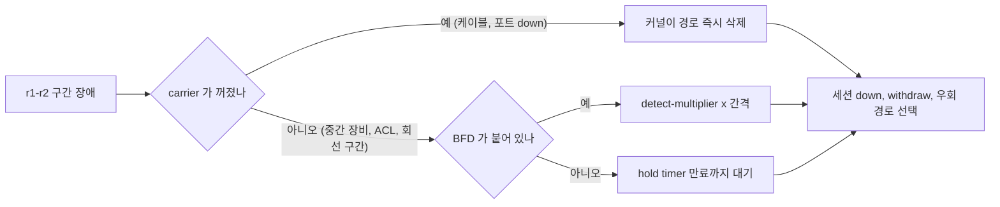
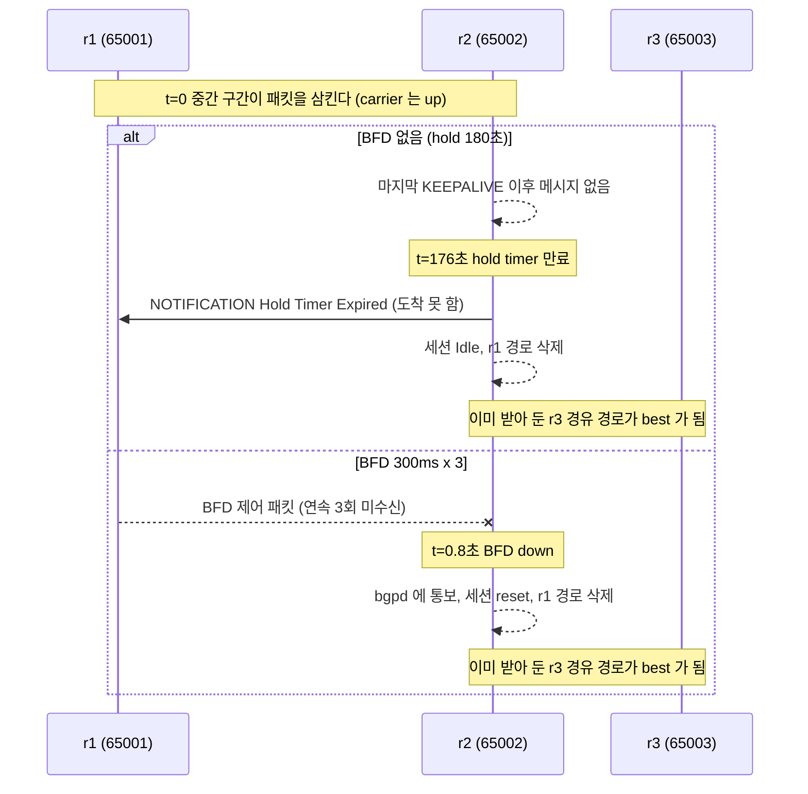
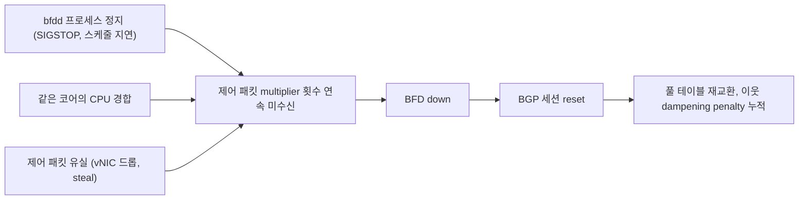
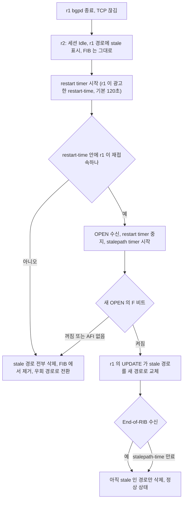
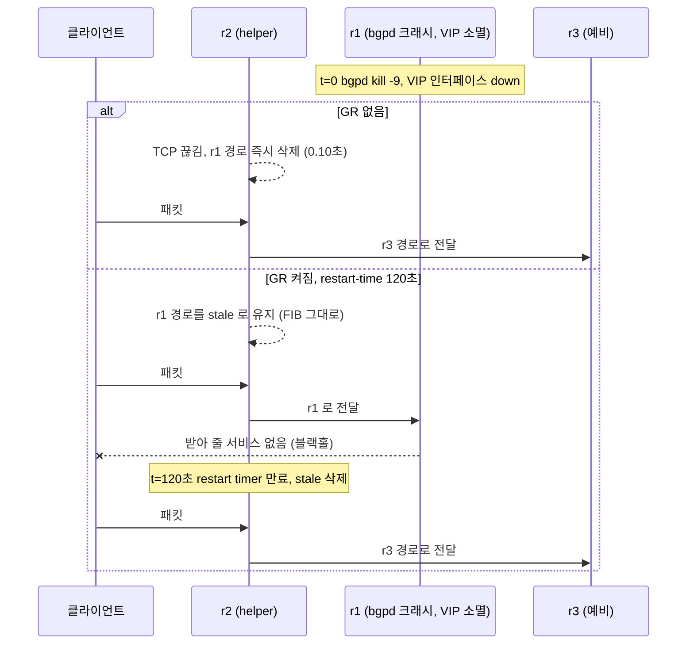
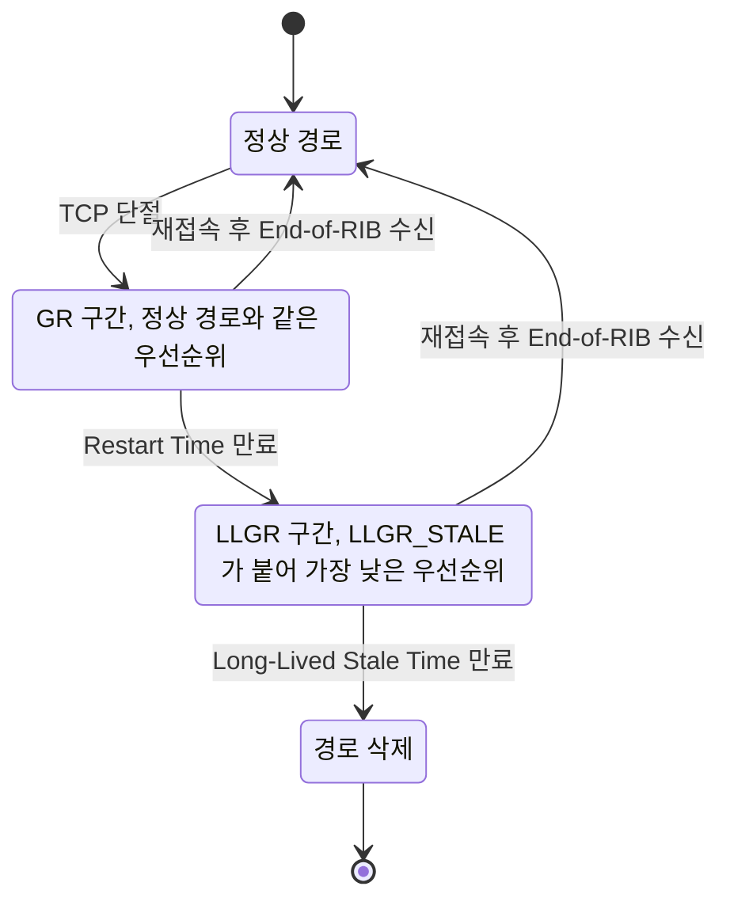
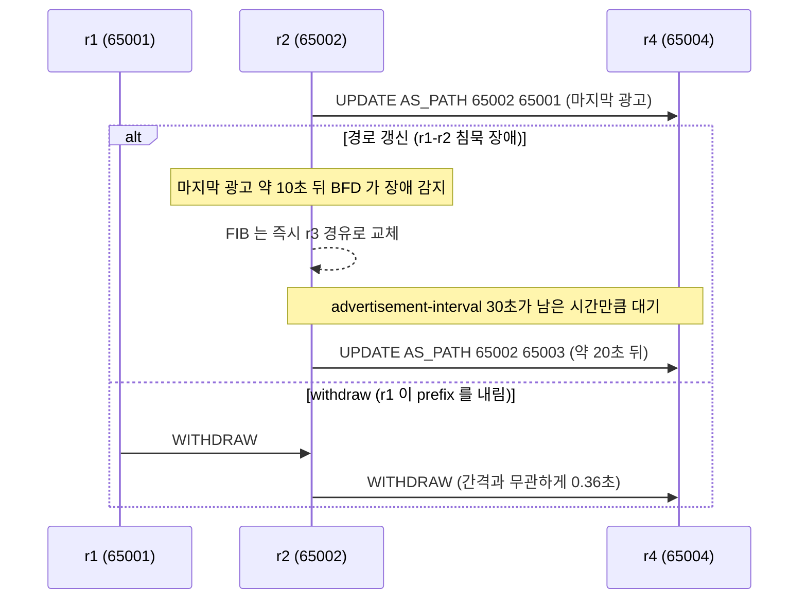
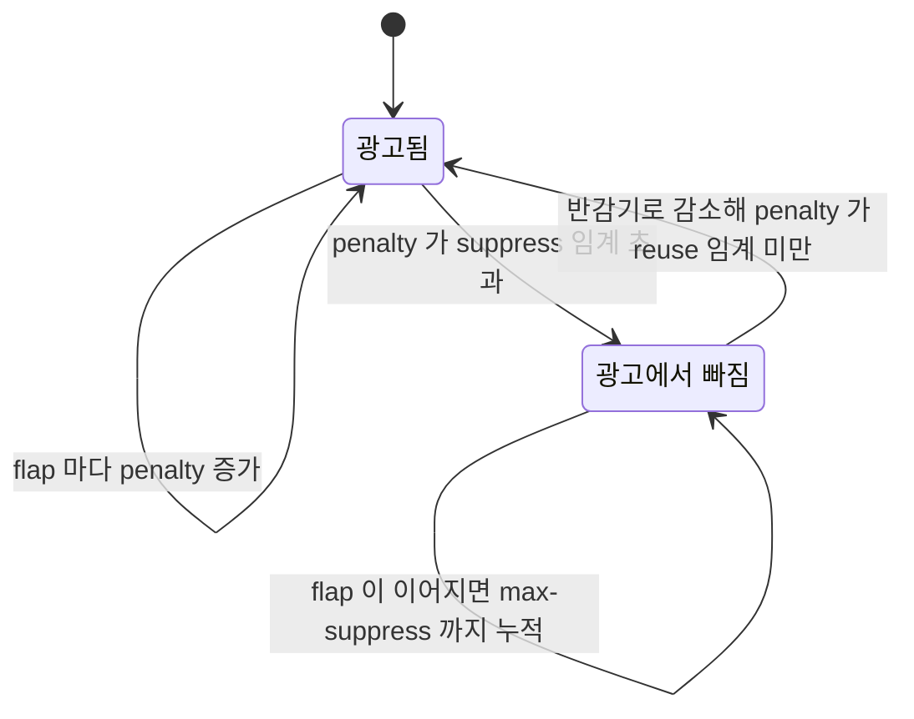

# BGP 장애 감지와 재시작, 타이머와 BFD와 Graceful Restart를 직접 재 본 기록

[BGP](BGP.md) 문서의 컨버전스 절은 "hold timer를 기다린다"는 말과 BFD 한 단락으로 끝난다. [Kubernetes에서의 BGP](BGP_in_Kubernetes_Calico_Metal_LB_Cilium.md) 문서에는 BFD와 Graceful Restart가 노드 장애 한 건을 재는 표 안에 부분적으로만 나온다. 이 문서는 그 사이를 메운다. 장애를 어떻게 알아채는지(hold timer, BFD), 알아챈 뒤에 경로를 얼마나 붙들고 있는지(Graceful Restart), 알아챈 사실이 이웃에게 얼마나 빨리 퍼지는지(MRAI), 불안정한 경로를 얼마나 오래 막는지(dampening)를 순서대로 본다.

수치는 전부 이 저장소의 작업 호스트에서 FRR 8.1로 직접 측정한 것이다. 인용한 값에는 출처 링크를 달았고, 측정하지 못한 항목은 못 했다고 적었다. 측정 환경은 첫 절에 있다. FRR 8.1 한 가지 구현에서 나온 값이라 다른 장비의 기본값이나 세부 동작은 다를 수 있다.

## 측정 환경

[BGP 실습](BGP_Lab_FRR_Containerlab.md)과 같은 방식으로 라우터 한 대를 network namespace 하나로 만들고 링크는 veth로 이었다. 노드는 네 대다.

| 노드 | AS | 역할 |
|---|---|---|
| r1 | 65001 | 10.10.0.0/24 원점. dummy 인터페이스로 prefix를 만든다 |
| r2 | 65002 | 관측 대상. 이 노드의 커널 FIB가 언제 바뀌는지를 잰다 |
| r3 | 65003 | 우회 경로. r1과 r2 양쪽에 붙어 있다 |
| r4 | 65004 | r2의 하류. MRAI 측정에만 쓴다 |

r2는 r1에서 직접 받은 경로(AS_PATH 길이 1)와 r3를 거쳐 받은 경로(길이 2)를 가진다. 평상시 best는 r1이다. 장애를 넣으면 r2 FIB의 10.10.0.0/24 nexthop이 `10.0.12.1`에서 `10.0.23.1`로 바뀌는 시점까지를 10ms 간격으로 폴링해서 쟀다. BGP 테이블이 아니라 커널 FIB를 본 이유는 패킷이 실제로 그 경로를 타기 시작하는 시점이 필요해서다.

장애 주입은 세 가지로 갈랐다.

```bash
# 침묵 장애: carrier는 살아 있고 패킷만 사라진다 (중간 장비, ACL, 회선 구간 단절)
ip netns exec gr_r1 tc qdisc add dev eth-r2 root netem loss 100%
ip netns exec gr_r2 tc qdisc add dev eth-r1 root netem loss 100%

# 링크 다운: carrier가 꺼진다 (케이블 뽑힘, 포트 down)
ip -n gr_r1 link set eth-r2 down

# bgpd 크래시: 데몬만 죽는다
kill -9 $(cat /tmp/gr/run/r1/bgpd.pid)
```

침묵 장애를 `iptables DROP`이 아니라 `tc netem loss 100%`로 넣은 데는 이유가 있다. DROP은 OUTPUT 체인에서 sendto가 `EPERM`을 돌려줘서 데몬이 오류를 알아챈다. netem은 보낸 쪽에서 아무 오류도 보이지 않아 실제로 중간 구간이 삼키는 상황과 같다.

세션을 올린 직후 항상 같은 지연 뒤에 장애를 넣었기 때문에 같은 설정의 반복값이 거의 같다. 반복 횟수는 표마다 적었다. 5회 안팎이라 분포를 말하기엔 적고, 범위만 본다.

## hold timer가 느린 이유

BGP에는 상대가 살아 있는지 묻는 메시지가 따로 없다. KEEPALIVE를 주기적으로 보내고, hold time 동안 아무 메시지도 못 받으면 죽었다고 판단한다. 감지가 "소식이 없음"의 타임아웃이라서 상대가 죽은 순간이 아니라 마지막으로 뭔가 받은 순간부터 시간이 흐른다.

RFC 4271은 hold time 기본을 [90초, KEEPALIVE는 그 3분의 1로 제안한다](https://www.rfc-editor.org/rfc/rfc4271.txt)(§10). FRR는 keepalive 60초, hold 180초가 기본이다. 침묵 장애를 넣고 r2의 FIB가 바뀔 때까지 쟀다.

| 설정 (keepalive/hold) | FIB 교체까지 | 반복 |
|---|---|---|
| FRR 기본 60/180 | 176.23초, 176.27초 | 2회 |
| 30/90 | 86.23~86.27초 | 3회 |
| 3/9 | 7.16~7.23초 | 5회 |

hold 값에서 3~4초가 빠진 이유는 세션이 올라온 뒤 장애를 넣기까지의 시간 동안 이미 hold timer가 소모됐기 때문이다. 마지막 메시지를 받은 시점부터 타이머가 도니, 장애가 KEEPALIVE 직후에 나면 거의 hold 전체를 기다리고 직전에 나면 거의 안 기다린다. 평균은 hold의 절반이 아니라 그 사이 어디든 될 수 있다.

타이머를 줄이면 되지 않느냐는 질문이 늘 나온다. 3/9까지 내린 결과가 7초다. 그 아래로는 못 간다. RFC 4271은 hold time을 0이거나 3초 이상으로 제한한다. 여기서 더 줄이는 방법은 없고, 3초 hold의 KEEPALIVE는 1초마다 간다. bgpd는 경로 처리와 KEEPALIVE 처리를 같은 프로세스가 하기 때문에 테이블이 크게 출렁이는 순간에 KEEPALIVE 한두 번이 밀리면 멀쩡한 세션이 내려간다. 이 부분은 이 랩에서 재현하지 않았다. 경로가 몇 개뿐인 랩에서는 일어나지 않는 부류라서다.

링크가 아예 꺼지는 경우에는 hold timer를 기다릴 일이 없다. 아래 그림은 장애 종류별로 어느 경로로 감지되는지를 나눈 것이다.



링크 다운은 BFD 없이도 빠르다. 링크를 내렸더니 r3 경유 경로가 FIB에 들어온 시점이 0.07~0.08초(BFD 없음, 3회 중 2회)와 0.07~0.09초(BFD 있음, 3회)였다. BFD 없음 한 번은 0.74초가 걸렸는데 원인은 확인하지 못했다. 커널이 nexthop이 사라진 경로를 먼저 지우고, bgpd는 zebra에게 nexthop 도달 불가를 통보받아 곧바로 세션을 내린다. 이 경로에서는 BFD가 할 일이 없다.

문제는 carrier가 살아 있는 장애다. 광전송 장비나 L2 스위치가 중간에 끼어 있으면 포트는 up인데 그 너머가 죽는 일이 생긴다. 이 경우의 감지는 hold timer나 BFD의 몫이다.

## BFD가 감지 시간을 만드는 방식

BFD([RFC 5880](https://www.rfc-editor.org/rfc/rfc5880.txt))는 BGP와 별개의 프로토콜이다. 단일 홉 세션은 UDP 3784로 제어 패킷을 주고받고, TTL은 255로 보내며 255가 아니면 버린다([RFC 5881](https://www.rfc-editor.org/rfc/rfc5881.txt) §4, §5). TTL 255 검사는 [GTSM](BGP_Session_Security_TCP_AO_GTSM.md)과 같은 발상이고, 한 홉 밖에서 위조한 패킷을 막는다.

### detect-multiplier 계산

비동기 모드에서 감지 시간은 이렇게 정해진다([RFC 5880 §6.8.4](https://www.rfc-editor.org/rfc/rfc5880.txt)).

```text
감지 시간 = 상대가 보낸 Detect Mult × 합의된 상대의 송신 간격
합의된 상대의 송신 간격 = max(내 Required Min RX, 상대의 Desired Min TX)
```

양쪽이 300ms로 설정하고 multiplier가 3이면 900ms다. 한쪽이 300ms, 다른 쪽이 100ms라면 그 큰 값인 300ms로 합의되고, 설정을 더 빠르게 한 쪽의 의도는 반영되지 않는다. 그리고 감지 시간은 내 설정이 아니라 상대의 Detect Mult로 정해진다. 양쪽이 서로 다른 multiplier를 쓰면 방향마다 감지 시간이 다르다.

실제 값은 900ms보다 조금 짧게 나온다. RFC 5880 §6.8.7이 송신 간격에 [0~25% 감산 jitter를 걸도록 규정](https://www.rfc-editor.org/rfc/rfc5880.txt)하기 때문이다. 300ms 간격이면 실제 패킷 간격은 225~300ms 사이에서 흔들리고, 마지막 패킷이 도착한 뒤 감지까지의 시간이 675~900ms가 된다. 측정값은 아래와 같았다.

| 설정 | 계산상 범위 | 측정 (FIB 교체까지) | 반복 |
|---|---|---|---|
| 1000ms x 3 | 2.25~3.00초 | 2.38~2.72초 | 4회 |
| 300ms x 3 | 0.675~0.900초 | 0.78~0.90초 | 5회 |
| 100ms x 3 | 0.225~0.300초 | 0.31~0.36초 | 5회 |
| 50ms x 3 | 0.113~0.150초 | 0.19~0.23초 | 5회 |

간격이 짧아질수록 계산값과 측정값의 차이가 커 보이는데 이건 감지 이후에 붙는 고정 지연 때문이다. bfdd가 bgpd에 통보하고, 세션이 내려가고, 경로를 다시 고르고, zebra가 커널에 쓰는 데 50ms 정도가 든다. 폴링 간격 10ms도 더해진다. 50ms 간격에서는 이 고정 지연이 감지 시간과 같은 크기가 된다.

### echo 모드

echo 모드에서는 내가 보낸 패킷이 상대의 포워딩 플레인을 거쳐 그대로 돌아온다. 상대의 BFD 프로세스는 관여하지 않으니 상대의 제어 평면이 바빠도 영향이 없고, 상대 쪽 CPU가 아니라 포워딩 경로만 검사한다. UDP 목적지 포트는 3785다. RFC 5880은 echo가 켜진 동안 제어 패킷의 수신 간격을 1초 이상으로 늦추도록 권한다(§6.8.3).

FRR 8.1에서는 echo를 이렇게 켠다. 상대도 FRR여야 한다는 경고가 `echo-mode` 입력 때 나온다(`Current implementation of echo mode works only when the peer is also FRR`).

```text
bfd
 peer 10.0.12.1
  echo-mode
  echo transmit-interval 50
  echo receive-interval 50
```

제어 패킷은 300ms x 3, echo는 50ms로 두고 침묵 장애를 넣었더니 FIB 교체가 0.21~0.22초(4회)였다. echo 없이 같은 제어 패킷 설정에서 0.78~0.90초였으니 감지가 echo 쪽 타이머를 따른 것이다. FRR가 echo를 켠 뒤에도 제어 패킷은 계속 300ms 간격으로 나갔다(`show bfd peer counters`에서 제어 패킷 약 35개와 echo 패킷 96개가 같은 시간대에 찍혔다). RFC가 권하는 1초 이상 완화는 구현하지 않는 것으로 보인다. 이 부분은 패킷 캡처로 확인하지 않았다.

BGP에 붙이는 설정은 한 줄이다. 양쪽 모두에 넣어야 한다.

```text
router bgp 65002
 neighbor 10.0.12.1 bfd 3 300 300
```

숫자는 multiplier, 수신 간격(ms), 송신 간격(ms) 순서다. 한쪽에만 넣으면 BFD 세션이 올라오지 않아 BGP 세션은 정상인데 BFD가 없는 상태가 된다. `show bfd peers brief`로 `up`을 확인한다.

## 침묵 장애 타임라인

같은 장애를 BFD 없이 두었을 때와 붙였을 때를 한 그림에 놓았다. 위쪽 분기는 hold 180초(FRR 기본), 아래쪽 분기는 300ms x 3이다. 시각은 측정 평균이다.



176초 동안 r2는 10.10.0.0/24 트래픽을 계속 r1 쪽으로 보내고 r1 앞 구간이 그걸 삼킨다. 우회 경로(r3)는 r2의 Adj-RIB-In에 처음부터 들어 있었다. 알고 있으면서도 못 쓴 것이다. BFD가 하는 일은 새 경로를 찾는 게 아니라 "지금 쓰는 경로가 죽었다"를 빨리 말해 주는 것뿐이다. 우회 경로가 없는 구성에서는 BFD를 붙여도 얻는 게 없다. 트래픽이 블랙홀로 가는 대신 즉시 `unreachable`이 되는 정도의 차이다.

노드가 통째로 죽은 경우(r1의 모든 링크가 침묵)도 따로 쟀다. 이 실험에서는 r3도 같은 prefix를 원점으로 광고하게 하고 r2에서 local-pref를 90으로 낮춰 r1을 우선으로 만들었다. BFD 300ms x 3으로 FIB 교체까지 0.95초(1회), BFD 없이 hold 9초로 두면 6.09초(1회)였다.

## 수렴 시간 비교

위 측정을 한 표에 모았다. 모두 r2의 FIB가 r3 경유로 바뀌는 시점이다.

| 장애 | 감지 수단 | FIB 교체까지 | 근거 |
|---|---|---|---|
| 링크 다운 | carrier | 0.07~0.09초 (1회 0.74초) | 직접 측정 6회 |
| 침묵 | hold 180초 | 176.2초 | 직접 측정 2회 |
| 침묵 | hold 90초 | 86.2초 | 직접 측정 3회 |
| 침묵 | hold 9초 | 7.2초 | 직접 측정 5회 |
| 침묵 | BFD 1000ms x 3 | 2.4~2.7초 | 직접 측정 4회 |
| 침묵 | BFD 300ms x 3 | 0.78~0.90초 | 직접 측정 5회 |
| 침묵 | BFD 100ms x 3 | 0.31~0.36초 | 직접 측정 5회 |
| 침묵 | BFD 50ms x 3 | 0.19~0.23초 | 직접 측정 5회 |
| 침묵 | BFD 300ms x 3 + echo 50ms | 0.21~0.22초 | 직접 측정 4회 |
| 노드 사망 | BFD 300ms x 3 | 0.95초 | 직접 측정 1회 |
| 노드 사망 | hold 9초 | 6.09초 | 직접 측정 1회 |

이 표가 가리키는 건 인터넷 전체의 수렴이 아니다. 이웃 한 곳이 우회 경로로 넘어가는 시간이다. 우회 경로가 없어서 withdraw가 여러 AS를 거쳐 전파되는 경우는 이 값에 MRAI와 경로 탐색이 더해진다. 그 부분은 뒤에서 본다.

## BFD가 flap을 일으키는 경우

BFD를 빠르게 잡을수록 오탐도 늘어난다. BFD가 내려가면 BGP 세션이 같이 내려가기 때문에 오탐 한 번이 곧 풀 테이블 재교환이다. 이 랩에서 BFD down 한 번마다 r2의 `Connections established`가 한 번씩 늘었다. 오탐을 만드는 원인을 셋으로 나눠 재현했다.

세 원인은 모두 "제어 패킷이 multiplier 횟수만큼 연속으로 안 온다"는 같은 결과로 모이고, 그 뒤는 한 줄로 이어진다. 원인이 다르면 손댈 곳도 다르다는 점을 아래 그림에서 보면 된다.



### 프로세스가 멈추는 경우

FRR의 bfdd는 일반 사용자 공간 프로세스다. 스케줄러가 그 프로세스를 못 돌리면 제어 패킷이 안 나간다. r1의 bfdd에 SIGSTOP을 걸었다가 풀어서, 멈춘 시간별로 r2가 BFD down을 보는지 확인했다. 시간마다 1회씩 쟀다.

| 설정 | flap 안 남 | flap 남 |
|---|---|---|
| 300ms x 3 | 300, 600, 800ms | 1000, 1200, 1500ms |
| 100ms x 3 | 200ms | 300, 400, 600ms |
| 50ms x 3 | 없음 | 100, 150, 250ms |

경계가 감지 시간(multiplier x 간격에 jitter 감산)에 거의 맞는다. 300ms x 3은 800ms까지 버티고 1000ms에서 끊겼다. 50ms x 3은 100ms 멈춤에도 끊겼다. 프로세스가 100ms 멈추는 건 부하가 있는 서버에서 드문 일이 아니다.

### CPU 경합

같은 CPU 코어에 bfdd를 고정(`taskset`)하고 같은 코어에서 busy loop 세 개를 nice 0으로 30초간 돌렸다. r2가 보는 BFD down 횟수다.

| 설정 | 부하 없음 | 부하 있음 |
|---|---|---|
| 50ms x 3 | 0회 | 18회, 21회 (2번 실행) |
| 100ms x 3 | - | 0회 |
| 300ms x 3 | - | 0회 |
| 50ms x 10 | - | 0회 |

부하만 걸었을 뿐인데 50ms x 3은 30초에 스무 번 안팎 끊겼다. 100ms 이상이거나 multiplier를 10으로 올리면 같은 부하에서 한 번도 끊기지 않았다. 횟수 자체는 비교 수단이 못 된다. BFD가 한 번 끊기면 다시 올라오는 동안(제어 패킷이 느린 속도로 핸드셰이크를 한다) 새 이벤트가 쌓이지 않는다. 그래서 횟수는 실제 오탐 위험보다 작게 나온다.

라우터 전용 장비는 BFD를 라인카드에서 처리하는 경우가 많고, 이때 BFD 패킷의 C 비트(Control Plane Independent)를 1로 보낸다. 이 비트는 BFD가 제어 평면과 운명을 같이하지 않는다는 선언이다([RFC 5880 §4.1](https://www.rfc-editor.org/rfc/rfc5880.txt)). 리눅스 서버의 FRR나 BIRD는 사용자 공간 프로세스라 이 보장이 없다. 서버에서 50ms 간격을 쓰려면 이 위험을 감수하고 쓰는 것이다.

### 패킷 유실

가상 NIC에서 드롭이 생기거나 하이퍼바이저가 steal 시간을 가져가면 제어 패킷이 연속으로 사라질 수 있다. 클라우드 VM의 vNIC에서 이런 드롭이 얼마나 나는지는 이 환경에서 재현하지 못했다. 대신 veth에 netem으로 양방향 20% 손실을 60초간 걸어 multiplier의 효과만 봤다.

| 설정 | 60초간 BFD down |
|---|---|
| 50ms x 3 | 13회 |
| 50ms x 5 | 1회 |
| 50ms x 10 | 0회 |

간격을 그대로 두고 multiplier만 올려도 오탐이 거의 사라진다. 대가는 감지 시간이다. 50ms x 10은 감지에 최대 500ms가 걸려 300ms x 3(900ms)보다는 빠르다. 오탐이 문제라면 간격을 늘리기 전에 multiplier부터 올리는 쪽이 같은 감지 시간에서 유리하다. 이 계산은 유실이 독립적이라고 가정한 것이고, 실제 NIC 드롭은 몰려서 나는 경향이 있다. 몰려 나는 유실에서는 multiplier의 효과가 여기서 본 값보다 작을 수 있다.

## Graceful Restart가 하는 일

라우터가 소프트웨어를 재시작하는 동안 BGP 세션이 끊기면, 보통은 상대가 그 라우터에서 받은 경로를 전부 지운다. 그런데 재시작하는 라우터의 포워딩 테이블(FIB)은 재시작 동안에도 그대로일 수 있다. Graceful Restart([RFC 4724](https://www.rfc-editor.org/rfc/rfc4724.txt))는 이 점을 이용한다. 상대가 경로를 바로 지우지 않고 "stale" 표시만 한 채 계속 쓰게 한다.

### 협상 값과 타이머

OPEN 메시지의 Graceful Restart capability에 들어가는 값이 둘 있다.

| 필드 | 의미 |
|---|---|
| Restart Time (12비트, 초) | 재시작 뒤 세션이 다시 올라오는 데 걸릴 것으로 예상하는 시간 |
| Restart State (R) 비트 | 이 OPEN을 보낸 쪽이 방금 재시작했다는 표시 |
| Forwarding State (F) 비트 (주소 계열마다) | 재시작 중에 포워딩 상태를 실제로 보존했는지 |

받는 쪽(helper)은 TCP 연결이 끊긴 걸 알아채면 그 피어의 경로를 stale로 표시하고 `Restart Time` 동안만 기다린다. 그 안에 세션이 안 올라오면 stale 경로를 전부 지운다(RFC 4724 §4.2). 세션이 올라오면 새 OPEN의 F 비트가 꺼져 있을 때 해당 주소 계열의 stale 경로를 즉시 지운다. 켜져 있으면 새 UPDATE가 오는 대로 stale 경로를 새 경로로 바꾸고, End-of-RIB 마커를 받는 순간 아직 stale인 것을 지운다.

End-of-RIB(EoR)는 "이 주소 계열의 초기 광고를 다 보냈다"는 표식이다. IPv4 unicast의 EoR는 [내용이 빈 최소 길이 UPDATE 메시지](https://www.rfc-editor.org/rfc/rfc4724.txt)다. 경로가 하나도 없어도 EoR는 보내야 한다. 이게 없으면 helper는 끝을 모르기 때문에 stale 경로를 `stalepath-time`이 만료될 때까지 붙들고 있다.

FRR의 명령과 기본값은 이렇다(`bgp graceful-restart ?`와 `show bgp neighbors`로 확인한 값).

```text
router bgp 65001
 bgp graceful-restart
 bgp graceful-restart restart-time 120        ! 재시작 후 세션 복구까지 기다릴 시간, OPEN으로 상대에게 광고
 bgp graceful-restart stalepath-time 360      ! 재접속 뒤 stale 경로를 붙들 최대 시간 (로컬 값)
 bgp graceful-restart select-defer-time 360   ! 재시작한 쪽이 best 선택을 미루는 최대 시간
 bgp graceful-restart preserve-fw-state       ! F 비트를 켠다
```

이 설정을 바꿀 때 FRR가 `Graceful restart configuration changed, reset all peers to take effect`를 출력했다. 이미 올라온 세션은 새 capability를 협상한 적이 없어서, 값이 반영되려면 세션을 한 번 내렸다 올려야 한다. 운영 중인 세션에 GR을 켜는 작업이 세션 리셋을 동반한다는 뜻이다.

협상이 끝난 뒤 `show bgp neighbors`에 이렇게 보인다.

```text
  Graceful restart information:
    Local GR Mode: Restart*
    Remote GR Mode: Restart
    R bit: True
    Timers:
      Configured Restart Time(sec): 120
      Received Restart Time(sec): 120
    IPv4 Unicast:
      F bit: True
      End-of-RIB sent: Yes
      End-of-RIB received: Yes
      Timers:
        Configured Stale Path Time(sec): 360
        Configured Selection Deferral Time(sec): 360
```

`preserve-fw-state`를 안 켜면 같은 자리가 `IPv4 Unicast(not preserved)`와 `F bit: False`로 나온다. 그 상태에서 F 비트가 stale 처리를 어떻게 바꾸는지는 이 랩에서 갈라 보지 못했다. 위 RFC 규정만 인용한다.

### 데이터플레인이 유지되는 흐름

r1의 bgpd에 `kill -9`를 하고 2초 뒤 다시 띄웠을 때의 helper(r2) 쪽 동작을 그렸다. 핵심은 BGP 상태가 바뀌어도 FIB는 그대로라는 점이다.



실제로 이 흐름대로 나오는지 r2가 r1 경로만 가진 상태(r3 세션은 내림)에서 재 봤다. r2에서 r1(10.10.0.1)로 20ms 간격 ping을 계속 보내면서 bgpd를 죽였다 살린 결과다. BFD는 끄고 GR만 켰다.

```text
  3.22s  FIB=10.10.0.0/24 via 10.0.12.1 dev eth-r1   BGP=stale
  8.87s  FIB=10.10.0.0/24 via 10.0.12.1 dev eth-r1   BGP=fresh

1000 packets transmitted, 1000 received, 0% packet loss
```

stale 표시가 붙은 상태로 5.6초 동안 FIB가 유지됐고 ping은 한 개도 잃지 않았다. `show bgp ipv4 unicast 10.10.0.0/24`의 경로 줄에는 `65001, (stale)`로 찍혔다. 같은 시험을 GR 없이 돌려보면 경로가 바로 지워진다.

## GR과 BFD를 같이 켰을 때

운영에서는 GR과 BFD를 함께 켜는 구성이 흔하다. 이 랩에서 같은 bgpd 재시작 시험을 BFD 300ms x 3과 같이 돌렸더니 결과가 달랐다. r2에서 r1으로 ping을 보내 손실 구간을 첫 실패부터 마지막 실패까지의 시간으로 쟀다.

| 구성 | 손실 구간 | 반복 |
|---|---|---|
| GR 없음 + BFD | 6.64초 | 1회 |
| GR + BFD | 2.11초, 3.18초, 2.18초 | 3회 |
| GR만 (BFD 없음) | 0 (1000개 중 0개 유실) | 1회 |

GR이 손실을 줄이긴 했지만 BFD가 같이 있으면 0이 되지 않았다. `show bgp neighbors`에 `Last reset ... BFD down received`가 찍혔다. 이 구성의 로그에서 본 순서는 이렇다. bgpd가 죽으면 r2가 stale 처리를 시작하고, r1의 bgpd가 다시 올라와 세션이 한 번 `Established`가 된 직후 다시 `Clearing`으로 떨어지고, 잠시 뒤 다시 올라온다. r1의 BFD 세션은 bgpd가 bfdd에 등록한 것이라 bgpd가 죽으면 같이 사라지고, 새 bgpd가 다시 등록하는 동안 r2의 bfdd가 상대의 상태 변화를 BFD down으로 보는 것으로 짐작한다. BFD 세션의 소멸 시점은 패킷으로 확인하지 못했다.

RFC 4724도 이런 경우를 예상한다. helper가 BFD로 피어의 포워딩 상태가 유효하지 않다고 판단하면 [stale 경로를 지워도 된다(MAY)](https://www.rfc-editor.org/rfc/rfc4724.txt)고 적혀 있다(§4.2). FRR 8.1의 BFD down 처리가 이쪽으로 동작한다.

정리하면 FRR 8.1에서 BFD는 장애를 빨리 알리고 GR은 재시작 중 경로를 붙든다. 두 기능의 목적이 정반대라서, bgpd 재시작이 BFD down을 만들면 GR이 무력해진다. 라인카드가 BFD를 처리하고 C 비트를 보내는 장비는 이 충돌이 없다. 서버의 FRR 구성에서는 재시작 시험을 실제로 돌려 본 뒤 BFD와 GR 조합을 정해야 한다.

## GR 때문에 죽은 노드로 트래픽이 가는 블랙홀

GR은 "재시작하는 라우터의 포워딩은 멀쩡하다"는 가정 위에 서 있다. 이 가정이 틀리면 GR은 장애 노드로 트래픽을 계속 밀어 넣는다. 가장 흔한 경우는 BGP 데몬만 죽은 게 아니라 그 노드에서 VIP를 받던 서비스도 같이 사라진 경우다.

[Kubernetes BGP 문서](BGP_in_Kubernetes_Calico_Metal_LB_Cilium.md)의 MetalLB speaker 파드가 노드와 같이 죽는 상황과 같은 부류다. 이 시험은 r1과 r3가 같은 prefix를 광고하고(r3는 local-pref 90) bgpd를 `kill -9`하면서 r1의 VIP 인터페이스도 내렸다. 서비스가 없어졌다는 뜻이다.



측정은 r2의 FIB가 r3 쪽으로 바뀌는 시점이다. BFD는 껐다.

| 구성 | FIB 교체까지 | 반복 |
|---|---|---|
| GR 없음 | 0.10초 | 1회 |
| GR, restart-time 20초 | 20.07초 | 1회 |
| GR, restart-time 120초 (기본) | 120.07초 | 1회 |
| GR, restart-time 120초 + BFD 300ms x 3 | 120.08초, 120.07초 | 2회 |

블랙홀이 지속되는 시간이 restart-time과 소수점 둘째 자리까지 같다. restart-time은 재시작을 얼마나 오래 기다려 줄지를 상대에게 약속하는 값이다. 기본 120초가 곧 장애 노드로 트래픽이 가는 최대 시간이다. BFD를 같이 켜도 달라지지 않았다. bgpd가 죽으면 bfdd 세션도 정상 종료되어 상대가 장애로 보지 않는 것으로 짐작하지만 이 부분은 확인하지 못했다.

반대로 GR이 켜져 있어도 블랙홀이 생기지 않은 경우를 둘 확인했다. 노드가 통째로 죽고 BFD가 감지한 경우는 GR(restart-time 20초와 120초)을 켜도 FIB가 0.74초, 0.81초에 바뀌었다. BFD가 없고 hold timer가 만료된 경우도 GR을 켠 상태에서 6.16초에 바뀌었다(GR 없음 6.09초). 두 경우 모두 FRR 8.1이 stale을 유지하지 않았다. hold timer 만료에서는 NOTIFICATION이 나가는데, RFC 4724의 기본 동작은 TCP 단절일 때만 stale을 유지하고 NOTIFICATION을 받았을 때는 유지하지 않는다. NOTIFICATION에서도 GR을 적용하게 하는 확장이 [RFC 8538](https://www.rfc-editor.org/rfc/rfc8538.txt)이고, capability의 N 비트로 협상한다. 이 랩의 FRR 8.1이 N 비트를 광고했는지는 확인하지 않았다. N 비트를 켠 구현끼리는 hold timer 만료에서도 stale이 유지될 수 있으니 장비 조합에서 따로 확인해야 한다.

대응은 restart-time을 서비스 복구 시간에 맞춰 낮추는 것이다. bgpd 재시작이 평균 10초 걸리는 환경에서 120초는 과하다. 위 측정에서 restart-time 20초가 블랙홀을 20초로 줄였다. 서비스의 헬스체크가 실패하면 BGP 경로를 직접 withdraw하는 구성(헬스체크 → `network` 제거)을 같이 두면 GR과 상관없이 경로가 빠진다. 파드나 노드가 정상 종료되는 경우는 [graceful shutdown community](BGP_Community_and_Routing_Policy.md)로 경로를 먼저 강등하는 쪽이 낫다.

## Long-Lived Graceful Restart

GR의 약점은 "경로를 믿고 계속 쓰든가, 지우든가" 둘 중 하나라는 점이다. Long-Lived Graceful Restart([RFC 9494](https://www.rfc-editor.org/rfc/rfc9494.txt))는 이 사이에 한 단계를 둔다. 보존하는 시간을 길게 잡되, 보존된 경로를 가장 낮은 우선순위로 내린다.

RFC 9494가 정한 요소는 이렇다.

| 항목 | 값 |
|---|---|
| capability 코드 | 71 |
| Long-Lived Stale Time | 24비트, 초 단위 (주소 계열별) |
| LLGR_STALE community | 0xFFFF0006 |
| NO_LLGR community | 0xFFFF0007 |

흐름은 이렇다. 일반 GR의 Restart Time이 끝나면 LLGR 구간이 시작된다. 보존 시간의 상한은 [Restart Time과 Long-Lived Stale Time의 합](https://www.rfc-editor.org/rfc/rfc9494.txt)이다(§4.2). LLGR 구간의 경로에는 LLGR_STALE community가 붙고, helper는 이 경로를 "다른 어떤 경로보다 덜 선호"로 취급한다(§4.3, §4.4). 우회 경로가 하나라도 있으면 그쪽이 이긴다. 우회 경로가 없을 때만 stale 경로가 쓰인다. 원점이 사라진 경로를 아무도 대체하지 못하면 그 경로가 그대로 쓰이므로, 이전에는 `Network unreachable`이 되던 트래픽이 일단 원래 경로로 시도된다. NO_LLGR가 붙은 경로는 LLGR 대상에서 빠진다.

stale 경로가 겪는 구간을 순서대로 놓으면 아래와 같다. 일반 GR 구간과 LLGR 구간의 차이는 경로 우선순위이고, 두 구간 모두 세션이 다시 올라와 End-of-RIB를 받으면 정상으로 돌아간다.



앞에서 본 블랙홀이 일반 GR의 문제였다면 LLGR은 이걸 구조적으로 덜어낸다. 우회 경로(r3)가 있는 상황에서 stale 경로가 우선순위 맨 아래로 내려가므로 FIB가 r3로 넘어간다. 다만 일반 GR 구간(restart-time)에서는 stale 경로가 정상 경로와 똑같이 취급되어 블랙홀이 그대로 생긴다. LLGR을 쓰면서도 restart-time은 짧게 두는 구성이 의미 있는 이유다.

FRR 8.1에는 이 기능의 설정 명령이 없다. `bgp long-lived-graceful-restart ?`가 `There is no matched command`로 끝났다. 그래서 위 내용은 RFC 기준이고 동작은 직접 확인하지 못했다. FRR의 다른 버전이나 BIRD, 상용 장비에서의 지원 여부와 동작은 사용하는 버전의 문서를 봐야 한다.

## MRAI는 얼마나 늦추나

감지가 빨라도 그 사실이 이웃에게 퍼지는 속도는 MRAI(MinRouteAdvertisementInterval)에 막힐 수 있다. RFC 4271의 제안값은 [eBGP 30초, iBGP 5초](https://www.rfc-editor.org/rfc/rfc4271.txt)다(§10). §9.2.1.1은 이 간격이 "광고와 철회 모두"에 적용된다고 적고 있다.

r2가 r4로 보내는 방향에 `neighbor 10.0.24.2 advertisement-interval`을 바꿔 가며, r1-r2 침묵 장애로 r2가 AS_PATH를 `65002 65001`에서 `65002 65003`으로 바꿔 r4에 UPDATE를 보내는 시간(BFD 100ms x 3으로 감지를 짧게 해서)과, r1이 prefix를 내려 withdraw가 r4에 닿는 시간을 쟀다.

간격 30초에서 경로 갱신이 기다리는 모습과 withdraw가 바로 나가는 모습을 한 그림에 놓았다. 갱신은 직전 광고 시각에 묶이고 withdraw는 묶이지 않는 점을 보면 된다.



| advertisement-interval | 장애 | r4 반영까지 | 비고 |
|---|---|---|---|
| 미설정 (FRR eBGP 기본 0초) | 경로 갱신 | 0.37초 | |
| 5초 | 경로 갱신 | 0.37초 | |
| 30초 | 경로 갱신 | 20.44초 | 마지막 광고로부터 약 10초 뒤 장애 |
| 30초 | 경로 갱신 | 0.36초 | 마지막 광고로부터 40초 뒤 장애 |
| 5초 | withdraw | 0.18초 | |
| 30초 | withdraw | 0.36초 | |

각각 1회씩 측정했다. 값에서 읽히는 규칙은 두 가지다. MRAI는 지연이 아니라 최소 간격이다. 마지막으로 광고한 지 간격이 이미 지났다면 곧바로 나가고(0.36초), 안 지났다면 남은 시간만큼 기다린다(30초 중 20.44초). 간격이 30초인데 바로 직전에 광고가 있었다면 갱신이 최대 30초 늦는다. 두 번째는 FRR 8.1이 withdraw에는 이 간격을 적용하지 않았다는 점이다. 간격 30초에서도 withdraw가 0.36초에 닿았다. RFC 문구와는 다르다. 다른 구현이 철회에도 MRAI를 거는지는 이 랩에서 확인하지 못했다.

경로 갱신이 MRAI에 걸리는 상황은 우회 경로로 넘어갈 때다. r2 자신은 FIB를 바로 바꾸지만 r2 하류의 r4는 최대 간격만큼 옛 경로를 쓴다. withdraw만 보면 MRAI의 영향이 안 보이고, 우회 경로가 있는 구성의 수렴을 잴 때 갱신 쪽에서 드러난다.

## route flap dampening 튜닝

dampening은 경로가 계속 사라졌다 나타나기를 반복하면 그 경로를 일정 시간 막는 장치다. 경로 flap마다 penalty가 쌓이고(반감기에 따라 줄어든다), suppress 임계를 넘으면 경로를 광고에서 뺀다. reuse 임계 밑으로 내려가면 다시 쓴다.

아래 상태도는 경로 하나가 penalty에 따라 쓰임과 억제를 오가는 흐름이다. 억제에서 빠져나오는 길은 시간이 지나 penalty가 reuse 밑으로 줄어드는 한 가지뿐이다.



FRR에서 파라미터를 바꾸면서 r1이 prefix를 내렸다 올리기를 3초 간격으로 반복해, 몇 번째 flap에서 r2가 경로를 suppress하는지 봤다.

| `bgp dampening` 파라미터 (half-life reuse suppress max-suppress) | suppress되는 flap 횟수 | reuse까지 남은 시간 |
|---|---|---|
| 15 750 2000 60 (FRR 기본값) | 2회째 | 21분 13초 |
| 15 750 6000 60 | 6회째 | 44분 59초 |

flap 한 번에 대략 1000이 쌓였다. 기본값은 prefix가 3초 간격으로 두 번만 내려갔다 올라와도 21분간 막는다. `show bgp ipv4 unicast dampening parameters`에는 `Max suppress penalty: 12000`이 찍혔다. 이 값은 `reuse x 2^(max-suppress / half-life)`다(750 x 2^4). 임계(suppress)를 12000 이상으로 두려면 max-suppress를 늘려야 한다. 12000으로 설정해 보았을 때 flap 두 번까지는 suppress가 안 됐고 그 이상은 확인하지 않았다.

[RFC 7196](https://www.rfc-editor.org/rfc/rfc7196.txt)은 이 기본값을 고치라고 권한다. 근거는 측정이다. 옛 기본값 2000은 Internet 규모에서 정상 경로까지 너무 많이 막는다. RFC 7196의 권고는 이렇다.

| 항목 | 권고 |
|---|---|
| suppress 임계 | 6000 이상 (§6, 덜 공격적인 쪽). 보수적으로는 12000 이상 |
| 최대 penalty (구현 내부 상수) | 50,000 이상 |
| 구현의 기본값 | 호환성 때문에 바꾸지 않는다 (SHOULD NOT change) |

6000으로 두면 2000과 비교해 막히는 prefix가 90% 줄고, 업데이트 양은 dampening을 아예 끈 경우 대비 19% 줄어든다는 인용 수치가 RFC 7196에 있다([PELSSER2011]을 근거로 한 §4의 값이다). 기본값이 안 바뀌니 운영자가 직접 올려야 한다.

dampening을 어디에 쓰느냐는 따로 따져 봐야 한다. 이 문서의 BFD 오탐과 만나면 문제가 커진다. BFD가 오탐으로 세션을 몇 번 내리면 그 피어가 광고하던 prefix가 전부 flap한다. [BGP 문서](BGP.md)에서 본 대로 이웃이 dampening을 켜 놓았다면, 복구된 뒤에도 최대 수십 분 경로가 안 보인다. 오탐을 줄이는 쪽(multiplier를 키우고 간격을 늘리는 쪽)과 이웃의 dampening 임계를 올리는 쪽을 같이 봐야 한다.

## 재현 방법

랩 구성(netns 4개와 veth, FRR 데몬 기동)은 [BGP 실습](BGP_Lab_FRR_Containerlab.md)의 `lab.sh`와 같고 노드 수와 링크만 다르다. 핵심은 장애를 넣고 FIB가 바뀔 때까지 폴링하는 부분이다.

```python
import subprocess, time

def route():
    return subprocess.run("ip -n gr_r2 route show 10.10.0.0/24",
                          shell=True, capture_output=True, text=True).stdout

assert "via 10.0.12.1" in route()
t0 = time.monotonic()
subprocess.run("ip netns exec gr_r1 tc qdisc add dev eth-r2 root netem loss 100%", shell=True)
subprocess.run("ip netns exec gr_r2 tc qdisc add dev eth-r1 root netem loss 100%", shell=True)
while "via 10.0.12.1" in route():
    time.sleep(0.01)
print(f"FIB 교체까지 {time.monotonic() - t0:.2f}초")
```

설정은 r2가 r1과 r3에 피어링하고 양쪽에 `neighbor ... timers 3 9`와 `neighbor ... bfd 3 300 300`을 넣는다. 실험마다 랩을 새로 올렸다. 같은 랩에서 장애를 반복하면 netem이 남아 있거나 BFD 세션이 아직 안 올라온 상태로 시작해서 값이 흐트러졌다. 실험 사이에는 `lab.sh down`으로 네임스페이스를 지운다.

## 출처

수치 중 인용한 것은 아래 RFC에서 가져왔고 나머지는 모두 FRR 8.1로 직접 측정했다.

- [RFC 4271 BGP-4](https://www.rfc-editor.org/rfc/rfc4271.txt): hold time 제안값 90초, keepalive 3분의 1, MRAI 제안값 eBGP 30초와 iBGP 5초, §9.2.1.1
- [RFC 4724 Graceful Restart](https://www.rfc-editor.org/rfc/rfc4724.txt): Restart Time, R·F 비트, stale 처리, End-of-RIB
- [RFC 5880 BFD](https://www.rfc-editor.org/rfc/rfc5880.txt): 감지 시간 계산(§6.8.4), jitter(§6.8.7), echo, C 비트
- [RFC 5881 BFD 단일 홉](https://www.rfc-editor.org/rfc/rfc5881.txt): UDP 3784와 3785, TTL 255
- [RFC 7196 Making Route Flap Damping Usable](https://www.rfc-editor.org/rfc/rfc7196.txt): suppress 임계 6000과 12000, 최대 penalty 50,000
- [RFC 8538 Graceful Restart for NOTIFICATION](https://www.rfc-editor.org/rfc/rfc8538.txt): N 비트
- [RFC 9494 Long-Lived Graceful Restart](https://www.rfc-editor.org/rfc/rfc9494.txt): capability 71, LLGR_STALE, NO_LLGR
