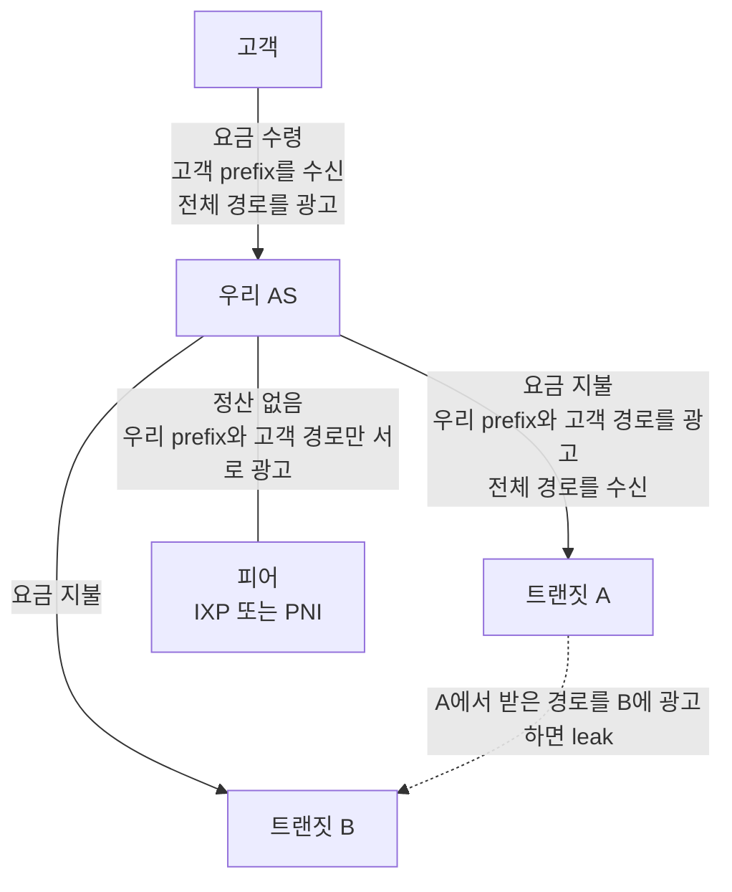
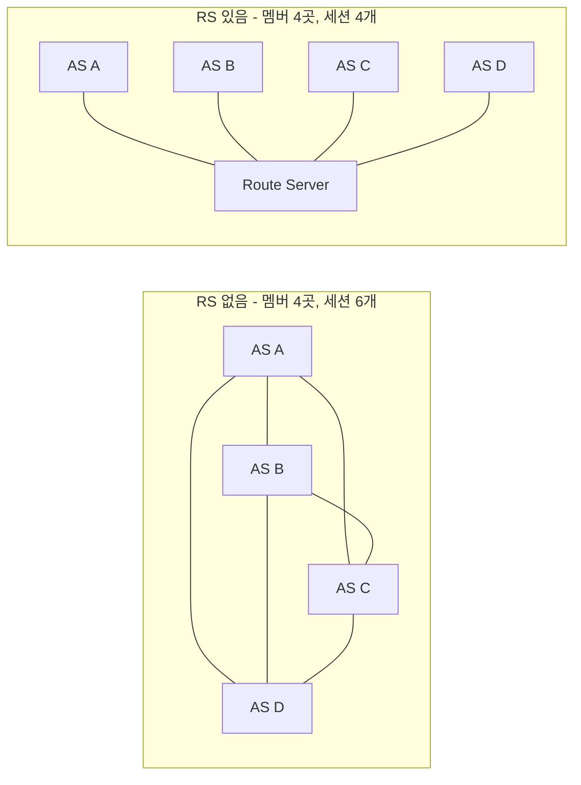
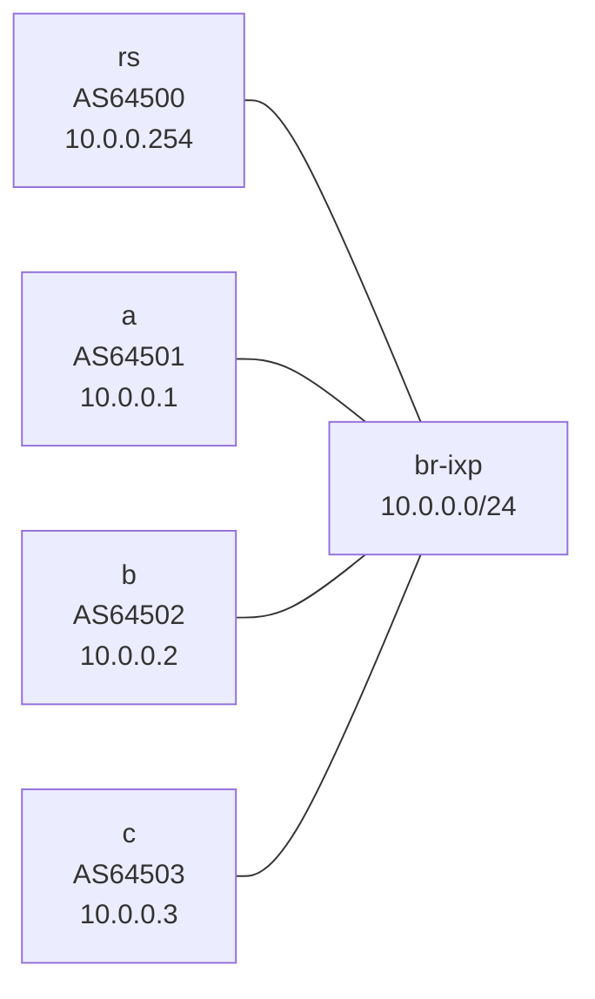
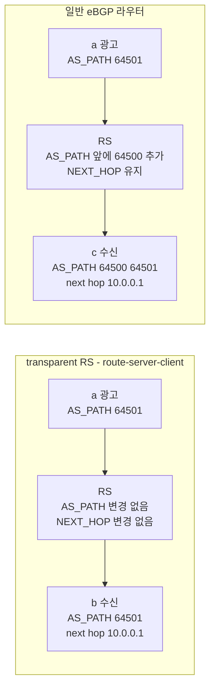
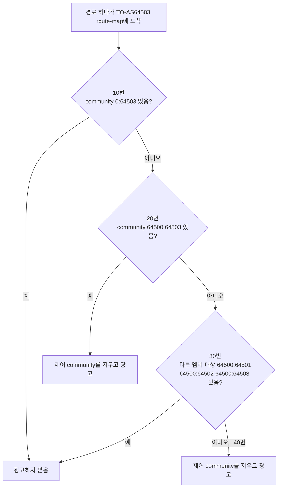
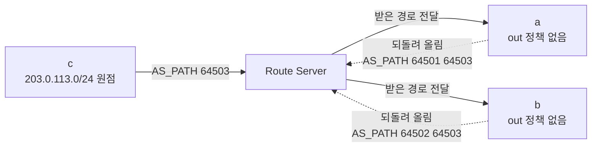
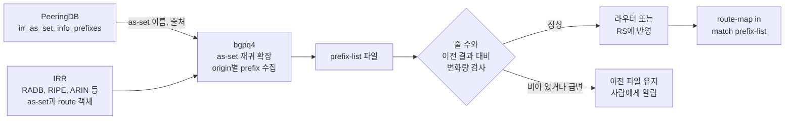
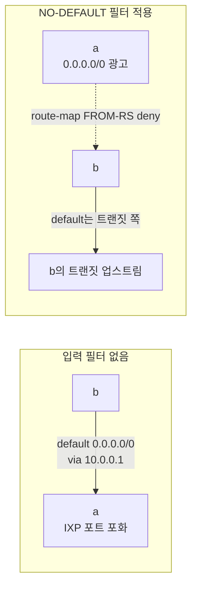
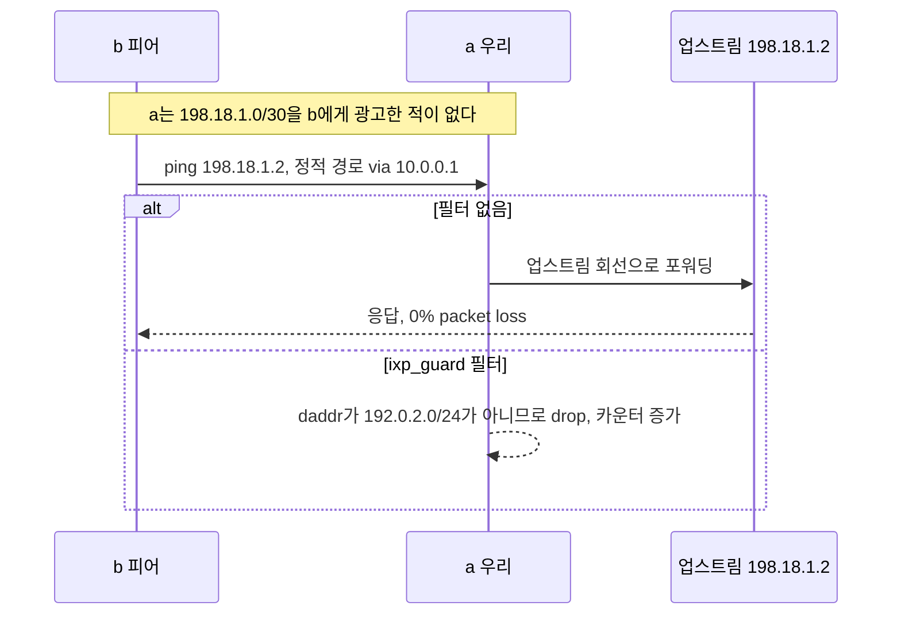
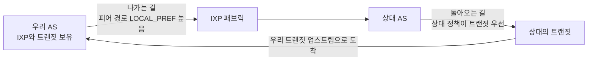

# IXP 피어링과 Route Server

[BGP community와 라우팅 정책](BGP_Community_and_Routing_Policy.md)에서 "피어에서 받은 경로는 고객에게만 준다"는 export 규칙을 다뤘고, [경로 보안](BGP_Route_Security_RPKI_ROV.md)에서 bgpq4로 prefix-list를 만드는 한 줄을 봤다. 둘 다 접점이 어디에 있는지는 가정하고 넘어갔다. 실제로 ISP나 대형 서비스 사업자의 접점은 대부분 IXP(Internet Exchange Point)의 스위치 한 대 위에 있고, 거기서 수십~수백 개의 AS와 동시에 세션을 맺는다. 트래픽 비용이 줄어드는 곳이면서 사고가 가장 싸게 나는 곳이기도 하다. 같은 L2 세그먼트에 모르는 사업자 수백 곳이 붙어 있기 때문이다.

이 문서는 transit, 공용 피어링, PNI가 무엇이 다르고 어떻게 고르는지, IXP에서 세션 수가 폭발하는 문제를 Route Server가 어떻게 줄이는지, Route Server가 경로를 건드리지 않는 방식(transparent)과 community로 광고 대상을 고르는 방법, 피어 필터를 IRR에서 bgpq4로 뽑아 쓰는 절차, 그리고 피어링에서 실제로 터지는 사고 두 가지(default route 수신, 피어의 트랜짓 무임승차)와 포트 포화를 다룬다. FRR 8.1을 네임스페이스 4개로 띄워 직접 돌린 출력을 쓴다.

## 트랜짓, 공용 피어링, PNI

상대 AS와 경로를 주고받는 방법은 세 가지다. 세 방식 모두 BGP 세션이라는 점은 같고, 달라지는 것은 요금이 누구에게 흐르는지와 어느 경로까지 서로 광고하는지다.

| 구분 | 요금 | 받는 경로 | 물리 연결 |
|---|---|---|---|
| 트랜짓 | 내가 업스트림에 낸다. 보통 사용량(commit + 95th percentile)에 비례 | 인터넷 전체(default 또는 full table) | 업스트림 장비와 전용 회선 |
| 공용 피어링 | IXP 포트 비용 + 크로스커넥트. 트래픽 양과 무관하게 정액 | 상대 AS와 그 고객 경로만 | IXP 공유 스위치 패브릭 |
| PNI(private peering) | 크로스커넥트 + 양쪽 포트. 정액 | 상대 AS와 그 고객 경로만 | 두 라우터를 직접 잇는 전용 케이블 |

트랜짓은 "인터넷 전체에 닿는 값"을 내는 것이고, 피어링은 "상대와 그 고객에게만 닿는 대신 비트당 요금이 없는" 거래다. 그래서 피어링만으로는 인터넷에 닿지 못한다. 피어는 자기 트랜짓 업스트림에서 받은 경로를 나에게 주지 않는다. 트랜짓은 최소 한 줄이 남아 있어야 한다.

이 규칙은 경로 광고 방향으로 표현된다. 고객에게서 받은 경로는 누구에게나 광고하고, 피어나 트랜짓에게서 받은 경로는 고객에게만 광고한다. 이렇게 하면 AS_PATH를 따라가 봤을 때 올라가는 길(고객→제공자)이 있고, 한 번 옆으로 건너는 길(피어)이 있고, 내려가는 길(제공자→고객)이 있다. 내려갔다가 다시 올라가거나 옆으로 두 번 건너는 경로가 나오지 않는다. 이 모양을 valley-free라고 부른다.



점선이 막아야 하는 방향이다. 트랜짓 A에서 받은 경로를 트랜짓 B나 피어에게 내보내면 내가 둘 사이의 무료 중계가 된다. 요금을 내는 쪽 회선으로 남의 트래픽이 지나가고, 피어는 그 경로로 트래픽을 보내기 시작한다. 이 export 필터를 정책으로 구현하는 방법은 community 문서의 "출처별 태그와 export 규칙"에 있다.

### 고르는 기준

셋 중 하나를 고르는 일은 대부분 "이 상대와 오가는 트래픽이 얼마인가"로 정리된다.

트래픽이 작은 AS 수백 곳은 공용 피어링이 맞다. 포트 하나와 세션 하나(Route Server)로 모두에게 닿고, 상대마다 케이블을 깔 이유가 없다. 한 피어와의 트래픽이 내 IXP 포트의 상당 부분을 차지하기 시작하면 그 피어는 PNI로 뺀다. 공용 포트는 모든 피어가 같이 쓰는 용량이라 한 상대가 점유하면 나머지 피어 트래픽이 같이 밀린다. PNI는 두 장비 사이의 선이라 다른 피어의 부하와 섞이지 않고, 한쪽 장애나 DDoS가 공유 스위치로 번지지도 않는다. PNI로 옮기는 임계치는 회선 단가와 크로스커넥트 월 비용을 놓고 직접 계산해야 한다. 업계에서 통용되는 단일 숫자는 없다.

트랜짓은 줄일 수는 있어도 없앨 수 없다. 피어링으로 닿지 않는 목적지가 분명히 남기 때문이다. 대신 "얼마를 트랜짓으로 흘리고 있는가"가 피어링 투자의 판단 기준이 된다. 트랜짓으로 나가는 트래픽을 목적지 AS별로 집계해서 상위 AS를 확인하고, 그 AS가 가입된 IXP를 PeeringDB에서 찾는 순서로 일한다.

## 멤버가 늘면 세션이 제곱으로 는다

IXP 패브릭은 L2 스위치라서 같은 VLAN에 붙은 두 멤버는 서로 직접 BGP 세션을 맺을 수 있다. 이것을 bilateral 피어링이라 한다. 상대마다 세션을 따로 협의하고 설정해야 한다. 멤버가 n개면 모두와 맺을 때 n(n-1)/2개의 세션이 생기고, 멤버 입장에서는 n-1개를 직접 관리한다.

| 멤버 수 | full mesh 세션 총수 | Route Server 1대 | Route Server 2대(이중화) |
|---|---|---|---|
| 5 | 10 | 5 | 10 |
| 10 | 45 | 10 | 20 |
| 50 | 1,225 | 50 | 100 |
| 100 | 4,950 | 100 | 200 |
| 800 | 319,600 | 800 | 1,600 |

Route Server는 멤버가 서로 세션을 맺는 대신 모두가 RS와 하나씩만 맺게 하고, RS가 한 멤버의 경로를 나머지 멤버에게 대신 전달한다. 멤버 한 곳의 입장에서는 세션이 n-1개에서 1개(이중화 시 2개)로 줄고, IXP 쪽 상호 협의도 필요 없다.



왼쪽은 멤버가 하나 늘 때마다 기존 멤버 전부가 설정을 추가해야 한다. 오른쪽은 새 멤버가 RS와 한 번만 맺으면 이미 있던 멤버들에게 아무 작업이 없다. 작은 멤버가 많은 IXP가 RS를 거의 필수로 두는 이유다.

RS는 경로만 중계하고 패킷은 중계하지 않는다. 데이터는 멤버끼리 L2로 직접 간다. 이 점은 아래 실험 환경에서 확인했다. b에 a의 주소(1.1.1.1/32)로 가는 정적 경로를 넣고 ping을 보내는 동안 RS 네임스페이스의 인터페이스에서 `tcpdump -ni eth0 icmp`를 5초 돌렸더니 `0 packets captured`가 나왔다. 그래서 RS가 죽으면 멤버 사이의 패킷 전달이 아니라 경로 광고가 끊긴다. 세션이 내려가면 멤버가 RS에서 배운 BGP 경로는 모두 withdraw된다. 뒤에서 이 상황을 다시 본다.

RS에도 한계가 있다. RS가 걸러 주는 만큼만 안전하고, 멤버가 RS에서 받은 경로 중 어떤 것을 신뢰할지는 별도 문제다. 그리고 상대와 개별 정책(예: 특정 상대에게만 MED를 다르게 주기)을 걸고 싶으면 bilateral 세션을 따로 맺어야 한다. 대형 콘텐츠 사업자 상당수가 RS로 롱테일을 처리하고 상위 피어는 bilateral이나 PNI로 따로 맺는 이유다.

## 실험 환경

네임스페이스 4개를 Linux bridge 하나에 붙여 IXP 스위치로 쓰고, 각 네임스페이스에서 FRR 8.1의 zebra와 bgpd를 별도 소켓으로 띄웠다.



a, b, c는 각각 192.0.2.0/24, 198.51.100.0/24, 203.0.113.0/24를 광고한다. 실험 장비에는 staticd가 없어서 `network` 명령이 RIB 존재 여부를 확인하다 막히는 문제가 있었고, 각 멤버에 `no bgp network import-check`를 넣어 해결했다. 실제 장비 설정이 아니라 실험용 우회다.

## Route Server는 자기 존재를 숨긴다

IXP RS가 일반 eBGP 라우터와 다른 점은 경로를 가공하지 않는 것이다. RFC 7947이 정한 transparent 동작이다. 멤버 a의 경로를 b에 전달할 때 RS는 AS_PATH에 자기 ASN을 붙이지 않고, NEXT_HOP도 바꾸지 않고, MED도 건드리지 않는다. b가 보기에는 a와 직접 맺은 bilateral 세션에서 받은 경로와 같다.

RS 쪽 설정은 FRR에서 `route-server-client` 한 줄이다.

```
router bgp 64500
 bgp router-id 10.0.0.254
 no bgp ebgp-requires-policy
 neighbor 10.0.0.1 remote-as 64501
 neighbor 10.0.0.2 remote-as 64502
 neighbor 10.0.0.3 remote-as 64503
 address-family ipv4 unicast
  neighbor 10.0.0.1 route-server-client
  neighbor 10.0.0.2 route-server-client
  neighbor 10.0.0.3 route-server-client
 exit-address-family
```

b에서 본 a의 경로다. AS_PATH는 `64501`뿐이고 next hop은 a의 IXP 주소 10.0.0.1이다.

```
$ vtysh -c 'show bgp ipv4 unicast'    # b
   Network          Next Hop            Metric LocPrf Weight Path
*> 192.0.2.0/24     10.0.0.1                 0             0 64501 i
*> 198.51.100.0/24  0.0.0.0                  0         32768 i
*> 203.0.113.0/24   10.0.0.3                 0             0 64503 i
```

같은 RS에서 c 쪽만 `route-server-client`를 빼고 세션을 다시 올렸더니 c가 보는 경로는 이렇게 바뀌었다.

```
   Network          Next Hop            Metric LocPrf Weight Path
*> 192.0.2.0/24     10.0.0.1                               0 64500 64501 i
*> 198.51.100.0/24  10.0.0.2                               0 64500 64502 i
*> 203.0.113.0/24   0.0.0.0                  0         32768 i
```

AS_PATH 앞에 RS의 ASN 64500이 붙었다. next hop은 두 경우 모두 a의 주소다. 일반 eBGP도 같은 서브넷의 제3자 next hop은 유지하기 때문이다. RS가 next hop을 자기 주소로 바꾸면 모든 데이터가 RS를 지나가야 하므로 RFC는 NEXT_HOP 불변을 요구한다. 이 실험에서 직접 차이가 난 것은 AS_PATH다.

AS_PATH에 RS ASN이 없으면 IXP를 통과한 경로가 길이가 하나 더 긴 것으로 비교되지 않는다. bilateral로 받은 경로와 RS로 받은 경로를 같은 길이로 비교하게 하려는 설계다. 반대로 RS ASN이 AS_PATH에 보이지 않는 만큼 트러블슈팅에서 "이 경로가 RS를 통해 왔는가"를 AS_PATH로 알아낼 수 없다. 장비에서 받은 이웃 주소(`from 10.0.0.254`)와 community를 봐야 한다.



두 묶음에서 RS가 AS_PATH를 건드리는지 비교해서 보면 된다. 위의 transparent 쪽은 b가 a와 직접 맺은 세션과 같은 경로를 받고, 아래의 일반 eBGP 쪽은 경로 길이가 하나 늘어난다.

### 멤버 쪽에서 first AS 검사를 켜면 경로가 사라진다

멤버 라우터 중에는 eBGP 이웃에서 받은 경로의 첫 번째 AS가 이웃의 ASN과 같은지 검사하는 기능이 있다(enforce-first-as). RS가 AS_PATH에 자기 ASN을 넣지 않으므로 첫 AS는 64501이지 RS의 64500이 아니다. b에 이 검사를 켜고 세션을 다시 올렸다.

```
b(config-router)# neighbor 10.0.0.254 enforce-first-as
b# clear bgp *

Neighbor        V         AS   MsgRcvd   MsgSent   TblVer  InQ OutQ  Up/Down State/PfxRcd   PfxSnt
10.0.0.254      4      64500        37        41        0    0    0 00:00:04            0        1

   Network          Next Hop            Metric LocPrf Weight Path
*> 198.51.100.0/24  0.0.0.0                  0         32768 i
```

세션은 Established인데 받은 prefix가 0이다. NOTIFICATION도 에러 로그도 눈에 띄는 곳에 없어서, "RS 세션은 올라왔는데 경로가 하나도 안 온다"는 증상으로만 나타난다. FRR 8.1은 이 검사가 이웃 단위 옵션이고 기본이 꺼져 있었다. 장비와 버전마다 기본값이 달라서 RS 세션을 올리기 전에 확인해야 하고, 켜 있다면 RS 이웃에는 끈다.

### RS가 내려갔을 때

RS의 bgpd를 죽이고 3초 뒤 b의 상태다.

```
$ vtysh -c 'show bgp ipv4 unicast' | grep '^\*'      # b
*> 198.51.100.0/24  0.0.0.0                  0         32768 i
$ ip route                                           # b
10.0.0.0/24 dev eth0 proto kernel scope link src 10.0.0.2
$ ping -c1 1.1.1.1
ping: connect: Network is unreachable
```

세션이 끊기자 RS에서 배운 경로 전부가 사라졌다. 이 실험에는 Graceful Restart를 켜지 않았다. IXP가 RS를 두 대 이상 운영하는 이유가 여기 있다. 멤버는 RS 두 대와 모두 세션을 맺고, 한 대가 내려가도 다른 한 대에서 같은 경로를 받는다. 테이블의 "Route Server 2대" 열이 그 비용이다.

## community로 광고 대상을 고른다

RS는 모든 멤버의 경로를 모든 멤버에게 뿌리는 장치로 시작하지만, 현실에서는 "이 경로는 A 사에게만 주고 싶다", "B 사에게는 주지 않겠다"는 요구가 있다. 상대와 정책 분쟁이 있거나, 특정 상대에게 들어오는 트래픽을 줄이고 싶을 때다. bilateral이라면 세션별 route-map이지만 RS는 세션이 하나뿐이다. 그래서 멤버가 경로에 community를 붙여 RS에게 광고 범위를 알린다.

IXP마다 값이 다르지만 많은 곳이 비슷한 관례를 쓴다. RS ASN을 R이라 하면 이렇다.

| 붙이는 값 | 의미 |
|---|---|
| (아무것도 없음) | 모든 멤버에게 광고 |
| `0:peer-as` | peer-as에게는 광고하지 않음 |
| `R:peer-as` | peer-as에게만 광고 |

IXP의 RS 문서를 먼저 읽고 값을 확인해야 한다. 값이 어긋나면 광고 제한을 걸었다고 믿는 경로가 전체에 나간다. 32비트 ASN은 16비트 community에 들어가지 않아서 large community(RFC 8092)로 같은 의미를 정의하는 IXP도 많다.

실험에서 RS ASN은 64500이고 정책을 이렇게 구현했다. 멤버별로 route-map을 만들어 `neighbor ... route-map ... out`에 붙였다.

```
bgp community-list standard BLOCK-64503 permit 0:64503
bgp community-list standard ONLY-64503  permit 64500:64503
bgp community-list standard ANY-ONLY    permit 64500:64501
bgp community-list standard ANY-ONLY    permit 64500:64502
bgp community-list standard ANY-ONLY    permit 64500:64503
bgp community-list standard RS-CTRL     permit 0:64503
bgp community-list standard RS-CTRL     permit 64500:64503
...
route-map TO-AS64503 deny 10
 match community BLOCK-64503
route-map TO-AS64503 permit 20
 match community ONLY-64503
 set comm-list RS-CTRL delete
route-map TO-AS64503 deny 30
 match community ANY-ONLY
route-map TO-AS64503 permit 40
 set comm-list RS-CTRL delete
```

순서가 의미를 만든다. 10번이 "나를 제외하라"를 먼저 처리하고, 20번이 "나에게만"을 통과시키며, 30번이 "다른 누군가에게만" 붙은 경로를 막고, 40번이 아무 태그도 없는 경로를 통과시킨다. 20번과 40번에서 제어용 community를 지워서 받는 쪽에는 RS 내부 값이 노출되지 않는다.



경로 하나가 위에서 아래로 내려가며 처음 맞는 번호에서 결정된다. 태그가 없는 경로는 10, 20, 30번을 모두 지나 40번에서 통과한다.

a는 192.0.2.0/24에 `0:64503`(c에게 주지 마라)을 붙였고, b는 198.51.100.0/24에 `64500:64501`(a에게만)을 붙였고, c는 203.0.113.0/24를 태그 없이 광고했다. 결과다.

| 수신자 | 보이는 경로 |
|---|---|
| a | 198.51.100.0/24(b), 203.0.113.0/24(c) |
| b | 192.0.2.0/24(a), 203.0.113.0/24(c) |
| c | 자기 prefix뿐 |

RS 쪽에서 `show bgp ipv4 unicast neighbors 10.0.0.3 advertised-routes`는 `Total number of prefixes 1`(203.0.113.0/24 하나)이었고, RS 테이블의 192.0.2.0/24에는 `Community: 0:64503`이 보이는데 b가 받은 같은 경로에는 community 줄이 없었다.

주의할 점은 이 제어가 선언이지 강제가 아니라는 것이다. `0:64503`을 붙였다고 c가 a의 prefix를 못 보는 것은 RS를 통한 경로에 한해서다. c가 a와 bilateral 세션을 맺고 있다면 그쪽으로는 받는다. 광고 차단이 필요한 이유가 상대에게 트래픽을 보내지 않겠다는 것이라면 bilateral 세션 쪽 정책도 같이 맞춰야 한다.

## 멤버가 export 필터를 안 걸면

RS는 경로를 가공하지 않으므로 멤버가 "RS에서 받은 경로를 RS로 되돌려 보내는" 실수도 그대로 통과시킨다. 첫 실험에서 각 멤버에 out 정책을 안 걸었을 때 RS 테이블은 이랬다.

```
*  203.0.113.0/24   10.0.0.2                               0 64502 64503 i
*                   10.0.0.1                               0 64501 64503 i
*>                  10.0.0.3                 0             0 64503 i

Displayed  3 routes and 9 total paths
```

prefix 3개에 경로가 9개다. 203.0.113.0/24는 c가 원래 광고했고, a와 b가 RS에서 받은 것을 `64501 64503`, `64502 64503`으로 다시 RS에 올렸다. 이 경로의 next hop은 a와 b의 주소다. best로 뽑히지 않아서 피해가 없었을 뿐, 어떤 이유로 c의 경로가 사라지거나 AS_PATH가 더 짧아지면 c 방향 트래픽이 b를 거쳐 가게 된다. 멤버는 b가 c의 트랜짓이 아닌데도 c의 prefix를 대신 받아 주는 꼴이 된다.



점선이 멤버의 실수로 생기는 경로다. prefix 하나가 RS에서 세 경로가 되는 것이 prefix 3개에 경로 9개로 나타난 이유다.

이 사고는 멤버 쪽 설정으로 막는다. RS 세션의 out 방향에는 내 AS가 원점인 prefix만 통과시키는 prefix-list를 건다. 실험에서는 이렇게 했다.

```
ip prefix-list MINE seq 5 permit 198.51.100.0/24
route-map TO-RS permit 10
 match ip address prefix-list MINE
router bgp 64502
 address-family ipv4 unicast
  neighbor 10.0.0.254 route-map TO-RS out
```

적용 후 RS 테이블은 prefix 3개에 경로 3개로 정리됐다. 실제 IXP의 RS는 이 방어를 멤버에게만 맡기지 않고 RS 쪽에서도 건다. 멤버의 as-set에 없는 origin AS의 경로를 거부하고, 경로의 첫 AS가 멤버 자신의 ASN인지 확인한다. 위 `64502 64503`은 첫 AS가 b라서 두 번째 검사는 통과하지만 origin 64503이 b의 as-set에 없어서 첫 번째에서 걸린다. 그 as-set 검사가 다음 절의 주제다.

## 피어 필터를 IRR에서 만든다

피어나 고객이 광고해도 되는 prefix를 사람이 적어 둔 목록으로 관리하면 얼마 못 간다. 상대가 prefix를 추가할 때마다 연락을 받아 목록을 고쳐야 하고, 한 번 늦으면 상대 서비스가 끊긴다. 그래서 상대가 IRR(Internet Routing Registry)에 자기 as-set과 route 객체를 등록하게 하고, 내 쪽에서 그것을 읽어 필터로 만든다.

흐름은 이렇다. PeeringDB에서 상대의 as-set 이름과 IRR 출처를 찾고, bgpq4가 IRR의 whois에서 as-set을 재귀로 펼쳐 ASN 목록을 얻고, 각 ASN의 route 객체를 모아 prefix-list를 만든다. 결과를 설정 파일로 내보내 라우터에 반영하고, 이 과정을 주기적으로 반복한다.



검사 상자가 이 파이프라인의 핵심이다. IRR 조회가 실패하거나 출처를 잘못 지정하면 bgpq4는 실패하지 않고 빈 목록을 낸다. 그대로 반영하면 상대의 모든 경로가 거부된다. 아래 실험이 이 사고를 보여 준다.

### bgpq4를 돌린 결과

bgpq4 1.4를 apt로 설치해서 2026-11-24에 실제 IRR에 질의했다. 먼저 AS 하나(origin ASN)의 prefix-list다.

```
$ bgpq4 -4 -A -m 24 -l PL-AS13335 AS13335 > pl13335.txt
$ wc -l pl13335.txt
1699 pl13335.txt
$ head -3 pl13335.txt
no ip prefix-list PL-AS13335
ip prefix-list PL-AS13335 permit 1.0.0.0/24
ip prefix-list PL-AS13335 permit 1.1.1.0/24
```

`-A`는 인접한 prefix를 합쳐 줄 수를 줄이고, `-m 24`는 /24보다 긴 prefix를 허용 범위에서 뺀다. 첫 줄 `no ip prefix-list`는 기존 목록을 지우고 새로 쓰는 용도다. 파이프라인에서 반영할 때는 이 줄이 있어서 갱신이 원자적으로 보이지 않는다는 점을 알아야 한다. 지우는 순간부터 새 항목이 모두 들어올 때까지 목록이 비어 있는 구간이 있다. 목록이 비면 "prefix-list 없음 = 모두 통과"인 장비가 있고 "모두 거부"인 장비가 있어서 장비별 동작을 확인한다.

as-set은 규모가 확 달라진다. 큰 트랜짓 사업자의 as-set인 AS-HURRICANE로 같은 질의를 해 봤다.

| 옵션 | 출력 줄 수 |
|---|---|
| IPv4, `-m 24` | 1,344,831 |
| IPv4, `-A -m 24` | 286,559 |
| IPv6, `-A -m 48` | 83,524 |

IPv4에서 `-A`를 빼면 줄 수가 4.7배(1,344,831 / 286,559) 많다. `-A`를 붙인 요청도 이 머신에서 11.6초가 걸렸다. 이 크기의 prefix-list는 라우터에 올리는 것 자체가 부담이다. 트랜짓 사업자의 as-set에는 고객 AS가 수천 개 들어 있으니 이 정도가 나오는 것이 정상이고, 그런 상대와는 prefix-list 대신 AS_PATH 필터와 RPKI로 거르는 편이 낫다. 기존 문서의 접점 필터 절이 그 조합이다. as-set에 속한 ASN만 목록으로 얻거나 as-path access-list로 만드는 것도 가능하다.

```
$ bgpq4 -b -t -l HE-ASNS AS-HURRICANE | head -3
HE-ASNS = [
    1, 2, 3, 4, 5, 6, 8, 13,
    16, 17, 22, 25, 26, 29, 31, 32,

$ bgpq4 -f 6939 -l HE-PATH AS-HURRICANE | head -3
no ip as-path access-list HE-PATH
ip as-path access-list HE-PATH permit ^6939(_6939)*$
ip as-path access-list HE-PATH permit ^6939(_[0-9]+)*_(1|2|3|4)$
```

`-t`는 ASN 목록 출력이고 BIRD(`-b`), JSON(`-j`), OpenBGPD(`-B`) 형식에서만 지원된다. Cisco 형식으로 부르면 `FATAL ERROR:As-Sets (-t) supported for JSON (-j), OpenBGPD (-B) and BIRD (-b) output only`가 나온다. `-f 6939`는 이웃 AS가 6939이고 그 뒤로 as-set 구성원이 origin인 경로만 통과시키는 as-path 필터를 낸다.

### 출처를 잘못 지정하면 목록이 비어 있다

PeeringDB의 irr_as_set 필드는 `출처::이름` 형식이다. AS13335의 값은 `ARIN::AS13335:AS-CLOUDFLARE`였다. 이 as-set으로 같은 질의를 출처만 바꿔서 돌렸다.

| 옵션 | 결과 |
|---|---|
| 출처 지정 없음 | 35,162줄 |
| `-S ARIN` | 6,124줄 |
| `-S RIPE` | 3줄(비어 있음) |

`-S RIPE`로 부른 결과가 아래다.

```
no ip prefix-list X
! generated prefix-list X is empty
ip prefix-list X deny 0.0.0.0/0
```

에러 종료가 아니고 종료 코드도 0이다. 비었다는 사실이 주석 한 줄로만 드러나고 `deny 0.0.0.0/0` 하나짜리 목록이 나온다. 이것을 자동 반영하면 상대의 prefix가 전부 막힌다. 한편 출처 지정이 없을 때와 `-S ARIN`일 때의 줄 수가 5배 넘게 차이난다. 출처를 지정하지 않으면 미러링된 다른 레지스트리의 객체까지 합쳐지고, 상대가 의도하지 않은 곳에 등록된 오래된 객체도 목록에 들어간다. 필터의 신뢰도를 올리려면 상대가 PeeringDB에 적어 둔 출처만 `-S`로 지정하는 것이 맞다.

### 만든 목록을 RS 입구에서 쓴다

만든 prefix-list를 RS의 멤버별 in route-map에 건다. AS13335의 목록을 실험 RS의 a 쪽에 걸고, a가 1.1.1.0/24(이 목록에 들어 있음)와 192.0.2.0/24(없음), 0.0.0.0/0을 광고하게 했다.

```
route-map FROM-A permit 10
 match ip address prefix-list PL-AS13335
route-map FROM-A deny 99
router bgp 64500
 address-family ipv4 unicast
  neighbor 10.0.0.1 route-map FROM-A in

$ vtysh -c 'show bgp ipv4 unicast neighbors 10.0.0.1 routes'      # rs
*> 1.1.1.0/24       10.0.0.1                 0             0 64501 i
Displayed  1 routes and 3 total paths
```

a가 광고한 3개 중 `1.1.1.0/24`만 RS에 남았다. 이 실험은 a의 ASN(64501)과 목록의 소유자(AS13335)가 일치하지 않는 장치다. 규칙이 동작하는지만 보여 주는 것이고, 실제 운영에서는 멤버 ASN에 맞는 as-set에서 뽑는다.

### IRR과 PeeringDB의 한계

IRR은 누구나 객체를 만들 수 있어서 RPKI처럼 서명되지 않는다. 오래된 객체가 지워지지 않고 남아 있기도 하다. 그래서 IRR 필터는 "상대가 등록해 둔 범위 안에서만 광고하게 하는" 안전선이고, 상대가 자기 prefix를 IRR에 등록하지 않으면 그 prefix는 광고하는 순간 막힌다. 그 경우 상대에게 등록을 요구하는 것이 정상 대응이다. RPKI ROV와 함께 쓰면 IRR로는 못 거르는 origin 위조를 ROV가 막고, ROV가 못 보는 AS_PATH 변조를 IRR 필터가 일부 막는다.

PeeringDB는 상대의 IRR 정보 외에 `info_prefixes4`, `info_prefixes6`, `policy_general`, `is_rs_peer`, `speed` 같은 항목을 준다. AS13335의 레코드에서는 `info_prefixes4`가 80000, `info_prefixes6`이 30000, `policy_general`이 Open이었다. `info_prefixes4`는 상대가 직접 입력하는 값이라 그대로 max-prefix에 쓰기에는 위험하다. 이 값은 위의 bgpq4 결과(`-A -m 24`로 35,162줄)와 두 배 넘게 달랐다. max-prefix는 PeeringDB 값에 의존하지 말고 세션이 올라온 뒤 실제 수신량을 며칠 보고 여유를 두어 정한다. 한도를 너무 낮게 잡으면 정상 증가에도 세션이 끊긴다.

## default route를 받는 사고

피어링에서 받을 경로는 상대와 그 고객의 prefix뿐이다. 그런데 어떤 멤버가 실수로 `0.0.0.0/0`을 광고하면 그 default를 받는 쪽은 모든 목적지의 next hop을 그 멤버로 잡게 된다. 상대가 default를 광고했으니 "인터넷 전체로 가는 길"이 생겼다고 라우터가 판단해서다.

실험에서 a가 `network 0.0.0.0/0`을 광고하게 했고 b에 입력 필터가 없을 때 b의 라우팅 테이블이다.

```
$ ip route                  # b
default nhid 23 via 10.0.0.1 dev eth0 proto bgp metric 20
10.0.0.0/24 dev eth0 proto kernel scope link src 10.0.0.2
192.0.2.0/24 nhid 23 via 10.0.0.1 dev eth0 proto bgp metric 20
203.0.113.0/24 nhid 24 via 10.0.0.3 dev eth0 proto bgp metric 20
$ ip route get 8.8.8.8
8.8.8.8 via 10.0.0.1 dev eth0 src 10.0.0.2
```

b에는 원래 트랜짓이 있어야 하고 8.8.8.8은 트랜짓으로 나가야 한다. default가 BGP로 들어오면 정적이나 다른 프로토콜 경로와 우선순위 싸움이 벌어진다. 업스트림의 default보다 거리(AD)나 LOCAL_PREF가 앞서면 b의 트랜짓 트래픽 전부가 a로 쏠린다. a의 IXP 포트는 b의 인터넷 트래픽을 감당하도록 만들어지지 않았다. 그러면 a의 포트가 가득 차고, a는 피해를 보고, b는 지연과 손실을 겪는다.



왼쪽은 b의 인터넷 트래픽이 전부 a로 쏠리는 모양이고, 오른쪽은 default가 입력에서 막혀 원래 트랜짓 경로가 유지되는 모양이다.

막는 것은 입력 필터 한 줄이다.

```
ip prefix-list NO-DEFAULT seq 5 permit 0.0.0.0/0
route-map FROM-RS deny 10
 match ip address prefix-list NO-DEFAULT
route-map FROM-RS permit 20
router bgp 64502
 address-family ipv4 unicast
  neighbor 10.0.0.254 route-map FROM-RS in
```

적용 후 b의 경로에서 default가 사라졌고 `ip route get 8.8.8.8`은 `RTNETLINK answers: Network is unreachable`이 됐다. 이 실험에는 트랜짓이 없어서 도달 불가가 나왔을 뿐, 트랜짓이 있으면 그쪽으로 갔을 것이다.

이 필터는 RS 입력에도, 멤버의 RS 세션 입력에도 둘 다 걸어야 한다. RS가 걸러도 멤버가 거르지 않으면 RS가 새로 만든 구멍을 막을 곳이 없고, 멤버가 걸어도 RS가 안 걸러 주면 같은 IXP의 다른 멤버가 같은 구멍에 빠진다. bilateral 피어링에서는 멤버가 직접 걸어야 한다. 실험에서 a의 default가 RS까지 통과한 것도 RS 입력에 default 필터가 없어서였다.

## 피어가 우리를 트랜짓으로 쓸 때

반대 방향의 문제도 있다. 피어링 상대는 BGP로 받은 경로(우리와 우리 고객)로만 트래픽을 보내야 하는데, BGP 광고와 무관하게 상대 라우터에 정적 경로를 넣어 우리 쪽으로 트래픽을 보낼 수 있다. IXP 패브릭은 L2라서 MAC만 알면 어떤 패킷이든 전달된다. 정적 default를 우리 IXP 주소로 향하게 한 멤버는 BGP를 거치지 않고 공짜 트랜짓을 쓰는 셈이다.



BGP 광고와 무관하게 패킷이 들어오는 점을 보면 된다. 필터가 없으면 a의 업스트림 비용으로 b가 트래픽을 보내고, 필터가 있으면 카운터가 그 시도를 기록한다.

실험에서 a 뒤에 업스트림을 흉내 내는 네임스페이스(198.18.1.2)를 두고, a는 이 prefix를 b에게 광고하지 않게 했다. b에서 정적 경로 하나를 넣었다.

```
$ ip route add 198.18.1.0/30 via 10.0.0.1       # b
$ ping -c2 198.18.1.2                           # b
2 packets transmitted, 2 received, 0% packet loss
```

a는 BGP로 광고한 적이 없는 목적지인데도 포워딩해서 전달했다. a 입장에서는 업스트림 회선 사용량이 늘지만 b의 청구서는 없다. a가 막으려면 IXP 포트로 들어오는 패킷 중 목적지가 "우리가 b에게 광고한 범위"가 아닌 것을 버려야 한다. Linux에서는 nftables로 이렇게 쓴다.

```
table inet ixp_guard {
  chain forward {
    type filter hook forward priority 0; policy accept;
    iifname "eth0" ip daddr != 192.0.2.0/24 counter drop
  }
}
```

같은 ping이 `100% packet loss`가 됐고 카운터가 `packets 2 bytes 168`로 올랐다. 이 카운터가 곧 "피어가 우리를 트랜짓으로 쓰려 했다"는 증거라서 알람을 걸어 둘 만하다.

실제 라우터에서는 인그레스 ACL이나 장비의 FIB 기반 필터로 같은 일을 한다. 구현은 장비마다 다르다. 필터를 고정 목록으로 쓰는 만큼 prefix를 추가하거나 바꿀 때 ACL도 같이 갱신해야 한다. 이 갱신은 앞에서 만든 bgpq4 파이프라인과 같은 자리에서 돌리는 것이 안전하다. BGP 광고만 바꾸고 ACL을 안 바꾸면 새 prefix로 들어오는 정상 트래픽이 버려진다.

## 포트 포화와 비대칭 경로

IXP 포트는 1G, 10G, 100G 단위의 이더넷 포트다. 포화 사고는 BGP가 아니라 용량에서 나오지만 BGP 정책이 그 원인을 만들기도 한다.

첫째, 모니터링 평균이 함정이다. SNMP로 5분마다 읽은 사용률이 평균 60%여도 그 안의 짧은 버스트가 100%에 닿으면 큐가 넘쳐서 패킷이 버려진다. 포트 사용률 그래프에서 여유가 있어 보이는데 상대 쪽에서 재전송과 지연이 늘었다는 연락이 오면 이 경우를 의심한다. 인터페이스의 discard 카운터를 같이 본다. 이 부분은 이 실험에서 재현하지 않았다.

둘째, 이 포트에는 방향이 둘이다. 콘텐츠 사업자는 나가는 쪽(outbound)이 훨씬 크고 접속망 사업자는 들어오는 쪽(inbound)이 훨씬 크다. 이더넷이 전이중이라 한 방향이 꽉 차도 반대 방향은 한가해서, 평균 사용률만 보다가 큰 쪽이 먼저 찬 것을 놓친다. 두 방향 중 큰 값을 기준으로 증설한다.

셋째, 비대칭 경로다. 내 경로 선택은 내가 정하지만 돌아오는 경로는 상대가 정한다. 피어에서 받은 경로를 트랜짓보다 높은 LOCAL_PREF로 두는 흔한 설정(community 문서에 있다)은 나가는 트래픽을 IXP로 보낸다. 상대도 비슷한 정책이면 돌아오는 트래픽도 IXP로 오고 양방향이 일치한다. 한쪽이 그 목적지를 피어링이 아니라 자기 트랜짓 업스트림 경로로 광고하거나 더 짧은 AS_PATH의 다른 경로를 선호하면 갈 때는 IXP, 올 때는 트랜짓이 된다.



비대칭 자체는 오류가 아니다. 문제는 방화벽이나 NAT 같은 상태 장비가 중간에 있을 때, 그리고 포트 한 방향만 포화될 때 드러난다. 상태 장비는 나간 패킷만 봤으니 돌아온 패킷을 세션 없음으로 버린다. 포화는 한쪽 포트의 inbound만 가득 차는 형태라 "우리는 IXP 포트가 한가한데 상대는 막힌다"는 모순된 증상이 나온다. 이럴 때 양쪽 traceroute를 맞춰 보고, 돌아오는 경로가 어느 AS를 지나는지 상대의 looking glass로 확인한다.

돌아오는 경로를 내 쪽에서 움직일 수 있는 수단은 제한적이다. 광고하는 prefix를 쪼개 일부를 IXP에만 내보내거나, 트랜짓 쪽 광고에 AS_PATH prepend를 붙이거나, 상대가 지원하면 community로 상대의 LOCAL_PREF를 조정한다. 전부 상대 정책이 이기면 소용없다. prepend가 안 먹는 경우는 community 문서에 정리해 두었다.

## 직접 확인하지 못한 것

RS 이중화에서 두 RS가 같은 멤버에게 주는 경로가 어긋나는 경우, RS의 클라이언트별 RIB 구현이 경로 은닉(path hiding)을 얼마나 막는지는 단일 RS로만 실험해서 확인하지 못했다. RFC 7947이 이 문제를 별도 절로 다룬다. 포트 포화와 비대칭 경로 절은 장비에서 실제 트래픽을 흘려 재현하지 않았고, 동작 설명과 확인 방법을 정리한 것이다. nftables 필터는 Linux 포워더 기준이고 상용 라우터의 ACL 성능과 FIB 연동은 다르다. IXP마다 RS community 값과 정책이 다르므로 실제 IXP에 가입할 때는 그 IXP의 문서가 기준이다.

## 출처

- [RFC 7947 — Internet Exchange BGP Route Server](https://datatracker.ietf.org/doc/html/rfc7947): transparent 동작, 클라이언트별 RIB
- [RFC 7948 — Internet Exchange BGP Route Server Operations](https://datatracker.ietf.org/doc/html/rfc7948): RS 운영, 필터링
- [RFC 7454 — BGP Operations and Security](https://datatracker.ietf.org/doc/html/rfc7454): 피어링 접점 필터
- [RFC 8092 — BGP Large Communities](https://datatracker.ietf.org/doc/html/rfc8092)
- [PeeringDB API](https://www.peeringdb.com/apidocs/)
- bgpq4 1.4(Ubuntu 22.04 패키지)와 FRR 8.1로 2026-11-24에 실행한 출력
