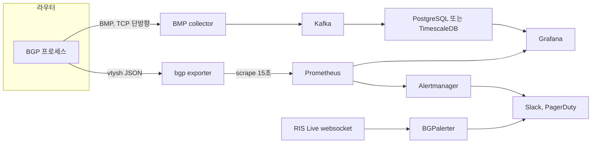
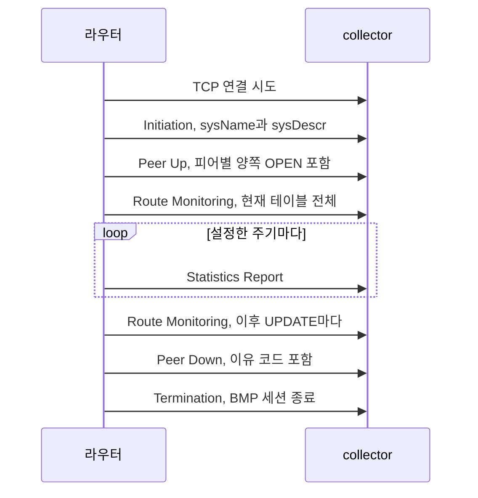
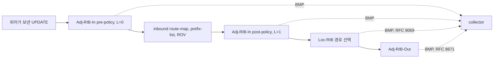
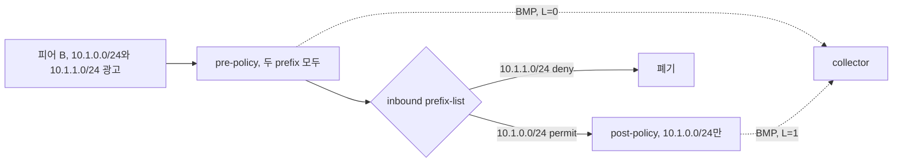
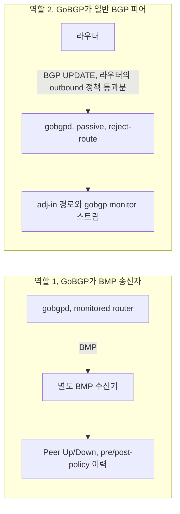
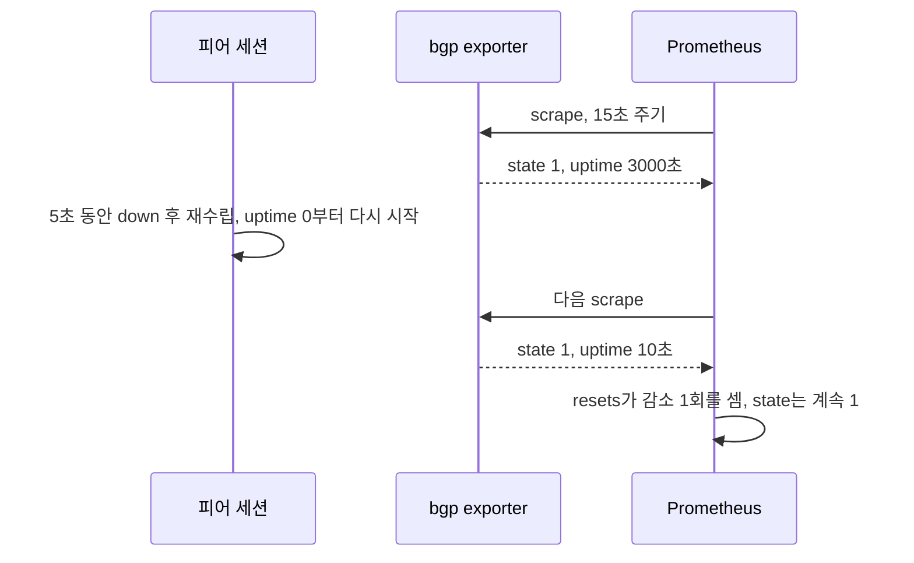
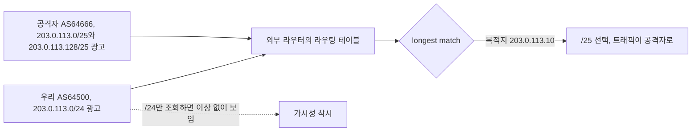
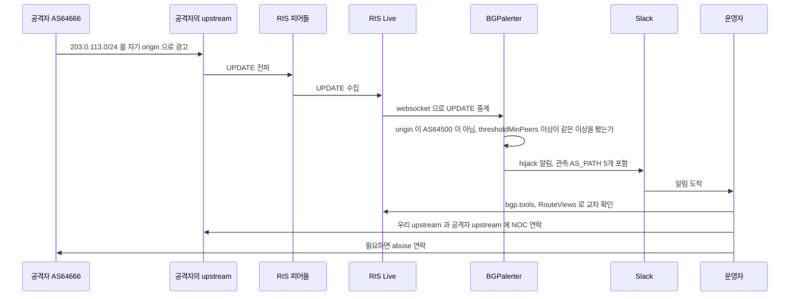
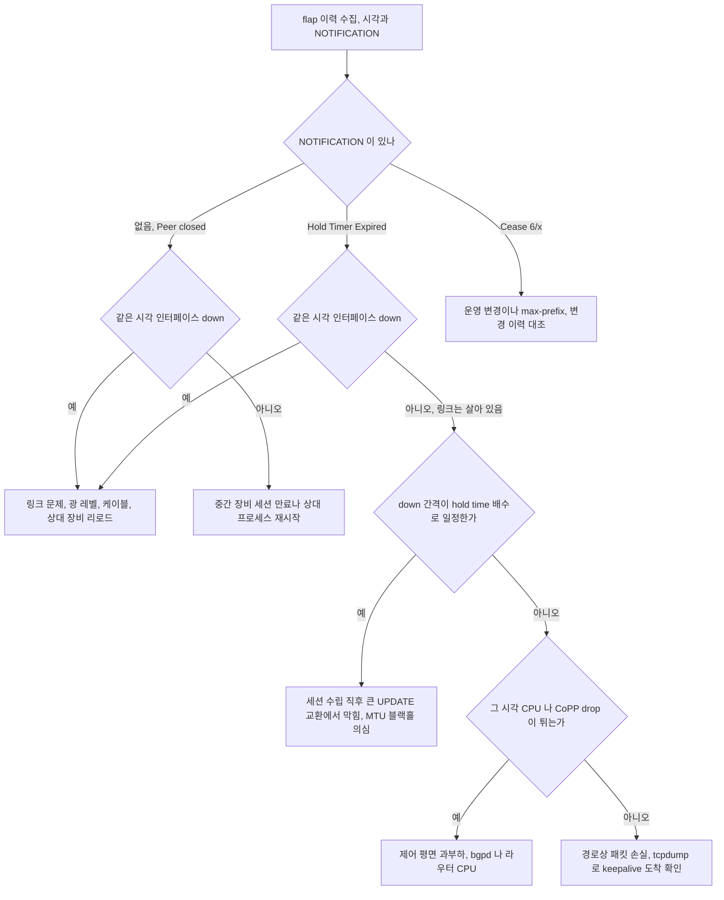
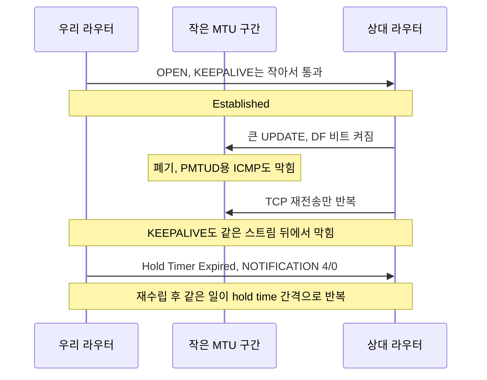

# BGP 관측

`show bgp summary`는 지금 이 순간의 상태만 보여준다. 새벽 3시에 세션이 두 번 떨어졌다가 올라왔다는 사실은 로그를 뒤져야 나오고, 어제 이 prefix의 AS_PATH가 어땠는지는 아무 데도 남아 있지 않다. 장애 보고를 받고 접속했을 때는 이미 복구돼 있는 경우가 많아서, "그때 무슨 일이 있었는지"를 물으면 대답할 근거가 없다. 이 문서는 그 근거를 남기는 쪽을 다룬다.

[BGP 기본 문서](BGP.md)의 트러블슈팅 절이 장애가 났을 때 `show` 명령으로 좁혀가는 순서였다면, 여기서는 장애가 나기 전부터 계속 모아두는 구조를 만든다. BMP로 라우터의 테이블 변화를 스트리밍하고, exporter로 세션 지표를 시계열에 쌓고, 외부 관측점으로 인터넷이 우리 prefix를 어떻게 보는지 확인한 다음, flap 로그에서 원인을 가르는 절차까지 순서대로 본다. 경로 위조를 막는 쪽은 [RPKI와 ROV](BGP_Route_Security_RPKI_ROV.md), 세션 자체의 보호는 [TCP-AO와 GTSM](BGP_Session_Security_TCP_AO_GTSM.md)에서 다뤘고, 여기서는 그것들이 뚫렸거나 설정이 틀렸을 때 알아채는 방법에 집중한다.

---

## 세 가지 시점은 서로 다른 질문에 답한다

관측 수단은 많은데 각자 볼 수 있는 범위가 다르다. 이걸 섞어서 생각하면 "BMP만 켜면 hijack도 잡힌다" 같은 오해가 생긴다.

| 시점 | 수단 | 답하는 질문 | 못 보는 것 |
|---|---|---|---|
| 라우터 내부 | BMP | 이 피어가 무엇을 보냈나, 정책이 무엇을 버렸나, 언제 바뀌었나 | 우리 바깥에서 우리 prefix가 어떻게 보이는지 |
| 장비 지표 | exporter + Prometheus | 세션이 몇 개 살아 있나, prefix 수가 줄었나, 얼마나 자주 떨어지나 | 어떤 prefix가 어떻게 바뀌었는지 |
| 외부 관측점 | RIPE RIS, RouteViews, bgp.tools | 인터넷 쪽에서 우리 prefix의 origin과 경로가 맞나 | 우리 라우터 안에서 일어난 일 |

hijack은 세 번째에서만 보인다. 남이 우리 prefix를 자기 것처럼 광고해도, 우리 라우터는 그 경로를 받은 적이 없을 수 있다. 반대로 우리 upstream과의 세션이 반쯤 죽어서 광고가 일부만 나가는 문제는 외부에서는 "가시성이 줄었다"로만 보이고, 원인은 첫 번째와 두 번째에서 찾는다.

아래 도식이 전체 데이터 흐름이다. 왼쪽 라우터에서 BMP와 exporter 두 갈래가 나가고, 외부 관측점은 따로 BGPalerter로 들어오며, 알림은 한 곳으로 모인다.



BMP 쪽(collector 이후)은 "무슨 경로가 어떻게 바뀌었나"를 저장하는 이력 창고이고, exporter 쪽은 "지금 이상한가"를 판단하는 경보 경로다. 경보를 BMP 이력에서 직접 만들 수도 있지만, 실무에서는 Prometheus 룰이 훨씬 다루기 쉬워서 이렇게 나눈다. BMP는 경보가 울린 뒤에 원인을 파는 용도로 쓴다.

---

## BMP가 하는 일

BMP(BGP Monitoring Protocol, RFC 7854)는 라우터가 자기 BGP 테이블의 변화를 외부 수신기(monitoring station, 보통 collector라고 부른다)로 흘려보내는 프로토콜이다. 몇 가지 성질을 알고 있어야 설정할 때 덜 헤맨다.

라우터가 TCP 연결을 먼저 건다. collector는 listen만 하고, 연결이 맺어지면 라우터는 보내기만 한다. collector가 라우터에 뭔가를 요청하거나 설정을 바꾸는 경로는 없다. 그래서 collector가 죽어도 라우터의 BGP 동작에는 영향이 없다. 라우터는 일정 간격으로 재연결을 시도한다. IANA에 등록된 포트는 11019인데, 실제로는 OpenBMP가 5000을 쓰는 등 구현마다 다르니 양쪽을 맞춘다.

메시지 종류는 일곱 개다.

| type | 이름 | 내용 |
|---|---|---|
| 4 | Initiation | 연결 직후 한 번. sysName, sysDescr 같은 장비 정보 |
| 3 | Peer Up | 세션이 Established가 될 때. 양쪽 OPEN 메시지가 통째로 들어 있다 |
| 2 | Peer Down | 세션이 끊길 때. 이유(로컬 NOTIFICATION, 상대 NOTIFICATION, FSM 이벤트 등)가 들어 있다 |
| 0 | Route Monitoring | UPDATE 메시지 원본. 피어마다 per-peer header가 앞에 붙는다 |
| 1 | Statistics Report | 정책에 걸러진 prefix 수, 루프 감지 수 같은 카운터. 주기적으로 |
| 5 | Termination | 라우터가 BMP 세션을 닫을 때 |
| 6 | Route Mirroring | 받은 BGP 메시지를 그대로 복제. 파싱 오류 디버깅용 |

아래 도식은 BMP 세션 하나의 수명 동안 메시지가 오가는 순서다. TCP 연결은 라우터가 먼저 걸고, 그 뒤로는 라우터에서 collector 방향으로만 메시지가 흐른다.



Peer Up과 Peer Down이 중요하다. `show` 로그에서는 "Down"만 찍히는 장비가 많은데, BMP의 Peer Down은 이유 코드가 구조화돼서 오고 Peer Up에는 협상된 capability가 전부 들어 있다. 어제 세션이 올라올 때 4바이트 ASN capability가 있었는지 같은 질문에 답할 수 있다.

### pre-policy와 post-policy

Route Monitoring 메시지의 per-peer header에는 플래그 바이트가 있고, 그 안의 L 비트가 이 UPDATE가 inbound 정책을 통과하기 전(0)인지 후(1)인지를 말해 준다. RFC 7854에서 Adj-RIB-In을 보는 방식이 이 두 가지다.



pre-policy는 피어가 실제로 보낸 것 전부다. 우리 정책이 버린 것도 들어 있다. post-policy는 정책을 통과한 것만 있다. 둘의 차이를 쓰는 곳이 분명하다.

- 상대가 우리에게 무엇을 보냈는지 분쟁이 생겼을 때, pre-policy가 증거다. "그 prefix 받은 적 없다"는 말과 "받았는데 우리 필터가 버렸다"는 말을 구분한다.
- ROV를 켠 뒤 invalid로 버려진 경로가 얼마나 들어오는지는 pre-policy에는 있고 post-policy에는 없다.
- 지금 우리 라우터가 실제로 쓰는 경로의 이력은 post-policy나 Loc-RIB로 본다.
- Loc-RIB(RFC 9069)는 경로 선택이 끝난 결과이고, Adj-RIB-Out(RFC 8671)은 우리가 피어에게 광고하는 것이다. "upstream에 community를 붙여서 나갔나"를 `neighbors advertised-routes`로 매번 확인하는 대신 이력으로 남길 수 있다. 장비·버전마다 지원이 달라서 도입 전에 확인한다.

FRR 8.1에서 직접 확인했다. 피어 B가 `10.1.0.0/24`와 `10.1.1.0/24`를 광고하고, 라우터 A가 inbound prefix-list로 `10.1.1.0/24`를 deny했다. A에서 `bmp monitor ipv4 unicast pre-policy`와 `post-policy`를 둘 다 켜고 파이썬으로 만든 수신기를 붙였더니 이렇게 나왔다.

```
Route Monitoring flags=0x40 L=1 nlri=['10.1.0.0/24']      <- post-policy
Route Monitoring flags=0x00 L=0 nlri=['10.1.0.0/24']      <- pre-policy
Route Monitoring flags=0x00 L=0 nlri=['10.1.1.0/24']      <- pre-policy, post에는 없다
```

위 출력이 만들어지는 경로를 도식으로 그리면 아래와 같다. 어느 지점에서 BMP로 복제되는지, 그리고 deny된 prefix가 어디서 사라지는지를 보면 된다.



pre-policy에는 두 prefix가 다 있고 post-policy에는 허용된 하나만 있다. 같은 구성에서 `soft-reconfiguration inbound`를 빼면 pre-policy(L=0) 메시지가 아예 오지 않고 post-policy만 왔다. FRR은 정책 적용 전 경로를 따로 보관하지 않으면 pre-policy를 만들 수 없다. 설정에 `pre-policy`라고 썼는데 collector에는 안 보이면 이 옵션부터 확인한다. 보관 방식과 메모리 비용은 장비마다 다르지만, 어느 쪽이든 정책 적용 전 경로를 따로 들고 있어야 하니 메모리를 쓴다. full table을 받는 피어마다 pre-policy를 켜면 라우터 메모리가 피어 수만큼 늘어난다는 뜻이라, 처음에는 transit과 IX 피어에만 건다.

### 라우터 설정

FRR은 BMP가 로드 가능한 모듈이라 bgpd를 띄울 때 `-M bmp`가 필요하다. `/etc/frr/daemons`에서 이렇게 건다.

```
bgpd_options="   -A 127.0.0.1 -M bmp"
```

```
router bgp 65001
 bgp router-id 10.255.0.1
 neighbor 203.0.113.1 remote-as 64500
 !
 address-family ipv4 unicast
  neighbor 203.0.113.1 soft-reconfiguration inbound
  neighbor 203.0.113.1 route-map UPSTREAM-IN in
 exit-address-family
 !
 bmp targets collector1
  bmp connect 192.0.2.10 port 5000 min-retry 1000 max-retry 2000
  bmp monitor ipv4 unicast pre-policy
  bmp monitor ipv4 unicast post-policy
  bmp monitor ipv6 unicast post-policy
  bmp stats interval 60000
 exit
```

`min-retry`와 `max-retry`는 밀리초다. `bmp stats interval`도 밀리초라서 60000이 60초다. `show bmp`로 연결 상태와 어떤 policy를 monitor하는지 본다. 테스트 중에는 collector가 죽었다 살아나도 라우터가 알아서 다시 붙는지 직접 끊어서 확인해 두는 편이 좋다.

IOS-XR은 서버를 정의하고 neighbor마다 활성화한다.

```
bmp server 1
 host 192.0.2.10 port 5000
 description openbmp-collector
 update-source Loopback0
 initial-delay 5
 stats-reporting-period 60
 initial-refresh delay 30 spread 2
!
router bgp 65001
 neighbor 203.0.113.1
  bmp-activate server 1
```

`initial-refresh`가 있는 이유는 BMP 연결이 처음 맺어질 때 라우터가 현재 테이블 전체를 한 번에 쏟아내기 때문이다. full table 피어가 몇 개 있으면 수백만 건이 몇 초 안에 collector로 들어간다. 여러 라우터가 동시에 재시작하는 상황(정전 후 복구)에서는 collector와 Kafka가 먼저 쓰러진다. `spread`로 시작 시각을 흩어놓는다. BMP는 인증이 없는 평문 TCP라서 collector 주소는 관리망 안에 두고 ACL로 라우터 loopback만 허용한다.

---

## collector 구성

### OpenBMP

OpenBMP는 collector가 BMP를 받아 파싱해서 Kafka 토픽(`openbmp.parsed.peer`, `openbmp.parsed.unicast_prefix` 등)에 넣고, 소비자 앱이 PostgreSQL(보통 TimescaleDB 확장)에 쌓는 구조다. 라우터 → collector → Kafka → psql-app → DB 순서이고, 위 flowchart의 오른쪽 위 가지가 이것이다. Grafana는 DB를 직접 데이터소스로 읽는다.

이 구성의 장점은 "2주 전 이 prefix가 어느 피어에서 어떤 AS_PATH로 들어왔나"를 SQL로 묻는다는 점이다. 비용은 데이터 양이다. full table 피어 하나만 해도 prefix가 100만 건 안팎이고 그 변화(churn)가 계속 쌓인다. 피어 수가 많은 라우터에서 pre-policy와 post-policy를 모두 저장하면 DB가 빠르게 커지므로 보존 기간을 정해 두고 오래된 파티션을 지운다. OpenBMP 프로젝트는 갱신 속도가 느린 편이라 도입 전에 저장소의 최근 커밋과 지원하는 BMP 확장(Loc-RIB, Adj-RIB-Out)을 확인한다. 이력 DB가 필요 없고 집계만 필요하면 pmacct의 `pmbmpd`처럼 가벼운 수신기도 대안이다.

### GoBGP를 쓰는 두 가지 방법

GoBGP는 두 가지 역할로 나온다. 둘을 혼동하면 안 된다.

하나는 GoBGP가 BMP를 보내는 쪽(monitored router)이 되는 것이다. 소프트웨어 라우터로 GoBGP를 쓰는 환경, 예를 들어 Kubernetes 안의 BGP 스피커에서 수집기로 테이블을 내보낼 때다. `gobgpd`는 BMP 수신 서버를 내장하고 있지 않다. 수신기는 별도로 있어야 한다.

```toml
[global.config]
  as = 65010
  router-id = "10.255.0.10"

[[bmp-servers]]
  [bmp-servers.config]
    address = "192.0.2.10"
    port = 5000
    route-monitoring-policy = "both"
    statistics-timeout = 60
```

`route-monitoring-policy`는 `pre-policy`, `post-policy`, `both`, `local-rib`, `all` 중에서 고른다. 버전에 따라 지원하는 값이 달라서 사용하는 버전의 문서를 본다.

다른 하나는 GoBGP를 BMP 대신 일반 BGP 피어로 붙여 route collector로 쓰는 것이다. BMP를 지원하지 않는 장비나 클라우드 라우터에서 경로를 모으고 싶을 때 쓴다. 광고는 하지 않고 받기만 하게 만든다.

두 역할의 차이는 아래 도식처럼 데이터가 collector에 도착하는 경로와 남는 정보의 범위로 갈린다. 위쪽은 GoBGP가 BMP 송신자이고, 아래쪽은 라우터의 일반 BGP 피어다.



```toml
[global.config]
  as = 65099
  router-id = "10.255.0.99"

[[neighbors]]
  [neighbors.config]
    neighbor-address = "10.255.0.1"
    peer-as = 65001
  [neighbors.transport.config]
    passive-mode = true
  [neighbors.apply-policy.config]
    default-export-policy = "reject-route"
```

```bash
gobgp neighbor 10.255.0.1 adj-in
gobgp monitor adj-in 10.255.0.1
```

이 방식은 BMP가 아니라 "피어가 우리에게 보낸 경로"만 보인다. Peer Up/Down 이벤트 이력이나 pre/post-policy 구분은 없다. 대신 배포가 가볍고 `gobgp monitor`가 변화를 스트림으로 내보내서 스크립트에 물리기 쉽다. collector는 라우터 입장에서 피어 하나일 뿐이다. 라우터 쪽에도 이 피어로 나가는 outbound 정책을 걸어 필요한 경로만 내보내게 하고, collector의 next-hop이 데이터 경로에 끼지 않게 한다.

---

## Prometheus 지표와 경보

BMP 이력은 사후 분석용이고, 경보는 지표에서 만든다. exporter는 장비마다 다르다. FRR이면 `frr_exporter`가 vtysh에서 JSON을 읽어 `/metrics`로 내보낸다(기본 포트 9342). BIRD는 `bird_exporter`가 있다. 아래 지표 이름은 `frr_exporter` 기준이고, 버전에 따라 이름이 바뀌는 경우가 있으니 처음 붙일 때 `curl localhost:9342/metrics | grep bgp`로 지표 이름과 라벨(`afi`, `safi`, `peer` 등)을 확인하고 쿼리를 맞춘다.

```yaml
scrape_configs:
  - job_name: frr
    scrape_interval: 15s
    static_configs:
      - targets: ["edge1:9342", "edge2:9342"]
```

수집할 지표와 경보 기준은 다음과 같다. 기준값은 처음 잡는 출발점이고, 피어 종류(transit, IX, 내부)와 운영 팀의 대응 속도에 맞게 바꾼다.

| 지표 | 의미 | 경보 조건 | 등급 |
|---|---|---|---|
| `frr_bgp_peer_state` | 1이면 Established | 0이 2분 지속 | page |
| `frr_bgp_peer_uptime_seconds` | 현재 세션 유지 시간 | 15분 동안 감소(리셋) 3회 이상 | warn |
| 같은 지표 | 같음 | 1시간 동안 리셋 10회 이상 | page |
| `frr_bgp_peer_prefixes_received_count_total` | 수신 prefix 수 | 7일 최대값의 70% 미만이 10분 지속 | warn |
| 같은 지표 | 같음 | 0이고 세션은 Established 5분 지속 | page |
| 같은 지표 | 같음 | 7일 평균의 1.5배 초과 | warn (leak, 필터 누락 의심) |
| `frr_bgp_peer_prefixes_advertised_count_total` | 광고 prefix 수 | 0이고 세션은 Established | warn |
| BMP 연결 | collector 도달성 | 5분 이상 끊김 | ticket |

state만 보면 flap을 놓친다. 15초 간격 scrape에서 세션이 5초 만에 떨어졌다 올라오면 state는 계속 1이다. 그래서 flap 횟수는 uptime이 줄어든 횟수로 센다. Prometheus의 `resets()`는 값이 감소한 횟수를 세는 함수이고, uptime은 세션이 재수립되면 0에서 다시 시작하니 scrape 사이에 일어난 flap도 잡힌다.

아래 도식은 scrape 두 번 사이에 세션이 한 번 떨어졌다 올라온 경우다. 두 scrape에서 state는 모두 1이라 state 경보는 조용하고, uptime만 줄어든 것으로 flap이 드러난다.



```yaml
groups:
  - name: bgp
    rules:
      - alert: BGPSessionDown
        expr: frr_bgp_peer_state{afi="ipv4",safi="unicast"} == 0
        for: 2m
        labels: {severity: page}
        annotations:
          summary: "{{ $labels.peer }} (AS{{ $labels.peer_as }}) 세션 down"

      - alert: BGPSessionFlapping
        expr: resets(frr_bgp_peer_uptime_seconds[15m]) >= 3
        labels: {severity: warn}
        annotations:
          summary: "{{ $labels.peer }} 15분간 {{ $value }}회 재수립"

      - alert: BGPPrefixDrop
        expr: |
          frr_bgp_peer_prefixes_received_count_total
            < 0.7 * max_over_time(frr_bgp_peer_prefixes_received_count_total[7d])
        for: 10m
        labels: {severity: warn}

      - alert: BGPEmptyEstablished
        expr: |
          frr_bgp_peer_prefixes_received_count_total == 0
            and on(peer, afi, safi) frr_bgp_peer_state == 1
        for: 5m
        labels: {severity: page}
        annotations:
          summary: "{{ $labels.peer }} Established인데 받은 경로 0 (ebgp-requires-policy, 상대 필터 확인)"

      - alert: BGPPrefixSurge
        expr: |
          frr_bgp_peer_prefixes_received_count_total
            > 1.5 * avg_over_time(frr_bgp_peer_prefixes_received_count_total[7d])
        for: 10m
        labels: {severity: warn}
```

`BGPPrefixDrop`에서 7일 최대값을 기준으로 삼는 이유가 있다. 평균을 쓰면 장애가 오래 이어졌을 때 평균 자체가 내려가서 경보가 스스로 풀린다. 새로 붙인 피어나 prefix 수가 원래 들쭉날쭉한 IX 피어는 이 룰이 계속 울린다. 그런 피어는 라벨로 분리해서 임계값을 다르게 준다. `BGPEmptyEstablished`는 [기본 문서](BGP.md)의 `(Policy)` 사례가 그대로 걸리는 룰이다. 세션이 올라와 있으니 state 경보는 조용하고, 이 룰만 문제를 알려 준다.

경보 피로가 가장 흔한 실패다. 처음 켜면 IX 피어의 작은 flap 때문에 하루에 수십 건이 울리고, 사흘 뒤에는 아무도 안 본다. page는 "지금 사람이 일어나야 하는 것"으로 한정하고(세션 down, 빈 Established), 나머지는 warn으로 채널에만 남긴다.

---

## 외부에서 우리 prefix 보기

라우터가 아무 이상 없다고 말해도 인터넷에서 다르게 보일 수 있다. 외부 관측점은 전 세계 라우터들이 자기 BGP 테이블을 공개 수집기에 흘려보낸 것이다.

RIPE RIS는 `rrc00`, `rrc01`처럼 번호가 붙은 collector 여럿이 여러 IX에 걸쳐 있고, 수백 개 피어의 UPDATE를 MRT 파일로 보관한다. RIS Live는 같은 UPDATE를 websocket으로 실시간 중계한다. RouteViews는 같은 목적의 다른 프로젝트이고, `route-views.routeviews.org`에 telnet으로 붙어 looking glass처럼 `show ip bgp`를 칠 수 있다. bgp.tools는 웹 UI와 whois로 prefix와 ASN의 현재 origin, upstream 목록, 가시성을 보여준다.

누가 어느 때 쓰는지는 이렇게 나눈다.

```bash
# RouteViews looking glass. 계정은 rviews, 비밀번호 없음
telnet route-views.routeviews.org
route-views> show ip bgp 203.0.113.0/24
route-views> show ip bgp 203.0.113.0/24 longer-prefixes

# RIPEstat 으로 현재 가시성과 origin 확인
curl -s "https://stat.ripe.net/data/routing-status/data.json?resource=203.0.113.0/24" | jq '.data.visibility'

# RIS Live 에 붙어서 우리 prefix 의 UPDATE 만 받기
websocat "wss://ris-live.ripe.net/v1/ws/?client=ygstudy-check"
{"type":"ris_subscribe","data":{"prefix":"203.0.113.0/24","moreSpecific":true,"type":"UPDATE"}}
```

`show ip bgp ... longer-prefixes`가 중요하다. 누군가 우리 `/24`를 `/25` 두 개로 쪼개서 광고하면(sub-prefix hijack) longest match 때문에 그쪽으로 트래픽이 간다. 우리가 광고한 `/24`만 보면 아무 이상이 없어 보이고 `moreSpecific: true`로 구독하거나 `longer-prefixes`로 조회해야 잡힌다.

아래 도식은 같은 대역에 대해 정상 광고와 쪼갠 광고가 함께 있을 때 외부 라우터가 무엇을 고르는지 보여 준다.



지난 일을 조사할 때는 RIS와 RouteViews가 보관하는 MRT 아카이브를 받아서 본다. `bgpdump -m`은 UPDATE를 파이프 구분 텍스트로 풀어준다.

```bash
bgpdump -m updates.20261120.0300.gz | grep '|203.0.113.0/24|'
# BGP4MP|1763607600|A|198.51.100.7|64511|203.0.113.0/24|64511 3356 64666|IGP|...
```

세 번째 칸이 `A`면 광고, `W`면 철회다. AS_PATH 끝이 우리 ASN이 아니라 낯선 ASN(`64666`)이면 origin이 바뀐 것이다.

### hijack이 탐지되는 흐름

수동으로 들여다보지 않고 알림으로 받으려면 BGPalerter를 쓴다. RIS Live를 구독하다가 우리 prefix의 origin이 바뀌거나 더 구체적인 prefix가 나타나면 알린다. 전체 흐름은 이렇다. 관측점이 많이 볼수록 확신이 커지므로 BGPalerter는 몇 개 피어에서 동시에 같은 이상을 봤을 때만 알림을 낸다.



본문과 함께 볼 지점은 5번째 화살표다. 탐지 로직이 BGPalerter 안에서 일어나서, 관측점 몇 곳이 같은 이상을 봐야 알림이 나가는지가 오탐과 지연을 결정한다. 임계값이 낮으면(1) 한 관측점의 일시적인 경로 변경에도 울리고, 높으면 알림이 늦다. 4 정도에서 시작해서 조정한다.

알림을 받은 뒤 할 수 있는 일은 생각보다 적다. 우리 prefix가 `/24`면 `/25`로 쪼개서 맞서는 방법이 있지만, 인터넷은 `/24`보다 긴 prefix를 대부분 버려서 `/24` hijack에는 소용이 없다. 실제로는 우리 upstream과 공격자의 upstream NOC에 연락해서 필터링을 요청하는 게 거의 전부이고, 그 연락처를 미리 정리해 둬야 한다. ROA가 등록돼 있고 상대 upstream이 ROV를 하고 있다면 공격자의 경로는 invalid로 버려진다. 그래서 알림 체계보다 [RPKI ROA 등록](BGP_Route_Security_RPKI_ROV.md)이 먼저다.

### BGPalerter 설정

BGPalerter는 단일 실행 파일(또는 Docker 이미지)이고 `config.yml`과 감시 대상을 적는 `prefixes.yml` 두 개로 돈다.

```yaml
environment: production
connectors:
  - file: connectorRIS
    name: ris
    params:
      carefulSubscription: true
      subscription:
        moreSpecific: true
        type: UPDATE
        socketOptions:
          includeRaw: false
monitors:
  - file: monitorHijack
    channel: hijack
    name: basic-hijack-detection
    params:
      thresholdMinPeers: 4
  - file: monitorNewPrefix
    channel: newprefix
    name: prefix-detection
    params:
      thresholdMinPeers: 4
  - file: monitorPath
    channel: path
    name: path-matching
    params:
      thresholdMinPeers: 1
  - file: monitorVisibility
    channel: visibility
    name: withdrawal-detection
    params:
      thresholdMinPeers: 20
reports:
  - file: reportSlack
    channels: [hijack, newprefix, visibility, path]
    params:
      showPaths: 5
      hooks:
        default: https://hooks.slack.com/services/XXX/YYY/ZZZ
notificationIntervalSeconds: 14400
persistStatus: true
```

```yaml
203.0.113.0/24:
  description: 서비스 대표 prefix
  asn: 64500
  ignoreMorespecifics: false
  group: edge
  path:
    - match: ".*,64496,.*"
      notMatch: ".*,64500$"
      matchDescription: "64496 을 거쳐 들어오는 경로는 leak 후보"

2001:db8:100::/48:
  description: 서비스 대표 IPv6
  asn: 64500
  group: edge
```

`path` 항목이 leak 탐지에 쓰인다. AS_PATH에 있어서는 안 되는 ASN 조합을 정규식으로 적어 두면 그 조합이 보일 때 알린다. 예를 들어 우리가 두 transit 사이에 낀 구조에서 한 transit이 다른 transit 경로를 우리에게서 받아 재광고하는 leak이 전형적이다. 어느 ASN을 금지할지는 [BGP Community와 라우팅 정책](BGP_Community_and_Routing_Policy.md) 쪽 정책 설계와 맞춰서 정한다. `ignoreMorespecifics: false`가 기본이라 sub-prefix도 잡힌다. 의도적으로 `/24`를 `/25` 두 개로 광고하는 트래픽 엔지니어링을 쓰고 있다면([Anycast와 트래픽 엔지니어링](BGP_Anycast_and_Traffic_Engineering.md)) 그 prefix를 따로 등록해서 오탐을 막는다. 알림 간격 `notificationIntervalSeconds: 14400`은 같은 이상을 4시간에 한 번만 반복해서 알린다는 뜻이고, 지속 중인 hijack이면 이 간격이 길어서 놓치기 쉬우니 처음 알림을 받으면 사람이 상태를 직접 추적한다.

---

## session flap 로그에서 원인 가르기

flap 경보가 울리면 원인은 크게 세 부류로 갈린다. 링크가 끊긴 경우, hold timer 안에 keepalive가 도착하지 않은 경우, 둘 중 어느 쪽 CPU나 제어 평면이 막힌 경우다. 겉으로는 모두 "세션이 떨어졌다"이고 해결책은 광 모듈 교체, MTU 수정, CoPP 조정으로 전혀 다르다.

NOTIFICATION의 방향과 코드가 첫 단서다.

| 로그 | 의미 | 의심 순서 |
|---|---|---|
| sent 4/0 Hold Timer Expired | 우리가 hold time 동안 상대에게서 아무것도 못 받았다 | 경로상 손실, 상대 CPU, 우리 쪽 수신 처리 지연 |
| received 4/0 Hold Timer Expired | 상대가 우리에게서 못 받았다 | 반대 방향의 위 항목, 우리 쪽 송신 지연 |
| NOTIFICATION 없이 Peer closed the session | TCP가 그냥 닫히거나 RST | 링크 down, 상대 프로세스 재시작, 중간 장비의 세션 테이블 만료 |
| received 6/1 Maximum Number of Prefixes | 상대의 max-prefix에 걸림 | 우리가 너무 많이 보냈다. 광고 폭증 점검 |
| sent 6/1 | 우리 max-prefix에 걸림 | 상대가 폭증시켰다. leak 가능성 |
| 6/2, 6/4 Administrative Shutdown, Reset | 사람이 내렸다 | 변경 작업 이력 대조 |
| 3/x UPDATE Message Error | 잘못된 UPDATE를 받았다 | 상대 소프트웨어 버그, attribute 길이 문제 |

방향을 헷갈리는 사람이 많다. `sent Hold Timer Expired`는 "우리가 보냈다"는 뜻이지만 문제는 상대에게서 오는 쪽에 있다. 우리가 수신 대기하다가 시간이 다 돼서 우리가 NOTIFICATION을 만들어 보낸 것이다.

로그가 위 표에서 어느 줄인지 정해지면 다음은 시간 정보다.



위 판별에서 가장 판별력이 좋은 단서는 down 간격이다. 간격이 hold time(기본 180초)에 거의 맞게 반복되면 세션이 수립된 뒤 그 시간 동안 아무 패킷도 못 받았다는 뜻이다. 가장 흔한 원인은 MTU 문제다. OPEN과 KEEPALIVE는 작아서 통과하는데, 세션이 올라간 직후 보내는 큰 UPDATE가 DF 비트가 켜진 상태에서 중간 구간의 작은 MTU에 걸려 사라진다. PMTUD용 ICMP가 막혀 있으면 재전송만 되풀이되고, TCP 스트림이 막히니 뒤에 오는 KEEPALIVE도 같이 못 간다. 세션은 Established까지 올라가고 prefix를 거의 못 받은 채(`PfxRcd` 0 또는 수십 개) hold time 후 끊긴다. [MTU, MSS, PMTUD](MTU_MSS_PMTUD.md) 문서의 증상과 같고, 해결은 경로 MTU 통일이나 `tcp-mss` 제한이다.

아래 도식은 이 MTU 블랙홀이 hold time 간격 flap으로 이어지는 순서다. 작은 메시지는 지나가고 큰 UPDATE부터 막힌다는 점을 보면 된다.



반대로 간격이 불규칙하고 같은 시각의 CPU 그래프에서 스파이크가 보이면 제어 평면 쪽이다. 라우터가 `bgpd`를 돌리는 소프트웨어 라우터라면 `top -H -p $(pidof bgpd)`로 스레드별 CPU를 본다. FRR에서는 `show thread cpu`(9 이후에는 `show event cpu`)가 이벤트별 소비 시간을 보여주고, 한 핸들러가 수 초씩 잡고 있으면 keepalive 송신이 밀린다. 하드웨어 라우터는 CoPP(control-plane policing)가 BGP 패킷을 drop하는지가 의심 대상이다. 평소에는 문제가 없다가 IGP 재계산이나 다른 피어의 table 교환이 겹치는 순간 제어 평면 큐가 넘치면서 keepalive가 밀려 hold timer가 만료된다. 이 부류는 BFD를 켜면 오히려 악화되기도 한다. BFD 패킷도 같은 제어 평면 자원을 타고, 감지 시간이 짧은 만큼 더 민감하게 flap하기 때문이다([BFD와 Graceful Restart](BGP_Graceful_Restart_BFD_Convergence.md)).

로그가 많을 때는 사람이 읽지 말고 집계한다. 아래 스크립트는 FRR 로그에서 피어별 down 횟수, 사유 분포, down 간격, 링크 down 동반 여부를 뽑는다.

```python
#!/usr/bin/env python3
import re, sys, collections
from datetime import datetime

DOWN = re.compile(r'^(?P<ts>\d{4}/\d\d/\d\d \d\d:\d\d:\d\d).*%ADJCHANGE: neighbor (?P<peer>\S+).*Down (?P<why>.+)$')
NOTI = re.compile(r'^(?P<ts>\d{4}/\d\d/\d\d \d\d:\d\d:\d\d).*%NOTIFICATION: (?P<dir>sent|received) (?:to|from) neighbor (?P<peer>\S+).* (?P<code>\d+/\d+) \((?P<name>[^)]+)\)')
LINK = re.compile(r'^(?P<ts>\d{4}/\d\d/\d\d \d\d:\d\d:\d\d).*Interface (?P<ifn>\S+) (?:is )?down', re.I)

def t(s): return datetime.strptime(s, '%Y/%m/%d %H:%M:%S')

downs = collections.defaultdict(list)
notis = collections.defaultdict(list)
links = []
for line in open(sys.argv[1], errors='replace'):
    line = line.rstrip()
    if m := DOWN.match(line):
        downs[m['peer']].append((t(m['ts']), m['why']))
    elif m := NOTI.match(line):
        notis[m['peer']].append((t(m['ts']), m['dir'], m['code'], m['name']))
    elif m := LINK.match(line):
        links.append((t(m['ts']), m['ifn']))

for peer, ev in downs.items():
    print(f'== {peer}: down {len(ev)}회')
    for w, n in collections.Counter(w for _, w in ev).most_common():
        print(f'   {n:3d}  {w}')
    gaps = [(b[0] - a[0]).total_seconds() for a, b in zip(ev, ev[1:])]
    if gaps:
        print(f'   down 간격(초): min={min(gaps):.0f} max={max(gaps):.0f} 평균={sum(gaps)/len(gaps):.0f}')
    near = sum(1 for ts, _ in ev if any(abs((ts - lt).total_seconds()) <= 2 for lt, _ in links))
    print(f'   링크 down 2초 이내 동반: {near}/{len(ev)}')
    for ts, d, code, name in notis.get(peer, [])[:3]:
        print(f'   NOTIFICATION {d} {code} {name} @ {ts:%H:%M:%S}')
```

피어 `10.0.0.2`는 hold time 간격으로 떨어지고 링크는 멀쩡한 로그, `10.0.1.2`는 링크 down과 함께 떨어지는 로그를 합성해서 돌린 결과다.

```
== 10.0.0.2: down 6회
     6  BGP Notification send
   down 간격(초): min=181 max=182 평균=182
   링크 down 2초 이내 동반: 0/6
   NOTIFICATION sent 4/0 Hold Timer Expired @ 03:03:01
== 10.0.1.2: down 4회
     4  Interface down
   down 간격(초): min=843 max=2530 평균=1709
   링크 down 2초 이내 동반: 4/4
```

첫 피어는 간격이 181~182초로 hold time에 붙어 있고 링크 이벤트가 없으니 위 flowchart의 MTU 쪽 가지로 간다. 둘째 피어는 4번 전부 링크 down과 겹쳐서 링크 문제다. 이 스크립트는 합성 로그에 맞춘 것이라 실제 장비의 로그 문구에 맞춰 정규식을 손봐야 한다. FRR 버전마다 `%ADJCHANGE` 뒤의 문구가 조금씩 다르다. 다른 NOS(IOS-XR, Junos)도 같은 틀에서 정규식만 바꾸면 된다.

---

## 운영하면서 부딪히는 것들

collector가 느려지면 라우터 쪽 BMP 큐가 쌓인다. 구현에 따라 메모리를 계속 쓰거나, 일정 크기를 넘으면 연결을 끊는다. FRR의 `show bmp`에는 mirroring 버퍼의 pending 용량과 최대 사용량이 나온다. collector와 Kafka의 처리량을 먼저 점검하고 BMP를 켠 직후 라우터 메모리 추이를 한동안 본다.

BMP 데이터에서 flap을 세려면 Peer Up/Down 메시지로 세는 편이 정확하다. Route Monitoring의 withdraw 개수로 flap을 판단하면 세션이 아닌 prefix flap(route flap)과 섞인다. 둘은 다른 현상이다. 세션 flap은 위 절차로 보고, prefix flap은 같은 prefix의 A/W가 짧은 간격으로 반복되는지 BMP 이력에서 본다.

외부 관측점은 공짜가 아니라 서비스 제공자의 호의다. RIS Live에 `client=` 파라미터로 이름을 붙이는 건 문제가 생겼을 때 운영자가 연락할 단서를 남기라는 뜻이다. 여러 인스턴스를 띄워 같은 구독을 반복하지 말고 하나만 둔다.

마지막으로 알림 경로 자체의 점검이다. 지표 수집기와 BGPalerter가 죽으면 경보가 영영 안 울린다. Prometheus는 `up == 0`과 별개로 `absent(frr_bgp_peer_state)`로 지표가 사라진 것을 잡고, BGPalerter는 주기적으로 heartbeat 성격의 테스트 알림을 보내서 알림 경로가 살아 있는지 확인한다. 한 번도 울린 적 없는 경보는 정상이라서가 아니라 연결이 끊겨서일 수 있다.
