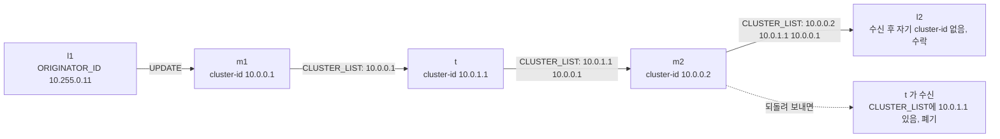
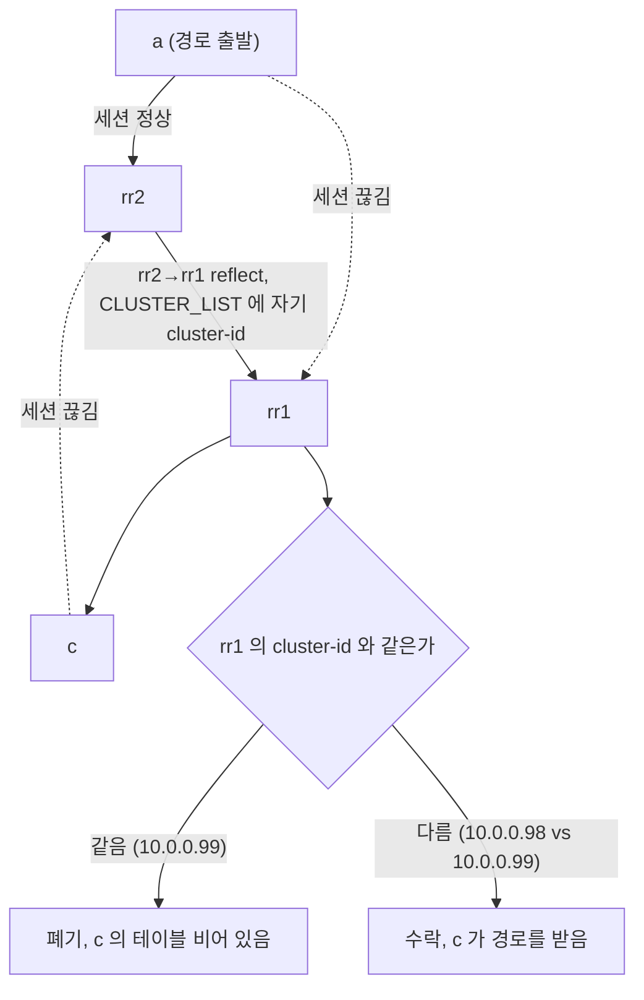
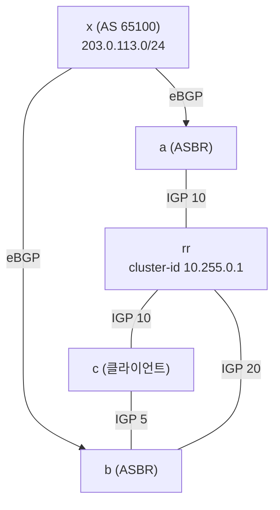
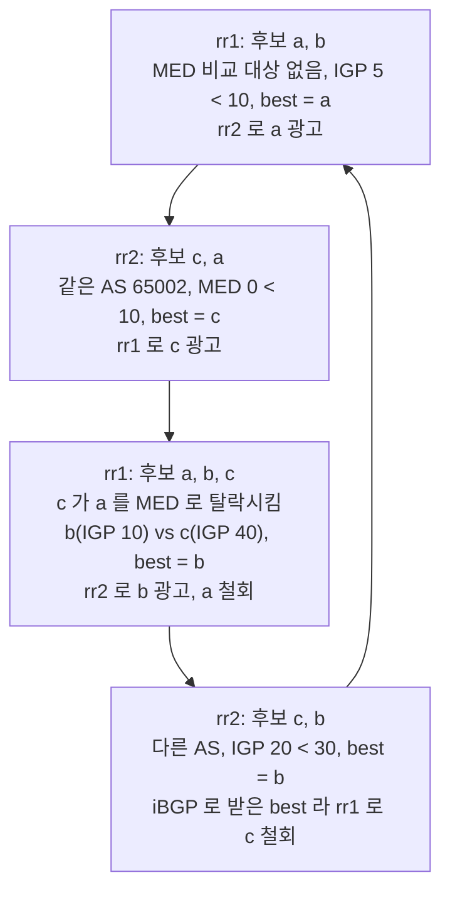
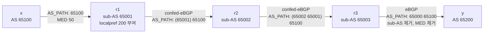
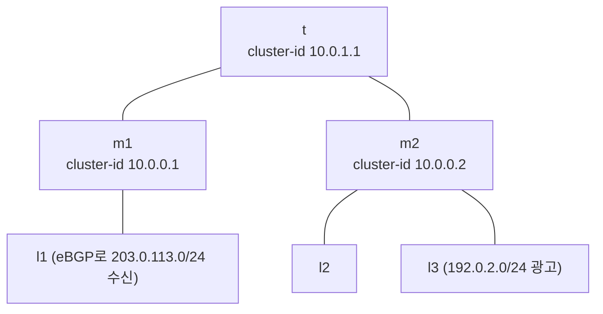

# BGP Route Reflector, Confederation, ADD-PATH

[BGP](BGP.md)의 Route Reflector 절은 RR이 iBGP 풀 메시를 줄여 준다는 데서 끝난다. 운영에서 문제가 되는 건 그 뒤다. RR 두 대를 올렸더니 한 대가 받은 경로를 버리고 있고, 클라이언트는 가까운 출구를 두고 먼 출구로 나가고, 아무도 설정을 안 건드렸는데 UPDATE가 초당 10개씩 계속 나간다. 전부 RR가 경로를 하나만 골라서 내려보낸다는 규칙에서 나온다.

이 문서는 FRR 8.1을 network namespace 위에서 돌린 결과로 쓴다. 라우터 한 대가 namespace 하나이고 링크는 veth, IGP는 OSPF(링크별 cost 지정)다. 랩은 다섯 개다.

| 랩 | 구성 | 확인한 것 |
|---|---|---|
| A | RR 1, 클라이언트 3, eBGP 이웃 1 | 경로 숨김, ADD-PATH, 메모리 |
| B | RR 2, 클라이언트 3, 외부 AS 2개 | MED 진동 |
| C | RR 2(이중화), 클라이언트 2 | cluster-id 같게/다르게 |
| D | 2단 RR 계층 | CLUSTER_LIST 누적, 장애 범위 |
| E | sub-AS 3개 | Confederation의 AS_PATH와 속성 |

community와 MED 비교 규칙 자체는 [BGP community와 라우팅 정책](BGP_Community_and_Routing_Policy.md)에, IXP의 Route Server는 [BGP IXP 피어링과 Route Server](BGP_IXP_Peering_Route_Server.md)에 있다. 여기서는 AS 내부의 iBGP 구조만 다룬다.

## cluster-id와 CLUSTER_LIST가 루프를 막는 방식

iBGP에는 "iBGP로 받은 경로를 다른 iBGP 피어에게 넘기지 않는다"는 규칙이 있고, AS_PATH가 AS 안에서 바뀌지 않으니 이 규칙이 사실상 유일한 루프 방지다. RR는 이 규칙을 일부러 깬다. 그래서 AS_PATH를 대신할 속성 두 개가 붙는다.

- ORIGINATOR_ID: 경로를 AS 안에 처음 넣은 라우터의 router-id. RR가 처음 reflect할 때 붙고 이후 바뀌지 않는다.
- CLUSTER_LIST: 경로가 거친 클러스터의 CLUSTER_ID 목록. RR가 reflect할 때마다 **맨 앞에** 자기 CLUSTER_ID를 붙인다.

수신 쪽 규칙은 둘이다. ORIGINATOR_ID가 내 router-id면 버리고, CLUSTER_LIST에 내 CLUSTER_ID가 있으면 버린다. `bgp cluster-id`를 안 주면 CLUSTER_ID는 router-id다. 클러스터 하나에 RR가 한 대면 이 기본값으로 충분하다.

2단 계층(랩 D)에서 l1이 외부에서 받은 203.0.113.0/24가 l2까지 가면 이렇게 보인다. m1은 `10.0.0.1`, t는 `10.0.1.1`, m2는 `10.0.0.2`를 CLUSTER_ID로 쓴다.

```
l2# show bgp ipv4 unicast 203.0.113.0/24
  65100
    10.255.0.11 (metric 40) from 10.255.0.3 (10.255.0.11)
      Origin IGP, metric 0, localpref 100, valid, internal, best (First path received)
      Originator: 10.255.0.11, Cluster list: 10.0.0.2 10.0.1.1 10.0.0.1
```

`Cluster list`가 경로를 거슬러 올라가는 순서로 찍힌다. 가장 가까운 m2가 맨 앞, 처음 reflect한 m1이 맨 뒤다. 이 목록이 곧 경로가 지나온 RR 기록이다.



실선이 정상 전파이고 점선은 m2가 이 경로를 t로 돌려보낸다고 가정한 경우다. t는 자기 CLUSTER_ID가 목록에 있으니 버린다. 실제로는 RR가 경로를 받아온 쪽으로 다시 보내지 않지만, 설정이 어긋나 돌아오는 경로는 이 검사가 잡는다.

### 폐기는 조용히 일어난다

이 검사에 걸린 경로는 에러 없이 사라진다. 세션은 Established이고 `PfxRcd`는 0이다. 로그를 보려면 수신 쪽에서 `debug bgp updates in`을 켠다.

```
BGP: 10.255.0.2 rcvd UPDATE about 203.0.113.0/24 IPv4 unicast -- DENIED due to: reflected from the same cluster;
BGP: 10.255.0.1 rcvd UPDATE about 203.0.113.0/24 IPv4 unicast -- DENIED due to: originator is us;
```

`reflected from the same cluster`가 CLUSTER_LIST 검사, `originator is us`가 ORIGINATOR_ID 검사다. 평소에는 안 보이다가 cluster-id를 만지는 작업 직후에 경로가 사라지면 이 두 줄부터 찾는다.

계층에서 cluster-id를 복사해 붙이다 겹치는 실수도 같은 증상을 낸다. 랩 D에서 m2의 cluster-id를 m1과 같은 `10.0.0.1`로 바꿨더니 t가 m2에게 내려보내는 경로의 CLUSTER_LIST에 `10.0.0.1`이 들어 있어서 m2가 전부 버렸다. l2의 BGP 테이블이 완전히 비었고, 세션은 그대로 올라와 있었다. 장비를 늘리면서 설정 템플릿을 복제할 때 가장 흔하게 날 수 있는 형태다.

## RR 이중화에서 cluster-id를 같게 할지 다르게 할지

RR 한 대가 죽으면 클라이언트가 전부 갈 곳을 잃으니 RR는 거의 항상 두 대로 둔다. 클라이언트는 두 RR와 모두 세션을 맺는다. 이때 두 RR의 cluster-id를 같게 하느냐가 선택지다. 랩 C로 둘을 다 돌렸다. a가 eBGP로 203.0.113.0/24를 받아 rr1, rr2에 올리고, c가 두 RR에서 받는다. rr1과 rr2 사이에도 non-client 세션을 하나 걸어 뒀다.

**같은 cluster-id (`10.0.0.99`)**

```
rr2# show bgp ipv4 unicast summary
10.255.0.1      4      65000   ...  00:00:17            0        1 N/A     (rr1: 받은 경로 0)
10.255.0.11     4      65000   ...  00:00:17            1        1 N/A     (a: 1)

c# show bgp ipv4 unicast 203.0.113.0/24
  65100
    10.255.0.11 (metric 20) from 10.255.0.1 (10.255.0.11)
      Originator: 10.255.0.11, Cluster list: 10.0.0.99
  65100
    10.255.0.11 (metric 20) from 10.255.0.2 (10.255.0.11)
      Originator: 10.255.0.11, Cluster list: 10.0.0.99
```

rr2는 a에게 직접 받은 경로 하나만 갖는다. rr1이 reflect해 준 경로는 CLUSTER_LIST에 자기 cluster-id가 있어서 버렸다. c는 rr1, rr2에서 각각 한 개씩 받는다. RR끼리 서로 reflect해 봐야 둘 다 같은 경로를 이미 갖고 있으니 버려져도 손해가 없다는 게 같은 cluster-id의 논리다.

**다른 cluster-id (`10.0.0.99`, `10.0.0.98`)**

```
rr2# show bgp ipv4 unicast 203.0.113.0/24
  65100
    10.255.0.11 (metric 10) from 10.255.0.1 (10.255.0.11)
      Originator: 10.255.0.11, Cluster list: 10.0.0.99
  65100, (Received from a RR-client)
    10.255.0.11 (metric 10) from 10.255.0.11 (10.255.0.11)
      Origin IGP, ... best (Cluster length)
```

rr2가 경로를 둘 갖는다. 직접 받은 것과 rr1을 거쳐 온 것이다. best는 CLUSTER_LIST가 짧은 쪽(`Cluster length`)이라 직접 받은 경로가 이긴다. 경로 수가 늘어나는 만큼 RR의 메모리와 UPDATE가 는다.

### 같은 cluster-id가 깨지는 장애

차이가 드러나는 건 장애 때다. a와 rr1 사이, c와 rr2 사이 세션이 동시에 끊긴 상황을 만들었다. a는 rr2에만, c는 rr1에만 붙어 있다.



같은 cluster-id일 때 c의 BGP 테이블은 비었다(`No BGP prefixes displayed, 0 exist`). a의 경로를 가진 rr2가 있고 c와 연결된 rr1이 있는데도 둘 사이를 넘어가지 못한다. rr2의 cluster-id를 `10.0.0.98`로 바꾸자 바로 경로가 도착했고, c에서 보이는 CLUSTER_LIST는 `10.0.0.99 10.0.0.98`이었다.

이 구조는 "RR 한 쌍이 클러스터 하나"라는 가정에 기댄다. 클라이언트가 두 RR에 모두 붙어 있어야 같은 cluster-id가 성립하고, 클라이언트 쪽 세션이 어긋나는 순간 RR 사이 경로가 막힌다. 한 클라이언트가 한 RR에만 붙은 구성이 섞여 있거나 RR 사이 링크로 우회 경로를 기대한다면 cluster-id를 다르게 두는 편이 장애 때 덜 위험하다. 대신 경로가 늘어난다. 같은 cluster-id를 택했다면 RR 사이의 iBGP 세션은 실익이 없다. 랩 C의 `PfxRcd 0`이 그 세션이 하는 일이다.

한 가지 더 있다. cluster-id를 다르게 두면 경로가 RR 두 대 사이를 돌며 ORIGINATOR_ID 검사에 걸린다. 랩 C에서 a가 rr2로 보내는 광고를 막아 rr2가 rr1 경유 경로만 갖게 하자 rr2가 그 경로를 a에게 reflect했고, a의 로그에 `originator is us`가 찍혔다. 루프는 막히지만 불필요한 UPDATE가 오간다.

## 경로 숨김과 hot-potato 왜곡

RR는 받은 경로 중 **best 하나만** 골라 클라이언트에 reflect한다. 그런데 best는 RR 위치에서 본 IGP cost로 정해진다. 클라이언트 입장에서 가장 가까운 출구와 RR가 고른 출구가 다르면, 클라이언트는 더 가까운 경로가 있다는 사실 자체를 모른다.



x가 a와 b 두 군데로 같은 prefix를 광고한다. rr에서 a까지는 10, b까지는 15다(직접 링크 20보다 c를 거치는 10+5가 짧다). rr는 a를 best로 고른다. c에서는 b까지 5, a까지 20이다. c에게 맞는 출구는 b다. 랩 A의 실제 출력이다.

```
rr# show bgp ipv4 unicast 203.0.113.0/24
Paths: (2 available, best #1, table default)
  65100, (Received from a RR-client)
    10.255.0.11 (metric 10) from 10.255.0.11 (10.255.0.11)
      ... best (IGP Metric)
  65100, (Received from a RR-client)
    10.255.0.12 (metric 15) from 10.255.0.12 (10.255.0.12)

c# show bgp ipv4 unicast 203.0.113.0/24
Paths: (1 available, best #1, table default)
  65100
    10.255.0.11 (metric 20) from 10.255.0.1 (10.255.0.11)
      Originator: 10.255.0.11, Cluster list: 10.255.0.1
```

rr는 경로를 둘 갖고 있고 c는 하나만 갖는다. 나머지 하나가 path hiding이다. c가 a를 고르는 게 아니라 고를 선택지가 없다. IGP metric 5짜리 b 경로를 두고 20짜리로 나가므로 hot-potato(가장 가까운 출구로 빨리 내보낸다는 원칙)가 깨진다. 패킷이 필요 이상으로 AS 내부를 긴 거리로 돌아 나간다. 링크 지연이나 비용이 같다면 눈에 안 띄고, 출구 사이의 거리가 큰 광역망에서는 지연으로 드러난다.

`show bgp ipv4 unicast neighbors 10.255.0.13 advertised-routes`로 rr가 c에게 보낸 걸 보면 prefix 한 줄이다. 받는 쪽의 `Paths: (1 available)`와 함께 보면 숨겨진 걸 알아챌 수 있다.

### 클라이언트가 숨기는 경우

숨김은 RR만의 일이 아니다. a의 인바운드에서 local-preference를 200으로 올렸다. b는 RR에게서 localpref 200짜리 a 경로를 받아 그것을 best로 삼는다. b 자신의 eBGP 경로(localpref 기본값 100)는 best가 아니고, iBGP로 받은 best는 iBGP 피어에 다시 광고하지 않는다. 그래서 b가 자기 eBGP 경로를 RR로 철회한다.

```
rr# show bgp ipv4 unicast 203.0.113.0/24
Paths: (1 available, best #1, table default)
  65100, (Received from a RR-client)
    10.255.0.11 (metric 10) ... localpref 200, valid, internal, best
```

RR는 경로를 하나만 갖는다. 이번엔 RR의 선택이 아니라 b가 보내지 않은 것이다. localpref 하나가 숨김의 원인이 되고, a가 죽으면 b의 경로가 올라올 때까지 컨버전스를 한 번 더 기다려야 한다. 이게 best-external이 풀려던 문제다.

## MED 진동

경로 숨김의 극단이 MED 진동이다. 안정적으로 하나를 고르는 대신 영원히 못 정한다. 랩 B에서 재현했다. 구성은 이렇다.

- rr1의 클라이언트: a(AS 65002에서 받음, MED 10), b(AS 65003에서 받음)
- rr2의 클라이언트: c(AS 65002에서 받음, MED 0)
- IGP: rr1→a 5, rr1→b 10, rr1→c 40(rr2 경유), rr2→c 30, rr2→b 20, rr2→a 15

MED는 같은 이웃 AS에서 온 경로끼리만 비교한다. a와 c는 둘 다 65002라 서로 MED로 비교되고, b는 65003이라 IGP cost로만 겨룬다. 이 조합에서 best가 이렇게 돈다.



S4에서 rr2의 best가 rr1에게서 받은 경로(b)가 되면, rr2는 클라이언트가 아닌 rr1에게 그 경로를 되돌려 주지 않고 c의 경로도 철회한다. rr1의 후보에서 c가 사라지면 a가 MED로 탈락하던 이유가 없어져 S1로 돌아간다. 비교가 A-B-C 순환(A가 C에 지고, C가 B에 지고, B가 A에 지는)이라 안정점이 없다. 어느 한 라우터도 이상한 결정을 내리지 않는다. 전부 규칙대로다.

측정은 두 가지로 했다. 테이블 버전이 10초마다 약 100씩 올라갔다(181, 285, 391). rr1→rr2 방향 UPDATE 카운터는 10초 동안 541개에서 641개가 됐다. 설정도 토폴로지도 안 건드린 상태다. rr1의 best를 0.25초 간격으로 찍으면 65002(a), 65003(b), 65002, 65003이 번갈아 나온다.

세션은 계속 Established이고 로그도 조용하다. 눈에 띄는 증상은 RR의 CPU와 UPDATE 카운터뿐이다. best가 바뀔 때마다 포워딩 경로도 바뀌므로, 해당 prefix로 가는 트래픽은 출구가 계속 흔들린다.

### 무엇이 가라앉혔나

| 조치 | rr1→rr2 UPDATE (10초) |
|---|---|
| 아무것도 안 함 | 약 100개 |
| `bgp deterministic-med` (양쪽 RR) | 101개, 그대로 |
| `bgp always-compare-med` 추가 (양쪽 RR) | 0개 |

`deterministic-med`는 경로를 이웃 AS별로 묶어서 비교 순서 의존성을 없애는 옵션이라 진동을 없앨 거라 기대하기 쉽다. 이 시나리오에서는 소용이 없었다. 위 순환은 비교 순서 때문이 아니라 MED가 일부 쌍에서만 적용되는 비전이성 때문이다. `always-compare-med`는 MED를 AS와 무관하게 비교해서 전체 순서를 만든다. 이 값으로 바꾸면 b(MED 0)가 a(MED 10)를 이기도록 선택이 바뀌고, 그 결과가 우리가 원하던 출구인지는 따로 따져야 한다. 모든 라우터에 같게 켜야 하고 외부 AS가 MED를 어떤 의미로 쓰는지 알아야 한다. 이 변경은 의도하지 않은 경로 이동으로 이어질 수 있다. RFC 7964는 이 방식 말고 RR가 경로를 더 많이 알려 주는 방식도 해법으로 다룬다. 진동의 정의와 사례는 RFC 3345에 있다.

경로를 RR끼리 더 많이 알려 주는 해법이 ADD-PATH다.

## ADD-PATH, best-external, diverse path

ADD-PATH(RFC 7911)는 NLRI에 4바이트 path identifier를 붙여서 같은 prefix에 대해 경로 여러 개를 한 세션에 실어 보내게 한다. 기본 BGP는 prefix당 UPDATE 하나가 이전 것을 덮어쓰기 때문에(implicit withdraw) 같은 prefix의 두 번째 경로는 첫 번째를 밀어낸다. identifier로 경로를 구분하면 덮어쓰기가 안 일어난다. AFI/SAFI별로 send, receive를 협상하고, FRR에서는 RR 쪽에 `addpath-tx-all-paths`를 건다.

```
router bgp 65000
 address-family ipv4 unicast
  neighbor 10.255.0.13 addpath-tx-all-paths
```

설정하면 세션이 한 번 내려갔다 올라온다(적용 직후 `Up/Down`이 5초였다). capability가 OPEN 안에 있어서 다시 협상해야 한다. 적용 후 capability는 이렇다.

```
rr# show bgp neighbors 10.255.0.13
    AddPath:
      IPv4 Unicast: TX advertised
      IPv4 Unicast: RX advertised and received
```

c의 경로 테이블이 달라졌다. 이전엔 a 경로 하나(metric 20)였고 지금은 둘이다.

```
c# show bgp ipv4 unicast 203.0.113.0/24
Paths: (2 available, best #1, table default)
  65100
    10.255.0.12 (metric 5) from 10.255.0.1 (10.255.0.12)
      Origin IGP, metric 0, localpref 100, valid, internal, best (IGP Metric)
      Originator: 10.255.0.12, Cluster list: 10.255.0.1
      AddPath ID: RX 3, TX-All 0 TX-Best-Per-AS 0
  65100
    10.255.0.11 (metric 20) from 10.255.0.1 (10.255.0.11)
      AddPath ID: RX 2, TX-All 0 TX-Best-Per-AS 0
```

c가 metric 5짜리 b 경로를 best로 고른다. 도착한 경로 두 개는 CLUSTER_LIST도 ORIGINATOR_ID도 정상이다. 같은 RR에서 같은 prefix를 두 번 받은 것이고, path identifier(`AddPath ID: RX 2, 3`)로 구분한다.

ADD-PATH는 RR가 클라이언트에게 주는 경로를 늘릴 뿐이다. 선택은 클라이언트가 자기 IGP 기준으로 한다. 클라이언트 입장에서 hot-potato가 되살아나고, RR 위치에 의존하던 결과가 사라진다. 이 때문에 MED 진동의 해법으로도 쓴다. 순환하는 경로가 모두 보이면 각 라우터가 같은 전체 집합에서 고르니 일관된 결과가 나온다. 랩 B에서 ADD-PATH로 진동을 막는 실험은 하지 않았다.

### 옵션 세 가지

| 옵션 | 보내는 경로 | 랩 A 결과 |
|---|---|---|
| `addpath-tx-all-paths` | 후보 전부 | c에서 경로 2개 |
| `addpath-tx-bestpath-per-AS` | 이웃 AS마다 best 하나 | c에서 경로 1개 |
| 설정 없음 | best 하나 | c에서 경로 1개 |

`per-AS`는 서로 다른 AS에서 들어온 경로를 각각 하나씩 보내는 옵션이다. 이 랩의 a, b는 같은 AS 65100에서 받은 경로라 AS당 하나만 나갔고, c는 `all-paths`일 때와 달리 a 경로 하나뿐이었다. 같은 이웃 AS에서 여러 출구로 들어오는 구조에서는 경로 숨김이 안 풀린다. 이웃 AS마다 하나로 상한을 두는 옵션이다. RR가 add-path 없이 클라이언트마다 다른 best를 계산해 주는 diverse path 방식(RFC 6774)은 이 랩에서 다루지 않았다. 여기서 diverse path는 `all-paths`나 `per-AS`로 서로 다른 출구의 경로를 클라이언트에 실어 보내는 것을 뜻한다.

### best-external

앞서 localpref 200으로 b가 eBGP 경로를 철회한 경우가 best-external의 대상이다. 다른 구현에는 best가 iBGP 경로일 때도 가장 좋은 eBGP 경로를 광고하게 하는 설정이 있다. **FRR 8.1에는 그 명령이 없다**(`neighbor ... ?`와 `bgp ?`에서 확인했다). 다른 장비의 명령은 이 랩에서 돌려보지 못했다.

대신 ADD-PATH가 같은 역할을 한다. b에서 RR 쪽으로 `addpath-tx-all-paths`를 걸자 b가 iBGP best(a 경로)가 있어도 자기 eBGP 경로를 RR로 올렸다.

```
rr# show bgp ipv4 unicast 203.0.113.0/24
Paths: (2 available, best #2, table default)
  65100, (Received from a RR-client)
    10.255.0.12 (metric 15) ... localpref 100, valid, internal
      AddPath ID: RX 3, TX-All 3 TX-Best-Per-AS 0
  65100, (Received from a RR-client)
    10.255.0.11 (metric 10) ... localpref 200, valid, internal, best (Local Pref)
```

RR가 두 경로를 다시 갖게 됐고, rr에서 c로도 둘이 내려간다. 다만 best-external은 클라이언트가 숨기는 경우만 푼다. RR가 best 하나만 reflect하는 문제는 RR에 ADD-PATH를 걸어야 풀린다. 둘은 별개의 지점이다.

### 메모리 비용

경로 수가 곱절이 되는 만큼 비용이 든다. 랩 A에서 x가 prefix 20,000개(/24)를 내보내게 하고 c의 bgpd 상주 메모리(VmRSS)를 ADD-PATH 전후로 쟀다.

| 측정 | ADD-PATH 전 | ADD-PATH 후 |
|---|---|---|
| c의 받은 경로 수 | 20,001 | 40,002 |
| c의 bgpd VmRSS | 36.8MB | 41.9MB |
| rr의 bgpd VmRSS | 47.5MB | 52.8MB |

경로 20,000개 추가에 c는 약 5MB(경로당 250바이트 안팎), rr도 비슷하게 늘었다. 단일 측정이고 할당기 단편화가 섞여 있어서 근삿값이다. 이 숫자를 풀 테이블(경로 수 백만 단위)에 대입하면 경로 하나를 얹을 때마다 수백 MB 단위가 된다는 계산이 나오지만 그건 외삽이고 직접 재지는 않았다. 실제 비용은 경로당 속성이 얼마나 공유되느냐(AS_PATH가 다양할수록 비싸다)와 받는 경로 수에 따라 달라진다. ADD-PATH를 받는 클라이언트는 전부 이 만큼을 낸다. rr가 늘어난 5MB의 원인은 따로 분석하지 않았다.

`show bgp ipv4 unicast summary`의 `PfxRcd` 열은 ADD-PATH를 받으면 prefix가 아니라 **경로 수**를 센다(20,001 → 40,002). 같은 숫자로 prefix 수를 모니터링하던 곳은 경보 기준이 바뀐다.

## Confederation

Confederation(RFC 5065)은 RR와 다른 방식으로 풀 메시를 없앤다. AS 하나를 sub-AS 여러 개로 쪼개고, sub-AS 안은 iBGP 풀 메시(필요하면 RR), sub-AS 사이는 **confed-eBGP**로 연결한다. 외부에서는 sub-AS가 안 보이고 confederation identifier인 AS 하나로만 보인다.

랩 E는 x(65100) - r1(sub-AS 65001) - r2(65002) - r3(65003) - y(65200)를 직선으로 이었다. confederation identifier는 65000이다.

```
router bgp 65001
 bgp confederation identifier 65000
 bgp confederation peers 65002
 neighbor 10.200.1.1 remote-as 65100
 neighbor 10.200.2.2 remote-as 65002
```

r1이 x에게서 받은 경로에 localpref 200, x가 MED 50을 붙였다. 세 지점에서 본 경로는 이렇다.



```
r3# show bgp ipv4 unicast 203.0.113.0/24
  (65002 65001) 65100
    10.200.1.1 (metric 30) from 10.200.3.1 (10.255.0.2)
      Origin IGP, metric 50, localpref 200, valid, confed-external, best

y# show bgp ipv4 unicast 203.0.113.0/24
  65000 65100
    10.200.4.1 from 10.200.4.1 (10.255.0.3)
      Origin IGP, valid, external, best
```

r3에서 AS_PATH 앞에 괄호로 묶인 `(65002 65001)`이 AS_CONFED_SEQUENCE다. sub-AS 사이 루프는 이 세그먼트로 막는다. 자기 sub-AS 번호가 이미 있으면 버린다. RR의 CLUSTER_LIST와 같은 구실이다. confed-eBGP는 eBGP처럼 AS_PATH를 갱신하지만 iBGP처럼 취급되는 속성이 있다.

- **localpref가 유지된다.** r3에서 localpref 200이 그대로다. 진짜 eBGP였다면 초기화됐을 값이다.
- **MED가 유지된다.** r3에서 metric 50이다. y에서는 사라졌다(y 쪽 경로에 metric이 없다).
- **NEXT_HOP이 유지된다.** r3이 보는 NEXT_HOP이 r1이 x에게서 받은 `10.200.1.1`이고 metric 30은 IGP로 계산한 값이다. sub-AS 사이에도 IGP 도달성이 필요하다. 랩에서는 OSPF를 sub-AS를 가로질러 하나로 돌렸고, x와 연결된 인터페이스는 passive로 광고했다.
- **밖으로 나갈 때 sub-AS가 지워진다.** y의 AS_PATH는 `65000 65100`이다.

### RR와 Confederation 비교

| 항목 | Route Reflector | Confederation |
|---|---|---|
| 풀 메시를 줄이는 방법 | 클라이언트가 RR에만 붙는다 | sub-AS로 나눠 sub-AS 안만 풀 메시 |
| 루프 방지 | ORIGINATOR_ID, CLUSTER_LIST | AS_CONFED_SEQUENCE |
| 경로 숨김 | 있다. RR가 best만 reflect | 같은 구조다. confed-eBGP로도 best만 광고한다 |
| 속성 유지 | NEXT_HOP, localpref, MED 모두 유지 | 같음. confed-eBGP가 이를 유지 |
| 외부에서 보이는 모습 | 바뀌지 않음 | 하나의 AS로만 보임. sub-AS 제거 |
| 도입 비용 | 라우터에 RR 설정만 추가 | 모든 라우터의 `router bgp` 번호와 neighbor 재설정 |
| 기존 AS 번호 | 그대로 | sub-AS 번호를 새로 부여. 기존 AS 번호는 identifier나 sub-AS로 재사용 |
| 정책 경계 | 없음. 한 AS 안 | sub-AS 경계마다 정책을 걸 수 있다 |
| 운영 | 설정이 단순하다 | sub-AS 번호, 피어 목록 관리가 늘어난다 |

한 줄로 줄이면, RR는 풀 메시를 줄이는 도구이고 Confederation은 AS를 쪼개는 도구다. 둘은 같이 쓸 수도 있다. sub-AS 안에서 풀 메시 대신 RR를 쓴다. 그래서 둘의 선택은 "풀 메시를 어떻게 줄이느냐"보다 "AS 경계를 어디에 두고 싶으냐"에 가깝다.

### 합병 시나리오

회사 둘이 합쳐 각자 ASN이 있고 망을 한 AS로 묶어야 할 때 Confederation이 쓰인다. ASN을 하나로 통일하려면 모든 라우터의 `router bgp`와 모든 외부 피어의 `remote-as`를 한꺼번에 바꿔야 하고, 피어 쪽 설정은 우리가 못 바꾼다. Confederation은 이 변경을 늦춘다. 한 회사의 ASN을 confederation identifier로 쓰면 그쪽 외부 피어는 아무것도 안 바꿔도 된다. 다른 회사의 망은 새 sub-AS로 들어간다.

그쪽 외부 피어가 옛 ASN을 기대한다면 `local-as`로 맞출 수 있다. 랩 E에서 r3의 y 쪽 세션에 `local-as 65010 no-prepend replace-as`를 걸고 y는 `remote-as 65010`으로 바꿨다.

```
router bgp 65003
 neighbor 10.200.4.2 local-as 65010 no-prepend replace-as
```

세션은 올라왔고 y의 `show bgp summary`에서 이웃 AS가 65010으로 보였다. 다만 y에서 본 AS_PATH의 첫 값은 여전히 `65000`이었다. 세션의 AS와 경로의 AS가 어긋난 상태라서, 상대가 AS_PATH 첫 값을 이웃 AS와 맞춰 보는 설정을 쓰면 문제가 될 수 있다. y에서는 거부되지 않았지만 상대 장비의 기본값에 따라 달라질 수 있어서 합병 전에 상대와 같이 확인해야 한다.

Confederation을 영구 구조로 두면 sub-AS 번호 관리와 sub-AS 경계의 경로 숨김을 계속 떠안는다. 이행 수단으로 쓰고 ASN 통합 일정을 같이 잡는 쪽이 부담이 적다.

## RR 계층과 장애 영향 범위

RR가 두 단계로 늘면 구조는 이렇게 된다. 랩 D의 구성이다.



m1, m2는 t의 클라이언트이면서 각자 클러스터의 RR다. 같은 라우터가 위쪽과는 클라이언트, 아래쪽과는 RR 역할을 한다. t가 cluster-id 하나, m1·m2가 각자 하나씩이다. 루프 방지는 앞에서 본 CLUSTER_LIST 세 개로 돌아간다.

각 RR가 best를 하나만 올리니 숨김이 단계마다 생긴다. l2가 보는 203.0.113.0/24는 l1이 가진 경로 중 m1이 고르고 t가 고르고 m2가 고른 하나다. 중간 어느 지점에서 다른 출구로 바뀌어도 l2는 알 방법이 없다. 층이 늘수록 CLUSTER_LIST가 길어지고, 경로가 어느 RR를 거쳤는지는 `Cluster list`로만 추적된다.

### t가 죽으면

t의 bgpd를 죽이고 6초 뒤에 l1과 l2의 테이블을 봤다.

```
정상
l2# 192.0.2.0/24   10.255.0.13  (l3 광고)
    203.0.113.0/24 10.255.0.11  (l1 이 eBGP 로 받음)
l1# 192.0.2.0/24   10.255.0.13
    203.0.113.0/24 10.200.6.1

t 장애 후
l2# 192.0.2.0/24   10.255.0.13  (같은 m2 클러스터 안, 그대로)
l1# 203.0.113.0/24 10.200.6.1   (자기 eBGP 경로만)
```

l2는 같은 m2 클러스터 안인 l3의 경로만 남고 l1 쪽 경로를 잃었다. l1도 반대로 m1 클러스터 밖의 192.0.2.0/24를 잃었다. 최상위 RR 한 대가 죽으면 클러스터 사이가 끊긴다. 최상위는 반드시 이중화해야 하고, 같은 장애 영역(전원, 랙)에 두면 안 된다.

m1이 죽는 경우는 측정하지 않았지만 구조에서 나온다. l1이 m1하고만 세션을 맺고 있으니 l1이 광고한 경로가 전부 사라진다. 클라이언트를 RR 두 대에 붙이는 건 이 이유다. 이때 앞의 cluster-id 논의가 다시 나온다. 같은 cluster-id로 RR 쌍을 만들면 클라이언트가 두 RR에 다 붙어 있어야 하고, 하나라도 어긋나면 앞의 c처럼 경로가 사라진다.

| 장애 | 영향 | 막는 방법 |
|---|---|---|
| 클라이언트 RR 세션 하나 | 이중화돼 있으면 없음 | 클라이언트가 RR 둘에 연결 |
| 클러스터의 RR 전부 | 그 클러스터의 모든 클라이언트 경로 소실 | 클러스터마다 RR 2대, 서로 다른 장애 영역 |
| 최상위 RR 전부 | 클러스터 사이 경로 소실 | 최상위 이중화 또는 최상위 RR끼리 풀 메시 |
| cluster-id 중복 | 경로 폐기, 세션은 정상 | 설정 템플릿에서 cluster-id를 장비별로 생성 |

## FRR에서 확인하는 명령

RR 설정은 클라이언트마다 `route-reflector-client`와 cluster-id 한 줄이다.

```
router bgp 65000
 bgp router-id 10.255.0.1
 bgp cluster-id 10.255.0.1
 neighbor CL peer-group
 neighbor CL remote-as 65000
 neighbor CL update-source lo
 neighbor 10.255.0.11 peer-group CL
 neighbor 10.255.0.12 peer-group CL
 neighbor 10.255.0.13 peer-group CL
 address-family ipv4 unicast
  neighbor CL route-reflector-client
  neighbor 10.255.0.13 addpath-tx-all-paths
```

`neighbor ... route-reflector-client`는 address-family 안에 둔다. iBGP 피어끼리 `update-source lo`를 쓰면 루프백 도달성을 IGP가 책임지므로, 세션이 안 올라올 때 IGP 수렴을 먼저 기다려야 한다. 랩에서 OSPF가 아직 안 올라온 상태에서 세션이 `Connect`, `Active`로 머물렀다.

확인에 쓰는 명령은 이렇다.

| 보고 싶은 것 | 명령 | 볼 곳 |
|---|---|---|
| reflect된 경로의 흔적 | `show bgp ipv4 unicast 203.0.113.0/24` | `Originator`, `Cluster list` |
| RR가 클라이언트에게 보낸 것 | `show bgp ipv4 unicast neighbors 10.255.0.13 advertised-routes` | prefix 줄 수 |
| 받은 경로 수가 맞는지 | `show bgp ipv4 unicast summary` | `PfxRcd` (0인데 Established면 폐기 의심) |
| ADD-PATH 협상 여부 | `show bgp neighbors 10.255.0.13` | `AddPath:` 아래 TX/RX |
| ADD-PATH 경로 구분 | `show bgp ipv4 unicast 203.0.113.0/24` | `AddPath ID: RX n, TX-All m` |
| 폐기 사유 | `debug bgp updates in` | `DENIED due to` |
| 진동 여부 | `show bgp neighbors 10.255.0.2` 두 번 | `Updates:` 증가량 |

FRR 8.1에서는 `show bgp neighbors 10.255.0.13 advertised-routes`처럼 주소 패밀리를 생략하면 `% No such neighbor or address family`가 나온다. 이웃이 멀쩡해도 그렇다. `show bgp ipv4 unicast neighbors ...` 또는 `show ip bgp neighbors ...`로 쓴다.

`advertised-routes`는 ADD-PATH가 켜져 있으면 경로마다 한 줄씩 나온다. rr에서 c로 `all-paths`를 건 뒤 두 줄이 나왔고 마지막 줄은 `Total number of prefixes 2`였다. 이 숫자가 prefix 수가 아니라 경로 수다.

진동은 `Updates:` 두 값을 10초 간격으로 빼 보는 것이 가장 빨랐다. 로그에는 아무 흔적이 없고 `show bgp`로 한 번만 보면 평소 같은 테이블이 나온다. UPDATE가 계속 늘면 수신 쪽에 `debug bgp updates in`을 걸어 어떤 prefix가 오가는지 본다.

관련 문서: 링크 장애가 BGP로 번지는 속도는 [BGP Graceful Restart와 BFD](BGP_Graceful_Restart_BFD_Convergence.md), 데이터센터에서 RR를 spine에 두는 구성은 [BGP EVPN VXLAN](BGP_EVPN_VXLAN_Datacenter.md)에 있다. MED와 local-preference를 건드리는 정책은 [BGP community와 라우팅 정책](BGP_Community_and_Routing_Policy.md)을 본다.

RFC 4456(Route Reflection), RFC 5065(Confederation), RFC 7911(ADD-PATH), RFC 3345(영구 진동 사례), RFC 7964(진동 해법)를 기준으로 썼다.
