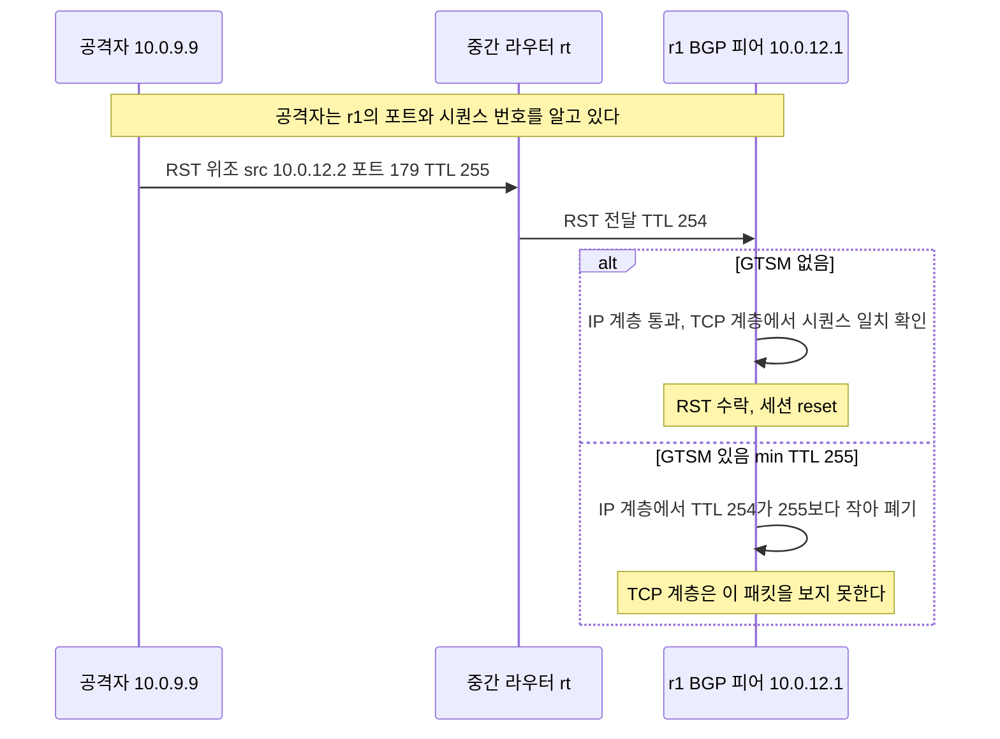
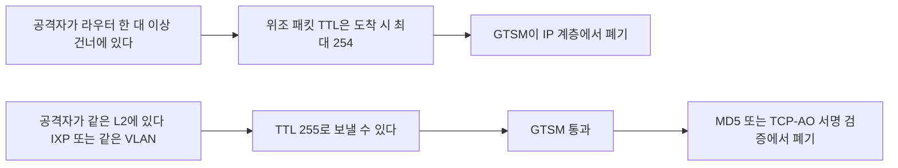
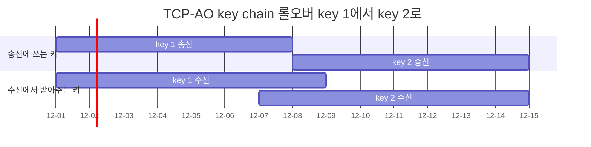
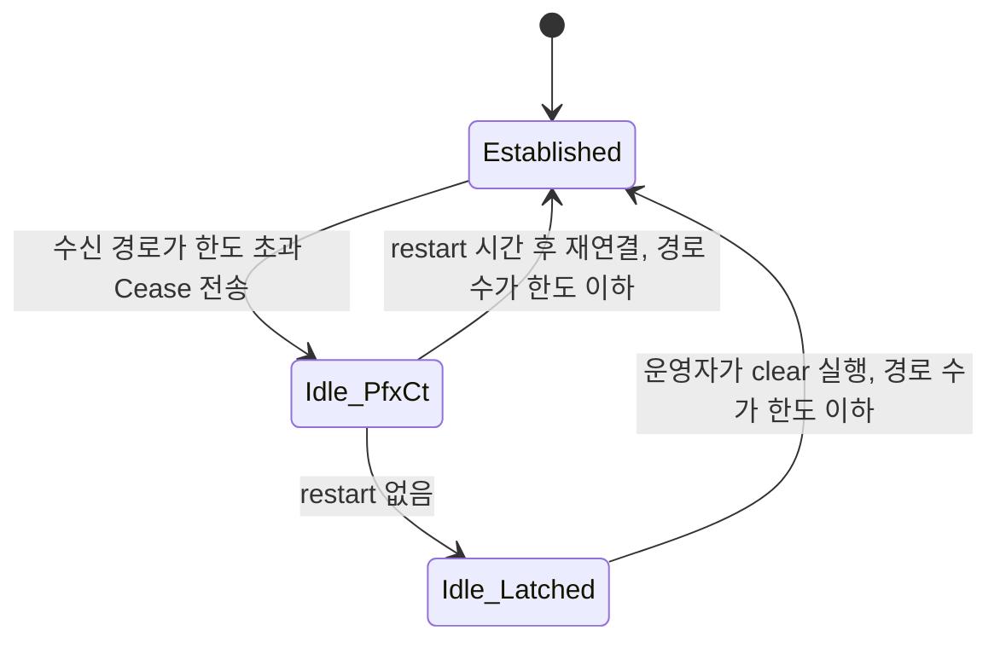

# BGP 세션 보호, 경로가 아니라 TCP 연결을 지키는 설정

[BGP](BGP.md) 문서와 [BGP 경로 보안](BGP_Route_Security_RPKI_ROV.md) 문서는 경로를 다룬다. 누가 어떤 prefix를 광고해도 되는지, 광고된 경로를 믿어도 되는지가 주제였다. 그 앞 단계는 한 번도 나오지 않았다. BGP 세션은 TCP 179번 포트 위의 연결 하나이고, 이 연결이 끊기면 그 피어에서 받은 경로가 전부 사라진다. 경로를 아무리 검증해도 연결 자체는 패킷 한 개로 끊을 수 있다.

이 문서는 연결을 지키는 설정을 다룬다. 위조 RST로 세션을 끊는 방법, MD5 옵션이 막는 것과 못 막는 것, TCP-AO의 키 롤오버, GTSM과 `ebgp-multihop`이 같이 못 켜지는 이유, 경로가 폭주할 때 세션을 스스로 내리는 `maximum-prefix`를 순서대로 본다. 마지막에 AWS Direct Connect에서 부딪히는 제약을 적는다.

## 실험 환경과 돌리지 못한 것

출력은 직접 돌려서 가져왔다. network namespace 4개로 아래 토폴로지를 만들었고 라우터는 FRR 8.1, 커널은 5.15.0-202, 패킷 위조는 scapy 2.8.0을 썼다. BGP 타이머는 `timers 3 9`로 줄였다.

| 이름 | 주소 | 역할 |
|---|---|---|
| r1 (AS 65001) | 10.0.12.1, 10.0.1.1 | 공격 대상. r2와 직접 연결, rt와도 연결 |
| r2 (AS 65002) | 10.0.12.2 | 정상 피어 |
| rt | 10.0.1.2, 10.0.9.1 | 중간 라우터. 포워딩만 한다 |
| atk | 10.0.9.9 | 공격자. rt 뒤에 있어서 r1까지 라우터 한 대를 지나야 한다 |

공격자에게 r1의 소스 포트와 시퀀스 번호를 알려 줬다. r1 쪽 인터페이스에서 r2가 보낸 세그먼트를 sniff해서 구한 값이다. 실제 off-path 공격자는 이 값을 맞혀야 하고, 그 난이도는 아래 "위조 RST" 절에서 따로 다룬다. 이 실험은 "값을 맞혔을 때 무엇이 세션을 지키는가"를 보는 용도다.

돌리지 못한 것도 있다. TCP-AO는 이 환경에서 실행할 수 없었다. 커널 5.15에 `TCP_AO_ADD_KEY`(옵션 번호 38)를 `setsockopt`로 걸면 `Errno 92 Protocol not available`이 나오고, FRR 8.1의 `neighbor` 옵션 목록에는 `ao`가 없다. TCP-AO 절은 RFC와 벤더 문서 기준이고 실행 결과가 없다. Cisco와 Juniper 장비도 없어서 그쪽 설정은 문법을 기억과 문서로 적은 것이다. 해당 블록에 표시해 두었다.

## 위조 RST 하나로 세션이 끊긴다

TCP 연결을 끊는 데 필요한 것은 4-tuple과 시퀀스 번호다. BGP는 이 중 절반이 공개되어 있다. 목적지 포트는 179이고, 피어링 주소는 IXP 멤버 목록이나 PeeringDB, 공개 looking glass에서 구할 수 있다. 남는 것은 상대가 연결을 걸어온 쪽이면 그쪽의 임시 포트, 그리고 시퀀스 번호다.

시퀀스 번호가 문제다. 예전 TCP 스택은 수신 윈도 안에 들어오는 RST를 전부 받아들였다. 윈도가 16384바이트면 32비트 시퀀스 공간 2^32를 16384로 나눈 262,144개의 패킷으로 전 범위를 훑는다. 이 공격이 [RFC 4953](https://datatracker.ietf.org/doc/html/rfc4953)이 정리한 BGP 세션 reset 위협의 배경이고, [RFC 5961](https://datatracker.ietf.org/doc/html/rfc5961)이 이걸 막는 규칙을 넣었다. 윈도 안이지만 `rcv_nxt`와 정확히 같지 않은 RST에는 연결을 끊지 않고 challenge ACK로 답한다.

Linux 5.15에서 두 경우를 그대로 확인했다. 먼저 시퀀스 번호에 100을 더한 RST를 보냈다.

```
  BGP state = Established, up for 00:00:38
  Connections established 1; dropped 0
TcpExtTCPChallengeACK           1                  0.0
```

세션은 살아 있고 challenge ACK 카운터만 올랐다. 이번에는 정확한 시퀀스 번호로 보냈다. 공격자가 TTL 255로 보낸 패킷이 라우터 한 대를 지나 r1에 도착했을 때의 tcpdump다.

```
17:55:55.367098 IP (tos 0x0, ttl 254, id 1, offset 0, flags [none], proto TCP (6), length 40)
    10.0.12.2.179 > 10.0.12.1.50260: Flags [R], cksum 0xf700 (correct), seq 3921591830, win 8192, length 0
```

```
  BGP state = Established, up for 00:00:00
  Connections established 2; dropped 1
  Last reset 00:00:02,  No AFI/SAFI activated for peer
```

세션이 reset되고 곧바로 다시 올라왔다. lab에서는 2초 안에 복구되지만 운영 환경에서는 그 사이에 받은 경로가 전부 withdraw되고, 다시 올라온 뒤 전체 테이블을 새로 받는다. 이 구간에 라우팅 테이블이 흔들리고, 풀 테이블을 받는 피어라면 그 처리 시간도 수렴 시간에 들어간다.

난이도는 낮아졌다고 보기 어렵다. RFC 5961을 구현한 스택에서는 정확한 시퀀스 번호를 맞혀야 하니 2^32분의 1이다. 그러나 라우터 OS의 TCP 스택이 전부 최신 규칙을 따른다는 보장은 없고, 공격자가 시퀀스를 알아낼 다른 경로(경로 상의 한 지점에서 트래픽을 본다든지)가 생기면 조건이 달라진다. 세션 보호 설정을 켜는 이유는 이 확률이 0이 아니고, 맞았을 때의 피해가 경로 전체라서다.

## GTSM이 있을 때와 없을 때

GTSM(Generalized TTL Security Mechanism, [RFC 5082](https://datatracker.ietf.org/doc/html/rfc5082))은 단순한 원리다. 직접 연결된 피어는 TTL 255로 보내고, 받는 쪽은 TTL이 255보다 작은 패킷을 버린다. 라우터를 한 대라도 지나온 패킷은 TTL이 254 이하이므로 원거리 공격자는 TTL을 아무리 올려도 255로 도착시킬 수 없다.

아래 도식은 같은 위조 RST가 r1에 도착했을 때 두 설정에서 어디까지 올라가는지 보여 준다. 중간 라우터를 지나면서 TTL이 254가 되는 부분을 보면 된다.



양쪽에 `ttl-security hops 1`을 걸고 같은 공격을 다시 했다.

```
sport=53576 dport=179 seq=2973949869
  BGP state = Established, up for 00:00:33
  Connections established 3; dropped 2
TcpExtTCPMinTTLDrop             1                  0.0
```

세션은 유지됐고 `TcpExtTCPMinTTLDrop` 카운터가 1 올랐다. 패킷이 BGP 데몬까지 올라가지 못하고 커널의 `IP_MINTTL` 검사에서 버려졌다는 뜻이다. BGP 로그에도 아무것도 남지 않는다. 막히고 있는지는 이 카운터로만 알 수 있다.

GTSM이 막지 못하는 공격자가 있다. 같은 L2 세그먼트에 있는 호스트는 TTL 255 패킷을 그대로 만들어 보낼 수 있다. IXP에서는 모든 멤버가 같은 L2에 있고, 같은 VLAN의 침해된 장비도 마찬가지다. 이 경우를 막는 것은 서명이다. 이 부분은 직접 실험하지 않았고 RFC 5082가 명시한 한계다.



## 세 방식 비교

| | GTSM | MD5 옵션 | TCP-AO |
|---|---|---|---|
| 표준 | RFC 5082 | RFC 2385 | RFC 5925, 알고리즘은 RFC 5926 |
| 막는 것 | 라우터 건너편의 위조 | 서명을 못 만드는 위조 | MD5와 같고, 키 롤오버가 가능 |
| 못 막는 것 | 같은 L2의 공격자, 침해된 이웃 | 키 유출, 키 교체 중 순단 | NAT 통과(주소가 서명에 들어간다) |
| 키 | 없음 | 피어당 정적 문자열 하나 | key chain, 키마다 ID와 수명 |
| 키 교체 | 해당 없음 | 양쪽을 동시에 바꿔야 하고 세션이 끊긴다 | 겹치는 구간을 두고 무중단 |
| TCP 옵션 | 없음 | kind 19, 18바이트 | kind 29, MAC 12바이트 포함 16바이트 |
| 알고리즘 | 해당 없음 | MD5 고정 | HMAC-SHA-1-96, AES-128-CMAC-96 필수 |
| 실험 | 직접 확인 (FRR 8.1) | 직접 확인 | 못 돌림 (커널 5.15) |
| 실패 시 보이는 것 | `TcpExtTCPMinTTLDrop` | `TcpExtTCPMD5Failure`, `TcpExtTCPMD5NotFound`, dmesg | 장비마다 다르다 |

세 방식은 서로 대체재가 아니라 층이 다르다. GTSM은 서명 계산 전에 값싸게 걸러내고, MD5나 TCP-AO는 같은 L2의 공격자까지 막는다. 둘 다 켜는 구성이 정상이다.

## MD5 옵션이 하는 일

[RFC 2385](https://datatracker.ietf.org/doc/html/rfc2385)의 MD5 옵션은 TCP 헤더 옵션 kind 19에 16바이트 해시를 싣는다. 해시는 의사 헤더, TCP 헤더(옵션 제외), 페이로드, 그리고 피어별로 설정한 문자열 키로 계산한다. 시퀀스 번호가 해시 안에 들어가므로 키를 모르는 공격자는 정확한 RST를 만들어도 서명을 맞출 수 없다.

SYN 패킷에서 옵션이 실제로 붙는 모습이다. tcpdump는 키를 모르면 해시 값을 그대로 보여 준다.

```
10.0.12.1.55548 > 10.0.12.2.179: Flags [S], seq 1078873264, win 64240,
  options [nop,nop,md5 shared secret not supplied with -M, can't check - 1874cc39da568635479bc78e9100ac32,mss 1460,nop,nop,sackOK,nop,wscale 7], length 0
```

MD5를 켠 세션에 서명 없는 위조 RST를 보냈다. 시퀀스 번호는 정확했고 TTL도 255였다.

```
  BGP state = Established, up for 00:00:23
TcpExtTCPMD5NotFound            2                  0.0
TcpExtTCPMD5Unexpected          0                  0.0
TcpExtTCPMD5Failure             0                  0.0
```

세션은 유지됐고 `TCPMD5NotFound`가 올랐다. 키가 설정된 피어에서 서명이 없는 세그먼트가 왔다는 뜻이다. 이 카운터는 공격이 아니어도 오른다. 경로 중간의 방화벽이 TCP 옵션을 정규화하면서 옵션 19를 지우면 정상 피어의 세그먼트가 전부 `NotFound`로 버려진다. 이 방화벽 동작은 실험하지 않았고 카운터의 정의에서 추론한 것이다. MD5 세션이 올라오지 않을 때 키 오타만 의심하지 말고 중간 장비를 보라는 이유다.

### 키를 바꾸면 세션이 끊긴다

MD5의 가장 큰 운영 문제는 키 교체다. 옵션에 키 ID가 없고 피어당 키가 하나뿐이라, 키를 바꾸는 순간 그 키로 서명하는 쪽과 검증하는 쪽이 어긋난다. r2의 키만 바꿨다.

```
  BGP state = Idle
  Connections established 6; dropped 6
  Last reset 00:00:00,   Notification received (Cease/Other Configuration Change)
```

FRR은 `password`를 바꾸는 즉시 상대에게 Cease(Other Configuration Change) NOTIFICATION을 보내고 세션을 내렸다. 20초 뒤 양쪽 모두 `Connect` 상태였고, 커널 카운터는 이렇게 올랐다.

```
TcpExtTCPMD5NotFound            2                  0.0
TcpExtTCPMD5Unexpected          0                  0.0
TcpExtTCPMD5Failure             5                  0.0
```

원인이 어디에도 BGP 로그로 남지 않는다. `bgpd.log`에는 MD5에 관한 줄이 없었고 커널 로그에만 이렇게 찍혔다.

```
[1617247.315988] TCP: MD5 Hash failed for (10.0.12.2, 58762)->(10.0.12.1, 179) L3 index 0
[1617247.316547] TCP: MD5 Hash failed for (10.0.12.1, 45718)->(10.0.12.2, 179) L3 index 0
```

세션이 `Active`나 `Connect`에서 움직이지 않으면 `dmesg`와 `nstat`부터 본다. BGP 쪽 명령으로는 "상대가 응답이 없다"까지만 보인다. r1의 키도 같은 값으로 바꾸자 2초 만에 다시 올라왔다. lab에서 빨랐던 것은 FRR이 reset 직후 곧바로 재연결을 시도하기 때문이다. 상대가 다른 조직의 장비이고 두 사람이 따로 명령을 치면, 두 명령 사이의 간격과 양쪽 connect-retry 타이머가 순단 시간이 된다. 피어가 수십 개면 그 횟수만큼 반복된다.

## TCP-AO와 key chain

[RFC 5925](https://datatracker.ietf.org/doc/html/rfc5925)의 TCP-AO는 MD5 옵션을 대체한다. 이 절은 실행 결과 없이 RFC 기준으로 적는다.

옵션 kind는 29이고 구조는 KeyID, RNextKeyID, MAC이다. MAC은 기본 12바이트로 잘라 쓰니 옵션 전체가 16바이트다. MD5의 20바이트(옵션 18바이트와 정렬용 NOP 2개)보다 작아서 SYN에서 MSS, SACK-permitted, window scale을 같이 싣기에 여유가 생긴다.

MD5와 다른 점은 네 가지다.

- 키가 하나가 아니라 key chain이다. 각 키는 SendID와 RecvID, 알고리즘, 마스터 키, 유효 기간을 가진다.
- 마스터 키를 그대로 서명에 쓰지 않는다. 연결의 주소, 포트, 양쪽 초기 시퀀스 번호를 섞어 연결마다 다른 트래픽 키를 파생한다([RFC 5926](https://datatracker.ietf.org/doc/html/rfc5926)). 한 연결의 서명을 다른 연결에 재사용할 수 없다.
- 시퀀스 번호가 32비트를 한 바퀴 돌아도 서명이 겹치지 않도록 SNE(Sequence Number Extension)를 넣는다.
- 수신 측이 세그먼트의 KeyID로 키를 고른다. 그래서 키 두 개가 동시에 유효할 수 있고, 이것이 무중단 롤오버의 기반이다.

### 롤오버 타임라인

롤오버는 key 2를 양쪽에 미리 심고, 수신 쪽 유효 기간을 송신보다 앞뒤로 넓게 잡는 방식이다. 송신 키가 바뀌는 순간 상대는 이미 새 키를 받아주고 있어야 하고, 옛 키로 서명한 늦은 세그먼트도 잠시 받아줘야 한다.



12월 7일에서 9일 사이가 겹치는 구간이다. 12월 8일에 송신이 key 2로 넘어가는 순간 상대는 이미 하루 전부터 key 2를 받아주고 있다. 두 장비의 시계가 몇 초 어긋나도, 설정이 장비마다 몇 분 차이로 반영되어도 서명 불일치가 생기지 않는다. 이 여유가 없으면 MD5와 같은 문제로 돌아간다. 수신 구간의 앞뒤 여유는 NTP 오차와 전체 피어에 설정을 반영하는 데 걸리는 시간보다 길게 잡아야 한다.

세그먼트의 RNextKeyID는 "나는 상대가 다음에 이 ID의 키로 보내 주기를 원한다"를 알리는 필드다. 이 필드로 시간 대신 신호로 전환할 수도 있지만, BGP 라우터 사이에서는 보통 시간 기준 롤오버를 쓴다.

### 설정에서 주의할 것

실행해 보지 못했으므로 문법은 적지 않고, 장비를 설정할 때 걸리는 지점만 적는다.

- Cisco와 Juniper 모두 `key chain` 단위로 키를 정의하고 BGP 피어에 chain 이름을 건다. 키마다 send ID와 recv ID를 양쪽이 서로 맞게 정해야 한다. 한쪽의 send ID가 상대의 recv ID와 같아야 한다.
- TCP 옵션을 서명 범위에 넣을지 정하는 스위치가 있다(Cisco는 `include-tcp-options`로 기억하고 있고 장비에서 확인하지 못했다). 양쪽이 다르면 서명이 맞지 않는다.
- 알고리즘이 장비마다 다르다. RFC가 필수로 정한 HMAC-SHA-1-96과 AES-128-CMAC-96이 서로 지원되는지 먼저 확인한다.
- 소프트웨어 지원 시점을 본다. Linux 커널은 6.7부터 TCP-AO를 넣었고, 이 문서를 쓴 환경의 5.15와 FRR 8.1은 지원하지 않는다. 호스트에서 BGP 데몬(FRR, BIRD, GoBGP 등)을 돌리고 있다면 커널과 데몬이 둘 다 지원하는지 따져야 한다.
- AO는 주소를 서명에 넣기 때문에 중간에 NAT가 있으면 서명이 깨진다. 라우터끼리 직접 피어링할 때는 문제 없다.

## GTSM과 ebgp-multihop은 같이 못 쓴다

GTSM은 직접 연결된 eBGP 피어를 전제로 한다. 대표적 충돌은 loopback 주소로 피어링하는 구성에서 나온다. loopback 피어링은 `ebgp-multihop`을 켜야 하는데, 이 명령이 TTL을 바꾼다. FRR에서 세 가지 설정이 보내는 TTL을 tcpdump로 확인했다.

| 설정 | 송신 TTL |
|---|---|
| 기본 eBGP | 1 |
| `ttl-security hops 1` | 255 |
| `ebgp-multihop 3` | 3 |

`ebgp-multihop 3`은 보내는 TTL을 3으로 낮추고 받는 쪽에는 하한이 없다. GTSM은 보내는 TTL을 255로 올리고 받는 쪽에 하한을 건다. 방향이 반대라 두 설정은 공존할 수 없고, FRR은 이렇게 거절한다.

```
r1(config-router)# neighbor 10.0.12.2 ebgp-multihop 3
r1(config-router)# neighbor 10.0.12.2 ttl-security hops 2
% ebgp-multihop and ttl-security cannot be configured together
```

반대 순서(GTSM을 먼저 걸고 multihop을 거는 것)에서도 같은 메시지가 나왔다. 피어까지 라우터가 N대 있으면 `ebgp-multihop N` 대신 `ttl-security hops N`을 쓴다. 수신 하한이 256 - N이 되어, 경로 중간의 라우터를 지나면서 줄어든 TTL을 허용하면서도 그보다 먼 곳에서 온 패킷은 버린다. Cisco IOS도 두 명령을 함께 쓰는 구성을 지원하지 않는 것으로 알고 있는데, 장비에서 확인하지는 못했다.

`ebgp-multihop`만 있는 구성은 보호가 없는 것과 같다. 송신 TTL이 3이니 TTL 3 이상으로 위조한 패킷은 전부 통과한다.

### 한쪽만 켜면 세션이 못 올라온다

GTSM 설정에서 가장 많이 겪는 실수는 한쪽만 켜는 것이다. r1에만 `ttl-security hops 1`을 걸고 r2는 기본값으로 둔 채 25초를 기다렸다.

```
10.0.12.2       4      65002       59        68        0    0    0 00:00:25       Active        0 N/A
TcpExtTCPMinTTLDrop             60                 0.0
```

```
17:57:43.774536 IP (tos 0xc0, ttl 255, ...) 10.0.12.1.179 > 10.0.12.2.54312: Flags [P.]
17:57:43.774559 IP (tos 0xc0, ttl 1, ...)   10.0.12.2.54312 > 10.0.12.1.179: Flags [P.]
```

r1은 TTL 255로 보내고 r2는 TTL 1로 보낸다. r1이 r2의 패킷을 25초 동안 60개 버렸고 세션은 `Active`에서 움직이지 않는다. BGP 쪽 메시지는 "상대에게서 응답이 없다"뿐이다. 양쪽을 동시에 바꾸는 것은 MD5와 같은 문제이므로, 상대가 협조하지 않는 피어(업스트림, 고객)는 GTSM을 켜기 전에 상대 설정을 확인한다.

## max-prefix로 폭주를 세션 단위에서 끊는다

앞의 설정들은 외부 공격을 막는다. `maximum-prefix`는 상대의 실수를 막는다. 고객이나 피어가 필터 없이 풀 테이블을 흘려 보내는 사고는 BGP 운영에서 반복되고, 받는 쪽 라우터의 메모리와 FIB가 한계에 닿기 전에 세션을 내려야 한다.

r2에 blackhole 경로를 넣어 `redistribute kernel`로 광고시키고, r1에서 한도를 5로 걸었다.

```
router bgp 65001
 address-family ipv4 unicast
  neighbor 10.0.12.2 maximum-prefix 5 80 restart 1
```

경로가 6개가 되자 세션이 내려갔다.

```
10.0.12.2       4      65002       103       115        0    0    0 00:00:04 Idle (PfxCt)        0 N/A
  Maximum prefixes allowed 5
  Threshold for warning message 80%, restart interval 1 min
  Last reset 00:00:04,   Notification sent (Cease/Maximum Number of Prefixes Reached)
  Reduce the no. of prefix from 10.0.12.2, will restart in 55 seconds
```

로그에는 `%MAXPFX`(한도 도달)와 `%MAXPFXEXCEED`(초과) 두 줄이 남는다. 80%는 경고 임계값이다. `restart 1`은 1분 뒤 다시 연결해 보라는 뜻이다. 상대가 여전히 경로를 6개 보내고 있으면 다시 올라왔다가 다시 내려간다. 로그의 초과 시각이 17:59:53과 18:00:54로 61초 간격이었다. 상대가 경로를 줄이자(r2에서 8개를 withdraw) 다음 재시도에 경로 3개를 받으며 세션이 복구됐다.



`restart`를 빼면 `Idle (PfxCt)`에 머무른다. 25초를 더 기다려도 그대로였고, FRR이 안내 문구를 바꿔서 알려 준다.

```
  Reduce the no. of prefix and clear ip bgp 10.0.12.2 to restore peering
```

경로를 줄이지 않은 채 `clear bgp 10.0.12.2`를 하면 5초 만에 다시 `Idle (PfxCt)`로 돌아왔다. 상대가 먼저 고쳐야 한다는 뜻이다.

`restart`는 값을 짧게 잡으면 폭주하는 상대와 재연결 루프를 돌고, 길게 잡으면 정상으로 돌아온 뒤에도 그만큼 대기한다. 없으면 새벽에 사람이 일어나야 한다. 한도 값은 현재 수신 개수를 보고 정한다. 한도를 현재 수신 수에 너무 가깝게 잡으면 업스트림의 정상적인 증가 때문에 세션이 내려간다. 경고 임계값(80%)을 로그 알림에 연결해 두면 한도에 닿기 전에 알 수 있다.

## 장비별 설정

FRR은 위 실험에서 쓴 그대로다.

```
router bgp 65001
 bgp router-id 1.1.1.1
 neighbor 10.0.12.2 remote-as 65002
 neighbor 10.0.12.2 password S3cret-2026
 neighbor 10.0.12.2 ttl-security hops 1
 !
 address-family ipv4 unicast
  neighbor 10.0.12.2 maximum-prefix 1000 80 restart 5
 exit-address-family
```

Cisco IOS XE는 장비에서 돌려 보지 못했고 문법을 문서와 기억으로 적었다. 적용 전에 `?`로 확인한다.

```
router bgp 65001
 neighbor 192.0.2.2 remote-as 65002
 neighbor 192.0.2.2 password S3cret-2026
 neighbor 192.0.2.2 ttl-security hops 1
 address-family ipv4
  neighbor 192.0.2.2 activate
  neighbor 192.0.2.2 maximum-prefix 1000 80 restart 5
```

Juniper Junos도 마찬가지로 돌려 보지 못했다. 수신 TTL 검사는 BGP 설정이 아니라 loopback 필터에서 한다는 점이 다르다. `ttl` 매치 조건 지원은 플랫폼마다 달라서 `commit check`로 확인해야 한다.

```
set protocols bgp group TRANSIT type external
set protocols bgp group TRANSIT peer-as 65002
set protocols bgp group TRANSIT ttl 255
set protocols bgp group TRANSIT neighbor 192.0.2.2 authentication-key "S3cret-2026"
set protocols bgp group TRANSIT family inet unicast prefix-limit maximum 1000 teardown 80 idle-timeout 5

set firewall family inet filter PROTECT-RE term BGP-OK from source-address 192.0.2.2/32
set firewall family inet filter PROTECT-RE term BGP-OK from protocol tcp
set firewall family inet filter PROTECT-RE term BGP-OK from port 179
set firewall family inet filter PROTECT-RE term BGP-OK from ttl 255
set firewall family inet filter PROTECT-RE term BGP-OK then accept
set firewall family inet filter PROTECT-RE term BGP-DROP from protocol tcp
set firewall family inet filter PROTECT-RE term BGP-DROP from port 179
set firewall family inet filter PROTECT-RE term BGP-DROP then discard
```

## tcpdump와 카운터로 확인한다

GTSM이 실제로 동작하는지는 설정 출력이 아니라 패킷의 TTL로 확인한다. 위 실험에서 쓴 명령은 이렇다.

```bash
# 양방향 TTL을 본다. 직접 연결 피어가 GTSM이면 양쪽 모두 ttl 255여야 한다
tcpdump -nv -i eth0 'tcp port 179' | grep -oE '(ttl [0-9]+)|([0-9.]+ > [0-9.]+)'

# TTL이 255가 아닌 BGP 패킷만 잡는다 (ip[8]이 IPv4 헤더의 TTL 바이트)
tcpdump -nv -i eth0 'tcp port 179 and ip[8] < 255'
```

두 번째 명령에 패킷이 잡히면 한쪽이 GTSM을 안 쓰고 있거나, 중간에 라우터를 지나 들어오는 패킷이 있다는 뜻이다. 정상 세션의 확인뿐 아니라 방화벽이 TTL을 건드리는 구간을 찾을 때도 쓴다.

MD5 해시를 tcpdump가 검증하게 하려면 `-M` 옵션에 키를 준다. 키를 안 주면 앞에서 본 `md5 shared secret not supplied with -M` 문구가 나온다. 키를 명령행에 노출하게 되니 운영 서버에서는 쓰지 않는다.

세션이 안 올라올 때 `bgpd` 로그보다 먼저 보는 것은 커널 카운터다.

```bash
nstat -az | grep -E 'MinTTL|MD5|ChallengeACK'
dmesg | grep -i md5
```

| 카운터 | 의미 | 무엇을 의심하나 |
|---|---|---|
| `TcpExtTCPMinTTLDrop` | `IP_MINTTL`보다 TTL이 작아 폐기 | 한쪽만 GTSM, 중간에 라우터가 하나 더 있다 |
| `TcpExtTCPMD5Failure` | 서명이 있는데 값이 다르다 | 양쪽 키가 다르다 |
| `TcpExtTCPMD5NotFound` | 키가 설정된 피어에서 서명 없는 세그먼트 | 상대가 MD5를 안 켰다, 중간 장비가 옵션을 지운다, 위조 패킷 |
| `TcpExtTCPMD5Unexpected` | 서명이 있는데 이쪽에 키가 없다 | 이쪽만 키가 빠졌다 (이번 실험에서는 0) |
| `TcpExtTCPChallengeACK` | 윈도 안이지만 정확하지 않은 RST | 블라인드 RST 시도 또는 비정상 TCP 스택 |

라우터 전용 OS에서는 `nstat`을 못 쓰는 경우가 많다. 그때는 벤더의 TCP 통계와 로그에서 같은 구분(TTL 불일치, MD5 불일치, 서명 없음)을 찾아야 한다.

## 클라우드에서 부딪히는 것, AWS Direct Connect

Direct Connect는 BGP 세션 보호를 고객이 고를 수 없는 부분이 있다. [AWS 문서](https://docs.aws.amazon.com/directconnect/latest/UserGuide/WorkingWithVirtualInterfaces.html)에는 "MD5가 기본으로 켜져 있고 이 옵션은 바꿀 수 없다"고 적혀 있고, MD5 키는 직접 넣거나 AWS가 생성하게 한다. 콘솔에서 인증 없이 VIF를 만드는 선택지가 없다. 장비 쪽에서 `password`를 빼먹으면 세션은 올라오지 않는다.

겪는 문제는 세 가지다.

**키 교체가 세션 교체다.** [BGP 피어 추가 문서](https://docs.aws.amazon.com/directconnect/latest/UserGuide/add-peer-to-vif.html)에 따르면 VIF는 주소 패밀리당 BGP 세션을 하나만 가질 수 있다. 위 MD5 실험에서 본 대로 키가 바뀌면 세션이 끊기는데, 그 키를 기존 피어에서 편집하는 절차를 문서에서 찾지 못했다. re:Post의 [질문](https://repost.aws/questions/QUtzZWwuCXSOSAS77VNmtt4Q/modify-or-update-the-bgp-key-on-direct-connect-vifs)에 대한 검색 결과 요약은 임시 IPv6 피어를 먼저 만들고 IPv4 피어를 지운 뒤 새 키로 다시 만드는 우회를 안내한다. 이 페이지는 접근이 막혀 원문을 읽지 못했고 검색 요약만 확인했다. 어느 쪽이든 키 교체 때 IPv4 세션이 한 번은 내려간다고 보고 점검 시간으로 잡는다. 이중화된 VIF가 있으면 한쪽씩 바꾼다.

**TCP-AO와 GTSM 설정이 없다.** 읽은 문서에서 TCP-AO 지원이나 GTSM 관련 항목을 찾지 못했다. AWS 쪽이 TTL 255로 보내는지는 확인하지 못했다. 장비에서 `ttl-security hops 1`을 걸면 앞의 한쪽만 켠 실험과 같은 증상이 나올 수 있고, 콘솔에서는 원인이 보이지 않는다. 켜기 전에 `ip[8] < 255` 필터로 AWS가 보내는 TTL을 먼저 본다. 255가 아니면 켜지 않는다.

**보내는 경로 수에 한도가 있다.** 같은 문서에서 public VIF는 광고할 prefix를 최대 1,000개까지만 받는다. 이 한도를 넘는 건 우리가 건 `maximum-prefix`와는 별개의 제약이라, 한도에 걸렸을 때 어느 쪽 설정 때문인지 가려야 한다.

호스팅 VIF(파트너가 제공하는 연결)는 파트너 장비가 L2로 연결을 넘기므로 TCP 옵션을 건드리는 구간이 늘 수 있다. MD5가 맞는데 세션이 안 올라오면 앞에서 본 `TCPMD5NotFound` 카운터로 서명이 지워지는지 장비에서 확인한다. 이 경로는 직접 겪은 사례가 아니고 위 카운터 정의에서 추론한 것이다.

## 확인하지 못한 것

GTSM, MD5, max-prefix는 직접 돌려 동작과 카운터를 확인했다. TCP-AO는 RFC와 벤더 문서만 읽고 적었고, 롤오버 구간에서 세션이 실제로 유지되는지는 보지 못했다. 커널 6.7 이상과 AO를 지원하는 BGP 데몬이 있는 환경이 생기면 이것을 가장 먼저 재현한다. 같은 L2 공격자에게 GTSM이 뚫린다는 점과 방화벽이 옵션 19를 지우는 경우도 RFC와 카운터 정의에서 추론한 것이고 직접 만들어 보지 않았다.
