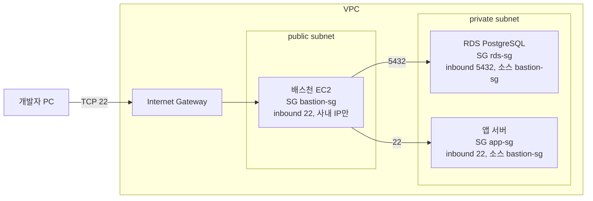
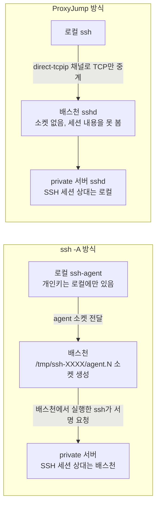
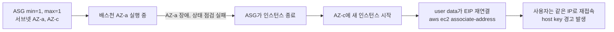
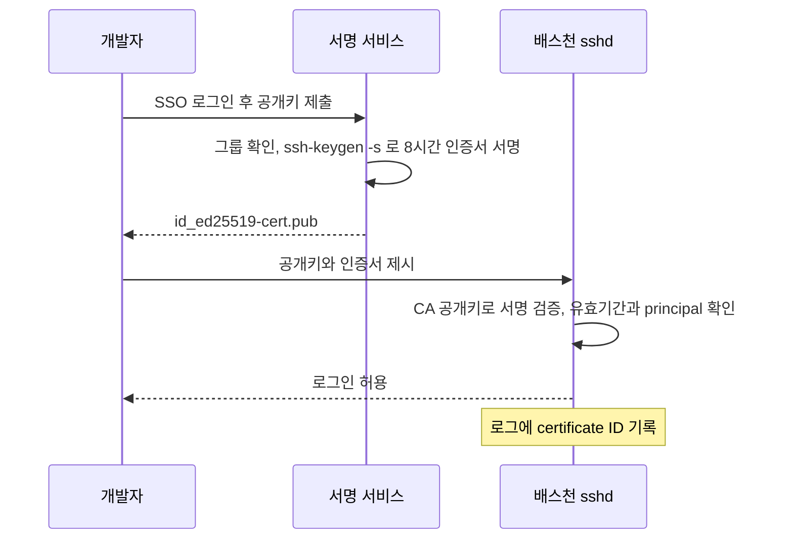
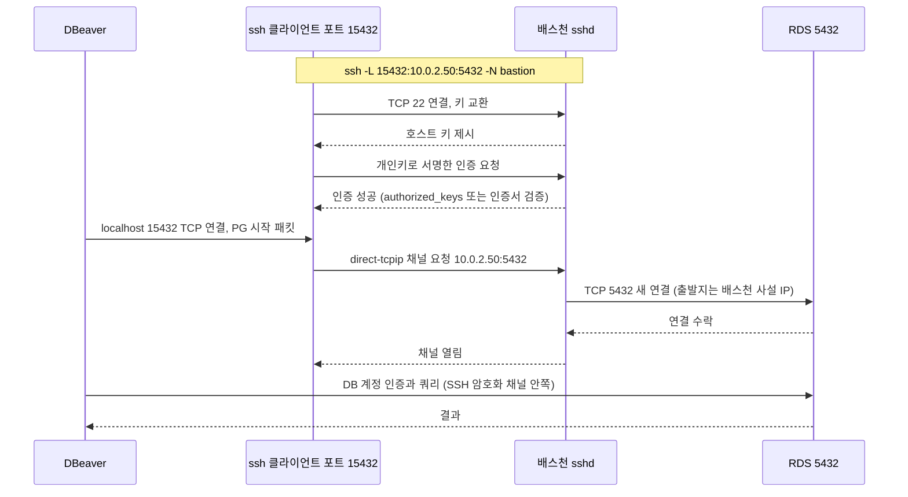
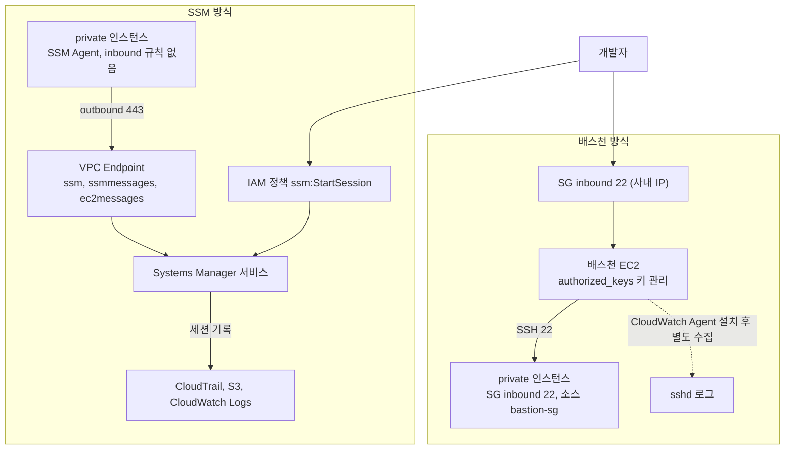
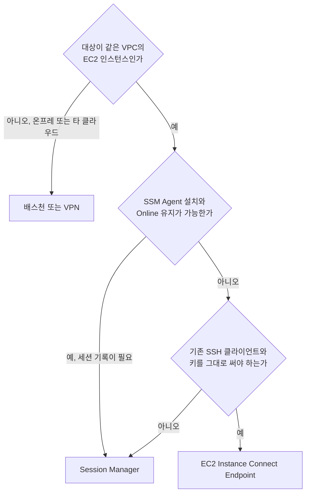
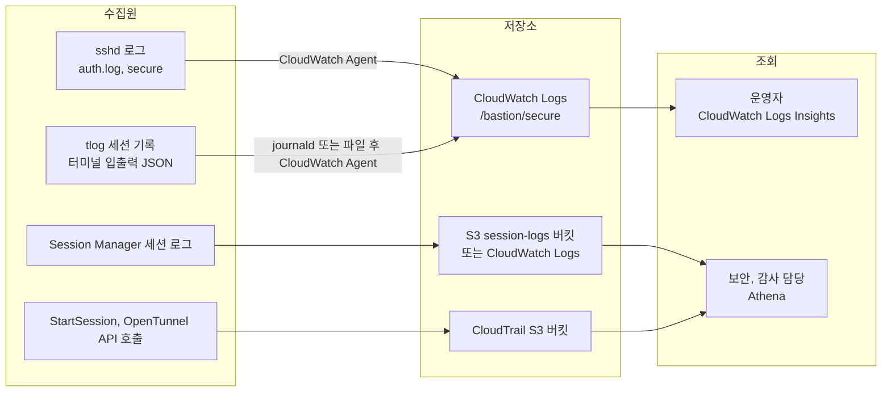

# 배스천 호스트 - private subnet 접근과 감사 구성

배스천 호스트를 처음 구성한 건 AWS에서 RDS를 private subnet에만 두기로 결정하면서였다. public subnet에 묶어두는 건 찜찜하니까 DB는 무조건 private, 그런데 로컬 DBeaver에서 바로 붙고 싶다. 그때 처음 배스천을 세우고 SSH 터널을 뚫었다.

몇 년 지나면서 팀이 커지고, 배스천 호스트에 누가 언제 들어갔는지 기록도 없고, IAM 계정은 있는데 OS 계정 관리가 따로 노는 문제가 생겼다. 결국 AWS Systems Manager Session Manager로 넘어갔고, 배스천 자체를 없앴다.

배스천 호스트를 언제 쓰고 언제 버리는지, 실제 운영하면서 겪은 것들을 정리했다. SSH 동작은 로컬에서 OpenSSH 8.9 sshd를 직접 띄워 확인한 것만 단정해서 적었고, AWS 서비스 쪽 동작은 문서 기준이라고 따로 표시했다.

## 배스천 호스트가 하는 일

배스천 호스트(Bastion Host)는 외부 네트워크에서 private 네트워크로 들어가는 유일한 진입점 역할을 한다. 군사 용어에서 왔는데, 요새 안으로 들어가는 성문 하나와 비슷한 개념이다.

private subnet에 있는 서버들은 인터넷에서 직접 접근이 안 된다. 라우팅 테이블에 인터넷 게이트웨이 경로가 없거나, 보안 그룹/NACL에서 아예 차단한다. 이 서버들을 관리하려면 같은 VPC 안이나 VPN으로 연결된 네트워크에서 들어가야 한다.

배스천은 public subnet에 올려서 22번 포트를 외부에 노출하고, 이 배스천을 거쳐서 private 서버로 들어가는 구조다. 서브넷 경계와 Security Group이 서로를 어떻게 참조하는지 아래 그림에서 보면 된다. private 쪽 SG는 IP 대역이 아니라 배스천 SG 자체를 소스로 허용한다.



배스천의 보안 그룹은 22번에 대해 사무실 IP, VPN 출구 IP, 개발자 집 IP 등 신뢰할 수 있는 대역만 허용한다. `0.0.0.0/0`으로 22번 열어두는 건 배스천이 아니라 그냥 공개된 SSH 서버다.

`rds-sg`와 `app-sg`의 소스를 `10.0.1.0/24` 같은 CIDR로 적지 않고 `bastion-sg`로 적는 이유가 있다. 배스천이 교체돼서 IP가 바뀌어도 규칙을 손댈 필요가 없고, 같은 서브넷에 다른 인스턴스가 올라와도 자동으로 허용되지 않는다. 방향도 헷갈리기 쉽다. 규칙은 전부 inbound 쪽에 쓰고, 배스천의 outbound는 기본값(전체 허용)을 그대로 둬도 된다. 막고 싶으면 outbound를 22와 5432로 좁히는데, 그러면 패치용 yum/apt 접근까지 같이 막히니 미러 경로를 따로 열어야 한다.

## 점프 서버 구성

점프 서버(Jump Server)는 배스천 호스트를 통해 내부 서버로 SSH하는 방식이다. 두 가지 방법이 있다.

### ProxyJump 방식

`~/.ssh/config`에 설정해두면 매번 옵션을 안 써도 된다.

```ssh-config
Host bastion
  HostName 52.xx.xx.xx
  User ec2-user
  IdentityFile ~/.ssh/bastion-key.pem

Host db-server
  HostName 10.0.2.15
  User ec2-user
  IdentityFile ~/.ssh/private-key.pem
  ProxyJump bastion

Host 10.0.3.*
  User ubuntu
  IdentityFile ~/.ssh/private-key.pem
  ProxyJump bastion
```

`ssh db-server` 한 번으로 배스천 경유가 자동으로 처리된다. `ssh 10.0.3.15`처럼 IP를 그대로 치면 `Host 10.0.3.*` 항목이 매칭돼서 같은 방식으로 경유한다. `ProxyJump`는 OpenSSH 7.3부터 지원된다.

`Host app-server-*`에 `HostName 10.0.3.%n`으로 적어 서버 번호를 끼워 넣는 설정은 동작하지 않는다. OpenSSH 8.9에서 `ssh -G app-server-5`를 돌리면 `unknown key %n`으로 설정 파싱 자체가 실패한다. `HostName`이 받는 토큰은 `%h`와 `%%` 정도이고, 호스트 번호를 뽑아 쓰는 치환은 없다. 서버 수가 적으면 `Host app1`, `Host app2`처럼 항목을 나열하고, 많으면 위처럼 IP 대역 패턴으로 받는다.

이전에는 `ProxyCommand`를 썼다.

```ssh-config
Host db-server
  HostName 10.0.2.15
  User ec2-user
  ProxyCommand ssh -W %h:%p bastion
```

`ProxyJump`가 더 간결하니 구버전 서버가 아니면 `ProxyJump`를 쓴다.

### 키 전달 주의사항

배스천 호스트에 개인키를 복사하면 안 된다. 배스천이 털리면 private 서버 키까지 노출된다. SSH 에이전트 포워딩(`-A`)을 쓰면 배스천에 키를 두지 않아도 된다.

```bash
ssh -A ec2-user@bastion
# 그 다음 배스천에서
ssh ec2-user@10.0.2.15
```

에이전트 포워딩은 배스천 서버의 루트 권한을 가진 누군가가 에이전트 소켓을 재사용할 수 있다는 위험이 있다. 에이전트 포워딩을 쓰려면 배스천 서버 자체가 완전히 신뢰 가능해야 한다. `ProxyJump`는 이 문제가 없다. 클라이언트에서 내부 서버까지 직접 연결을 만들기 때문에 배스천 서버에 에이전트 소켓이 남지 않는다.

두 방식이 인증을 어디서 하는지가 갈린다. `-A`는 배스천 안에서 새 ssh를 실행하므로 배스천이 private 서버와 SSH 세션을 맺고, 개인키로 하는 서명만 로컬 에이전트에 요청한다. `ProxyJump`에서 배스천은 TCP 바이트만 중계하고, SSH 세션과 인증은 로컬과 private 서버 사이에서 끝난다.



왼쪽은 배스천에 에이전트 소켓이 생기고 그 소켓을 가진 누구든 서명을 요청할 수 있다. 오른쪽은 배스천이 내용을 해독할 수 없다. 그래서 배스천 쪽 root 계정까지 신뢰 범위에 넣을지가 두 방식을 가르는 기준이 된다.

## 배스천 서버 자체의 하드닝

배스천은 인터넷에 22번을 여는 서버라서 가장 먼저 공격받는다. 서버가 하는 일은 중계뿐인데, 털리면 private 쪽 전체가 뚫린다. 그래서 기능을 줄이는 쪽으로 설정한다.

### 접속 허용 범위와 인증 방식

접속 허용 소스는 SG에서 사무실 고정 IP와 VPN 출구 IP로 제한한다. 개발자 집 IP처럼 자주 바뀌는 대역을 SG에 하나씩 넣다 보면 SG 수정 요청이 쌓이고, 결국 누가 급하다고 `0.0.0.0/0`으로 열어두는 일이 생긴다. 그 지경이 되면 VPN을 두거나 뒤에서 다루는 Session Manager, EC2 Instance Connect Endpoint로 가는 편이 낫다.

sshd 설정은 아래 정도를 기본으로 둔다. `sshd -t -f`로 문법 검사까지 해서 8.9에서 통과하는 것을 확인했다.

```text
# /etc/ssh/sshd_config
PasswordAuthentication no
KbdInteractiveAuthentication no
PermitRootLogin no
PubkeyAuthentication yes
AllowGroups bastion-users
MaxAuthTries 3
LoginGraceTime 20
ClientAliveInterval 60
ClientAliveCountMax 3
LogLevel VERBOSE
```

`PasswordAuthentication no`만 꺼도 안심하면 안 된다. 로컬에서 이 값만 끈 sshd에 접속을 거부당했을 때 `Permission denied (publickey,keyboard-interactive)`가 돌아왔다. 서버가 아직 keyboard-interactive를 인증 수단으로 알려주고 있다는 뜻이다. PAM을 쓰는 설정(`UsePAM yes`)에서는 이 경로가 비밀번호 입력 창구가 될 수 있어서 `KbdInteractiveAuthentication no`를 같이 둔다. 8.7 이전 버전은 이름이 `ChallengeResponseAuthentication`이다. `LogLevel VERBOSE`는 로그에 접속에 쓴 키 지문이 남게 하려고 올린다.

사양은 작아도 된다. 터널만 중계하면 CPU는 거의 안 쓴다. 다만 인스턴스 네트워크 대역폭이 터널 처리량의 상한이라서, `pg_dump` 결과를 이 경로로 내려받는 용도가 있으면 nano급은 느릴 수 있다. 용도를 먼저 정하고 사양을 고른다.

패치는 서버 안에서 `yum update`를 돌리는 방식보다 AMI를 갈아끼우는 쪽이 편했다. 배스천에 남는 상태가 거의 없어서(키도 로그도 두지 않으니) 새 AMI로 인스턴스를 교체하는 비용이 낮다. 뒤의 ASG 구성이 있으면 Instance Refresh로 한 번에 된다.

### fail2ban의 효과와 한계

fail2ban은 auth 로그에서 실패 횟수를 세고 임계값을 넘은 IP를 방화벽에서 막는다. 배스천에 두면 로그가 깨끗해지긴 한다. 그런데 효과는 생각보다 작았다.

SG가 이미 사무실 IP만 허용하고 있으면 외부 스캐너는 sshd까지 오지 못한다. 로그에 실패가 남는다면 대부분 우리 팀 사람이다. 에이전트에 키가 여러 개 들어 있으면 서버가 `MaxAuthTries`(여기서는 3)를 채우기 전에 키를 하나씩 시도하다가 `Too many authentication failures`로 끊기는데, 이게 실패로 집계된다. 사무실이 NAT 하나로 나가면 한 사람의 실수가 사무실 전체 차단으로 번진다. 그렇다고 `ignoreip`에 사무실 IP를 넣으면 보호 대상이 거의 사라진다. 차단은 인스턴스 안에만 있어서 교체하면 같이 사라지는 점도 걸린다. 키 인증만 허용하는 서버에서 무차별 대입은 어차피 성공하지 못하므로 fail2ban은 로그 소음 정리용으로만 보고, 실제 방어선은 SG와 키 인증에 둔다. 가장 흔한 원인은 에이전트 키 개수라서, `IdentitiesOnly yes`와 `IdentityFile` 지정으로 시도하는 키 수를 줄이면 잠기는 일이 없어진다.

### 단일 장애점 문제와 ASG로 1대 유지

배스천이 한 대면 그 인스턴스가 죽는 순간 모든 사람이 서버에 못 들어간다. 장애를 복구하려고 접속하려는 시점에 하필 접속 경로가 죽어 있는 상황이다. EC2 한 대는 AZ 장애나 하드웨어 문제에 그대로 노출된다.

Auto Scaling Group을 min=max=1로 두고 서브넷을 서로 다른 AZ 두 곳에 걸어두면 인스턴스가 죽었을 때 다른 AZ에서 새로 뜬다. 이 방식은 이중화가 아니라 자동 복구다. 복구되는 동안은 접속이 안 되고, 걸리는 시간은 상태 점검 실패 감지와 부팅 시간의 합이다. 분 단위로 본다.



새 인스턴스가 같은 공인 IP를 갖게 하려면 EIP를 user data에서 붙인다.

```bash
#!/bin/bash
TOKEN=$(curl -s -X PUT http://169.254.169.254/latest/api/token \
  -H "X-aws-ec2-metadata-token-ttl-seconds: 60")
IID=$(curl -s -H "X-aws-ec2-metadata-token: $TOKEN" \
  http://169.254.169.254/latest/meta-data/instance-id)
aws ec2 associate-address --instance-id "$IID" \
  --allocation-id eipalloc-0abc1234 --allow-reassociation \
  --region ap-northeast-2
```

인스턴스 역할에 `ec2:AssociateAddress` 권한이 있어야 한다. `--allow-reassociation`을 빼면 EIP가 이전 인스턴스에 붙은 채일 때 실패한다. 여기서 반드시 따라오는 문제가 host key다. 인스턴스가 새로 뜨면 host key도 바뀌어서 모든 사람에게 `REMOTE HOST IDENTIFICATION HAS CHANGED` 경고가 뜬다. host key를 SSM Parameter Store나 S3에 저장해 두었다가 부팅 때 `/etc/ssh/ssh_host_*`로 복원하거나, host 인증서(`ssh-keygen -s ca -h`)와 클라이언트 `known_hosts`의 `@cert-authority` 줄로 바꾸면 경고가 사라진다. 후자는 이 환경에서 돌려보지 않았다.

### 키가 퇴사자에게 남아 있을 때

Session Manager 비교 절에서 적은 것처럼 퇴사자 키가 한 달 넘게 살아 있는 일이 생기는 이유는 단순하다. `authorized_keys`에 공개키가 들어 있고 공개키에는 사람이 없기 때문이다. sshd 로그에는 키 지문만 찍히는데, 그 지문이 누구 키인지는 따로 장부를 만들지 않으면 알 수 없다. 키 끝의 comment(`kim@laptop` 같은 문자열)는 아무나 바꿔 쓸 수 있어서 근거가 못 된다.

퇴사자 키를 삭제하는 건 한 번이면 끝나지만, 그 키가 다른 서버에 복사돼 있었는지는 확인이 안 된다. 근본적으로는 키 파일을 배포하지 않는 구성으로 가야 한다. 그 구성이 뒤에 나오는 SSH CA 서명 인증서다.

### 배스천에 키 파일이 평문으로 남은 경우

급할 때 배스천에 private 서버용 `.pem`을 `scp`로 올려두고 쓰다가 그대로 두는 경우가 있다. 이 상태에서 배스천이 침해되면 그 키로 private 서버 전체가 열린다. 점검은 단순한 grep으로 한다.

```bash
sudo grep -rIl -E "BEGIN (OPENSSH|RSA|EC) PRIVATE KEY" /home /root /tmp /opt /var/tmp 2>/dev/null
```

찾으면 지우는 것으로 끝나지 않는다. 키가 있던 인스턴스의 EBS 스냅샷이나 그 인스턴스에서 만든 AMI에도 같은 파일이 들어 있을 수 있다. 해당 키는 노출된 것으로 보고 교체하고, 인스턴스는 깨끗한 AMI에서 새로 띄운다. 이후에는 앞의 `ProxyJump`로 키를 로컬에만 두거나, 아래 SSH CA로 넘어간다.

## 사용자별 계정과 SSH CA

### 배스천에서 사용자별 계정 만들기

공용 `ec2-user` 하나에 팀 공개키를 전부 넣어두면 로그에서 누구인지 구분이 안 된다. 사람마다 OS 계정을 만들고 그 계정의 `authorized_keys`에만 본인 키를 둔다.

```bash
sudo useradd -m -s /bin/bash -G bastion-users kim
sudo install -d -m 700 -o kim -g kim /home/kim/.ssh
echo "ssh-ed25519 AAAA... kim" | sudo tee /home/kim/.ssh/authorized_keys
sudo chown kim:kim /home/kim/.ssh/authorized_keys && sudo chmod 600 /home/kim/.ssh/authorized_keys
```

이렇게 하면 `Accepted publickey for kim` 형태로 로그에 사람이 남는다. 한계는 계정 수명 주기를 사람이 챙겨야 한다는 점이다. 입사, 퇴사, 팀 이동마다 `useradd`와 `userdel`을 해야 하고, ASG로 인스턴스가 교체되면 계정이 사라지므로 user data나 AMI에 계정 목록을 심어야 한다. 키를 로컬 노트북에서 바꾸면(키 교체) 서버 쪽 `authorized_keys`도 다시 올려야 한다.

터널만 쓰는 사람에게는 셸이 필요 없다. 계정 셸을 `nologin`으로 두고 `Match` 블록에서 목적지를 제한하면 DB 터널 전용 계정을 만들 수 있다.

```text
Match Group tunnel-only
  PermitOpen 10.0.2.50:5432
  PermitTTY no
  X11Forwarding no
  AllowAgentForwarding no
```

로컬 sshd에서 `nologin` 계정으로 접속해 확인한 결과다. `ssh tunneluser@host id`는 `This account is currently not available.`로 거부되지만 `-L`로 포워딩은 열렸다. `PermitOpen`에 적은 `127.0.0.1:9000`은 응답이 왔고, 적지 않은 `127.0.0.1:22`로 연결한 쪽은 SSH 배너도 받지 못하고 닫혔다. 계정 셸을 막는 것과 터널을 막는 것은 별개라서 목적지 제한은 `PermitOpen`으로 따로 걸어야 한다.

하나 주의할 점이 있다. `useradd`로 만든 계정은 비밀번호 필드가 `!`(잠김)로 시작한다. `UsePAM no`로 띄운 테스트 sshd에서는 이 계정이 `User tunneluser not allowed because account is locked`로 거부됐고, `usermod -p '*'`로 바꾸니 접속됐다. 기본 Ubuntu 설정(`UsePAM yes`)에서는 이 문제가 나오지 않는 환경이 많지만, 설정을 줄여서 쓰는 배스천에서는 만날 수 있다.

### SSH CA 서명 인증서로 키 배포 없애기

공개키 배포를 없애는 방법이 SSH CA다. CA 키 한 쌍을 만들고, 서버는 CA 공개키만 신뢰한다. 사용자는 자기 공개키를 CA 개인키로 서명한 인증서를 받아서 접속한다. 서버에는 개별 사용자 키를 등록할 일이 없다.

```bash
# CA 키 쌍 생성 (개인키는 로컬 디스크에 두지 않는다)
ssh-keygen -t ed25519 -f ssh_user_ca -C "company ssh user ca"

# 개발자 공개키에 서명: -I 는 로그에 남는 ID, -n 은 로그인 가능한 계정, -V 는 유효기간
ssh-keygen -s ssh_user_ca -I "kim.gyutory" -n ec2-user -V +8h id_ed25519.pub
# 결과: id_ed25519-cert.pub
```

서버 쪽은 CA 공개키와 principal 매핑을 설정한다.

```text
# /etc/ssh/sshd_config
TrustedUserCAKeys /etc/ssh/ssh_user_ca.pub
AuthorizedPrincipalsFile /etc/ssh/principals/%u
```

`/etc/ssh/principals/ec2-user` 파일에 이 계정으로 로그인해도 되는 principal 이름을 한 줄씩 적는다. 발급한 인증서의 `-n` 값이 이 파일에 없으면 인증서가 유효해도 거부된다. 로컬 sshd에서 직접 확인한 것은 다음과 같다.

- 인증서 없이 CA에 서명받지 않은 키로 접속하면 거부된다.
- 유효기간 안의 인증서로는 접속된다. 서명 시 `-V +1h`는 시작 시각이 서명 시점보다 1분쯤 앞서 잡혔다. 클라이언트와 서버의 시계 차이를 감안한 값이다.
- 유효기간이 지난 인증서(`-V -2h:-1h`)는 서버 로그에 `Certificate invalid: expired`가 남고 거부된다.
- principal이 다른 인증서(`-n tunneluser`로 서명하고 `root`로 접속)는 `Certificate does not contain an authorized principal`로 거부된다.
- `authorized_keys`와 `TrustedUserCAKeys`를 같은 sshd에 같이 설정해도 충돌하지 않았다. 그래서 단계적 전환이 가능하다.

감사 측면에서 가장 큰 차이는 로그다. 로컬 sshd 로그에는 `Accepted certificate ID "kim.dev1" (serial 0) signed by ED25519 CA SHA256:... via /tmp/bt/keys/ca.pub`처럼 `-I`로 넣은 ID가 찍혔다. 키 지문을 장부와 대조할 필요 없이 로그 한 줄에서 사람이 나온다.



그림에서 CA 개인키를 쥔 곳은 서명 서비스 한 군데다. 이 서비스에 접근할 수 있는 사람이 곧 서버 접근 권한을 만들 수 있는 사람이어서, CA 개인키는 SSM Parameter Store SecureString이나 KMS 뒤에 두고 서명 호출을 감사한다. 서명 서비스는 Lambda든 사내 CLI든 상관없다. 중요한 건 그 앞에 SSO 인증이 있고 유효기간을 짧게 잡는 것이다.

인증서는 로그인 시점에 만료를 검사한다. 이미 열린 세션이 만료 시각에 끊기는 건 아니라고 알고 있다(OpenSSH 동작 기준이고 이 환경에서 확인하지는 않았다). 퇴사자 계정이 SSO에서 막히면 새 인증서를 못 받으므로, 가장 오래 남는 접근 권한이 인증서 유효기간이 된다. 긴급하게 특정 인증서를 막아야 하면 `RevokedKeys` 파일에 등록할 수 있는데, 평소에는 유효기간을 짧게 가져가는 쪽이 낫다.

전환은 기존 `authorized_keys`를 유지한 채 병행하다가 비우는 순서로 한다.

1. CA 키 쌍을 만들고 서명 서비스를 먼저 만든다. 아직 서버는 건드리지 않는다.
2. 배스천과 private 서버에 `TrustedUserCAKeys`를 추가하고 sshd를 reload한다. `authorized_keys`는 그대로라 기존 접속은 계속된다.
3. 팀원에게 인증서를 발급해서 로그에 `Accepted certificate ID`가 찍히는지 본다. 인증서와 키 접속이 섞여 있는 기간이다.
4. 로그에 키 지문 접속이 더 안 나오면 사용자 계정의 `authorized_keys`를 비운다. 비상용 키 하나는 별도 계정에 남긴다. CA 서명 서비스가 죽으면 아무도 못 들어오기 때문이다.
5. 이후 퇴사 처리는 SSO 비활성화 하나로 끝난다. 서버를 돌며 키를 지우는 일이 없어진다.

### ~/.ssh/config를 팀이 공유하는 방법

호스트 목록은 사람마다 다르게 쓰면 금방 어긋난다. 팀 공용 설정을 저장소에 두고 각자 `~/.ssh/config`에서 `Include`로 읽는 방식이 편했다.

```text
# 저장소의 ssh/config.d/team.conf
Host bastion
  HostName 52.xx.xx.xx
  User ec2-user
  ServerAliveInterval 30

Host 10.0.*
  ProxyJump bastion
  User ubuntu
```

```text
# 개인 ~/.ssh/config
Host 10.0.3.15
  User kim
Match all
Include ~/team-ssh/config.d/*.conf
Host *
  ServerAliveInterval 60
```

여기에 함정이 두 개 있고 둘 다 `ssh -G`로 확인했다. 첫째, ssh 설정은 처음 매칭된 값이 이긴다. 개인 override를 쓰려면 개인 항목이 `Include`보다 앞에 있어야 한다. 둘째, `Include`가 어느 `Host` 블록 뒤에 있으면 그 블록 안에서만 조건부로 읽힌다. `Match all` 없이 `Host 10.0.3.15` 바로 뒤에 `Include`를 두었더니 `ssh -G bastion`의 결과가 `user root`, `serveraliveinterval 60`으로 팀 설정이 통째로 무시됐다. 사이에 `Match all`을 넣어 블록을 닫으면 `user ec2-user`, `serveraliveinterval 30`으로 의도대로 읽혔고, `10.0.3.15`도 `user kim`에 `proxyjump bastion`이 붙었다. `IdentityFile` 같은 개인 경로는 팀 파일에 넣지 않고 각자 개인 파일에 둔다.

## SSH 터널링으로 private subnet 접근

private subnet의 DB나 내부 서비스에 로컬에서 직접 붙으려면 포트 포워딩을 쓴다. 로컬 DBeaver의 요청 하나가 배스천을 지나 RDS까지 가는 과정에서 인증이 어디서 일어나는지 순서대로 보면 이렇다.



SSH 키 인증은 맨 위에서 한 번만 일어난다. 그 뒤 DBeaver가 보내는 DB 비밀번호와 쿼리는 SSH 암호화 채널 안에서 RDS로 전달된다. RDS 입장에서는 접속 출발지가 배스천 IP로 보인다. 뒤에서 다루는 DB 감사에서 이 점이 문제가 된다.

### 로컬 포워딩

```bash
# 로컬 15432 → 배스천 → private RDS (10.0.2.50:5432)
ssh -L 15432:10.0.2.50:5432 -N ec2-user@bastion

# DBeaver나 psql에서 localhost:15432로 접속
psql -h localhost -p 15432 -U dbuser mydb
```

`-N`은 원격 명령 실행 없이 포워딩만 유지한다. `-f`까지 붙이면 백그라운드로 돌아간다.

```bash
# 백그라운드 실행
ssh -fN -L 15432:10.0.2.50:5432 ec2-user@bastion

# 세션 종료: 리스너만 골라서 종료한다
lsof -ti :15432 -sTCP:LISTEN | xargs kill
```

종료 명령에서 `-sTCP:LISTEN`을 빼면 안 된다. `lsof -ti :15432`만 쓰면 포트를 연 모든 프로세스가 나온다. 로컬에서 터널 리스너와 터널에 붙은 클라이언트(python으로 연결을 하나 유지했다)를 동시에 띄워 확인했더니 PID가 두 개 나왔다. 하나는 `ssh`, 하나는 `python3`였다. 여기에 `kill -9`를 붙이면 터널에 접속 중이던 DBeaver나 psql까지 같이 죽는다.

혼자 쓰는 단발성 접속엔 이게 제일 편하다. 다만 세션이 끊어지면 재연결을 수동으로 해야 한다. 장시간 유지해야 하면 `autossh`나 `systemd` 유닛을 쓴다.

```ini
# /etc/systemd/system/ssh-tunnel-rds.service
[Unit]
Description=SSH tunnel to private RDS
After=network.target

[Service]
User=deploy
ExecStart=/usr/bin/ssh -NT \
  -o ServerAliveInterval=30 \
  -o ServerAliveCountMax=3 \
  -o ExitOnForwardFailure=yes \
  -L 15432:10.0.2.50:5432 \
  ec2-user@bastion
Restart=always
RestartSec=5

[Install]
WantedBy=multi-user.target
```

### SOCKS 프록시로 내부망 접근

내부 서비스 여러 개에 붙어야 할 때 `-L`을 서비스마다 잡는 건 번거롭다. `-D`로 SOCKS5 프록시를 띄우면 내부 IP 전체를 라우팅할 수 있다.

```bash
ssh -D 1080 -N ec2-user@bastion
```

브라우저나 curl을 SOCKS5 프록시로 설정하면 내부 서비스에 직접 붙는다.

```bash
curl --socks5 localhost:1080 http://10.0.3.10:8080/admin
```

브라우저에서는 FoxyProxy 같은 확장으로 내부 IP 대역만 SOCKS 프록시를 경유하게 설정한다.

## 터널 유지와 접속 정책

### ProxyJump 체인이 여러 단일 때

점프 호스트가 둘 이상이면 항목마다 `ProxyJump`를 건다.

```ssh-config
Host a
  HostName bastion.example.com
Host b
  HostName 10.0.0.2
  ProxyJump a
Host c
  HostName 10.0.0.3
  ProxyJump b
```

`ssh -G c`에서 `proxyjump b`, `hostname 10.0.0.3`으로 읽히는 것까지 확인했다. 단수가 늘수록 문제는 에러 메시지에서 나타난다. 중간 홉이 연결을 거부하게 만들어 놓고 `ssh c`를 실행해 보면 이런 출력이 나왔다.

```text
ssh: connect to host 127.0.0.1 port 1: Connection refused
kex_exchange_identification: Connection closed by remote host
Connection closed by UNKNOWN port 65535
```

첫 줄이 실제 원인(홉 `a`의 Port 1 연결 거부)인데, 그 뒤로 홉마다 `kex_exchange_identification`이 연달아 찍히고 마지막은 `UNKNOWN port 65535`로 끝난다. 이 마지막 두 줄만 로그에서 잘라 보면 어느 홉이 문제인지 알 수 없다. 이런 상황에서는 홉마다 설정을 분리해서 하나씩 접속해 본다. `ssh a`, 이어서 `ssh b`처럼 앞에서부터 보고, 안 되는 홉을 찾으면 `ssh -vvv`로 본다. 점프 호스트도 자기 `Host` 항목의 `Port`, `User`, `IdentityFile`을 따로 읽는다는 것도 이 출력에서 확인됐다(`a`에 지정한 Port 1로 접속을 시도했다).

각 홉의 sshd가 TCP 포워딩을 허용해야 한다. 중간 홉에서 `PermitOpen`으로 허용 목적지를 좁혀둔 경우 목적지가 목록에 없으면 연결이 열리자마자 닫힌다. 로컬 실험에서 허용 안 된 목적지에 붙으면 SSH 배너도 받지 못하고 연결이 닫혔다. 체인이 안 풀리면 중간 홉의 `PermitOpen`부터 본다.

### ServerAliveInterval과 조용히 끊기는 터널

터널은 연결이 끊긴 걸 늦게 아는 게 문제다. 중간 방화벽이나 NAT가 흐름 정보를 지워버리면 양 끝은 연결이 살아 있다고 믿는다. 로컬 포트는 계속 열려 있어서 DBeaver는 접속 시도 시점에 응답이 없다. AWS NAT Gateway는 흐름이 없는 연결을 350초 뒤에 끊는다는 것이 문서의 값이다. 노트북에서 배스천까지 가는 경로에는 NAT Gateway가 없고 사무실 방화벽이나 공유기가 이 역할을 한다. 설정값은 환경마다 다르다.

`ServerAliveInterval 30`과 `ServerAliveCountMax 3`을 두면 ssh가 30초마다 응답을 요구하고, 3번 연속 응답이 없으면 연결을 종료한다. 90초 안에 끊긴 걸 감지한다는 계산이다. 이 숫자는 설정값에서 계산한 것이고, 서버 프로세스를 멈춰서 실측하려는 시도는 이 환경에서 하지 못했다. 서버 측 `ClientAliveInterval`과 `ClientAliveCountMax`는 배스천이 죽은 클라이언트 세션을 정리하는 데 쓴다. 양쪽을 같이 두는 편이 낫다.

keepalive 없이 `-N` 터널을 쓰면, 종료돼야 할 때 안 끝나서 사람이 알아챌 때까지 먹통으로 남는 일이 생긴다. 종료만 되면 systemd나 autossh가 다시 붙여주기 때문에 감지가 곧 복구의 시작점이다.

### autossh와 systemd로 재연결할 때의 포트 충돌

재연결에서 가장 흔한 실패는 새 터널이 포트를 못 잡는 경우다. 로컬에서 같은 `-L 19000:...`를 두 번 실행해 보았다.

```text
bind [127.0.0.1]:19000: Address already in use
channel_setup_fwd_listener_tcpip: cannot listen to port: 19000
Could not request local forwarding.
```

`ExitOnForwardFailure`를 안 쓰면 이 메시지가 찍히고도 종료 코드 `0`으로 끝났고, `-f`로 띄운 ssh는 포워딩 없이 살아 있었다. 로그인은 됐는데 포워딩만 빠진 프로세스가 하나 남은 셈이다. `ExitOnForwardFailure=yes`를 쓰면 종료 코드 `255`로 끝난다. systemd 유닛에 `ExitOnForwardFailure=yes`를 넣어둔 이유가 이것이다. 이 옵션이 없으면 `Restart=always`가 동작할 일이 없다. ssh가 종료되지 않으니 재시작 조건이 안 만들어진다.

반대 상황도 있다. 누가 수동으로 `ssh -fN -L 15432:...`를 띄워둔 상태에서 유닛을 시작하면 포트가 이미 점유돼서 5초 간격으로 재시작을 반복한다. `systemctl status`에 위 bind 오류가 보이면 `ss -ltnp 'sport = :15432'`로 누가 쥐고 있는지 본다. 리스너가 `ssh` 프로세스면 위의 `lsof -sTCP:LISTEN` 방식으로 정리한다.

autossh는 `-M 0`으로 감시용 포트를 끄고 ssh의 ServerAlive에 맡긴다.

```bash
AUTOSSH_GATETIME=0 autossh -M 0 -N \
  -o ServerAliveInterval=30 -o ServerAliveCountMax=3 \
  -o ExitOnForwardFailure=yes \
  -L 15432:10.0.2.50:5432 ec2-user@bastion
```

`AUTOSSH_GATETIME=0`을 안 주면 첫 연결이 일정 시간 안에 실패했을 때 autossh가 재시도하지 않고 종료한다(autossh 매뉴얼 기준). 부팅 직후 네트워크가 늦게 올라오는 서버에서 필요하다. 여기서도 `ExitOnForwardFailure=yes`가 있어야 autossh가 포워딩 실패를 감지한다.

## AWS Session Manager와 배스천 호스트 비교

배스천 호스트를 몇 년 운영하면서 점점 불편해진 것들이 있었다.

OS 수준 계정 관리가 IAM과 별개였다. 신규 입사자에게 배스천 접근 주려면 IAM 계정 만들고, SSH 키 생성하고, 배스천 서버에 공개키 등록하는 걸 따로 했다. 퇴사자 처리도 IAM 비활성화와 별개로 배스천 `authorized_keys`에서 키를 지워야 했다. 한 번은 퇴사한 개발자 키가 한 달 넘게 살아 있었다.

또 배스천 서버 자체를 관리해야 했다. OS 패치, 키 관리, 로그 수집 설정. 트래픽이 거의 없는 서버인데 거기에 시간을 쓰는 게 낭비였다.

AWS Systems Manager Session Manager(SSM Session Manager)는 이 문제들을 IAM 하나로 해결한다. 두 방식의 경로를 나란히 놓으면 차이가 분명해진다. 왼쪽은 22번을 열고 키를 직접 관리하며 로그를 따로 모아야 하고, 오른쪽은 인스턴스가 밖으로만 연결하고 IAM이 접근과 기록을 맡는다.



배스천 쪽은 열어둔 22번 포트, 사람이 쥔 키 파일, 별도 설치한 로그 수집기가 각각 관리 대상이다. SSM 쪽은 인스턴스가 먼저 바깥(VPC Endpoint)으로 연결을 유지하고, 사용자가 IAM으로 세션을 요청하면 서비스가 두 쪽을 이어준다.

### Session Manager의 동작 방식

SSM Agent가 인스턴스에서 실행되고, 이 에이전트가 AWS Systems Manager 엔드포인트로 아웃바운드 HTTPS 연결을 유지한다. 사용자는 이 채널로 세션을 연다. 인바운드 22번 포트가 전혀 필요 없다.

```
사용자 → AWS Systems Manager 엔드포인트 → SSM Agent (인스턴스)
```

인스턴스 보안 그룹에서 22번 포트 인바운드 규칙을 완전히 제거한다. 인터넷이나 사내망에서 직접 접근할 방법 자체가 사라진다.

접근 권한은 IAM 정책으로만 관리한다. 퇴사자 IAM 계정을 비활성화하는 것만으로 Session Manager 접근이 차단된다. 키 파일을 따로 회수할 필요가 없다.

### SSM Agent 설치와 IAM 역할 설정

Amazon Linux 2, Amazon Linux 2023, Ubuntu 20.04 이후 버전에는 SSM Agent가 기본 설치된다. 직접 설치해야 하는 경우:

```bash
# Ubuntu/Debian
sudo snap install amazon-ssm-agent --classic
sudo systemctl enable amazon-ssm-agent
sudo systemctl start amazon-ssm-agent
```

인스턴스에 IAM 역할을 붙여야 한다. 최소 권한으로 쓰려면 `AmazonSSMManagedInstanceCore` 관리형 정책을 쓴다. 이 정책은 에이전트가 인스턴스 상태를 보고하고(`ssm:UpdateInstanceInformation` 등), 세션 채널(`ssmmessages`)과 Run Command 메시지(`ec2messages`)를 주고받는 데 필요한 권한을 모아둔 것이다. 세부 액션 목록은 `aws iam get-policy-version`으로 현재 버전을 직접 확인하는 편이 정확하다.

Session Manager 로그를 S3나 CloudWatch Logs로 보내려면 이 정책에 없는 권한이 인스턴스 역할에 더 필요하다. AWS 문서 기준으로 S3는 `s3:PutObject`(암호화된 버킷이면 `s3:GetEncryptionConfiguration`도), CloudWatch Logs는 `logs:CreateLogStream`, `logs:PutLogEvents`, `logs:DescribeLogGroups`, `logs:DescribeLogStreams`다. 로깅 설정을 켰는데 로그가 안 쌓이면 이쪽을 먼저 본다.

VPC에 인터넷 게이트웨이나 NAT가 없는 완전한 private 환경이면 ssm, ssmmessages, ec2messages에 대한 인터페이스 VPC 엔드포인트가 필요하다.

```
com.amazonaws.ap-northeast-2.ssm
com.amazonaws.ap-northeast-2.ssmmessages
com.amazonaws.ap-northeast-2.ec2messages
```

엔드포인트에 붙이는 SG는 인스턴스 쪽에서 오는 443 인바운드를 허용해야 하고, 엔드포인트의 Private DNS 옵션이 켜져 있어야 한다. 이 두 가지는 뒤의 장애 사례에서 다시 나온다.

### 세션 시작

```bash
# AWS CLI로 세션 시작
aws ssm start-session --target i-0123456789abcdef0

# 특정 리전
aws ssm start-session --target i-0123456789abcdef0 --region ap-northeast-2
```

로컬에는 `session-manager-plugin`이 따로 설치돼 있어야 한다. 없으면 `SessionManagerPlugin is not found`로 시작하다 멈춘다. 브라우저에서는 EC2 콘솔 → 인스턴스 선택 → Connect → Session Manager 탭으로 들어간다.

### SSM으로 포트 포워딩

Session Manager는 SSH 포트 포워딩도 대체한다.

```bash
# 로컬 15432 → private RDS (10.0.2.50:5432)
aws ssm start-session \
  --target i-0123456789abcdef0 \
  --document-name AWS-StartPortForwardingSessionToRemoteHost \
  --parameters '{"host":["10.0.2.50"],"portNumber":["5432"],"localPortNumber":["15432"]}'
```

`~/.ssh/config`에 배스천 없이 ProxyCommand로 쓸 수도 있다.

```ssh-config
Host i-* mi-*
  ProxyCommand sh -c "aws ssm start-session --target %h --document-name AWS-StartSSHSession --parameters 'portNumber=%p'"
```

이 설정으로 `ssh ec2-user@i-0123456789abcdef0` 형태로 쓴다. SSH 키 인증은 그대로 쓰되, 전송 채널이 SSM Session Manager를 타는 구조다. 22번 포트가 열려 있을 필요가 없다.

### 배스천 호스트가 여전히 필요한 경우

Session Manager가 만능은 아니다. AWS 밖의 서버, 온프레미스 서버는 SSM Agent를 붙이더라도 AWS managed instance로 등록하는 설정이 별도로 필요하다. 여러 클라우드나 IDC가 섞인 환경에서는 배스천 호스트가 더 단순하다.

또 SSH 자체 기능(SCP, SFTP, 포트포워딩)을 이미 스크립트화해서 쓰고 있다면 Session Manager로 전환할 때 그 부분을 전부 다시 짜야 한다. 팀에 SSH에 익숙하지 않은 사람이 있을 때 Session Manager 콘솔이 더 접근하기 쉬운 면도 있다.

## EC2 Instance Connect Endpoint

SSM Agent를 못 깔거나 SSH 클라이언트를 그대로 쓰고 싶은데 배스천은 두기 싫을 때 중간 선택지가 EC2 Instance Connect Endpoint(EICE)다. 이 절은 AWS 문서를 기준으로 썼고 위의 SSH 실험처럼 로컬에서 재현하지는 못했다. 요금과 쿼터 수치는 바뀔 수 있으니 반영 전에 서비스 페이지를 확인한다.

EICE는 VPC의 서브넷에 만드는 관리형 엔드포인트(ENI)다. 클라이언트는 IAM 권한으로 AWS API에 터널을 요청하고, 터널은 EICE를 거쳐 퍼블릭 IP가 없는 private 인스턴스의 포트로 이어진다. 인터넷 게이트웨이, 배스천 EC2, 인스턴스의 SSM Agent가 모두 필요 없다.

```bash
# SSH 접속 (IAM 권한으로 임시 공개키를 밀어 넣고 접속)
aws ec2-instance-connect ssh --instance-id i-0123456789abcdef0 --connection-type eice

# 터널만 열기 (원래 쓰던 키와 SSH 클라이언트를 그대로 사용)
aws ec2-instance-connect open-tunnel --instance-id i-0123456789abcdef0 \
  --remote-port 22 --local-port 2222
ssh -p 2222 -i ~/.ssh/private-key.pem ec2-user@localhost
```

보안 그룹 구성은 배스천과 방향이 같다. 엔드포인트에 SG를 붙이고(outbound 22를 대상 SG로), 대상 인스턴스 SG는 inbound 22의 소스를 그 엔드포인트 SG로 둔다. 대상 인스턴스에서 보이는 출발지는 클라이언트가 아니라 엔드포인트 ENI의 사설 IP다. 그래서 인스턴스의 sshd 로그에서는 누가 들어왔는지 알 수 없고, 실제 호출자는 CloudTrail의 `OpenTunnel` 이벤트에 남는다.

배스천, SSM, EICE는 이렇게 갈렸다.

| 구분 | 배스천 | Session Manager | EC2 Instance Connect Endpoint |
|---|---|---|---|
| 인스턴스 쪽 요구 | 22 inbound (SG 소스 배스천) | SSM Agent + IAM 역할 + 443 outbound(VPC Endpoint) | 22 inbound (SG 소스 엔드포인트) |
| 인증 | SSH 키, 인증서 | IAM | IAM + SSH 키 또는 임시 키(EICE ssh) |
| SSH 클라이언트, scp 그대로 | 가능 | AWS-StartSSHSession 경유 시 가능 | 가능 |
| 세션 내용 기록 | 직접 구성(tlog 등) | S3, CloudWatch Logs 내장 | 없음(터널 요청만 CloudTrail) |
| 관리할 서버 | 배스천 EC2 | 없음 | 없음 |
| 비용 | EC2, EIP | VPC Endpoint 3개의 시간당 요금(NAT 없는 VPC) | 엔드포인트 자체 시간당 요금은 없다고 안내됨 |
| VPC 밖, 온프레 대상 | 가능 | 등록 설정 필요 | 불가 |

도식으로 정리하면 어디서 갈리는지가 분명하다.



EICE가 맞는 경우는 AMI를 마음대로 못 바꾸는 서드파티 어플라이언스, 에이전트를 올릴 수 없는 레거시 인스턴스, 스크립트와 도구가 SSH 클라이언트에 묶여 있는 경우다. 한계는 세 가지다. 세션 내용을 기록하지 않아서 감사 요구가 있으면 못 쓴다. 터널 한 번의 최대 지속 시간에 제한이 걸려 있다는 것이 문서의 내용이어서(1시간으로 기억하는데 확인이 필요하다), 장시간 DB 연결은 재연결을 전제로 해야 한다. 포트도 완전히 자유롭지 않다. `open-tunnel`은 TCP 포트를 지정할 수 있지만 IAM 조건 키(`ec2-instance-connect:remotePort` 등)로 허용 포트를 좁힐 수 있고, UDP는 대상이 아니다. 엔드포인트 개수와 동시 연결 수에는 쿼터가 있다. SSM 쪽은 NAT가 없는 VPC에서 인터페이스 엔드포인트 세 개가 시간당 요금이 붙으니 EICE가 더 싼 경우가 많다. 반대로 NAT Gateway가 이미 있으면 그 비용 차이는 줄어든다.

## 접근 이력 로깅과 감사 구성

배스천 호스트든 Session Manager든, 누가 언제 어떤 서버에 들어갔는지는 기록이 있어야 한다. 감사 요청이 올 때 로그가 없으면 할 말이 없다. 로그는 종류마다 쌓이는 곳과 조회하는 사람이 다르다.



배스천의 sshd 로그와 tlog는 서버 안에 있으니 CloudWatch Agent로 밖으로 빼야 하고, Session Manager 세션 로그와 CloudTrail은 설정만 켜면 서비스가 직접 쌓는다. 배스천 로그만 서버가 교체되면 사라질 위험이 있다는 점이 크게 다르다.

### 배스천 호스트 로깅

sshd 자체 로그는 `auth.log`나 `secure`에 기록된다.

```
/var/log/auth.log  (Ubuntu/Debian)
/var/log/secure    (RHEL/CentOS/Amazon Linux)
```

기본 로그에는 접속 시각, 소스 IP, 사용자명, 키 핑거프린트가 찍힌다.

```
Jul 25 10:23:15 bastion sshd[12345]: Accepted publickey for ec2-user from 121.xx.xx.xx port 54321 ssh2: RSA SHA256:xxxx
```

이것만으로는 배스천에서 어디로 ProxyJump했는지, 세션에서 뭘 했는지는 알 수 없다. 로컬에서 `LogLevel VERBOSE`로 올린 sshd에 `-L` 터널을 열어 봐도 로그에 `Accepted ...` 줄만 남았고 포워딩 목적지(`10.0.2.50:5432` 같은 값)는 찍히지 않았다. 더 상세한 감사가 필요하면 `auditd`나 세션 로깅 도구를 쓴다.

터미널 세션 내용 자체를 기록하려면 `script` 명령이나 `tlog` 같은 도구를 사용한다.

```bash
# sshd_config에 ForceCommand로 tlog 강제 적용
# /etc/ssh/sshd_config
ForceCommand /usr/bin/tlog-rec-session
```

`tlog`는 터미널 입출력을 JSON으로 기록하고 나중에 재생할 수 있다. 설치와 설정은 별도 작업이 필요하지만, 보안 감사가 엄격한 환경에서는 이 수준의 로그가 요구된다. 이 도구는 로컬에 없어서 직접 돌려보지는 못했다.

`ForceCommand`는 이 설정만으로 모든 접근을 기록하지 못한다. `ForceCommand echo FORCED_COMMAND_RAN`을 건 sshd에서 `ssh host id`는 `id` 대신 `FORCED_COMMAND_RAN`을 출력했지만, 같은 서버로 `-L 19000:127.0.0.1:9000` 터널을 열자 HTTP 200이 그대로 돌아왔다. `ForceCommand`는 셸이나 명령을 실행하는 세션 채널에만 적용되고, 포워딩 채널(`-L`, `-W`, `ProxyJump`)은 지나간다. 그러니 `tlog`를 `ForceCommand`로 걸어도 DB 터널이나 ProxyJump로 들어온 트래픽은 기록되지 않는다. 터널 접근이 있는 구성이라면 `AllowTcpForwarding`과 `PermitOpen`으로 허용 목적지를 좁혀서 막는다.

로그를 배스천 서버 로컬에만 두면 서버가 교체되거나 날아가면 사라진다. CloudWatch Logs나 S3로 중앙화해야 한다. CloudWatch Agent 설정 파일(`amazon-cloudwatch-agent.json`)은 이렇게 쓴다.

```json
{
  "logs": {
    "logs_collected": {
      "files": {
        "collect_list": [
          {
            "file_path": "/var/log/secure",
            "log_group_name": "/bastion/secure",
            "log_stream_name": "{instance_id}"
          }
        ]
      }
    }
  }
}
```

`/var/log/secure`라는 키 아래에 `file_path`와 `log_group_name`을 바로 적는 구조의 JSON은 CloudWatch Agent가 읽는 형식이 아니다. `logs.logs_collected.files.collect_list` 배열 구조여야 한다. 적용은 `amazon-cloudwatch-agent-ctl -a fetch-config -m ec2 -s -c file:경로`로 한다. 인스턴스 역할에는 `CloudWatchAgentServerPolicy`가 필요하다.

### Session Manager 로깅

Session Manager는 로깅 설정이 한 곳에서 된다. Systems Manager 콘솔 → Session Manager → Preferences에서 설정한다.

S3에 세션 출력 저장:

```json
{
  "s3BucketName": "company-ssm-session-logs",
  "s3KeyPrefix": "sessions/",
  "s3EncryptionEnabled": true
}
```

CloudWatch Logs로도 보낼 수 있다.

```json
{
  "cloudWatchLogGroupName": "/ssm/session-manager",
  "cloudWatchEncryptionEnabled": true,
  "cloudWatchStreamingEnabled": true
}
```

세션 중 실행한 명령과 출력이 S3나 CloudWatch Logs에 남는다. Session Manager 이전에 배스천을 쓸 때는 이 수준의 로깅을 구성하려면 별도 도구가 필요했는데, Session Manager는 설정 몇 줄로 된다. 다만 AWS 문서에는 포트 포워딩이나 `AWS-StartSSHSession`으로 연 세션은 이 로깅의 대상이 아니라고 적혀 있다. SSH가 데이터를 암호화하고 Session Manager는 터널 역할만 하기 때문이다. 셸 세션 기록과 터널 세션 기록은 별개이고, DB 접속에는 뒤에서 다룰 보완이 필요하다.

### CloudTrail로 접근 감사

Session Manager의 세션 시작/종료는 AWS CloudTrail에 API 호출로 기록된다.

```json
{
  "eventName": "StartSession",
  "userIdentity": {
    "type": "IAMUser",
    "userName": "dev-user",
    "arn": "arn:aws:iam::123456789012:user/dev-user"
  },
  "requestParameters": {
    "target": "i-0123456789abcdef0"
  },
  "eventTime": "2026-07-25T10:23:15Z",
  "sourceIPAddress": "121.xx.xx.xx"
}
```

누가, 어느 IP에서, 어떤 인스턴스에, 언제 들어갔는지 쿼리가 된다. Athena로 CloudTrail 로그를 분석하거나, CloudWatch Logs Insights로 실시간 모니터링한다.

```sql
-- Athena로 특정 인스턴스 접근 이력 조회
SELECT eventtime, useridentity.arn, sourceipaddress
FROM cloudtrail_logs
WHERE eventsource = 'ssm.amazonaws.com'
  AND eventname = 'StartSession'
  AND requestparameters LIKE '%i-0123456789abcdef0%'
ORDER BY eventtime DESC
```

`useridentity.username`을 고르면 IAM Identity Center(SSO)나 AssumeRole로 들어온 사용자는 `userName` 필드가 없어서 빈 값이 나온다. 이 경우 `useridentity.arn`에 역할과 세션 이름이 들어 있으므로 `arn`으로 조회한다.

Session Manager 접근 권한을 IAM으로 세밀하게 제어할 수도 있다. 특정 인스턴스에만 접근을 허용하거나, 특정 태그가 달린 인스턴스에만 접근하게 하는 식이다. 인스턴스에 거는 태그 조건과 세션 문서(document) 허용은 문장을 나눠서 쓴다.

```json
{
  "Version": "2012-10-17",
  "Statement": [
    {
      "Effect": "Allow",
      "Action": "ssm:StartSession",
      "Resource": "arn:aws:ec2:*:*:instance/*",
      "Condition": {
        "StringEquals": {
          "ssm:resourceTag/Environment": "production"
        }
      }
    },
    {
      "Effect": "Allow",
      "Action": "ssm:StartSession",
      "Resource": [
        "arn:aws:ssm:*:*:document/AWS-StartSSHSession",
        "arn:aws:ssm:*:*:document/AWS-StartPortForwardingSessionToRemoteHost"
      ]
    }
  ]
}
```

첫 문장은 `Environment: production` 태그가 붙은 인스턴스에만 세션 시작을 허용하고, 두 번째 문장은 사용할 수 있는 세션 문서를 연다. 두 리소스를 한 문장에 넣고 태그 조건을 걸면 안 된다. 태그 조건은 인스턴스 리소스에 해당하는 조건이라서 문서 ARN 쪽 평가가 조건을 만족하지 못해 거부될 수 있다. 정확히 어떻게 평가되는지는 IAM 정책 시뮬레이터로 확인한다. 포트 포워딩을 쓰는 팀이라면 `AWS-StartPortForwardingSessionToRemoteHost` 문서를 허용하지 않아서 셸은 되는데 터널만 `AccessDenied`가 나는 경우도 흔하다.

## 프로덕션 DB 접근 통제

DB 접근에서는 누가 터널을 열었는지와 터널로 무엇을 했는지가 별개로 남는다.

| 경로 | 남는 것 | 안 남는 것 |
|---|---|---|
| SSH 터널(배스천) | 접속 시각, 소스 IP, 키 지문 또는 인증서 ID | 포워딩 목적지(VERBOSE까지 확인), 쿼리 내용 |
| SSM 포트 포워딩 | CloudTrail의 StartSession(IAM 주체, 인스턴스, 시각) | 세션 내용(문서 기준 포트 포워딩은 로깅 대상 아님), 쿼리 내용 |
| DB 자체 로그 | DB 계정, 시각, 설정한 범위의 쿼리 | 사람이 누구인지(공용 계정일 때) |

앞의 두 줄은 세션은 남지만 쿼리는 안 남는다는 뜻이다. SSH 터널 안쪽은 SSH가 암호화한 DB 프로토콜 바이트열일 뿐이고 배스천은 그걸 해독하지 않는다. 쿼리를 남기는 곳은 DB밖에 없다.

DB 쪽에서 쿼리를 남기려면 PostgreSQL이면 기본 로그 설정과 pgaudit을 쓴다.

```text
# postgresql.conf (RDS는 파라미터 그룹)
log_connections = on
log_disconnections = on
log_statement = 'ddl'
log_line_prefix = '%m user=%u db=%d host=%h '
```

`log_statement = 'all'`은 로그가 매우 커지고 `ALTER ROLE ... PASSWORD '...'` 같은 구문이 평문으로 남을 수 있으므로 일단 `ddl`로 시작한다. 읽기 쿼리까지 남겨야 하면 pgaudit으로 범위를 정한다.

```text
# 파라미터 그룹
shared_preload_libraries = pgaudit    # 재부팅 필요
pgaudit.log = 'write, ddl'
```

```sql
CREATE EXTENSION pgaudit;
```

이 환경의 PostgreSQL 14에는 pgaudit 확장이 없어서 직접 돌려보지 못했다. 위 값은 pgaudit 문서 기준이고, 반영 전 스테이징 DB에서 로그가 실제로 찍히는지 확인한다. 로그 쪽 `log_statement` 설정도 이 환경에서는 실행하지 않았다. RDS라면 로그를 CloudWatch Logs로 내보내는 옵션을 같이 켠다.

여기서 제일 중요한 연결 문제가 있다. 터널을 거치면 DB 로그의 `host=` 값은 배스천(또는 SSM이 붙은 인스턴스)의 사설 IP다. 공용 DB 계정(`dbuser`)을 쓰고 있으면 DB 로그에도 누가 했는지가 나오지 않는다. 사람 단위로 추적하려면 DB 계정을 사람마다 만들거나, RDS IAM 인증으로 IAM 주체와 DB 계정을 묶는다. 그리고 DB 로그의 접속 시각을 sshd의 certificate ID 로그 또는 CloudTrail의 StartSession 시각과 시간대로 맞춰 대조한다. 두 로그가 시계가 다르면 이 대조가 틀어지므로 NTP 설정도 확인한다.

앞에서 만든 터널 전용 계정과 `PermitOpen`도 같이 쓴다. 터널로 열 수 있는 목적지를 DB 하나로 제한해 두면, 터널을 열 권한이 있는 사람이 배스천을 발판으로 다른 내부 서버를 긁는 길이 막힌다.

## 실무에서 자주 겪는 문제

배스천을 통한 SSH 포트포워딩이 갑자기 끊기는 경우, 대부분 idle timeout 때문이다. 방화벽이나 NAT가 일정 시간 트래픽 없는 연결을 끊는다.

`ServerAliveInterval`을 설정해서 keepalive를 보내면 해결된다.

```ssh-config
Host bastion
  ServerAliveInterval 30
  ServerAliveCountMax 3
```

인스턴스가 교체되면 host key가 바뀌어서 `REMOTE HOST IDENTIFICATION HAS CHANGED` 오류가 난다. 배스천 IP가 같아도 인스턴스가 다르면 키가 다르다. 오토스케일링이나 스팟 인스턴스 사용 시 자주 발생한다.

```bash
ssh-keygen -R bastion.example.com
```

배스천을 완전히 없애고 Session Manager만 쓰게 되면 이 문제 자체가 없어진다.

Session Manager 포트포워딩 세션이 끊겼는데 로컬 포트가 해제되지 않는 경우가 있다. 앞서 `aws ssm start-session`이 띄운 플러그인 프로세스가 남아 포트를 쥐고 있는 경우다. 해당 프로세스를 직접 종료해야 하는데, 포트를 연 프로세스를 모조리 지우지 말고 리스너만 골라서 지운다.

```bash
lsof -ti :15432 -sTCP:LISTEN | xargs kill
```

`lsof -ti :15432 | xargs kill -9`처럼 쓰면 그 포트에 붙어 있는 DBeaver나 psql 같은 클라이언트도 함께 죽인다. 리스너만 대상으로 하고, 일반 `kill`로 안 죽을 때만 `-9`를 쓴다.

### SSM Agent가 Online이 안 될 때

새로 만든 인스턴스를 콘솔에서 Connect해 보면 Session Manager 탭이 비활성화되거나 `describe-instance-information` 결과가 비어 있다. 원인은 세 군데에서 나왔다.

```bash
aws ssm describe-instance-information \
  --filters "Key=InstanceIds,Values=i-0123456789abcdef0" \
  --query "InstanceInformationList[].PingStatus"
```

결과가 빈 배열이면 인스턴스가 SSM에 한 번도 등록되지 못한 것이다. `Online`이 아니라 `ConnectionLost`면 등록은 됐는데 연결이 끊겼다는 뜻이라 증상이 다르다.

- IAM 역할이 없거나 정책이 빠졌다. 인스턴스 프로파일에 `AmazonSSMManagedInstanceCore`가 있는지 본다. 역할을 인스턴스 시작 뒤에 붙였으면 에이전트를 재시작해야 등록되는 경우가 있다.
- VPC Endpoint가 세 개 중 하나라도 빠졌다. `ssm`만 만들고 `ssmmessages`를 빼면 등록은 되는데 세션을 열 때 실패하는 형태로 나타날 수 있다. 세 개 모두 있어야 한다.
- 엔드포인트의 Private DNS가 꺼져 있다. 인스턴스에서 `getent hosts ssm.ap-northeast-2.amazonaws.com`을 실행해서 사설 IP(VPC 대역)가 나오면 정상이다. 공인 IP가 나오면 NAT가 없는 서브넷에서는 에이전트가 그 공인 IP로 나가려다 타임아웃된다. 엔드포인트 SG가 인스턴스의 443 인바운드를 허용하는지도 같이 본다.

에이전트 로그는 `/var/log/amazon/ssm/amazon-ssm-agent.log`에서 마지막 오류를 본다. 로그의 `connection timed out`은 네트워크(엔드포인트, DNS, SG), `AccessDenied`나 `credentials` 관련은 IAM 쪽이다.

### SSM 포트 포워딩이 대용량 전송에서 느릴 때

SSM 포트 포워딩은 로컬 → AWS 서비스(웹소켓) → 인스턴스 에이전트 → 대상 구간을 거친다. SSH 직결(`-L`)보다 중간 구간이 많아서 큰 덤프를 받을 때 처리량이 낮게 나오는 경우가 있다. 수치는 환경에 따라 달라서 이 문서에서는 측정하지 않았다. 대용량 전송이 필요하면 SSM으로 서버에 들어가서 서버 안에서 덤프를 만들고 S3에 올려 내려받는 식으로 경로를 바꾼다. 작은 쿼리 위주의 DBeaver 사용에는 체감 차이가 거의 없다.

### 세션이 20분 만에 끊길 때

Session Manager의 Idle session timeout 기본값은 20분이다. Preferences에서 1분에서 60분 사이로 바꿀 수 있다(문서 기준). 입력 없이 20분이 지나면 셸 세션이 종료된다. 포트 포워딩 세션에도 같은 값이 적용되는지는 문서에서 분명하지 않아서 팀 환경에서 직접 확인해 보는 편이 안전하다. 장시간 터널이 필요하면 끊겼을 때 다시 `aws ssm start-session`을 실행해 주는 루프를 두거나, 세션 시간이 문제 되는 용도는 배스천이나 EICE를 쓴다.
