# 서브도메인 (Subdomain)

## 개요

### 서브도메인이란
서브도메인은 메인 도메인 앞에 추가로 붙는 식별자다. `example.com`이 메인 도메인이라면 `api.example.com`, `blog.example.com`, `admin.example.com` 같은 것들이 서브도메인이다. 하나의 도메인을 구입하면 그 아래에 사실상 무제한으로 서브도메인을 만들 수 있고, 추가 비용도 들지 않는다.

실무에서 서브도메인은 단순히 주소를 나눠주는 도구가 아니다. 트래픽 분리, 서비스 격리, 멀티테넌트 SaaS의 테넌트 식별, CDN 분기, 인증 쿠키 스코프 제어 등 서버 아키텍처 전반에 걸쳐 영향을 준다. 도메인 한 글자 차이로 쿠키가 전송되거나 전송되지 않고, CORS가 막히거나 풀리고, 인증서가 갱신되거나 실패한다.

### 도메인 계층 구조
도메인 이름은 오른쪽에서 왼쪽으로 읽는다. 가장 오른쪽이 최상위, 가장 왼쪽이 최하위다.

```
api.staging.example.com.
│   │       │       │  │
│   │       │       │  └─ 루트 도메인 (보통 생략됨, FQDN에서만 표기)
│   │       │       └──── TLD (Top Level Domain): com
│   │       └──────────── 2차 도메인 (Second Level): example
│   └──────────────────── 3차 도메인 / 서브도메인: staging
└──────────────────────── 4차 도메인 / 서브도메인: api
```

- **루트(Root)**: 모든 도메인의 최상단. FQDN(Fully Qualified Domain Name) 표기시 끝에 점(`.`)으로 표시한다. 일반적으로 생략된다.
- **TLD**: `com`, `org`, `net`, `kr`, `co.kr` 같은 것. 등록 기관(Registry)이 관리한다.
- **2차 도메인**: 우리가 돈 주고 등록하는 부분. `example.com`의 `example`이 여기다.
- **서브도메인**: 2차 도메인 왼쪽에 붙는 모든 것. 깊이 제한은 사실상 없지만 길어지면 관리가 어려워진다.

여기서 자주 헷갈리는 게 있다. `co.kr`은 TLD인가 2차 도메인인가? 형식적으로는 `kr`이 TLD고 `co`가 2차다. 하지만 실제로는 `co.kr` 전체가 등록 단위라서 Public Suffix List에서는 effective TLD(eTLD)로 취급한다. 이게 뭐가 중요하냐면 쿠키 스코프와 SameSite 정책이 eTLD+1 단위로 동작하기 때문이다. 뒤에서 자세히 다룬다.

서브도메인이라고 해서 항상 DNS 존이 따로 있는 건 아니다. 대부분은 `example.com` 존 안에 레코드 한 줄을 더한 것이고, 부모 존이 자식 존의 NS를 가리키는 위임이 있어야 존이 갈린다. 도식에서 `api`, `blog`, `admin`은 같은 존의 레코드이고 `app.example.com`은 위임으로 떨어져 나간 별도 존이다.

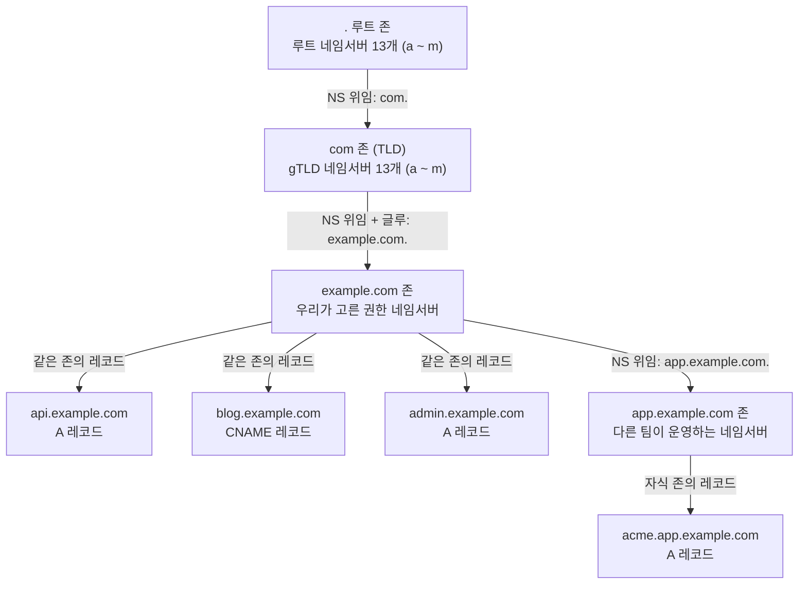

루트와 TLD의 네임서버가 13개인 것은 `dig +trace`에서 a부터 m까지 나열되는 걸 직접 세어 확인했다. 우리가 손대는 구간은 `example.com` 존 아래부터고, 그 위의 두 단계는 등록 대행사에 도메인을 등록할 때 NS 레코드를 TLD 쪽에 올려 주는 방식으로만 연결된다.

### 서브도메인을 쓰는 이유
실무에서 서비스를 서브도메인으로 분리하는 이유는 보통 이렇다.

**서비스 격리**: API와 웹 프론트엔드를 분리하면 한쪽이 죽어도 다른 쪽은 살아있다. `api.example.com`은 백엔드 클러스터로, `www.example.com`은 CDN으로 라우팅하면 된다.

**테넌트 분리**: 멀티테넌트 SaaS에서 `tenant1.app.com`, `tenant2.app.com` 같은 식으로 테넌트마다 고유한 주소를 준다. 마케팅 효과도 있고 데이터 격리도 명확해진다.

**환경 분리**: `staging.example.com`, `dev.example.com`처럼 환경별로 분리한다. 운영과 스테이징이 같은 도메인에 있으면 쿠키가 섞여서 사고 난다.

**SEO와 캐싱**: 정적 자원을 `static.example.com`이나 `cdn.example.com`으로 분리하면 메인 도메인 쿠키가 정적 자원 요청에 따라가지 않아 캐시 히트율이 올라간다.

## DNS 레코드 설정

### A 레코드와 CNAME 레코드
서브도메인을 만들려면 DNS에 레코드를 추가해야 한다. 주로 쓰는 건 A, AAAA, CNAME이다.

```bash
# A 레코드: 도메인을 IPv4 주소로 매핑
api.example.com.        300     IN      A       192.0.2.10

# AAAA 레코드: IPv6
api.example.com.        300     IN      AAAA    2001:db8::1

# CNAME 레코드: 다른 도메인으로 별칭
www.example.com.        300     IN      CNAME   example.com.
cdn.example.com.        300     IN      CNAME   d1234.cloudfront.net.
```

A 레코드는 직접 IP를 박는 거고 CNAME은 다른 도메인 이름으로 위임하는 거다. 실무에서 가장 많이 실수하는 게 `apex 도메인(루트 도메인)에 CNAME을 박는 것`이다. RFC 1034에 따르면 `example.com` 같은 apex 레코드에는 CNAME을 사용할 수 없다. SOA, NS 레코드와 충돌하기 때문이다. 그래서 AWS Route53의 ALIAS, Cloudflare의 CNAME Flattening 같은 우회 기능이 등장했다.

### api.example.com이 풀리는 순서
`api.example.com`이 CDN 업체의 호스트명으로 향하는 CNAME이라고 하면, 리졸버는 질의를 두 번 한다. 한 번은 `example.com` 쪽 권한 네임서버에, 한 번은 CDN 업체의 권한 네임서버에 간다. 캐시는 레코드마다 따로 잡히기 때문에 TTL을 볼 때도 레코드 단위로 봐야 한다.

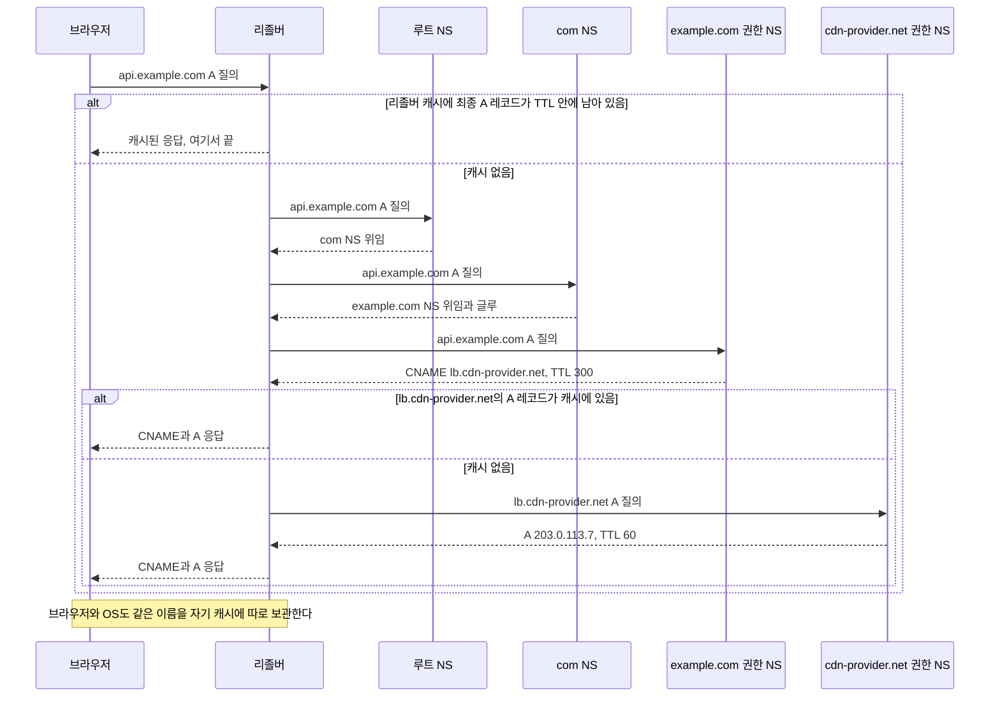

도식의 위쪽 `alt`가 캐시 히트고, 아래쪽 안쪽 `alt`가 CNAME 체인에서 한 번 더 갈라지는 지점이다. `dig +trace`에서 `com.` NS의 TTL이 172800초(2일)로 나오기 때문에, 실제 리졸버는 대부분 루트를 건너뛰고 TLD 네임서버부터 묻는다.

체인의 각 단계가 TTL을 따로 갖는 건 공개 사이트로 확인할 수 있다.

```bash
$ dig www.microsoft.com A +noall +answer
www.microsoft.com.                  3568  IN  CNAME  www.microsoft.com-c-3.edgekey.net.
www.microsoft.com-c-3.edgekey.net.   779  IN  CNAME  e13678.dscb.akamaiedge.net.
e13678.dscb.akamaiedge.net.           20  IN  A      23.49.206.40
```

CNAME 두 개와 A 레코드가 각각 3568초, 779초, 20초로 남은 시간이 다르다. 맨 끝 A 레코드만 TTL이 짧고 앞쪽 CNAME은 길게 캐시된다. 우리가 `api.example.com`의 CNAME을 바꿔도 이미 그 CNAME을 캐시한 리졸버는 TTL이 끝날 때까지 옛 대상을 따라간다. 마이그레이션 때 TTL을 미리 낮추는 이유가 이것이다.

### ALIAS와 ANAME
ALIAS 레코드는 표준 DNS 스펙에는 없는 비표준 확장이다. Route53, DNSimple, Cloudflare 같은 매니지드 DNS 서비스에서 제공한다. 동작은 CNAME과 비슷하지만 apex 도메인에서도 쓸 수 있고, 응답할 때는 A 레코드처럼 IP를 직접 돌려준다.

```bash
# Route53 콘솔에서 (Hosted Zone)
example.com.    A       ALIAS d1234.cloudfront.net.    (apex에 alb/cloudfront 연결)
www.example.com. CNAME  d1234.cloudfront.net.          (서브도메인은 그냥 CNAME)
```

ALIAS는 DNS 서버 내부에서 타깃의 IP를 미리 해석해서 응답하기 때문에 클라이언트는 한 번의 조회로 IP를 받는다. CNAME은 클라이언트가 다시 한 번 조회를 해야 한다. 그래서 응답 속도 면에서 ALIAS가 약간 유리하다.

### 와일드카드 레코드
서브도메인이 동적으로 늘어나는 멀티테넌트 서비스에서는 와일드카드 레코드를 쓴다.

```bash
# 와일드카드 A 레코드
*.example.com.          300     IN      A       192.0.2.10

# 와일드카드 CNAME
*.tenants.example.com.  300     IN      CNAME   app.example.com.
```

`*.example.com`은 `foo.example.com`, `bar.example.com`처럼 등록되지 않은 이름에 매칭된다. 이 문서의 이전 판에는 "와일드카드는 한 단계만 커버한다"고 적혀 있었는데, DNS 와일드카드에 대해서는 틀린 설명이었다. 한 단계만 커버하는 건 TLS 인증서의 와일드카드(RFC 6125)고, DNS 쪽은 직접 BIND 9.20에 올려서 확인하니 다르게 동작했다.

```
; example.test 존
*       IN A 192.0.2.77
api     IN A 192.0.2.10
x.deep  IN A 192.0.2.88
```

```text
질의: dig @10.77.0.6 <이름> A  (BIND 9.20 컨테이너, 위 존을 로드)
foo.example.test           NOERROR 192.0.2.77
a.b.example.test           NOERROR 192.0.2.77     # 두 단계인데 와일드카드가 응답
api.example.test           NOERROR 192.0.2.10     # 명시 레코드가 우선
v1.api.example.test        NXDOMAIN               # api 가 존재하므로 *.api 를 찾고, 없어서 NXDOMAIN
y.deep.example.test        NXDOMAIN               # deep 은 x.deep 때문에 존재하는 이름
x.deep.example.test        NOERROR 192.0.2.88
deep.example.test          NOERROR (답 없음)      # 빈 중간 노드
```

규칙은 RFC 4592의 closest encloser 방식이다. 질의한 이름에서 오른쪽부터 실제로 존재하는 가장 가까운 이름을 찾고, 그 바로 아래의 `*` 레코드로 응답을 만든다. `a.b.example.test`는 가장 가까운 존재하는 이름이 `example.test`라서 `*.example.test`가 응답한다. `v1.api.example.test`는 `api`가 있으니 `*.api.example.test`를 찾는데 그건 없어서 NXDOMAIN이 된다. 공개 DNS에서도 같은 모양이 보인다. `lvh.me`는 `a.b.c.lvh.me`까지 `127.0.0.1`로 풀린다.

결과적으로 `a.b.example.com`은 DNS로는 풀리는데 `*.example.com` 인증서는 맞지 않아서 브라우저가 인증서 오류를 낸다. 와일드카드 DNS를 믿고 서브도메인을 두 단계로 만들었다가 이 불일치로 막히는 경우가 있다. 매니지드 DNS 서비스의 와일드카드 동작은 이번에 확인하지 않았으니 쓰는 서비스에서 `dig`로 한 번 확인하는 편이 낫다.

명시적으로 등록된 레코드가 있으면 와일드카드보다 우선한다. 예를 들어 `*.example.com`과 `api.example.com`이 둘 다 있으면 `api.example.com`은 명시 레코드를 따른다.

와일드카드의 함정 중 하나는 메일이다. 와일드카드 A를 박아두면 `존재하지않는주소@nonexist.example.com`으로 메일을 보낼 때 메일 서버가 SPF나 MX 조회 결과를 이상하게 받아들일 수 있다. MX 와일드카드도 함께 관리하지 않으면 스팸 발송지로 악용될 가능성도 있다.

### TTL 설정
서브도메인 추가나 IP 변경시 TTL은 중요하다. TTL이 86400(1일)인 레코드를 변경하면 전 세계 리졸버 캐시가 만료될 때까지 하루 가까이 기다려야 한다. 마이그레이션 며칠 전에 TTL을 60~300초로 낮춰두고, 마이그레이션이 끝나고 안정화되면 다시 올리는 패턴이 일반적이다.

```bash
# 마이그레이션 1주일 전: TTL 낮추기
api.example.com.        86400   IN      A       192.0.2.10
                          ↓
api.example.com.        300     IN      A       192.0.2.10

# 마이그레이션 당일: IP 변경
api.example.com.        300     IN      A       198.51.100.20

# 안정화 후: TTL 복원
api.example.com.        86400   IN      A       198.51.100.20
```

## Nginx server_name과 가상 호스트

### server_name 매칭 규칙
Nginx에서 서브도메인 라우팅은 `server_name` 지시어로 한다. 같은 80/443 포트로 들어온 요청을 Host 헤더로 구분해서 다른 server 블록으로 보낸다.

```nginx
server {
    listen 80;
    server_name api.example.com;

    location / {
        proxy_pass http://api_backend;
    }
}

server {
    listen 80;
    server_name www.example.com example.com;

    root /var/www/main;
}
```

`server_name` 매칭 우선순위는 다음과 같다.

1. 정확히 일치하는 이름 (`api.example.com`)
2. 가장 긴 와일드카드 (앞쪽 `*`): `*.example.com`
3. 가장 긴 와일드카드 (뒤쪽 `*`): `mail.*`
4. 정규식 (등장 순서대로)
5. 매칭되는 게 없으면 `default_server` 또는 처음 정의된 server 블록

### 와일드카드 서브도메인 처리
멀티테넌트 환경에서 테넌트 서브도메인을 한 server 블록으로 받아서 애플리케이션에서 분기 처리하는 패턴.

```nginx
server {
    listen 443 ssl;
    http2 on;   # 1.25.1+ 문법. listen 에 붙이면 deprecated 경고가 뜬다
    server_name ~^(?<tenant>[a-z0-9-]+)\.app\.example\.com$;

    ssl_certificate     /etc/letsencrypt/live/wildcard/fullchain.pem;
    ssl_certificate_key /etc/letsencrypt/live/wildcard/privkey.pem;

    location / {
        proxy_set_header X-Tenant $tenant;
        proxy_set_header Host $host;
        proxy_pass http://app_backend;
    }
}
```

정규식 캡처 그룹으로 테넌트 이름을 뽑아 헤더로 넘겨주면 백엔드에서 굳이 Host 헤더를 다시 파싱할 필요가 없다. 테넌트 이름에 허용되는 문자를 `[a-z0-9-]`로 제한하는 건 보안 측면에서 중요하다. 검증 안 된 호스트명을 그대로 백엔드에 넘기면 호스트 헤더 인젝션 공격에 노출된다.

### default_server의 함정
서버에 등록되지 않은 호스트로 요청이 오면 첫 번째 server 블록이나 `default_server`로 라우팅된다. 그래서 의도하지 않은 도메인이 우리 서버 IP로 향하는 경우 우리 메인 사이트가 응답할 수 있다. 검색 엔진에서 잘못된 도메인이 우리 사이트로 인덱싱되거나, SEO에 안 좋은 영향을 줄 수 있다.

방어를 위해 catch-all default 블록을 명시적으로 만든다.

```nginx
server {
    listen 80 default_server;
    listen 443 ssl default_server;
    server_name _;

    ssl_certificate     /etc/ssl/dummy.crt;
    ssl_certificate_key /etc/ssl/dummy.key;

    return 444;  # 응답 없이 연결 종료
}
```

`return 444`는 Nginx 전용 비표준 코드로 응답 없이 그냥 커넥션을 끊는다. 이렇게 하면 우리 서비스에 등록되지 않은 호스트로 들어오는 요청은 모두 차단된다.

## TLS 인증서와 SAN

### Subject Alternative Name (SAN)
하나의 인증서로 여러 도메인을 보호하려면 SAN(Subject Alternative Name) 확장을 사용한다. CN(Common Name)은 사실상 deprecated 됐고 모든 브라우저가 SAN을 본다.

```
Certificate:
    Subject: CN=example.com
    X509v3 Subject Alternative Name:
        DNS:example.com
        DNS:www.example.com
        DNS:api.example.com
        DNS:admin.example.com
```

SAN에 명시된 도메인만 인증서가 유효하다. `api.example.com`이 SAN에 없는데 그 도메인으로 HTTPS 접속하면 브라우저가 NET::ERR_CERT_COMMON_NAME_INVALID를 띄운다.

### 와일드카드 인증서
서브도메인이 동적으로 늘어나는 환경에서는 와일드카드 인증서를 발급받는다.

```
Subject Alternative Name:
    DNS:example.com
    DNS:*.example.com
```

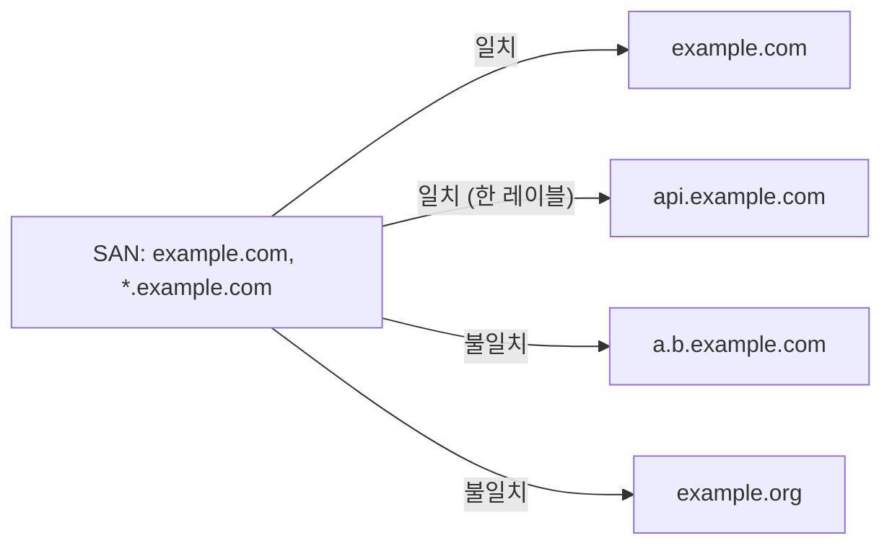

`*`는 레이블 하나만 대신하므로 `a.b.example.com`은 DNS가 풀려도 이 인증서로는 경고가 뜬다. 루트 `example.com`은 와일드카드가 덮지 않아서 SAN에 따로 적혀 있다.

와일드카드 인증서 발급시 알아둘 점.

**한 단계만 커버한다**: `*.example.com` 인증서는 `api.example.com`에는 유효하지만 `v1.api.example.com`에는 유효하지 않다. 깊은 서브도메인까지 커버하려면 `*.api.example.com`을 별도로 SAN에 추가해야 한다.

**Apex 도메인은 커버 안 한다**: `*.example.com`은 `example.com` 자체에는 매칭되지 않는다. 둘 다 보호하려면 SAN에 `example.com`을 명시적으로 추가해야 한다.

**DNS-01 챌린지가 필수**: Let's Encrypt에서 와일드카드 인증서를 받으려면 HTTP-01 챌린지로는 안 되고 DNS-01 챌린지만 가능하다. 자동화하려면 DNS API에 접근할 수 있는 ACME 클라이언트가 필요하다.

```bash
# Certbot으로 와일드카드 인증서 받기 (Cloudflare DNS API 예시)
certbot certonly \
  --dns-cloudflare \
  --dns-cloudflare-credentials ~/.secrets/cloudflare.ini \
  -d "example.com" \
  -d "*.example.com"
```

**갱신시 DNS 전파 시간 주의**: TXT 레코드를 추가하고 전 세계 DNS 서버에 전파되기를 기다려야 한다. 보통 60~120초 정도면 되는데 가끔 더 걸린다. ACME 클라이언트에 적절한 propagation delay를 설정해두지 않으면 갱신이 실패한다.

### 다중 도메인 SAN과 와일드카드 조합
실무에서는 와일드카드 SAN과 일반 SAN을 섞어서 쓴다.

```
SAN:
    DNS:example.com
    DNS:*.example.com
    DNS:*.app.example.com
    DNS:*.api.example.com
```

이렇게 하면 `example.com`, `www.example.com`, `tenant1.app.example.com`, `v1.api.example.com` 모두 커버할 수 있다. 단, Let's Encrypt는 한 인증서당 100개의 SAN까지 허용한다. SAN이 많아지면 인증서 파일 자체가 커지고 TLS 핸드셰이크 페이로드도 커진다.

## HSTS includeSubDomains 함정

### 헤더를 내려주는 호스트가 범위를 정한다
HSTS(`Strict-Transport-Security`)는 브라우저에게 "이 호스트는 앞으로 HTTPS로만 접속하라"고 기억시키는 응답 헤더다. `includeSubDomains`를 붙이면 그 호스트의 모든 하위 이름까지 같은 규칙이 적용된다. 루트 도메인에 이걸 걸었다가 HTTP만 받는 사내 서브도메인이 안 열리는 사고가 흔하다. `legacy.example.com`처럼 오래된 관리 도구가 80 포트만 열고 있는 경우다.

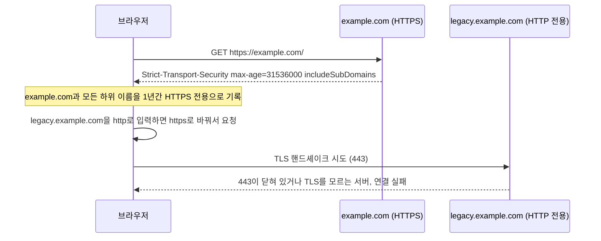

이 동작을 curl 7.81의 `--hsts` 캐시로 재현했다. 자체 서명 인증서(`*.example.test`)를 쓰는 HTTPS 서버(8443)와 HTTP만 받는 서버(8080)를 로컬에 띄우고, `--resolve`로 이름만 127.0.0.1에 붙였다. HTTPS 서버는 `Strict-Transport-Security: max-age=31536000; includeSubDomains`를 내려준다.

```bash
# 1) www 에서 헤더를 받은 경우
$ curl -sk --hsts hsts.txt --resolve www.example.test:8443:127.0.0.1 https://www.example.test:8443/
$ cat hsts.txt
.www.example.test "20271028 01:10:49"
$ curl -s --hsts hsts.txt -o /dev/null -w "%{http_code}\n" http://legacy.example.test:8080/
200                                   # legacy 는 www 의 하위 이름이 아니라서 영향 없음

# 2) 루트(example.test) 에서 헤더를 받은 경우
$ cat hsts2.txt
.example.test "20271028 01:10:54"
$ curl -sk -v --hsts hsts2.txt http://legacy.example.test:8080/
* Switched from HTTP to HTTPS due to HSTS => https://legacy.example.test:8080/
* error:0A00010B:SSL routines::wrong version number
curl: (35) error:0A00010B:SSL routines::wrong version number
```

캐시 파일에서 앞에 점이 붙은 항목(`.example.test`)이 `includeSubDomains`가 켜진 항목이다. 첫 번째 시도가 보여주듯 같은 헤더라도 `www`가 내려주면 `www` 아래에만 걸리고 형제인 `legacy`는 건드리지 않는다. 사고는 헤더를 apex에서 내려줄 때, 그리고 그 apex가 사이트 전체의 기본 응답을 하는 Nginx 설정에 들어갈 때 난다. 공통 `include` 파일에 헤더를 넣어 두면 apex뿐 아니라 모든 server 블록이 같은 헤더를 내려주므로 범위가 더 커진다.

브라우저는 HSTS 호스트에서 인증서 오류가 나도 "그래도 진행" 선택을 주지 않는다. RFC 6797은 보안 전송 수립에 오류가 나면 사용자 개입 없이 연결을 끊도록 요구한다. 내부 도구가 HTTP만 지원하면 사용자가 우회할 방법이 없다.

### preload는 되돌리기 어렵다
HSTS preload는 브라우저 소스에 호스트 목록을 박아 두는 방식이라 첫 접속부터 HTTPS를 강제한다. 등록 조건에 `includeSubDomains`와 `preload` 지시어, 1년 이상의 `max-age`가 들어간다. 헤더에 이 셋이 모두 있는지는 `github.com` 응답에서 볼 수 있다.

```bash
$ curl -sI https://github.com | grep -i strict-transport
strict-transport-security: max-age=31536000; includeSubdomains; preload
```

문제는 해제다. [hstspreload.org](https://hstspreload.org/)는 신규 등록이 Chrome 안정 버전에 반영되기까지 몇 달이 걸리고, 삭제도 Chrome 업데이트를 타고 사용자에게 가는 데 몇 달이 걸리며 다른 브라우저는 보장하지 못한다고 안내한다. 서비스 도메인 전체에 `includeSubDomains`로 preload를 걸었다가 HTTP만 되는 서브도메인이 뒤늦게 발견되면, 서버에서 헤더를 지워도 이미 배포된 브라우저에는 목록이 남아 있다.

hstspreload.org는 `max-age=300; includeSubDomains`로 시작해 1주, 1개월 순으로 `max-age`를 올리라고 안내한다. 나는 그 앞에 단계를 하나 더 둔다. `max-age=300`만 `includeSubDomains` 없이 걸고, 서브도메인 목록을 DNS 존과 CT 로그 양쪽에서 뽑아 HTTPS 응답을 하나씩 확인한다. 문제가 없으면 `includeSubDomains`를 붙이고 `max-age`를 올리며, preload는 마지막이다. `max-age=0`을 내려주면 브라우저가 항목을 지우지만, 그 브라우저가 해당 호스트에 HTTPS로 한 번은 접속해서 헤더를 받아야 한다.

## Certificate Transparency 로그로 새는 서브도메인

### 인증서를 발급하면 이름이 공개된다
공개 CA가 발급하는 인증서는 CT(Certificate Transparency) 로그에 제출돼야 브라우저가 신뢰한다. SAN에 들어간 이름은 그대로 공개 로그에 남고, 누구나 검색할 수 있다. 서브도메인 하나마다 인증서를 따로 받는 운영이면 `staging-payment-v2.example.com`, `vpn.example.com`, `jenkins.example.com` 같은 이름이 발급 즉시 목록에 올라간다. 아무 데도 링크하지 않은 내부 서비스 이름이 외부에서 보이는 경로가 이것이다.

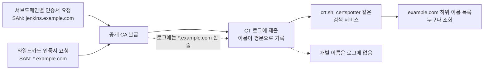

공개 프로젝트인 python.org로 실제 조회해 봤다. certspotter API는 인증 없이 호출할 수 있다.

```bash
$ curl -s "https://api.certspotter.com/v1/issuances?domain=python.org&include_subdomains=true&expand=dns_names" > cs.json
```

```python
import json
d = json.load(open("cs.json"))
names = {n.lower() for r in d for n in r["dns_names"]}
mine = sorted(n for n in names if n.endswith(".python.org") and not n.startswith("*"))
print(len(d), len(names), len(mine), [n for n in names if n.startswith("*")])
# 82 102 50 ['*.python.org']
```

2026-10-28에 조회한 결과 발급 82건에서 이름 102개가 나왔고, 그중 `python.org` 하위 이름이 50개였다. 와일드카드 `*.python.org`는 한 건뿐이고 나머지 50개는 서비스별로 따로 받은 인증서의 SAN에 있던 이름이다. 와일드카드 인증서가 있어도 개별 인증서를 따로 받으면 이름은 숨겨지지 않는다. 개별 인증서를 한 번이라도 받은 이름은 로그에 영구히 남는다. `crt.sh`는 같은 용도의 웹 서비스인데, 큰 도메인에 `q=%25.python.org`로 요청하면 502가 나는 일이 있어서 이번에는 certspotter 결과를 썼다.

### 와일드카드 인증서의 장단점
와일드카드 인증서는 SAN이 `*.example.com` 한 줄이라서 로그에서 개별 이름이 보이지 않는다. 대신 다른 비용이 있다.

| 항목 | 서브도메인별 인증서 | 와일드카드 인증서 |
|---|---|---|
| CT 로그 노출 | 이름마다 평문 노출 | `*.example.com` 한 줄 |
| 개인키 | 서비스마다 분리 가능 | 모든 서버가 같은 키를 공유하기 쉬움, 한 곳에서 유출되면 전체 이름이 영향 |
| 발급 방식 | HTTP-01 가능 | DNS-01 필수, 서버나 CI에 DNS API 자격 증명 필요 |
| 깊이 | 필요한 이름만 | 한 단계만 (`a.b.example.com`은 안 맞음) |
| 신규 서비스 추가 | 인증서 발급 필요 | 추가 작업 없음 |

내부 서비스 이름을 숨기는 게 목적이면 와일드카드로 CT 노출을 줄이는 것까지는 쓸 만하지만 그것만으로 충분하다고 보면 안 된다. 이름은 CT 말고도 새는 경로가 많다. 공개 DNS에 A 레코드를 넣었다면 사전 대입으로 찾을 수 있고, 메일 헤더나 JS 번들, 에러 페이지에 내부 호스트명이 박혀 나가기도 한다.

### 열거에 대한 대응
내부 서비스는 공개 존에 두지 않는다. 사설 존(split-horizon DNS)에 넣고 사설 CA로 인증서를 받으면 CT 로그에도 공개 DNS에도 이름이 나가지 않는다. 공개 존에 둬야 한다면 이름이 알려진다는 전제로 접근 제어(VPN, mTLS, IP 제한)를 건다. 이름을 모르는 것에 보안을 기대하면 이 구조에서는 오래 못 간다.

와일드카드 DNS를 쓰고 있으면 사전 대입이 헛돈다는 점도 알아 둘 만하다. 존재하지 않는 임의 라벨(`zz-random-3918.example.com`)을 질의해서 답이 오면 그 존은 와일드카드를 쓰는 것이고, 사전 대입 결과에서는 그 답과 같은 값으로 풀리는 이름을 걸러내야 한다. 위 BIND 실험에서 `foo.example.test`가 `192.0.2.77`로 풀린 것이 이 경우다. 반대로 내 도메인의 신규 인증서를 감시하려면 같은 API를 주기적으로 호출해 이름 집합의 차이를 보면 된다. 모르는 서브도메인이 뜨면 누가 만들었는지 확인하는 용도로 쓴다.

## 멀티테넌트 SaaS 패턴

### 테넌트별 서브도메인 라우팅
B2B SaaS에서 가장 흔한 패턴은 테넌트마다 서브도메인을 할당하는 것이다.

```
acme.app.example.com      → ACME 회사 테넌트
globex.app.example.com    → Globex 회사 테넌트
initech.app.example.com   → Initech 회사 테넌트
```

DNS 설정은 와일드카드 한 줄로 끝난다.

```
*.app.example.com.      300     IN      A       192.0.2.10
```

애플리케이션 레이어에서 Host 헤더 또는 Nginx에서 캡처한 테넌트 이름으로 요청 컨텍스트에 테넌트 ID를 매핑한다.

```typescript
// Express.js 예시
app.use(async (req, res, next) => {
  try {
    const host = req.hostname;  // acme.app.example.com
    const match = host.match(/^([a-z0-9-]+)\.app\.example\.com$/);

    if (!match) {
      return res.status(400).send('Invalid host');
    }

    const tenant = await TenantRepo.findBySlug(match[1]);

    if (!tenant) {
      return res.status(404).send('Tenant not found');
    }

    req.tenant = tenant;
    next();
  } catch (err) {
    next(err);
  }
});
```

이 미들웨어의 이전 판은 `async` 없이 `await`를 써서 파일을 로드하는 순간 `SyntaxError: await is only valid in async functions`로 죽는 코드였다. Express 4는 `async` 핸들러가 던지는 예외를 잡아 주지 않으므로 `try/catch`에서 `next(err)`로 넘겨야 한다.

`req.hostname`에는 더 위험한 동작이 있다. `trust proxy`를 켜면 Express는 `Host` 헤더 대신 `X-Forwarded-Host`를 읽는다. Express 4.22.3에서 `Host: acme.app.example.com`, `X-Forwarded-Host: globex.app.example.com`을 같이 보내 확인했다.

```
trust proxy=false -> req.hostname = acme.app.example.com
trust proxy=true  -> req.hostname = globex.app.example.com
```

로드밸런서가 클라이언트가 보낸 `X-Forwarded-Host`를 지우지 않고 그대로 넘기면, 요청자가 자기 테넌트의 세션을 들고 `X-Forwarded-Host`만 바꿔서 다른 테넌트 컨텍스트로 들어올 수 있다. 토큰의 테넌트와 호스트의 테넌트를 비교하는 검증(바로 아래 절)이 마지막 방어선이 되는 이유다. LB 설정에서 이 헤더를 덮어쓰는지 먼저 확인한다.

### 테넌트 식별과 격리
서브도메인을 그냥 라우팅 키로만 쓰지 말고 인증/인가 컨텍스트에 묶어야 한다. 예를 들어 `acme.app.example.com`에서 받은 JWT가 `globex.app.example.com`에서도 통하면 큰일이다. 토큰에 테넌트 ID를 박고 미들웨어에서 토큰의 테넌트와 호스트의 테넌트가 일치하는지 검증한다.

```typescript
function verifyTenantContext(req, res, next) {
  const hostTenantId = req.tenant.id;
  const tokenTenantId = req.user.tenantId;

  if (hostTenantId !== tokenTenantId) {
    return res.status(403).send('Tenant mismatch');
  }

  next();
}
```

### 커스텀 도메인 지원
대부분의 SaaS는 어느 시점부터 고객이 자기 도메인(`app.acme.com`)을 쓰고 싶다고 요구한다. 이때 패턴은 두 가지다.

첫 번째는 고객이 자기 DNS에 CNAME을 박고 우리 시스템에 등록하는 방식이다.

```
# 고객 측 DNS
app.acme.com.    CNAME    customers.example.com.

# 우리 시스템 데이터베이스
custom_domains 테이블에 app.acme.com → tenant_id 매핑 저장
```

들어오는 요청의 Host 헤더로 매핑 테이블을 조회해서 테넌트를 결정한다. 이 방식의 어려운 점은 인증서다. 고객 도메인마다 인증서가 필요하다. ACME `HTTP-01` 챌린지를 쓰면 우리 인프라에서 자동 발급할 수 있는데, Cloudflare for SaaS, AWS ACM, Caddy 같은 솔루션이 이걸 자동화해준다.

두 번째는 CNAME 대신 NS 위임을 받는 방식이다. 고객이 `app.acme.com`의 NS 레코드를 우리 네임서버로 위임하면 우리가 그 이름의 DNS를 통째로 관리한다. 자유도는 높지만 고객 입장에서 동의하기 어려운 경우가 많다. 위임 설정은 뒤의 "서브도메인 단위 NS 위임" 절에서 다룬다.

### 두 진입 경로가 합쳐지는 지점
우리 도메인의 서브도메인(`acme.app.example.com`)과 고객 도메인(`app.acme.com`)은 DNS 단계에서는 다른 경로로 들어오지만, 로드밸런서에서 합쳐진다. 고객 도메인의 CNAME 대상(`customers.example.com`)이 우리 LB로 풀리기 때문이다. 합쳐진 뒤의 갈림길은 Host 헤더 파싱 단계에 있다.

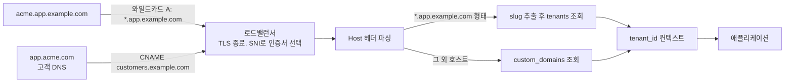

도식에서 인증서가 갈리는 곳도 LB다. `acme.app.example.com`은 `*.app.example.com` 와일드카드 인증서 하나로 처리되지만 `app.acme.com`은 고객 도메인마다 인증서를 따로 발급해서 SNI로 골라야 한다. 두 경로가 같은 앱에 도착하더라도 `custom_domains` 조회에 실패한 호스트는 404로 끊어야 한다. 조회 실패를 기본 테넌트로 처리하면 DNS를 우리 LB에 붙이기만 한 임의의 도메인이 우리 서비스의 화면을 그대로 띄운다. 앞서 본 `default_server` 문제와 같은 종류다.

고객이 apex(`acme.com`) 자체를 쓰고 싶다고 하면 CNAME을 못 쓰므로 ALIAS/ANAME을 지원하는 DNS를 쓰거나 고정 IP의 A 레코드를 안내해야 한다. 고정 IP를 약속하면 LB를 바꿀 때 고객 DNS를 전부 고쳐야 하므로, 처음부터 서브도메인(`app.acme.com`) 형태만 받는 정책이 운영하기 편하다.

## 쿠키 도메인 스코프

### Domain 속성과 동작 방식
쿠키의 `Domain` 속성은 어떤 호스트로 보낼 때 이 쿠키를 첨부할지 결정한다. 이게 서브도메인을 다룰 때 가장 자주 사고 나는 부분이다.

```
Set-Cookie: session=abc123; Domain=example.com; Path=/; Secure; HttpOnly
```

Domain을 `example.com`으로 설정하면 `example.com`, `www.example.com`, `api.example.com`, `nested.foo.example.com` 모두에 이 쿠키가 전송된다. 즉 도메인과 모든 서브도메인을 커버한다.

```
Set-Cookie: session=abc123; Domain=app.example.com; Path=/; Secure; HttpOnly
```

Domain을 `app.example.com`으로 설정하면 `app.example.com`과 그 서브도메인(`a.app.example.com`, `b.app.example.com`)에는 가지만 `api.example.com`이나 `example.com`에는 가지 않는다.

Domain 속성을 아예 생략하면 쿠키를 설정한 정확한 호스트에만 전송된다. `example.com`에서 Domain 없이 쿠키를 발급하면 `www.example.com`에는 안 간다. 이걸 host-only 쿠키라고 한다.

### 어느 호스트로 가는지 대비
`Domain`을 지정한 쿠키와 지정하지 않은 쿠키는 같은 응답에서 발급돼도 가는 곳이 다르다. 도식은 `acme.app.example.com`이 발급한 두 종류의 쿠키가 어디까지 가는지 나눈 것이다.

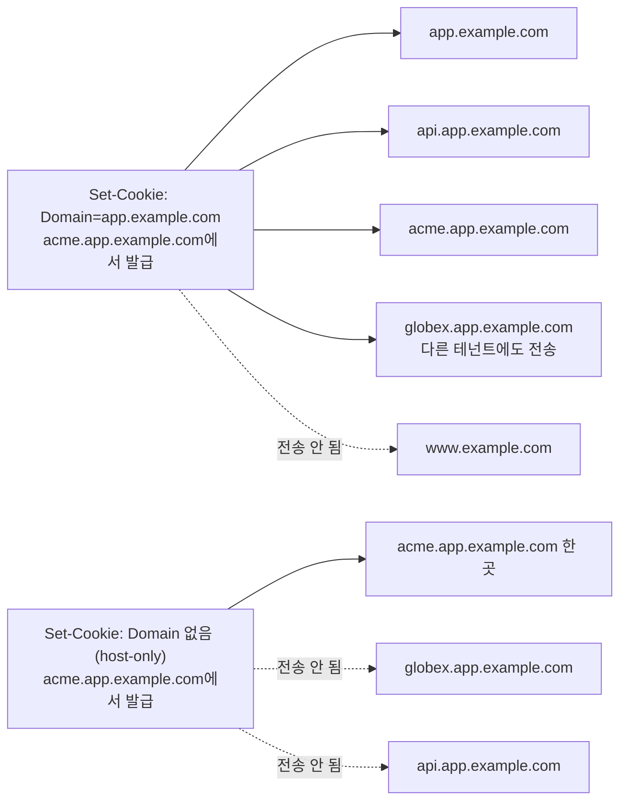

이 대비를 Python `http.cookiejar`로 돌려 확인했다. 한 가지 주의할 점은 `cookiejar`의 기본 정책이 RFC 6265와 다르다는 것이다. `Domain` 없이 `example.com`이 발급한 쿠키를 하위 호스트에도 보낸다. `DefaultCookiePolicy(strict_ns_domain=DomainStrict)`를 줘야 host-only 쿠키가 발급한 호스트에만 간다.

```python
import urllib.request, http.cookiejar as cj, email

class Resp:
    def __init__(self, line):
        self._m = email.message_from_string(f"Set-Cookie: {line}\n\n")
    def info(self): return self._m

def who_gets(set_from, line, targets):
    jar = cj.CookieJar(cj.DefaultCookiePolicy(strict_ns_domain=cj.DefaultCookiePolicy.DomainStrict))
    jar.extract_cookies(Resp(line), urllib.request.Request(f"https://{set_from}/"))
    sent = []
    for t in targets:
        r = urllib.request.Request(f"https://{t}/")
        jar.add_cookie_header(r)
        if r.get_header("Cookie"): sent.append(t)
    return [c.domain for c in jar], sent
```

```text
www.example.com 이 Domain=example.com 으로 발급
  전송: example.com, www.example.com, app.example.com, api.app.example.com, acme.app.example.com, globex.app.example.com
www.example.com 이 Domain 없이 발급
  전송: www.example.com
acme.app.example.com 이 Domain=app.example.com 으로 발급
  전송: app.example.com, api.app.example.com, acme.app.example.com, globex.app.example.com
acme.app.example.com 이 Domain 없이 발급
  전송: acme.app.example.com
acme.app.example.com 이 Domain=globex.app.example.com 으로 발급
  저장 거부 (자기 호스트의 상위 도메인이 아니라서)
www.example.com 이 Domain=other.com 으로 발급
  저장 거부
```

`Domain=example.com`으로 발급한 쿠키는 apex와 형제 서브도메인, 중첩 서브도메인 전부에 간다. 마지막 두 줄처럼 발급 호스트와 무관한 `Domain`은 저장 자체가 거부된다. 이 스크립트는 브라우저가 아니라서 Public Suffix List 검사는 하지 않는다. `Domain=co.uk` 같은 값을 브라우저가 어떻게 거부하는지는 이번에 직접 확인하지 못했다.

### 옛날 점 표기법(.example.com)
RFC 6265 이전 명세에서는 `Domain=.example.com`처럼 앞에 점을 붙여서 서브도메인 포함을 명시했다. RFC 6265에서는 점 유무에 상관없이 동일하게 처리하도록 표준화됐다. 실무에서는 점 없이 쓰는 게 일반적이지만 옛날 코드베이스에서 점 붙은 표기를 종종 본다.

### 멀티테넌트에서 쿠키가 새는 문제
멀티테넌트 SaaS에서 쿠키 도메인을 잘못 설정하면 테넌트 간 정보가 새어나간다.

```
# 잘못된 설정
Set-Cookie: session=acme_user_token; Domain=app.example.com
```

이렇게 하면 `acme.app.example.com`에서 발급한 쿠키가 `globex.app.example.com`으로 가는 모든 요청에 포함된다. 다른 테넌트 사용자가 자기 도메인에서 우리 백엔드로 요청을 보내면 ACME 사용자의 세션 쿠키가 그쪽으로도 간다는 얘기다.

해결 방법은 쿠키 Domain을 설정하지 않거나(host-only) 테넌트 도메인에 정확히 매칭시키는 것이다.

```
# 올바른 설정 - host-only 쿠키
Set-Cookie: session=acme_user_token; Path=/; Secure; HttpOnly; SameSite=Lax
# Domain 속성 없음 → acme.app.example.com에서만 유효
```

### SameSite 속성
SameSite는 크로스 사이트 요청에서 쿠키 전송 여부를 제어한다. 값은 `Strict`, `Lax`, `None` 세 가지가 있다.

- **Strict**: 같은 사이트에서 시작한 요청에만 쿠키 전송. 외부 링크 클릭으로 들어와도 쿠키 안 감.
- **Lax**: top-level navigation(주소창 입력, 링크 클릭)에는 쿠키 전송. iframe, AJAX, 이미지 로드 같은 서브 요청에는 안 감. 2020년부터 크롬 기본값.
- **None**: 모든 요청에 쿠키 전송. 단 `Secure` 속성이 있어야 한다(HTTPS 전용).

여기서 "같은 사이트(same-site)"의 정의가 중요하다. 브라우저는 eTLD+1 단위로 같은 사이트를 판단한다. 즉 `api.example.com`에서 `app.example.com`으로 요청을 보내면 같은 사이트로 본다. 둘 다 eTLD+1인 `example.com` 아래에 있기 때문이다. 반면 `example.com`에서 `another.com`으로 가는 요청은 cross-site다.

### 서브도메인 간 요청과 SameSite
서브도메인 분리 아키텍처(`app.example.com` 프론트엔드 + `api.example.com` 백엔드)에서 쿠키 동작은 이렇다.

```
# 프론트엔드에서 백엔드로 fetch
fetch('https://api.example.com/data', { credentials: 'include' })
```

쿠키 설정이 `Domain=example.com; SameSite=Lax`이면 same-site 요청이라 쿠키가 전송된다. 만약 백엔드가 다른 eTLD+1 도메인이면(`example.com` → `api.somewhere.com`) cross-site가 되고, 그러면 SameSite=None; Secure이 필요하다.

## CORS와 서브도메인 간 통신

### Same-Origin 정책의 도메인 단위
SOP(Same-Origin Policy)에서 origin은 protocol + host + port 조합이다. 호스트는 정확히 일치해야 한다. `example.com`과 `api.example.com`은 서로 cross-origin이다. 같은 사이트(same-site)지만 같은 출처(same-origin)는 아니다.

이 차이를 헷갈리는 경우가 많은데 정리하면 이렇다.

```
example.com            ↔ api.example.com         : cross-origin, same-site
example.com            ↔ example.com:8080        : cross-origin, same-site
http://example.com     ↔ https://example.com     : cross-origin, same-site
example.com            ↔ another.com             : cross-origin, cross-site
```

### CORS 헤더 설정
서브도메인 간 통신에서 CORS 헤더는 필수다. 백엔드에서 응답할 때 이렇게 보낸다.

```
Access-Control-Allow-Origin: https://app.example.com
Access-Control-Allow-Credentials: true
Access-Control-Allow-Methods: GET, POST, PUT, DELETE
Access-Control-Allow-Headers: Content-Type, Authorization
```

여기서 가장 자주 실수하는 게 `Access-Control-Allow-Origin: *`와 `Access-Control-Allow-Credentials: true`를 같이 쓰려다가 안 되는 거다. 자격증명(쿠키 포함) 요청에는 와일드카드를 쓸 수 없다. 명시적인 origin을 돌려줘야 한다.

```typescript
// Express.js에서 동적으로 origin 허용
const allowedOrigins = [
  'https://app.example.com',
  'https://admin.example.com',
];

app.use((req, res, next) => {
  const origin = req.headers.origin;

  if (allowedOrigins.includes(origin)) {
    res.setHeader('Access-Control-Allow-Origin', origin);
    res.setHeader('Access-Control-Allow-Credentials', 'true');
    res.setHeader('Vary', 'Origin');
  }

  next();
});
```

`Vary: Origin` 헤더를 빼먹으면 CDN이 한 응답을 캐시해서 다른 origin에 그대로 돌려주는 사고가 난다.

### 멀티테넌트에서의 CORS
테넌트마다 서브도메인이 다른 SaaS에서는 origin이 동적이다. 정규식으로 검증해서 와일드카드 식으로 허용한다.

```typescript
const tenantOriginPattern = /^https:\/\/[a-z0-9-]+\.app\.example\.com$/;

app.use((req, res, next) => {
  const origin = req.headers.origin;

  if (origin && tenantOriginPattern.test(origin)) {
    res.setHeader('Access-Control-Allow-Origin', origin);
    res.setHeader('Access-Control-Allow-Credentials', 'true');
    res.setHeader('Vary', 'Origin');
  }

  next();
});
```

정규식을 너무 느슨하게 짜면 `evil.app.example.com.attacker.com` 같은 우회가 가능하다. 끝부분 앵커(`$`)를 반드시 붙여야 한다.

## 서브도메인과 경로 기반 분리 중 고르기

### 판단 기준
`blog.example.com`으로 뗄지 `example.com/blog`로 둘지는 새 서비스를 붙일 때마다 나오는 질문이다. 앞에서 본 쿠키, CORS, 인증서가 그대로 비용으로 돌아온다. 표는 같은 서비스를 두 방식으로 붙였을 때 달라지는 지점이다.

| 관점 | 서브도메인 (`blog.example.com`) | 경로 (`example.com/blog`) |
|---|---|---|
| 쿠키 | `Domain=example.com` 쿠키는 따라가고 host-only 쿠키는 안 따라간다. 블로그에 세션 쿠키가 의도치 않게 전달될 수 있다 | 같은 호스트라서 host-only 쿠키도 모두 전달된다. `Path`로 좁혀도 같은 origin의 스크립트는 `document.cookie`로 읽는다 |
| CORS | cross-origin이라 CORS 헤더와 preflight가 필요하다. same-site라서 `SameSite=Lax` 쿠키는 간다 | same-origin이라 CORS가 필요 없다 |
| 보안 경계 | XSS가 나면 해당 origin의 저장소만 영향을 받는다 | `/blog`의 XSS가 `/account`와 같은 origin이라 `localStorage`와 쿠키 접근 범위를 공유한다 |
| 인증서 | 와일드카드나 SAN 추가가 필요하다. 와일드카드는 한 단계만 맞는다 | 기존 인증서 하나로 끝난다 |
| CDN 캐시 정책 | 서브도메인마다 오리진과 캐시 키 규칙을 따로 둔다. 정적 도메인에는 쿠키가 따라가지 않는다 | 한 CDN 설정 안에서 경로 패턴으로 오리진과 캐시 규칙을 나눠야 한다. 경로별로 쿠키, 헤더를 캐시 키에 넣을지가 갈린다 |
| SEO | 검색엔진이 별도 사이트로 평가한다는 의견이 있지만 직접 측정하지 못했다 | 도메인 신호가 한 곳에 모인다는 설명이 일반적이지만 이것도 측정하지 못했다 |
| 배포 독립성 | DNS, 인증서, LB를 팀별로 분리할 수 있다. 장애와 사고의 경계가 도메인 단위다 | 한 LB나 Ingress의 라우팅 규칙을 공유한다. 한 팀의 규칙 실수가 다른 경로에 영향을 준다 |
| 로컬 개발 | hosts, dnsmasq, 로컬 와일드카드 인증서가 필요하다 | `localhost` 하나로 된다 |

SEO 행은 일부러 비워 뒀다. 서브도메인과 하위 디렉터리 중 어느 쪽이 검색 노출에 유리한지는 사이트마다 다르게 보고되고, 이 문서에서 실험으로 확인할 수 있는 영역이 아니다. Google도 다국어 사이트 문서에서 서브도메인과 하위 디렉터리를 둘 다 선택지로 나열하고 각각 장단점을 적어 둔 정도다([Managing multi-regional sites](https://developers.google.com/search/docs/specialty/international/managing-multi-regional-sites)). 수치를 믿기보다 Search Console에 속성을 따로 등록해서 노출량을 비교하는 편이 정확하다.

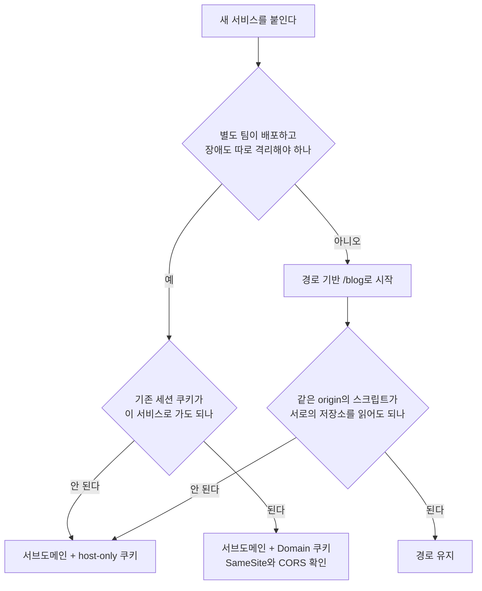

도식의 마지막 분기가 놓치기 쉽다. 경로 방식은 쿠키 문제를 없애 주지만 보안 경계도 같이 없앤다. 사용자 콘텐츠를 렌더링하는 영역(게시판, 위키, 고객이 올린 HTML)은 같은 origin에 두지 말고 서브도메인으로 떼어낸다. 그 서브도메인을 PSL에 올리거나 host-only 쿠키만 쓰게 하면 이 영역의 XSS가 본 서비스의 세션으로 번지지 않는다.

이미 경로로 운영하던 서비스를 서브도메인으로 옮기는 일은 `redirect_maps`나 301로 가능하지만 쿠키는 따라가지 않는다. 옮기는 날 로그인 세션이 한꺼번에 끊기는 일이 있으니 쿠키 `Domain` 설정을 먼저 맞춰 두고 옮긴다.

## 서브도메인 테이크오버 취약점

### 어떻게 발생하는가
서브도메인 테이크오버는 DNS에는 서브도메인이 등록돼 있는데 그 서브도메인이 가리키는 외부 서비스(Heroku, S3, GitHub Pages, Azure 등)는 더 이상 사용되지 않을 때 발생한다. 공격자가 그 외부 서비스에 동일한 이름으로 신규 등록하면 우리 도메인을 통째로 가져갈 수 있다.

```
# 회사 DNS에 남아있는 dangling 레코드
old-marketing.example.com.    CNAME    abandoned-app.herokuapp.com.

# Heroku에서는 abandoned-app이 이미 삭제됨
# 공격자가 Heroku에 abandoned-app 이름으로 새 앱 생성
# → 공격자가 old-marketing.example.com 호스팅 권한 획득
```

이 상태에서 공격자가 만든 페이지가 `old-marketing.example.com`에서 서비스되면 신뢰할 수 있는 도메인으로 위장한 피싱이 가능하다. 또 쿠키 Domain이 `example.com`으로 풀려있으면 공격자 페이지에서 우리 메인 사이트의 쿠키도 읽거나 쓸 수 있다.

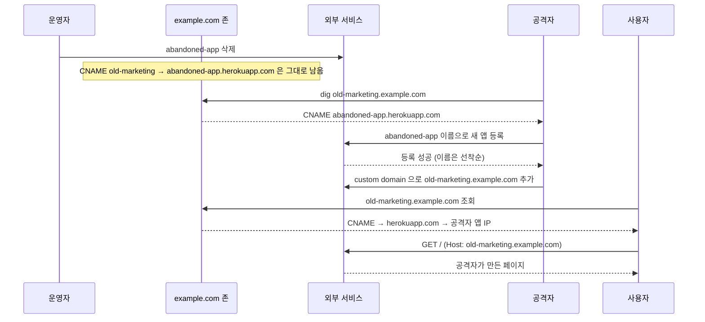

DNS 존 쪽에서는 아무것도 바뀌지 않았다는 점을 보면 된다. 운영자가 한 일은 외부 서비스에서 앱을 지운 것뿐이고, 그 뒤로는 우리 DNS가 아무 변경 없이 공격자 쪽으로 사용자를 보낸다. 우리 쪽 로그나 알림에는 흔적이 남지 않는다.

### 실제로 남은 CNAME을 찾아보기
감사 스크립트가 어렵지 않다. 존 파일에서 CNAME 줄을 뽑아 대상 이름을 조회하고, 대상이 NXDOMAIN이거나 외부 서비스의 "그런 사이트 없음" 응답을 돌려주면 걸러낸다. 아래는 일부러 존재하지 않는 이름(`zz-no-such-site-48213`)을 5개 서비스에 걸어 두고 돌려본 결과다. 2026-10-28에 실행했다.

```
docs.example.com.            -> zz-no-such-site-48213.github.io          dns=NOERROR   DANGLING (HTTP 404, 'There isn't a GitHub Pages site here')
old-marketing.example.com.   -> zz-no-such-site-48213.herokuapp.com      dns=NOERROR   DANGLING (HTTP 404, 'No such app')
files.example.com.           -> zz-no-such-site-48213.s3.amazonaws.com   dns=NOERROR   DANGLING (HTTP 404, 'NoSuchBucket')
promo.example.com.           -> zz-no-such-site-48213.azurewebsites.net  dns=NXDOMAIN  DANGLING (대상 도메인 NXDOMAIN)
landing.example.com.         -> zz-no-such-site-48213.vercel.app         dns=NOERROR   DANGLING (HTTP 404, 'DEPLOYMENT_NOT_FOUND')
www.example.com.             -> example.com                              dns=NOERROR   ok
```

두 부류로 갈린다. `azurewebsites.net`은 이름이 비어 있으면 DNS 자체가 NXDOMAIN을 돌려주므로 `dig`만으로 잡힌다. 나머지는 DNS는 정상 응답하고 HTTP 계층에서 404 본문으로만 구별되므로 서비스별 본문 문구(시그니처)를 알아야 한다. 이 문구는 서비스가 바꾸면 조용히 틀어진다. 시그니처 목록은 스크립트에 박아 두지 말고 `can-i-take-over-xyz` 같은 공개 목록을 주기적으로 받아 쓰는 편이 낫다.

HTTP 404가 났다고 모두 탈취 가능한 것도 아니다. 서비스에 따라 이미 다른 계정이 이름을 점유해서 404가 날 수 있고, 반대로 신규 등록 때 도메인 소유 검증을 요구하는 서비스는 CNAME이 남아 있어도 공격자가 붙이지 못한다. 위 결과는 "의심 후보"이지 "탈취 가능"이 아니다. 실제로 등록을 시도해 확인하는 것은 우리 소유 도메인에서만 해야 한다.

### 방어 방법
**DNS 레코드 정기 감사**: 외부 서비스로 향하는 CNAME을 주기적으로 점검한다. 해당 외부 서비스에 실제로 우리 리소스가 살아있는지 확인한다.

**서비스 해지 순서**: 외부 서비스를 해지하기 전에 DNS 레코드를 먼저 삭제한다. 순서를 바꾸면 잠깐이라도 dangling 상태가 생긴다.

**자동화 스캔**: `subzy`, `subjack`, `aquatone` 같은 오픈소스 도구로 자동 스캔한다. 외부 서비스마다 take-over 가능 여부 시그니처가 정리돼 있다.

**SPF/DKIM 레코드도 확인**: A/CNAME뿐 아니라 SPF, DKIM, MX 같은 레코드의 외부 의존성도 같이 봐야 한다. 메일 서비스 해지 후 SPF에 빠진 도메인이 남아있으면 메일 스푸핑 위험이 있다.

## eTLD+1과 Public Suffix List

### eTLD의 정의
eTLD(effective TLD)는 사용자가 직접 도메인을 등록할 수 있는 가장 깊은 단계다. `com`은 eTLD다. `co.kr`도 eTLD다. 사용자가 `com`이나 `co.kr` 자체를 살 순 없고 그 아래에 `example.com`, `example.co.kr`을 등록한다. eTLD+1은 eTLD에서 한 단계 더 들어간 단위, 즉 등록 가능한 가장 짧은 도메인이다.

이걸 정확히 알아야 하는 이유는 브라우저가 보안 결정을 eTLD+1 단위로 하기 때문이다.

- 쿠키 Domain 속성: eTLD까지 좁힐 수는 없다. `Domain=com`은 거부된다.
- SameSite 정책의 same-site 판단: eTLD+1이 같으면 same-site.
- localStorage, IndexedDB 격리: origin 단위지만 일부 정책은 eTLD+1 단위.

### Public Suffix List
Public Suffix List(PSL)는 Mozilla가 관리하는 eTLD 목록이다. 어떤 도메인 접미사가 effective TLD로 취급되어야 하는지 명시돼 있다. 브라우저, OS, 보안 도구가 이 리스트를 참고한다.

```
# PSL 일부 예시
com
co.kr
ne.kr
github.io
appspot.com
herokuapp.com
```

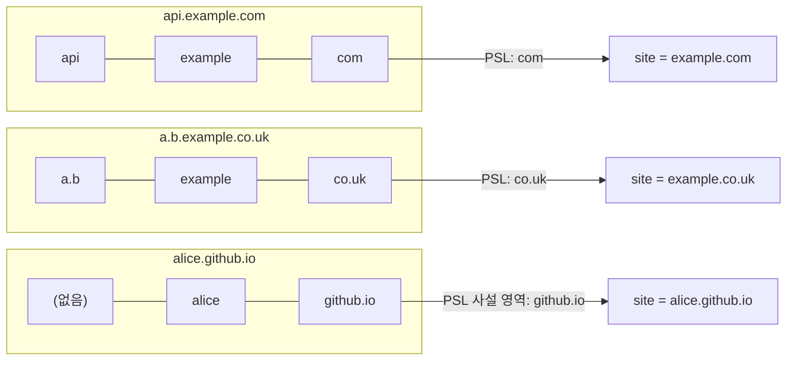

세 줄 모두 가운데 칸이 등록 단위(eTLD+1)이고 오른쪽 칸이 PSL에 올라 있는 접미사다. `co.uk`와 `github.io`는 점이 하나 들어 있는데도 TLD 한 개처럼 다뤄지기 때문에 사이트 경계가 한 칸 왼쪽으로 밀려난다.

PSL을 라이브러리로 직접 조회해 보면 같은 결과가 나온다. `publicsuffixlist` 1.1.2(목록 버전 2026-10-23)로 실행했다.

```
api.example.com      suffix=com            site=example.com
a.b.example.co.uk    suffix=co.uk          site=example.co.uk
app.example.co.kr    suffix=co.kr          site=example.co.kr
alice.github.io      suffix=github.io      site=alice.github.io
bob.github.io        suffix=github.io      site=bob.github.io
x.herokuapp.com      suffix=herokuapp.com  site=x.herokuapp.com
```

`alice.github.io`와 `bob.github.io`는 서로 다른 site로 나온다. 같은 `github.io` 아래지만 PSL에 `github.io`가 접미사로 올라 있어서 둘 사이는 cross-site다. 같은 라이브러리를 ICANN 영역만 쓰는 옵션(`only_icann=True`)으로 돌리면 `alice.github.io`의 접미사가 `io`, site가 `github.io`로 바뀐다. PSL은 ICANN 영역과 사설(private) 영역 두 부분으로 나뉘어 있고, `github.io`나 `herokuapp.com`은 사설 영역에 있다. 도구에 따라 사설 영역을 무시하는 경우가 있어서, 보안 판단을 직접 구현했다면 어느 영역을 쓰는지부터 확인해야 한다.

`github.io`나 `herokuapp.com`이 PSL에 들어있는 게 흥미롭다. GitHub Pages는 사용자마다 `username.github.io`를 발급한다. 만약 `github.io`가 PSL에 없으면 `userA.github.io`에서 발급한 쿠키가 `userB.github.io`로 흘러들어가서 사용자 간 정보가 새어버린다. 그래서 PaaS 회사들은 자기 도메인을 PSL에 등록한다.

우리도 멀티테넌트 SaaS를 운영하면서 테넌트마다 서브도메인을 발급하는 구조라면 `app.example.com`을 PSL에 등록하는 걸 검토해야 한다. 등록되면 `tenant1.app.example.com`과 `tenant2.app.example.com`은 cross-site로 간주되고, 한쪽 쿠키가 다른 쪽으로 흘러갈 가능성이 차단된다.

## 서브도메인 NS 위임과 글루 레코드

서브도메인을 다른 팀이나 다른 DNS 업체에 맡기려면 부모 존에 NS 레코드를 둔다. 이 레코드를 두는 순간 그 이름 아래의 응답 책임은 자식 존으로 넘어가고, 부모는 "저기에 물어보라"는 안내만 한다. 아래는 BIND 두 대로 부모(`example.test`, 10.77.0.2)와 자식(`app.example.test`, 10.77.0.3)을 띄워 확인한 흐름이다.

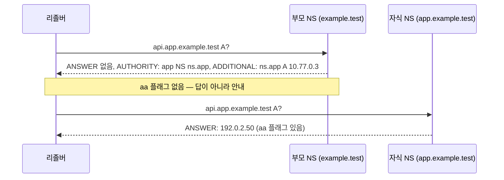

부모 응답에는 ANSWER가 비어 있고 `aa` 플래그도 없다. 부모는 "내 소관이 아니다"라고만 말하고 자식 NS의 이름과 주소를 건네줄 뿐이다. 자식에 가서야 `aa`가 붙은 실제 답이 나온다.

```
$ dig @10.77.0.2 api.app.example.test A +norec
;; flags: qr; QUERY: 1, ANSWER: 0, AUTHORITY: 1, ADDITIONAL: 2
;; AUTHORITY SECTION:
app.example.test.       300 IN NS  ns.app.example.test.
;; ADDITIONAL SECTION:
ns.app.example.test.    300 IN A   10.77.0.3

$ dig @10.77.0.3 api.app.example.test A +norec
;; flags: qr aa; QUERY: 1, ANSWER: 1, AUTHORITY: 1, ADDITIONAL: 2
api.app.example.test.   300 IN A   192.0.2.50
```

### 글루 레코드가 필요한 경우

위 예에서 자식의 네임서버 이름 `ns.app.example.test`는 위임받는 존 자신의 안쪽 이름이다. 이 이름의 주소를 알려면 `app.example.test`의 NS에 물어봐야 하고, 그 NS를 찾으려면 이름의 주소가 필요하니 순환이 생긴다. 이 순환을 끊으려고 부모 존에 `ns.app IN A 10.77.0.3`을 같이 적어 두는 것이 글루(glue) 레코드다. 부모는 NS 안내를 줄 때 이 A를 ADDITIONAL 섹션에 붙여 보낸다.

글루를 빼먹은 부모 존도 만들어 봤다. BIND 로그에는 로드할 때 이미 경고가 찍혔다.

```
zone example.test/IN: app.example.test/NS 'ns.app.example.test' has no REQUIRED GLUE address records (A or AAAA)
```

이 부모에게 같은 질문을 하면 NS 안내는 나오는데 ADDITIONAL이 비어 있다(`ANSWER: 0, AUTHORITY: 1, ADDITIONAL: 1`, 그 1은 EDNS OPT). 리졸버가 자식 서버 주소를 못 얻으니 조회가 중간에서 멈춘다. 반면 NS 이름이 `ns-1234.awsdns-12.org`처럼 다른 존의 이름이면 글루는 필요 없다. Route53 위임에서 글루를 신경 쓰지 않아도 되는 이유가 이것이다. 글루가 필요한 건 `ns.app.example.com`처럼 위임 대상 존 안에 네임서버 이름을 두는 경우뿐이다.

### 위임 뒤에 부모 존에 남은 옛 레코드

팀이 분리되는 과정에서 자주 나오는 일이다. 위임 전에 부모 존에 `api.app`과 `old.app` 레코드가 이미 있었고, NS를 추가한 뒤에도 지우지 않았다. 실험 존에는 `api.app IN A 192.0.2.1`, `old.app IN A 192.0.2.99`가 그대로 남아 있고 자식 존에는 `api IN A 192.0.2.50`만 있다.

```
$ dig @10.77.0.2 api.app.example.test A +norec     # 부모에게 직접
;; flags: qr; ANSWER: 0, AUTHORITY: 1             # 192.0.2.1 이 나오지 않는다

$ dig @10.77.0.3 old.app.example.test A +norec     # 자식에게
;; status: NXDOMAIN, flags: qr aa
```

부모에 `192.0.2.1`이 남아 있어도 위임 경계 아래라서 응답으로 쓰이지 않고, 안내만 나간다. 대신 `old.app`은 자식 존에 없으니 `NXDOMAIN`이 되고, 그 레코드를 보고 있던 사람은 "부모에 분명히 있는데 왜 안 풀리냐"고 한참 헤맨다. 부모 존 파일만 grep해서는 원인이 안 보이는 부류다. 위임을 거는 날에는 그 이름 아래 레코드를 부모에서 모두 걷어내고, 자식에 옮겨 적은 목록을 먼저 확인한다.

반대 방향도 있다. 자식 존만 고치고 부모의 NS는 건드리지 않으면 외부에서는 변경이 보이지 않는다. 앞의 Route53 절에서 짚은 "위임의 한계"가 이 경우다.

## AWS Route53과 CloudFront 위임

### Route53 호스티드 존
AWS Route53에서 도메인을 관리하면 호스티드 존(Hosted Zone)이라는 단위로 작업한다. 도메인 하나당 하나의 호스티드 존을 만들고, 그 안에 레코드를 넣는다.

```
Hosted Zone: example.com
├── example.com           A      ALIAS d1234.cloudfront.net.
├── www.example.com       CNAME  d1234.cloudfront.net.
├── api.example.com       A      192.0.2.10
└── *.app.example.com     A      198.51.100.20
```

서브도메인을 별도의 호스티드 존으로 분리할 수도 있다. 예를 들어 `app.example.com`을 별도 팀이 관리한다면, `app.example.com` 호스티드 존을 만들고 부모 존(`example.com`)에서 NS 레코드로 위임한다.

```
# example.com 호스티드 존
app.example.com.    NS    ns-1234.awsdns-12.org.
app.example.com.    NS    ns-5678.awsdns-34.com.
app.example.com.    NS    ns-9012.awsdns-56.net.
app.example.com.    NS    ns-3456.awsdns-78.co.uk.

# app.example.com 호스티드 존 (별도 존)
app.example.com.        A      192.0.2.50
api.app.example.com.    A      192.0.2.51
```

이렇게 위임하면 `app.example.com` 존을 관리하는 팀은 부모 존을 건드리지 않고 자기 서브도메인 안에서 자유롭게 레코드를 추가/변경할 수 있다. 권한 분리에도 좋다.

### CloudFront와 alternate domain name
CloudFront 배포에 커스텀 도메인을 붙이려면 두 가지가 필요하다. CloudFront 측의 Alternate Domain Name(CNAME) 등록과 ACM 인증서다.

```
1. ACM에서 인증서 발급: example.com, *.example.com
   (단 ACM 와일드카드 인증서는 us-east-1에서 발급해야 CloudFront에 붙일 수 있음)

2. CloudFront 배포 설정:
   - Alternate Domain Names: example.com, *.example.com
   - Custom SSL Certificate: 위에서 발급한 ACM 인증서

3. Route53에서 ALIAS 레코드:
   example.com.        A    ALIAS d1234.cloudfront.net.
   *.example.com.      A    ALIAS d1234.cloudfront.net.
```

CloudFront는 같은 alternate domain name을 여러 배포에 동시 등록하지 못한다. 다른 계정에서 누군가 우리 도메인을 자기 배포에 박아두면 우리는 그 도메인을 등록 못 하는데 이게 호스트네임 도용 시나리오다. CloudFront는 이를 방지하기 위해 도메인 소유 검증을 추가한 SSL Certificate 또는 DNS 검증을 요구한다.

### 서브도메인 위임의 한계
부모 존(`example.com`)이 다른 서비스에 있고 자식 존(`app.example.com`)이 Route53에 있다면, 부모 측 DNS에 NS 레코드를 박아야 한다. 이걸 깜빡하고 자식 존의 레코드만 수정하면 외부에서는 변경 사항이 보이지 않는다. NS 레코드의 TTL과 리졸버 캐시 때문에 위임이 반영되는 데 시간이 걸리는 것도 자주 보는 문제다. 위임 응답이 어떻게 생겼는지와 글루 레코드는 앞의 'NS 위임과 글루 레코드' 절에서 직접 재현했다.

## 메일 인증 레코드를 서브도메인별로 나누기

메일은 도메인의 평판을 쓴다. 마케팅 메일을 `example.com`으로 대량 발송하다 스팸 신고가 쌓이면 같은 도메인으로 나가는 결제 영수증이나 비밀번호 재설정 메일까지 스팸함으로 간다. 그래서 용도별로 서브도메인을 나눠 발신하고, SPF·DKIM·DMARC 레코드도 서브도메인마다 따로 둔다. 평판이 서브도메인 단위로 쌓이는 정도는 수신 업체마다 다르지만, 정책(DMARC)과 허용 발신자(SPF)가 분리된다는 점은 레코드로 확실히 통제된다.

다음은 BIND 존으로 구성해 `dig`로 확인한 값이다. `example.test`는 사내 메일, `news.example.test`는 외부 메일 서비스(ESP)로 보내는 뉴스레터, `api.example.test`는 메일을 아예 보내지 않는 이름이다.

```
; 루트 도메인 — 사내 메일 서버만 허용
@               TXT  "v=spf1 include:_spf.corp-mail.test -all"
_dmarc          TXT  "v=DMARC1; p=reject; sp=quarantine; rua=mailto:dmarc-agg@example.test; adkim=s; aspf=s"

; news — ESP 가 대신 발송
news            MX   10 mx.news.example.test.
news            TXT  "v=spf1 include:_spf.esp.test -all"
_dmarc.news     TXT  "v=DMARC1; p=none; rua=mailto:dmarc-agg@example.test; fo=1"
s1._domainkey.news  TXT  ( "v=DKIM1; k=rsa; p=MIIBIjANBgkq..." "...나머지..." )

; api — 메일을 보내지도 받지도 않는다
api             MX   0 .
api             TXT  "v=spf1 -all"
_dmarc.api      TXT  "v=DMARC1; p=reject; aspf=s"
```

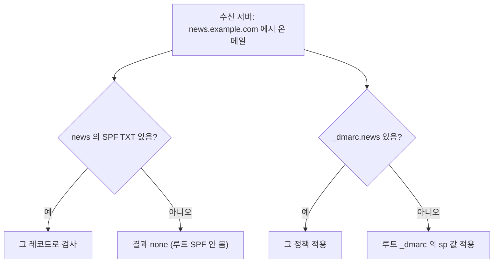

SPF는 상속이 없고 DMARC는 상속이 있다는 차이가 위 그림의 핵심이다.

SPF는 서브도메인으로 상속되지 않는다. `example.com`의 SPF가 있어도 `news.example.com`에서 보낸 메일의 SPF 검사는 `news.example.com`의 TXT를 본다. 그래서 `news`에 별도 SPF가 없으면 검사 결과가 `none`이고, ESP를 `include`로 허용하는 건 `news` 쪽에서 해야 한다. 루트의 SPF에 ESP를 같이 넣으면 루트 SPF가 DNS 조회 10회 제한에 빠르게 다가간다는 부작용도 있다.

DMARC는 반대로 상속이 있다. `_dmarc.news`가 없으면 수신 측이 상위 도메인의 `_dmarc`를 찾고, 이때 서브도메인에는 `sp=` 값이 쓰인다. 위 루트 정책이 `p=reject; sp=quarantine`이니 정책을 두지 않은 서브도메인은 quarantine으로 처리된다. 뉴스레터처럼 처음 도입하는 서브도메인은 `p=none`으로 리포트(`rua`)만 모아 정상 발신원을 모두 파악한 뒤 올리는 순서를 밟는다. `adkim=s`, `aspf=s`는 엄격 정렬이라 `news.example.com`에서 보낸 메일의 DKIM 서명 도메인이 `example.com`이면 정렬 실패로 본다. 서브도메인 분리와 함께 쓸 때는 서명 도메인도 서브도메인으로 맞춰야 한다.

DKIM 공개키는 2048비트 RSA면 TXT 값이 400자 가까이 돼서 255바이트를 넘는다. TXT 레코드 하나는 255바이트 이하 문자열의 나열이라서 존 파일에서 위처럼 괄호로 쪼개 적는다. 실험에서는 200자씩 잘랐고, `dig +short`는 418자짜리 값을 `"조각" "조각" "조각"` 모양의 세 조각으로 보여준다. DNS 관리 콘솔 중에는 이 쪼개기를 자동으로 해주는 것도 있고 안 해주는 것도 있어서, 저장 뒤 `dig +short TXT`로 조각 상태를 확인한다.

보내지 않는 서브도메인은 `api` 예처럼 `v=spf1 -all`, 널 MX(`MX 0 .`), `p=reject`로 닫아 둔다. 서브도메인 테이크오버나 오타 도메인으로 `api.example.com`을 발신자로 위조하는 메일이 들어오면 DMARC 검사에서 걸러진다. 이 레코드를 안 두면 `api.example.com` 이름으로 보낸 위조 메일은 루트의 `sp=quarantine`을 따라 스팸함으로 가는 데 그치고 거부되지는 않는다.

## Kubernetes Ingress와 external-dns로 서브도메인 관리하기

쿠버네티스에서는 서브도메인별 라우팅을 Ingress의 `host` 규칙으로 쓰고, 그 호스트 이름을 DNS에 올리는 일은 external-dns가 맡는 구성이 흔하다. 서비스를 하나 만들 때 DNS 담당자에게 따로 요청하는 단계가 사라지는 대신, 누가 Ingress를 만들면 DNS가 바뀐다는 점이 새 위험이 된다.

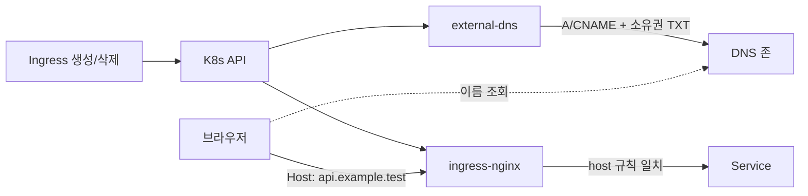

Ingress가 만들어지면 같은 이벤트를 ingress-nginx(트래픽 라우팅)와 external-dns(DNS 반영)가 각자 본다. 두 컴포넌트는 서로 모르고, 둘 다 Ingress의 `host` 값만 읽는다.

kind v0.24.0 / Kubernetes v1.31.0 / ingress-nginx v1.11.2 / external-dns v0.15.0 조합으로 아래 Ingress를 만들었다. DNS 업체 대신 external-dns의 `inmemory` 프로바이더를 썼다.

```yaml
apiVersion: networking.k8s.io/v1
kind: Ingress
metadata:
  name: hosts
  annotations:
    external-dns.alpha.kubernetes.io/ttl: "300"
spec:
  ingressClassName: nginx
  rules:
    - host: api.example.test
      http:
        paths:
          - { path: /, pathType: Prefix, backend: { service: { name: api, port: { number: 80 } } } }
    - host: "*.app.example.test"
      http:
        paths:
          - { path: /, pathType: Prefix, backend: { service: { name: tenant-app, port: { number: 80 } } } }
```

external-dns 인자는 `--source=ingress --registry=txt --txt-owner-id=sd-lab --domain-filter=example.test --policy=upsert-only`다. 기동 직후 로그는 이렇다.

```
CREATE: api.example.test 300 IN CNAME  localhost []
CREATE: *.app.example.test 300 IN CNAME  localhost []
CREATE: api.example.test 0 IN TXT  "heritage=external-dns,external-dns/owner=sd-lab,external-dns/resource=ingress/default/hosts" []
CREATE: cname-api.example.test 0 IN TXT  "heritage=external-dns,external-dns/owner=sd-lab,external-dns/resource=ingress/default/hosts" []
```

CNAME 하나당 TXT가 두 개 따라 붙는다. 이 TXT가 소유권 표식이다. external-dns는 자기 표식이 붙은 레코드만 수정·삭제하고, 표식이 없는 레코드(사람이 직접 만든 것)는 건드리지 않는다. 같은 존을 여러 클러스터가 공유할 때는 `--txt-owner-id`를 클러스터마다 다르게 줘야 서로의 레코드를 지우지 않는다. 같은 값을 쓰면 서로 자기 것으로 알고 덮어쓴다.

TTL도 확인하자. 어노테이션을 준 `hosts` Ingress의 레코드는 TTL 300이고, 어노테이션 없이 만든 `blog.example.test`는 TTL 0으로 생성됐다. `inmemory` 프로바이더에서 본 값이라 실제 업체에서는 기본 TTL이 다를 수 있으니 이 숫자를 일반화하지는 않는다. 다만 어노테이션을 주지 않으면 프로바이더 기본값이 쓰이고, 그 값이 서브도메인 전환 시 반영 속도를 정한다는 점은 같다. 이전 절의 TTL 이야기와 이어지는 부분이다.

### policy: sync와 upsert-only

`--policy=sync`에서는 Ingress를 지우면 external-dns가 그 레코드도 지운다. `upsert-only`에서는 만들고 고치기만 하고 지우지 않는다. `blog.example.test` Ingress를 만들었다 지워서 비교했을 때, sync 쪽 로그에는 `DELETE`가 찍혔고 upsert-only 쪽에는 찍히지 않았다(레코드가 DNS에 남았다).

둘 다 위험하다. sync는 Ingress를 실수로 지우면 DNS도 바로 사라진다. 반대로 upsert-only는 서비스를 내려도 CNAME이 영구히 남고, 이것이 앞서 본 서브도메인 테이크오버의 가장 흔한 출발점이다. 클러스터에서 로드밸런서를 지웠는데 CNAME만 남으면 대상이 사라진 dangling 레코드가 되기 때문이다. 그래서 sync를 쓰고, Ingress를 실수로 지우는 사고는 Ingress 쪽 접근 권한(RBAC)과 배포 승인으로 막는 쪽을 택하는 편이 낫다.

### 와일드카드 host는 한 레이블만

위 Ingress의 `*.app.example.test`는 ingress-nginx에 붙은 포트로 직접 요청해 확인했다(`Host` 헤더만 바꿔서).

```
Host: api.example.test        200  api backend
Host: acme.app.example.test   200  tenant app
Host: a.b.app.example.test    404
Host: app.example.test        404
Host: nope.example.test       404
```

`acme.app`은 매치되지만 `a.b.app`과 `app` 자체는 404다. Ingress의 와일드카드 host는 TLS 와일드카드 인증서와 같이 딱 한 레이블만 대신한다. 앞의 와일드카드 레코드 절에서 본 DNS 와일드카드(`a.b`까지 풀림)와 헷갈리기 쉬운 지점이다. 테넌트가 `a.b.app`처럼 두 단계를 쓰는 설계라면 Ingress 규칙과 인증서 모두 단계마다 따로 만들어야 한다.

## 로컬 개발 환경에서 서브도메인 테스트

### /etc/hosts
가장 단순한 방법은 hosts 파일에 직접 등록하는 거다.

```
# /etc/hosts (Linux/macOS)
127.0.0.1   acme.app.localhost
127.0.0.1   globex.app.localhost
127.0.0.1   api.localhost
```

테넌트가 추가될 때마다 손으로 hosts를 수정해야 해서 동적인 환경에서는 한계가 있다. 와일드카드를 지원하지 않는다.

### dnsmasq
dnsmasq를 로컬에 설치하면 와일드카드 도메인을 한 줄로 처리할 수 있다.

```bash
# macOS에서 brew 설치
brew install dnsmasq

# 설정 (/usr/local/etc/dnsmasq.conf)
address=/.test/127.0.0.1
address=/.local.dev/127.0.0.1
```

이 설정은 `.test`로 끝나는 모든 호스트, `.local.dev`로 끝나는 모든 호스트를 127.0.0.1로 보낸다. `acme.app.test`, `foo.bar.test`, `whatever.local.dev` 모두 로컬로 향한다.

macOS에서는 추가로 `/etc/resolver/test` 파일을 만들어서 `.test` 도메인 조회시 dnsmasq를 사용하도록 지정한다.

```
# /etc/resolver/test
nameserver 127.0.0.1
```

### lvh.me와 nip.io
hosts 수정도 dnsmasq 설치도 귀찮다면 공개 와일드카드 DNS 서비스를 쓴다.

**lvh.me**: 모든 서브도메인이 127.0.0.1로 매핑된다. `acme.lvh.me`, `globex.app.lvh.me` 모두 로컬을 가리킨다.

```bash
curl http://acme.lvh.me:3000
curl http://globex.app.lvh.me:3000
```

**nip.io**: 도메인 안에 IP를 넣을 수 있다. `192.168.1.10.nip.io`는 192.168.1.10으로 매핑된다. 팀원과 같은 네트워크에서 개발할 때 유용하다.

```bash
# 같은 네트워크의 다른 머신에서 내 노트북에 접속
curl http://192-168-1-10.nip.io:3000
curl http://acme.192-168-1-10.nip.io:3000
```

이런 서비스의 단점은 외부 DNS 의존성이다. 인터넷이 끊기거나 해당 서비스가 죽으면 로컬 개발이 안 된다. 보안 관점에서도 외부에 도메인 조회 패턴이 노출된다는 점이 있다. 개인 개발용으로는 괜찮지만 회사 환경에서는 dnsmasq나 사내 DNS 서버를 쓰는 게 낫다.

### .localhost와 .test 도메인
RFC 6761은 특정 TLD를 특수 용도로 예약했다.

- `.localhost`: 항상 루프백을 가리켜야 한다. 모던 브라우저는 `*.localhost`를 자동으로 127.0.0.1로 해석한다.
- `.test`: 테스트용으로만 쓰도록 예약. 실제 인터넷에 등록되지 않는다.
- `.example`: 문서 예시용으로 예약.
- `.invalid`: 항상 무효한 도메인.

`.localhost`는 hosts 파일이나 별도 DNS 설정 없이도 바로 동작하는 경우가 많다. 다만 와일드카드가 모든 클라이언트에서 보장되진 않아서 hosts나 dnsmasq를 백업으로 두는 게 안전하다.

```bash
# 모던 브라우저/Node.js에서 바로 동작
curl http://api.localhost:3000
curl http://acme.app.localhost:3000
```

### 로컬 HTTPS와 와일드카드
서브도메인 라우팅을 쿠키와 함께 테스트하려면 HTTPS가 필요하다(특히 SameSite=None; Secure 케이스). `mkcert`로 로컬 와일드카드 인증서를 만든다.

```bash
# mkcert 설치 후 로컬 CA 등록
mkcert -install

# 와일드카드 인증서 생성
mkcert "*.app.localhost" "*.localhost" localhost 127.0.0.1
```

생성된 `*-cert.pem`과 `*-key.pem`을 로컬 Nginx나 개발 서버에 붙이면 브라우저에서 인증서 경고 없이 HTTPS로 서브도메인 테스트가 가능하다.

## 마무리

서브도메인은 주소를 나누는 도구처럼 보이지만 DNS, 인증서, 쿠키, CORS, 메일 인증, 브라우저 보안 정책이 한 이름에 겹쳐 있다. 와일드카드 한 줄을 넣으면서 "이러면 다 되겠지" 했다가 인증서 갱신 실패, 쿠키 누수, 테이크오버로 사고가 나는 경우를 자주 본다.

이 문서에서 직접 돌려 확인한 것들을 한 줄로 묶으면, DNS 와일드카드는 여러 단계를 풀어주는데 인증서와 Ingress의 와일드카드는 한 단계만 덮는다는 어긋남이 가장 흔한 사고의 뿌리였다. 두 번째는 부모와 자식이 서로의 변경을 보지 못하는 지점이다. 위임을 걸고도 부모에 남은 옛 레코드가 가려지거나, 서비스를 내렸는데 CNAME이 남아 외부 서비스에 이름을 내주거나, HSTS `includeSubDomains`가 잊힌 `legacy` 서브도메인을 막아버린다. 세 경우 모두 한쪽만 고쳐서 생겼다.

새 서브도메인을 하나 열 때는 그 이름이 어느 인증서에 들어가는지, 로그인 쿠키가 어디까지 따라가는지, 이름이 Certificate Transparency 로그에 공개돼도 괜찮은지를 한 번씩 물어본다. 닫을 때는 외부 서비스를 해지하기 전에 DNS부터 지우고, 메일을 보내지 않는 이름이면 SPF와 DMARC로 닫아 둔다. 경로로 갈지 서브도메인으로 갈지 망설여진다면 쿠키를 공유해야 하는지와 독립 배포가 필요한지를 먼저 따져보면 대부분 답이 나온다.
