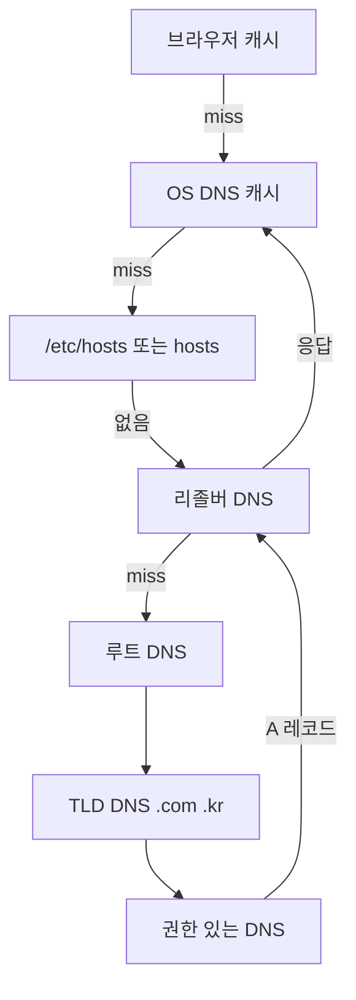
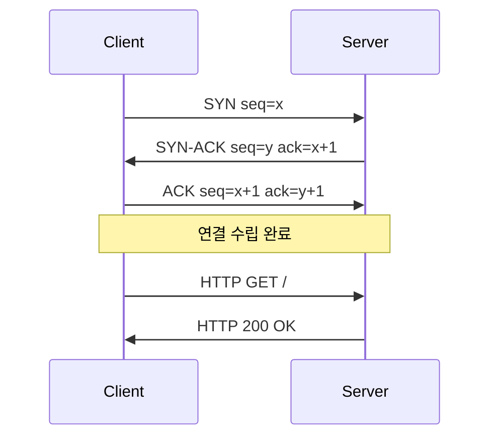
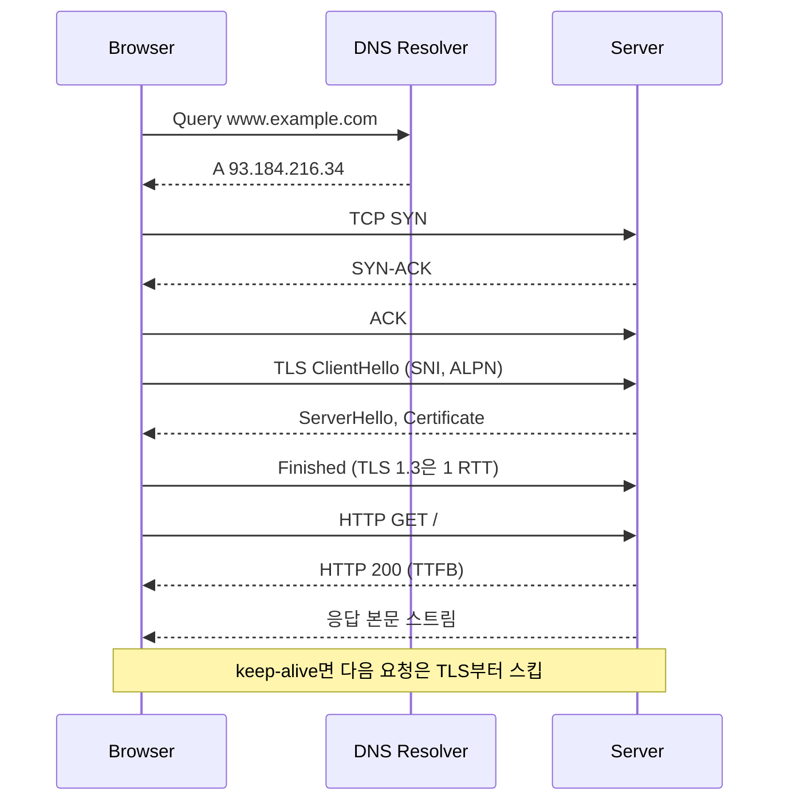

# 웹 통신의 흐름
## 개요

브라우저 주소창에 URL을 치고 엔터를 눌렀을 때 화면이 뜰 때까지, 사실 패킷 레벨에서 보면 꽤 많은 일이 일어난다. URL 파싱, DNS 조회, TCP 3-way handshake, TLS handshake, HTTP 요청/응답, 그리고 브라우저 렌더링. 각 단계마다 ms 단위로 시간이 쌓이고, 어느 한 곳에서 막히면 전체 응답이 느려진다.

장애 대응할 때 "느리다"는 리포트만 보고 어디가 병목인지 모르면 답이 안 나온다. DNS인지 TCP 연결인지, TLS 협상인지, 서버 처리인지, 다운로드인지를 구분할 수 있어야 한다. 이 문서는 각 단계를 실제 명령어와 패킷 출력으로 확인하면서 어디에서 시간이 소모되고 어디에서 자주 깨지는지 정리한다.

### 용어 정리

| 용어 | 설명 |
|------|------|
| RTT | Round Trip Time. 패킷이 왕복하는 시간 |
| TTFB | Time To First Byte. 요청을 보내고 첫 응답 바이트를 받기까지 |
| SNI | Server Name Indication. TLS handshake에서 어떤 호스트로 접속할지 알려주는 확장 |
| ALPN | Application-Layer Protocol Negotiation. TLS 위에서 HTTP/2, HTTP/3을 협상 |
| keep-alive | 한 번 맺은 TCP 연결을 재사용 |
| QUIC | UDP 기반 전송 프로토콜. HTTP/3가 사용 |

---

## 1. URL 파싱

브라우저나 HTTP 클라이언트는 가장 먼저 URL을 분해한다. 프로토콜, 호스트, 포트, 경로, 쿼리, 프래그먼트로 쪼개야 어디로 어떻게 연결할지 결정할 수 있다.

```
https://www.example.com:443/login?redirect=home#section1
└─┬─┘   └──────┬──────┘ └┬┘└──┬─┘└──────┬──────┘└───┬──┘
protocol      host    port path        query     fragment
```

프래그먼트(`#` 뒤)는 서버로 전송되지 않는다. 브라우저 내부에서만 쓴다. 신입 때 액세스 로그에서 프래그먼트가 안 보여서 한참 헤맸던 기억이 있다.

### Node.js URL API로 파싱 확인

```javascript
const url = new URL('https://www.example.com:443/login?redirect=home#section1');

console.log(url.protocol); // 'https:'
console.log(url.hostname); // 'www.example.com'
console.log(url.port);     // '' (기본 포트면 빈 문자열)
console.log(url.pathname); // '/login'
console.log(url.search);   // '?redirect=home'
console.log(url.hash);     // '#section1'

// 쿼리 파라미터 접근
console.log(url.searchParams.get('redirect')); // 'home'
```

`url.port`가 기본 포트(http:80, https:443)면 빈 문자열로 나오는 점에 주의해야 한다. 직접 비교 로직을 짤 때 이걸 모르면 분기가 어긋난다.

### 브라우저 Performance API로 단계별 시간 측정

브라우저에서 한 요청의 단계별 시간을 코드로 잡으려면 `PerformanceResourceTiming`을 쓴다.

```javascript
// 페이지 로드가 끝난 뒤 실행
const [nav] = performance.getEntriesByType('navigation');

console.log({
  redirect:        nav.redirectEnd - nav.redirectStart,
  dns:             nav.domainLookupEnd - nav.domainLookupStart,
  tcp:             nav.connectEnd - nav.connectStart,
  tls:             nav.connectEnd - nav.secureConnectionStart,
  request:         nav.responseStart - nav.requestStart,   // TTFB
  response:        nav.responseEnd - nav.responseStart,    // 다운로드
  domInteractive:  nav.domInteractive - nav.responseEnd,
  load:            nav.loadEventEnd - nav.startTime,
});
```

특정 fetch 호출만 측정하려면 `getEntriesByName`으로 이름을 찍어서 가져온다.

```javascript
performance.mark('api-start');
const res = await fetch('/api/users');
performance.mark('api-end');
performance.measure('api-call', 'api-start', 'api-end');
```

---

## 2. DNS 조회

도메인을 IP로 바꾸는 단계다. 서비스가 갑자기 안 되는 장애의 절반은 DNS에서 시작된다. 먼저 클라이언트가 어떤 순서로 캐시를 뒤지는지 알아야 한다.



브라우저 캐시 → OS 캐시 → hosts 파일 → 리졸버(보통 ISP 또는 8.8.8.8) → 루트 → TLD → 권한 있는 네임서버 순으로 내려간다. 각 단계마다 TTL이 다르고, 어디서 캐시되어 있는지에 따라 응답 시간이 0ms에서 수백 ms까지 갈린다.

### dig으로 직접 따라가기

`dig`은 DNS 디버깅의 기본기다. `+trace` 옵션을 붙이면 루트부터 권한 있는 네임서버까지 한 단계씩 따라간다.

```bash
dig +trace www.example.com
```

```
.                       518400  IN  NS  a.root-servers.net.
.                       518400  IN  NS  b.root-servers.net.
...
com.                    172800  IN  NS  a.gtld-servers.net.
...
example.com.            172800  IN  NS  a.iana-servers.net.
...
www.example.com.        86400   IN  A   93.184.216.34
```

특정 레코드 타입만 보고 싶으면 타입을 지정한다.

```bash
dig www.example.com A          # IPv4
dig www.example.com AAAA       # IPv6
dig example.com MX             # 메일 서버
dig example.com NS             # 네임서버
dig example.com TXT            # SPF, DKIM, 도메인 검증
```

특정 DNS 서버에 직접 물어보려면 `@` 뒤에 서버를 적는다. 캐시를 우회하고 권한 있는 서버에 직접 묻고 싶을 때 자주 쓴다.

```bash
dig @8.8.8.8 www.example.com
dig @1.1.1.1 www.example.com
dig @ns1.example.com www.example.com   # 권한 있는 서버에 직접
```

`+short`로 결과만 뽑고, `+stats`로 응답 시간을 본다.

```bash
$ dig +short www.example.com
93.184.216.34

$ dig www.example.com | grep "Query time"
;; Query time: 32 msec
```

macOS는 `dscacheutil -flushcache; sudo killall -HUP mDNSResponder`로 OS 캐시를 비울 수 있고, Linux는 systemd-resolved를 쓰면 `resolvectl flush-caches`다.

### Node.js dns 모듈로 캐시 무시하고 조회

Node의 기본 `dns.lookup()`은 OS의 getaddrinfo를 호출한다. 즉 OS DNS 캐시를 탄다. 캐시를 무시하고 DNS 서버에 직접 물어보려면 `dns.resolve*` 계열을 써야 한다.

```javascript
const dns = require('node:dns').promises;

// OS 캐시 사용 (getaddrinfo)
const lookup = await dns.lookup('www.example.com');
console.log(lookup); // { address: '93.184.216.34', family: 4 }

// 리졸버에 직접 (OS 캐시 우회)
const a    = await dns.resolve4('www.example.com');
const aaaa = await dns.resolve6('www.example.com');
const mx   = await dns.resolveMx('example.com');
const txt  = await dns.resolveTxt('example.com');

console.log(a);   // [ '93.184.216.34' ]
console.log(mx);  // [ { exchange: '...', priority: 10 } ]
```

특정 DNS 서버에 직접 묻고 싶으면 `Resolver`를 만들어서 `setServers`로 지정한다.

```javascript
const { Resolver } = require('node:dns').promises;
const resolver = new Resolver();
resolver.setServers(['8.8.8.8', '1.1.1.1']);

const addrs = await resolver.resolve4('www.example.com');
```

장애 분석할 때 "내 서버에서는 8.8.8.8로 물어보면 잘 나오는데 사내 DNS에서는 안 나온다" 같은 상황을 잡으려면 이 방식이 필수다.

### 자주 만나는 DNS 트러블

DNS는 캐시 계층이 많아서 변경이 즉시 반영되지 않는다. 도메인 IP를 바꿨는데 일부 사용자만 안 된다고 하면 거의 캐시 문제다. 점검 순서는 이렇다.

1. `dig @권한네임서버 도메인` — 원본은 정상인지 확인
2. `dig @8.8.8.8 도메인` — 외부 리졸버에서 어떻게 보이는지
3. `dig 도메인` (서버 명시 없이) — 실제 사용하는 리졸버 응답
4. 클라이언트 OS 캐시 비우기

TTL을 너무 길게(예: 24시간) 잡아둔 도메인을 바꾸려고 하면 하루 종일 일부 트래픽이 옛 IP로 간다. 변경 예정 시점 며칠 전에 TTL을 60초 같은 짧은 값으로 미리 낮춰두는 작업을 해야 한다.

또 하나 자주 보는 건 `/etc/hosts`에 테스트용 엔트리가 남아 있는 경우다. 분명 DNS는 새 IP를 가리키는데 한 서버만 옛 IP로 가고 있어서 한참 헤매다 hosts 파일을 보면 한 줄이 박혀 있다.

---

<div class="ygd-dns-ttl-propagation" id="ygd-dns-ttl-propagation">
<style>
.ygd-dns-ttl-propagation{--ygd-surface:#fbfaf8;--ygd-border:#d9d4cd;--ygd-text:#2b2724;--ygd-muted:#5f5953;--ygd-old:#b45309;--ygd-old-soft:rgba(180,83,9,.16);--ygd-new:#15803d;--ygd-on-new:#ffffff;--ygd-accent:#3d7387;--ygd-on-accent:#ffffff;--ygd-grid:#d9d4cd;max-width:760px;margin-left:auto;margin-right:auto;margin-top:24px;margin-bottom:24px;box-sizing:border-box;padding:12px;background:var(--ygd-surface);border:1px solid var(--ygd-border);border-radius:8px;color:var(--ygd-text);overflow:hidden;line-height:1.6}
body[data-md-color-scheme="slate"] .ygd-dns-ttl-propagation{--ygd-surface:#272427;--ygd-border:#4a4549;--ygd-text:#f0ede9;--ygd-muted:#b3ada5;--ygd-old:#fbbf24;--ygd-old-soft:rgba(251,191,36,.2);--ygd-new:#4ade80;--ygd-on-new:#0b1f10;--ygd-accent:#7cc0d6;--ygd-on-accent:#10222a;--ygd-grid:#4a4549}
.ygd-dns-ttl-propagation *{box-sizing:border-box}
.ygd-dns-ttl-propagation .ygd-heading{font-size:15px;font-weight:700;margin:0 0 8px 0;color:var(--ygd-text)}
.ygd-dns-ttl-propagation .ygd-svg{display:block;width:100%;max-width:100%;height:auto}
.ygd-dns-ttl-propagation .ygd-t{fill:var(--ygd-text);font-size:12px;font-family:inherit}
.ygd-dns-ttl-propagation .ygd-t-strong{font-size:13px;font-weight:700}
.ygd-dns-ttl-propagation .ygd-t-muted{fill:var(--ygd-muted)}
.ygd-dns-ttl-propagation .ygd-t-acc{fill:var(--ygd-accent);font-weight:700}
.ygd-dns-ttl-propagation .ygd-t-title{paint-order:stroke;stroke:var(--ygd-surface);stroke-width:4px;stroke-linejoin:round}
.ygd-dns-ttl-propagation .ygd-grid{stroke:var(--ygd-grid);stroke-width:1;stroke-dasharray:3 3;fill:none}
.ygd-dns-ttl-propagation .ygd-axis{stroke:var(--ygd-muted);stroke-width:1.2;fill:none}
.ygd-dns-ttl-propagation .ygd-base{stroke:var(--ygd-border);stroke-width:1.2;fill:none}
.ygd-dns-ttl-propagation .ygd-ghost{fill:none;stroke:var(--ygd-old);stroke-width:1.5;stroke-dasharray:4 3;opacity:.5}
.ygd-dns-ttl-propagation .ygd-line{fill:none;stroke:var(--ygd-old);stroke-width:2.5;stroke-linejoin:round}
.ygd-dns-ttl-propagation .ygd-area{fill:var(--ygd-old-soft);stroke:none}
.ygd-dns-ttl-propagation .ygd-dot{fill:var(--ygd-old);stroke:var(--ygd-surface);stroke-width:2}
.ygd-dns-ttl-propagation .ygd-playhead{stroke:var(--ygd-accent);stroke-width:2;fill:none}
.ygd-dns-ttl-propagation .ygd-bar-base{fill:var(--ygd-old-soft);stroke:var(--ygd-old);stroke-width:1}
.ygd-dns-ttl-propagation .ygd-bar-prog{fill:var(--ygd-old)}
.ygd-dns-ttl-propagation .ygd-cap{fill:var(--ygd-surface);stroke:var(--ygd-old);stroke-width:1.5}
.ygd-dns-ttl-propagation .ygd-done .ygd-cap{fill:var(--ygd-new);stroke:var(--ygd-new)}
.ygd-dns-ttl-propagation .ygd-check{fill:none;stroke:var(--ygd-on-new);stroke-width:1.6;stroke-linecap:round;stroke-linejoin:round;opacity:0}
.ygd-dns-ttl-propagation .ygd-done .ygd-check{opacity:1}
.ygd-dns-ttl-propagation .ygd-legend{display:flex;flex-wrap:wrap;gap:4px 16px;margin:8px 0 0 0;font-size:14px;color:var(--ygd-muted)}
.ygd-dns-ttl-propagation .ygd-legend-item{display:inline-flex;align-items:center;gap:6px}
.ygd-dns-ttl-propagation .ygd-sw-line{display:inline-block;width:18px;height:0;border-top:3px solid var(--ygd-old)}
.ygd-dns-ttl-propagation .ygd-sw-bar{display:inline-block;width:18px;height:10px;border-radius:5px;background:var(--ygd-old-soft);border:1px solid var(--ygd-old)}
.ygd-dns-ttl-propagation .ygd-sw-ok{display:inline-block;width:14px;height:14px;border-radius:50%;background:var(--ygd-new)}
.ygd-dns-ttl-propagation .ygd-panel{margin:12px 0 0 0;padding:10px 12px;border:1px solid var(--ygd-border);border-left:4px solid var(--ygd-accent);border-radius:6px;font-size:15px;line-height:1.6}
.ygd-dns-ttl-propagation .ygd-when{display:inline-block;font-size:14px;font-weight:700;color:var(--ygd-accent);margin-right:8px}
.ygd-dns-ttl-propagation .ygd-title{font-size:15px;font-weight:700;color:var(--ygd-text)}
.ygd-dns-ttl-propagation .ygd-text{margin-top:4px;font-size:15px;color:var(--ygd-text)}
.ygd-dns-ttl-propagation .ygd-controls{display:flex;flex-wrap:wrap;align-items:center;gap:8px;margin:12px 0 0 0}
.ygd-dns-ttl-propagation .ygd-btn{font-family:inherit;font-size:14px;line-height:1.2;min-height:40px;padding:0 14px;border:1px solid var(--ygd-border);border-radius:6px;background:var(--ygd-surface);color:var(--ygd-text);cursor:pointer}
.ygd-dns-ttl-propagation .ygd-btn:disabled{opacity:.5;cursor:default}
.ygd-dns-ttl-propagation .ygd-btn-main{background:var(--ygd-accent);border-color:var(--ygd-accent);color:var(--ygd-on-accent);font-weight:700}
.ygd-dns-ttl-propagation .ygd-btn:focus-visible{outline:3px solid var(--ygd-accent);outline-offset:2px}
.ygd-dns-ttl-propagation .ygd-chips{display:flex;gap:6px;margin-left:auto}
.ygd-dns-ttl-propagation .ygd-chip{font-family:inherit;font-size:14px;min-width:40px;min-height:40px;padding:0;border:1px solid var(--ygd-border);border-radius:6px;background:var(--ygd-surface);color:var(--ygd-text);cursor:pointer}
.ygd-dns-ttl-propagation .ygd-chip.ygd-on{background:var(--ygd-accent);border-color:var(--ygd-accent);color:var(--ygd-on-accent);font-weight:700}
.ygd-dns-ttl-propagation .ygd-chip:focus-visible{outline:3px solid var(--ygd-accent);outline-offset:2px}
.ygd-dns-ttl-propagation .ygd-note{margin:12px 0 0 0;font-size:14px;color:var(--ygd-muted)}
.ygd-dns-ttl-propagation .ygd-analogy{margin:8px 0 0 0;font-size:14px;color:var(--ygd-text)}
@media (max-width:480px){.ygd-dns-ttl-propagation{padding:10px}.ygd-dns-ttl-propagation .ygd-chips{margin-left:0;width:100%}}
@media (prefers-reduced-motion:reduce){.ygd-dns-ttl-propagation *{transition:none !important;animation:none !important}}
</style>
<div class="ygd-heading">IP를 바꾼 뒤 옛 IP가 사라지기까지: TTL 24시간 vs 사전에 60초로 낮춘 경우</div>
<svg class="ygd-svg" viewBox="0 0 400 354" role="img" aria-label="DNS 변경 후 시간 경과 타임라인. A는 TTL 24시간 그대로라 옛 IP를 쥔 사용자 비중이 24시간에 걸쳐 서서히 줄고, B는 변경 며칠 전 TTL을 60초로 낮춰 두어 1분 안에 리졸버, OS, 브라우저 캐시가 모두 새 IP로 바뀐다.">
<defs>
<clipPath id="ygd-dns-ttl-propagation-clip"><rect class="ygd-clip-rect" x="0" y="0" width="56" height="354"></rect></clipPath>
</defs>
<text class="ygd-t ygd-t-muted" x="8" y="34">경과</text>
<line class="ygd-axis" x1="56" y1="30" x2="376" y2="30"></line>
<line class="ygd-axis" x1="56" y1="26" x2="56" y2="34"></line>
<line class="ygd-axis" x1="136" y1="26" x2="136" y2="34"></line>
<line class="ygd-axis" x1="216" y1="26" x2="216" y2="34"></line>
<line class="ygd-axis" x1="296" y1="26" x2="296" y2="34"></line>
<line class="ygd-axis" x1="376" y1="26" x2="376" y2="34"></line>
<text class="ygd-t ygd-t-acc" x="56" y="16" text-anchor="middle">변경</text>
<text class="ygd-t" x="136" y="16" text-anchor="middle">1분</text>
<text class="ygd-t" x="216" y="16" text-anchor="middle">1시간</text>
<text class="ygd-t" x="296" y="16" text-anchor="middle">6시간</text>
<text class="ygd-t" x="376" y="16" text-anchor="middle">24시간</text>
<line class="ygd-grid" x1="56" y1="72" x2="56" y2="184"></line>
<line class="ygd-grid" x1="136" y1="72" x2="136" y2="184"></line>
<line class="ygd-grid" x1="216" y1="72" x2="216" y2="184"></line>
<line class="ygd-grid" x1="296" y1="72" x2="296" y2="184"></line>
<line class="ygd-grid" x1="376" y1="72" x2="376" y2="184"></line>
<line class="ygd-grid" x1="56" y1="236" x2="56" y2="348"></line>
<line class="ygd-grid" x1="136" y1="236" x2="136" y2="348"></line>
<line class="ygd-grid" x1="216" y1="236" x2="216" y2="348"></line>
<line class="ygd-grid" x1="296" y1="236" x2="296" y2="348"></line>
<line class="ygd-grid" x1="376" y1="236" x2="376" y2="348"></line>
<line class="ygd-base" x1="56" y1="120" x2="376" y2="120"></line>
<line class="ygd-base" x1="56" y1="284" x2="376" y2="284"></line>
<text class="ygd-t ygd-t-muted" x="8" y="80">많음</text>
<text class="ygd-t ygd-t-muted" x="8" y="119">없음</text>
<text class="ygd-t ygd-t-muted" x="8" y="244">많음</text>
<text class="ygd-t ygd-t-muted" x="8" y="283">없음</text>
<path class="ygd-ghost ygd-ghost-a" d=""></path>
<path class="ygd-ghost ygd-ghost-b" d=""></path>
<g clip-path="url(#ygd-dns-ttl-propagation-clip)">
<path class="ygd-area ygd-area-a" d=""></path>
<path class="ygd-line ygd-line-a" d=""></path>
<path class="ygd-area ygd-area-b" d=""></path>
<path class="ygd-line ygd-line-b" d=""></path>
</g>
<g class="ygd-row" data-end="376"><text class="ygd-t" x="8" y="142">리졸버</text><rect class="ygd-bar-base" x="56" y="134" width="320" height="8" rx="4"></rect><rect class="ygd-bar-prog" x="56" y="134" width="0" height="8" rx="4"></rect><circle class="ygd-cap" cx="376" cy="138" r="5.5"></circle><path class="ygd-check" d="M373.2 138.2 L375.2 140.4 L379 135.8"></path></g>
<g class="ygd-row" data-end="376"><text class="ygd-t" x="8" y="162">OS</text><rect class="ygd-bar-base" x="56" y="154" width="320" height="8" rx="4"></rect><rect class="ygd-bar-prog" x="56" y="154" width="0" height="8" rx="4"></rect><circle class="ygd-cap" cx="376" cy="158" r="5.5"></circle><path class="ygd-check" d="M373.2 158.2 L375.2 160.4 L379 155.8"></path></g>
<g class="ygd-row" data-end="376"><text class="ygd-t" x="8" y="182">브라우저</text><rect class="ygd-bar-base" x="56" y="174" width="320" height="8" rx="4"></rect><rect class="ygd-bar-prog" x="56" y="174" width="0" height="8" rx="4"></rect><circle class="ygd-cap" cx="376" cy="178" r="5.5"></circle><path class="ygd-check" d="M373.2 178.2 L375.2 180.4 L379 175.8"></path></g>
<g class="ygd-row" data-end="136"><text class="ygd-t" x="8" y="306">리졸버</text><rect class="ygd-bar-base" x="56" y="298" width="80" height="8" rx="4"></rect><rect class="ygd-bar-prog" x="56" y="298" width="0" height="8" rx="4"></rect><circle class="ygd-cap" cx="136" cy="302" r="5.5"></circle><path class="ygd-check" d="M133.2 302.2 L135.2 304.4 L139 299.8"></path></g>
<g class="ygd-row" data-end="136"><text class="ygd-t" x="8" y="326">OS</text><rect class="ygd-bar-base" x="56" y="318" width="80" height="8" rx="4"></rect><rect class="ygd-bar-prog" x="56" y="318" width="0" height="8" rx="4"></rect><circle class="ygd-cap" cx="136" cy="322" r="5.5"></circle><path class="ygd-check" d="M133.2 322.2 L135.2 324.4 L139 319.8"></path></g>
<g class="ygd-row" data-end="136"><text class="ygd-t" x="8" y="346">브라우저</text><rect class="ygd-bar-base" x="56" y="338" width="80" height="8" rx="4"></rect><rect class="ygd-bar-prog" x="56" y="338" width="0" height="8" rx="4"></rect><circle class="ygd-cap" cx="136" cy="342" r="5.5"></circle><path class="ygd-check" d="M133.2 342.2 L135.2 344.4 L139 339.8"></path></g>
<circle class="ygd-dot ygd-dot-a" cx="56" cy="72" r="5"></circle>
<circle class="ygd-dot ygd-dot-b" cx="56" cy="236" r="5"></circle>
<line class="ygd-playhead" x1="56" y1="26" x2="56" y2="348"></line>
<text class="ygd-t ygd-t-strong ygd-t-title" x="8" y="62">A. TTL 24시간 그대로</text>
<text class="ygd-t ygd-t-muted ygd-t-title" x="392" y="62" text-anchor="end">옛 IP 사용자 비중</text>
<text class="ygd-t ygd-t-strong ygd-t-title" x="8" y="226">B. 며칠 전 TTL을 60초로 낮춰 둠</text>
<text class="ygd-t ygd-t-muted ygd-t-title" x="392" y="226" text-anchor="end">옛 IP 사용자 비중</text>
</svg>
<div class="ygd-legend">
<span class="ygd-legend-item"><span class="ygd-sw-line"></span>옛 IP로 가는 사용자 비중</span>
<span class="ygd-legend-item"><span class="ygd-sw-bar"></span>캐시가 옛 IP를 줄 수 있는 구간 (진한 부분이 경과)</span>
<span class="ygd-legend-item"><span class="ygd-sw-ok"></span>새 IP로 갱신 완료</span>
</div>
<div class="ygd-panel" aria-live="polite">
<span class="ygd-when">변경 전</span><span class="ygd-title">둘 다 캐시에 옛 IP가 있다</span>
<div class="ygd-text">A는 TTL이 24시간 그대로이고, B는 변경 며칠 전에 TTL을 60초로 낮춰 두었다. 낮춰 두는 시점은 기존 24시간짜리 캐시가 모두 만료될 만큼 넉넉히 앞서야 한다.</div>
</div>
<div class="ygd-controls">
<button type="button" class="ygd-btn ygd-btn-main ygd-play">재생</button>
<button type="button" class="ygd-btn ygd-next">다음 단계</button>
<button type="button" class="ygd-btn ygd-reset">처음으로</button>
<div class="ygd-chips" role="group" aria-label="단계 바로가기">
<button type="button" class="ygd-chip ygd-on" data-i="0" aria-label="단계 1: 변경 전" aria-current="step">1</button>
<button type="button" class="ygd-chip" data-i="1" aria-label="단계 2: 변경 시점">2</button>
<button type="button" class="ygd-chip" data-i="2" aria-label="단계 3: 1분 뒤">3</button>
<button type="button" class="ygd-chip" data-i="3" aria-label="단계 4: 1시간에서 6시간">4</button>
<button type="button" class="ygd-chip" data-i="4" aria-label="단계 5: 24시간 뒤">5</button>
<button type="button" class="ygd-chip" data-i="5" aria-label="단계 6: 그래도 안 될 때">6</button>
</div>
</div>
<div class="ygd-note">개념 모델이다. 실측값이 아니며, 사용자들이 캐시한 시점이 TTL 안에 고르게 흩어져 있고 OS·브라우저도 받은 TTL을 그대로 따른다고 가정했다. 가로축은 구간마다 간격을 압축한 시간축이다.</div>
<div class="ygd-analogy">비유: 사무실 벽에 붙여 둔 연락처 메모. 메모에 적힌 유효기간이 지나야 최신 번호를 다시 확인하므로, 번호가 바뀌어도 유효기간 동안에는 옛 번호로 전화가 걸린다. 실제 캐시는 리졸버, OS, 브라우저 세 겹이라는 점만 다르다.</div>
<script>
(function(){
var root=document.getElementById('ygd-dns-ttl-propagation');
if(!root){return;}
function q(s){return root.querySelector(s);}
function qa(s){return Array.prototype.slice.call(root.querySelectorAll(s));}
var X=[56,136,216,296,376],T=[0,60,3600,21600,86400];
var CA={top:72,bot:120},CB={top:236,bot:284};
var TARGET=[56,56,136,296,376,376];
var STEPS=[
{when:'변경 전',title:'둘 다 캐시에 옛 IP가 있다',text:'A는 TTL이 24시간 그대로이고, B는 변경 며칠 전에 TTL을 60초로 낮춰 두었다. 낮춰 두는 시점은 기존 24시간짜리 캐시가 모두 만료될 만큼 넉넉히 앞서야 한다.'},
{when:'변경 시점',title:'네임서버에서 IP를 바꾼다',text:'권한 네임서버는 이 순간부터 새 IP로 답한다. 하지만 리졸버·OS·브라우저는 TTL이 끝나기 전에는 다시 묻지 않으므로, 캐시를 쥔 사용자는 옛 IP로 간다.'},
{when:'1분 뒤',title:'B는 캐시가 모두 만료된다',text:'B는 TTL이 60초라 1분이면 모든 캐시가 만료되고, 다음 조회에서 새 IP를 받아온다. A는 같은 시간이 지나도 사실상 그대로다.'},
{when:'1시간 ~ 6시간',title:'A는 만료되는 대로 조금씩 넘어간다',text:'A의 캐시는 각자 받아 온 시점부터 24시간이 지나야 만료되어, 사용자마다 새 IP로 바뀌는 시점이 흩어진다. 이 구간에서 일부 사용자만 안 된다는 제보가 나온다.'},
{when:'24시간 뒤',title:'A도 하루가 지나야 끝난다',text:'TTL이 24시간이면 가장 늦게 받아 간 캐시도 24시간 안에는 만료된다. 그때까지 일부 트래픽이 옛 IP로 가므로, 옛 IP 쪽 서버는 그동안 살려 두어야 한다.'},
{when:'그래도 안 될 때',title:'점검 순서',text:'dig @권한네임서버, dig @8.8.8.8, dig 순으로 어느 층에서 값이 갈리는지 보고, 클라이언트 OS 캐시를 비운다. 한 서버만 옛 IP로 간다면 /etc/hosts에 남은 테스트용 엔트리를 확인한다.'}
];
var clip=q('.ygd-clip-rect'),head=q('.ygd-playhead');
var dotA=q('.ygd-dot-a'),dotB=q('.ygd-dot-b');
var whenEl=q('.ygd-when'),titleEl=q('.ygd-title'),textEl=q('.ygd-text');
var playBtn=q('.ygd-play'),nextBtn=q('.ygd-next'),resetBtn=q('.ygd-reset');
var chips=qa('.ygd-chip');
var rows=qa('.ygd-row').map(function(el){return {el:el,end:parseFloat(el.getAttribute('data-end')),prog:el.querySelector('.ygd-bar-prog')};});
var step=0,cur=56,raf=0,timer=0,playing=false,last=STEPS.length-1;
function isReduced(){return !!(window.matchMedia&&window.matchMedia('(prefers-reduced-motion: reduce)').matches);}
function xToT(x){for(var i=1;i<X.length;i++){if(x<=X[i]){return T[i-1]+(T[i]-T[i-1])*(x-X[i-1])/(X[i]-X[i-1]);}}return T[T.length-1];}
function ratioA(t){return Math.max(0,1-t/86400);}
function ratioB(t){return Math.max(0,1-t/60);}
function yOf(c,r){return c.bot-(c.bot-c.top)*r;}
function buildPath(c,fn,close){
var d='',x;
for(x=56;x<=376;x+=4){d+=(x===56?'M':'L')+x+' '+yOf(c,fn(xToT(x))).toFixed(1);}
if(close){d+='L376 '+c.bot+'L56 '+c.bot+'Z';}
return d;
}
function initPaths(){
q('.ygd-ghost-a').setAttribute('d',buildPath(CA,ratioA,false));
q('.ygd-ghost-b').setAttribute('d',buildPath(CB,ratioB,false));
q('.ygd-line-a').setAttribute('d',buildPath(CA,ratioA,false));
q('.ygd-line-b').setAttribute('d',buildPath(CB,ratioB,false));
q('.ygd-area-a').setAttribute('d',buildPath(CA,ratioA,true));
q('.ygd-area-b').setAttribute('d',buildPath(CB,ratioB,true));
}
function render(x){
cur=x;
clip.setAttribute('width',x);
head.setAttribute('x1',x);head.setAttribute('x2',x);
var t=xToT(x);
dotA.setAttribute('cx',x);dotA.setAttribute('cy',yOf(CA,ratioA(t)).toFixed(1));
dotB.setAttribute('cx',x);dotB.setAttribute('cy',yOf(CB,ratioB(t)).toFixed(1));
rows.forEach(function(r){
var w=Math.min(Math.max(x-56,0),r.end-56);
r.prog.setAttribute('width',w);
if(x>=r.end-0.01){r.el.classList.add('ygd-done');}else{r.el.classList.remove('ygd-done');}
});
}
function cancelAnim(){if(raf){cancelAnimationFrame(raf);raf=0;}}
function animateTo(target){
cancelAnim();
if(isReduced()||Math.abs(target-cur)<0.5){render(target);return;}
var from=cur,start=null,dur=Math.min(1800,400+Math.abs(target-from)*7);
function f(ts){
if(start===null){start=ts;}
var p=Math.min(1,(ts-start)/dur);
var e=p<0.5?2*p*p:1-Math.pow(-2*p+2,2)/2;
render(from+(target-from)*e);
if(p<1){raf=requestAnimationFrame(f);}else{raf=0;}
}
raf=requestAnimationFrame(f);
}
function goTo(i,animate){
step=i;
var s=STEPS[i];
whenEl.textContent=s.when;titleEl.textContent=s.title;textEl.textContent=s.text;
chips.forEach(function(c,k){
if(k===i){c.classList.add('ygd-on');c.setAttribute('aria-current','step');}
else{c.classList.remove('ygd-on');c.removeAttribute('aria-current');}
});
nextBtn.disabled=(i===last);
if(animate===false){cancelAnim();render(TARGET[i]);}else{animateTo(TARGET[i]);}
}
function stopPlay(){
playing=false;
if(timer){clearTimeout(timer);timer=0;}
playBtn.textContent='재생';
}
function schedule(){
timer=setTimeout(function(){
timer=0;
if(!playing){return;}
if(step<last){goTo(step+1,true);}
if(step>=last){stopPlay();}else{schedule();}
},4200);
}
function startPlay(){
if(step>=last){goTo(0,false);}
playing=true;
playBtn.textContent='일시정지';
schedule();
}
playBtn.addEventListener('click',function(){if(playing){stopPlay();}else{startPlay();}});
nextBtn.addEventListener('click',function(){stopPlay();if(step<last){goTo(step+1,true);}});
resetBtn.addEventListener('click',function(){stopPlay();goTo(0,true);});
chips.forEach(function(c){c.addEventListener('click',function(){stopPlay();goTo(parseInt(c.getAttribute('data-i'),10),true);});});
initPaths();
goTo(0,false);
})();
</script>
</div>

## 3. TCP 3-way Handshake

DNS로 IP를 얻었으면 TCP 연결을 맺는다. SYN → SYN-ACK → ACK 세 패킷을 주고받아야 양쪽이 "보낼 준비도 받을 준비도 됐다"는 합의를 한다.



이 과정은 무조건 1 RTT가 든다. 서버가 미국에 있고 RTT가 150ms라면, 데이터를 보내기도 전에 150ms를 깐다.

### tcpdump로 실제 패킷 보기

tcpdump로 핸드셰이크를 직접 캡처해보면 동작이 머리에 박힌다. 80번 포트(또는 443)에 대한 패킷을 잡는다.

```bash
sudo tcpdump -i any -nn 'tcp port 80 and host www.example.com' -c 6
```

별도 터미널에서 `curl http://www.example.com`을 치면 이런 출력이 나온다.

```
14:23:01.123456 IP 192.168.1.10.54321 > 93.184.216.34.80: Flags [S], seq 1000, win 65535
14:23:01.198765 IP 93.184.216.34.80 > 192.168.1.10.54321: Flags [S.], seq 5000, ack 1001, win 65535
14:23:01.198901 IP 192.168.1.10.54321 > 93.184.216.34.80: Flags [.], ack 5001, win 65535
14:23:01.199012 IP 192.168.1.10.54321 > 93.184.216.34.80: Flags [P.], seq 1001:1078, ack 5001
14:23:01.275123 IP 93.184.216.34.80 > 192.168.1.10.54321: Flags [P.], seq 5001:6500, ack 1078
```

`[S]`는 SYN, `[S.]`는 SYN-ACK, `[.]`는 ACK, `[P.]`는 PSH+ACK(데이터 푸시). 첫 SYN과 마지막 ACK 사이의 시간 차이가 핸드셰이크에 든 시간이다. 위 예시는 약 75ms.

좀 더 자세히 보려면 `-vv`나 `-X`(헥사 + ASCII)를 추가한다. 패킷을 파일로 저장해서 Wireshark에서 열어 보고 싶으면 `-w` 옵션을 쓴다.

```bash
sudo tcpdump -i any -nn -w capture.pcap 'tcp port 443 and host api.example.com'
# 다른 터미널에서 요청 발생
# Ctrl+C로 종료 후
wireshark capture.pcap
```

Wireshark에서 `tcp.flags.syn == 1 && tcp.flags.ack == 0` 같은 필터로 SYN만 골라 보면 핸드셰이크 패턴이 한눈에 들어온다.

### TIME_WAIT 누적 문제

연결을 active close한 쪽은 TIME_WAIT 상태로 보통 60~120초간 남는다. 짧은 HTTP 요청을 초당 수천 번 보내는 워커가 있으면 로컬 포트가 바닥나거나 conntrack 테이블이 가득 찬다.

```bash
# 상태별 TCP 연결 개수
ss -tan | awk '{print $1}' | sort | uniq -c
# 또는
netstat -an | grep -c TIME_WAIT
```

해결은 keep-alive를 켜서 연결을 재사용하는 것이다. 서버 간 통신을 단발성 fetch로 짜놓고 트래픽 늘었다고 TIME_WAIT 수만으로 깔리는 패턴을 신입한테 자주 본다. HTTP 클라이언트(axios, undici, requests, OkHttp 등)는 보통 connection pool이 있다. 풀 사이즈와 keep-alive 옵션을 확인해야 한다.

---

<div class="ygd-time-wait-keepalive" id="ygd-time-wait-keepalive">
<style>
.ygd-time-wait-keepalive{--ygd-panel:rgb(246,243,240);--ygd-box:rgb(255,255,255);--ygd-fg:rgb(43,39,36);--ygd-muted:rgb(95,90,84);--ygd-line:rgb(176,168,160);--ygd-accent:rgb(61,115,135);--ygd-onaccent:rgb(255,255,255);--ygd-warn:rgb(168,86,0);--ygd-danger:rgb(179,38,30);--ygd-empty:rgb(232,227,222);max-width:760px;margin-top:16px;margin-bottom:16px;margin-left:auto;margin-right:auto;box-sizing:border-box;padding:12px;border:1px solid var(--ygd-line);border-radius:10px;background:var(--ygd-panel);color:var(--ygd-fg);font-size:14px;line-height:1.6}
body[data-md-color-scheme="slate"] .ygd-time-wait-keepalive{--ygd-panel:rgb(42,38,41);--ygd-box:rgb(31,28,30);--ygd-fg:rgb(240,237,233);--ygd-muted:rgb(176,170,162);--ygd-line:rgb(110,104,98);--ygd-accent:rgb(127,184,204);--ygd-onaccent:rgb(31,28,30);--ygd-warn:rgb(240,170,70);--ygd-danger:rgb(255,138,128);--ygd-empty:rgb(58,54,56)}
.ygd-time-wait-keepalive *{box-sizing:border-box}
.ygd-time-wait-keepalive .ygd-row{display:flex;flex-wrap:wrap;gap:8px;margin:0 0 10px}
.ygd-time-wait-keepalive .ygd-btn{font:inherit;font-size:14px;line-height:1.3;min-height:40px;padding:8px 12px;border:1px solid var(--ygd-line);border-radius:8px;background:var(--ygd-box);color:var(--ygd-fg);cursor:pointer}
.ygd-time-wait-keepalive .ygd-tog{flex:1 1 140px}
.ygd-time-wait-keepalive .ygd-btn:hover{border-color:var(--ygd-accent)}
.ygd-time-wait-keepalive .ygd-btn:focus-visible{outline:3px solid var(--ygd-accent);outline-offset:2px}
.ygd-time-wait-keepalive .ygd-btn[aria-pressed="true"]{background:var(--ygd-accent);border-color:var(--ygd-accent);color:var(--ygd-onaccent);font-weight:700}
.ygd-time-wait-keepalive .ygd-svg{display:block;width:100%;max-width:100%;height:auto}
.ygd-time-wait-keepalive .ygd-tb{fill:var(--ygd-fg);font-size:14px;font-weight:700;font-family:inherit}
.ygd-time-wait-keepalive .ygd-ts{fill:var(--ygd-muted);font-size:12px;font-family:inherit}
.ygd-time-wait-keepalive .ygd-phase{fill:var(--ygd-accent);font-size:13px;font-weight:700;font-family:inherit}
.ygd-time-wait-keepalive.ygd-bad .ygd-phase{fill:var(--ygd-danger)}
.ygd-time-wait-keepalive .ygd-box{fill:var(--ygd-box);stroke:var(--ygd-line);stroke-width:1.5}
.ygd-time-wait-keepalive .ygd-lane{stroke:var(--ygd-accent);stroke-width:2}
.ygd-time-wait-keepalive .ygd-lane-bad{stroke:var(--ygd-danger);stroke-dasharray:5 4}
.ygd-time-wait-keepalive .ygd-end,.ygd-time-wait-keepalive .ygd-dot{fill:var(--ygd-accent)}
.ygd-time-wait-keepalive .ygd-hide{display:none}
.ygd-time-wait-keepalive .ygd-cell{fill:var(--ygd-empty);stroke:var(--ygd-line);stroke-width:1;transform-box:fill-box;transform-origin:center;transition:fill .25s}
.ygd-time-wait-keepalive .ygd-cell-tw{fill:var(--ygd-warn);stroke:var(--ygd-warn);animation:ygd-time-wait-keepalive-pop .3s ease-out}
.ygd-time-wait-keepalive .ygd-cell-est{fill:var(--ygd-accent);stroke:var(--ygd-accent)}
@keyframes ygd-time-wait-keepalive-pop{0%{transform:scale(.4)}100%{transform:scale(1)}}
.ygd-time-wait-keepalive .ygd-sw-tw{fill:var(--ygd-warn)}
.ygd-time-wait-keepalive .ygd-sw-est{fill:var(--ygd-accent)}
.ygd-time-wait-keepalive .ygd-sw-empty{fill:var(--ygd-empty);stroke:var(--ygd-line)}
.ygd-time-wait-keepalive .ygd-bar-bg{fill:var(--ygd-empty);stroke:var(--ygd-line)}
.ygd-time-wait-keepalive .ygd-bar{fill:var(--ygd-accent);transform-box:fill-box;transform-origin:0 50%;transition:transform .5s}
.ygd-time-wait-keepalive.ygd-bad .ygd-bar{fill:var(--ygd-danger)}
.ygd-time-wait-keepalive.ygd-bad .ygd-gs{fill:var(--ygd-danger);font-weight:700}
.ygd-time-wait-keepalive .ygd-chips{display:flex;flex-wrap:wrap;gap:6px;margin:10px 0 0}
.ygd-time-wait-keepalive .ygd-chip{min-width:40px;padding:8px 10px}
.ygd-time-wait-keepalive .ygd-chip[aria-current="step"]{background:var(--ygd-accent);border-color:var(--ygd-accent);color:var(--ygd-onaccent);font-weight:700}
.ygd-time-wait-keepalive .ygd-panel{margin:10px 0;padding:10px 12px;min-height:110px;border:1px solid var(--ygd-line);border-left:4px solid var(--ygd-accent);border-radius:6px;background:var(--ygd-box)}
.ygd-time-wait-keepalive .ygd-ptitle{display:block;font-size:15px;color:var(--ygd-fg)}
.ygd-time-wait-keepalive .ygd-ptext{margin:4px 0 0;font-size:15px;line-height:1.6;color:var(--ygd-fg)}
.ygd-time-wait-keepalive .ygd-note{margin:10px 0 0;font-size:14px;line-height:1.6;color:var(--ygd-muted)}
@media (max-width:520px){.ygd-time-wait-keepalive .ygd-panel{min-height:190px}}
@media (prefers-reduced-motion: reduce){.ygd-time-wait-keepalive *{transition:none !important;animation:none !important}}
</style>
<div class="ygd-row" role="group" aria-label="보기 전환">
<button type="button" class="ygd-btn ygd-tog" data-mode="fresh" aria-pressed="true">요청마다 새 연결</button>
<button type="button" class="ygd-btn ygd-tog" data-mode="pool" aria-pressed="false">keep-alive 풀 재사용</button>
</div>
<svg class="ygd-svg" viewBox="0 0 400 316" role="img" aria-label="">
<rect class="ygd-box" x="8" y="30" width="110" height="96" rx="8"/>
<rect class="ygd-box" x="282" y="30" width="110" height="96" rx="8"/>
<text class="ygd-tb" x="63" y="74" text-anchor="middle">워커</text>
<text class="ygd-ts ygd-wsub" x="63" y="96" text-anchor="middle">매번 새 연결</text>
<text class="ygd-tb" x="337" y="74" text-anchor="middle">서버</text>
<text class="ygd-ts" x="337" y="96" text-anchor="middle">요청 처리</text>
<text class="ygd-phase" x="200" y="16" text-anchor="middle"></text>
<g class="ygd-laneg"><line class="ygd-lane" x1="118" y1="54" x2="282" y2="54"/><circle class="ygd-end" cx="118" cy="54" r="4"/><circle class="ygd-end" cx="282" cy="54" r="4"/><circle class="ygd-dot" cx="200" cy="54" r="5"/></g>
<g class="ygd-laneg"><line class="ygd-lane" x1="118" y1="78" x2="282" y2="78"/><circle class="ygd-end" cx="118" cy="78" r="4"/><circle class="ygd-end" cx="282" cy="78" r="4"/><circle class="ygd-dot" cx="200" cy="78" r="5"/></g>
<g class="ygd-laneg"><line class="ygd-lane" x1="118" y1="102" x2="282" y2="102"/><circle class="ygd-end" cx="118" cy="102" r="4"/><circle class="ygd-end" cx="282" cy="102" r="4"/><circle class="ygd-dot" cx="200" cy="102" r="5"/></g>
<text class="ygd-ts" x="10" y="152">워커의 소켓 (칸 하나 = 소켓 하나, 개념도)</text>
<g class="ygd-cells"></g>
<rect class="ygd-sw-tw" x="10" y="252" width="10" height="10" rx="2"/>
<text class="ygd-ts" x="25" y="261">TIME_WAIT</text>
<rect class="ygd-sw-est" x="116" y="252" width="10" height="10" rx="2"/>
<text class="ygd-ts" x="131" y="261">ESTABLISHED</text>
<rect class="ygd-sw-empty" x="244" y="252" width="10" height="10" rx="2"/>
<text class="ygd-ts" x="259" y="261">비어 있음</text>
<text class="ygd-ts" x="10" y="285">로컬 포트 사용</text>
<rect class="ygd-bar-bg" x="128" y="276" width="200" height="10" rx="3"/>
<rect class="ygd-bar" x="128" y="276" width="200" height="10" rx="3"/>
<text class="ygd-ts ygd-gs" x="338" y="285">여유</text>
<text class="ygd-ts" x="10" y="309">conntrack 테이블</text>
<rect class="ygd-bar-bg" x="128" y="300" width="200" height="10" rx="3"/>
<rect class="ygd-bar" x="128" y="300" width="200" height="10" rx="3"/>
<text class="ygd-ts ygd-gs" x="338" y="309">여유</text>
</svg>
<div class="ygd-chips" role="group" aria-label="단계 선택"></div>
<div class="ygd-panel" role="status" aria-live="polite"><strong class="ygd-ptitle"></strong><p class="ygd-ptext"></p></div>
<div class="ygd-row">
<button type="button" class="ygd-btn ygd-play">재생</button>
<button type="button" class="ygd-btn ygd-next">다음 단계</button>
</div>
<p class="ygd-note">비유: 요청마다 전화를 걸고 끊으면 끊은 뒤에도 한동안 그 회선 번호가 사용 중으로 남아 쌓이고, 통화를 유지한 채 계속 말하면 번호가 늘지 않는다. 비유일 뿐이며 TCP의 실제 동작을 단순화한 것이다.</p>
<script>
(function(){
var root=document.getElementById('ygd-time-wait-keepalive');
if(!root){return;}
var NS='http://www.w3.org/2000/svg';
var mq=window.matchMedia?window.matchMedia('(prefers-reduced-motion: reduce)'):null;
function reduced(){return !!(mq&&mq.matches);}
function one(s){return root.querySelector(s);}
function all(s){return Array.prototype.slice.call(root.querySelectorAll(s));}
var N=48,STEP_MS=4200,X1=118,X2=282;
var svg=one('.ygd-svg'),phase=one('.ygd-phase'),wsub=one('.ygd-wsub'),cellsG=one('.ygd-cells');
var ptitle=one('.ygd-ptitle'),ptext=one('.ygd-ptext'),chipsBox=one('.ygd-chips');
var playBtn=one('.ygd-play'),nextBtn=one('.ygd-next');
var laneGs=all('.ygd-laneg'),bars=all('.ygd-bar'),gstats=all('.ygd-gs'),togs=all('.ygd-tog');
var MODES={
fresh:{
sub:'매번 새 연결',vis:[1],
aria:'요청마다 새 연결을 맺고 끊는 흐름. 워커가 요청 하나마다 서버와 연결을 맺고 닫으면 워커 쪽에 TIME_WAIT 소켓이 쌓이고, 로컬 포트와 conntrack 사용량이 차오른다.',
steps:[
{t:'1. 새 연결 맺기',d:'요청이 올 때마다 handshake로 TCP 연결을 새로 맺는다. 이 연결 하나에 로컬 포트 하나와 소켓 하나가 쓰인다.',phase:'새 연결 handshake',est:1,tw:0,g:[0.04,0.04],act:[1],period:1800},
{t:'2. 요청과 응답',d:'짧은 HTTP 요청 하나를 보내고 응답을 받는다. 이 연결이 하는 일은 이 한 번이 전부다.',phase:'요청 / 응답',est:1,tw:0,g:[0.04,0.04],act:[1],period:1800},
{t:'3. 연결 종료 후 TIME_WAIT',d:'먼저 연결을 닫은 쪽(active close)의 소켓은 바로 사라지지 않고 TIME_WAIT 상태로 보통 60~120초 남는다. 이 그림에서는 워커가 먼저 닫는다.',phase:'연결 종료',est:0,tw:1,g:[0.06,0.06],act:[1],period:1800},
{t:'4. 요청이 계속되면',d:'다음 요청도 새 연결을 맺고 닫는다. 그때마다 TIME_WAIT 소켓이 60~120초씩 남아, 초당 수천 번 보내는 워커라면 사라지는 속도보다 쌓이는 속도가 훨씬 빠르다.',phase:'맺고 끊기를 반복',est:0,tw:30,g:[0.6,0.55],act:[1],period:700},
{t:'5. 한계 도달',d:'로컬 포트가 바닥나거나 conntrack 테이블이 가득 찬다. 상태별 소켓 수는 ss -tan 으로 확인할 수 있다.',phase:'포트와 conntrack 소진',est:0,tw:48,g:[1,1],act:[],period:700,bad:true}
]},
pool:{
sub:'풀에서 재사용',vis:[0,1,2],
aria:'keep-alive 연결 풀을 재사용하는 흐름. 워커가 연결 몇 개를 맺어 두고 요청마다 빌려 쓰고 반납하므로 TIME_WAIT 소켓이 생기지 않고 소켓 수가 일정하게 유지된다.',
steps:[
{t:'1. 연결 몇 개를 맺어 풀에 둔다',d:'연결 몇 개를 handshake로 맺고 connection pool에 보관한다. 이 연결들은 요청이 끝나도 닫지 않는다.',phase:'연결 맺기 (handshake)',est:3,tw:0,g:[0.08,0.08],act:[0,1,2],period:1800},
{t:'2. 풀에서 빌려 요청',d:'요청이 오면 풀의 연결 하나를 빌려 요청을 보내고 응답을 받는다. 새 handshake는 필요 없다.',phase:'요청 / 응답',est:3,tw:0,g:[0.08,0.08],act:[1],period:1800},
{t:'3. 닫지 않고 반납',d:'응답을 받으면 연결을 끊지 않고 풀에 돌려놓는다. 닫는 일이 없으니 TIME_WAIT 소켓도 생기지 않는다.',phase:'풀에 반납 (연결 유지)',est:3,tw:0,g:[0.08,0.08],act:[],period:1800},
{t:'4. 같은 연결을 계속 재사용',d:'이후 요청도 같은 연결을 돌려 쓴다. 요청이 늘어도 소켓 수는 일정하고 로컬 포트와 conntrack 사용량도 거의 늘지 않는다. 풀 크기와 keep-alive 옵션은 클라이언트마다 확인해야 한다.',phase:'같은 연결 재사용',est:3,tw:0,g:[0.08,0.08],act:[0,1,2],period:700}
]}
};
var mode='fresh',step=0,playing=false,timer=0,raf=0,cellTimer=0,twCur=0;
var cells=[];
for(var i=0;N>i;i+=1){
var r=document.createElementNS(NS,'rect');
r.setAttribute('class','ygd-cell');
r.setAttribute('x',String(11+(i%12)*32));
r.setAttribute('y',String(166+Math.floor(i/12)*20));
r.setAttribute('width','26');r.setAttribute('height','14');r.setAttribute('rx','3');
cellsG.appendChild(r);cells.push(r);
}
function paint(tw,est){
cells.forEach(function(c,k){
var cls='ygd-cell';
if(tw>k){cls+=' ygd-cell-tw';}else if(tw+est>k){cls+=' ygd-cell-est';}
c.setAttribute('class',cls);
});
}
function goCells(tw,est,instant){
clearInterval(cellTimer);
if(instant||reduced()||twCur>=tw){twCur=tw;paint(tw,est);return;}
cellTimer=setInterval(function(){
twCur+=1;
if(twCur>=tw){twCur=tw;clearInterval(cellTimer);paint(tw,est);}else{paint(twCur,0);}
},45);
}
function setDot(g,f){g.querySelector('.ygd-dot').setAttribute('cx',String(X1+(X2-X1)*f));}
function restDots(s){
laneGs.forEach(function(g,k){if(s.act.indexOf(k)>-1){setDot(g,0.25+0.2*k);}});
}
function frame(ts){
if(!playing){raf=0;return;}
var s=MODES[mode].steps[step];
s.act.forEach(function(k){
var u=(ts/s.period+k*0.31)%1;
setDot(laneGs[k],u>0.5?2-2*u:2*u);
});
raf=requestAnimationFrame(frame);
}
function startRaf(){
if(reduced()||raf){return;}
raf=requestAnimationFrame(frame);
}
function stopRaf(){
if(raf){cancelAnimationFrame(raf);raf=0;}
}
function setGauge(k,f){
bars[k].style.transform='scaleX('+Math.max(f,0.02)+')';
gstats[k].textContent=f>=0.95?'가득':(f>=0.3?'누적 중':'여유');
}
function buildChips(){
chipsBox.innerHTML='';
MODES[mode].steps.forEach(function(s,k){
var b=document.createElement('button');
b.type='button';
b.className='ygd-btn ygd-chip';
b.textContent=String(k+1);
b.setAttribute('aria-label',s.t);
b.title=s.t;
b.addEventListener('click',function(){pause();step=k;apply(false);});
chipsBox.appendChild(b);
});
}
function updateBtn(){
var last=MODES[mode].steps.length-1;
playBtn.textContent=playing?'일시정지':(step===last?'다시 재생':'재생');
}
function apply(instant){
var m=MODES[mode],s=m.steps[step];
root.classList.toggle('ygd-bad',!!s.bad);
ptitle.textContent=s.t;
ptext.textContent=s.d;
phase.textContent=s.phase;
wsub.textContent=m.sub;
svg.setAttribute('aria-label',m.aria);
laneGs.forEach(function(g,k){
g.classList.toggle('ygd-hide',m.vis.indexOf(k)<0);
g.querySelector('.ygd-lane').classList.toggle('ygd-lane-bad',!!s.bad);
g.querySelector('.ygd-dot').classList.toggle('ygd-hide',s.act.indexOf(k)<0);
});
all('.ygd-chip').forEach(function(b,k){
if(k===step){b.setAttribute('aria-current','step');}else{b.removeAttribute('aria-current');}
});
setGauge(0,s.g[0]);setGauge(1,s.g[1]);
goCells(s.tw,s.est,instant);
if(!playing||reduced()){restDots(s);}
updateBtn();
}
function pause(){
playing=false;
clearTimeout(timer);
stopRaf();
updateBtn();
}
function tick(){
var last=MODES[mode].steps.length-1;
if(step>=last){pause();return;}
step+=1;
apply(false);
timer=setTimeout(tick,STEP_MS);
}
function play(){
var last=MODES[mode].steps.length-1;
if(step>=last){step=0;apply(false);}
playing=true;
clearTimeout(timer);
timer=setTimeout(tick,STEP_MS);
startRaf();
updateBtn();
}
playBtn.addEventListener('click',function(){if(playing){pause();}else{play();}});
nextBtn.addEventListener('click',function(){
pause();
step=(step+1)%MODES[mode].steps.length;
apply(false);
});
togs.forEach(function(b){
b.addEventListener('click',function(){
pause();
mode=b.getAttribute('data-mode');
step=0;twCur=0;
togs.forEach(function(o){o.setAttribute('aria-pressed',o===b?'true':'false');});
buildChips();
apply(true);
});
});
buildChips();
apply(true);
})();
</script>
</div>

## 4. TLS Handshake

HTTPS면 TCP 위에 TLS handshake가 또 붙는다. TLS 1.2는 2 RTT, TLS 1.3은 1 RTT(또는 0-RTT). 인증서 검증, 키 교환, 암호 스위트 합의가 여기서 일어난다.

### openssl s_client로 단계별 출력 보기

`openssl s_client`는 TLS 진단의 표준 도구다.

```bash
openssl s_client -connect www.example.com:443 -servername www.example.com
```

출력 핵심부:

```
CONNECTED(00000003)
depth=2 C = US, O = ..., CN = ... Root CA
verify return:1
depth=1 C = US, O = ..., CN = ... Intermediate CA
verify return:1
depth=0 CN = www.example.com
verify return:1
---
Certificate chain
 0 s:CN = www.example.com
   i:C = US, O = ..., CN = ... Intermediate CA
 1 s:C = US, O = ..., CN = ... Intermediate CA
   i:C = US, O = ..., CN = ... Root CA
---
SSL handshake has read 5234 bytes and written 412 bytes
---
New, TLSv1.3, Cipher is TLS_AES_256_GCM_SHA384
Server public key is 2048 bit
Secure Renegotiation IS NOT supported
Compression: NONE
Expansion: NONE
No ALPN negotiated
Verification: OK
```

출력에서 봐야 할 항목들이다.

- `verify return:1`이 모든 depth에서 나오는가 — 인증서 체인 검증 통과
- `Certificate chain`에 root까지 가는 경로가 다 나오는가 — 중간 인증서 누락 여부
- `Cipher is`에 협상된 암호 스위트
- `New, TLSvX.X` — 협상된 TLS 버전
- `Verification: OK`

`-servername` 옵션(SNI)을 빼먹으면 가상 호스팅 서버에서 다른 인증서가 돌아오거나 handshake가 실패한다. SNI가 일반적이 된 지금은 이 옵션을 거의 항상 붙여야 한다.

ALPN 협상을 보고 싶으면 `-alpn h2,http/1.1`을 추가한다.

```bash
openssl s_client -connect www.example.com:443 -servername www.example.com -alpn h2,http/1.1
```

출력에 `ALPN protocol: h2`가 뜨면 HTTP/2로 협상된 것이다.

특정 TLS 버전을 강제하려면 `-tls1_2`, `-tls1_3` 같은 플래그를 쓴다. 버전 협상 문제를 디버깅할 때 유용하다.

### 인증서 체인 깨짐

서비스 한 곳에서는 잘 되는데 다른 곳에서 인증서 오류가 뜨는 경우, 거의 중간 인증서(intermediate) 누락이다. 브라우저는 보통 OS에 깔린 root CA를 신뢰하지만, 중간 인증서는 서버가 함께 보내줘야 한다. nginx면 `ssl_certificate` 파일에 leaf + intermediate를 합친 fullchain을 지정해야 한다. leaf만 넣으면 모바일이나 Java 클라이언트에서 깨진다.

체인 검증은 SSL Labs(`https://www.ssllabs.com/ssltest/`)나 위 `openssl s_client` 출력에서 `Certificate chain` 길이로 확인한다.

### SNI 미스매치

한 IP에 여러 도메인이 호스팅돼 있는데 클라이언트가 SNI를 보내지 않거나 잘못된 호스트로 보내면, 서버가 default 인증서를 돌려준다. 그 기본 인증서가 요청한 도메인과 안 맞으면 hostname mismatch 에러.

```bash
# SNI를 일부러 다르게 줘서 재현
openssl s_client -connect 1.2.3.4:443 -servername wrong.example.com
```

오래된 라이브러리(Java 7 이하 일부, 일부 임베디드 환경)는 SNI를 안 보낸다. 이런 클라이언트만 인증서 오류가 난다면 SNI가 의심 1순위다.

---

## 5. HTTP/1.1 vs HTTP/2 vs HTTP/3

같은 리소스를 가져와도 HTTP 버전에 따라 동작이 다르다.

| 항목 | HTTP/1.1 | HTTP/2 | HTTP/3 |
|------|----------|--------|--------|
| 전송 계층 | TCP | TCP | UDP (QUIC) |
| 다중화 | 불가, 한 연결당 한 요청 | 한 연결에서 동시 다중 요청 | HTTP/2와 동일하나 head-of-line 차단 없음 |
| 헤더 압축 | 없음 | HPACK | QPACK |
| 연결 수립 | TCP + TLS = 2~3 RTT | TCP + TLS = 2~3 RTT | QUIC = 1 RTT, 0-RTT 가능 |
| Server Push | 없음 | 있음 (현재는 폐기 추세) | 있음 |

HTTP/1.1의 가장 큰 약점은 한 연결에서 한 요청을 끝내야 다음 요청을 보낼 수 있다는 것(파이프라이닝은 사실상 죽었다). 그래서 브라우저가 도메인당 6개 정도 연결을 만들었다. HTTP/2는 한 연결에서 stream을 다중화한다. HTTP/3는 TCP의 head-of-line 차단까지 우회하려고 UDP 위 QUIC을 쓴다.

<div class="ygd-http-versions-multiplexing" id="ygd-http-versions-multiplexing">
<style>
.ygd-http-versions-multiplexing{--ygd-bg:rgb(253,251,250);--ygd-fg:rgb(40,36,34);--ygd-mut:rgb(98,92,86);--ygd-line:rgb(210,203,196);--ygd-panel:rgb(244,240,236);--ygd-track:rgb(236,231,226);--ygd-hs:rgb(205,198,190);--ygd-acc:rgb(46,108,130);--ygd-onacc:rgb(255,255,255);--ygd-bad:rgb(184,50,50);--ygd-focus:rgb(46,108,130);--ygd-lit:66%;max-width:760px;margin-left:auto;margin-right:auto;box-sizing:border-box;padding:12px;border:1px solid var(--ygd-line);border-radius:8px;background:var(--ygd-bg);color:var(--ygd-fg);font-size:15px;line-height:1.55}
body[data-md-color-scheme="slate"] .ygd-http-versions-multiplexing{--ygd-bg:rgb(31,28,30);--ygd-fg:rgb(240,237,233);--ygd-mut:rgb(176,170,162);--ygd-line:rgb(80,75,78);--ygd-panel:rgb(44,40,43);--ygd-track:rgb(52,48,51);--ygd-hs:rgb(96,90,92);--ygd-acc:rgb(125,184,208);--ygd-onacc:rgb(20,18,19);--ygd-bad:rgb(255,135,125);--ygd-focus:rgb(125,184,208);--ygd-lit:58%}
.ygd-http-versions-multiplexing *{box-sizing:border-box}
.ygd-http-versions-multiplexing .ygd-tabs{display:flex;gap:6px;margin-bottom:10px}
.ygd-http-versions-multiplexing .ygd-b{font:inherit;font-size:15px;color:var(--ygd-fg);background:var(--ygd-panel);border:1px solid var(--ygd-line);border-radius:6px;cursor:pointer;padding:8px 10px;min-height:40px;margin:0}
.ygd-http-versions-multiplexing .ygd-tab{flex:1 1 0;padding:8px 4px;font-weight:bold}
.ygd-http-versions-multiplexing .ygd-tab[aria-selected="true"]{background:var(--ygd-acc);color:var(--ygd-onacc);border-color:var(--ygd-acc)}
.ygd-http-versions-multiplexing .ygd-b:focus-visible{outline:3px solid var(--ygd-focus);outline-offset:2px}
.ygd-http-versions-multiplexing .ygd-stats{display:grid;grid-template-columns:repeat(2,minmax(0,1fr));gap:6px;margin-bottom:10px}
.ygd-http-versions-multiplexing .ygd-stat{padding:6px 8px;border:1px solid var(--ygd-line);border-radius:6px;font-size:14px;line-height:1.4;min-width:0}
.ygd-http-versions-multiplexing .ygd-k{display:block;color:var(--ygd-mut);font-size:14px}
.ygd-http-versions-multiplexing .ygd-v{display:block;font-weight:bold;font-size:14px;overflow-wrap:anywhere}
.ygd-http-versions-multiplexing .ygd-svg{display:block;width:100%;max-width:100%;height:auto}
.ygd-http-versions-multiplexing .ygd-svg text{font-family:inherit}
.ygd-http-versions-multiplexing .ygd-lab,.ygd-http-versions-multiplexing .ygd-sm{fill:var(--ygd-mut);font-size:11px}
.ygd-http-versions-multiplexing .ygd-in{fill:var(--ygd-fg);font-size:11px}
.ygd-http-versions-multiplexing .ygd-bt{fill:rgb(25,22,20);font-size:11px;font-weight:bold}
.ygd-http-versions-multiplexing .ygd-x{fill:var(--ygd-bad);font-size:12px;font-weight:bold}
.ygd-http-versions-multiplexing .ygd-bad-t{fill:var(--ygd-bad);font-size:11px;font-weight:bold}
.ygd-http-versions-multiplexing .ygd-ok-t{fill:var(--ygd-acc);font-size:11px;font-weight:bold}
.ygd-http-versions-multiplexing .ygd-track{fill:var(--ygd-track)}
.ygd-http-versions-multiplexing .ygd-hs{fill:var(--ygd-hs)}
.ygd-http-versions-multiplexing .ygd-r0{fill:hsl(10,60%,var(--ygd-lit))}
.ygd-http-versions-multiplexing .ygd-r1{fill:hsl(40,60%,var(--ygd-lit))}
.ygd-http-versions-multiplexing .ygd-r2{fill:hsl(75,55%,var(--ygd-lit))}
.ygd-http-versions-multiplexing .ygd-r3{fill:hsl(140,50%,var(--ygd-lit))}
.ygd-http-versions-multiplexing .ygd-r4{fill:hsl(175,50%,var(--ygd-lit))}
.ygd-http-versions-multiplexing .ygd-r5{fill:hsl(210,60%,var(--ygd-lit))}
.ygd-http-versions-multiplexing .ygd-r6{fill:hsl(260,55%,var(--ygd-lit))}
.ygd-http-versions-multiplexing .ygd-r7{fill:hsl(320,55%,var(--ygd-lit))}
.ygd-http-versions-multiplexing .ygd-stall{fill-opacity:.45;stroke:var(--ygd-mut);stroke-width:1;stroke-dasharray:2 2}
.ygd-http-versions-multiplexing .ygd-lost{fill:none;stroke:var(--ygd-bad);stroke-width:1.5;stroke-dasharray:3 2}
.ygd-http-versions-multiplexing .ygd-q{fill:none;stroke:var(--ygd-mut);stroke-width:1;stroke-dasharray:3 2}
.ygd-http-versions-multiplexing .ygd-el{opacity:0;transition:opacity .5s ease}
.ygd-http-versions-multiplexing .ygd-el.ygd-on{opacity:1}
.ygd-http-versions-multiplexing .ygd-grow{transform:scaleX(0);transform-box:fill-box;transform-origin:0 50%;transition:transform .8s ease,opacity .3s ease}
.ygd-http-versions-multiplexing .ygd-grow.ygd-on{transform:scaleX(1)}
.ygd-http-versions-multiplexing .ygd-ctl{display:flex;flex-wrap:wrap;gap:6px;margin:10px 0 6px}
.ygd-http-versions-multiplexing .ygd-play{background:var(--ygd-acc);color:var(--ygd-onacc);border-color:var(--ygd-acc);font-weight:bold}
.ygd-http-versions-multiplexing .ygd-steps{display:flex;flex-wrap:wrap;gap:6px;margin-bottom:8px}
.ygd-http-versions-multiplexing .ygd-stepbtn{font-size:14px;padding:5px 8px;min-height:34px;opacity:.6}
.ygd-http-versions-multiplexing .ygd-stepbtn.ygd-done{opacity:1}
.ygd-http-versions-multiplexing .ygd-stepbtn[aria-pressed="true"]{border-color:var(--ygd-acc);border-width:2px;font-weight:bold;opacity:1}
.ygd-http-versions-multiplexing .ygd-desc{min-height:6.5em;padding:8px 10px;border-left:4px solid var(--ygd-acc);background:var(--ygd-panel);border-radius:4px;font-size:15px}
.ygd-http-versions-multiplexing .ygd-note{margin-top:8px;font-size:14px;color:var(--ygd-mut)}
@media (min-width:520px){.ygd-http-versions-multiplexing .ygd-stats{grid-template-columns:repeat(4,minmax(0,1fr))}}
@media (prefers-reduced-motion:reduce){.ygd-http-versions-multiplexing .ygd-el,.ygd-http-versions-multiplexing .ygd-grow{transition:none}}
</style>
<div class="ygd-tabs" role="tablist" aria-label="HTTP 버전 선택">
<button type="button" class="ygd-b ygd-tab" role="tab" aria-selected="true" aria-controls="ygd-http-versions-multiplexing-panel" tabindex="0">HTTP/1.1</button>
<button type="button" class="ygd-b ygd-tab" role="tab" aria-selected="false" aria-controls="ygd-http-versions-multiplexing-panel" tabindex="-1">HTTP/2</button>
<button type="button" class="ygd-b ygd-tab" role="tab" aria-selected="false" aria-controls="ygd-http-versions-multiplexing-panel" tabindex="-1">HTTP/3</button>
</div>
<div id="ygd-http-versions-multiplexing-panel" role="tabpanel">
<div class="ygd-stats">
<div class="ygd-stat"><span class="ygd-k">전송 계층</span><span class="ygd-v"></span></div>
<div class="ygd-stat"><span class="ygd-k">연결 수립</span><span class="ygd-v"></span></div>
<div class="ygd-stat"><span class="ygd-k">헤더 압축</span><span class="ygd-v"></span></div>
<div class="ygd-stat"><span class="ygd-k">연결 수</span><span class="ygd-v"></span></div>
</div>
<svg class="ygd-svg" viewBox="0 0 360 182" role="img" aria-label="HTTP 버전별 다중화 다이어그램" preserveAspectRatio="xMidYMid meet"></svg>
<div class="ygd-ctl">
<button type="button" class="ygd-b ygd-play" aria-pressed="false">재생</button>
<button type="button" class="ygd-b ygd-reset">처음으로</button>
</div>
<div class="ygd-steps" role="group" aria-label="단계 선택"></div>
<div class="ygd-desc" aria-live="polite"></div>
<div class="ygd-note"></div>
</div>
<script>
(function(){
var root=document.getElementById('ygd-http-versions-multiplexing');
if(!root){return;}
var NS='http://www.w3.org/2000/svg';
var svg=root.querySelector('.ygd-svg');
var descEl=root.querySelector('.ygd-desc');
var noteEl=root.querySelector('.ygd-note');
var stepsEl=root.querySelector('.ygd-steps');
var tabs=root.querySelectorAll('.ygd-tab');
var playBtn=root.querySelector('.ygd-play');
var resetBtn=root.querySelector('.ygd-reset');
var vEls=root.querySelectorAll('.ygd-v');
var items=[],cur=0,step=0,timer=null,H=182;
var SEQ=[0,1,2,3,4,5,6,7,0,1,2,3,4,2,6,7];
function mk(tag,at){var e=document.createElementNS(NS,tag);for(var k in at){e.setAttribute(k,at[k]);}svg.appendChild(e);return e;}
function tx(x,y,s,cls,anchor){var e=mk('text',{x:x,y:y,'class':cls});if(anchor){e.setAttribute('text-anchor',anchor);}e.textContent=s;return e;}
function add(e,f,t){e.classList.add('ygd-el');items.push({e:e,f:f,t:(t===undefined?99:t)});return e;}
function lane(i,y){tx(0,y+12,'연결'+(i+1),'ygd-lab');mk('rect',{x:44,y:y,width:312,height:16,rx:3,'class':'ygd-track'});}
function req(y,x,w,n,from){
add(mk('rect',{x:x,y:y,width:w,height:16,rx:3,'class':'ygd-r'+n+' ygd-grow'}),from);
add(tx(x+6,y+12,'R'+(n+1),'ygd-bt'),from);
}
function build11(){
H=182;
tx(44,14,'시간 →','ygd-sm');
var D=[60,70,110,130,90,150],i,y;
for(i=0;i<6;i++){
y=30+i*22;
lane(i,y);
add(mk('rect',{x:44,y:y,width:90,height:16,rx:3,'class':'ygd-hs ygd-grow'}),1);
add(tx(89,y+12,'2~3 RTT','ygd-in','middle'),1);
req(y,138,D[i],i,2);
}
req(30,202,90,6,3);
req(52,212,100,7,3);
tx(0,174,'대기열','ygd-lab');
add(mk('rect',{x:44,y:162,width:38,height:16,rx:3,'class':'ygd-q'}),2,2);
add(tx(63,174,'R7','ygd-in','middle'),2,2);
add(mk('rect',{x:88,y:162,width:38,height:16,rx:3,'class':'ygd-q'}),2,2);
add(tx(107,174,'R8','ygd-in','middle'),2,2);
add(tx(134,174,'줄 서서 대기','ygd-sm'),2,2);
}
function buildMux(h3){
H=194;
var HS=h3?36:90,FX=44+HS+4,k,i,y;
tx(44,14,h3?'QUIC 연결 1개 (UDP 위)':'TCP 연결 1개 (TLS 포함)','ygd-sm');
tx(0,34,'연결','ygd-lab');
mk('rect',{x:44,y:22,width:312,height:16,rx:3,'class':'ygd-track'});
add(mk('rect',{x:44,y:22,width:HS,height:16,rx:3,'class':'ygd-hs ygd-grow'}),1);
add(tx(44+HS/2,34,h3?'1 RTT':'2~3 RTT','ygd-in','middle'),1);
for(i=0;i<8;i++){
y=48+i*15;
tx(0,y+9,'S'+(i+1),'ygd-lab');
mk('rect',{x:44,y:y,width:312,height:11,rx:2,'class':'ygd-track'});
}
for(k=0;k<16;k++){
var s=SEQ[k],x=FX+k*13;
var blocked=(k>10)&&(!h3||s===2);
var rows=[[22,16],[48+s*15,11]];
rows.forEach(function(r){
var c='ygd-r'+s;
function f(cls){
var e=mk('rect',{x:x,y:r[0],width:12,height:r[1],rx:2,'class':cls});
e.style.transitionDelay=(k*40)+'ms';
return e;
}
if(k<10){add(f(c),2);}
else if(k===10){add(f('ygd-lost'),3,3);add(f(c),4);}
else if(blocked){add(f(c+' ygd-stall'),3,3);add(f(c),4);}
else{add(f(c),3);}
});
if(k===10){add(tx(x+6,34,'X','ygd-x','middle'),3,3);}
}
add(tx(44,186,h3?'QUIC: S3만 재전송 대기, 나머지는 계속 전달':'TCP: 유실 뒤 도착한 모든 stream이 대기','ygd-bad-t'),3,3);
add(tx(44,186,'재전송 도착: 대기 해소','ygd-ok-t'),4,4);
}
var T=[
{aria:'HTTP/1.1 다이어그램: 연결 6개에 요청이 나뉘고 나머지 요청은 대기열에서 줄을 선다.',
stats:['TCP','TCP + TLS = 2~3 RTT (연결마다)','없음','도메인당 6개 정도'],
note:'비유: 택배 기사 6명이 각자 한 번에 주문 하나만 배달하고, 돌아와야 다음 주문을 싣는다.',
steps:[
['준비','같은 도메인에서 리소스 8개(R1~R8)를 받는다고 하자. HTTP/1.1은 한 연결에서 요청 하나가 끝나야 다음 요청을 보낼 수 있다(파이프라이닝은 사실상 죽었다). 그래서 브라우저가 도메인당 6개 정도 연결을 만든다.'],
['핸드셰이크','연결마다 TCP와 TLS 핸드셰이크를 따로 거친다. 연결 수립에 2~3 RTT가 들고, 연결이 6개면 이 과정도 6번 반복된다.'],
['요청 전송','R1~R6이 연결 6개에 하나씩 실린다. 연결 하나는 한 번에 요청 하나만 처리하므로 R7과 R8은 대기열에서 줄을 선다.'],
['대기열 소화','R1과 R2가 끝나 비어 있는 연결을 대기하던 R7과 R8이 이어받는다. 동시에 처리되는 요청 수는 연결 수(6개 정도)가 상한이다.']
],build:build11},
{aria:'HTTP/2 다이어그램: TCP 연결 1개 위에 stream 8개가 섞여 흐르고, 패킷 하나가 유실되면 모든 stream이 멈춘다.',
stats:['TCP','TCP + TLS = 2~3 RTT','HPACK','1개 (stream 다중화)'],
note:'비유: 트럭 한 대에 여러 주문의 상자를 섞어 싣는다. 다만 상자를 실은 순서대로만 내릴 수 있는 트럭이라, 중간 상자 하나가 빠지면 뒤의 상자도 내리지 못한다.',
steps:[
['준비','HTTP/2도 전송 계층은 TCP다. 다만 연결은 하나만 열고, 그 안에서 요청마다 stream을 나눠 쓴다. 같은 리소스 8개를 stream S1~S8로 받아 보자.'],
['핸드셰이크','연결은 한 번만 맺는다. TCP와 TLS를 합쳐 2~3 RTT로 HTTP/1.1과 같지만, 연결이 6개가 아니라 1개라서 이 비용을 한 번만 낸다.'],
['다중화','8개 요청이 한 연결 위의 stream으로 동시에 흐른다. 프레임이 섞여 전송되므로 앞선 요청이 끝나길 기다리지 않는다. 헤더는 HPACK으로 압축한다.'],
['패킷 유실','패킷 하나가 유실되면 TCP는 순서를 지키려고 그 뒤에 도착한 데이터를 애플리케이션에 넘기지 않는다. 유실과 상관없는 stream까지 전부 멈춘다(점선). 이것이 TCP 수준의 head-of-line 차단이다.'],
['복구','재전송된 패킷이 도착하면 대기하던 데이터가 한꺼번에 풀린다. HTTP/2는 요청 단위의 줄 서기는 없앴지만 TCP의 이 차단은 남아 있다.']
],build:function(){buildMux(false);}},
{aria:'HTTP/3 다이어그램: QUIC 연결 1개 위에 stream 8개가 흐르고, 패킷 하나가 유실돼도 해당 stream만 기다린다.',
stats:['UDP (QUIC)','QUIC = 1 RTT, 0-RTT 가능','QPACK','1개 (stream 다중화)'],
note:'비유: 상자마다 주문별 송장을 따로 관리해서, 분실된 주문만 재배송을 기다리고 나머지는 바로 내린다.',
steps:[
['준비','HTTP/3는 UDP 위의 QUIC을 쓴다. 연결 하나에 stream을 다중화하는 구조는 HTTP/2와 같지만, 전달 순서를 stream 단위로 관리한다.'],
['핸드셰이크','QUIC은 연결 수립이 1 RTT이고 0-RTT도 가능하다. TCP + TLS의 2~3 RTT와 비교해 왕복 횟수가 줄어든다.'],
['다중화','8개 stream이 QUIC 연결 하나에서 섞여 흐른다. 헤더는 QPACK으로 압축한다.'],
['패킷 유실','S3의 패킷 하나가 유실됐다. QUIC은 stream마다 순서를 따로 관리하므로 S3만 재전송을 기다린다(점선). 나머지 stream의 데이터는 막히지 않고 계속 전달된다.'],
['복구','재전송된 패킷이 도착하면 S3도 이어서 진행된다. TCP의 head-of-line 차단을 피하려고 UDP 위에 QUIC을 얹은 것이 이 차이를 만든다.']
],build:function(){buildMux(true);}}
];
function render(){
items.forEach(function(it){it.e.classList.toggle('ygd-on',step>=it.f&&step<=it.t);});
var t=T[cur],btns=stepsEl.children,i;
descEl.textContent=t.steps[step][1];
for(i=0;i<btns.length;i++){
btns[i].setAttribute('aria-pressed',i===step?'true':'false');
btns[i].classList.toggle('ygd-done',i<=step);
}
svg.setAttribute('aria-label',t.aria+' 현재 단계 '+(step+1)+'/'+t.steps.length+': '+t.steps[step][0]);
}
function stop(){
if(timer){clearInterval(timer);timer=null;}
playBtn.textContent='재생';
playBtn.setAttribute('aria-pressed','false');
}
function play(){
if(timer){stop();return;}
var last=T[cur].steps.length-1;
if(step>=last){step=0;}else{step++;}
render();
if(step>=last){return;}
playBtn.textContent='일시정지';
playBtn.setAttribute('aria-pressed','true');
timer=setInterval(function(){
step++;
render();
if(step>=T[cur].steps.length-1){stop();}
},2800);
}
function setTab(i){
stop();
cur=i;step=0;items=[];
while(svg.firstChild){svg.removeChild(svg.firstChild);}
T[i].build();
svg.setAttribute('viewBox','0 0 360 '+H);
Array.prototype.forEach.call(tabs,function(b,j){
b.setAttribute('aria-selected',j===i?'true':'false');
b.setAttribute('tabindex',j===i?'0':'-1');
});
T[i].stats.forEach(function(s,j){vEls[j].textContent=s;});
noteEl.textContent=T[i].note;
while(stepsEl.firstChild){stepsEl.removeChild(stepsEl.firstChild);}
T[i].steps.forEach(function(s,j){
var b=document.createElement('button');
b.type='button';
b.className='ygd-b ygd-stepbtn';
b.textContent=(j+1)+' '+s[0];
b.addEventListener('click',function(){stop();step=j;render();});
stepsEl.appendChild(b);
});
render();
}
Array.prototype.forEach.call(tabs,function(b,j){
b.addEventListener('click',function(){setTab(j);});
b.addEventListener('keydown',function(ev){
var n=-1;
if(ev.key==='ArrowRight'){n=(j+1)%3;}
else if(ev.key==='ArrowLeft'){n=(j+2)%3;}
if(n>=0){ev.preventDefault();setTab(n);tabs[n].focus();}
});
});
playBtn.addEventListener('click',play);
resetBtn.addEventListener('click',function(){stop();step=0;render();});
setTab(0);
})();
</script>
</div>

### curl로 버전별 비교

`curl --http1.1`, `--http2`, `--http3`로 버전을 강제해서 비교할 수 있다.

```bash
# HTTP/1.1
curl --http1.1 -o /dev/null -s -w 'connect=%{time_connect} ttfb=%{time_starttransfer} total=%{time_total}\n' \
  https://www.example.com/

# HTTP/2 (TLS ALPN으로 협상)
curl --http2 -o /dev/null -s -w 'connect=%{time_connect} ttfb=%{time_starttransfer} total=%{time_total}\n' \
  https://www.example.com/

# HTTP/3 (curl이 HTTP/3 지원 빌드여야 함)
curl --http3 -o /dev/null -s -w 'connect=%{time_connect} ttfb=%{time_starttransfer} total=%{time_total}\n' \
  https://www.example.com/
```

`-v`로 헤더와 협상 과정을 자세히 보면 `ALPN: server accepted h2` 같은 줄이 뜬다. HTTP/3는 첫 요청에서는 보통 HTTP/2로 시작하고, `Alt-Svc` 헤더로 "다음부터는 h3로 와라"고 알려주는 방식이다. 그래서 `--http3`로 강제하지 않으면 HTTP/3 협상이 잘 안 잡힌다.

여러 리소스를 동시에 받을 때 HTTP/2의 다중화 효과가 드러난다. 단일 큰 파일 하나만 받으면 차이가 거의 없다. 작은 파일 100개를 받는 페이지에서는 HTTP/1.1과 HTTP/2의 체감 속도가 확연히 다르다.

### Connection: close와 keep-alive 오설정

HTTP/1.1은 기본이 keep-alive다. 응답 헤더에 `Connection: close`가 있으면 응답 후 연결을 끊는다. 가끔 옛 코드가 이걸 무조건 박아놓고 있어서, 분명 keep-alive 풀을 쓰는 클라이언트인데도 매 요청마다 새 TCP 연결을 만든다. 트래픽이 늘면 비용이 폭발한다.

```bash
curl -v https://api.example.com/ 2>&1 | grep -i 'connection:'
```

응답 헤더에 `Connection: close`가 보이는지 확인. 서버 설정(nginx의 `keepalive_timeout`, 애플리케이션 프레임워크의 keep-alive 설정)을 점검해야 한다. 반대로 클라이언트가 매 요청에서 `Connection: close`를 강제로 넣는 경우도 있다.

---

## 6. curl로 단계별 시간 측정

가장 빠른 진단은 curl이다. `-w` 옵션에 timing 변수를 넣으면 각 단계별 누적 시간이 나온다.

```bash
curl -o /dev/null -s -w '
namelookup:    %{time_namelookup}s
connect:       %{time_connect}s
appconnect:    %{time_appconnect}s
pretransfer:   %{time_pretransfer}s
starttransfer: %{time_starttransfer}s
total:         %{time_total}s
' https://www.example.com/
```

출력 예시:

```
namelookup:    0.003425s
connect:       0.078123s
appconnect:    0.198765s
pretransfer:   0.198812s
starttransfer: 0.275432s
total:         0.276891s
```

각 변수 의미다.

| 변수 | 의미 | 어디까지 끝났을 때 시각 |
|------|------|--------------------------|
| `time_namelookup` | DNS 조회 끝 | DNS 응답 받음 |
| `time_connect` | TCP 연결 끝 | 3-way handshake 끝 |
| `time_appconnect` | TLS handshake 끝 | HTTPS의 TLS 협상 완료 |
| `time_pretransfer` | 전송 직전 | 첫 바이트 보내기 직전 |
| `time_starttransfer` | TTFB | 첫 응답 바이트 받음 |
| `time_total` | 전체 끝 | 응답 다운로드 완료 |

차이로 단계별 소요시간을 뽑는다. `connect - namelookup = TCP 핸드셰이크`, `appconnect - connect = TLS 핸드셰이크`, `starttransfer - pretransfer = 서버 처리 + 첫 바이트 도착`, `total - starttransfer = 응답 다운로드`.

이 한 줄이면 "느리다"는 리포트를 받았을 때 어디서 시간이 깔리는지 1차 분류가 끝난다. DNS가 0.3초씩 걸리면 리졸버나 캐시 문제, TCP 연결이 길면 네트워크 RTT 또는 방화벽, TLS가 길면 인증서 OCSP 또는 RTT, TTFB가 길면 서버 내부, total - starttransfer가 길면 응답 크기나 대역폭.

<div class="ygd-curl-timing-breakdown" id="ygd-curl-timing-breakdown">
<style>
.ygd-curl-timing-breakdown{--ygd-fg:#1f2328;--ygd-muted:#5b636d;--ygd-card:#f6f8fa;--ygd-line:#c4ccd4;--ygd-seg:#ffffff;--ygd-accent:#2563eb;--ygd-onaccent:#ffffff;--ygd-warn:#9a3412;--ygd-c0:#3b82f6;--ygd-c1:#10b981;--ygd-c2:#8b5cf6;--ygd-c3:#f59e0b;--ygd-c4:#ef4444;max-width:760px;margin-left:auto;margin-right:auto;box-sizing:border-box;color:var(--ygd-fg);font-size:14px;line-height:1.6}
body[data-md-color-scheme="slate"] .ygd-curl-timing-breakdown{--ygd-fg:#e8eaed;--ygd-muted:#a9b0b9;--ygd-card:#252a31;--ygd-line:#4a525c;--ygd-seg:#1b1f24;--ygd-accent:#60a5fa;--ygd-onaccent:#0b1220;--ygd-warn:#fdba74;--ygd-c0:#60a5fa;--ygd-c1:#34d399;--ygd-c2:#a78bfa;--ygd-c3:#fbbf24;--ygd-c4:#f87171}
.ygd-curl-timing-breakdown *{box-sizing:border-box}
.ygd-curl-timing-breakdown .ygd-title{font-size:16px;font-weight:700;margin:0 0 8px}
.ygd-curl-timing-breakdown .ygd-ctl{display:flex;flex-wrap:wrap;gap:8px;margin:0 0 8px}
.ygd-curl-timing-breakdown .ygd-btn{font:inherit;font-size:14px;color:var(--ygd-fg);background:var(--ygd-card);border:1px solid var(--ygd-line);border-radius:6px;padding:6px 14px;cursor:pointer;min-height:36px}
.ygd-curl-timing-breakdown .ygd-btn.ygd-primary{background:var(--ygd-accent);border-color:var(--ygd-accent);color:var(--ygd-onaccent);font-weight:700}
.ygd-curl-timing-breakdown .ygd-btn:focus-visible{outline:3px solid var(--ygd-accent);outline-offset:2px}
.ygd-curl-timing-breakdown .ygd-svg{display:block;width:100%;height:auto;max-width:100%}
.ygd-curl-timing-breakdown .ygd-svg text{fill:var(--ygd-fg);font-family:inherit}
.ygd-curl-timing-breakdown .ygd-svg .ygd-dim{fill:var(--ygd-muted)}
.ygd-curl-timing-breakdown .ygd-base{fill:var(--ygd-seg);stroke:var(--ygd-line);stroke-width:1}
.ygd-curl-timing-breakdown .ygd-fill{fill-opacity:0.4;transform-box:fill-box;transform-origin:left center;transform:scaleX(0);transition:transform 0.9s ease}
.ygd-curl-timing-breakdown .ygd-fill.ygd-on{transform:scaleX(1)}
.ygd-curl-timing-breakdown .ygd-seg{opacity:0.5;transition:opacity 0.4s}
.ygd-curl-timing-breakdown .ygd-seg.ygd-on{opacity:1}
.ygd-curl-timing-breakdown .ygd-seg.ygd-cur .ygd-base{stroke:var(--ygd-accent);stroke-width:2.5}
.ygd-curl-timing-breakdown .ygd-mk{opacity:0.5;transition:opacity 0.4s}
.ygd-curl-timing-breakdown .ygd-mk.ygd-on{opacity:1}
.ygd-curl-timing-breakdown .ygd-mk circle{fill:var(--ygd-seg);stroke:var(--ygd-accent);stroke-width:1.5}
.ygd-curl-timing-breakdown .ygd-mk line{stroke:var(--ygd-accent);stroke-width:1.5}
.ygd-curl-timing-breakdown .ygd-mk.ygd-on circle{fill:var(--ygd-accent)}
.ygd-curl-timing-breakdown .ygd-svg .ygd-mk.ygd-on .ygd-num{fill:var(--ygd-onaccent)}
.ygd-curl-timing-breakdown .ygd-legend{display:grid;grid-template-columns:repeat(auto-fit,minmax(220px,1fr));gap:4px 12px;margin:6px 0 10px;padding:0}
.ygd-curl-timing-breakdown .ygd-li{opacity:0.5;font-size:14px;transition:opacity 0.4s;word-break:break-word}
.ygd-curl-timing-breakdown .ygd-li.ygd-on{opacity:1}
.ygd-curl-timing-breakdown .ygd-li b{font-family:ui-monospace,Menlo,Consolas,monospace;font-size:13px}
.ygd-curl-timing-breakdown .ygd-panel{background:var(--ygd-card);border:1px solid var(--ygd-line);border-left:4px solid var(--ygd-accent);border-radius:6px;padding:10px 14px;min-height:190px}
.ygd-curl-timing-breakdown .ygd-ptitle{font-size:15px;font-weight:700;margin:0 0 4px}
.ygd-curl-timing-breakdown .ygd-pdesc{margin:0 0 8px;font-size:14px}
.ygd-curl-timing-breakdown .ygd-row{margin:0 0 6px;font-size:14px;word-break:break-word}
.ygd-curl-timing-breakdown .ygd-row[hidden]{display:none}
.ygd-curl-timing-breakdown .ygd-tag{display:inline-block;font-size:13px;font-weight:700;color:var(--ygd-muted);margin-right:6px}
.ygd-curl-timing-breakdown .ygd-code{font-family:ui-monospace,Menlo,Consolas,monospace;font-size:13px}
.ygd-curl-timing-breakdown .ygd-sus{color:var(--ygd-warn)}
.ygd-curl-timing-breakdown .ygd-note{margin:8px 0 0;font-size:14px;color:var(--ygd-muted)}
.ygd-curl-timing-breakdown.ygd-rm .ygd-fill,.ygd-curl-timing-breakdown.ygd-rm .ygd-seg,.ygd-curl-timing-breakdown.ygd-rm .ygd-mk,.ygd-curl-timing-breakdown.ygd-rm .ygd-li{transition:none}
@media (prefers-reduced-motion:reduce){.ygd-curl-timing-breakdown .ygd-fill,.ygd-curl-timing-breakdown .ygd-seg,.ygd-curl-timing-breakdown .ygd-mk,.ygd-curl-timing-breakdown .ygd-li{transition:none}}
</style>
<div class="ygd-title">curl 단계별 시간: time_* 변수가 찍히는 시점</div>
<div class="ygd-ctl">
<button type="button" class="ygd-btn ygd-primary" data-ygd="play">재생</button>
<button type="button" class="ygd-btn" data-ygd="next">다음 단계</button>
<button type="button" class="ygd-btn" data-ygd="reset">처음으로</button>
</div>
<svg class="ygd-svg" viewBox="0 0 400 104" role="img" aria-label="curl 시간 측정 가로 막대. DNS, TCP, TLS, 서버 처리, 다운로드 다섯 구간 위에 time_namelookup, time_connect, time_appconnect, time_starttransfer, time_total 이 찍히는 시점을 번호로 표시한다. 막대 폭은 시간에 비례하지 않는다.">
<g class="ygd-seg" data-i="0"><rect class="ygd-base" x="20" y="44" width="72" height="34"/><rect class="ygd-fill" x="20" y="44" width="72" height="34" style="fill:var(--ygd-c0)"/><text x="56" y="59" text-anchor="middle" font-size="12" font-weight="700">DNS</text><text class="ygd-dur ygd-dim" x="56" y="73" text-anchor="middle" font-size="11">—</text></g>
<g class="ygd-seg" data-i="1"><rect class="ygd-base" x="92" y="44" width="72" height="34"/><rect class="ygd-fill" x="92" y="44" width="72" height="34" style="fill:var(--ygd-c1)"/><text x="128" y="59" text-anchor="middle" font-size="12" font-weight="700">TCP</text><text class="ygd-dur ygd-dim" x="128" y="73" text-anchor="middle" font-size="11">—</text></g>
<g class="ygd-seg" data-i="2"><rect class="ygd-base" x="164" y="44" width="72" height="34"/><rect class="ygd-fill" x="164" y="44" width="72" height="34" style="fill:var(--ygd-c2)"/><text x="200" y="59" text-anchor="middle" font-size="12" font-weight="700">TLS</text><text class="ygd-dur ygd-dim" x="200" y="73" text-anchor="middle" font-size="11">—</text></g>
<g class="ygd-seg" data-i="3"><rect class="ygd-base" x="236" y="44" width="72" height="34"/><rect class="ygd-fill" x="236" y="44" width="72" height="34" style="fill:var(--ygd-c3)"/><text x="272" y="59" text-anchor="middle" font-size="12" font-weight="700">서버 처리</text><text class="ygd-dur ygd-dim" x="272" y="73" text-anchor="middle" font-size="11">—</text></g>
<g class="ygd-seg" data-i="4"><rect class="ygd-base" x="308" y="44" width="72" height="34"/><rect class="ygd-fill" x="308" y="44" width="72" height="34" style="fill:var(--ygd-c4)"/><text x="344" y="59" text-anchor="middle" font-size="12" font-weight="700">다운로드</text><text class="ygd-dur ygd-dim" x="344" y="73" text-anchor="middle" font-size="11">—</text></g>
<g class="ygd-mk" data-k="1"><line x1="92" y1="31" x2="92" y2="44"/><circle cx="92" cy="22" r="9"/><text class="ygd-num" x="92" y="26" text-anchor="middle" font-size="11" font-weight="700">1</text><text class="ygd-dim" x="92" y="96" text-anchor="middle" font-size="11">0.003</text></g>
<g class="ygd-mk" data-k="2"><line x1="164" y1="31" x2="164" y2="44"/><circle cx="164" cy="22" r="9"/><text class="ygd-num" x="164" y="26" text-anchor="middle" font-size="11" font-weight="700">2</text><text class="ygd-dim" x="164" y="96" text-anchor="middle" font-size="11">0.078</text></g>
<g class="ygd-mk" data-k="3"><line x1="236" y1="31" x2="236" y2="44"/><circle cx="236" cy="22" r="9"/><text class="ygd-num" x="236" y="26" text-anchor="middle" font-size="11" font-weight="700">3</text><text class="ygd-dim" x="236" y="96" text-anchor="middle" font-size="11">0.199</text></g>
<g class="ygd-mk" data-k="4"><line x1="308" y1="31" x2="308" y2="44"/><circle cx="308" cy="22" r="9"/><text class="ygd-num" x="308" y="26" text-anchor="middle" font-size="11" font-weight="700">4</text><text class="ygd-dim" x="308" y="96" text-anchor="middle" font-size="11">0.275</text></g>
<g class="ygd-mk" data-k="5"><line x1="380" y1="31" x2="380" y2="44"/><circle cx="380" cy="22" r="9"/><text class="ygd-num" x="380" y="26" text-anchor="middle" font-size="11" font-weight="700">5</text><text class="ygd-dim" x="380" y="96" text-anchor="middle" font-size="11">0.277</text></g>
</svg>
<div class="ygd-legend">
<div class="ygd-li" data-k="1">1 <b>time_namelookup</b> 0.003425s</div>
<div class="ygd-li" data-k="2">2 <b>time_connect</b> 0.078123s</div>
<div class="ygd-li" data-k="3">3 <b>time_appconnect</b> 0.198765s (time_pretransfer 0.198812s)</div>
<div class="ygd-li" data-k="4">4 <b>time_starttransfer</b> 0.275432s</div>
<div class="ygd-li" data-k="5">5 <b>time_total</b> 0.276891s</div>
</div>
<div class="ygd-panel" aria-live="polite">
<div class="ygd-ptitle" data-ygd="ptitle"></div>
<p class="ygd-pdesc" data-ygd="pdesc"></p>
<div class="ygd-row" data-ygd="rcalc"><span class="ygd-tag">계산</span><span class="ygd-code" data-ygd="calc"></span></div>
<div class="ygd-row ygd-sus" data-ygd="rsus"><span class="ygd-tag ygd-sus">길면 의심</span><span data-ygd="sus"></span></div>
</div>
<p class="ygd-note">비유: 전화로 주문하는 흐름과 비슷하다. 번호 찾기(DNS), 연결음(TCP), 서로 확인(TLS), 첫 답을 기다림(서버 처리), 답을 끝까지 들음(다운로드). 막대 폭은 단계를 구분하려는 것이라 시간에 비례하지 않으며, 수치는 문서의 출력 예시다.</p>
<script>
(function(){
var root=document.getElementById('ygd-curl-timing-breakdown');
if(!root){return;}
var mq=window.matchMedia?window.matchMedia('(prefers-reduced-motion: reduce)'):null;
function applyRm(){if(mq&&mq.matches){root.classList.add('ygd-rm');}else{root.classList.remove('ygd-rm');}}
applyRm();
if(mq&&mq.addEventListener){mq.addEventListener('change',applyRm);}
var DUR=['3.4ms','74.7ms','120.6ms','76.6ms','1.5ms'];
var STEPS=[
{t:'준비: 모든 time_* 는 요청 시작부터의 누적 시각이다',d:'curl 은 변수 6개를 누적값으로 찍는다. 재생을 누르면 DNS, TCP, TLS, 서버 처리, 다운로드 순서로 각 변수가 찍히는 시점을 보여 준다.',c:'',s:''},
{t:'1단계 DNS 조회: time_namelookup 이 찍힘',d:'도메인을 IP 로 바꾸는 단계가 끝나 DNS 응답을 받은 시점이다. 앞 단계가 없으므로 누적값이 곧 DNS 소요시간이다. --resolve 로 IP 를 박아 두면 이 구간은 0 이 된다.',c:'time_namelookup − 0 = 0.003425s',s:'리졸버 또는 DNS 캐시 문제. 캐시가 따뜻한지에 따라 첫 측정과 두 번째 측정이 크게 달라질 수 있다.'},
{t:'2단계 TCP 연결: time_connect 가 찍힘',d:'3-way handshake 가 끝난 시점이다. time_connect 는 DNS 시간까지 포함한 누적값이라, 그대로 읽으면 TCP 시간이 부풀려 보인다.',c:'time_connect − time_namelookup = 0.078123 − 0.003425 = 0.074698s',s:'네트워크 RTT 또는 방화벽.'},
{t:'3단계 TLS 핸드셰이크: time_appconnect 가 찍힘',d:'HTTPS 의 TLS 협상이 끝난 시점이다. 곧이어 time_pretransfer 가 0.198812s 에 찍히는데, 첫 바이트를 보내기 직전이라 서버 처리 구간의 시작점이 된다.',c:'time_appconnect − time_connect = 0.198765 − 0.078123 = 0.120642s',s:'인증서 OCSP 확인 또는 RTT.'},
{t:'4단계 서버 처리: time_starttransfer(TTFB)가 찍힘',d:'요청을 보낸 뒤 첫 응답 바이트를 받은 시점이다. 이 구간에는 서버 내부 처리 시간과 첫 바이트가 도착하는 시간이 함께 들어 있다.',c:'time_starttransfer − time_pretransfer = 0.275432 − 0.198812 = 0.076620s',s:'서버 내부. APM 이나 서버 로그를 본다.'},
{t:'5단계 다운로드: time_total 이 찍힘',d:'응답 본문을 끝까지 받은 시점이다. 마지막 변수도 누적값이므로, 첫 바이트 이후에 걸린 시간만 보려면 time_starttransfer 를 빼야 한다.',c:'time_total − time_starttransfer = 0.276891 − 0.275432 = 0.001459s',s:'응답 크기 또는 대역폭. 압축 누락이나 응답 크기 과다를 확인한다.'}
];
var segs=root.querySelectorAll('.ygd-seg');
var mks=root.querySelectorAll('.ygd-mk');
var lis=root.querySelectorAll('.ygd-li');
var q=function(n){return root.querySelector('[data-ygd="'+n+'"]');};
var elTitle=q('ptitle'),elDesc=q('pdesc'),elCalc=q('calc'),elSus=q('sus'),rCalc=q('rcalc'),rSus=q('rsus');
var bPlay=q('play'),bNext=q('next'),bReset=q('reset');
var cur=0,timer=null;
function show(n){
cur=n;
var i,s;
for(i=0;i<segs.length;i++){
var on=i<n;
var g=segs[i];
var fill=g.querySelector('.ygd-fill');
var dur=g.querySelector('.ygd-dur');
if(on){g.classList.add('ygd-on');fill.classList.add('ygd-on');dur.textContent=DUR[i];}
else{g.classList.remove('ygd-on');fill.classList.remove('ygd-on');dur.textContent='—';}
if(i===n-1){g.classList.add('ygd-cur');}else{g.classList.remove('ygd-cur');}
}
for(i=0;i<mks.length;i++){
if(i<n){mks[i].classList.add('ygd-on');}else{mks[i].classList.remove('ygd-on');}
}
for(i=0;i<lis.length;i++){
if(i<n){lis[i].classList.add('ygd-on');}else{lis[i].classList.remove('ygd-on');}
}
s=STEPS[n];
elTitle.textContent=s.t;
elDesc.textContent=s.d;
elCalc.textContent=s.c;
elSus.textContent=s.s;
rCalc.hidden=!s.c;
rSus.hidden=!s.s;
}
function stop(){
if(timer){clearInterval(timer);timer=null;}
bPlay.textContent='재생';
}
function play(){
if(timer){stop();return;}
if(cur>=5){show(0);}
show(cur+1);
bPlay.textContent='일시정지';
if(cur>=5){stop();return;}
timer=setInterval(function(){
if(cur>=5){stop();return;}
show(cur+1);
if(cur>=5){stop();}
},2800);
}
bPlay.addEventListener('click',play);
bNext.addEventListener('click',function(){stop();if(cur>=5){show(0);}else{show(cur+1);}});
bReset.addEventListener('click',function(){stop();show(0);});
show(0);
})();
</script>
</div>

### DNS 캐시 영향 빼고 측정

DNS 캐시가 따뜻한지 차가운지에 따라 첫 측정과 두 번째 측정이 크게 다르다. 비교하려면 캐시 비우고 측정하거나, 캐시를 우회한다.

```bash
# DNS를 미리 박아 캐시 영향 제거
curl --resolve www.example.com:443:93.184.216.34 -o /dev/null -s -w '%{time_connect}\n' \
  https://www.example.com/
```

`--resolve`로 IP를 직접 박아두면 DNS 단계가 0이 된다. 순수 TCP/TLS/HTTP 시간만 보고 싶을 때 쓴다.

---

## 7. 브라우저 DevTools Network Timing

브라우저 DevTools Network 탭에서 한 요청을 클릭해 Timing을 보면 다음 항목이 뜬다. 이 표시가 무엇을 의미하는지 모르면 진단이 안 된다.

| 항목 | 의미 | 길어지면 의심할 것 |
|------|------|---------------------|
| Queueing | 브라우저 큐에서 대기 | 도메인당 동시 연결 수 한계, 우선순위 낮은 리소스 |
| Stalled | 연결 풀 대기, 프록시 협상 등 | HTTP/1.1에서 동시 요청이 너무 많음 |
| DNS Lookup | DNS 조회 | 리졸버 응답 지연, 캐시 미스 |
| Initial connection | TCP 연결 + 재시도 | 네트워크 RTT, 방화벽 드롭 |
| SSL | TLS handshake | TLS 1.2 사용, OCSP stapling 미적용, RTT |
| Request sent | 요청 헤더/바디 전송 | 거의 안 길어짐. 길면 큰 POST |
| Waiting (TTFB) | 서버 응답 대기 | 서버 내부 처리, DB, 캐시 미스 |
| Content Download | 응답 본문 다운로드 | 응답 크기, 대역폭, 압축 누락 |

DNS가 길면 클라이언트 리졸버 또는 권한 있는 네임서버 문제. Initial connection이 길면 RTT 또는 서버 측 SYN 대기. SSL이 길면 인증서 체인이 너무 길거나 OCSP 응답을 클라이언트가 받으러 가는 경우(서버에 OCSP stapling 켜면 사라진다). TTFB가 길면 서버 내부. Content Download가 길면 응답 크기를 줄이거나 압축(gzip/br)을 켜야 한다.

`Stalled`가 유독 긴 요청들이 보이면 HTTP/1.1에서 도메인당 6 connection 한계에 걸려 있을 가능성이 높다. HTTP/2로 올리면 사라진다.

---

## 8. 전체 흐름 시퀀스

지금까지 본 단계를 한 그림에 합치면 이렇게 된다.



같은 호스트로 두 번째 요청을 보내면 DNS는 캐시, TCP는 재사용, TLS도 재사용된다. 그래서 첫 요청과 N번째 요청의 timing 분포는 완전히 다르다. 실서비스 성능을 볼 때는 cold start와 warm path를 따로 측정해야 한다.

---

## 9. 자주 만나는 트러블 정리

장애 들어왔을 때 이 순서로 분류하면 80%는 빠르게 잡힌다.

**DNS가 의심**
- 일부 사용자만 안 됨 → 클라이언트 측 DNS 캐시 또는 리졸버 차이
- `dig +trace`로 권한 있는 서버까지 추적
- `/etc/hosts`에 잔여 엔트리 확인

**TCP 연결이 안 됨**
- `nc -zv host port` 또는 `telnet host port`로 포트 도달성 확인
- 방화벽/보안그룹/네트워크 ACL 점검
- 서버에서 `ss -ltn`으로 실제 LISTEN 중인지 확인

**TLS handshake 실패**
- `openssl s_client -connect host:443 -servername host`로 직접 확인
- 인증서 만료 (`openssl x509 -enddate -noout -in cert.pem`)
- 중간 인증서 누락
- 클라이언트가 SNI를 안 보냄
- 클라이언트와 서버의 TLS 버전 불일치(예: TLS 1.0 강제하는 옛 클라이언트)

**연결은 되는데 응답이 느림**
- `curl -w` timing으로 단계 분류
- TTFB가 길면 서버 내부 — APM이나 서버 로그
- Content Download가 길면 압축 누락, 응답 크기 과다

**연결이 매번 새로 맺어짐**
- 응답 헤더 `Connection: close` 확인
- 클라이언트 풀 설정 확인
- 서버 keep-alive timeout 너무 짧지 않은지

**TIME_WAIT 폭증**
- 단발성 요청 패턴 → keep-alive 풀로 전환
- conntrack 테이블 한계 확인 (`sysctl net.netfilter.nf_conntrack_max`)

**Connection reset / EPIPE**
- 보통 서버가 idle timeout으로 끊었는데 클라이언트가 모르고 보냄
- 클라이언트 풀의 idle timeout을 서버보다 짧게 잡아야 한다

---

## 참고

- RFC 9110 (HTTP Semantics): https://www.rfc-editor.org/rfc/rfc9110
- RFC 9111 (HTTP Caching): https://www.rfc-editor.org/rfc/rfc9111
- RFC 9112 (HTTP/1.1): https://www.rfc-editor.org/rfc/rfc9112
- RFC 9113 (HTTP/2): https://www.rfc-editor.org/rfc/rfc9113
- RFC 9114 (HTTP/3): https://www.rfc-editor.org/rfc/rfc9114
- RFC 8446 (TLS 1.3): https://www.rfc-editor.org/rfc/rfc8446
- RFC 1035 (DNS): https://www.rfc-editor.org/rfc/rfc1035
- curl `-w` 변수 목록: https://everything.curl.dev/usingcurl/verbose/writeout.html
- MDN PerformanceResourceTiming: https://developer.mozilla.org/docs/Web/API/PerformanceResourceTiming
