# WebRTC 심화

## 개요

WebRTC는 브라우저나 앱 사이에서 서버를 거치지 않고 직접 미디어와 데이터를 주고받는 기술이다. 화상 통화, 화면 공유, 저지연 게임 데이터 동기화 같은 곳에 쓴다. WebSocket과 헷갈리는 사람이 많은데, WebSocket은 클라이언트-서버 연결이고 WebRTC는 클라이언트-클라이언트(P2P) 연결이다. 다만 P2P 연결을 맺기까지의 과정이 WebSocket보다 훨씬 복잡하다. 두 단말이 서로의 주소를 모르고, 대부분 NAT 뒤에 있어서 공인 IP로 바로 연결되지 않기 때문이다.

WebRTC를 처음 붙일 때 "코드는 다 짰는데 로컬에서는 되고 운영에서는 연결이 안 된다"는 상황을 거의 다 겪는다. 이 문서는 그 연결 과정이 내부에서 어떻게 돌아가는지, 그리고 안 될 때 어디를 봐야 하는지를 중심으로 정리한다.

본문에 나오는 상태 전이 시각, 로그, 에러 메시지는 Chrome 156(headless)에서 한 페이지에 PeerConnection 두 개를 만들고, 필요한 경우 로컬 coturn 4.5.2를 붙여 직접 잰 값이다. 타이머와 상태 전이 순서는 브라우저와 버전마다 다르니 "Chrome 156에서 관측"이라고 적은 값은 다른 환경에 그대로 옮기지 않는다.

```
WebSocket:
  Client ──────▶ Server ◀────── Client
  (모든 트래픽이 서버를 경유)

WebRTC:
  Client ◀══════ 직접 연결(P2P) ══════▶ Client
       │                              │
       └──── 시그널링 서버 (연결 수립용) ────┘
  (연결만 서버 도움으로 맺고, 미디어/데이터는 직접)
```

P2P 개념 자체는 [P2P 문서](../P2P.md)에서 다루고, 여기서는 WebRTC가 실제로 그 연결을 어떻게 뚫는지를 본다.

## 전체 연결 흐름

연결이 맺히기까지 크게 세 단계를 거친다.

1. 시그널링: 두 단말이 서로의 정보(SDP, ICE 후보)를 교환한다. 이 교환 통로는 WebRTC가 제공하지 않는다. 직접 만들어야 한다.
2. ICE: 양쪽이 가능한 연결 경로 후보를 모으고, 그중 실제로 통하는 경로를 찾는다.
3. 연결: 찾은 경로로 DTLS 핸드셰이크를 하고 미디어/데이터를 흘린다.

```
A 단말                  시그널링 서버                  B 단말
  │                          │                          │
  │── Offer(SDP) ───────────▶│── Offer 전달 ───────────▶│
  │                          │                          │
  │◀─────────── Answer(SDP) ─│◀──────────── Answer ─────│
  │                          │                          │
  │── ICE 후보 ─────────────▶│── 후보 전달 ────────────▶│
  │◀──────────────── ICE 후보│◀──────────────── ICE 후보│
  │                          │                          │
  │◀════ 연결 점검(STUN 바인딩) ════▶ (서버 안 거침)      │
  │◀═══════ DTLS 핸드셰이크 ═══════▶                      │
  │◀═════ 미디어 / DataChannel ════▶                      │
```

핵심은 시그널링 서버는 연결을 맺을 때까지만 쓰이고, 일단 P2P가 뚫리면 미디어와 데이터는 서버를 거치지 않는다는 점이다. 그래서 서버 대역폭이 사용자 수에 비례해서 폭증하지 않는다. 단 뒤에서 설명할 TURN 릴레이로 떨어지면 이 전제가 깨진다.

아래 도식은 세 단계가 어떤 순서로 이어지고, 어디서부터 시그널링 서버가 빠지는지 보여준다.

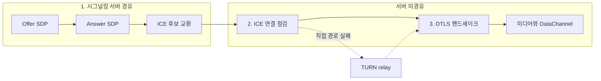

<div class="ygd-webrtc-flow" id="ygd-webrtc-flow">
<style>
.ygd-webrtc-flow{--ygd-fg:#2B2724;--ygd-muted:#5F5A54;--ygd-line:#B8B1A8;--ygd-sig:#3D7387;--ygd-p2p:#A24E12;--ygd-bg:#FDFBFA;--ygd-panel:#F3EFEA;--ygd-btn:#3D7387;--ygd-btnfg:#FFFFFF;max-width:760px;margin-left:auto;margin-right:auto;margin-top:1.5em;margin-bottom:1.5em;color:var(--ygd-fg);box-sizing:border-box}
body[data-md-color-scheme="slate"] .ygd-webrtc-flow{--ygd-fg:#F0EDE9;--ygd-muted:#B5AEA5;--ygd-line:#6B655E;--ygd-sig:#7FB9CF;--ygd-p2p:#F0A868;--ygd-bg:#1F1C1E;--ygd-panel:#2B2729;--ygd-btn:#7FB9CF;--ygd-btnfg:#1F1C1E}
.ygd-webrtc-flow *{box-sizing:border-box}
.ygd-webrtc-flow .ygd-note{font-size:14px;line-height:1.6;color:var(--ygd-muted);margin:0 0 10px 0}
.ygd-webrtc-flow .ygd-svg{display:block;width:100%;height:auto;max-width:100%}
.ygd-webrtc-flow .ygd-life{stroke:var(--ygd-line);stroke-width:1.5;stroke-dasharray:4 4}
.ygd-webrtc-flow .ygd-box{fill:var(--ygd-panel);stroke:var(--ygd-line);stroke-width:1.5}
.ygd-webrtc-flow .ygd-boxt{fill:var(--ygd-fg);font-size:13px;font-weight:600}
.ygd-webrtc-flow .ygd-row{opacity:.5;transition:opacity .3s}
.ygd-webrtc-flow .ygd-row.ygd-done{opacity:.8}
.ygd-webrtc-flow .ygd-row.ygd-on{opacity:1}
.ygd-webrtc-flow .ygd-ln{stroke-width:2;fill:none}
.ygd-webrtc-flow .ygd-on .ygd-ln{stroke-width:3;stroke-dasharray:var(--ygd-len);animation:ygd-webrtc-flow-draw .5s ease-out both}
.ygd-webrtc-flow .ygd-on .ygd-hd{animation:ygd-webrtc-flow-fade .3s both}
.ygd-webrtc-flow .ygd-sig .ygd-ln{stroke:var(--ygd-sig)}
.ygd-webrtc-flow .ygd-sig .ygd-hd,.ygd-webrtc-flow .ygd-sig .ygd-num{fill:var(--ygd-sig)}
.ygd-webrtc-flow .ygd-p2p .ygd-ln{stroke:var(--ygd-p2p)}
.ygd-webrtc-flow .ygd-p2p .ygd-hd,.ygd-webrtc-flow .ygd-p2p .ygd-num{fill:var(--ygd-p2p)}
.ygd-webrtc-flow .ygd-numt{fill:var(--ygd-bg);font-size:11px;font-weight:700}
.ygd-webrtc-flow .ygd-lb{fill:var(--ygd-fg);font-size:13px;stroke:var(--ygd-bg);stroke-width:4px;paint-order:stroke}
.ygd-webrtc-flow .ygd-ctrl{display:flex;flex-wrap:wrap;gap:8px;align-items:center;margin:10px 0}
.ygd-webrtc-flow .ygd-btn{font:inherit;font-size:14px;line-height:1.2;padding:9px 16px;min-height:40px;border:0;border-radius:6px;background:var(--ygd-btn);color:var(--ygd-btnfg);cursor:pointer}
.ygd-webrtc-flow .ygd-btn:disabled{opacity:.45;cursor:default}
.ygd-webrtc-flow .ygd-btn:focus-visible{outline:3px solid var(--ygd-p2p);outline-offset:2px}
.ygd-webrtc-flow .ygd-cnt{font-size:14px;color:var(--ygd-muted)}
.ygd-webrtc-flow .ygd-panel{background:var(--ygd-panel);border-radius:8px;padding:12px 14px;border-left:4px solid var(--ygd-sig)}
.ygd-webrtc-flow .ygd-panel.ygd-p2p{border-left-color:var(--ygd-p2p)}
.ygd-webrtc-flow .ygd-ptitle{font-size:15px;font-weight:700;margin:0 0 4px 0}
.ygd-webrtc-flow .ygd-ptext{font-size:14px;line-height:1.65;margin:0}
@keyframes ygd-webrtc-flow-draw{from{stroke-dashoffset:var(--ygd-len)}to{stroke-dashoffset:0}}
@keyframes ygd-webrtc-flow-fade{from{opacity:0}to{opacity:1}}
@media (prefers-reduced-motion:reduce){.ygd-webrtc-flow .ygd-ln,.ygd-webrtc-flow .ygd-hd{animation:none !important}.ygd-webrtc-flow .ygd-row{transition:none}}
</style>
<p class="ygd-note">비유: 시그널링 서버는 두 사람에게 서로의 연락처를 건네주는 소개자다. 연락처만 전달하고 이후 통화에는 끼지 않는다. 단 TURN 릴레이로 떨어지면 이 비유는 맞지 않는다.</p>
<svg class="ygd-svg" viewBox="0 0 480 320" role="img" aria-label="WebRTC 연결 흐름 다이어그램. A 단말과 B 단말이 시그널링 서버를 통해 Offer, Answer, ICE 후보를 교환한 뒤, 서버를 거치지 않고 연결 점검, DTLS 핸드셰이크, 미디어 전송을 직접 수행한다."></svg>
<div class="ygd-ctrl">
<button type="button" class="ygd-btn ygd-prev">이전</button>
<button type="button" class="ygd-btn ygd-play">재생</button>
<button type="button" class="ygd-btn ygd-next">다음</button>
<span class="ygd-cnt" aria-hidden="true"></span>
</div>
<div class="ygd-panel" aria-live="polite">
<p class="ygd-ptitle"></p>
<p class="ygd-ptext"></p>
</div>
<script>
(function(){
var root=document.getElementById('ygd-webrtc-flow');
if(!root)return;
var NS='http://www.w3.org/2000/svg';
var svg=root.querySelector('.ygd-svg');
var A=70,S=240,B=410;
function el(n,a,p,t){var e=document.createElementNS(NS,n);for(var k in a)e.setAttribute(k,a[k]);if(t!==undefined)e.textContent=t;if(p)p.appendChild(e);return e;}
var steps=[
{ph:'sig',t:'1단계 시그널링: Offer 전달',x:'A가 createOffer로 만든 SDP(코덱, 미디어, 암호화 조건)를 시그널링 서버로 보낸다. 서버는 내용을 해석하지 않고 B에게 그대로 전달한다.',s:[[A,S,'Offer(SDP)'],[S,B,'Offer 전달']]},
{ph:'sig',t:'2단계 시그널링: Answer 회신',x:'B는 setRemoteDescription 뒤 createAnswer로 응답을 만들어 같은 경로로 돌려보낸다. 양쪽이 쓸 코덱이 여기서 정해지며, 겹치는 코덱이 없으면 연결이 맺혀도 영상이 나오지 않는다.',s:[[B,S,'Answer(SDP)'],[S,A,'Answer 전달']]},
{ph:'sig',t:'3단계 시그널링: ICE 후보 교환',x:'host, srflx, relay 후보가 발견되는 대로 Trickle ICE로 바로 상대에게 보낸다. 후보가 Answer보다 먼저 도착하면 addIceCandidate가 에러를 내므로 큐에 모아 둔다.',s:[[A,S,'ICE 후보',1],[S,B,'ICE 후보',1]]},
{ph:'p2p',t:'4단계 ICE: 연결 점검',x:'교환한 후보로 쌍을 만들어 host, srflx, relay 우선순위로 STUN 바인딩 요청을 주고받는다. 이 구간부터는 시그널링 서버를 거치지 않으며, 통하는 쌍 중 우선순위가 가장 높은 것으로 연결된다.',s:[[A,B,'연결 점검 · 서버 미경유',1]]},
{ph:'p2p',t:'5단계 연결: DTLS 핸드셰이크',x:'선택된 경로 위에서 DTLS 핸드셰이크를 한다. 이후 DataChannel은 SCTP over DTLS로 전송된다.',s:[[A,B,'DTLS 핸드셰이크',1]]},
{ph:'p2p',t:'6단계 연결: 미디어와 DataChannel',x:'미디어는 RTP/SRTP over UDP로, 데이터는 DataChannel로 서버 없이 직접 흐른다. 다만 TURN relay 후보가 선택됐다면 이 트래픽이 전부 TURN 서버를 거친다.',s:[[A,B,'미디어 / DataChannel',1]]}
];
[[A,'A 단말'],[S,'시그널링 서버'],[B,'B 단말']].forEach(function(h){
el('line',{x1:h[0],y1:42,x2:h[0],y2:318,'class':'ygd-life'},svg);
el('rect',{x:h[0]-60,y:8,width:120,height:34,rx:6,'class':'ygd-box'},svg);
el('text',{x:h[0],y:30,'class':'ygd-boxt','text-anchor':'middle'},svg,h[1]);
});
steps.forEach(function(st,i){
var y=80+i*45;
var g=el('g',{'class':'ygd-row ygd-'+st.ph},svg);
el('circle',{cx:24,cy:y,r:10,'class':'ygd-num'},g);
el('text',{x:24,y:y+4,'class':'ygd-numt','text-anchor':'middle'},g,String(i+1));
st.s.forEach(function(sg,si){
var x1=sg[0],x2=sg[1],d=x2>x1?1:-1;
var ln=el('line',{x1:x1,y1:y,x2:x2,y2:y,'class':'ygd-ln'},g);
ln.style.setProperty('--ygd-len',String(Math.abs(x2-x1)));
ln.style.animationDelay=(si*0.5)+'s';
function head(x,dir){
var p=el('polygon',{points:x+','+y+' '+(x-dir*9)+','+(y-4.5)+' '+(x-dir*9)+','+(y+4.5),'class':'ygd-hd'},g);
p.style.animationDelay=(si*0.5+0.35)+'s';
}
head(x2,d);
if(sg[3])head(x1,-d);
el('text',{x:(x1+x2)/2,y:y-9,'class':'ygd-lb','text-anchor':'middle'},g,sg[2]);
});
st.g=g;
});
var prev=root.querySelector('.ygd-prev'),next=root.querySelector('.ygd-next'),playBtn=root.querySelector('.ygd-play');
var cnt=root.querySelector('.ygd-cnt'),panel=root.querySelector('.ygd-panel');
var ptitle=root.querySelector('.ygd-ptitle'),ptext=root.querySelector('.ygd-ptext');
var cur=0,timer=null;
function show(i){
cur=i;
steps.forEach(function(st,k){
st.g.setAttribute('class','ygd-row ygd-'+st.ph+(k===i?' ygd-on':(k<i?' ygd-done':'')));
});
ptitle.textContent=steps[i].t;
ptext.textContent=steps[i].x;
panel.setAttribute('class','ygd-panel ygd-'+steps[i].ph);
cnt.textContent=(i+1)+' / '+steps.length;
prev.disabled=i===0;
next.disabled=i===steps.length-1;
}
function stop(){
if(timer){clearInterval(timer);timer=null;}
playBtn.textContent='재생';
}
function play(){
if(cur>=steps.length-1)show(0);
playBtn.textContent='일시정지';
timer=setInterval(function(){
if(cur>=steps.length-1){stop();return;}
show(cur+1);
},2800);
}
playBtn.addEventListener('click',function(){if(timer)stop();else play();});
prev.addEventListener('click',function(){stop();if(cur>0)show(cur-1);});
next.addEventListener('click',function(){stop();if(cur<steps.length-1)show(cur+1);});
show(0);
})();
</script>
</div>

## 시그널링 서버

WebRTC 명세에는 시그널링 프로토콜이 없다. 일부러 비워뒀다. 두 단말이 SDP와 ICE 후보를 교환할 통로만 있으면 되고, 그 통로를 WebSocket으로 만들든 HTTP 폴링으로 만들든 상관없다. 보통 WebSocket으로 만든다. 양방향이고 지연이 낮아서 후보 교환에 잘 맞는다.

시그널링 서버가 하는 일은 단순하다. A가 보낸 메시지를 B에게, B가 보낸 메시지를 A에게 전달한다. 메시지 내용을 해석할 필요도 없다. 그냥 상대에게 던져주면 된다.

아래 시퀀스는 룸 단위 릴레이가 join, 메시지 전달, close 를 처리하는 순서다. 서버가 `raw` 를 해석하지 않고 같은 방의 나머지 소켓에 그대로 넘기는 점을 보면 된다.

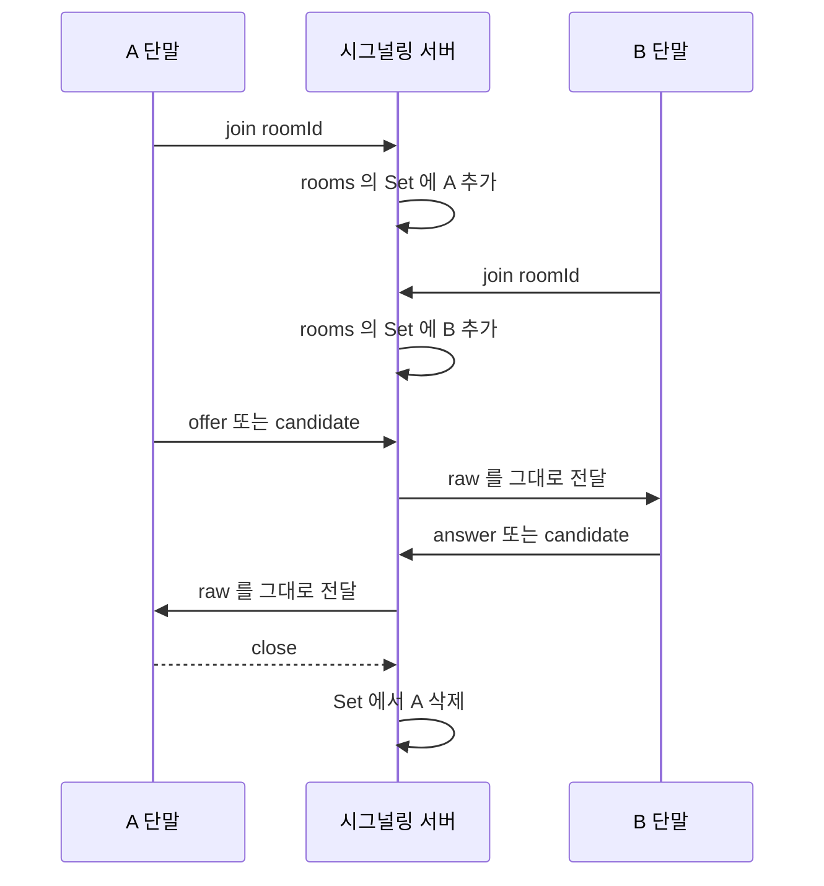

```javascript
// 시그널링 서버 (Node.js + ws) — 룸 단위 릴레이만 한다
const rooms = new Map(); // roomId -> Set<WebSocket>

wss.on('connection', (ws) => {
  let roomId = null;

  ws.on('message', (raw) => {
    const msg = JSON.parse(raw);

    if (msg.type === 'join') {
      roomId = msg.roomId;
      if (!rooms.has(roomId)) rooms.set(roomId, new Set());
      rooms.get(roomId).add(ws);
      return;
    }

    // offer / answer / candidate 는 같은 방의 다른 사람에게 그대로 전달
    const peers = rooms.get(roomId);
    if (!peers) return;
    for (const peer of peers) {
      if (peer !== ws && peer.readyState === peer.OPEN) {
        peer.send(raw);
      }
    }
  });

  ws.on('close', () => {
    if (roomId && rooms.has(roomId)) {
      rooms.get(roomId).delete(ws);
    }
  });
});
```

여기서 자주 빠뜨리는 게 연결 종료 처리다. close 이벤트에서 룸 set을 비워주지 않으면 끊긴 소켓에 계속 send를 시도하고, 룸 인원 카운트도 틀어진다. 운영하다 보면 "방을 나갔는데 상대 화면에 아직 내가 보인다"는 류의 버그가 여기서 나온다.

시그널링 서버는 연결만 맺어주면 역할이 끝나지만, 실무에서는 보통 연결 유지 동안 켜둔다. 통화 중에 한쪽 네트워크가 바뀌면(와이파이→LTE) ICE 재협상이 일어나고, 새 후보를 다시 교환해야 하기 때문이다.

## SDP 교환

SDP(Session Description Protocol)는 "내가 어떤 코덱을 쓸 수 있고, 어떤 미디어를 보낼 거고, 암호화 키는 뭐고" 같은 연결 조건을 텍스트로 적은 문서다. A가 만든 걸 Offer, B가 그에 답해서 만든 걸 Answer라고 부른다. 이 둘을 교환하면 양쪽이 공통으로 쓸 코덱과 파라미터가 정해진다.

```javascript
// A 단말 (발신)
const pc = new RTCPeerConnection({ iceServers });

const stream = await navigator.mediaDevices.getUserMedia({ video: true, audio: true });
stream.getTracks().forEach(track => pc.addTrack(track, stream));

const offer = await pc.createOffer();
await pc.setLocalDescription(offer);
signaling.send({ type: 'offer', sdp: offer.sdp });

// B 단말 (수신)
pc.ondatachannel = ... ;
signaling.on('offer', async (msg) => {
  await pc.setRemoteDescription({ type: 'offer', sdp: msg.sdp });
  const answer = await pc.createAnswer();
  await pc.setLocalDescription(answer);
  signaling.send({ type: 'answer', sdp: answer.sdp });
});

// 다시 A 단말
signaling.on('answer', async (msg) => {
  await pc.setRemoteDescription({ type: 'answer', sdp: msg.sdp });
});
```

SDP 본문은 이렇게 생겼다. 직접 파싱할 일은 거의 없지만 디버깅할 때 한 번씩 읽게 된다.

```
v=0
o=- 4611731400430051336 2 IN IP4 127.0.0.1
s=-
t=0 0
m=video 9 UDP/TLS/RTP/SAVPF 96 97
a=rtpmap:96 VP8/90000
a=rtpmap:97 H264/90000
a=candidate:1 1 udp 2122260223 192.168.0.10 54321 typ host
a=candidate:2 1 udp 1686052607 203.0.113.5 54321 typ srflx ...
```

`m=` 줄이 미디어 종류, `a=rtpmap` 이 코덱 협상 후보다. A가 VP8과 H264를 둘 다 제시했는데 B가 VP8만 지원하면 결과적으로 VP8로 합의된다. 여기서 양쪽이 겹치는 코덱이 하나도 없으면 연결은 맺혀도 영상이 안 나온다. 모바일에서 H264만 되는 단말과 데스크톱 브라우저를 붙일 때 가끔 이 문제가 난다.

순서도 중요하다. `setRemoteDescription`을 하기 전에 도착한 ICE 후보를 `addIceCandidate`로 넣으면 에러가 난다. 시그널링이 빨라서 후보가 Answer보다 먼저 도착하는 경우가 있어서, remoteDescription이 세팅되기 전 후보는 큐에 모아뒀다가 나중에 넣는 처리를 해두는 게 안전하다.

위 코드가 `signalingState`를 어떻게 움직이는지는 아래 상태도로 본다. 발신 쪽은 `have-local-offer`, 수신 쪽은 `have-remote-offer`를 거쳐 둘 다 `stable`로 돌아오고, 후보를 넣어도 되는 시점은 `setRemoteDescription` 이후다.

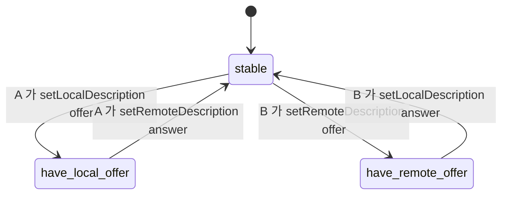

## Perfect Negotiation

위 코드는 A가 offer를 만들고 B가 answer를 만드는 고정 역할이다. 통화가 시작된 뒤에는 이 전제가 깨진다. 화면 공유를 켜거나 트랙을 추가하거나 ICE를 재시작하는 renegotiation은 양쪽 어느 쪽에서도 시작할 수 있고, 두 쪽이 거의 같은 시각에 시작하면 offer 두 개가 서로 엇갈려 지나간다. 이 상황을 glare라고 부른다.

역할 고정 코드에서 glare가 나면 어떻게 되는지 Chrome 156에서 돌려봤다. 한 페이지에 PeerConnection 두 개를 만들고, 시그널링은 30ms 지연을 넣은 메모리 전달로 대신하고, 양쪽이 같은 순간 `addTrack`을 호출했다.

- 두 쪽 모두 `have-local-offer`가 된다.
- 상대 offer가 도착하면 Chrome이 자기 offer를 암묵적으로 rollback하고 상대 offer를 적용한 뒤 answer를 만든다. 두 쪽이 똑같이 한다.
- 서로의 answer가 도착했을 때는 이미 `stable`이라 `InvalidStateError: Failed to set remote answer sdp: Called in wrong state`가 양쪽에서 터진다.
- 두 쪽 모두 `signalingState`는 `stable`인데 7초가 지나도 `connectionState`가 `connecting`에서 안 넘어간다.

에러가 났는데 상태는 `stable`이라 겉으로는 정상처럼 보인다. 로그에 `Called in wrong state`가 보이면 glare를 의심한다.

Perfect Negotiation은 충돌이 났을 때 누가 양보할지를 미리 정해두는 패턴이다. 한 쪽은 polite, 다른 쪽은 impolite로 고정한다.

| 역할 | 내 offer가 진행 중인데 상대 offer가 도착하면 |
|------|------------------------------------------|
| impolite | 상대 offer를 무시한다. 자기 offer를 끝까지 밀고 간다 |
| polite | 자기 offer를 포기하고 상대 offer를 받아들여 answer를 만든다 |

아래 도식은 두 쪽이 동시에 offer를 보냈을 때의 흐름이다. polite인 B가 양보하고, impolite인 A의 offer 하나로 협상이 끝나는 것을 보면 된다.

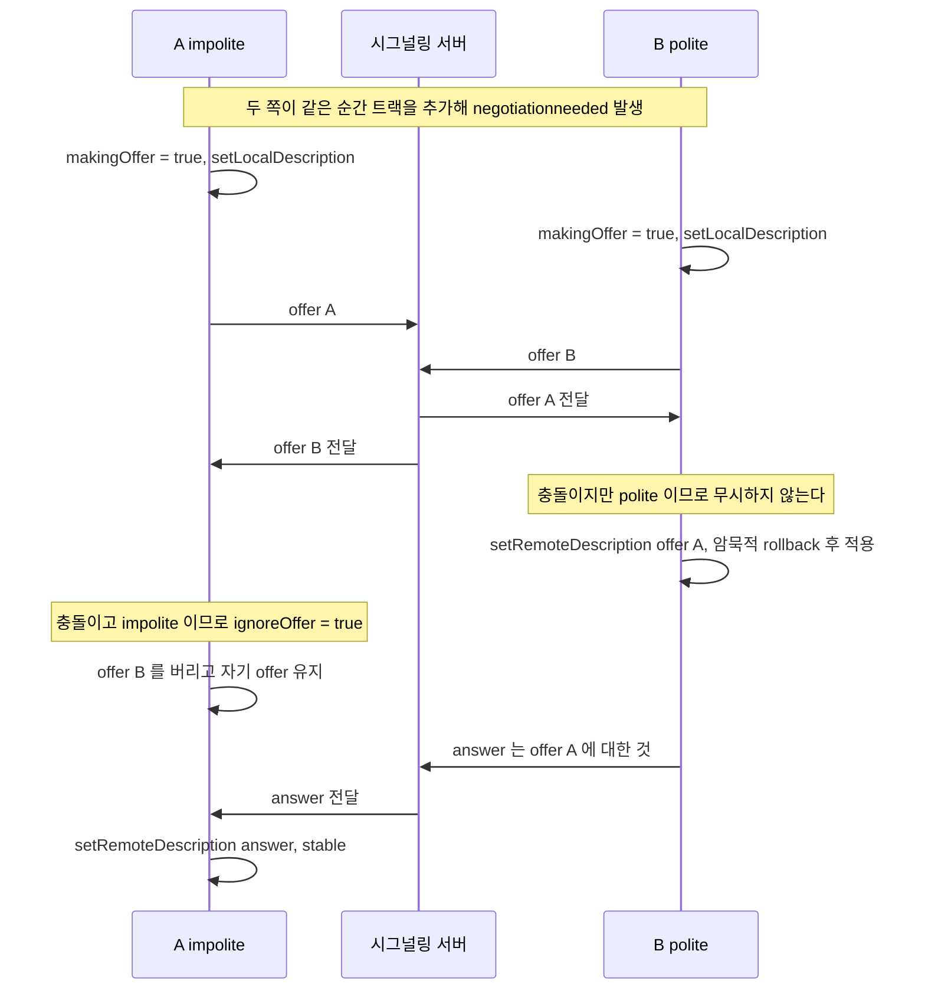

구현에는 플래그 세 개가 들어간다.

`makingOffer`는 `setLocalDescription()`이 끝나기 전 구간을 잡는다. 이 구간에는 `signalingState`가 아직 `stable`이라서 상태값만 보면 충돌을 놓친다. `isSettingRemoteAnswerPending`은 answer를 적용하는 중에 offer가 끼어드는 경우를 위한 것으로, 이 동안 `signalingState`가 잠깐 `stable`이 아닌 값으로 보여도 충돌이 아니라고 판단하게 해준다. `ignoreOffer`는 impolite 쪽이 버린 offer에 딸려 오는 ICE 후보를 `addIceCandidate`가 거부할 때, 그 에러를 삼키기 위한 표시다.

```javascript
function setupPerfectNegotiation(pc, signaling, polite) {
  let makingOffer = false;
  let ignoreOffer = false;
  let isSettingRemoteAnswerPending = false;

  pc.onnegotiationneeded = async () => {
    try {
      makingOffer = true;
      await pc.setLocalDescription();
      signaling.send({ description: pc.localDescription });
    } catch (e) {
      console.error('offer 생성 실패', e);
    } finally {
      makingOffer = false;
    }
  };

  pc.onicecandidate = ({ candidate }) => {
    if (candidate) signaling.send({ candidate });
  };

  signaling.onmessage = async ({ description, candidate }) => {
    try {
      if (description) {
        const readyForOffer =
          !makingOffer &&
          (pc.signalingState === 'stable' || isSettingRemoteAnswerPending);
        const offerCollision = description.type === 'offer' && !readyForOffer;

        ignoreOffer = !polite && offerCollision;
        if (ignoreOffer) return;

        isSettingRemoteAnswerPending = description.type === 'answer';
        await pc.setRemoteDescription(description); // polite 쪽은 여기서 암묵적 rollback
        isSettingRemoteAnswerPending = false;

        if (description.type === 'offer') {
          await pc.setLocalDescription();
          signaling.send({ description: pc.localDescription });
        }
      } else if (candidate) {
        try {
          await pc.addIceCandidate(candidate);
        } catch (e) {
          if (!ignoreOffer) throw e; // 무시한 offer 의 후보는 실패해도 정상
        }
      }
    } catch (e) {
      console.error('시그널링 처리 실패', e);
    }
  };
}
```

같은 조건(양쪽 동시 `addTrack`)에서 이 함수를 쓰면 B는 충돌을 감지하고 rollback을 거쳐 A의 offer를 받고, A는 B의 offer를 버리며, 양쪽 `connectionState`가 `connected`로 간다. 같은 종류(video)의 트랙을 양쪽에서 `addTrack`으로 추가한 경우 Chrome 156에서는 B가 자기 트랙용으로 만들어 둔 transceiver를 A의 offer가 만든 m-line에 재사용해서, 양쪽 모두 mid 0 하나만 남았다.

역할을 어떻게 나눌지가 구현보다 어렵다. 두 쪽이 같은 값을 갖도록 시그널링 서버가 정해서 내려줘야 한다. 방에 먼저 들어온 쪽을 polite로 하거나, 사용자 ID를 사전순으로 비교하는 식이면 된다. 둘 다 같은 값이 되면 다음처럼 깨진다.

| 설정 | 5초 뒤 Chrome 156 상태 |
|------|---------------------|
| 둘 다 impolite | 양쪽 `have-local-offer`에 멈춘다. 서로의 offer를 무시하고 answer를 아무도 안 보낸다 |
| 둘 다 polite | 양쪽이 서로 양보해서 역할 고정 코드와 같은 `Called in wrong state`가 난다. `connecting`에서 안 넘어간다 |

한 가지 더 걸리는 경우가 있다. A는 audio, B는 video처럼 서로 종류가 다른 m-line을 동시에 추가하면, 패턴대로 짠 코드가 Chrome 156에서 두 가지 방식으로 깨졌다.

- 새 연결에서 동시에 추가하면, B가 A의 offer를 받은 뒤 만든 두 번째 offer가 `A BUNDLE group contains a codec collision for header extension id=1`로 실패한다. 4번 돌려서 4번 모두 재현됐다. 이때 B의 video transceiver는 mid가 `null`인 채 협상되지 않고, 연결 자체는 `connected`가 된다. 연결은 붙었는데 B의 영상만 안 가는 모양이다.
- 데이터 채널이 이미 열려 있는 연결에서 동시에 추가하면 B의 `setRemoteDescription(offer)`가 `RTP extension ID reassignment not supported (collision on active MID 1`로 실패하고, B가 보낸 offer는 impolite인 A가 버려서 양쪽 transceiver가 mid 1에서 방향이 `null`인 채 멈춘다.

새 연결에서 A가 audio를 추가하고 1.5초 뒤에 B가 video를 추가하는 순차 추가는 에러가 없었다. 양쪽이 audio와 video transceiver를 같은 순서로 연결 직후에 미리 만들어 두고 이후 방향만 동시에 바꾸는 경우도 에러 없이 `stable`로 끝났다. 다만 이 경우 양쪽이 만든 transceiver가 서로 합쳐지지 않아 m-line이 4개로 늘었다. 종류가 다른 m-line을 양쪽에서 동시에 여는 화면이 있다면 이 경우를 직접 돌려봐야 한다. Chrome 156 한 버전에서만 확인했고, 원인이 명세인지 구현인지는 따져보지 않았다.

## ICE 후보 수집

ICE(Interactive Connectivity Establishment)는 "이 두 단말이 실제로 통할 수 있는 경로"를 찾는 절차다. 단말 하나가 가질 수 있는 주소는 한 개가 아니다. 사설 IP도 있고, NAT를 거친 공인 IP도 있고, 릴레이 서버 주소도 있다. 이 가능한 주소들을 후보(candidate)라고 부르고, 양쪽이 후보를 다 모아서 서로 교환한 뒤 짝을 지어가며 통하는 조합을 찾는다.

후보는 세 종류다.

| 종류 | 표기 | 의미 | 통하는 경우 |
|------|------|------|-----------|
| host | typ host | 단말의 로컬 주소 (사설 IP 포함) | 같은 LAN |
| server reflexive | typ srflx | STUN으로 알아낸 NAT 바깥 공인 주소 | 일반적인 NAT 환경 |
| relay | typ relay | TURN 서버가 대신 받아주는 주소 | NAT 통과 실패 시 |

후보는 종류마다 얻는 경로가 달라서 시간차를 두고 나온다. 아래 도식에서 host는 서버 왕복 없이 바로 나가고, srflx는 STUN 왕복이, relay는 TURN 할당이 끝나야 나가는 차이를 보면 된다.

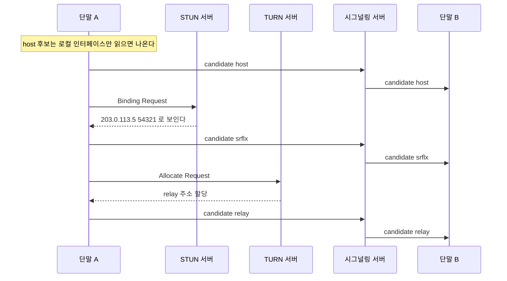

### STUN의 역할

NAT 뒤에 있는 단말은 자기 공인 IP를 모른다. 자기가 아는 건 사설 IP(예: 192.168.0.10)뿐이다. STUN 서버는 "너 지금 나한테 어떤 주소로 보이는지" 알려주는 역할만 한다. 단말이 STUN 서버에 패킷을 하나 보내면, STUN 서버는 그 패킷의 출발지 주소(즉 NAT를 거친 공인 주소)를 그대로 응답에 담아 돌려준다. 단말은 이걸로 자기 공인 주소를 알게 되고 srflx 후보로 등록한다.

STUN 서버는 가볍다. 주소만 알려주고 끝이라 트래픽을 중계하지 않는다. 구글이 공개로 운영하는 `stun.l.google.com:19302`를 테스트용으로 많이 쓴다. 다만 운영에서는 자체 STUN/TURN을 띄우는 게 맞다. 공개 STUN은 가용성 보장이 없다.

```javascript
const iceServers = [
  { urls: 'stun:stun.l.google.com:19302' },
  {
    urls: 'turn:turn.example.com:3478',
    username: 'webrtc',
    credential: 'secret',
  },
];
```

이 설정은 예제용이다. `username`과 `credential`이 JS 번들에 그대로 실려 내려가기 때문에, 운영에서는 아래 "TURN REST 임시 자격증명"으로 바꿔야 한다.

### Trickle ICE

후보를 다 모은 다음에 한꺼번에 보내면 느리다. STUN 응답을 기다리는 동안 연결이 지연된다. 그래서 후보가 하나 발견될 때마다 즉시 보내는 방식을 쓴다. 이걸 Trickle ICE라고 한다.

```javascript
pc.onicecandidate = (event) => {
  if (event.candidate) {
    // 후보 하나 발견 → 바로 시그널링으로 전송
    signaling.send({ type: 'candidate', candidate: event.candidate });
  } else {
    // event.candidate 가 null 이면 후보 수집 완료
    console.log('ICE 후보 수집 끝');
  }
};

signaling.on('candidate', async (msg) => {
  try {
    await pc.addIceCandidate(msg.candidate);
  } catch (e) {
    // remoteDescription 세팅 전이면 여기서 터진다 → 큐잉 필요
    console.error('candidate 추가 실패', e);
  }
});
```

로그를 보면 host가 먼저 깔리고 srflx, relay가 순서대로 붙는다.

### host 후보와 mDNS

로컬에서 테스트하다가 SDP의 host 후보가 IP가 아니라 이런 모양으로 나와서 당황하는 경우가 있다.

```
a=candidate:1878050736 1 udp 2113937151 2cb35fca-31c1-4dd2-8d59-45105666c0b2.local 42679 typ host generation 0
```

브라우저가 사설 IP 노출을 막으려고 host 후보의 주소를 임의 UUID에 `.local`을 붙인 mDNS 이름으로 바꿔 보낸다. 페이지가 마이크나 카메라 권한을 받지 못한 상태에서만 이렇게 숨긴다. Chrome 156에서 같은 머신으로 세 가지를 비교한 결과는 이렇다.

| 페이지 상태 | host 후보 주소 |
|-----------|--------------|
| 마이크 권한 없음 (`about:blank`, 권한 미허용 `http://localhost`) | `xxxxxxxx-....local` |
| 마이크 권한이 허용된 오리진 (`getUserMedia` 호출 전부터) | 실제 IP (`172.17.0.1`, `114.202.247.39`) |
| 허용 후 트랙을 `stop()` 한 뒤 | 실제 IP |

권한은 허용돼 있는데 `getUserMedia`를 아직 안 불러도 실제 IP가 나왔다. "스트림을 잡고 있을 때만 IP가 보인다"가 아니라 권한 상태가 기준이었다. 그래서 같은 코드가 개발자 PC(권한 허용해 둠)에서는 IP로, 처음 접속한 사용자 브라우저에서는 `.local`로 나와서 로그가 서로 안 맞는다.

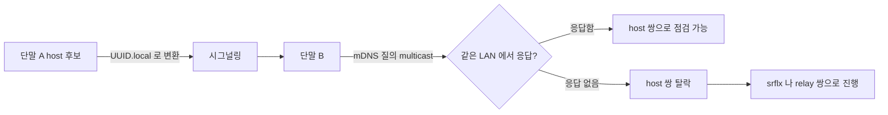

위 도식에서 갈리는 지점은 B가 `.local` 이름을 풀 수 있는지다. 같은 LAN의 브라우저끼리는 mDNS 질의에 A가 직접 답해서 host 쌍이 살아 있다. multicast가 막힌 망이거나 서로 다른 서브넷이면 이름을 못 풀어서 host 쌍이 빠지고 srflx나 relay로 넘어간다. 서버 쪽 ICE 구현(SFU 등)이 mDNS 이름을 풀지 못하는 경우에도 그 후보는 버려진다. 서버는 공인 주소로 열려 있으니 클라이언트의 srflx 후보로 붙으면 되어서 보통 연결에는 지장이 없다.

문제가 되는 건 디버깅이다. 서버 로그에 클라이언트 host IP를 남기려고 후보를 파싱하면 `.local`만 찍힌다. `RTCIceCandidate.address`도 `.local` 이름을 그대로 돌려주고, `getStats()`의 `local-candidate`는 mDNS로 숨긴 host 후보의 `address`와 `ip`를 비워서 준다(둘 다 `undefined`로 확인).

```javascript
pc.onicecandidate = ({ candidate }) => {
  if (!candidate) return;
  const masked = candidate.address?.endsWith('.local');
  logger.debug({
    type: candidate.type,
    address: masked ? '(mdns)' : candidate.address,
    port: candidate.port,
  });
};
```

실제 접속 IP가 필요하면 host 후보가 아니라 srflx나 relay 후보, 혹은 서버가 소켓에서 직접 본 원격 주소를 쓴다. 로컬 개발에서 사설 IP가 꼭 필요하면 브라우저에 권한을 허용해 두면 되지만, 사용자 환경에서는 같은 결과가 나오지 않는다는 점을 감안해서 로그 포맷을 짠다.

## NAT 통과와 TURN 릴레이

NAT 종류에 따라 STUN만으로 뚫리는 경우와 안 뚫리는 경우가 갈린다. 여기서 WebRTC 트러블슈팅의 절반이 나온다.

NAT는 동작 방식에 따라 분류되는데, 실무에서 문제 되는 건 Symmetric NAT다. Symmetric NAT는 목적지마다 다른 외부 포트를 할당한다. 즉 A가 STUN 서버에 보낼 때 쓴 공인 포트와, B에게 직접 보낼 때 쓰는 공인 포트가 다르다. STUN으로 알아낸 주소(srflx)가 B에게 보낼 때는 무효가 된다. 양쪽이 다 Symmetric NAT면 srflx 후보로는 절대 연결이 안 된다.

```
일반 NAT (Cone):
  A → STUN  : 공인주소 = 203.0.113.5:54321
  A → B     : 공인주소 = 203.0.113.5:54321  (같음 → srflx 통함)

Symmetric NAT:
  A → STUN  : 공인주소 = 203.0.113.5:54321
  A → B     : 공인주소 = 203.0.113.5:60000  (다름 → srflx 무효)
  → 직접 연결 불가, TURN 릴레이로 떨어짐
```

양쪽 NAT 조합에 따라 어떤 후보로 연결이 끝나는지는 아래 도식으로 정리된다. Symmetric NAT가 한쪽이라도 끼면 srflx 가 막히는 갈림길을 보면 된다.

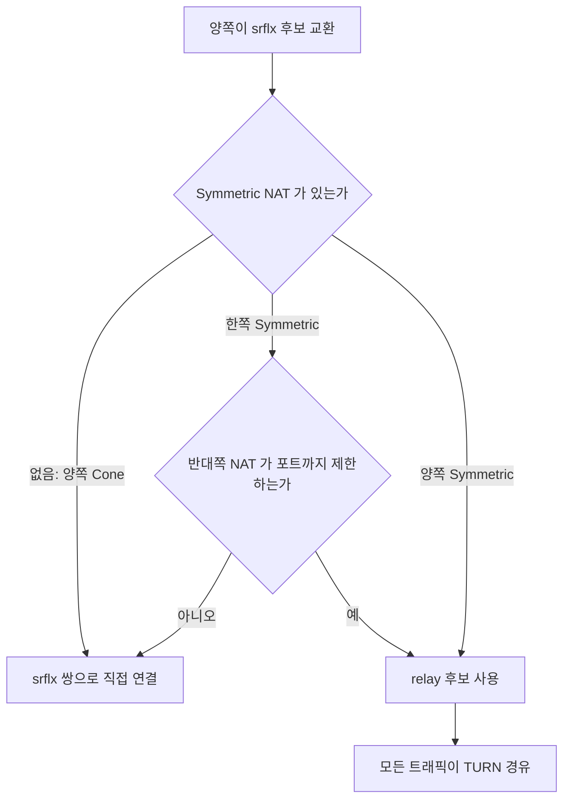

이때 쓰는 게 TURN(Traversal Using Relays around NAT)이다. TURN 서버는 양쪽 단말의 트래픽을 대신 받아서 상대에게 넘겨준다. 직접 연결이 아니라 서버를 한 번 거치는 중계다. 직접 연결이 안 되는 환경에서도 통신이 되게 해주는 마지막 수단이다.

```
직접 연결 실패 시 TURN 릴레이:

  A ──▶ TURN 서버 ──▶ B
  A ◀── TURN 서버 ◀── B

  미디어/데이터가 전부 TURN을 경유한다.
  → P2P의 장점(서버 부하 안 늘어남)이 사라진다.
```

TURN으로 떨어지면 그 통화의 모든 트래픽이 TURN 서버 대역폭을 먹는다. 화상 통화 한 건이 수 Mbps인데 이게 전부 서버를 지난다. 그래서 TURN 서버는 STUN과 달리 트래픽 비용이 크고, 공개 무료 TURN이 거의 없는 이유도 이거다. 운영에서는 coturn을 직접 띄우거나 Twilio 같은 유료 TURN을 쓴다.

직접 연결과 TURN 릴레이의 경로 차이를 아래 도식으로 비교한다. TURN 쪽은 서버를 한 번 더 지나므로 서버 대역폭이 통화 수에 비례해 늘어난다.

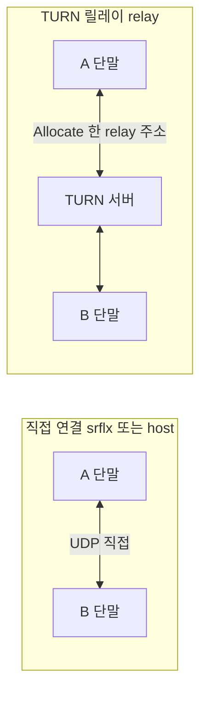

```bash
# coturn 최소 설정 (/etc/turnserver.conf)
listening-port=3478
tls-listening-port=5349
fingerprint
lt-cred-mech
user=webrtc:secret
realm=turn.example.com
# 방화벽 환경 대응 — 뒤에서 설명
listening-ip=0.0.0.0
external-ip=203.0.113.50
```

전체 통화 중 TURN으로 떨어지는 비율은 환경에 따라 다르다. 일반 가정용 인터넷끼리는 대부분 직접 연결이 되지만, 기업 네트워크나 모바일 캐리어 NAT가 끼면 비율이 확 올라간다. 운영 모니터링에서 "TURN relay 비율"을 지표로 잡아두면, 갑자기 이 비율이 튈 때 네트워크 쪽 문제를 빨리 잡을 수 있다.

<div class="ygd-nat-types" id="ygd-nat-types">
<style>
.ygd-nat-types{--ygd-fg:#2B2724;--ygd-muted:#5F5A54;--ygd-line:#B8B1A8;--ygd-sig:#3D7387;--ygd-p2p:#A24E12;--ygd-bad:#B3261E;--ygd-turn:#6B4E9B;--ygd-bg:#FDFBFA;--ygd-panel:#F3EFEA;--ygd-btn:#3D7387;--ygd-btnfg:#FFFFFF;max-width:760px;margin-left:auto;margin-right:auto;margin-top:1.5em;margin-bottom:1.5em;color:var(--ygd-fg);box-sizing:border-box}
body[data-md-color-scheme="slate"] .ygd-nat-types{--ygd-fg:#F0EDE9;--ygd-muted:#B5AEA5;--ygd-line:#6B655E;--ygd-sig:#7FB9CF;--ygd-p2p:#F0A868;--ygd-bad:#FF9A94;--ygd-turn:#C4A8F0;--ygd-bg:#1F1C1E;--ygd-panel:#2B2729;--ygd-btn:#7FB9CF;--ygd-btnfg:#1F1C1E}
.ygd-nat-types *{box-sizing:border-box}
.ygd-nat-types .ygd-note{font-size:14px;line-height:1.6;color:var(--ygd-muted);margin:0 0 10px 0}
.ygd-nat-types .ygd-svg{display:block;width:100%;height:auto;max-width:100%}
.ygd-nat-types .ygd-wire{stroke:var(--ygd-line);stroke-width:2}
.ygd-nat-types .ygd-box{fill:var(--ygd-panel);stroke:var(--ygd-line);stroke-width:1.5}
.ygd-nat-types .ygd-boxt{fill:var(--ygd-fg);font-size:13px;font-weight:600}
.ygd-nat-types .ygd-grp{opacity:.5;transition:opacity .3s}
.ygd-nat-types .ygd-grp.ygd-done{opacity:.8}
.ygd-nat-types .ygd-grp.ygd-on{opacity:1}
.ygd-nat-types .ygd-hide{display:none}
.ygd-nat-types .ygd-ln{fill:none;stroke-width:2}
.ygd-nat-types .ygd-on .ygd-ln{stroke-width:3;stroke-dasharray:var(--ygd-len);animation:ygd-nat-types-draw .5s ease-out both}
.ygd-nat-types .ygd-on .ygd-hd{animation:ygd-nat-types-fade .3s both}
.ygd-nat-types .ygd-stun .ygd-ln{stroke:var(--ygd-sig)}
.ygd-nat-types .ygd-stun .ygd-hd{fill:var(--ygd-sig)}
.ygd-nat-types .ygd-direct .ygd-ln{stroke:var(--ygd-p2p)}
.ygd-nat-types .ygd-direct .ygd-hd{fill:var(--ygd-p2p)}
.ygd-nat-types .ygd-turn .ygd-ln{stroke:var(--ygd-turn)}
.ygd-nat-types .ygd-turn .ygd-hd{fill:var(--ygd-turn)}
.ygd-nat-types .ygd-bad .ygd-ln{stroke:var(--ygd-bad);stroke-dasharray:6 4;animation:none}
.ygd-nat-types .ygd-bad .ygd-hd{fill:var(--ygd-bad)}
.ygd-nat-types .ygd-bad .ygd-lbbad{fill:var(--ygd-bad)}
.ygd-nat-types .ygd-lb{fill:var(--ygd-fg);font-size:12px;stroke:var(--ygd-bg);stroke-width:4px;paint-order:stroke}
.ygd-nat-types .ygd-ctrl{display:flex;flex-wrap:wrap;gap:8px;align-items:center;margin:10px 0}
.ygd-nat-types .ygd-btn{font:inherit;font-size:14px;line-height:1.2;padding:9px 14px;min-height:40px;border:2px solid var(--ygd-btn);border-radius:6px;background:transparent;color:var(--ygd-fg);cursor:pointer}
.ygd-nat-types .ygd-btn.ygd-act{background:var(--ygd-btn);color:var(--ygd-btnfg)}
.ygd-nat-types .ygd-btn:disabled{opacity:.45;cursor:default}
.ygd-nat-types .ygd-btn:focus-visible{outline:3px solid var(--ygd-p2p);outline-offset:2px}
.ygd-nat-types .ygd-cnt{font-size:14px;color:var(--ygd-muted)}
.ygd-nat-types .ygd-panel{background:var(--ygd-panel);border-radius:8px;padding:12px 14px;border-left:4px solid var(--ygd-sig)}
.ygd-nat-types .ygd-ptitle{font-size:15px;font-weight:700;margin:0 0 4px 0}
.ygd-nat-types .ygd-ptext{font-size:14px;line-height:1.65;margin:0}
@keyframes ygd-nat-types-draw{from{stroke-dashoffset:var(--ygd-len)}to{stroke-dashoffset:0}}
@keyframes ygd-nat-types-fade{from{opacity:0}to{opacity:1}}
@media (prefers-reduced-motion:reduce){.ygd-nat-types .ygd-ln,.ygd-nat-types .ygd-hd{animation:none !important}.ygd-nat-types .ygd-grp{transition:none}}
</style>
<p class="ygd-note">비유: NAT는 건물 안내 데스크와 비슷하다. 밖에서는 대표번호만 보이는데, Cone 방식은 어느 상대와 통화하든 같은 내선을 쓰고, Symmetric 방식은 상대마다 다른 내선을 배정한다. 아래 버튼으로 두 경우를 바꿔 본다.</p>
<div class="ygd-ctrl" role="group" aria-label="NAT 종류 선택">
<button type="button" class="ygd-btn ygd-act ygd-sc-cone" aria-pressed="true">일반 NAT (Cone)</button>
<button type="button" class="ygd-btn ygd-sc-sym" aria-pressed="false">Symmetric NAT</button>
</div>
<svg class="ygd-svg" viewBox="0 0 480 302" role="img" aria-label="NAT 종류별 연결 경로 다이어그램. A 단말은 NAT 뒤에서 STUN 서버로 공인 주소를 확인한 뒤 B 단말로 직접 보낸다. Cone NAT에서는 같은 공인 포트라 직접 연결되고, Symmetric NAT에서는 포트가 달라져 TURN 서버를 거치는 릴레이로 떨어진다."></svg>
<div class="ygd-ctrl">
<button type="button" class="ygd-btn ygd-prev">이전</button>
<button type="button" class="ygd-btn ygd-play">재생</button>
<button type="button" class="ygd-btn ygd-next">다음</button>
<span class="ygd-cnt" aria-hidden="true"></span>
</div>
<div class="ygd-panel" aria-live="polite">
<p class="ygd-ptitle"></p>
<p class="ygd-ptext"></p>
</div>
<script>
(function(){
var root=document.getElementById('ygd-nat-types');
if(!root)return;
var NS='http://www.w3.org/2000/svg';
var svg=root.querySelector('.ygd-svg');
function el(n,a,p,t){var e=document.createElementNS(NS,n);for(var k in a)e.setAttribute(k,a[k]);if(t!==undefined)e.textContent=t;if(p)p.appendChild(e);return e;}
function box(x,y,w,h,s){el('rect',{x:x,y:y,width:w,height:h,rx:6,'class':'ygd-box'},svg);el('text',{x:x+w/2,y:y+h/2+4,'class':'ygd-boxt','text-anchor':'middle'},svg,s);}
el('line',{x1:100,y1:145,x2:140,y2:145,'class':'ygd-wire'},svg);
box(10,125,90,40,'A 단말');
box(140,125,90,40,'NAT');
box(370,125,100,40,'B 단말');
box(370,20,100,40,'STUN 서버');
var G={};
['stun','direct','turn'].forEach(function(k){G[k]=el('g',{'class':'ygd-grp ygd-'+k},svg);});
function ln(g,d,len,delay){var p=el('path',{d:d,'class':'ygd-ln'},g);p.style.setProperty('--ygd-len',String(len));p.style.animationDelay=delay+'s';}
function hd(g,pts,delay){var p=el('polygon',{points:pts,'class':'ygd-hd'},g);p.style.animationDelay=delay+'s';}
function lb(g,x,y,s,c){return el('text',{x:x,y:y,'class':'ygd-lb'+(c?' '+c:''),'text-anchor':'middle'},g,s);}
ln(G.stun,'M185 125 L185 40 L370 40',270,0);
hd(G.stun,'370,40 361,35.5 361,44.5',0.35);
ln(G.stun,'M370 58 L201 58 L201 125',236,0.5);
hd(G.stun,'201,125 196.5,116 205.5,116',0.85);
lb(G.stun,277,31,'STUN 요청');
lb(G.stun,285,78,'응답: 203.0.113.5:54321');
ln(G.direct,'M230 145 L370 145',140,0);
hd(G.direct,'370,145 361,140.5 361,149.5',0.35);
lb(G.direct,300,134,'A→B 직접 시도');
var d2=lb(G.direct,300,161,'');
var d3=lb(G.direct,300,184,'','ygd-lbbad');
el('rect',{x:250,y:235,width:100,height:40,rx:6,'class':'ygd-box'},G.turn);
el('text',{x:300,y:259,'class':'ygd-boxt','text-anchor':'middle'},G.turn,'TURN 서버');
ln(G.turn,'M185 165 L185 255 L250 255',155,0);
hd(G.turn,'250,255 241,250.5 241,259.5',0.35);
ln(G.turn,'M350 255 L420 255 L420 165',160,0.5);
hd(G.turn,'420,165 415.5,174 424.5,174',0.85);
lb(G.turn,300,295,'전부 TURN 경유');
var SC={
cone:[
{on:'stun',t:'일반 NAT: STUN으로 공인 주소 확인',x:'A가 STUN 서버에 패킷을 보내면 서버는 출발지 주소를 응답에 담아 돌려준다. A는 203.0.113.5:54321을 srflx 후보로 등록하고 시그널링으로 B에게 보낸다.'},
{on:'direct',t:'B에게 보낼 때도 같은 공인 포트',x:'A가 B에게 보낼 때 쓰는 공인 주소도 203.0.113.5:54321로 같다. STUN으로 알아낸 srflx 후보가 B에게도 유효해서 직접 연결이 된다.'}
],
sym:[
{on:'stun',t:'Symmetric NAT: STUN으로 공인 주소 확인',x:'여기까지는 일반 NAT와 같다. STUN 서버는 A가 STUN으로 보낼 때의 공인 주소 203.0.113.5:54321을 알려준다.'},
{on:'direct',t:'B에게 보낼 때는 다른 공인 포트',x:'Symmetric NAT는 목적지마다 다른 외부 포트를 할당한다. A가 B에게 보내면 203.0.113.5:60000이 되어, STUN으로 알아낸 srflx 후보가 무효가 된다.'},
{on:'turn',t:'TURN 릴레이로 전환',x:'직접 연결이 안 되면 TURN 서버가 양쪽 트래픽을 대신 받아 넘겨준다. 통신은 되지만 모든 트래픽이 TURN 대역폭을 먹어 P2P의 장점이 사라진다. 양쪽이 다 Symmetric NAT면 srflx 후보로는 절대 연결되지 않는다.'}
]};
var bCone=root.querySelector('.ygd-sc-cone'),bSym=root.querySelector('.ygd-sc-sym');
var prev=root.querySelector('.ygd-prev'),next=root.querySelector('.ygd-next'),playBtn=root.querySelector('.ygd-play');
var cnt=root.querySelector('.ygd-cnt'),ptitle=root.querySelector('.ygd-ptitle'),ptext=root.querySelector('.ygd-ptext');
var sc='cone',cur=0,timer=null;
function show(i){
cur=i;
var steps=SC[sc];
['stun','direct','turn'].forEach(function(k){
var idx=-1;
steps.forEach(function(s,n){if(s.on===k&&idx<0)idx=n;});
var c='ygd-grp ygd-'+k;
if(idx<0)c+=' ygd-hide';
else if(idx===i)c+=' ygd-on';
else if(idx<i)c+=' ygd-done';
if(k==='direct'&&sc==='sym'&&i>=1)c+=' ygd-bad';
G[k].setAttribute('class',c);
});
d2.textContent='공인 포트 :'+(sc==='cone'?'54321':'60000');
d3.textContent=sc==='cone'?'STUN과 같은 포트 → 유효':'STUN과 다른 포트 → 무효';
ptitle.textContent=steps[i].t;
ptext.textContent=steps[i].x;
cnt.textContent=(i+1)+' / '+steps.length;
prev.disabled=i===0;
next.disabled=i===steps.length-1;
}
function stop(){if(timer){clearInterval(timer);timer=null;}playBtn.textContent='재생';}
function play(){
if(cur>=SC[sc].length-1)show(0);
playBtn.textContent='일시정지';
timer=setInterval(function(){
if(cur>=SC[sc].length-1){stop();return;}
show(cur+1);
},2800);
}
function pick(s){
stop();sc=s;
bCone.classList.toggle('ygd-act',s==='cone');
bSym.classList.toggle('ygd-act',s==='sym');
bCone.setAttribute('aria-pressed',String(s==='cone'));
bSym.setAttribute('aria-pressed',String(s==='sym'));
show(0);
}
bCone.addEventListener('click',function(){pick('cone');});
bSym.addEventListener('click',function(){pick('sym');});
playBtn.addEventListener('click',function(){if(timer)stop();else play();});
prev.addEventListener('click',function(){stop();if(cur>0)show(cur-1);});
next.addEventListener('click',function(){stop();if(cur<SC[sc].length-1)show(cur+1);});
show(0);
})();
</script>
</div>

### TURN REST 임시 자격증명

위의 `user=webrtc:secret` 같은 정적 계정은 클라이언트 코드에 박아 넣는 순간 문제가 된다. 브라우저에 내려간 `iceServers`는 개발자 도구에서 그대로 보이고, 한 번 유출되면 누구든 그 계정으로 TURN에 allocation을 만들어 우리 서버 대역폭으로 임의의 UDP 트래픽을 중계할 수 있다. 오픈 릴레이가 되는 것이다. 계정을 바꾸려면 모든 클라이언트를 다시 배포해야 하고, 그동안은 막을 방법이 없다.

coturn의 `use-auth-secret`은 이 문제를 서버와 앱 서버가 비밀값 하나를 공유하는 방식으로 푼다. 앱 서버가 사용자마다 만료 시각이 들어간 계정을 그때그때 계산해서 내려주고, TURN 서버는 같은 비밀값으로 서명을 다시 계산해 대조한다. TURN 서버에 사용자 DB가 필요 없다.

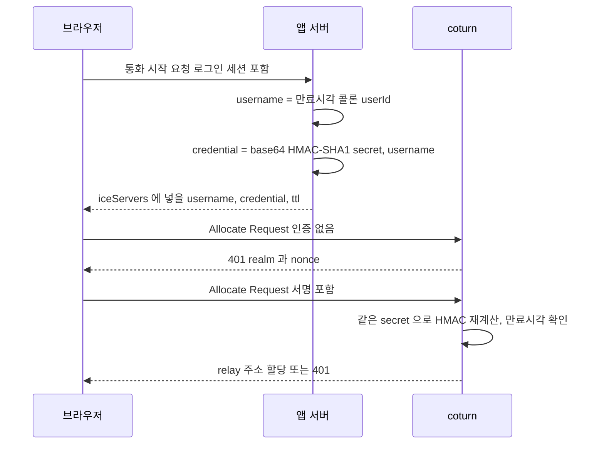

도식에서 비밀값은 앱 서버와 coturn 사이에만 있고 브라우저에는 서명 결과만 간다는 점을 보면 된다. 브라우저가 받은 값은 `ttl`이 지나면 쓸 수 없다.

```bash
# /etc/turnserver.conf — user= 줄은 두지 않는다
use-auth-secret
static-auth-secret=<앱 서버와 같은 값>
realm=turn.example.com
fingerprint
no-cli
```

```javascript
const crypto = require('crypto');

// coturn: use-auth-secret + static-auth-secret 과 같은 값을 쓴다
function turnCredential(userId, secret, ttlSec = 3600) {
  const expiresAt = Math.floor(Date.now() / 1000) + ttlSec;
  const username = `${expiresAt}:${userId}`;
  const credential = crypto
    .createHmac('sha1', secret)
    .update(username)
    .digest('base64');
  return { username, credential, ttl: ttlSec };
}
```

`username`은 `만료시각:사용자ID` 모양이고, `credential`은 이 문자열 전체에 대한 HMAC-SHA1을 base64로 인코딩한 값이다. 위 함수가 만든 값을 `openssl dgst -sha1 -hmac <secret> -binary | base64`로 따로 계산한 결과와 대조했을 때 일치했다.

coturn 4.5.2에 붙여서 relay 전용(`iceTransportPolicy: 'relay'`)으로 확인한 결과는 이렇다.

| 자격증명 | 결과 |
|---------|------|
| 만료 1시간 뒤, `만료시각:alice` | relay 후보 생성, 선택된 쌍 relay/relay, `connected` |
| 만료 시각이 60초 전 | `onicecandidateerror` 401, 후보 0개 |
| 비밀번호 틀림 | 401, 후보 0개 |
| `alice:만료시각` 순서 | 이 버전에서는 통과. HMAC 대상이 문자열 전체라 순서와 무관하게 서명은 맞는다 |

순서가 바뀐 계정이 통과한 건 이 버전의 동작이다. 다른 버전이나 다른 TURN 구현을 믿고 순서를 바꾸지 말고 `만료시각:사용자ID`로 고정한다.

운영에서 걸리는 건 통화가 `ttl`보다 길어지는 경우다. 만료된 자격증명으로는 새 allocation을 못 만든다. 통화 중에 네트워크가 바뀌어 ICE restart를 하면 새 allocation이 필요한데, 그 시점에 자격증명이 만료돼 있으면 401이 나고 relay 후보가 하나도 안 생긴다. 만료된 자격증명으로 만든 연결에서 `setConfiguration()`으로 새 `iceServers`를 넣고 `restartIce()`를 부르면 relay 후보가 다시 생기는 것을 확인했다. 이미 만들어 둔 allocation이 `ttl` 이후에 갱신되는지는 확인하지 않았다.

```javascript
// 통화가 ttl 의 절반쯤 지났을 때 앱 서버에서 새 자격증명을 받아 교체한다
async function refreshTurn(pc) {
  const { iceServers } = await fetch('/api/turn-credential').then((r) => r.json());
  pc.setConfiguration({ ...pc.getConfiguration(), iceServers });
}
```

TURN 서버가 내부망으로 향하는 통로가 되는 것도 막아야 한다. 클라이언트가 임의의 peer 주소로 relay를 요청할 수 있어서, 허용 범위를 두지 않으면 TURN 서버를 거쳐 내부 서비스에 UDP를 보낼 수 있는 구성이 된다. coturn에는 `denied-peer-ip`(예: `10.0.0.0-10.255.255.255`), `user-quota`, `total-quota` 옵션이 있다. 사용자 한 명이 allocation을 무한정 만들지 못하도록 quota도 같이 건다. 이 구성의 악용 경로는 직접 재현해 보지 않았고, 옵션 이름만 `turnserver -h`로 확인했다.

### ICE 후보 짝짓기

후보를 다 교환하면 ICE는 가능한 모든 조합을 만들어서 우선순위 순으로 연결을 시도한다. 우선순위는 host > srflx > relay 순이다. 직접 연결이 가장 좋고, 릴레이가 가장 비싸니까 마지막이다.

아래 도식은 후보 교환이 끝난 뒤 selected pair가 정해지기까지의 판단 흐름이다. 점검은 우선순위 내림차순으로 하고, 성공한 쌍을 valid list에 모은 뒤 controlling 쪽(offer를 낸 쪽이 기본)이 하나를 nominate하는 구조다.

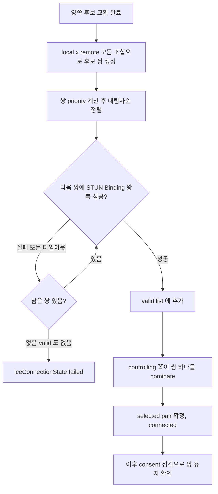

우선순위는 후보 하나에 매겨지는 값에서 출발한다. 후보 priority는 `2^24 * 타입 선호도 + 2^8 * 로컬 선호도 + (256 - 컴포넌트)`이고, RFC 8445가 권하는 타입 선호도는 host 126, srflx 100, relay 0이다. 쌍 priority는 controlling 쪽 후보 G와 controlled 쪽 후보 D로 `2^32 * min(G,D) + 2 * max(G,D) + (G > D ? 1 : 0)`을 계산한다. 작은 쪽 후보가 쌍 순위를 지배하기 때문에, 한쪽이 relay면 상대가 host여도 쌍은 낮은 순위로 내려간다.

```javascript
// 후보 priority = 2^24 * 타입선호도 + 2^8 * 로컬선호도 + (256 - 컴포넌트)
function candidatePriority(typePref, localPref, component = 1) {
  return (typePref << 24) + (localPref << 8) + (256 - component);
}
// 쌍 priority: G = controlling 쪽, D = controlled 쪽 후보 priority
function pairPriority(G, D) {
  G = BigInt(G); D = BigInt(D);
  const min = G < D ? G : D;
  const max = G > D ? G : D;
  return (1n << 32n) * min + 2n * max + (G > D ? 1n : 0n);
}
```

Chrome 156이 낸 값으로 대조하면 host 후보 priority `2113937151`은 `candidatePriority(126, 30)`과 같고, srflx 후보 `1677729535`는 `candidatePriority(100, 30)`과 같다. 로컬 선호도는 브라우저가 인터페이스마다 매기는 값이라 30이나 40처럼 다르게 나온다. 쌍 priority는 `getStats()`의 `candidate-pair.priority`로 읽을 수 있는데, 이 값은 JS Number(double)라서 2^53을 넘는다. 위 함수로 계산한 `7205793487713746430`과 stats가 준 `7205793487713746000`은 `Number(계산값)`으로 바꿔야 같아진다. `===`로 BigInt와 비교하면 항상 다르다고 나온다.

순서대로 점검한다고 해서 결과를 추측하면 틀린다. 같은 머신에서 STUN 서버 없이 돌리면 host/host가 선택됐고, 같은 머신에 STUN을 켜고 돌리니 srflx/srflx가 선택된 적도 있었다. 어떤 쌍으로 붙었는지는 반드시 아래 "어디서 막히는지 확인하는 법"의 방식으로 읽는다.

### ICE 연결 상태와 consent freshness

각 쌍에 대해 STUN 바인딩 요청을 주고받아서 실제로 통하는지 확인한다. 이 과정이 `iceConnectionState`로 노출된다. 상태 전이와 앱이 해야 하는 일을 한 장에 정리하면 이렇다.

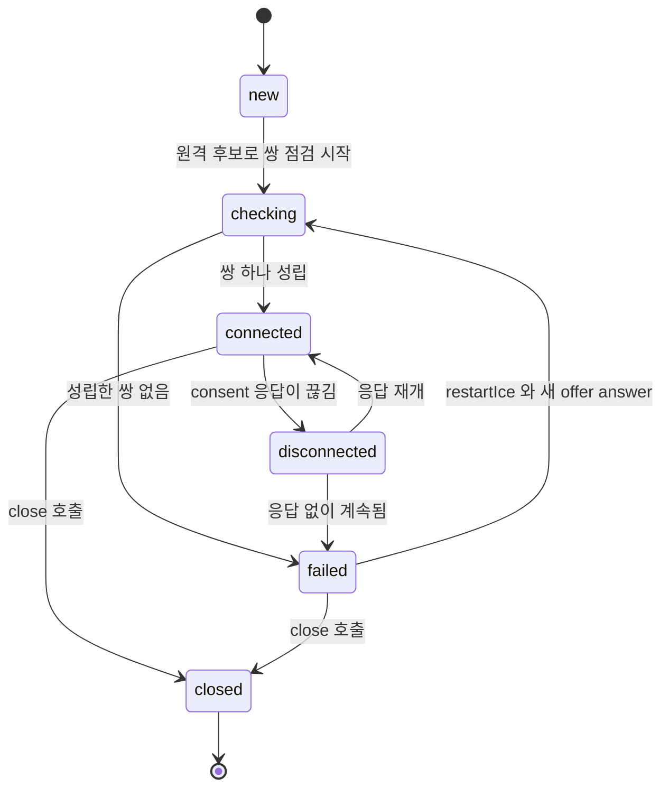

| 상태 | 앱이 할 일 |
|------|-----------|
| `checking` | 화면에 연결 중을 보여 준다. 오래 걸리면 TURN 설정과 방화벽부터 본다 |
| `connected` | `getStats()`로 selected pair 타입을 기록해 둔다 (relay 비율 지표) |
| `disconnected` | 바로 끊지 않는다. 몇 초 유예를 두고 안 돌아오면 `restartIce()` |
| `failed` | `restartIce()`로 재협상. 시그널링 연결이 살아 있는지도 같이 본다 |
| `closed` | 리소스 정리. `pc.close()` 이후에는 되돌릴 수 없다 |

`completed`는 도식에서 뺐다. 명세에는 모든 후보 점검이 끝났을 때 `connected` 다음에 오는 상태로 있지만, Chrome 156으로 연결을 만들어 보면 `checking`, `connected`까지만 나오고 `completed`는 한 번도 안 나왔다. `=== 'completed'`를 연결 성공 조건으로 쓰면 영원히 대기하는 코드가 된다. 연결 성공은 `connected`로 판단한다.

`connected`에서 `disconnected`로 넘어가는 기준이 consent freshness다. 연결이 맺힌 뒤에도 ICE는 selected pair로 STUN 바인딩 요청을 계속 보내고, 응답이 오는 동안만 "상대가 아직 이 트래픽을 받아 줄 의사가 있다"고 본다. RFC 7675는 이 점검을 5초 안팎 간격으로 하고 30초 동안 유효한 응답이 없으면 consent가 만료되어 전송을 멈춘다고 정한다. 상대가 사라졌는데 미디어를 계속 쏘는 일, 그리고 공격자가 제3자 주소로 트래픽을 쏟아붓게 하는 일을 막으려는 장치다. NAT 바인딩이 만료되지 않게 붙들어 두는 효과도 있다.

실제 구현은 명세 숫자와 다르다. Chrome 156에서 잰 값은 이렇다.

| 측정 | 결과 |
|------|------|
| 정상 연결 중 `consentRequestsSent` 증가 | 24초 동안 2, 5, 7, 9, 12로 늘었다. 약 2.5초 간격 |
| 연결된 상태에서 TURN 서버 프로세스를 `SIGSTOP`으로 멈춤 (relay 전용 연결) | 약 5초 뒤 `iceConnectionState`와 `connectionState`가 `disconnected` |
| 같은 상태가 계속될 때 | `disconnected`로부터 10초 뒤 `connectionState`만 `failed`. `iceConnectionState`는 50초 시점에도 `disconnected` |
| 50초 뒤 `SIGCONT`로 서버 재개 | 재개 직후 재시작 없이 `iceConnectionState`가 `connected`, `connectionState`도 `disconnected`를 거쳐 `connected`로 복귀 |
| 한 쪽 `pc.close()` 후 상대 | 약 6초 뒤 `disconnected`, 그로부터 10초 뒤 `connectionState`가 `failed` |

명세의 5초 간격, 30초 만료와 측정값이 서로 다르다. 어느 구현이든 "연결 직후 몇 초 안에 끊김을 감지하고, 십수 초 뒤 failed로 본다"는 모양은 같지만 정확한 초는 브라우저와 버전이 정한다. 타임아웃을 앱 로직에 박을 때는 이 숫자들을 쓰지 말고 `disconnected`, `failed` 이벤트에 반응하게 만든다. 또 `connectionState`가 `failed`가 된 뒤에도 네트워크가 돌아오면 Chrome이 스스로 복구한 사례가 위에 있다. `failed`를 보고 곧바로 `pc.close()`를 부르면 살릴 수 있던 연결을 버린다.

### ICE restart

Wi-Fi에서 LTE로 넘어가면 단말의 IP가 바뀌므로 기존 후보 쌍은 더 못 쓴다. 이때 `disconnected`나 `failed`가 뜨고, 새 주소로 후보를 다시 모아 짝을 지어야 한다. 이 절차가 ICE restart다. offer를 `iceRestart: true`로 만들면 SDP의 `a=ice-ufrag`와 `a=ice-pwd`가 새 값으로 바뀌고, 받은 쪽은 자격증명이 바뀐 것을 보고 후보 수집과 점검을 처음부터 다시 한다.

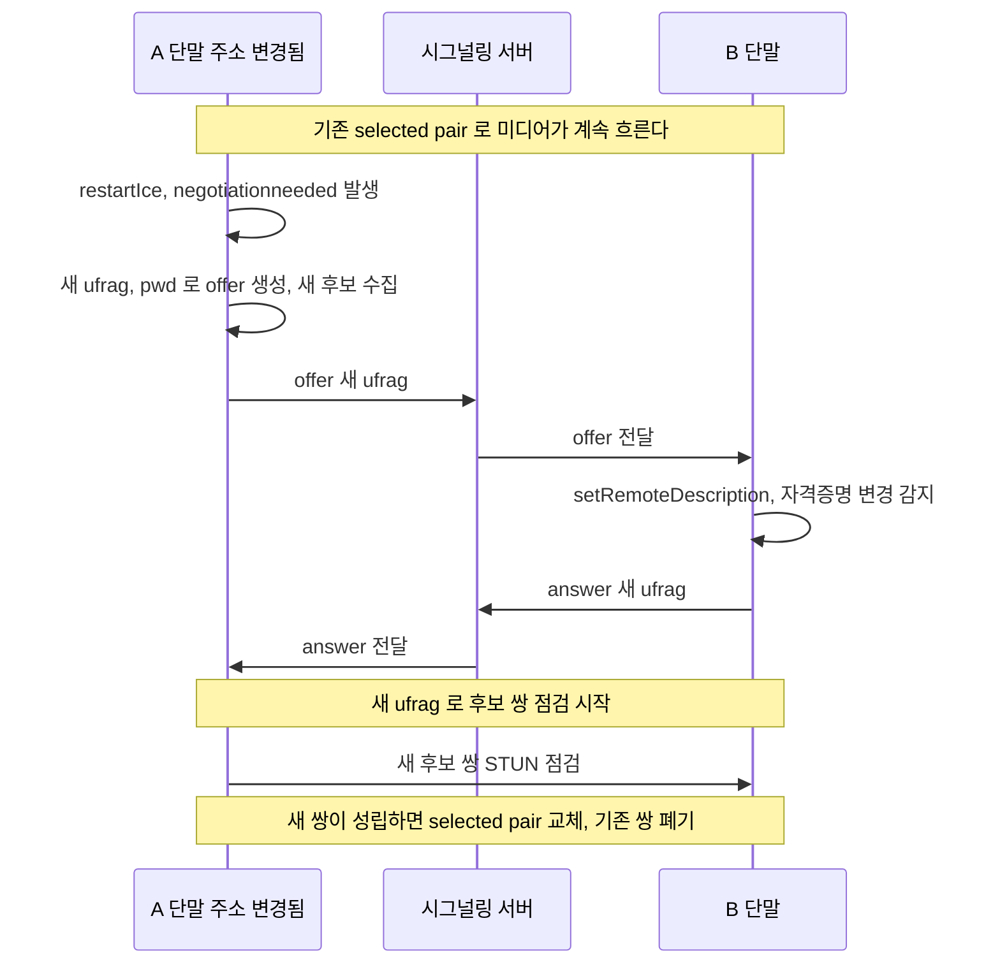

도식에서 눈여겨볼 곳은 맨 위 Note다. restart를 시작해도 기존 쌍을 곧바로 버리지 않는다. Chrome 156에서 restart offer를 `setLocalDescription`한 직후, answer를 받기 전에 `getStats()`로 확인하면 selected pair의 ID, 로컬 포트, ufrag가 그대로였고(`CP5wH98MHQ_amnsvRAo`, 43948, `Ddq6`), answer를 적용하고 나서야 새 쌍(`CPzpc2011N_nIRuQRA/`, 32797, `Xl6o`)으로 바뀌고 `selectedCandidatePairChanges`가 1에서 2가 됐다. restart를 시작하고 1.5초 동안 DataChannel로 계속 보낸 34개도 전부 수신됐다. 루프백에서는 restart가 순식간에 끝나서 이 숫자만으로는 근거가 약하고, 위의 selected pair 비교가 실제 근거다. 미디어가 안 끊기는 건 새 쌍이 성립하기 전까지 기존 쌍이 계속 쓰이기 때문이다. 단말 주소가 이미 바뀌어서 기존 쌍이 죽어 있다면 이 이점은 없고, 새 쌍이 성립할 때까지 끊김이 그대로 사용자에게 보인다.

restart 도중 `iceConnectionState`가 `checking`으로 떨어지는지는 상황에 따라 다르다. 루프백 테스트에서는 restart를 해도 `connected`에서 이벤트가 하나도 안 왔다. `failed`에서 restart했을 때 `checking`으로 돌아가는 전이는 명세 기준이고 직접 재현하지는 못했다(`failed`를 만들려면 응답 없는 후보를 써야 하는데, 60초를 기다려도 Chrome이 `new`에서 움직이지 않았다).

restart를 만드는 방법은 두 가지다. `createOffer({ iceRestart: true })`를 직접 부르는 방법은 상태를 신경 써야 한다. 이미 `have-local-offer`일 때 부르면 충돌하고, 만든 offer를 못 보내면 `pendingLocalDescription`에 새 ufrag가 남은 채로 있다. Chrome 156에서 restart offer를 만든 뒤 rollback하고 평범한 `createOffer()`를 다시 부르면 ufrag는 이전 값으로 돌아왔다. 즉 만든 쪽이 롤백하면 restart는 취소된다. `pc.restartIce()`는 다음 offer를 restart로 바꾸라는 표시만 하고 `negotiationneeded`를 발생시키므로, 위 Perfect Negotiation의 핸들러가 `setLocalDescription()`으로 offer를 만들어 보낸다. 두 쪽이 동시에 `restartIce()`를 불러도 충돌 처리가 같이 돈다. 양쪽 동시 호출을 relay 전용 연결에서 돌렸을 때 양쪽 ufrag가 모두 바뀌었고 `stable/stable`, `connected/connected`로 끝났다.

```javascript
function watchConnection(pc, { graceMs = 3000 } = {}) {
  let timer = null;

  pc.addEventListener('connectionstatechange', () => {
    clearTimeout(timer);
    if (pc.connectionState === 'disconnected') {
      // 잠깐 끊긴 경우 스스로 복구되는 일이 많다. 유예를 두고 그래도 안 돌아오면 재시작
      timer = setTimeout(() => pc.restartIce(), graceMs);
    } else if (pc.connectionState === 'failed') {
      pc.restartIce();
    }
  });
}
```

이 코드에서 놓치기 쉬운 건 시그널링 소켓이다. 네트워크가 바뀌면 WebSocket도 같이 끊기는 경우가 많아서, `restartIce()`로 offer를 만들어도 보낼 길이 없다. offer를 큐에 쌓아 두었다가 시그널링이 다시 붙은 뒤에 보내도록 `signaling.send`를 만들어 둬야 한다. 통화가 TURN `ttl`보다 길어졌다면 위 TURN REST 절에서 본 대로 새 자격증명으로 `setConfiguration()`을 먼저 해야 relay 후보가 생긴다.

### 세 가지 상태는 따로 움직인다

`RTCPeerConnection`에는 상태 속성이 세 개 있고, 서로 다른 계층을 본다. 이름이 비슷해서 하나로 뭉쳐 쓰다가 장애 원인을 놓치는 일이 많다.

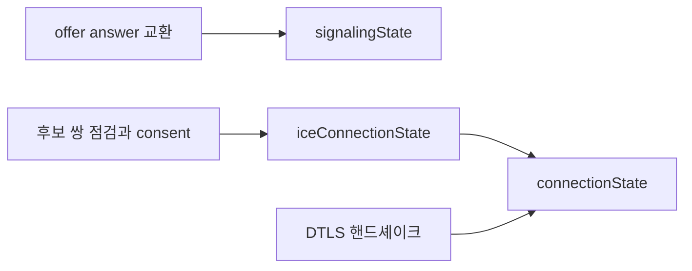

`signalingState`는 SDP 교환 절차의 위치(`stable`, `have-local-offer`, `have-remote-offer` 등)만 알려 주고 네트워크는 보지 않는다. `iceConnectionState`는 ICE 쌍 점검의 결과다. `connectionState`는 ICE와 DTLS 상태를 합친 값이라서, ICE가 붙었어도 DTLS가 실패하면 `failed`가 된다. Chrome 156에서 상황별로 찍어 본 값은 이렇다.

| 상황 | `signalingState` | `iceConnectionState` | `connectionState` |
|------|------------------|----------------------|-------------------|
| 정상 연결 | `have-local-offer` → `stable` | `checking` → `connected` | `connecting` → `connected` |
| answer의 DTLS fingerprint를 틀리게 바꿈 | `stable` | `connected` | `connecting` → `failed` |
| 상대가 응답을 멈춤 (TURN 서버를 `SIGSTOP`) | `stable` | `connected` → `disconnected` (50초 뒤에도 유지) | `connected` → `disconnected` → `failed` |
| 양쪽이 동시에 offer (glare), polite 쪽 | `have-local-offer` → (rollback) `stable` → `have-remote-offer` → `stable` | 협상이 끝나야 `checking` | `new` → `connecting` |
| 둘 다 impolite로 설정 | `have-local-offer`에서 멈춤 | `new` | `new` |

정상 연결에서 두 이벤트의 순서는 보장되지 않는다. 같은 코드를 여러 번 돌렸더니 `ice checking`, `conn connecting`, `ice connected` 순서도 나오고 `ice checking`, `ice connected`, `conn connecting` 순서도 나왔다. 이벤트 순서에 의존하는 코드를 쓰지 않는다.

두 번째 행이 운영에서 헷갈리는 사례다. `iceConnectionState`만 보고 "연결됨"으로 표시했는데 영상이 안 오고, `getStats()`를 보면 transport의 `dtlsState`가 `failed`이다. SDP를 중간에서 바꾸는 프록시나 시그널링 구현이 fingerprint 줄을 건드린 경우에 이 모양이 난다. 연결 상태 UI는 `connectionState`를 기준으로 하고, `iceConnectionState`는 ICE 쪽 원인을 좁힐 때 보조로 쓴다.

```javascript
function logStates(pc, label) {
  const dump = () =>
    console.log(label, {
      signaling: pc.signalingState,
      ice: pc.iceConnectionState,
      connection: pc.connectionState,
    });
  pc.addEventListener('signalingstatechange', dump);
  pc.addEventListener('iceconnectionstatechange', dump);
  pc.addEventListener('connectionstatechange', dump);
}
```

## DataChannel과 미디어 채널

WebRTC로 보낼 수 있는 건 두 가지다. 카메라/마이크 같은 미디어 트랙과, 임의의 데이터를 보내는 DataChannel이다. 둘은 전송 방식이 다르다.

| 구분 | 미디어 채널 | DataChannel |
|------|-----------|-------------|
| 전송 | RTP/SRTP over UDP | SCTP over DTLS |
| 신뢰성 | 비신뢰 (손실 허용) | 신뢰/비신뢰 선택 가능 |
| 순서 보장 | 없음 | 선택 가능 |
| 용도 | 영상, 음성 | 채팅, 파일, 게임 상태, 시그널 |

미디어는 실시간성이 신뢰성보다 중요하다. 영상 프레임 하나 손실됐다고 재전송 기다리면 화면이 멈춘다. 그래서 미디어는 UDP 위에서 손실을 허용하고 그냥 다음 프레임으로 넘어간다.

DataChannel은 TCP처럼 신뢰성 있게 보낼 수도 있고, UDP처럼 손실을 허용하게 설정할 수도 있다. 게임에서 위치 동기화처럼 "최신 값만 중요하고 옛날 패킷은 버려도 되는" 데이터는 비신뢰/비순서로 설정하는 게 낫다.

데이터 성격에 따라 채널 옵션이 갈리는 모양은 아래 도식과 같다. 손실 허용 여부가 먼저 갈리고, 그다음 순서 보장 여부를 본다.

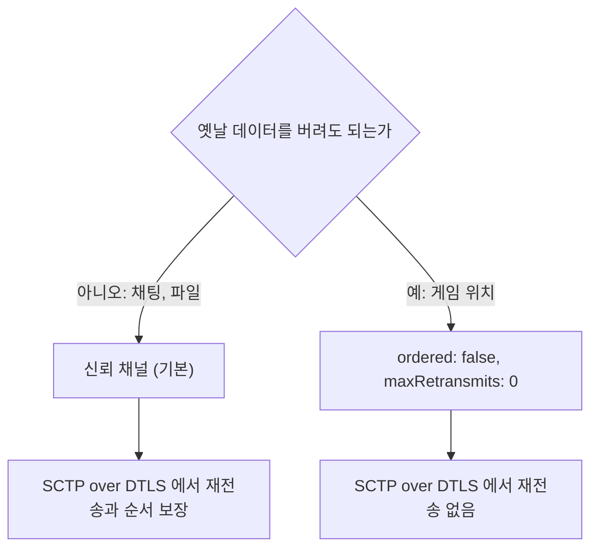

```javascript
// 신뢰성 있는 채널 (기본) — 채팅, 파일 전송
const chatChannel = pc.createDataChannel('chat');

// 비신뢰 채널 — 게임 위치 동기화 같은 거
const gameChannel = pc.createDataChannel('game', {
  ordered: false,        // 순서 보장 안 함
  maxRetransmits: 0,     // 재전송 안 함 (손실 허용)
});

chatChannel.onopen = () => chatChannel.send('연결됨');
chatChannel.onmessage = (e) => console.log('받음:', e.data);

// 수신 쪽
pc.ondatachannel = (event) => {
  const channel = event.channel;
  channel.onmessage = (e) => console.log(channel.label, e.data);
};
```

DataChannel만 쓰는 경우도 많다. 미디어 없이 P2P 데이터만 주고받는 멀티플레이 게임이나, 서버 부하 없이 파일을 직접 전송하는 경우다. 이때도 NAT 통과 과정은 미디어와 똑같다. STUN/TURN/ICE를 거쳐야 채널이 열린다. DataChannel은 서버 안 거치니 공짜라고 생각하기 쉬운데, TURN으로 떨어지면 데이터도 릴레이를 타서 똑같이 서버 대역폭을 먹는다.

한 가지 주의할 점은 DataChannel의 메시지 크기 제한이다. 큰 파일을 한 번에 send하면 버퍼가 넘쳐서 채널이 끊긴다. 보통 16KB 정도로 잘라서 보내고, `bufferedAmount`를 보면서 흐름을 조절해야 한다.

아래 도식은 이 흐름 제어 루프다. 버퍼가 임계값을 넘으면 `send`를 멈추고 비워질 때까지 기다리는 지점을 보면 된다.

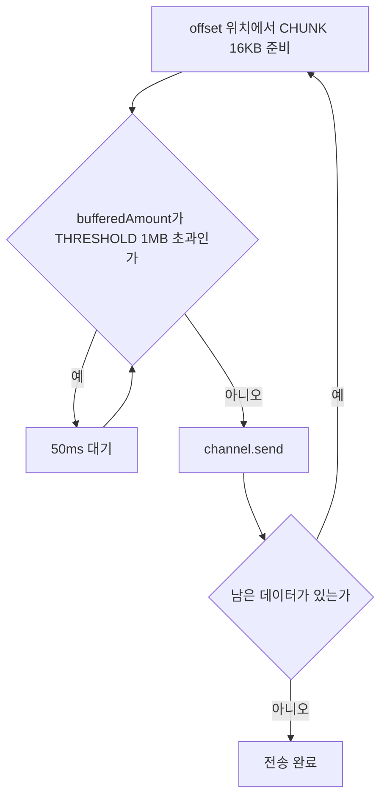

```javascript
const CHUNK = 16 * 1024;
const THRESHOLD = 1 * 1024 * 1024; // 1MB 넘으면 잠깐 멈춤

async function sendFile(channel, buffer) {
  for (let offset = 0; offset < buffer.byteLength; offset += CHUNK) {
    // 버퍼가 차면 비워질 때까지 대기
    while (channel.bufferedAmount > THRESHOLD) {
      await new Promise(r => setTimeout(r, 50));
    }
    channel.send(buffer.slice(offset, offset + CHUNK));
  }
}
```

## 방화벽 환경 트러블슈팅

로컬에서는 잘 되던 WebRTC가 회사 망이나 특정 고객사 환경에서 연결이 안 되는 일이 흔하다. 원인은 대부분 방화벽이 UDP를 막거나 특정 포트를 차단하는 데 있다. 순서대로 확인할 항목을 정리한다.

### UDP 차단

WebRTC 미디어는 기본적으로 UDP를 쓴다. 그런데 기업 방화벽은 보안상 UDP를 통째로 막아둔 곳이 많다. 이러면 STUN도 안 되고(STUN도 UDP), 미디어도 못 흐른다. 이때는 TURN을 TCP로, 더 나아가 TLS(443 포트)로 돌리는 설정이 필요하다.

```javascript
const iceServers = [
  { urls: 'stun:turn.example.com:3478' },
  // UDP TURN
  { urls: 'turn:turn.example.com:3478', username: 'u', credential: 'p' },
  // TCP TURN — UDP 막힌 환경
  { urls: 'turn:turn.example.com:3478?transport=tcp', username: 'u', credential: 'p' },
  // TLS TURN — 443 으로 위장, 거의 모든 방화벽 통과
  { urls: 'turns:turn.example.com:443?transport=tcp', username: 'u', credential: 'p' },
];
```

`turns:` (s가 붙은 것)는 TLS 위의 TURN이다. 443 포트로 돌리면 HTTPS 트래픽과 구분이 안 돼서 웬만한 방화벽은 통과시킨다. 연결이 도저히 안 되는 빡빡한 환경에서 마지막 카드로 쓴다. 단 모든 트래픽이 TURN을 경유하므로 가장 느리고 서버 부하가 크다.

위 `iceServers` 목록의 후보가 방화벽을 만났을 때 어디서 갈라지는지 아래 도식으로 본다. 왼쪽에서 오른쪽으로 갈수록 통과율은 높아지고 비용도 커진다.

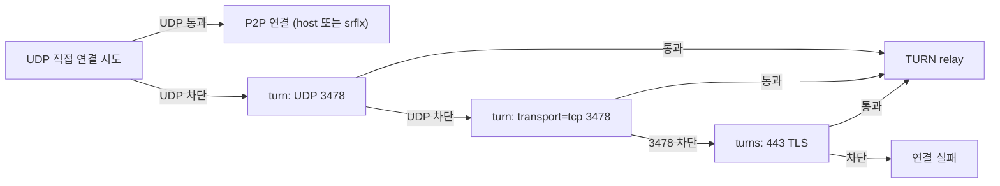

<div class="ygd-fw-turn" id="ygd-fw-turn">
<style>
.ygd-fw-turn{--ygd-fg:#2B2724;--ygd-muted:#5F5A54;--ygd-line:#B8B1A8;--ygd-sig:#3D7387;--ygd-p2p:#A24E12;--ygd-bad:#B3261E;--ygd-ok:#1E7A46;--ygd-bg:#FDFBFA;--ygd-panel:#F3EFEA;--ygd-btn:#3D7387;--ygd-btnfg:#FFFFFF;max-width:760px;margin-left:auto;margin-right:auto;margin-top:1.5em;margin-bottom:1.5em;color:var(--ygd-fg);box-sizing:border-box}
body[data-md-color-scheme="slate"] .ygd-fw-turn{--ygd-fg:#F0EDE9;--ygd-muted:#B5AEA5;--ygd-line:#6B655E;--ygd-sig:#7FB9CF;--ygd-p2p:#F0A868;--ygd-bad:#FF9A94;--ygd-ok:#7FD6A0;--ygd-bg:#1F1C1E;--ygd-panel:#2B2729;--ygd-btn:#7FB9CF;--ygd-btnfg:#1F1C1E}
.ygd-fw-turn *{box-sizing:border-box}
.ygd-fw-turn .ygd-note{font-size:14px;line-height:1.6;color:var(--ygd-muted);margin:0 0 10px 0}
.ygd-fw-turn .ygd-svg{display:block;width:100%;height:auto;max-width:100%}
.ygd-fw-turn .ygd-box{fill:var(--ygd-panel);stroke:var(--ygd-line);stroke-width:1.5}
.ygd-fw-turn .ygd-wall{fill:var(--ygd-panel);stroke:var(--ygd-bad);stroke-width:1.5}
.ygd-fw-turn .ygd-boxt{fill:var(--ygd-fg);font-size:13px;font-weight:600}
.ygd-fw-turn .ygd-lane{opacity:.5;transition:opacity .3s}
.ygd-fw-turn .ygd-lane.ygd-done{opacity:.8}
.ygd-fw-turn .ygd-lane.ygd-on{opacity:1}
.ygd-fw-turn .ygd-ln{fill:none;stroke:var(--ygd-sig);stroke-width:2}
.ygd-fw-turn .ygd-hd{fill:var(--ygd-sig)}
.ygd-fw-turn .ygd-on .ygd-ln{stroke-width:3;stroke-dasharray:var(--ygd-len);animation:ygd-fw-turn-draw .5s ease-out both}
.ygd-fw-turn .ygd-on .ygd-hd,.ygd-fw-turn .ygd-on .ygd-mk{animation:ygd-fw-turn-fade .3s .45s both}
.ygd-fw-turn .ygd-blk .ygd-r{stroke:var(--ygd-bad);stroke-dasharray:6 4;animation:none}
.ygd-fw-turn .ygd-blk .ygd-hd{fill:var(--ygd-bad)}
.ygd-fw-turn .ygd-mk{font-size:15px;font-weight:700;stroke:var(--ygd-panel);stroke-width:3px;paint-order:stroke}
.ygd-fw-turn .ygd-mk-ok{fill:var(--ygd-ok)}
.ygd-fw-turn .ygd-mk-no{fill:var(--ygd-bad)}
.ygd-fw-turn .ygd-lb{fill:var(--ygd-fg);font-size:12px;stroke:var(--ygd-bg);stroke-width:4px;paint-order:stroke}
.ygd-fw-turn .ygd-wl{fill:var(--ygd-bad);font-size:12px;font-weight:600}
.ygd-fw-turn .ygd-ctrl{display:flex;flex-wrap:wrap;gap:8px;align-items:center;margin:10px 0}
.ygd-fw-turn .ygd-btn{font:inherit;font-size:14px;line-height:1.2;padding:9px 14px;min-height:40px;border:2px solid var(--ygd-btn);border-radius:6px;background:transparent;color:var(--ygd-fg);cursor:pointer}
.ygd-fw-turn .ygd-btn.ygd-act{background:var(--ygd-btn);color:var(--ygd-btnfg)}
.ygd-fw-turn .ygd-btn:disabled{opacity:.45;cursor:default}
.ygd-fw-turn .ygd-btn:focus-visible{outline:3px solid var(--ygd-p2p);outline-offset:2px}
.ygd-fw-turn .ygd-cnt{font-size:14px;color:var(--ygd-muted)}
.ygd-fw-turn .ygd-panel{background:var(--ygd-panel);border-radius:8px;padding:12px 14px;border-left:4px solid var(--ygd-sig)}
.ygd-fw-turn .ygd-panel.ygd-blk{border-left-color:var(--ygd-bad)}
.ygd-fw-turn .ygd-panel.ygd-pass{border-left-color:var(--ygd-ok)}
.ygd-fw-turn .ygd-ptitle{font-size:15px;font-weight:700;margin:0 0 4px 0}
.ygd-fw-turn .ygd-ptext{font-size:14px;line-height:1.65;margin:0}
@keyframes ygd-fw-turn-draw{from{stroke-dashoffset:var(--ygd-len)}to{stroke-dashoffset:0}}
@keyframes ygd-fw-turn-fade{from{opacity:0}to{opacity:1}}
@media (prefers-reduced-motion:reduce){.ygd-fw-turn .ygd-ln,.ygd-fw-turn .ygd-hd,.ygd-fw-turn .ygd-mk{animation:none !important}.ygd-fw-turn .ygd-lane{transition:none}}
</style>
<p class="ygd-note">비유: 출입구가 여러 개인 건물에서 보안 검색대가 일부 출입구만 막고, 일반 방문객이 쓰는 정문(443)은 열어 두는 것과 비슷하다. 방화벽 정책을 고른 뒤 세 가지 TURN 후보가 어떻게 되는지 본다.</p>
<div class="ygd-ctrl" role="group" aria-label="방화벽 정책 선택">
<button type="button" class="ygd-btn ygd-act ygd-sc-a" aria-pressed="true">UDP만 차단</button>
<button type="button" class="ygd-btn ygd-sc-b" aria-pressed="false">UDP와 3478 차단</button>
</div>
<svg class="ygd-svg" viewBox="0 0 480 262" role="img" aria-label="방화벽 환경별 TURN 후보 통과 여부 다이어그램. 단말에서 TURN 서버로 가는 UDP 3478, TCP 3478, TLS 443 세 경로가 방화벽 정책에 따라 막히거나 통과한다."></svg>
<div class="ygd-ctrl">
<button type="button" class="ygd-btn ygd-prev">이전</button>
<button type="button" class="ygd-btn ygd-play">재생</button>
<button type="button" class="ygd-btn ygd-next">다음</button>
<span class="ygd-cnt" aria-hidden="true"></span>
</div>
<div class="ygd-panel" aria-live="polite">
<p class="ygd-ptitle"></p>
<p class="ygd-ptext"></p>
</div>
<script>
(function(){
var root=document.getElementById('ygd-fw-turn');
if(!root)return;
var NS='http://www.w3.org/2000/svg';
var svg=root.querySelector('.ygd-svg');
function el(n,a,p,t){var e=document.createElementNS(NS,n);for(var k in a)e.setAttribute(k,a[k]);if(t!==undefined)e.textContent=t;if(p)p.appendChild(e);return e;}
el('rect',{x:10,y:50,width:70,height:200,rx:6,'class':'ygd-box'},svg);
el('text',{x:45,y:154,'class':'ygd-boxt','text-anchor':'middle'},svg,'A 단말');
el('rect',{x:370,y:50,width:100,height:200,rx:6,'class':'ygd-box'},svg);
el('text',{x:420,y:154,'class':'ygd-boxt','text-anchor':'middle'},svg,'TURN 서버');
el('rect',{x:190,y:50,width:20,height:200,rx:4,'class':'ygd-wall'},svg);
el('text',{x:200,y:36,'class':'ygd-wl','text-anchor':'middle'},svg,'방화벽');
var LANES=[
{y:90,l:'UDP · 3478',r:'turn: (UDP)'},
{y:150,l:'TCP · 3478',r:'turn: ?transport=tcp'},
{y:210,l:'TLS · 443',r:'turns: ?transport=tcp'}
];
LANES.forEach(function(ln){
var g=el('g',{'class':'ygd-lane'},svg);
var a=el('path',{d:'M80 '+ln.y+' L190 '+ln.y,'class':'ygd-ln ygd-l'},g);
a.style.setProperty('--ygd-len','110');
el('polygon',{points:'190,'+ln.y+' 181,'+(ln.y-4.5)+' 181,'+(ln.y+4.5),'class':'ygd-hd'},g);
var b=el('path',{d:'M210 '+ln.y+' L370 '+ln.y,'class':'ygd-ln ygd-r'},g);
b.style.setProperty('--ygd-len','160');
b.style.animationDelay='0.4s';
el('polygon',{points:'370,'+ln.y+' 361,'+(ln.y-4.5)+' 361,'+(ln.y+4.5),'class':'ygd-hd'},g);
el('text',{x:135,y:ln.y-9,'class':'ygd-lb','text-anchor':'middle'},g,ln.l);
el('text',{x:290,y:ln.y-9,'class':'ygd-lb','text-anchor':'middle'},g,ln.r);
ln.mk=el('text',{x:200,y:ln.y+5,'class':'ygd-mk','text-anchor':'middle'},g,'');
ln.g=g;
});
var SC={
a:[
{ok:0,t:'UDP TURN (3478): 차단',x:'UDP를 통째로 막은 방화벽에서는 STUN도 UDP라 동작하지 않고, 미디어도 UDP라 흐르지 못한다. 이 후보는 통과하지 못한다.'},
{ok:1,t:'TCP TURN (3478): 통과',x:'TURN을 TCP로 돌리면 UDP만 막은 방화벽은 지나간다. 이 경로로 TURN 릴레이가 성립한다.'},
{ok:1,t:'TLS TURN (443): 통과',x:'turns:는 TLS 위의 TURN이라 443 포트에서 HTTPS 트래픽과 구분되지 않는다. 다만 모든 트래픽이 TURN을 경유하므로 가장 느리고 서버 부하가 크다.'}
],
b:[
{ok:0,t:'UDP TURN (3478): 차단',x:'UDP가 막혀 있으므로 이 후보는 통과하지 못한다. STUN 바인딩도 UDP라 같이 막힌다.'},
{ok:0,t:'TCP TURN (3478): 차단',x:'방화벽이 3478 포트까지 막았다면 TCP로 바꿔도 소용없다. 특정 고객사에서만 연결이 안 되는 경우가 이런 모양이다.'},
{ok:1,t:'TLS TURN (443): 통과',x:'turns:443으로 바꿔서 연결이 되면 방화벽이 원인이라는 게 확정된다. 빡빡한 환경의 마지막 카드지만 모든 트래픽이 TURN을 경유한다.'}
]};
var bA=root.querySelector('.ygd-sc-a'),bB=root.querySelector('.ygd-sc-b');
var prev=root.querySelector('.ygd-prev'),next=root.querySelector('.ygd-next'),playBtn=root.querySelector('.ygd-play');
var cnt=root.querySelector('.ygd-cnt'),panel=root.querySelector('.ygd-panel');
var ptitle=root.querySelector('.ygd-ptitle'),ptext=root.querySelector('.ygd-ptext');
var sc='a',cur=0,timer=null;
function show(i){
cur=i;
var steps=SC[sc];
LANES.forEach(function(ln,k){
var c='ygd-lane';
if(k===i)c+=' ygd-on';else if(k<i)c+=' ygd-done';
if(k<=i&&!steps[k].ok)c+=' ygd-blk';
ln.g.setAttribute('class',c);
ln.mk.setAttribute('class','ygd-mk '+(steps[k].ok?'ygd-mk-ok':'ygd-mk-no'));
ln.mk.textContent=k<=i?(steps[k].ok?'\u2713':'\u2715'):'';
});
ptitle.textContent=steps[i].t;
ptext.textContent=steps[i].x;
panel.setAttribute('class','ygd-panel '+(steps[i].ok?'ygd-pass':'ygd-blk'));
cnt.textContent=(i+1)+' / '+steps.length;
prev.disabled=i===0;
next.disabled=i===steps.length-1;
}
function stop(){if(timer){clearInterval(timer);timer=null;}playBtn.textContent='재생';}
function play(){
if(cur>=2)show(0);
playBtn.textContent='일시정지';
timer=setInterval(function(){
if(cur>=2){stop();return;}
show(cur+1);
},2800);
}
function pick(s){
stop();sc=s;
bA.classList.toggle('ygd-act',s==='a');
bB.classList.toggle('ygd-act',s==='b');
bA.setAttribute('aria-pressed',String(s==='a'));
bB.setAttribute('aria-pressed',String(s==='b'));
show(0);
}
bA.addEventListener('click',function(){pick('a');});
bB.addEventListener('click',function(){pick('b');});
playBtn.addEventListener('click',function(){if(timer)stop();else play();});
prev.addEventListener('click',function(){stop();if(cur>0)show(cur-1);});
next.addEventListener('click',function(){stop();if(cur<2)show(cur+1);});
show(0);
})();
</script>
</div>

### bundle과 rtcp-mux가 포트를 줄이는 방식

SDP에서 `a=group:BUNDLE 0 1 2` 줄과 각 m-line의 `a=rtcp-mux`가 쓰는 포트 개수를 정한다. `rtcp-mux`는 RTP와 RTCP를 한 포트로 합친다. 과거에는 RTCP가 RTP 포트 바로 다음 번호를 따로 썼다. `BUNDLE`은 여기서 한 걸음 더 나가 오디오, 비디오, DataChannel처럼 m-line이 여럿이어도 ICE와 DTLS를 한 번만 하고 같은 5-tuple(프로토콜, 양쪽 IP와 포트)에 모두 싣는다.

video, audio, DataChannel 세 m-line을 가진 연결을 Chrome 156에서 만들고 `getStats()`로 transport 수와 로컬 포트를 셌다. 두 번째는 offer SDP에서 `a=group:BUNDLE` 줄만 지우고 같은 연결을 맺은 것이다.

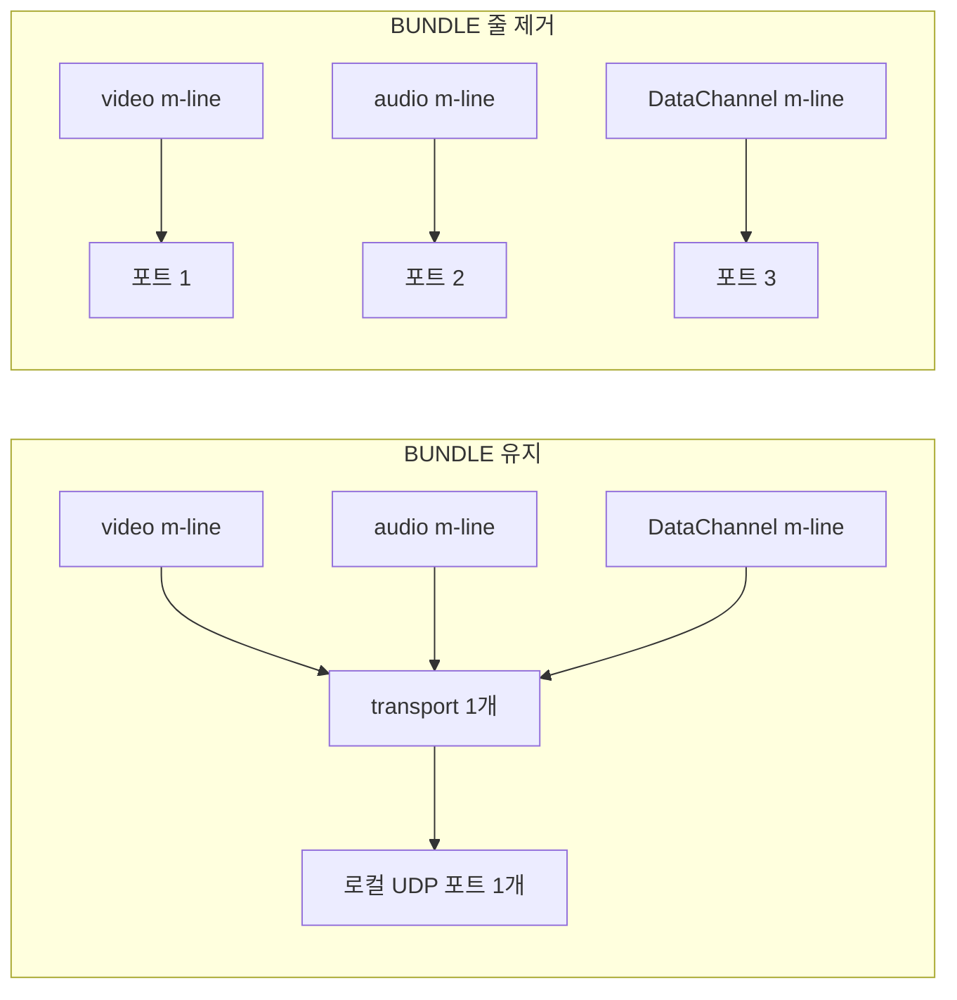

| 구성 | transport 수 | 선택된 로컬 포트 | relay 전용으로 같은 실험 시 relay 후보 |
|------|-------------|-----------------|--------------------------------|
| BUNDLE 유지 | 1 | 1개 (38328) | 1개 |
| BUNDLE 줄 제거 | 3 | 3개 (42979, 53039, 45054) | 3개 |

포트 번호는 실행마다 바뀐다. 보려는 건 개수다. 방화벽 입장에서는 이 차이가 세 군데에서 나온다.

단말 쪽 방화벽이 아웃바운드 UDP를 허용하고 응답만 stateful로 받는 구조라면 포트가 몇 개든 상관없다. 문제는 "특정 UDP 포트 범위만 연다"는 정책이다. 이 경우 BUNDLE이 살아 있으면 통화당 포트 하나만 범위 안에 들어가면 되지만, BUNDLE이 빠진 SDP(구형 SIP 게이트웨이와 붙을 때 가끔 만난다)를 받으면 포트 세 개가 필요하다. 어느 한 포트만 막혀도 오디오는 되는데 비디오만 안 되는 모양이 나온다.

TURN 서버 쪽에서는 relay 후보 하나가 allocation 하나다. 위 표대로 BUNDLE이 없으면 같은 통화가 allocation을 세 개 쓰므로 coturn의 `min-port`와 `max-port` 범위, `user-quota`를 3배 빨리 소모할 수 있다.

반대 방향의 부작용도 있다. 모든 미디어가 같은 5-tuple에 올라가므로 그 경로가 막히거나 NAT 바인딩이 사라지면 오디오, 비디오, DataChannel이 한꺼번에 죽는다. 부분 장애가 없으니 "비디오만 안 나온다"는 증상은 BUNDLE이 살아 있는 연결에서는 포트 문제보다 코덱과 트랙 협상 문제일 가능성이 높다. 또 포트 번호로 미디어 종류를 구분하는 방화벽 QoS 규칙은 BUNDLE에서 소용이 없다. 한 포트에 RTP, RTCP, DTLS, SCTP가 섞여 들어오기 때문이다.

`bundlePolicy: 'max-compat'`은 포트를 나누려고 쓰는 옵션이 아니다. 같은 실험을 `max-compat`으로 돌렸을 때 양쪽이 모두 Chrome이면 BUNDLE이 수락되어 transport는 여전히 1개였다.

### 어디서 막히는지 확인하는 법

연결이 안 될 때 추측하지 말고 실제 후보 상태를 봐야 한다. 크롬이면 `chrome://webrtc-internals`를 열면 ICE 후보와 연결 시도 과정이 전부 나온다. 코드에서는 `getStats()`로 확인한다.

```javascript
async function getSelectedPair(pc) {
  const stats = await pc.getStats();
  let transport;
  stats.forEach((r) => {
    if (r.type === 'transport' && r.selectedCandidatePairId) transport = r;
  });
  if (!transport) return null; // 아직 선택된 쌍이 없다

  const pair = stats.get(transport.selectedCandidatePairId);
  const local = stats.get(pair.localCandidateId);
  const remote = stats.get(pair.remoteCandidateId);
  return {
    state: pair.state,
    local: local.candidateType,       // host | srflx | prflx | relay
    remote: remote.candidateType,
    protocol: local.protocol,         // udp | tcp
    relayProtocol: local.relayProtocol, // relay 일 때만 udp | tcp | tls
    rtt: pair.currentRoundTripTime,   // 초 단위
  };
}
```

`state === 'succeeded'`인 쌍을 찾는 방식은 쓰지 않는다. 성공한 쌍은 여러 개일 수 있고 그중 실제로 트래픽이 흐르는 쌍은 `transport.selectedCandidatePairId`가 가리키는 하나뿐이다. relay 전용 연결에서 이 함수를 돌리면 `local: 'relay'`, `remote: 'relay'`, `relayProtocol: 'udp'`가 나왔다. TCP나 TLS TURN으로 붙은 연결이면 `relayProtocol`에 그 값이 찍히므로 `turns:443`으로 떨어졌는지 바로 구분된다. 앞 절에서 본 mDNS 때문에 host 후보의 `address`는 비어 있을 수 있어서 위 함수는 주소를 반환하지 않는다.

여기서 봐야 할 건 선택된 쌍의 후보 타입이다.

- 양쪽 다 host면: 같은 LAN. 정상.
- srflx면: NAT 통과 성공. 정상.
- relay면: 직접 연결 실패해서 TURN 릴레이 중. 동작은 하지만 느리고 비싸다. 이게 의도보다 자주 나오면 NAT/방화벽을 점검해야 한다.
- candidate-pair가 아예 succeeded 없이 failed면: 통하는 경로가 없다. TURN이 없거나 TURN도 막힌 것.

### 자주 겪는 증상과 원인

운영하면서 반복적으로 만난 패턴들이다.

연결은 되는데 영상이 안 나온다. ICE는 connected인데 화면이 검다. 코덱 협상 실패이거나 미디어 트랙이 SDP에 안 실린 경우다. SDP의 `m=video` 줄과 양쪽 코덱 교집합을 확인한다.

로컬에서는 되고 운영에서만 안 된다. 로컬은 같은 LAN이라 host 후보로 바로 붙는다. 운영은 서로 다른 NAT 뒤라 STUN/TURN이 필요한데 TURN 설정이 빠진 경우가 대부분이다. 로컬 테스트로는 NAT 통과를 검증할 수 없다는 걸 기억해야 한다.

특정 고객사에서만 안 된다. 그 망의 방화벽이 UDP나 3478 포트를 막고 있다. `turns:443` 으로 떨어뜨려서 되는지 본다. 되면 방화벽이 원인이라는 게 확정된다.

가끔 끊겼다가 다시 붙는다. `disconnected` → `connected`가 반복되는 경우다. 모바일에서 네트워크가 흔들리거나 Wi-Fi와 LTE를 오갈 때 나는 정상 동작에 가깝다. 앞에서 본 `watchConnection`처럼 `disconnected`에 유예를 두고 `restartIce()`를 걸어두면 사용자가 끊김을 덜 느낀다. `failed`에서만 restart하면 사용자는 이미 십수 초를 기다린 뒤다.

## 다대다 연결의 한계

여기까지는 1:1 연결을 전제로 했다. 그런데 화상 회의처럼 여러 명이 붙으면 P2P 풀메시는 금방 한계에 부딪힌다. N명이 서로 다 연결하면 각 단말이 N-1개의 연결을 유지하고 자기 영상을 N-1번 인코딩해서 보내야 한다. 4~5명만 넘어가도 클라이언트 CPU와 업로드 대역폭이 못 버틴다.

```
풀메시 (P2P 다대다):
  4명이면 각자 3개 연결 → 총 6개 연결, 각자 3번 송신
  10명이면 각자 9개 연결 → 클라이언트 폭발

SFU (미디어 서버):
  각 단말은 서버와 1개 연결만
  서버가 받아서 다른 사람들에게 분배
```

그래서 인원이 많아지면 SFU(Selective Forwarding Unit)나 MCU 같은 미디어 서버를 둔다. 각 단말은 서버와만 연결하고, 서버가 영상을 받아서 다른 참가자에게 뿌린다. 이러면 순수 P2P는 아니지만 클라이언트 부담이 사라진다. mediasoup, Janus, LiveKit 같은 게 이 SFU 구현이다. 소규모는 P2P로 충분하지만, 회의 규모가 커지면 SFU 도입을 검토하게 된다.

## 정리

WebRTC 연결이 안 될 때 볼 곳은 거의 정해져 있다. 시그널링이 SDP와 후보를 제대로 전달하는지, ICE 후보가 양쪽에서 수집되는지, TURN 설정이 있는지, 방화벽이 UDP를 막지는 않는지. `chrome://webrtc-internals`와 `getStats()`로 어느 후보 쌍에서 막히는지 확인하면 원인의 대부분이 잡힌다. 로컬에서 된다고 운영에서 되는 게 아니라는 것, TURN 없이는 NAT 통과가 보장되지 않는다는 것, 이 두 개만 기억해도 초기 삽질을 크게 줄인다.
