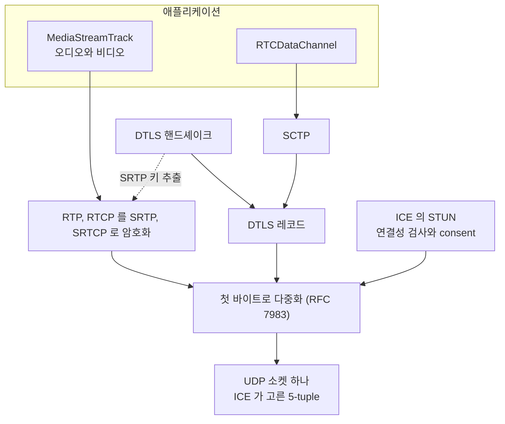
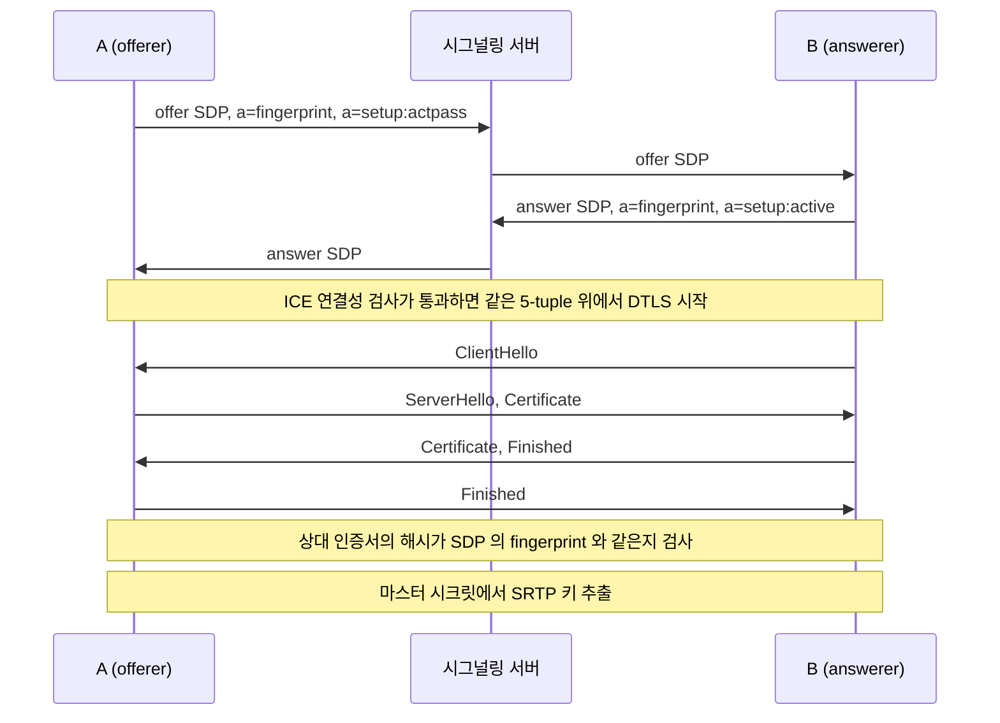
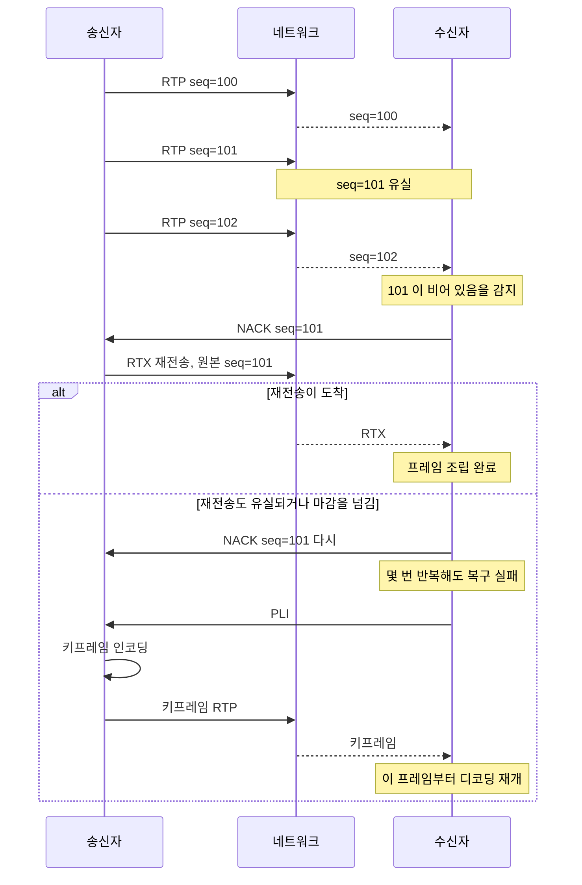
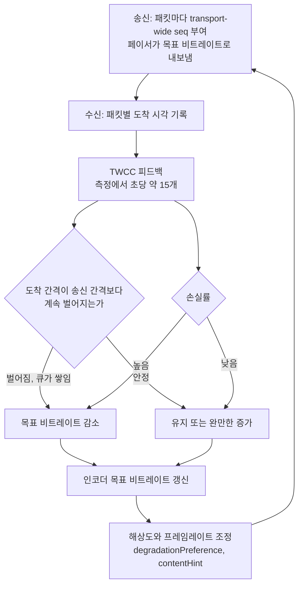
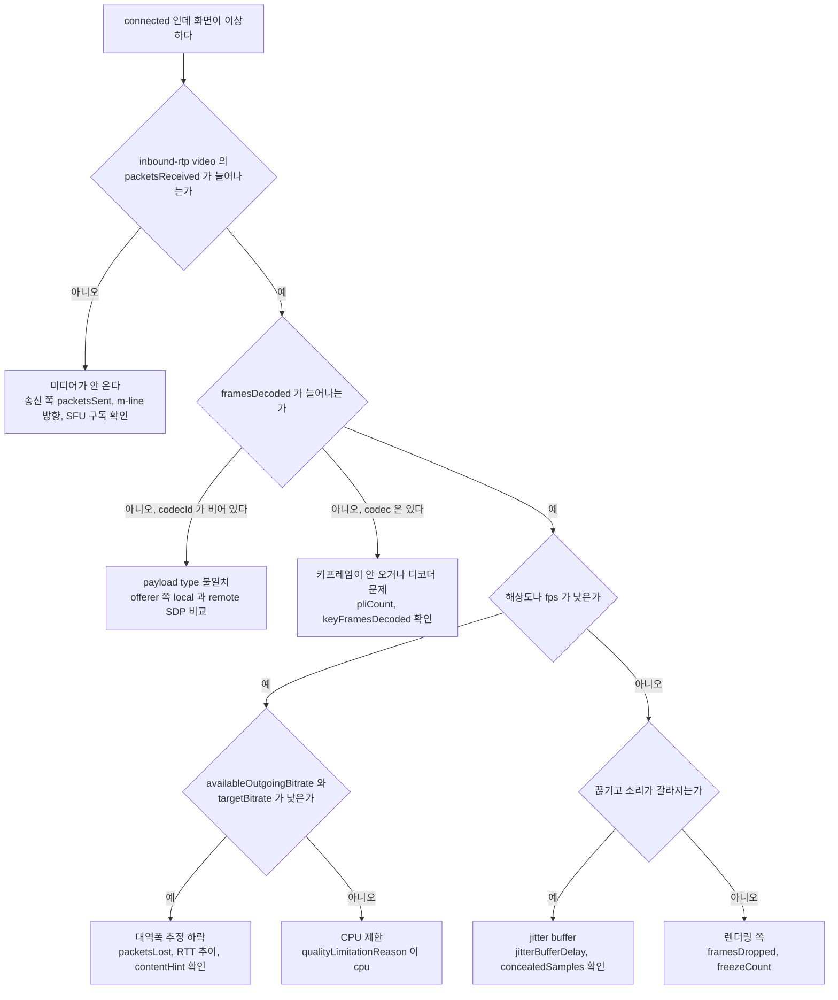

# WebRTC 미디어 전송 계층

`connectionState` 가 `connected` 로 바뀌면 연결 문제는 끝난 것처럼 보인다. 실제로는 그 뒤에 겪는 문제가 더 많다. 소리는 나는데 영상이 검은 화면이고, 통화 시작 20초 동안 화면이 뭉개져 있고, 모바일에서 오디오가 로봇 소리처럼 갈라지고, 화면 공유 글자가 흐릿하다. ICE 는 성공했고 DTLS 도 끝났는데 이런 일이 생기는 이유는 전부 미디어 전송 계층, 곧 SRTP 패킷과 RTCP 피드백이 오가는 구간에 있다.

ICE·STUN·TURN 으로 연결을 맺는 과정은 [WebRTC 심화](Web_RTC.md)에서 다뤘고, SFU 서버 구성은 [SFU 미디어 서버](SFU_Media_Server.md)에 있다. 이 문서는 그 사이, 연결이 맺어진 뒤 패킷이 어떻게 생겼고 손실·지연·대역폭 부족이 생기면 어떻게 반응하는지를 다룬다.

본문의 수치는 전부 직접 잰 값이다. Chrome 156(headless) 한 페이지에 PeerConnection 두 개를 만들고 가짜 카메라·마이크로 송신하게 한 뒤, 호스트 주소 `10.9.0.1` 로 오가는 트래픽에만 `tc netem` 으로 손실·지연·대역폭 제한을 걸었다. `tcpdump` 로 `lo` 를 떠 RTP/RTCP 헤더를 직접 읽었고, 브라우저의 `getStats()` 를 1~3초 간격으로 찍었다. "Chrome 156에서 관측"이라고 적은 값은 다른 브라우저나 버전에 그대로 옮기지 않는다. 한계는 맨 끝에 적었다.

## UDP 포트 하나에 겹쳐 있는 프로토콜

WebRTC 는 ICE 가 고른 UDP 5-tuple 하나에 STUN, DTLS, SRTP, SRTCP, SCTP 를 전부 올린다. 오디오, 비디오, 데이터 채널이 각자 포트를 쓰지 않는다. 8초짜리 통화를 `lo` 에서 떴을 때 오디오 RTP(PT 111), 비디오 RTP(PT 118), 재전송용 RTX(PT 97, 119), RTCP 가 전부 같은 `(34747 → 56485)` 포트쌍으로 나갔다.



DTLS 는 두 곳에 걸려 있다. DTLS 레코드는 SCTP(데이터 채널)를 실어 나르고, 같은 핸드셰이크에서 나온 키 재료가 SRTP 키가 된다. 미디어 패킷은 DTLS 레코드에 담기지 않고 SRTP 로 직접 나간다. 그래서 DTLS 핸드셰이크가 끝나야 미디어가 흐르지만, 일단 흐르기 시작하면 DTLS 는 데이터 채널이 없는 한 거의 조용하다.

DTLS 와 SRTP 는 5-tuple 이 아니라 ICE 전송 객체에 묶인다. 이 캡처에서도 DTLS 핸드셰이크는 다른 포트쌍에서 끝났고, 이후 ICE 가 후보 쌍을 바꾼 뒤에도 SRTP 는 끊기지 않고 새 쌍 위로 이어졌다.

### 첫 바이트로 나누는 규칙

같은 포트로 여러 프로토콜이 들어오니 수신 측은 패킷 첫 바이트로 종류를 가른다. RFC 7983 이 정한 범위는 이렇다.

| 첫 바이트 | 프로토콜 | 캡처에서 본 값 |
|---|---|---|
| 0 ~ 3 | STUN | `0x00` (Binding 요청·응답, consent 검사) |
| 16 ~ 19 | ZRTP | 안 나옴 |
| 20 ~ 63 | DTLS | `0x16` = 22 (Handshake) |
| 64 ~ 79 | TURN ChannelData | 릴레이 경유 때만 나옴 |
| 128 ~ 191 | RTP 또는 RTCP | `0x90` = 144 (RTP, 확장 헤더 있음), `0x8f` = 143 (RTCP, FMT 15) |

128~191 안에서 RTP 와 RTCP 는 두 번째 바이트로 가른다. 값이 192~223 이면 RTCP 고, 아니면 RTP 다. RTP 두 번째 바이트는 마커 비트(최상위 1비트)와 payload type 이 합쳐진 값이어서, 마커가 켜진 PT 64~95 가 RTCP 범위(192~223)와 겹친다. 동적 payload type 이 96 부터 시작하는 이유다. 서버에서 직접 demux 를 짤 때는 마스크를 씌우지 않은 바이트 전체를 비교해야 한다.

```js
function demux(buf) {
  const b = buf[0];
  if (b <= 3) return 'stun';
  if (b >= 16 && b <= 19) return 'zrtp';
  if (b >= 20 && b <= 63) return 'dtls';
  if (b >= 64 && b <= 79) return 'turn-channel';
  if (b >= 128 && b <= 191) return buf[1] >= 192 && buf[1] <= 223 ? 'rtcp' : 'rtp';
  return 'unknown';
}
```

같은 규칙으로 pcap 을 분류하면 8초 동안 STUN 40, DTLS 8, RTP 509, RTCP 135 개였다. 이 분류에서 `unknown` 이 나오면 거의 항상 캡처가 중간에서 잘렸거나, 앞단 장비가 UDP payload 를 건드린 것이다.

### rtcp-mux 와 BUNDLE

옛 SIP 식 구성은 RTP 에 포트 N, RTCP 에 포트 N+1 을 썼다. WebRTC 는 SDP 의 `a=rtcp-mux` 로 RTCP 를 RTP 와 같은 포트에 올리고, `a=group:BUNDLE 0 1` 로 오디오와 비디오 m-line 을 한 전송에 묶는다. Chrome 156 의 offer 에서 `a=rtcp:9 IN IP4 0.0.0.0` 이라는 줄이 보이는데 자리만 채우는 값이고, 실제 포트는 ICE 후보가 정한다.

이 구성이 방화벽에는 득이지만 직접 SFU 를 만들 때는 함정이다. RTCP 를 별도 포트로 기대하는 코드는 이 환경에서 영영 RTCP 를 받지 못한다. 반대로 BUNDLE 을 받아주지 않는 구형 장비를 만나면 m-line 마다 ICE 전송을 따로 맺어야 해서 포트 수가 곱절이 된다.

## DTLS-SRTP 키 교환과 fingerprint

SRTP 키는 시그널링으로 주고받지 않는다. 양쪽이 DTLS 핸드셰이크를 하고, 거기서 나온 마스터 시크릿에서 `use_srtp` 확장으로 SRTP 키를 뽑는다. 시그널링 서버는 SDP 만 나른다.



offer 의 `a=setup:actpass` 에 answer 가 `a=setup:active` 로 답하면 answerer 가 DTLS 클라이언트가 된다. `getStats()` 의 `transport.dtlsRole` 이 A 는 `server`, B 는 `client` 로 나왔다. 협상된 암호 스위트는 `dtlsCipher` 가 `TLS_CHACHA20_POLY1305_SHA256`, `srtpCipher` 가 `SRTP_AES128_CM_HMAC_SHA1_80` 이었다. 장애 보고서에 이 두 줄을 같이 붙이면 "구형 단말만 SRTP 암호 스위트가 달랐다" 같은 원인을 빨리 가려낼 수 있다.

DTLS 인증서는 브라우저가 그때그때 만든 자체 서명이다. CA 체인이 없으니 신뢰의 근거는 오직 SDP 안의 `a=fingerprint` 하나다. 상대가 보낸 인증서의 해시가 SDP 에 적힌 값과 같은지만 본다. 값을 일부러 틀리게 바꿔서 확인했다. answer 의 fingerprint 를 `AA:AA:...` 로 바꿔 offerer 에 적용했더니 `setRemoteDescription` 은 성공하고 이어서 `connectionState` 가 `connecting` 에서 `failed` 로 내려갔다. 2초 안에 양쪽 모두 `dtlsState: failed` 였고 `outbound-rtp` 의 `packetsSent` 는 0 에 머물렀다. 미디어는 단 한 패킷도 나가지 않는다.

여기서 중간자 공격이 가능한 조건이 나온다. 검증이 "인증서 == SDP 의 fingerprint" 뿐이므로, SDP 를 바꿀 수 있는 쪽이 fingerprint 도 같이 바꾸면 검증을 통과한다. 시그널링 서버, SDP 를 가공하는 프록시, SDP 원문을 받아 로그로 남기고 다시 내보내는 중간 계층이 전부 해당한다. 공격자는 A 와 B 에게 각각 자기 인증서의 fingerprint 를 심어 두고, 양쪽과 따로 DTLS 를 맺은 다음 SRTP 를 복호화해서 다시 암호화해 넘기면 된다. 양쪽 브라우저는 아무 경고 없이 `connected` 가 된다.

그래서 시그널링 채널은 `wss://` 에 인증이 붙어야 하고, SDP 를 서버에서 가공한다면 그 서버가 신뢰 경계 안에 있어야 한다. SFU 를 쓰면 구조상 SFU 가 SRTP 의 종단이라 서버가 미디어를 볼 수 있다. 종단간 암호화가 필요하면 DTLS-SRTP 와 별도로 Insertable Streams 로 프레임을 한 번 더 암호화해야 한다.

## RTP 헤더와 코덱 협상

### 캡처로 본 RTP 헤더

SRTP 는 헤더를 암호화하지 않고 페이로드만 암호화한다. 그래서 캡처에서 12바이트 고정 헤더와 확장 헤더를 그대로 읽을 수 있다. 위에서 말한 통화를 파싱한 결과다.

| 스트림 | SSRC 특징 | seq | timestamp | transport-wide seq |
|---|---|---|---|---|
| 오디오 (PT 111, opus) | 하나 | 16205, 16206, 16207 ... 패킷마다 +1 | 패킷마다 +960 (48kHz 에서 20ms) | 1, 2, 3, 4 |
| 비디오 (PT 118, RED) | 하나 | 10231, 10232 ... | 같은 프레임의 패킷은 값이 같음 | 8, 9, 14, 15 |
| 재전송과 프로브 (PT 97, 119) | 비디오와 별개 SSRC | 12039 ... | 첫 패킷은 0 | 7, 10, 11, 13 |

네 필드가 각자 하는 일이 다르다. `sequence number` 는 패킷 단위 순번이라 손실과 순서 뒤바뀜을 잡는 데 쓴다. `timestamp` 는 미디어 시계(오디오 48kHz, 비디오 90kHz) 기준 샘플링 시각이라 재생 타이밍과 지터 계산에 쓴다. 한 비디오 프레임이 패킷 두 개로 쪼개지면 둘의 timestamp 는 같고 마지막 패킷에만 마커 비트가 선다. `SSRC` 는 스트림 식별자다. `payload type` 은 이 패킷이 어떤 코덱인지 SDP 의 `a=rtpmap` 와 대응하는 번호다.

표에서 눈여겨볼 곳은 마지막 열이다. `transport-wide seq` 는 헤더 확장 id 3(`transport-wide-cc-extensions-01`)에 실리는 번호인데, 오디오·비디오·RTX 가 번호를 공유한다. 비디오가 8, 9 일 때 오디오는 그 사이를 채우고, RTX 는 13 이었다. 혼잡 제어가 스트림별이 아니라 연결 전체를 한 덩어리로 보기 때문이다. 이 번호를 쓰는 곳은 뒤의 혼잡 제어 절에서 다시 나온다.

### RED 로 감싸 나가는 비디오

SDP 의 비디오 payload type 은 VP8 이 96 이다. 그런데 와이어에서 PT 96 은 한 패킷도 보이지 않았고, 비디오가 전부 PT 118 로 나갔다. 118 은 `red/90000` 이다. offer 에 `red` 와 `ulpfec` 가 들어 있으면 Chrome 은 미디어 패킷을 RED 로 감싸 보낸다. 수신 쪽 `getStats()` 는 RED 를 벗긴 뒤의 코덱을 보고하므로 `video/VP8` 에 payload type 96 으로 나온다.

SFU 나 녹화 서버를 만들 때 이 차이로 조용히 깨진다. SDP 를 보고 VP8 은 PT 96 이라고 믿어 RTP 를 필터링하면 PT 118 이 전부 버려진다. RED 를 처리하지 못하는 쪽이라면 SDP 에서 `red`, `ulpfec` 와 이들의 RTX(`apt=118`)를 지워 offer 를 보내는 편이 낫다. 지우는 순간 FEC 가 사라지지만 NACK 재전송은 그대로 동작한다.

비슷하게 RTX 스트림에는 재전송만 실리지 않는다. 첫 몇 개의 RTX 패킷은 timestamp 가 0 이고 패딩 비트가 서 있었다. RTX(PT 97, 119) 31개 중 15개가 패딩 패킷이었다. 대역폭 추정이 늘려볼 구간을 시험하는 프로브 패킷으로 보이는데, 페이로드를 해독하지 않았으니 정황이다. 서버에서 "RTX 인데 원본이 없는 패킷"이 보여도 이상 신호가 아닐 수 있다.

### payload type 불일치로 한쪽 영상만 나오는 경우

가장 재현이 쉬운 "소리는 되는데 영상이 안 나오는" 원인이다. offerer 가 VP8 을 96 으로 제안했는데, 시그널링 중간의 코드가 answer 의 payload type 을 다시 매기는 경우를 만들었다. answer SDP 의 `96` 을 `127` 로 치환해서 offerer 에 적용했다.

- `setRemoteDescription` 은 에러 없이 끝났다. 숫자가 서로 충돌하지만 않으면 파서는 통과시킨다. 처음엔 `120` 으로 바꿨는데 `ulpfec` 가 이미 120 이라 `Duplicate payload type` 에러로 막혔다.
- `connectionState` 는 `connected`, DTLS 도 `connected` 였다.
- 오디오는 정상이다.
- B 의 비디오 `inbound-rtp` 는 `packetsReceived` 가 계속 늘었다(10초에 619개).
- 그런데 `framesReceived: 0`, `framesDecoded: 0`, `codecId` 없음. 정상 연결에서는 같은 위치에 `video/VP8#96` 과 프레임 수가 찍힌다.
- `<video>` 요소는 `paused: false`, 트랙은 `readyState: "live"`, `muted: false`. 그런데 `videoWidth` 는 0 이다.

브라우저는 에러도 `onerror` 도 내지 않는다. 패킷은 계속 들어오고 UI 상태는 전부 정상이라, 이 증상을 처음 만나면 TURN 이나 방화벽부터 의심하게 된다. 판별 신호는 `packetsReceived` 만 늘고 `framesReceived` 가 0 이며 `codecId` 가 비어 있다는 조합이다.

원인은 SDP 두 벌을 비교하면 나온다. 주의할 점이 하나 있는데, 어긋남은 offerer 쪽에서만 드러난다. B(answerer)는 자기 answer 와 받은 offer 가 서로 맞아서 차이가 없다.

```js
function ptMap(sdp) {
  const map = {};
  let mid = null;
  for (const line of sdp.split(/\r?\n/)) {
    if (line.startsWith('a=mid:')) mid = line.slice(6);
    const m = line.match(/^a=rtpmap:(\d+) ([^/]+)\//);
    if (m && mid !== null) (map[mid] ??= {})[m[2].toLowerCase() + ':' + m[1]] = true;
  }
  return map;
}

function diffPayloadTypes(pc) {
  const local = ptMap(pc.localDescription.sdp), remote = ptMap(pc.remoteDescription.sdp);
  const problems = [];
  for (const mid of Object.keys(local)) {
    const names = new Set([...Object.keys(local[mid]), ...Object.keys(remote[mid] ?? {})].map((k) => k.split(':')[0]));
    for (const name of names) {
      const l = Object.keys(local[mid]).filter((k) => k.startsWith(name + ':')).map((k) => k.split(':')[1]);
      const r = Object.keys(remote[mid] ?? {}).filter((k) => k.startsWith(name + ':')).map((k) => k.split(':')[1]);
      if (l.length && r.length && !l.some((x) => r.includes(x))) problems.push(`mid=${mid} ${name} local=${l} remote=${r}`);
    }
  }
  return problems;
}
```

문제가 있는 상태에서 offerer 에게 `diffPayloadTypes(pc)` 를 호출하면 `["mid=1 vp8 local=96 remote=127"]` 이 나왔고, 정상 상태에서는 빈 배열이었다. 이런 어긋남은 SDP 를 정규식으로 다듬는 코드(코덱 제거, 비트레이트 줄 삽입, SFU 가 payload type 을 정리하는 로직)에서 자주 생긴다. 정규식이 `96` 을 `a=rtpmap`, `a=fmtp`, `a=rtcp-fb` 세 곳에서 모두 바꾸지 않고 일부만 바꾸는 경우가 흔하다.

### 코덱 순서를 바꿀 때

SDP 의 `m=video` 줄에 나열된 payload type 의 순서가 선호 순서다. Chrome 156 의 offer 에는 비디오 payload type 이 23개 있었고 VP8 이 맨 앞, 뒤로 H264 변형 여러 개, AV1, VP9 두 가지(`profile-id=0`, `profile-id=2`)가 이어졌다. 순서는 `setCodecPreferences` 로 바꾼다.

```js
function preferCodecs(transceiver, order) {
  const rank = (c) => { const i = order.indexOf(c.mimeType); return i === -1 ? order.length : i; };
  const caps = RTCRtpReceiver.getCapabilities('video').codecs;
  transceiver.setCodecPreferences([...caps].sort((a, b) => rank(a) - rank(b)));
}
preferCodecs(pc.getTransceivers()[0], ['video/VP9', 'video/H264']);
```

돌려보니 offer 의 첫 payload type 이 98(`VP9/90000`)로 바뀌었다. 목록을 직접 만들면 안 된다. `{ mimeType: 'video/H264', clockRate: 90000, sdpFmtpLine: 'profile-level-id=640c1f' }` 처럼 capabilities 에 없는 항목을 넣었더니 `InvalidModificationError: Missing codec from codec capabilities` 였다. 반드시 capabilities 객체를 그대로 골라 재배열한다.

H264 는 `profile-level-id` 와 `packetization-mode` 가 다른 변형이 여섯 개 나열된다. 양쪽이 같은 변형을 지원하지 않으면 협상에서 H264 가 빠지고 VP8 로 떨어진다. 하드웨어 인코더를 쓰려고 H264 만 남겨 둔 상태에서 상대 단말이 해당 프로파일을 못 받으면 m-line 자체가 성립하지 않는다.

## RTCP 가 실어 나르는 정보

### SR, RR 로 손실률·지터·RTT 계산

RTCP 는 미디어 패킷과 같은 포트로 오가며, 첫 바이트가 `0x80~0x8f`, 두 번째 바이트가 packet type 이다. SRTCP 도 앞 8바이트(버전, FMT, 타입, 길이, SSRC)는 평문이다. 캡처에서 복합 패킷의 첫 패킷 종류를 센 결과는 이렇다.

| 두 번째 바이트 | 종류 | 12초 캡처에서 센 수 |
|---|---|---|
| 200 | SR (Sender Report) | 10 ~ 19 |
| 201 | RR (Receiver Report) | 10 ~ 20 |
| 205, FMT 1 | NACK | 손실을 걸었을 때만 나옴 |
| 205, FMT 15 | TWCC 피드백 | 178 |
| 206, FMT 1 | PLI | 복합 패킷 뒤쪽에 붙어 첫 패킷으로는 안 보였음 |

SR 과 RR 이 담는 값으로 손실률, 지터, RTT 를 만든다.

손실률은 RR 의 `fraction lost` 8비트 필드에 들어 있다. 마지막 보고 이후의 손실 비율을 256 분율로 적는다. `remote-inbound-rtp.fractionLost` 로 `0.0546875` 가 찍혔는데 14/256 이다. 해상도가 1/256 이라 손실이 0.3% 밑이면 0 으로 보인다.

RTT 는 송신자가 SR 에 넣은 NTP 시각을 수신자가 RR 에 되돌려 보내는 방식으로 잰다. RR 에는 `LSR`(마지막 SR 의 NTP 시각 중간 32비트)과 `DLSR`(그 SR 을 받고 RR 을 보낼 때까지 쥐고 있던 시간)이 있고, 송신자가 RR 을 받은 시각을 A 라고 하면 RTT = A - LSR - DLSR 이다. 단위는 1/65536 초다.

```js
const toNtp32 = (sec) => Math.round(sec * 65536) >>> 0;

function rttMs(arrivalSec, lsr, dlsr) {
  const a = toNtp32(arrivalSec);
  return (((a - lsr - dlsr) >>> 0) / 65536) * 1000;
}

// t=100.000 에 SR 송신, 편도 지연 40ms, 수신자가 0.250초 쥐고 있다가 RR 송신
const lsr = toNtp32(100.000);
const arrival = 100.000 + 0.040 + 0.250 + 0.040;
console.log(rttMs(arrival, lsr, toNtp32(0.250)));  // 80.0
console.log(rttMs(arrival, lsr, 0));               // 330.0
```

`DLSR` 을 빼먹으면 80ms 가 330ms 로 나온다. RTCP 를 직접 파싱해 RTT 를 계산하는 모니터링 코드에서 실제로 틀리기 쉬운 부분이다. 32비트 연산이라 `>>> 0` 으로 래핑을 맞춰야 한다.

지터는 RFC 3550 부록 A.8 의 식을 쓴다. 연속한 두 패킷에서 도착 간격과 timestamp 간격의 차이 `D` 를 구하고 `J += (|D| - J) / 16` 으로 지수 평활한다. 이 식 때문에 `jitter` 값이 짧은 스파이크를 거의 보여주지 못한다. 20ms 간격으로 오는 오디오에서 한 패킷만 400ms 늦게 도착하는 상황을 계산하면 값은 최대 48.4ms 까지 올랐다가 20패킷 뒤 13.3ms, 100패킷(2초) 뒤 0.09ms 로 내려갔다. 5초마다 `getStats()` 를 찍는 모니터링은 이 스파이크를 놓친다. 뒤의 jitter buffer 절에서 실제 측정으로 다시 확인한다.

### NACK 에서 PLI 까지

수신 측은 sequence number 에 구멍이 생기면 NACK 으로 그 번호를 재전송해 달라고 한다. 송신자는 RTX 스트림에 원본을 다시 실어 보낸다. 재전송도 날아가면 수신자는 NACK 을 되풀이하고, 재전송이 프레임 마감 시점을 넘기거나 구멍이 너무 크면 NACK 을 포기하고 PLI(Picture Loss Indication)로 새 키프레임을 요구한다. FIR(`ccm fir`)도 같은 목적의 오래된 요청이다. SDP 에 `nack`, `nack pli`, `ccm fir` 가 모두 적혀 있으니 피드백 종류는 협상 사항이다.



위 흐름이 실제 값으로 어떻게 나타나는지 `netem` 으로 세 가지 손실을 줘서 봤다. 모두 해상도 변경으로 인한 키프레임은 따로 세었다.

| 조건 | 관측 |
|---|---|
| 무작위 손실 5%, 약 12초 | 송신 `nackCount` 31, `retransmittedPacketsSent` 43, 수신 `packetsLost` 43. 수신 `pliCount` 0, `freezeCount` 0. NACK 과 RTX 만으로 막았다 |
| 무작위 손실 30%, 9초 | 송신 NACK 122건 수신인데 수신 측이 보낸 NACK 은 163건. 약 25%가 오는 길에 사라졌다. `freezeCount` 가 2 에서 9 까지 올랐다 |
| 완전 정체 1.5초 | NACK 으로 복구, `pliCount` 0, `freezeCount` 1 |
| 완전 정체 4초 | 수신 `pliCount` 1, `freezeCount` 1, 송신 `keyFramesEncoded` 가 2 에서 3 으로 증가 |

손실 30% 줄에서 NACK 수가 송신과 수신이 다른 점은 중요하다. 피드백 경로도 같은 망이라 NACK 자체가 유실된다. 상용 네트워크에서 상향·하향 품질이 비대칭이면 한쪽만 손실 통계가 좋아 보이는 일이 흔하다.

완전 정체 4초에서 수신 측은 `pliCount` 1 을 찍었는데, 송신 쪽 `outbound-rtp.pliCount` 는 모든 실행에서 0 으로 남았다. 키프레임은 분명히 하나 더 인코딩됐다(`keyFramesEncoded`). Chrome 156 에서 송신 쪽 `pliCount` 로 PLI 수신 횟수를 세는 방식은 믿을 수 없었다. 키프레임 요청 빈도는 수신 쪽 `pliCount` 와 `keyFramesDecoded` 로 본다. 그리고 키프레임은 해상도가 바뀔 때도 나가므로 `keyFramesEncoded` 의 증가분이 전부 PLI 때문이라고 해석하면 틀린다.

### 키프레임 요청이 몰릴 때

SFU 구성에서는 구독자 N명이 각자 손실을 겪고 각자 PLI 를 보낸다. 서버가 PLI 를 받는 대로 발행자에게 전달하면 발행자는 키프레임을 N번 만든다. 키프레임은 델타 프레임보다 크기가 훨씬 커서 한 번에 패킷 버스트를 만들고, 그 버스트가 다시 다른 구독자의 손실을 늘려 PLI 를 더 부르는 되먹임이 생긴다. 인코더도 키프레임을 만드는 동안 프레임 처리 시간이 길어진다. 실제로 방이 커질 때 발행자의 `qualityLimitationReason` 이 `cpu` 로 바뀌고 서버 로그에 PLI 가 초당 수십 건씩 찍히는 패턴이 이 형태다.

방지책은 서버가 PLI 를 병합하는 것이다. 마지막으로 발행자에게 전달한 시각을 기록해 두고, 최소 간격 안에 들어온 요청은 버린다. 간격 안에 오는 요청은 이미 오고 있는 키프레임으로 해소되기 때문이다.

```js
class KeyframeRequestGate {
  constructor(minIntervalMs = 1000) {
    this.minIntervalMs = minIntervalMs;
    this.last = -Infinity;
  }
  // true 면 발행자에게 PLI 를 전달한다
  shouldForward(now = Date.now()) {
    if (now - this.last < this.minIntervalMs) return false;
    this.last = now;
    return true;
  }
}
```

구독자당 분당 PLI 3건이 무작위 시각에 독립적으로 도착한다고 가정하고 10분을 모의했다. 실측이 아니라 단순 모델이다.

| 구독자 수 | PLI 요청 | 그대로 전달 | 1초 병합 |
|---|---|---|---|
| 5 | 150 | 150 (초당 0.25) | 121 (초당 0.20) |
| 20 | 600 | 600 (초당 1.00) | 302 (초당 0.50) |
| 50 | 1500 | 1500 (초당 2.50) | 430 (초당 0.72) |

실제 PLI 는 독립이 아니다. 발행자의 상향 회선이 흔들리면 모든 구독자가 같은 시각에 같은 구멍을 보고 PLI 를 동시에 쏜다. 이 경우 병합 효과는 위 표보다 훨씬 크다. 반대로 간격을 너무 길게 잡으면(수 초) 정말 키프레임이 필요한 구독자가 그만큼 오래 멈춘 화면을 본다. 간격은 0.5~1초에서 시작해서 방 크기에 맞춰 조정한다.

## 혼잡 제어

### REMB 와 TWCC

대역폭 추정은 누가 계산하느냐로 갈린다.

| | REMB | TWCC |
|---|---|---|
| 계산하는 쪽 | 수신자 | 송신자 |
| 피드백 내용 | 수신자가 추정한 상한 하나 (bps) | 패킷마다 도착 시각 |
| SDP | `a=rtcp-fb:96 goog-remb` | `a=rtcp-fb:96 transport-cc`, `a=extmap:3 ...transport-wide-cc-extensions-01` |
| 패킷에 필요한 것 | `abs-send-time` 확장 | transport-wide seq 확장 |
| 단위 | 스트림 | 연결 전체 (오디오·비디오·RTX 번호 공유) |

REMB 는 수신자가 도착 간격 변화로 상한을 계산해서 숫자 하나를 보낸다. 송신자는 그 숫자를 믿고 따라간다. TWCC 는 수신자가 "번호 N 패킷이 시각 T 에 도착했다"를 모아 보내고, 판단은 송신자가 한다. 송신자는 자기 송신 시각을 갖고 있으니 송신 간격과 도착 간격을 직접 비교할 수 있다. 번호가 오디오·비디오·RTX 에 공유되므로 연결 전체의 큐 상태를 한 번에 본다는 점이 핵심 차이다.

Chrome 156 의 offer 에는 둘 다 적혀 있었고, 실제로는 TWCC 가 선택됐다. 약 12초 캡처에서 TWCC 피드백(RTCP `205, FMT 15`)이 178개, 곧 초당 15개 정도 오갔다. offer 에서 `transport-wide-cc` 확장과 `transport-cc` 줄을 지워 B 에 적용하자 answer 에도 해당 줄이 없었고, 캡처에서 TWCC 피드백이 0개로 줄었다. REMB 는 복합 패킷 안쪽에 붙어 첫 패킷 종류로는 세어지지 않아 이 방법으로는 확인하지 못했다.

SFU 를 만들 때 이 차이가 걸린다. SFU 는 구독자에게 보내는 방향의 송신자이므로 TWCC 를 쓰려면 SFU 가 TWCC 피드백을 받아 자체 추정기를 돌려야 한다. REMB 만 지원하는 구형 SFU 는 수신자 계산에 의존하기 때문에, 발행자 쪽에서는 업링크를 구독자 쪽 REMB 에 맞춰 줄이는 식으로만 반응한다.

### 송신 측 대역폭 추정이 화질을 깎는 과정

Chrome 의 추정기는 GCC(Google Congestion Control)다. TWCC 도착 시각으로 지연 기울기를 계산하는 지연 기반 추정과, 손실률로 계산하는 손실 기반 추정을 함께 돌려 둘 중 작은 값을 목표로 쓴다. 지연 기울기가 계속 양수면 중간 큐가 쌓이는 중이니 내리고, 손실이 크면 곱해서 크게 내리고, 안정적이면 천천히 올린다. 손실 기반 임계값은 GCC 초안(draft-ietf-rmcat-gcc)에 있지만, libwebrtc 의 상수는 버전마다 바뀌어서 문서의 숫자를 그대로 믿지 않는다. 아래 실측에서 확인한 것은 숫자 자체가 아니라 반응의 방향과 속도다.



그림의 고리가 한 바퀴 도는 데 피드백 간격(초당 15개)과 인코더 반응 시간이 걸린다. 감소 쪽 화살표는 한 번에 크게, 증가 쪽은 여러 번에 걸쳐 조금씩 올라간다. 측정은 이 비대칭을 그대로 보여준다.

손실이 없는 루프백에서 가짜 카메라 720p 요청이 실제 720p 로 나가기까지의 값이다. 실행마다 몇 초씩 달랐다.

| 통화 시작 후 | 송신 해상도 | `targetBitrate` | `qualityLimitationReason` |
|---|---|---|---|
| 처음 몇 초 | 180p ~ 360p | 0.6 ~ 1.4 Mbps | `bandwidth` |
| 약 15초 | 540p | 1.7 ~ 2.0 Mbps | `bandwidth` |
| 약 24초 | 720p | 2.1 ~ 2.5 Mbps | `none` |

대역폭 제약이 전혀 없는 루프백인데도 720p 까지 24초가 걸렸다. 통화 시작 직후 몇 초 동안 화질이 낮은 것은 장애가 아니라 추정기가 위로 탐색하는 중이다. 해상도가 한 단계 올라갈 때마다 키프레임이 한 번씩 나갔다(`keyFramesEncoded` 1, 2, 3).

내려갈 때는 훨씬 빠르다. 위와 같은 상태에서 손실 30%를 걸었더니 3초 만에 `targetBitrate` 가 2.5 Mbps 에서 184 kbps, 다시 3초 뒤 47 kbps, 그 3초 뒤 30 kbps 가 되고 송신 프레임레이트가 20 에서 4, 2 로 떨어졌다. `availableOutgoingBitrate` 도 454 kbps, 190 kbps, 88 kbps 로 같이 내려갔다. 정체 4초 뒤 회선이 복구된 경우에는 `targetBitrate` 가 123 kbps 에서 출발해 약 9초 만에 960p 가 켜지는 1.46 Mbps 에 도달했다. 떨어지는 데 몇 초, 돌아오는 데 열 초가 든다.

그리고 조용히 어긋나는 부분이 있다. 위 손실 30% 실험에서 처음 9초 동안 `qualityLimitationReason` 은 `none` 이었다. 해상도는 1280 폭 그대로인데 프레임레이트가 2~4 까지 내려가고 비트레이트가 30 kbps 까지 떨어진 상태였다. `bandwidth` 로 바뀐 건 해상도가 960 으로 내려간 뒤다. 이 값은 해상도를 줄였는지에 가까운 신호라서 프레임레이트 하락이나 비트레이트 하락을 가리지 못한다. 알람은 `qualityLimitationReason` 대신 `targetBitrate`, `framesPerSecond`, `availableOutgoingBitrate` 에 건다.

### degradationPreference 와 contentHint

대역폭이 모자라면 인코더는 해상도, 프레임레이트, 양자화 중 무엇을 희생할지 골라야 한다. `RTCRtpSender` 의 `degradationPreference`(`maintain-framerate`, `maintain-resolution`, `balanced`)와 트랙의 `contentHint`(`motion`, `detail`, `text`)가 이 선택을 정한다. 지연 10ms, 대역폭 800kbit/s 로 제한한 상태에서 1920x1080 캔버스(코드처럼 보이는 글자를 매 프레임 새로 그린 소스)를 30fps 로 보내고 26초 뒤 값을 읽었다.

| 설정 | 송신 해상도 | 프레임레이트 | `qualityLimitationReason` |
|---|---|---|---|
| 아무것도 안 줌 | 480x270 | 18 ~ 29 | `bandwidth` |
| `contentHint = 'motion'` | 320x180 | 19 ~ 27 | `bandwidth` |
| `contentHint = 'detail'` | 1920x1080 | 1 ~ 4 | `none` |
| `degradationPreference = 'maintain-resolution'` | 1920x1080 | 3 ~ 4 | `none` |
| `degradationPreference = 'maintain-framerate'` | 640x360 에서 480x270 | 19 ~ 27 | `bandwidth` |
| `detail` + `maintain-framerate` | 1920x1080 | 3 | `none` |

마지막 줄이 가장 신경 쓰인다. `maintain-framerate` 를 명시했는데도 `contentHint = 'detail'` 이 걸려 있으면 해상도 유지가 이겼다. 두 설정이 충돌하면 contentHint 쪽이 우선하는 것으로 보인다(Chrome 156 에서 관측). 화면 공유 트랙에 contentHint 를 심어 놓고 나중에 다른 코드에서 `degradationPreference` 로 프레임레이트를 지키려 하면 설정이 먹히지 않은 채 지나간다.

`degradationPreference` 는 송신 파라미터에서 설정한다.

```js
const sender = pc.getSenders().find((s) => s.track?.kind === 'video');
const params = sender.getParameters();
params.degradationPreference = 'maintain-resolution';
await sender.setParameters(params);
```

Chrome 156 에서 `setParameters` 전의 `getParameters()` 결과에는 `degradationPreference` 키가 없었고, 설정한 뒤에는 키가 생겼다. 브라우저가 기본 동작을 기억하는 방식이라 현재 값이 기본인지 직접 설정한 것인지 구분되지 않는다. 설정 직후 `getParameters()` 로 반영을 확인하고, 실제 효과는 `frameWidth` 와 `framesPerSecond` 로 본다.

## jitter buffer 와 재생 지연

패킷은 순서와 간격이 흐트러진 채 도착한다. 수신 측은 jitter buffer 에 잠깐 쌓아 순서대로 정렬한 뒤 일정한 간격으로 재생한다. 버퍼를 깊게 두면 끊김이 줄지만 재생 지연이 늘고, 얕게 두면 지연은 짧지만 늦은 패킷을 놓쳐 소리가 끊긴다. 브라우저는 최근 도착 지터를 보고 이 깊이를 계속 바꾼다. 오디오는 샘플을 늘이거나 줄이는 방식(감속·가속)으로 깊이를 맞추고, 패킷이 끝내 안 오면 이전 소리로 메운다(은닉).

관련 `inbound-rtp` 값은 이렇게 읽는다.

- `jitterBufferDelay / jitterBufferEmittedCount`: 샘플(프레임) 하나가 버퍼에서 보낸 평균 시간. 재생 지연의 직접 신호다.
- `concealedSamples / totalSamplesReceived`: 은닉한 샘플의 비율. 사용자가 "소리가 갈라진다"고 느끼는 정도에 가장 가깝다.
- `insertedSamplesForDeceleration`, `removedSamplesForAcceleration`: 버퍼 깊이를 맞추려고 늘이거나 줄인 샘플 수.
- `jitter`: 앞 절의 평활된 도착 지터.

소프트웨어 기반으로 상태를 흉내냈다. 같은 통화에서 `netem` 설정을 바꿔가며 6~12초 구간의 값을 읽었다.

| 구간 | 오디오 `jitter` | 오디오 평균 버퍼 지연 | 은닉 샘플 | 오디오 손실 | 비디오 `jitter` | 비디오 평균 버퍼 지연 | 비디오 fps |
|---|---|---|---|---|---|---|---|
| 정상 루프백 | 2 ms | 69 ms | 0.0% | 0 | 10 ms | 9 ms | 20 |
| 지연 60ms ±40ms (순서 뒤바뀜) | 22 ms | 127 ms | 0.4% | 1 | 27 ms | 78 ms | 20 |
| 400ms 정체 후 해제를 6번 반복 | 2 ms | 402 ms | 23.1% | 125 | 373 ms | 101 ms | 8 |
| 위 상황이 끝나고 8~14초 뒤 | 14 ms | 420 ms | 0.0% | 0 | 5 ms | 119 ms | 20 |

세 가지가 보인다.

첫째, 세 번째 줄에서 오디오 `jitter` 는 2ms 인데 은닉이 23%다. 앞 절에서 계산한 대로 평활된 지터가 이미 가라앉은 시점에 읽은 값이다. 알람을 `jitter` 하나에 걸면 오디오가 이 정도로 깨져도 울리지 않는다. 오디오 품질 신호로는 은닉 비율과 평균 버퍼 지연이 낫다.

둘째, 네 번째 줄에서 문제가 끝났는데도 평균 버퍼 지연이 420ms 로 남아 있다. 버퍼가 한번 깊어지면 가속으로 샘플을 조금씩 걷어내며 줄이기 때문에 되돌아오는 데 오래 걸린다. 모바일에서 터널을 지나거나 와이파이에서 LTE 로 넘어간 직후에, 네트워크가 멀쩡해진 뒤에도 상대 목소리가 반 박자 늦는 현상이 이것이다. 통화가 길면 재연결(ICE restart) 대신 그냥 두는 편이 낫다. 재연결로 코덱 상태를 초기화하면 버퍼는 다시 얕아지지만 그 순간 끊김을 감수해야 한다.

셋째, 이 실험의 "정체 후 해제"는 `netem` 설정을 바꿀 때 큐에 있던 패킷이 버려지는 효과가 섞여 오디오 125개가 유실됐다. 순수 지연 변동이 아니라 "정체 뒤 일부 유실"이고, 모바일 핸드오버나 와이파이 절전 해제 때 묶였던 패킷이 한꺼번에 오거나 일부가 버려지는 양상을 흉내낸 것이다. 실제 단말로 확인한 것이 아니니 정확한 수치는 달라진다.

재생 지연을 일부러 늘려 끊김을 줄이고 싶을 때는 수신 쪽 `RTCRtpReceiver.jitterBufferTarget`(밀리초)을 쓴다. Chrome 156 에 프로퍼티가 존재함을 확인했다. 실시간 대화에서는 지연이 늘어난 만큼 끼어들기가 어려워지고, 단방향 중계라면 수백 ms 를 줘서 끊김을 줄여도 된다. 효과 크기는 이 문서에서 재지 않았다.

## getStats() 로 지표 만들기

### 어떤 값을 어떻게 읽나

`getStats()` 의 숫자는 대부분 누적 카운터라서 그대로 그래프에 올리면 소용없다. 직전 값과의 차이로 구간 값을 만들어야 한다.

| 지표 | 계산 | 읽을 때 주의 |
|---|---|---|
| 손실률 | `Δ packetsLost / (Δ packetsReceived + Δ packetsLost)` | `packetsLost` 는 늦게 도착한 패킷이나 재전송으로 줄어들 수 있어 음수 델타를 0 으로 자른다. NACK 이 복구한 손실은 여기 남지 않는다 |
| 지터 | `jitter × 1000` ms | 평활값이라 스파이크를 놓침 |
| RTT | `remote-inbound-rtp.roundTripTime`, `candidate-pair.currentRoundTripTime` | 앞쪽은 RR 이 올 때만 갱신(초 단위), 뒤쪽은 STUN consent 검사 기반이라 미디어 큐 지연이 안 섞임 |
| 재생 지연 | `Δ jitterBufferDelay / Δ jitterBufferEmittedCount` | 초 단위 값이라 1000 곱함 |
| 오디오 은닉 | `Δ concealedSamples / Δ totalSamplesReceived` | |
| 렌더 드롭 | `Δ framesDropped` | 수신·디코드 이후 단계에서 버려진 프레임 |
| 정지 | `Δ freezeCount` | 비디오가 일정 시간 이상 멈춘 횟수 |
| 대역폭 제한 | `qualityLimitationReason`, `qualityLimitationDurations` | 앞서 본 것처럼 늦게 바뀜. `targetBitrate`, `framesPerSecond` 와 함께 본다 |
| 송신 가능 대역폭 | `candidate-pair.availableOutgoingBitrate` | 선택된 쌍(`transport.selectedCandidatePairId`)에서 읽어야 한다. 후보 쌍을 전부 뒤지면 값 없는 항목이 섞인다 |

`getStats()` 안의 `candidate-pair` 는 여러 개이고 `nominated` 만으로 거르면 `availableOutgoingBitrate` 가 비어 있는 쌍이 섞인다. 처음엔 이 때문에 대역폭 그래프가 "정의되지 않음"으로 나왔다. `transport` 항목의 `selectedCandidatePairId` 로 쌍을 찾는다.

### 수집 코드 (브라우저와 Node)

브라우저는 5초마다 델타를 만들어 서버로 보낸다.

```js
// stats-collector.js
export function startStatsCollector(pc, { url, room, peer, intervalMs = 5000 }) {
  let prev = new Map();

  const delta = (cur, old, key) => (old ? (cur[key] ?? 0) - (old[key] ?? 0) : 0);

  async function tick() {
    const report = await pc.getStats();
    const samples = [];
    let pair = null;
    report.forEach((r) => {
      if (r.type === 'transport' && r.selectedCandidatePairId) pair = report.get(r.selectedCandidatePairId);
    });

    report.forEach((r) => {
      const old = prev.get(r.id);
      if (r.type === 'inbound-rtp') {
        const recv = delta(r, old, 'packetsReceived');
        const lost = delta(r, old, 'packetsLost');
        const emitted = delta(r, old, 'jitterBufferEmittedCount');
        samples.push({
          dir: 'in', kind: r.kind, ssrc: r.ssrc,
          lossPct: recv + lost > 0 ? (100 * Math.max(lost, 0)) / (recv + lost) : 0,
          jitterMs: (r.jitter ?? 0) * 1000,
          jbDelayMs: emitted > 0 ? (1000 * delta(r, old, 'jitterBufferDelay')) / emitted : null,
          concealedPct: r.kind === 'audio' && delta(r, old, 'totalSamplesReceived') > 0
            ? (100 * delta(r, old, 'concealedSamples')) / delta(r, old, 'totalSamplesReceived') : null,
          framesDropped: delta(r, old, 'framesDropped'),
          freezes: delta(r, old, 'freezeCount'),
          nack: delta(r, old, 'nackCount'), pli: delta(r, old, 'pliCount'),
          fps: r.framesPerSecond ?? null,
          decoded: r.kind === 'video' ? delta(r, old, 'framesDecoded') : null,
        });
      } else if (r.type === 'outbound-rtp' && r.kind === 'video') {
        samples.push({
          dir: 'out', kind: r.kind, ssrc: r.ssrc,
          limitation: r.qualityLimitationReason, targetKbps: (r.targetBitrate ?? 0) / 1000,
          fps: r.framesPerSecond ?? null, width: r.frameWidth ?? null,
          nack: delta(r, old, 'nackCount'), pli: delta(r, old, 'pliCount'),
          retransmitted: delta(r, old, 'retransmittedPacketsSent'),
        });
      } else if (r.type === 'remote-inbound-rtp') {
        samples.push({
          dir: 'out-remote', kind: r.kind, ssrc: r.ssrc,
          rttMs: (r.roundTripTime ?? 0) * 1000, lossPct: (r.fractionLost ?? 0) * 100,
        });
      }
    });
    prev = new Map(report.entries());

    const body = JSON.stringify({
      room, peer, ts: Date.now(),
      availableOutKbps: pair?.availableOutgoingBitrate ? pair.availableOutgoingBitrate / 1000 : null,
      pairRttMs: pair?.currentRoundTripTime != null ? pair.currentRoundTripTime * 1000 : null,
      samples,
    });
    if (!navigator.sendBeacon(url, body)) fetch(url, { method: 'POST', body, keepalive: true });
  }

  const timer = setInterval(() => tick().catch(() => {}), intervalMs);
  return () => clearInterval(timer);
}
```

Node 서버는 마지막 샘플을 Prometheus 텍스트로 내놓고 임계값을 넘으면 로그를 남긴다.

```js
// server.js
const http = require('http');
const latest = new Map();

const RULES = [
  { name: 'video_loss', test: (s) => s.dir === 'in' && s.kind === 'video' && s.lossPct > 5, msg: (s) => `수신 손실 ${s.lossPct.toFixed(1)}%` },
  { name: 'audio_conceal', test: (s) => s.dir === 'in' && s.kind === 'audio' && s.concealedPct > 5, msg: (s) => `오디오 은닉 ${s.concealedPct.toFixed(1)}%` },
  { name: 'jb_delay', test: (s) => s.dir === 'in' && s.jbDelayMs > 300, msg: (s) => `지터버퍼 ${s.jbDelayMs.toFixed(0)}ms` },
  { name: 'rtt', test: (s) => s.dir === 'out-remote' && s.rttMs > 400, msg: (s) => `RTT ${s.rttMs.toFixed(0)}ms` },
];

function put(metric, labels, value) {
  if (value == null || Number.isNaN(value)) return;
  latest.set(metric + JSON.stringify(labels), { metric, labels, value });
}

function ingest(m) {
  const base = { room: m.room, peer: m.peer };
  put('rtc_available_out_kbps', base, m.availableOutKbps);
  put('rtc_pair_rtt_ms', base, m.pairRttMs);
  for (const s of m.samples) {
    const l = { ...base, dir: s.dir, kind: s.kind, ssrc: s.ssrc };
    put('rtc_loss_pct', l, s.lossPct);
    put('rtc_jitter_ms', l, s.jitterMs);
    put('rtc_jitter_buffer_delay_ms', l, s.jbDelayMs);
    put('rtc_concealed_pct', l, s.concealedPct);
    put('rtc_frames_dropped', l, s.framesDropped);
    put('rtc_freezes', l, s.freezes);
    put('rtc_rtt_ms', l, s.rttMs);
    put('rtc_target_kbps', l, s.targetKbps);
    put('rtc_nack', l, s.nack);
    put('rtc_pli', l, s.pli);
    if (s.limitation) put('rtc_quality_limited', { ...l, reason: s.limitation }, s.limitation === 'none' ? 0 : 1);
    for (const r of RULES) if (r.test(s)) console.log(`ALERT ${r.name} room=${m.room} peer=${m.peer} ssrc=${s.ssrc} ${r.msg(s)}`);
  }
}

http.createServer((req, res) => {
  if (req.method === 'POST' && req.url === '/rtc-stats') {
    let buf = '';
    req.on('data', (c) => { buf += c; if (buf.length > 256 * 1024) req.destroy(); });
    req.on('end', () => {
      try { ingest(JSON.parse(buf)); res.writeHead(204).end(); } catch { res.writeHead(400).end(); }
    });
  } else if (req.url === '/metrics') {
    const lines = [...latest.values()].map(({ metric, labels, value }) =>
      `${metric}{${Object.entries(labels).map(([k, v]) => `${k}="${v}"`).join(',')}} ${Number(value).toFixed(3)}`);
    res.writeHead(200, { 'content-type': 'text/plain' }).end(lines.join('\n') + '\n');
  } else res.writeHead(404).end();
}).listen(+process.env.PORT || 9100);
```

이 코드를 그대로 돌렸다. 두 PeerConnection 에 수집기를 붙이고(`alice`, `bob`), 10초 정상 통화 뒤에 `delay 400ms` 와 `delay 20ms` 를 번갈아 8번 걸면서 손실 8%를 더했다. 서버 로그에 ALERT 가 이런 모양으로 쌓였다.

```
ALERT audio_conceal room=r1 peer=bob ssrc=2672750024 오디오 은닉 24.5%
ALERT video_loss room=r1 peer=bob ssrc=2837645592 수신 손실 11.7%
ALERT jb_delay room=r1 peer=bob ssrc=2672750024 지터버퍼 372ms
ALERT video_loss room=r1 peer=bob ssrc=2837645592 수신 손실 22.5%
```

`/metrics` 마지막 줄 일부를 옮긴다. 송신 쪽 alice 가 목표 비트레이트를 67 kbps 까지 내리고 `bandwidth` 제한에 걸린 상태가 같이 보인다.

```
rtc_jitter_buffer_delay_ms{room="r1",peer="bob",dir="in",kind="audio",ssrc="2672750024"} 436.250
rtc_available_out_kbps{room="r1",peer="alice"} 136.400
rtc_target_kbps{room="r1",peer="alice",dir="out",kind="video",ssrc="2837645592"} 67.392
rtc_quality_limited{room="r1",peer="alice",dir="out",kind="video",ssrc="2837645592",reason="bandwidth"} 1.000
```

운영에 올릴 때 걸리는 곳이 몇 군데 있다. 첫 틱은 비교할 이전 값이 없어 델타가 0 이므로 첫 샘플은 버린다. `ssrc` 를 라벨로 쓰면 재접속할 때마다 시계열이 새로 생겨 카디널리티가 터지니 운영에서는 `kind` 와 `dir` 만 남기고 `ssrc` 는 뺀다. 위 코드는 사라진 피어의 마지막 값을 지우지 않아서, 나간 사용자의 값이 `/metrics` 에 계속 남는다. `sendBeacon` 은 한 번에 보낼 수 있는 크기에 제한(보통 64KB)이 있으니 샘플이 많은 방은 분할한다.

## 증상에서 원인 찾기



위 흐름은 `getStats()` 에서 값 세 개를 순서대로 읽는 것으로 시작한다. 패킷이 오는지, 프레임이 만들어지는지, 만들어진 프레임이 몇 해상도와 몇 fps 인지다.

### 소리는 되는데 영상이 안 나올 때

`packetsReceived` 가 오르는지부터 본다. 오르지 않으면 이 문서의 범위 밖이다. 송신 쪽 `outbound-rtp` 의 `packetsSent`, m-line 의 방향(`sendonly`/`recvonly`), SFU 구독 여부, 시그널링에서 트랙이 실제로 붙었는지를 본다.

오르는데 `framesDecoded` 가 0 이고 `codecId` 가 비어 있으면 앞에서 재현한 payload type 불일치다. offerer 에서 `diffPayloadTypes()` 를 돌린다. `codecId` 는 있는데 프레임이 안 나오면 키프레임이 도착하지 않은 상태일 수 있다. 중간 장비가 첫 키프레임을 버렸거나, 구독 시작 시점에 키프레임을 요청하지 않은 SFU 가 대표적이다. 수신 쪽 `pliCount` 가 0 인지 오르는지, `keyFramesDecoded` 가 0 인지 본다. PLI 가 나가는데 `keyFramesDecoded` 가 안 오르면 PLI 가 발행자까지 가지 않는 것이다.

`<video>` 요소의 `videoWidth` 가 0 인 것도 같이 확인한다. 비디오 요소가 `muted` 없이 `autoplay` 로 만들어져 브라우저 자동재생 정책에 막힌 경우에도 화면이 안 나오는데, 이때는 `framesDecoded` 가 오르고 `paused` 가 `true` 로 남는다. 앞의 payload type 문제는 `paused: false` 에 `videoWidth: 0` 이었다.

### 몇 초 뒤 화질이 급락할 때

통화 시작 때는 낮은 화질에서 올라가는 것이 정상이다(앞의 24초 표). 문제는 올라간 뒤에 갑자기 떨어지는 경우다. 이때 읽을 값은 시간순으로 이렇다.

- 급락 직전 몇 초 동안 `packetsLost` 델타나 `remote-inbound-rtp.fractionLost` 가 올랐는지. 손실이 10% 를 넘기면 `targetBitrate` 가 곱해서 내려간다. 손실 30% 실험에서 3초 만에 2.5 Mbps 가 184 kbps 가 됐다.
- RTT 가 솟았는지. 모바일에서 업링크 큐가 차면 손실 없이도 지연 기울기 때문에 감소한다.
- `qualityLimitationReason` 은 `cpu` 인지 `bandwidth` 인지. 앞서 봤듯 이 값은 늦게 바뀌니 `targetBitrate` 를 같이 본다.
- 회복이 얼마나 걸리는지. 정체 4초 뒤 정상 해상도로 돌아오는 데 약 9초가 걸렸다. 사용자는 문제가 지나갔는데도 한동안 낮은 화질을 보게 된다.

몇 초 단위로 반복해서 떨어지고 올라가는 톱니 모양이면 회선이 한계 근처에서 출렁이는 것이다. 이때 해상도는 오르내릴 때마다 키프레임을 동반하므로 키프레임 용량이 다시 혼잡을 만든다. 상한을 `RTCRtpSender.setParameters()` 의 `maxBitrate` 로 현실적인 값에 고정하면 오르내림 폭이 줄어든다.

### 화면 공유가 흐릿할 때

글자가 흐릿하게 보이는 것은 해상도를 줄인 결과다. 앞 절의 표에서 `contentHint` 를 주지 않으면 800 kbit/s 에서 1080p 소스가 480x270 으로 줄었다. 코드 화면이나 문서에서 글자가 뭉개지는 크기다. 화면 공유 트랙에는 해상도를 지키는 쪽으로 힌트를 준다.

```js
const stream = await navigator.mediaDevices.getDisplayMedia({ video: true });
const [track] = stream.getVideoTracks();
track.contentHint = 'text';   // 'detail' 도 해상도 유지 쪽
pc.addTrack(track, stream);
```

내 실험에서 `contentHint` 는 `getDisplayMedia` 가 아니라 캔버스 `captureStream` 소스에 줬다. headless 에서는 화면 캡처 소스를 잡을 수 없었기 때문이다. 힌트 값에 따른 인코더 반응은 소스 종류와 무관하게 `RTCRtpSender` 쪽에서 일어나므로 표의 경향은 유효하다고 본다. 다만 `text` 와 `detail` 이 서로 어떻게 다른지는 따로 재지 않았다.

대가가 있다. `detail` 에서는 1080p 해상도를 지키는 대신 프레임레이트가 1~4 fps 까지 떨어졌고 `qualityLimitationReason` 은 `none` 이었다. 화면이 움직이는 슬라이드 넘기기나 스크롤에서는 프레임이 뚝뚝 끊긴다. 내 소스는 매 프레임 글자 전체를 새로 그려서 최악의 경우다. 실제 화면은 대부분의 프레임이 직전과 거의 같아서 인코더가 쓰는 비트가 훨씬 적으므로 이만큼 낮아지지는 않는다. 영상 재생이나 빠른 스크롤처럼 화면 전체가 바뀌는 순간에 이 수치에 가까워질 것이다.

용도가 둘로 갈리면 구독자나 상황에 따라 힌트를 바꾼다. 문서를 보여줄 때는 `text`, 영상이나 게임을 보여줄 때는 `motion` 으로 `track.contentHint` 를 통화 도중에 바꿀 수 있다. 앞서 본 대로 `degradationPreference` 와 함께 쓰면 힌트가 이기므로 둘을 따로 건드리는 코드가 섞이지 않게 한 곳에서만 관리한다.

## 측정 환경의 한계

이 문서의 숫자는 한 대의 리눅스 서버에서 Chrome 156 headless 로 잰 값이다. 몇 가지는 실제 서비스 환경과 다르다.

- 두 PeerConnection 이 같은 호스트에 있어 RTT 가 1ms 안팎이다. 지연 기반 추정은 실제 인터넷 경로에서 훨씬 예민하게 반응할 수 있다.
- 가짜 카메라 영상은 단조로워서 키프레임과 델타 프레임의 크기 차이를 대표하지 못한다. 키프레임 폭주 절은 그래서 크기 숫자 없이 구조만 설명했다.
- `netem` 의 손실·지연은 양방향에 같이 걸려 RTCP 피드백도 유실된다. 이 점은 실제 망에서도 비슷하지만 비대칭 구간에서는 다르다.
- 오디오는 파일 재생이 아니라 가짜 마이크의 신호다. 은닉률 절댓값보다 상대 비교로 읽는다.
- 같은 조건을 반복하면 시점이 몇 초 단위로 달라졌다. 표의 시간 값은 경향으로 읽는다.
- Safari, Firefox, 모바일 브라우저는 확인하지 않았다. 특히 `degradationPreference` 와 `contentHint` 충돌 규칙, `jitterBufferTarget` 지원 여부는 브라우저마다 다를 가능성이 크다.

참고한 규격은 RFC 7983(STUN, DTLS, RTP 다중화), RFC 5761(RTP 와 RTCP 의 한 포트 다중화), RFC 3550(RTP, RTCP, 지터 계산), RFC 4585(RTCP 피드백, NACK, PLI), RFC 5764(DTLS-SRTP)다.

- [RFC 7983](https://www.rfc-editor.org/rfc/rfc7983)
- [RFC 5761](https://www.rfc-editor.org/rfc/rfc5761)
- [RFC 3550](https://www.rfc-editor.org/rfc/rfc3550)
- [RFC 4585](https://www.rfc-editor.org/rfc/rfc4585)
- [RFC 5764](https://www.rfc-editor.org/rfc/rfc5764)
