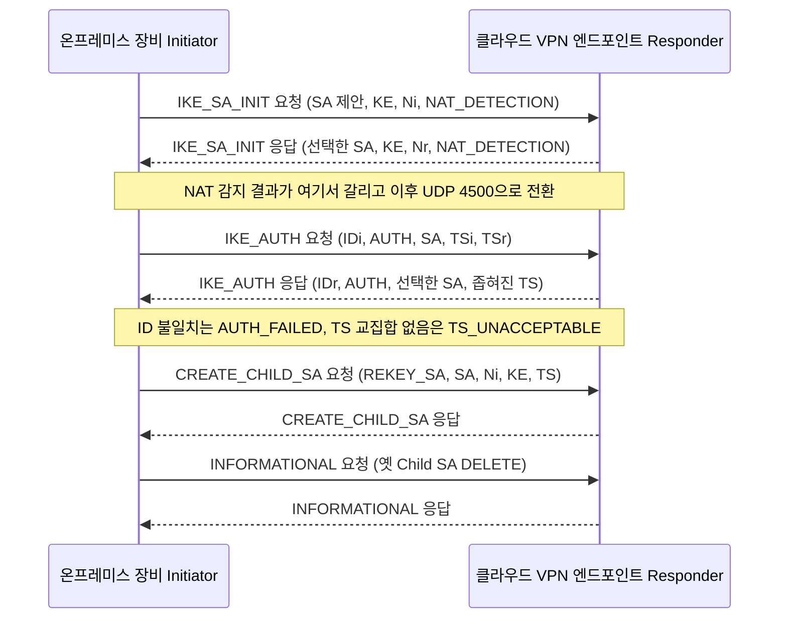
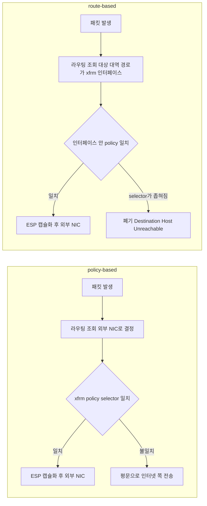
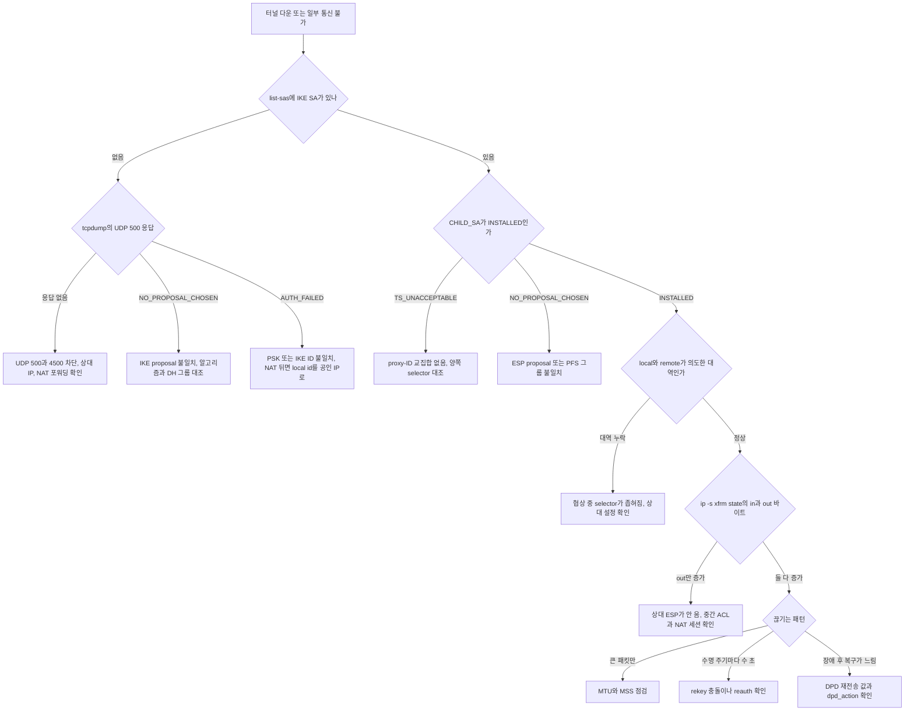

# Site-to-Site VPN 장비 쪽 IPsec 운영

클라우드 콘솔은 터널이 UP이면 거기서 끝난다. 장애는 그 뒤에 난다. 터널은 떠 있는데 한 대역만 안 되고, NAT 장비가 세션을 비운 뒤 끊기고, 장비를 교체했더니 ID가 달라 협상이 거부된다. 전부 온프레미스 장비 쪽에서만 보인다. 이 문서는 netns 세 개로 만든 랩(strongSwan 5.9.5, 커널 5.15)에서 재현하고 측정한 값을 쓴다. 클라우드 쪽 엔드포인트는 두 번째 strongSwan이라, AWS·GCP 기본값은 각 문서 기준이다. 클라우드 설정은 [AWS Site-to-Site VPN](../../Cloud/AWS/Network/Site_to_Site_VPN.md)과 [GCP Cloud VPN](../../Cloud/GCP/Network/Cloud_VPN.md), 프로토콜 일반론은 [VPN](VPN.md)을 본다.

## IKE 협상 세 단계와 UP의 의미

IKE_SA_INIT은 평문으로 알고리즘, DH, nonce, NAT 감지 해시를 주고받는다. IKE_AUTH에서 ID 인증과 첫 Child SA, traffic selector가 한 번에 협상된다. 수명이 차면 CREATE_CHILD_SA로 새 Child SA를 만들고 INFORMATIONAL로 옛것을 지운다.

IKE SA가 올라왔다고 통신이 되는 건 아니다. Child SA 협상이 실패해도 IKE SA는 남는다. 랩 로그에 `received TS_UNACCEPTABLE notify, no CHILD_SA built` 다음 줄이 `failed to establish CHILD_SA, keeping IKE_SA`였다. IKE SA만 보는 모니터링은 이 상태를 정상으로 읽는다.



## strongSwan으로 AWS 터널 붙이기

xfrm 인터페이스를 쓰는 route-based 구성이다(strongSwan 5.8 이상, 커널 4.19 이상). GCP도 `remote_addrs`, PSK, ID만 바꾸면 구조가 같다. AWS 터널은 두 개라 `aws-tun2`를 하나 더 둔다.

```bash
ip link add ipsec1 type xfrm dev eth0 if_id 101
ip link set ipsec1 up mtu 1400
ip addr add 169.254.10.2/30 dev ipsec1     # 터널 inside IP, BGP 피어링용
```

```
# /etc/strongswan.conf 의 charon 섹션에 install_routes = no 를 둔다 (라우팅은 직접 건다)

# /etc/swanctl/swanctl.conf
connections {
  aws-tun1 {
    version = 2
    local_addrs  = 192.168.1.2          # NAT 뒤 장비면 사설 IP
    remote_addrs = 203.0.113.101        # AWS 터널 1 외부 IP
    proposals = aes256-sha256-modp2048
    mobike = no
    fragmentation = yes
    dpd_delay = 10s
    local  { auth = psk
             id = 203.0.113.10 }        # CGW에 등록한 공인 IP
    remote { auth = psk
             id = 203.0.113.101 }
    children {
      aws-tun1 {
        local_ts  = 0.0.0.0/0
        remote_ts = 0.0.0.0/0
        esp_proposals = aes256-sha256-modp2048
        if_id_in = 101
        if_id_out = 101
        rekey_time = 3400s
        rand_time = 120s
        life_time = 3550s
        start_action = start            # AWS 기본이 add(대기)라 장비가 먼저 건다
        dpd_action = restart
      }
    }
  }
}
secrets {
  ike-aws-tun1 { id-1 = 203.0.113.10
                 id-2 = 203.0.113.101
                 secret = "..." }
}
```

랩에서 `swanctl --list-sas`는 이렇게 나왔다.

```
to-cloud: #1, ESTABLISHED, IKEv2, 90c366899e14c4ac_i* 995cdf3b911368c7_r
  local  '198.51.100.10' @ 192.168.1.2[4500]       # 포트 4500이면 NAT-T로 전환된 상태
  remote '198.51.100.2' @ 198.51.100.2[4500]
  AES_CBC-256/HMAC_SHA2_256_128/PRF_HMAC_SHA2_256/MODP_2048
  established 3s ago, rekeying in 13854s           # IKE SA 기본 4시간
  to-cloud: #1, reqid 1, INSTALLED, TUNNEL-in-UDP, ESP:AES_CBC-256/HMAC_SHA2_256_128
    installed 3s ago, rekeying in 3374s, expires in 3957s
    in  c290a12d (-|0x00000065),      0 bytes,     0 packets   # 0x65 = if_id 101
    out c44e76f5 (-|0x00000065),      0 bytes,     0 packets
    local  0.0.0.0/0
    remote 0.0.0.0/0
```

`_i*`의 `*`는 이쪽이 initiator라는 표시다. in 바이트가 0이고 out만 늘면 상대의 ESP가 안 돌아온다. 커널 쪽은 `ip -s xfrm state`로 본다(키는 가렸다).

```
src 192.168.1.2 dst 198.51.100.2
	proto esp spi 0xc44e76f5 reqid 1 mode tunnel
	enc cbc(aes) 0x<key>
	encap type espinudp sport 4500 dport 4500 addr 0.0.0.0   # UDP 캡슐화 중
	anti-replay context: seq 0x0, oseq 0x3, bitmap 0x00000000 # oseq = 내보낸 패킷 수
	if_id 0x65
	lifetime config:
	  expire add: soft 3394(sec), hard 3960(sec)             # soft가 rekey, hard가 life_time
	stats:
	  replay-window 0 replay 0 failed 0                      # failed가 늘면 replay 윈도우 문제
```

## route-based와 policy-based, proxy-ID 불일치

policy-based는 xfrm policy의 selector에 맞는 패킷만 암호화한다. route-based는 라우팅이 xfrm 인터페이스를 고르고 selector는 0.0.0.0/0으로 둔다. 어느 쪽이든 협상된 selector가 곧 proxy-ID다.



사고는 selector가 좁혀질 때 난다. 장비는 10.10.0.0/24와 10.20.0.0/24를 제안했고 클라우드는 10.10.0.0/24만 허용하게 해 봤다.

```
# 클라우드 쪽 로그
 config: 10.10.0.0/24, received: 10.10.0.0/24 => match: 10.10.0.0/24
 config: 10.10.0.0/24, received: 10.20.0.0/24 => no match
# 장비 쪽 list-sas
    local  10.10.0.0/24       <- 10.20.0.0/24 이 조용히 빠졌다
    remote 172.31.0.0/24
$ ping -I 10.10.0.1 172.31.0.1   -> 0% loss
$ ping -I 10.20.0.1 172.31.0.1   -> From 10.20.0.1 Destination Host Unreachable
```

터널은 ESTABLISHED이고 에러 로그도 없다. 교집합이 비면 `TS_UNACCEPT`로 Child SA 자체가 안 선다. 협상 뒤에는 `list-sas`의 local/remote를 의도한 대역과 대조한다. AWS는 selector 기본값이 0.0.0.0/0이고 터널 옵션에서 local/remote CIDR로 좁힌다. GCP는 `--local-traffic-selector`, `--remote-traffic-selector`가 있다. selector를 좁혀주는 대신 정확히 일치해야 한다고 요구하는 policy-based 장비도 있다.

## NAT-T와 IKE ID 불일치

IKE_SA_INIT의 NAT_DETECTION 해시로 경로에 NAT가 있는지 알아내고, 있으면 UDP 4500으로 옮겨 ESP를 UDP로 감싼다. NAT 장치는 UDP 500과 4500을 모두 통과시켜야 한다. 매핑 유지용 keepalive는 strongSwan 기본 20초(`charon.keep_alive`)다.

장비가 NAT 뒤에 있으면 ID가 문제다. strongSwan은 `id`를 안 쓰면 로컬 주소, 즉 사설 IP 192.168.1.2를 IDi로 보낸다. 클라우드는 NAT 장치의 공인 IP를 기대한다. 장비 쪽 로그에는 `received AUTHENTICATION_FAILED notify error` 한 줄뿐이고, 원인은 응답한 쪽에만 남는다.

```
# 응답 쪽 로그 (송신 주소는 NAT 공인 IP, IDi는 사설 IP)
looking for peer configs matching 198.51.100.2[198.51.100.2]...198.51.100.10[192.168.1.2]
no matching peer config found
generating IKE_AUTH response 1 [ N(AUTH_FAILED) ]
```

`local { id = <공인 IP> }`와 `secrets`의 id-1을 그 값으로 맞추면 풀린다. AWS는 터널 로그를 CloudWatch로 보낼 수 있으니 켜 둔다. GCP에서 NAT 뒤 피어가 지원되는 조건은 [Cloud VPN](../../Cloud/GCP/Network/Cloud_VPN.md)과 현재 문서에서 확인한다. UDP 캡슐화로 패킷이 커지므로 MTU는 [MTU, MSS, PMTUD](../7%20Layer/Network%20Layer/MTU_MSS_PMTUD.md)를 같이 본다.

## lifetime, rekey 충돌, DPD와 failover 시간

AWS 터널 옵션의 기본값은 Phase1 28800초, Phase2 3600초, rekey margin 540초, fuzz 100%, DPD timeout 30초, DPD 동작 clear, startup action add다. 수명은 IKEv2에서 협상하지 않고 각자 자기 타이머로 rekey한다. 양쪽이 같은 시각에 시작하면 충돌한다. 랩에서 양쪽 child `rekey_time`을 20초, `rand_time`을 0으로 두니 실제로 충돌했고 로그가 이렇게 남았다.

```
received DELETE for ESP CHILD_SA with SPI cf65881a   # 상대가 만든 SA가 nonce 비교에서 졌다
sending DELETE for ESP CHILD_SA with SPI c495930f
```

| 조건 | 결과 |
|---|---|
| child rekey 충돌, 10ms 간격 ping 4800개 | 유실 0 |
| child rekey 한쪽만 | 유실 0 |
| IKE reauth 20초, RTT 100ms, 3회, make_before_break=no | 4500개 중 64개(1.42%), 회당 약 0.2초 |
| 같은 조건, make_before_break=yes | 1개 |

strongSwan끼리는 옛 inbound SA를 `charon.delete_rekeyed_delay`(기본 5초) 동안 남겨 유실이 없었다. 다른 벤더 장비는 이 랩에서 안 봤다. 수 초짜리 구멍은 break-before-make인 reauth에서 개시 메시지 하나가 유실돼 첫 재전송(4초)을 기다릴 때 나온다고 계산된다. 그래서 `reauth_time`은 쓰지 않는다. 위 설정은 장비 child rekey를 AWS 개시 구간(수명에서 margin과 fuzz를 뺀 범위) 뒤로 밀어 AWS가 먼저 시작하게 한 것이다.

IKEv2의 DPD는 빈 INFORMATIONAL 요청이고, 응답이 없으면 재전송 규칙을 따른다. `dpd_timeout`이 아니라 `retransmit_timeout`(4초), `retransmit_base`(1.8), `retransmit_tries`(5)가 시간을 정한다. dpd_delay 5초로 링크를 끊고 쟀다.

| retransmit 설정 | 계산 | 실측(차단 후 포기까지) |
|---|---|---|
| 기본 4초, 1.8배, 5회 | 4+7.2+13+23.3+42+75.6 = 165초 | 22:25:10 차단, 22:28:00 포기, 약 170초 |
| 2초, 1.8배, 3회 | 2+3.6+6.5+11.7 = 23.7초 | 22:24:26 차단, 22:24:53 포기, 27초 |

포기 뒤 `dpd_action = restart`가 `restarting CHILD_SA`를 로그에 남기고 재시도했다. clear로 두면 장비가 다시 안 건다. 터널 두 개에 BGP를 올렸다면 BGP hold timer와 DPD 중 먼저 끝나는 쪽이 failover 시점이고, static이면 DPD 값이 곧 failover 시간이다.

## 겹치는 CIDR과 1:1 NAT

양쪽이 10.10.0.0/24일 때 장비에서 양방향을 변환했다. LAN 호스트(10.10.0.5)는 클라우드를 10.202.0.0/24로 보고, 클라우드는 LAN을 10.201.0.0/24로 본다.

```bash
ip rule add fwmark 0x1 lookup 100
ip route add 10.10.0.0/24 dev ipsec1 table 100
iptables -t mangle -A PREROUTING -i lan0 -d 10.202.0.0/24 -j MARK --set-mark 0x1
iptables -t nat -A PREROUTING  -i lan0 -d 10.202.0.0/24 -j NETMAP --to 10.10.0.0/24
iptables -t nat -A POSTROUTING -o ipsec1 -s 10.10.0.0/24 -j NETMAP --to 10.201.0.0/24
# swanctl: local_ts = 10.201.0.0/24, remote_ts = 10.10.0.0/24  (NAT 이후 주소)
```

fwmark 규칙이 핵심이다. DNAT 뒤 목적지가 10.10.0.x라 라우팅이 로컬 LAN을 골라 터널을 안 탄다. 규칙을 지우자 ping이 전부 실패했고 `ip route get 10.10.0.50`이 LAN 인터페이스를 가리켰다.

한계도 직접 확인했다. 클라우드 서버 로그에는 클라이언트가 10.201.0.5로 찍힌다. 서버가 응답에 자기 주소를 넣으면 깨진다. 302 Location을 `http://10.10.0.50:8000/next`로 주는 서버에 `curl -L`을 했더니 LAN 쪽으로 가서 실패했다. 변환은 상태 기반이라 장비를 이중화하면 conntrack 동기화가 필요하다. 가능하면 CIDR 재설계가 먼저다.

## 터널 다운 증상별 진단



순서는 로그부터다. 장비 로그는 `swanctl --log`, 패킷은 `tcpdump -ni eth0 'udp port 500 or udp port 4500 or esp'`, 커널 드롭은 `awk '$2 != 0' /proc/net/xfrm_stat`로 본다. 장비 쪽 에러는 거의 항상 "failed" 한 줄이라, 거부한 쪽의 로그를 못 보면 위 갈래를 하나씩 소거하는 수밖에 없다.
