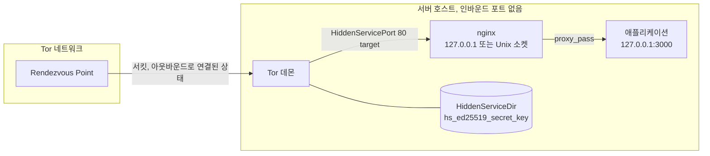
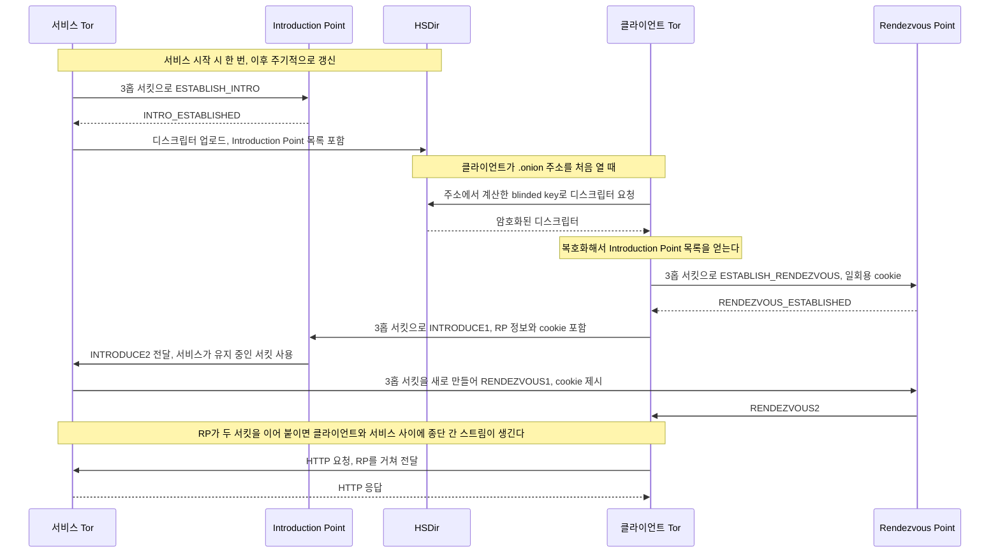
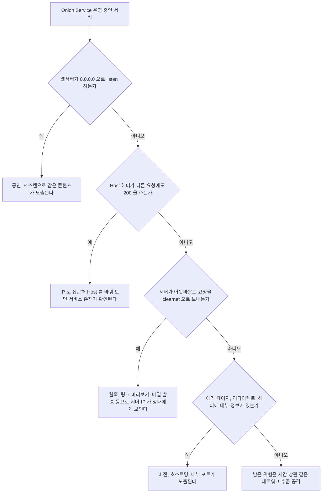
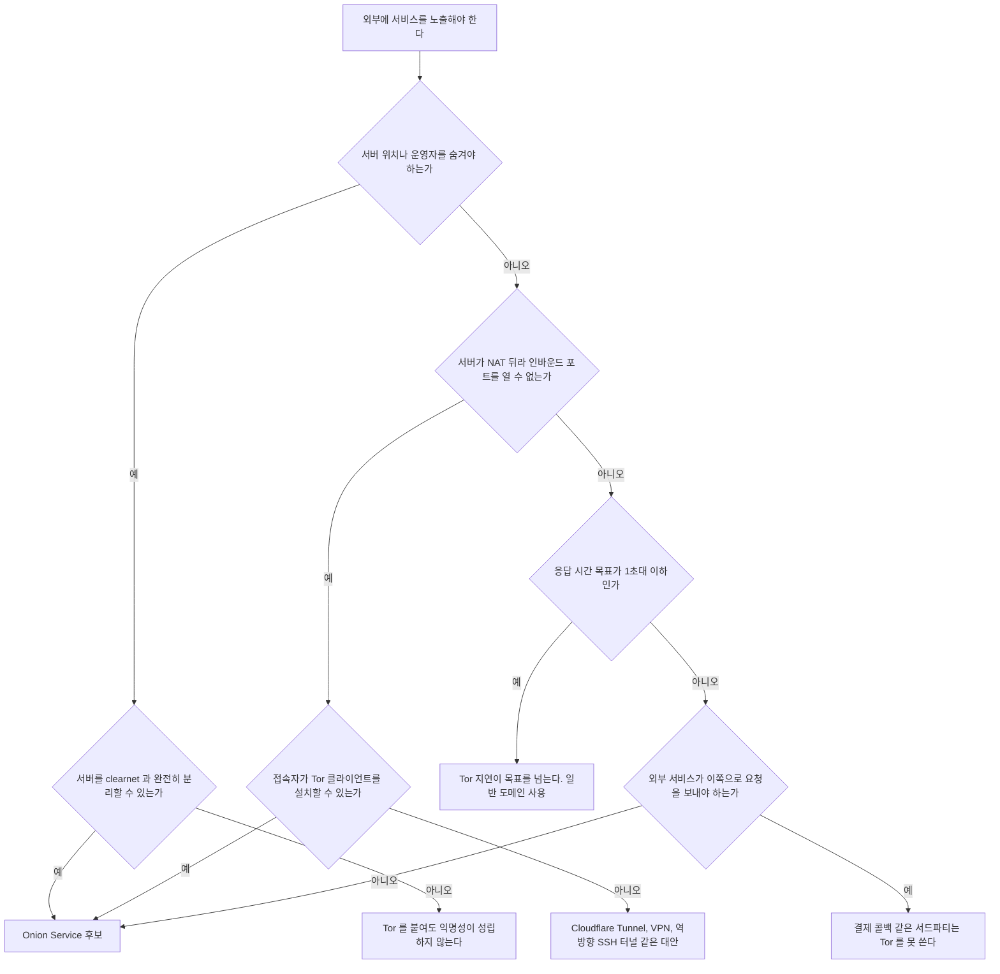

# Tor Onion Service v3 운영 - 주소 유도, 6홉 접속, nginx 연결, 키 관리

Onion Service는 서버가 공인 IP를 열지 않고 Tor 네트워크 안에서만 주소를 갖는 방식이다. 설정 자체는 torrc 두 줄이면 끝나서 띄우기는 쉽다. 문제는 그 뒤에 생긴다. 개인키 파일 하나가 곧 서비스의 신원이라 잃으면 주소가 사라지고, nginx 기본 설정 그대로 두면 서버 IP가 헤더와 리다이렉트로 새고, 클라이언트 IP는 전부 127.0.0.1로 보여서 기존 접근 제어가 무의미해진다.

이 문서의 설정과 수치는 Ubuntu 22.04에서 Tor 0.4.9.11, nginx 1.18.0으로 한 대에 서비스 Tor와 클라이언트 Tor를 따로 띄워서 확인한 값이다. 직접 재현하지 않은 내용은 그렇게 적었다. Tor 자체의 서킷 구조(Guard, Middle, Exit)는 [Tor 동작 원리](Tor_Onion_Routing.md)에 있고, 여기서는 서비스를 올리는 쪽만 다룬다.

## 최소 구성과 프로세스 배치

Tor 데몬은 외부 연결을 받는 프로세스가 아니라 Tor 네트워크로 나가는 아웃바운드 연결만 만든다. 서버에 열어 둘 인바운드 포트가 없다. 들어온 요청은 Tor가 rendezvous 서킷으로 받아서 torrc에 적은 로컬 주소로 TCP 연결을 새로 맺어 넘긴다. 웹서버 입장에서는 같은 호스트의 Tor 프로세스가 클라이언트다.



본문의 경계는 Tor 데몬과 웹서버 사이다. Tor와 nginx 사이는 로컬 TCP이거나 Unix 소켓이고, 이 구간이 바깥으로 노출되는 순간 Onion Service를 쓴 의미가 없어진다. 서버 호스트가 직접 인터넷에 열려 있으면(`listen 0.0.0.0:80`) 같은 콘텐츠를 가진 서버가 공인 IP에도 존재하는 셈이라, 포트 스캔 한 번으로 서비스 위치가 드러난다. 뒤에서 이 경로를 따로 다룬다.

### torrc

```text
# /etc/tor/torrc
HiddenServiceDir /var/lib/tor/myservice/
HiddenServicePort 80 127.0.0.1:8080
```

`HiddenServiceDir`은 키와 주소가 저장되는 디렉터리다. 서비스마다 디렉터리가 하나씩 따로 필요하다. `HiddenServicePort`의 첫 번째 값은 클라이언트가 보는 가상 포트이고 두 번째가 실제로 연결할 대상이다. 같은 `HiddenServiceDir` 아래에 `HiddenServicePort`를 여러 줄 쓰면 포트별로 다른 대상으로 보낼 수 있다. 같은 가상 포트에 대상을 여러 줄 쓰면 연결마다 그중 하나가 무작위로 선택된다는 점이 man 페이지에 있다. 로드밸런싱으로 믿고 쓰기에는 가중치도 헬스체크도 없다.

Tor를 처음 띄우면 디렉터리가 이렇게 만들어진다.

```text
$ ls -la /var/lib/tor/myservice/
drwx------ authorized_clients
-rw------- hostname                    63 bytes
-rw------- hs_ed25519_public_key       64 bytes
-rw------- hs_ed25519_secret_key       96 bytes
```

`hostname`은 62자 주소에 개행이 붙은 63바이트다. 이 세 파일의 관계가 다음 절의 주제이고, `authorized_clients`는 클라이언트 인증에서 쓴다. 디렉터리 권한은 700이어야 하고 Tor가 소유해야 한다. 패키지로 설치하면 `debian-tor` 사용자가 이 위치를 관리한다.

### nginx를 localhost에 붙이기

```nginx
# /etc/nginx/conf.d/onion.conf
server_tokens off;
server_names_hash_bucket_size 128;
port_in_redirect off;

limit_conn_zone $server_name zone=onion_all:1m;

server {
    listen 127.0.0.1:8080 default_server;
    server_name _;
    return 444;
}

server {
    listen 127.0.0.1:8080;
    server_name c2rfb6ymajw3paimozi2mjbj3i2uiu5meghh3nhptscz3zngwetxjlqd.onion;

    limit_conn onion_all 200;

    location / {
        proxy_pass http://127.0.0.1:3000;
        proxy_set_header Host $host;
        proxy_set_header X-Forwarded-For "";
    }
}
```

각 줄에 이유가 있다.

`server_names_hash_bucket_size 128`이 없으면 nginx가 시작하지 않는다. `.onion` 주소는 62자라서 기본 버킷 크기 64에 걸리고 `could not build server_names_hash, you should increase server_names_hash_bucket_size: 64`가 나온다. 이 설정이 없는 채로 reload하면 실패해서 기존 설정이 유지되므로, 배포 파이프라인에서 `nginx -t`를 빼먹으면 변경이 반영되지 않은 채 지나간다.

`default_server`에서 444를 돌려주는 이유는 Host 헤더가 다른 요청을 걸러내기 위해서다. 같은 설정에서 default_server 없이 `server_name`만 지정해 두면, `Host: evil.example`로 요청해도 200과 같은 페이지가 나온다. 기본 설정에서 직접 확인했다. 444는 nginx가 응답 없이 연결을 닫는 코드이고, curl로 보면 종료 코드 52(빈 응답)로 끝난다.

`port_in_redirect off`는 비표준 포트로 listen할 때 필요하다. 8081에서 listen하는 서버에 `/dir`(슬래시 없는 디렉터리)을 요청하면 `Location: http://<주소>.onion:8081/dir/`이 나온다. 클라이언트는 80번이 아니라 8081로 가려고 하고 당연히 접속이 안 된다. 내부 포트 번호가 바깥에 노출되는 것도 문제다. 이 옵션을 켠 설정에서는 `Location: http://<주소>.onion/dir/`로 정상 출력됐다.

`X-Forwarded-For`를 빈 값으로 덮는 것은 클라이언트가 보낸 값을 애플리케이션이 믿지 못하게 하려는 것이다. 어차피 원본 IP는 존재하지 않는다.

### 연결 대상으로 Unix 소켓 쓰기

로컬 TCP 포트는 같은 호스트의 다른 프로세스나 컨테이너가 붙을 수 있다. 소켓 파일을 쓰면 파일 권한으로 접근 주체를 제한할 수 있다.

```text
# torrc
HiddenServicePort 80 unix:/run/tor/onion-web.sock
```

```nginx
server {
    listen unix:/run/tor/onion-web.sock;
    server_name c2rfb6ymajw3paimozi2mjbj3i2uiu5meghh3nhptscz3zngwetxjlqd.onion;
    ...
}
```

소켓 방식으로 `--verify-config`가 통과하고, nginx가 소켓을 열어 `curl --unix-socket`으로 정상 응답하는 것까지 확인했다. 소켓 파일은 nginx가 만들기 때문에 Tor 프로세스(debian-tor)가 읽고 쓸 수 있는 소유자나 그룹으로 맞춰야 한다. 내 실험에서는 root로 돌려서 `chmod 666`으로 넘어갔는데, 그대로 따라 하면 안 된다. 그룹을 공유하는 쪽으로 권한을 조정하는 편이 맞다.

### 애플리케이션이 보는 클라이언트 주소

nginx 액세스 로그에는 모든 요청이 `127.0.0.1`로 찍힌다.

```text
127.0.0.1 - - [29/Oct/2026:12:32:10 +0900] "GET / HTTP/1.1" 200 12 "-" "curl/7.81.0"
127.0.0.1 - - [29/Oct/2026:12:32:11 +0900] "GET / HTTP/1.1" 200 12 "-" "curl/7.81.0"
```

이 때문에 생기는 문제가 두 가지다. 로그로 사용자를 구분할 수 없다. 그리고 `limit_req_zone $binary_remote_addr`로 IP별 제한을 걸면 모든 사용자가 같은 키를 공유한다. 한 명이 몰아 쓰면 정상 사용자 전원이 같이 막힌다. 위 설정에서 `limit_conn_zone`의 키를 `$server_name`으로 잡은 것은 이 때문이다. 서버 전체 동시 연결 상한이 되고, 사용자별 제한은 불가능하다는 것을 받아들이는 설정이다. 사용자 단위 제한이 필요하면 로그인 세션이나 토큰 같은 애플리케이션 레벨 식별자로 걸어야 한다.

man 페이지에는 `HiddenServiceExportCircuitID haproxy`라는 옵션도 있다. 연결마다 PROXY 프로토콜 헤더 형태로 서킷 식별자를 IPv6 주소의 하위 32비트에 실어 보낸다. 같은 서킷에서 온 요청을 묶을 수 있다는 정도의 쓸모이고, 이 옵션은 직접 돌려 보지 않았다.

## v3 주소는 공개키에서 계산한 값이다

v3 주소는 등록받는 이름이 아니라 ed25519 공개키에서 계산하는 값이다. 56글자 base32 문자열 하나에 공개키 32바이트, 체크섬 2바이트, 버전 1바이트가 들어 있다.

```text
주소 = base32( 공개키(32B) | 체크섬(2B) | 버전(1B, 0x03) ) + ".onion"
체크섬 = SHA3-256( ".onion checksum" | 공개키 | 버전 )의 앞 2바이트
```

`hs_ed25519_public_key` 파일에서 앞 32바이트는 `== ed25519v1-public: type0 ==` 헤더이고 뒤 32바이트가 공개키다. 이 사실로 `hostname` 파일 없이 주소를 직접 계산할 수 있다.

```python
import hashlib, base64

pub = open('/var/lib/tor/myservice/hs_ed25519_public_key', 'rb').read()[32:]
ver = b'\x03'
chk = hashlib.sha3_256(b'.onion checksum' + pub + ver).digest()[:2]
print(base64.b32encode(pub + chk + ver).decode().lower() + '.onion')
```

```text
c2rfb6ymajw3paimozi2mjbj3i2uiu5meghh3nhptscz3zngwetxjlqd.onion
```

`hostname` 파일의 내용과 글자 하나까지 일치했다. 32 + 2 + 1 = 35바이트이고 base32는 5바이트당 8글자니까 정확히 56글자로 떨어진다. 패딩 문자가 필요 없어서 주소에 `=`가 없다.

여기서 나오는 성질이 몇 가지 있다. 주소 자체가 공개키라서 클라이언트는 주소만 알면 서비스의 서명을 검증할 수 있다. 중간에 주소를 가로채서 다른 서버로 바꿔치는 중간자 공격이 성립하려면 해당 개인키가 필요하다. DNS도 CA도 필요 없는 이유가 이것이다. 반대로 사람이 외울 수 있는 주소는 만들 수 없고, 앞부분 몇 글자를 원하는 값으로 맞추려면 키 생성을 무수히 반복해서 우연히 맞는 키를 찾아야 한다.

주소가 공개키라고 해서 네트워크 안에서 주소가 그대로 돌아다니는 것은 아니다. 서비스는 Introduction Point 목록이 담긴 디스크립터를 HSDir에 올리는데, v3에서는 공개키 그대로가 아니라 시간 구간마다 달라지는 blinded key로 올린다. 주소를 아는 클라이언트는 같은 blinded key를 계산해서 같은 HSDir을 찾아가고, HSDir 운영자는 blinded key만 봐서는 원래 주소를 알아낼 수 없다. 디스크립터 내용도 주소를 아는 쪽만 복호화할 수 있는 형태로 암호화된다. v2 시절에는 HSDir이 주소 목록을 쉽게 수집할 수 있었던 점이 이렇게 바뀌었다.

## 접속은 6홉으로 이루어진다

클라이언트와 서비스는 서로의 IP를 모른 채 중간 지점에서 만난다. 클라이언트가 Rendezvous Point까지 3홉, 서비스가 같은 지점까지 3홉이라 합쳐서 6홉이 된다. 일반 웹 접속이 출구 노드까지 3홉인 것과 비교해 지연이 크게 늘어나는 이유다.



도식에서 볼 점은 서비스가 Introduction Point로 향하는 서킷을 미리 만들어 두고, 실제 접속이 올 때마다 Rendezvous Point로 새 서킷을 만든다는 것이다. 접속 요청을 받는 쪽과 실제 데이터가 오가는 쪽이 분리돼 있다. Introduction Point는 서비스의 IP를 모르고(서비스도 Tor 서킷으로 연결했으니), Rendezvous Point는 양쪽 어느 쪽 IP도 모른다. 어느 한 릴레이도 클라이언트와 서비스를 모두 알지 못한다.

운영에서 이 구조가 만드는 현상이 몇 가지 있다. 서비스 쪽에서 새 접속이 올 때마다 서킷을 만들기 때문에 서비스 Tor 프로세스의 CPU와 대역폭이 접속 수에 비례해서 늘어난다. 서비스를 막는 가장 간단한 방법은 이 서킷 생성을 강제하는 것이고, 뒤의 DoS 절에서 다룬다. 또 서비스 Tor가 막 시작되고 디스크립터를 올리기 전에는 아무도 접속할 수 없다. 재시작 직후의 짧은 공백은 피할 수 없다.

### 첫 접속이 느린 것은 정상이다

같은 머신에서 서비스 Tor와 클라이언트 Tor(SocksPort 19050)를 따로 띄우고, 클라이언트 Tor를 부팅 완료한 직후 같은 주소로 세 번 연속 요청한 결과다.

```text
try 1  code=200 connect=12.305711 starttransfer=13.051062 total=13.051115
try 2  code=200 connect=1.090488  starttransfer=2.260896  total=2.260954
try 3  code=200 connect=1.076152  starttransfer=1.845562  total=1.845617
```

첫 요청이 13초 걸렸다. 디스크립터를 HSDir에서 받아오는 과정, Rendezvous Point 서킷 구성, Introduction Point를 통한 협상이 전부 첫 요청에 몰리기 때문이다. 이후 요청은 디스크립터가 캐시돼서 2초 안팎이다. 한 대의 서버에서 각각 한 번씩 잰 값이라 네트워크 상태에 따라 달라진다. 숫자 자체보다 이 지연이 한 자릿수 초에서 수십 초 범위이고 첫 요청에 집중된다는 점이 중요하다. 이 수치로 설계할 때 반영해야 할 것이 있다.

- 클라이언트의 HTTP 타임아웃을 보통의 5~10초로 잡으면 첫 요청이 실패한다. 30초 이상으로 잡고, 한 번은 재시도한다.
- 헬스체크는 바로 앞 요청에서 서킷이 이미 만들어진 상태가 아니라 새 클라이언트 기준으로 설계해야 한다. 외부 모니터링 호스트에서 Tor를 쓴다면 요청마다 Tor 프로세스를 재시작하지 않는 한 위 두 번째 이후 값이 나온다.
- 하나의 페이지가 여러 리소스를 연속으로 요청하면 연결마다 스트림이 생긴다. 한 번 붙은 뒤에는 병렬 요청이 대부분 같은 서킷 위에서 처리되므로 이후 요청은 느리지 않다.

## 개인키 파일을 잃거나 유출했을 때

`hs_ed25519_secret_key`는 96바이트 파일이고 32바이트 헤더(`== ed25519v1-secret: type0 ==`)를 뺀 64바이트가 실제 개인키다. 이 파일이 서비스의 전부다. 공개키와 `hostname`은 개인키에서 다시 만들 수 있는 파생물이다.

개인키만 남기고 나머지를 지워도 복구되는지 직접 확인했다. 새 디렉터리에 `hs_ed25519_secret_key` 하나만 복사하고 Tor를 시작하자 `hostname`과 `hs_ed25519_public_key`가 다시 생겼고 주소는 원본과 같았다.

```text
원본:  c2rfb6ymajw3paimozi2mjbj3i2uiu5meghh3nhptscz3zngwetxjlqd.onion
복원:  c2rfb6ymajw3paimozi2mjbj3i2uiu5meghh3nhptscz3zngwetxjlqd.onion
```

반대로 키 없이 빈 디렉터리로 시작하면 새 키를 만들고 완전히 다른 주소(`6mqodigwgljwcnhybelzao6xfopiap22qjke5dhsmzznqub5o7rrrayd.onion`)를 받는다. 구분은 간단하다.

| 상황 | 결과 | 대응 |
|---|---|---|
| 개인키를 잃음, 백업 없음 | 주소를 되살릴 방법이 없다. 새 주소로 다시 시작해야 하고 기존 북마크, 외부 링크, 사용자가 외운 주소가 전부 무효가 된다 | 새 주소를 공지할 별도 채널이 있어야 한다 |
| 개인키를 잃음, 백업 있음 | 개인키 하나를 복사해 넣고 Tor를 시작하면 같은 주소로 복원된다 | 백업은 개인키 하나만 있어도 충분하다 |
| 개인키가 유출됨 | 키를 가진 누구든 같은 주소의 정당한 서비스를 띄울 수 있다 | 폐기 수단이 없다. 새 키로 새 주소를 만들고 옮겨야 한다 |
| 서버 디스크를 통째로 가져감 | 디스크에 개인키가 평문으로 있으면 유출과 같은 상태가 된다 | 디스크를 암호화한다 |

유출 시 대응이 어려운 이유는 v3 주소에 인증서 폐기 같은 장치가 없기 때문이다. 유출된 키로 만든 디스크립터도 네트워크 입장에서는 유효한 서명을 가진 정상 디스크립터다. 같은 주소를 두 곳에서 서비스하는 상황이 되면 어느 쪽이 정당한지 클라이언트가 구분할 방법이 없다. 그래서 개인키는 TLS 개인키보다 더 엄격하게 다루는 편이 맞다. TLS 인증서는 폐기하고 재발급하면 되지만 이쪽은 주소 자체가 바뀐다.

운영에서 현실적인 규칙은 이렇다. 백업은 암호화한 별도 저장소에 두고, 배포 이미지나 컨테이너 레이어, git 저장소에는 절대 넣지 않는다. 쿠버네티스에서는 Secret으로 마운트하되 `defaultMode: 0400`처럼 파일 권한을 좁게 준다. 서버를 교체할 때는 개인키 파일을 안전한 경로로 옮기는 절차가 반드시 있어야 하고, 이 절차를 미리 한 번 리허설해 두지 않으면 장애 때 처음으로 해 보게 된다. 같은 키로 서버를 여러 대 두는 구성은 Tor에 OnionBalance 연동 옵션(`HiddenServiceOnionBalanceInstance`)이 따로 있을 정도로 별도 주제라서 여기서는 다루지 않는다.

## 서버 IP가 새는 경로

Onion Service의 익명성은 Tor 쪽에서 지켜 주지만, 애플리케이션과 웹서버가 스스로 IP를 흘리는 것은 막아 주지 않는다. 실제 사고는 대부분 이 경로에서 난다.



위에서 아래로 내려오며 걸러지는 구조다. 각 경로는 다음과 같다.

**clearnet에 같은 서버가 열려 있는 경우.** 가장 흔하다. 기존에 운영하던 서비스에 `.onion` 주소를 하나 더 붙이는 경우, 같은 nginx가 80번과 443번도 열고 있다. 인터넷 전체 스캔 서비스는 `Server` 헤더, 페이지 제목, 파비콘 해시 등으로 같은 콘텐츠를 가진 서버를 색인한다. Onion Service에서 받은 응답의 특징 몇 가지를 검색하면 공인 IP가 나온다. Onion Service 전용 호스트를 쓰거나, 최소한 `.onion` 용 server 블록만 로컬 주소로 listen해야 한다.

**Host 헤더 처리.** 위 nginx 설정에서 `default_server` 없이 두면 직접 IP로 접근해도 응답이 나온다. 기본 설정에서 직접 재현했다. IP를 알아낸 쪽이 Host만 바꿔 보내면 같은 서비스가 거기 있다는 것이 확인되므로, 알려지지 않은 Host는 444로 끊는다.

**버전과 에러 페이지.** `server_tokens off`로 `Server: nginx/1.18.0 (Ubuntu)`가 `Server: nginx`로 줄어든다. 완전히 사라지지는 않는다. OS 배포판과 버전이 같이 나오는 기본 값에 비해 지문 정보는 줄지만 nginx라는 사실은 남는다. `more_clear_headers Server;`를 쓰려면 `headers-more` 모듈이 필요하다. 이 모듈은 설치해 보지 않았다. 애플리케이션 프레임워크의 에러 페이지(스택 트레이스, 서버 호스트명, 내부 경로)와 디버그 모드는 프로덕션 설정에서 반드시 꺼야 한다. 이쪽은 프레임워크마다 달라서 일반화하지 않는다.

**리다이렉트.** 앞에서 본 `port_in_redirect`가 대표적이다. `server_name_in_redirect`, `absolute_redirect` 같은 옵션이 비슷한 부류이고, 애플리케이션이 `Location` 헤더나 HTML 안에 절대 URL을 만들 때 내부 호스트명이나 사설 주소를 넣고 있지 않은지 `curl -i`로 응답 전체를 읽어 확인한다.

**아웃바운드 연결.** 가장 놓치기 쉽다. 서버가 웹훅을 보내거나, 사용자가 입력한 URL의 미리보기를 가져오거나, OAuth 콜백을 처리하거나, 메일을 보내면 그 서버의 공인 IP가 상대 서버 로그에 남는다. 공격자가 자신이 통제하는 URL을 서비스에 입력하는 SSRF 스타일의 시나리오가 가장 직접적이다. 서버의 모든 아웃바운드를 막거나(egress 방화벽) `torsocks`나 SOCKS 프록시로 Tor를 거치게 해야 한다. 서버 패키지 업데이트(`apt`)도 같은 IP로 나간다는 점은 전용 호스트에서 큰 문제가 아닐 수 있지만, 알고 있어야 한다.

**시간 상관.** 서비스가 재시작되는 시각과 clearnet 사이트의 가동 중단 시각이 겹치는 식의 간접 증거로도 같은 운영자임을 추정할 수 있다. 이 부분은 설정으로 막을 수 없는 영역이라, 서버를 완전히 분리하는 것이 유일한 대책이다.

## 클라이언트 인증

주소를 아는 사람이면 누구나 접속할 수 있는 것이 기본값이다. 접속 가능한 사람을 제한하려면 v3의 클라이언트 인증을 쓴다. 인증은 HTTP 레벨이 아니라 디스크립터 복호화 단계에서 이루어진다. 키가 없는 클라이언트는 Introduction Point 목록조차 읽지 못한다.

사용자마다 x25519 키 쌍을 만들고, 서비스는 공개키를, 사용자는 개인키를 보관한다.

```bash
# 사용자 측에서 키 쌍 생성
openssl genpkey -algorithm x25519 -out alice.pem

python3 - <<'EOF'
import subprocess, base64
priv = subprocess.run("openssl pkey -in alice.pem -outform DER",
                      shell=True, capture_output=True).stdout[-32:]
pub  = subprocess.run("openssl pkey -in alice.pem -pubout -outform DER",
                      shell=True, capture_output=True).stdout[-32:]
b32 = lambda x: base64.b32encode(x).decode().rstrip('=')
print("pub :", b32(pub))
print("priv:", b32(priv))
EOF
```

DER 인코딩의 마지막 32바이트가 원시 키 바이트다. 각각 base32로 인코딩하면 패딩을 뺀 52글자가 나온다.

서비스 쪽은 `HiddenServiceDir/authorized_clients/` 아래에 `.auth` 확장자 파일 하나당 한 사용자를 둔다.

```text
# /var/lib/tor/myservice/authorized_clients/alice.auth
descriptor:x25519:OFXA7Z7SYV63HCMUO7RROGD6R6WTEGH722XR24XSCWF2UQ4D2USA
```

클라이언트 쪽은 `ClientOnionAuthDir`에 `.auth_private` 파일을 둔다. 주소에서 `.onion`을 뺀 56글자 부분이 앞에 붙는다.

```text
# torrc (클라이언트)
ClientOnionAuthDir /var/lib/tor/onion_auth

# /var/lib/tor/onion_auth/alice.auth_private
c2rfb6ymajw3paimozi2mjbj3i2uiu5meghh3nhptscz3zngwetxjlqd:descriptor:x25519:<개인키 base32>
```

서비스 Tor에 SIGHUP을 보내 설정을 다시 읽게 한 뒤, 캐시가 없는 새 클라이언트 두 개로 확인했다. 인증 파일이 없는 클라이언트는 curl이 종료 코드 97(SOCKS5 연결 실패)로 끝났고, Tor 로그에 이렇게 남았다.

```text
[notice] Fail to decrypt descriptor for requested onion address. It is likely requiring client authorization.
```

인증 파일이 있는 클라이언트는 200을 받았고 걸린 시간은 5.9초였다. 이 메시지가 인증 실패를 알려 주는 거의 유일한 단서다. 사용자가 "접속이 안 된다"고 문의할 때 Tor 로그에서 이 줄이 있는지부터 본다.

세 가지는 알아 둬야 한다. `authorized_clients`에 유효한 파일이 하나라도 로드되면 그때부터 모든 클라이언트가 인증이 필요해진다. 기존에 주소만 알던 사용자는 모두 막힌다. 설정을 바꾸는 순간 서비스 전체가 잠기므로 사용자 키를 먼저 배포한 뒤에 켜야 한다. 사용자 폐기는 `.auth` 파일을 지우고 SIGHUP 또는 재시작으로 반영된다고 man 페이지에 적혀 있다. 폐기된 사용자가 이미 캐시한 디스크립터로 얼마나 계속 접속할 수 있는지는 확인하지 못했다. 마지막으로 서비스 쪽에서는 어떤 사용자가 접속했는지 알 수 없다. 인증은 접속 허용 여부만 정하고, 로그에는 여전히 127.0.0.1만 찍힌다.

## DoS 완화 설정

서비스가 접속마다 서킷을 새로 만드는 구조 때문에 공격 비용이 비대칭이다. 공격자는 작은 INTRODUCE1 메시지를 던지기만 하고 서비스는 Rendezvous Point까지 서킷을 만들어야 한다. Tor가 제공하는 방어는 층이 나뉜다.


도식은 요청이 바깥에서 안쪽으로 들어오며 걸리는 지점을 순서대로 나타낸 것이다. 앞 단계일수록 서비스 자원을 덜 쓰고 막지만 선별이 거칠다.

```text
# torrc
HiddenServiceDir /var/lib/tor/myservice/
HiddenServicePort 80 127.0.0.1:8080

# Introduction Point 단계 제한
HiddenServiceEnableIntroDoSDefense 1
HiddenServiceEnableIntroDoSRatePerSec 25
HiddenServiceEnableIntroDoSBurstPerSec 200

# Proof-of-Work 우선순위 큐
HiddenServicePoWDefensesEnabled 1
HiddenServicePoWQueueRate 50
HiddenServicePoWQueueBurst 200

# 서킷 하나에서 열 수 있는 스트림 수
HiddenServiceMaxStreams 20
HiddenServiceMaxStreamsCloseCircuit 1
```

이 설정은 `tor --verify-config`가 `Configuration was valid`로 통과했고, 개인키만 복사한 디렉터리로 실제로 Tor를 띄워 부팅까지 완료되는 것을 확인했다. 실제 공격 트래픽을 걸어 효과를 측정하지는 않았으므로, 아래의 동작 설명은 man 페이지 내용이다.

**IntroDoSDefense.** 기본값은 꺼짐이다. 켜면 Introduction Point 하나당 초당 25건, 순간 200건까지 허용하도록 Introduction Point에 요청한다(값은 위에 적은 기본값 그대로다). man 페이지가 직접 밝히는 한계가 있다. 이 방어는 서비스를 지키는 게 아니라 네트워크를 지키는 쪽에 가깝다. 공격자가 Introduction Point 세 곳을 모두 막아 버리면 정상 사용자도 서비스에 들어올 수 없다. 서비스 Tor의 과부하를 줄이는 효과가 있고 가용성을 보장하지는 못한다.

**PoW.** 옵션 이름은 `HiddenServicePoWDefensesEnabled`이다. `HiddenServicePoWDefenses`처럼 줄여 쓰거나 비슷한 철자로 쓰면 Tor가 `Unknown option 'HiddenServicePoWDefences'. Failing.`으로 시작 자체를 거부한다. 철자를 헷갈려서 조용히 무시되는 방식이 아니라 실패하는 쪽이라서 오히려 안전하다. 이 기능은 서비스가 과부하일 때만 클라이언트에게 퍼즐을 내고, 높은 노력을 들여 푼 요청의 처리 순서를 앞당긴다. 평소에는 퍼즐을 내지 않는다. 사용하려면 빌드에 pow 모듈이 들어 있어야 한다. 직접 확인하는 방법이 있다.

```bash
$ tor --list-modules
relay: yes
dirauth: yes
dircache: yes
pow: yes
```

man 페이지에는 모듈이 컴파일되지 않은 빌드에서는 PoW 옵션이 효과가 없다고 적혀 있다. 배포판 패키지의 Tor 버전이 오래돼서 이 옵션을 인식하지 못하는 경우도 생긴다. 옵션을 넣어 두고 켜졌다고 믿지 말고 `--list-modules`와 `--verify-config`로 확인한다. 클라이언트도 PoW를 지원하는 Tor 버전이어야 퍼즐을 풀 수 있다. 지원하지 않는 클라이언트는 우선순위 없이 큐 뒤쪽에 서게 된다. `HiddenServicePoWQueueRate`는 초당 처리량이고 기본값이 250, `HiddenServicePoWQueueBurst`는 기본값 2500이다. 위 예제의 50과 200은 서비스 호스트가 작을 때 낮춘 값이다. 내 예시 값이라 근거가 있는 수치는 아니다. 호스트 자원에 맞춰 부하 테스트로 정한다.

**MaxStreams.** 서킷 하나가 동시에 열 수 있는 스트림 수를 제한한다. `HiddenServiceMaxStreamsCloseCircuit 1`이 없으면 상한을 넘는 요청이 조용히 무시되고, 켜 두면 해당 서킷 자체를 끊는다. 한 서킷으로 연결을 수천 개 여는 방식의 남용에 대한 방어다.

**nginx와 애플리케이션 단계.** 앞에서 본 것처럼 IP 기반 제한은 의미가 없다. `limit_conn`을 `$server_name` 키로 걸어 서버 전체 동시 연결 상한을 두고, 정상 사용자를 구분해야 하는 제한(로그인 시도 횟수, API 호출량)은 세션이나 토큰 단위로 애플리케이션이 맡는다. 앞 단계가 뚫려서 공격 트래픽이 nginx까지 오면 이미 서킷은 만들어진 뒤라서 Tor 프로세스의 CPU 부담은 해결되지 않는다.

## Tor로 외부에 노출할지 정하는 기준

Tor를 쓰는 이유는 크게 세 부류다. 서버 위치를 숨겨야 하는 경우, 서버가 NAT 뒤에 있어 포트 개방 없이 외부에 노출해야 하는 경우, 도메인과 인증서 없이 종단 간 인증된 접근이 필요한 경우다. 각 경우에 Tor의 한계가 맞는지 따져 본다.



판단의 핵심 질문은 접속하는 쪽이 누구냐다. 접속자가 Tor Browser를 쓰는 사람이거나 직접 Tor를 설치할 수 있는 내부 직원이면 Onion Service가 맞다. 불특정 다수의 일반 브라우저, 모바일 앱, 서드파티 웹훅이면 맞지 않는다. 예를 들어 결제사 웹훅 서버는 Tor를 통해 `.onion`에 접속하지 않는다. 관리자 페이지 하나만 외부에 열고 싶고 접속자가 사내 몇 명뿐이라면, 포트를 닫은 채로 쓸 수 있고 클라이언트 인증까지 붙일 수 있어서 VPN을 새로 구축하는 것보다 간단하다. 다만 이 경우의 지연은 처음 열 때 10초 넘게 걸리는 것을 사용자가 감수해야 한다. 사내 접근 통제를 어떻게 구성할지는 [Zero Trust 네트워크](Zero_Trust_Network.md)와 [VPN](VPN.md)에서 비교해 볼 수 있다.

운영 부담도 가볍지 않다. 가용성 면에서 Tor 네트워크 자체의 상태(릴레이 수, 디렉터리 합의)에 서비스가 의존한다. Tor 데몬은 보안 업데이트가 자주 나오는 소프트웨어라서 버전을 따라가야 한다. 외부 모니터링은 별도의 Tor 클라이언트가 달린 호스트에서 `.onion`을 호출해야만 할 수 있고, 같은 호스트 내부의 `curl 127.0.0.1`은 Tor 경로가 죽어 있어도 성공한다. 서비스 로그에는 클라이언트 정보가 없으니 장애 분석과 감사에서 쓸 수 있는 단서도 줄어든다. 이 점들을 받아들일 수 있을 때만 쓴다.
