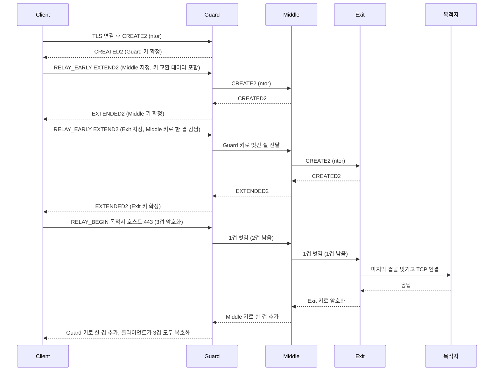
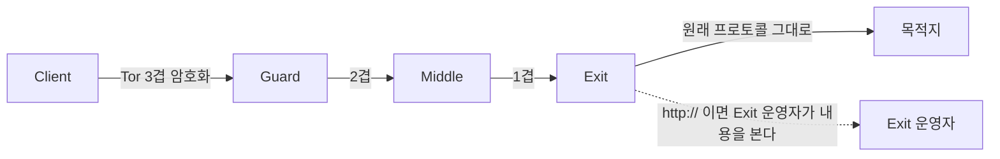
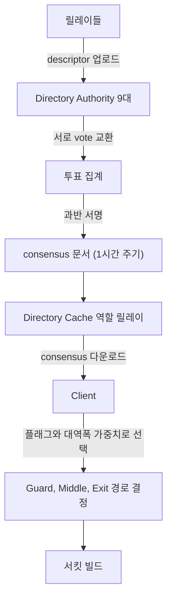
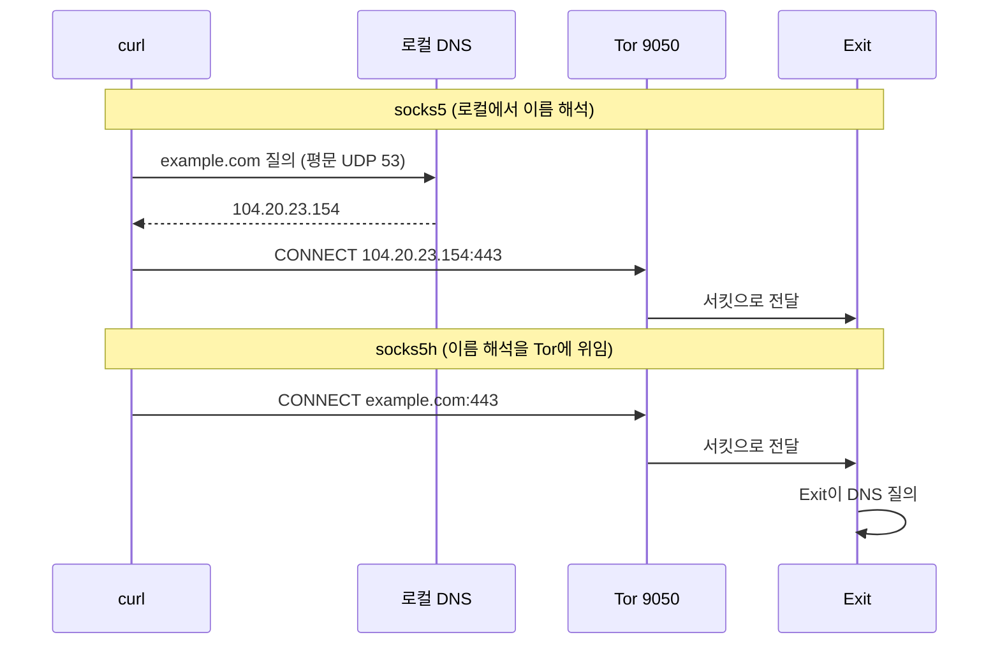

# Tor 동작 원리 - 3홉 서킷, Directory Authority, 그리고 출구 노드 구간

Tor는 "IP를 숨겨 주는 도구"로 알려져 있지만, 백엔드 개발자가 Tor를 마주치는 자리는 대개 두 곳이다. 서비스 로그에 출구 노드 IP가 찍혀서 차단 여부를 정해야 할 때, 그리고 내부 도구가 외부로 나가는 경로를 Tor로 돌릴 때다. 둘 다 서킷이 어떻게 만들어지고 누가 무엇을 아는지 모르면 판단이 틀어진다.

이 문서의 설정과 수치는 Ubuntu 22.04에서 `apt install tor torsocks`로 설치한 Tor 0.4.9.11을 실제로 띄워서 확인한 값이다. 남이 측정한 수치는 출처를 달았고, 직접 잰 값은 그렇게 표시했다.

## 서킷 하나가 만들어지는 과정

Tor 클라이언트는 목적지로 바로 가지 않고 릴레이 3개를 순서대로 거치는 서킷을 먼저 만든다. 서킷은 Guard, Middle, Exit 순서다. 클라이언트는 각 릴레이와 따로 대칭키를 협상하고, 보낼 데이터를 Exit 키, Middle 키, Guard 키 순으로 세 겹 암호화한다. 패킷이 홉을 지날 때마다 한 겹씩 벗겨진다.



위 그림에서 볼 곳은 EXTEND2가 매번 직전 홉을 통해 나간다는 점이다. 클라이언트는 Middle과 직접 통신하지 않는다. Guard가 중계하기 때문에 Middle은 클라이언트 IP를 모르고, Exit도 마찬가지다.

각 홉에서 하는 키 교환이 ntor 핸드셰이크다. Curve25519 기반이고, 클라이언트가 상대 릴레이의 onion key를 이미 consensus에서 알고 있는 상태에서 1왕복으로 끝난다. 구버전의 TAP(RSA 기반)은 더 이상 쓰이지 않는다. 핸드셰이크 종류는 CREATE2 셀 안의 타입 필드로 구분하고, ntor는 `0x0002`다. 자세한 바이트 레이아웃은 [tor-spec](https://spec.torproject.org/tor-spec/)에 있다.

### 셀 크기

Tor는 모든 데이터를 고정 길이 셀에 담아 보낸다. 흔히 "512바이트 셀"이라고 부르는 건 초기 설계 논문의 숫자다. 현재 링크 프로토콜(v4 이상)에서는 서킷 ID가 4바이트라서 헤더 5바이트에 payload 509바이트, 합쳐서 514바이트다. 그 안에서 relay 헤더가 11바이트를 쓰므로 실제 애플리케이션 데이터는 셀당 498바이트까지 실린다. 값은 [tor-spec](https://spec.torproject.org/tor-spec/)의 셀 형식 절 기준이다.

고정 길이로 맞추는 이유는 크기로 트래픽을 구분하지 못하게 하려는 것이다. 대신 작은 응답 하나도 셀 한 개를 통째로 쓴다. 작은 요청을 수천 번 보내는 클라이언트는 대역폭 손실이 눈에 띈다.

## 각 노드가 아는 것

서킷이 세 겹으로 감싸져 있어도 어느 한 노드가 전체를 알 수는 없다는 게 설계의 핵심이다.

| 노드 | 클라이언트 IP | 목적지 | 평문 내용 | 아는 이웃 |
|---|---|---|---|---|
| Guard | 안다 | 모른다 | 못 봄 | Client, Middle |
| Middle | 모른다 | 모른다 | 못 봄 | Guard, Exit |
| Exit | 모른다 | 안다 | 애플리케이션 계층이 평문이면 봄 | Middle, 목적지 |
| 목적지 | 모른다 (Exit IP만 봄) | 자신 | 봄 | Exit |

Guard와 Exit을 같은 주체가 운영하면 트래픽의 시간 패턴을 맞춰 보는 상관 공격으로 클라이언트와 목적지를 연결할 수 있다. Tor가 막지 못하는 영역이고, 그래서 경로를 고르는 방식에 제약이 붙는다. 같은 /16 대역이나 같은 운영자 패밀리의 릴레이가 한 서킷에 들어가지 않도록 클라이언트가 걸러낸다.

### 출구 구간은 평문이다

가장 흔한 오해가 "Tor를 쓰면 통신이 전부 암호화된다"는 것이다. Tor가 암호화하는 구간은 클라이언트에서 Exit까지다. Exit에서 목적지로 나가는 마지막 구간은 원래 프로토콜 그대로 나간다.



`http://`로 접속하면 Exit 운영자가 요청 헤더, 쿠키, 응답 본문을 전부 볼 수 있다. 로그인 폼을 평문 HTTP로 열어 두고 "Tor로 접속했으니 안전하다"고 믿는 경우를 실제로 본 적이 있다. 출구 노드는 누구나 띄울 수 있으므로 그 자리에서 계정이 털리는 건 이론이 아니다. TLS는 Tor 위에서도 그대로 필요하다. `.onion` 주소는 Exit을 거치지 않고 rendezvous 지점에서 양쪽 서킷이 만나기 때문에 이 문제가 없다.

## Directory Authority와 consensus

클라이언트가 어떤 릴레이가 있는지 아는 방법이 consensus 문서다. 릴레이 목록을 중앙 서버에서 내려받는 구조처럼 보이지만, 실제로는 Directory Authority 아홉 대가 투표해서 만든 문서에 과반이 서명한 것만 유효하다.



그림에서 클라이언트가 Authority에 직접 접속하지 않는다는 점을 보면 된다. 대부분의 클라이언트는 Directory Cache 역할을 하는 릴레이에서 consensus를 받는다. 클라이언트는 받은 consensus의 서명을 검증하고, 디스크에 캐시해 둔 것을 다음 부트스트랩에 재사용한다.

로컬에 받아진 consensus를 직접 열어 보면 구조가 보인다.

```bash
$ grep -E "^(valid-after|fresh-until|valid-until) " /var/lib/tor/cached-microdesc-consensus
valid-after 2026-10-29 02:00:00
fresh-until 2026-10-29 03:00:00
valid-until 2026-10-29 05:00:00

$ grep -c "^directory-signature" /var/lib/tor/cached-microdesc-consensus
9

$ grep -c "^r " /var/lib/tor/cached-microdesc-consensus
9236
```

consensus는 한 시간 단위로 새로 나오고(`fresh-until`), 그 뒤 두 시간 더 유효하다(`valid-until`, 발행 후 총 3시간). 서명 아홉 개가 모두 붙어 있다. 위 환경에서 릴레이 항목(`r` 줄)은 9,236개였다. 릴레이 수 추이는 [Tor Metrics](https://metrics.torproject.org/networksize.html)에서 볼 수 있다. consensus 형식과 투표 절차는 [dir-spec](https://spec.torproject.org/dir-spec/)에 정의돼 있다.

클라이언트는 각 릴레이의 플래그(`Guard`, `Exit`, `Fast`, `Stable`, `BadExit` 등)와 대역폭 가중치를 보고 경로를 고른다. `BadExit` 플래그가 붙은 릴레이는 트래픽을 조작한 것이 확인돼 Authority가 출구로 쓰지 못하게 막은 것이다.

## Guard를 고정하는 이유

서킷을 만들 때마다 첫 홉을 무작위로 바꾸면 공격자가 Guard 후보를 일부만 운영해도 언젠가 확률적으로 내 서킷의 첫 홉이 된다. 서킷을 많이 만들수록 그 확률이 쌓여서 결국 노출된다. 그래서 클라이언트는 소수의 Guard를 오래 고정해서 쓴다. 공격자 릴레이가 Guard로 뽑히지 않으면 계속 뽑히지 않고, 뽑히면 오래 노출되지만, 서킷마다 새로 뽑아서 언젠가 반드시 노출되는 쪽보다는 낫다는 판단이다. 매뉴얼의 `UseEntryGuards` 설명도 같은 이유를 든다.

직접 확인하려고 별도 인스턴스를 띄우고 ControlPort로 서킷 경로를 뽑아 봤다. `PURPOSE=GENERAL` 서킷만 추리면 첫 홉이 전부 같다.

```text
12 BUILT $5484...~watermelon,$FCDD...~prsv,$042B...~TorDola3        PURPOSE=GENERAL
13 BUILT $5484...~watermelon,$7B6F...~prsv,$5064...~torexitams17    PURPOSE=GENERAL
```

Guard(`watermelon`)는 같고 Middle과 Exit만 바뀐다. 같은 출력에는 한 홉짜리 서킷(디렉터리 요청용)이나 `CONFLUX_LINKED`, `HS_VANGUARDS` 목적의 서킷도 섞여 나오니 `GENERAL`로 걸러서 봐야 한다.

고정하는 기간은 `GuardLifetime`으로 정해지고, 0이면 consensus의 파라미터를 따른다(매뉴얼 기본값 0). 이 설정은 건드리지 않는다. Guard 정보는 `DataDirectory`의 `state` 파일에 남기 때문에, 컨테이너로 Tor를 돌릴 때 `DataDirectory`를 볼륨으로 빼지 않으면 재시작할 때마다 Guard가 새로 뽑힌다. 고정하는 의미가 없어진다.

```bash
$ grep -E "^Guard " /var/lib/tor/state | cut -c1-90
Guard in=default rsa_id=6EC4A9CC... nickname=SolidCloaker1 sampled_on=2026-10-23T10:43:24 ...
Guard in=default rsa_id=133494472... nickname=DontTreadOnMe2 sampled_on=2026-10-28T05:25:08 ...
```

## 로컬에서 띄우고 확인하기

### torrc 최소 설정

패키지로 설치하면 서비스가 바로 9050 포트에 SOCKS5 리스너를 연다. 기본 `/etc/tor/torrc`는 `SocksPort` 줄이 주석이어도 기본값(127.0.0.1:9050)으로 열린다. 별도 인스턴스를 만들려면 이렇게 쓴다.

```text
# /tmp/torrc2
SocksPort 9060
ControlPort 9061
CookieAuthentication 1
DataDirectory /tmp/tor2
Log notice file /tmp/tor2/notice.log
```

`DataDirectory`는 실행하는 사용자만 접근할 수 있어야 한다. 권한이 열려 있으면 Tor가 경고를 내고 700으로 고쳐 버린다. 설정 문법은 `tor --verify-config -f 파일`로 먼저 확인한다.

### 9050과 9150

| 포트 | 누가 여는가 | 용도 |
|---|---|---|
| 9050 | 시스템에 설치한 `tor` 데몬 | 다른 프로그램이 붙는 SOCKS5 |
| 9150 | Tor Browser 안에 들어 있는 tor | Tor Browser 전용. 제어 포트는 9151 |

9150은 Tor Browser가 실행 중일 때만 열린다. 서버에서 스크립트로 쓰려고 9150을 찍는 실수를 종종 본다. 서버에는 브라우저가 없으니 9050이어야 한다. 반대로 개발 PC에서 Tor Browser만 켜 두고 9050으로 붙으면 연결이 거부된다. 포트 구분은 [Tor Project 지원 문서](https://support.torproject.org/)에 나온 동작이고, 이 환경에는 Tor Browser를 설치하지 않아 9150은 직접 열어 보지 못했다.

### curl로 확인

```bash
$ curl -s --socks5-hostname 127.0.0.1:9050 https://check.torproject.org/api/ip
{"IsTor":true,"IP":"204.8.96.84"}
```

`IsTor`가 `true`이고 IP가 내 공인 IP와 다르면 Exit을 통해 나간 것이다. 다른 서킷이 만들어지면 응답 IP가 바뀐다.

## DNS 누수, socks5와 socks5h

curl에서 `--socks5`와 `--socks5-hostname`은 한 글자 차이처럼 보이지만 DNS 질의가 나가는 위치가 다르다. `socks5h`의 `h`는 hostname을 프록시에 넘긴다는 뜻이다.



실제로 `curl -v`로 두 방식의 출력을 비교했다.

```bash
$ curl -sv -o /dev/null --socks5 127.0.0.1:9050 https://example.com 2>&1 | grep -i socks5
* SOCKS5 connect to IPv4 104.20.23.154:443 (locally resolved)

$ curl -sv -o /dev/null --socks5-hostname 127.0.0.1:9050 https://example.com 2>&1 | grep -i socks5
* SOCKS5 connect to example.com:443 (remotely resolved)
```

`strace -f -e trace=connect`로 소켓 호출을 걸어 보면 차이가 더 분명하다. `--socks5`는 9050 연결 말고도 `210.220.163.82:53`(이 머신의 리졸버)으로 연결하는 호출이 잡혔다. `--socks5-hostname`은 9050 연결만 잡히고 53번 포트 호출이 없었다. `--socks5`로 접속하면 어느 사이트에 접속하는지가 ISP에 평문으로 남는다. 서킷을 아무리 잘 만들어도 소용이 없다.

`.onion` 주소에서는 사정이 다르다. 로컬 DNS는 `.onion`을 풀 수 없지만, 이 환경의 curl은 `--socks5`로도 `.onion` 호스트를 프록시로 넘겼고 200을 받았다. curl이 `.onion` 이름을 로컬에서 해석하지 않고 프록시에 넘기는 처리가 들어 있기 때문이다. 그렇다고 `--socks5`를 써도 된다는 뜻은 아니다. 일반 도메인은 위에서 본 대로 로컬 DNS로 샌다. 라이브러리마다 이 처리가 있는지 없는지 다르니, 코드에서 쓰는 HTTP 클라이언트가 어느 쪽인지 확인해야 한다.

언어별 대응은 이렇다.

| 클라이언트 | 올바른 설정 |
|---|---|
| curl | `--socks5-hostname` 또는 `-x socks5h://127.0.0.1:9050` |
| Python requests (PySocks) | 프록시 URL을 `socks5h://127.0.0.1:9050`로 지정 |
| Node.js socks-proxy-agent | URL 스킴을 `socks5h://`로 지정 |

Python이나 Node 쪽 동작은 이 환경에서 돌려 보지 않았다. 사용하는 라이브러리 문서의 `socks5h` 항목을 확인하고, 실제로 패킷이 나가는지 `strace`나 `tcpdump -i any port 53`으로 검증하는 게 확실하다.

## 서킷 교체와 스트림 격리

서킷은 계속 같은 경로로 두지 않는다. `MaxCircuitDirtiness`의 기본값은 10분이다. 서킷에 처음 스트림이 붙은 시점부터 10분이 지나면 새 스트림을 그 서킷에 붙이지 않는다. 이미 열린 연결은 계속 쓰고 끊기지 않으니, 장시간 연결은 10분이 지나도 같은 Exit IP로 나갈 수 있다. 서킷이 "10분마다 바뀐다"는 말은 새 연결 기준이다.

서킷을 나누는 기준은 시간만이 아니다. 스트림 격리가 걸려 있으면 서로 다른 격리 그룹은 서킷을 공유하지 않는다. 매뉴얼에서 `IsolateClientAddr`와 `IsolateSOCKSAuth`가 기본으로 켜져 있다고 명시한다. SOCKS 인증 필드에 아무 값이나 넣으면 값이 다를 때 서킷이 갈라진다.

```bash
$ for u in a a b b; do echo -n "$u: "; \
  curl -s --socks5-hostname $u:x@127.0.0.1:9050 https://check.torproject.org/api/ip; echo; done
a: {"IsTor":true,"IP":"192.42.116.53"}
a: {"IsTor":true,"IP":"192.42.116.53"}
b: {"IsTor":true,"IP":"171.25.193.36"}
b: {"IsTor":true,"IP":"171.25.193.36"}
```

사용자명이 같으면 같은 Exit IP이고, 다르면 다른 Exit IP다. 크롤러나 테스트 스크립트에서 "요청마다 IP를 바꾸고 싶다"면 요청마다 사용자명을 다르게 주면 된다. 이 값은 인증이 아니고 격리 그룹 이름일 뿐이라 Tor는 비밀번호를 검증하지 않는다.

반대로 이 격리를 의도하지 않고 우회하는 설정 실수가 있다. 한 프로세스가 서로 신원이 다른 요청(사용자 A의 요청과 사용자 B의 요청)을 같은 SOCKS 인증값으로 내보내면 둘이 한 서킷을 공유한다. 두 요청이 같은 Exit IP로 나가니 상대 사이트에서 두 사용자를 같은 주체로 묶을 수 있다.

## torsocks와 UDP 미지원

SOCKS5 프록시를 지원하지 않는 프로그램은 `torsocks`로 감싸서 실행한다. `LD_PRELOAD`로 `connect()` 같은 libc 소켓 호출을 가로채 Tor로 보낸다.

```bash
$ torsocks curl -s https://check.torproject.org/api/ip
{"IsTor":true,"IP":"204.8.96.82"}

$ torsocks dig example.com
;; UDP setup with 168.126.63.1#53(168.126.63.1) for example.com failed: permission denied.
;; UDP setup with 127.0.0.53#53(127.0.0.53) for example.com failed: permission denied.
;; no servers could be reached
```

`dig`가 실패한 게 정상이다. Tor는 TCP 스트림만 나르고 UDP는 전달하지 않는다. torsocks는 누수를 막으려고 UDP 소켓 생성 자체를 거부한다. 그래서 일반 `dig`, `ping`(ICMP), NTP, QUIC(HTTP/3), WebRTC, 게임 트래픽은 Tor로 못 보낸다.

DNS가 필요하면 Tor가 제공하는 해석 경로를 쓴다.

```bash
$ tor-resolve example.com 127.0.0.1:9050
104.20.23.154
```

`tor-resolve`는 SOCKS5의 RESOLVE 확장 명령으로 Exit에게 이름 해석을 시킨다. 혹은 torrc에 `DNSPort`를 열어 로컬 DNS 서버처럼 쓸 수도 있다. 이 문서에서는 `DNSPort`를 열어 보지 않았다.

QUIC을 쓰는 클라이언트가 Tor를 거치게 설정해 놓고 UDP가 막히면, 라이브러리에 따라 TCP로 자동 폴백하는 것도 있고 그냥 타임아웃으로 죽는 것도 있다. HTTP/3 우선 정책이 켜진 환경이면 폴백 동작을 따로 확인해야 한다.

## 지연 시간

홉이 세 개이고 각 홉이 지구 반대편에 있을 수 있어서 느리다. 같은 머신에서 `example.com`에 HTTPS 요청을 세 번씩 보내 직접 쟀다.

| 경로 | 총 소요 시간 (3회) |
|---|---|
| 직접 | 0.15초, 0.15초, 0.16초 |
| Tor (socks5h) | 3.49초, 2.92초, 2.70초 |

직접 연결의 약 20배다(이 환경에서 직접 잰 값이고 서킷이 이미 만들어져 있던 상태다). 서킷을 처음 만드는 시간은 위 수치에 들어 있지 않아서, 처음 한 번은 이보다 더 걸릴 수 있다. TCP 핸드셰이크와 TLS 핸드셰이크가 각각 서킷 전체 왕복을 타는 구조라 요청 하나가 쓰는 왕복 횟수가 지연에 곱해진다. 작은 요청을 직렬로 수백 번 보내는 코드는 Tor 위에서 쓸 수 없는 수준이 되므로, 연결을 재사용하고 병렬로 보내야 한다. 같은 SOCKS 인증값이면 서킷도 공유하니 병렬 요청에 불리하지 않다.

릴레이의 대역폭이 서킷마다 다르기 때문에 같은 코드가 서킷에 따라 속도가 크게 달라진다. 타임아웃을 직접 연결 기준으로 잡으면 간헐적 실패가 난다. 최소 30초 이상으로 두고, 실패하면 다른 격리 그룹(다른 서킷)으로 재시도하는 편이 안정적이다.

## VPN, 단일 프록시, Tor 비교

| 항목 | 일반 VPN | 단일 프록시 (HTTP, SOCKS) | Tor |
|---|---|---|---|
| 중간 경유 수 | 1 (VPN 서버) | 1 (프록시 서버) | 3 (Guard, Middle, Exit) |
| IP를 아는 주체 | VPN 사업자가 클라이언트와 목적지를 모두 앎 | 프록시 운영자가 둘 다 앎 | Guard는 클라이언트만, Exit은 목적지만 앎 |
| 신뢰 대상 | 사업자 한 곳 | 운영자 한 곳 | 한 곳도 전체를 알지 못함 (단, 상관 공격은 못 막음) |
| 구간 암호화 | 클라이언트-VPN 서버 | 보통 없음 (HTTP 프록시) 또는 TLS | 클라이언트-Exit, Exit-목적지는 평문 |
| 지원 프로토콜 | TCP, UDP, ICMP | 주로 TCP | TCP만 |
| 속도 | 직접 연결에 가까움 | 직접 연결에 가까움 | 이 환경에서 약 20배 느림 |
| 출구 IP | 고정 또는 소수 | 고정 | 공개 목록에 있음 (차단 가능) |
| 운영자 | 상용 사업자 | 개인, 사업자 | 자원봉사 릴레이 |

VPN과 Tor는 위협 모델이 다르다. VPN은 "내 ISP와 같은 와이파이 사용자에게서 트래픽을 가리는" 용도로는 충분하지만, VPN 사업자가 로그를 남기면 끝이다. Tor는 신뢰를 분산하는 대신 속도와 UDP를 포기한다. 사내망 접속 같은 용도에는 [VPN](VPN.md)을, 신뢰 지점을 나눠야 하는 용도에만 Tor를 쓴다.

## 서버를 운영하는 쪽에서 본 Tor

Tor 출구 노드 목록은 공개된다. Tor Project가 [출구 IP 목록](https://check.torproject.org/torbulkexitlist)을 배포한다. 서비스에서 이 목록으로 가입이나 결제 요청을 막거나 추가 인증을 거는 경우가 있다. 목록이 자주 바뀌므로 하루 몇 번씩 갱신해야 하고, 한 시간 전 목록으로 차단하면 이미 다른 사람이 쓰는 IP를 막는 일이 생긴다.

Tor 사용자 한 명의 출구 IP는 새 서킷이 만들어질 때마다 바뀐다. IP 하나를 사용자 하나로 보고 속도를 제한하면 서킷이 바뀌는 순간 카운터가 초기화되는 효과가 나서 쉽게 우회된다. 반대로 같은 출구 IP를 여러 사람이 공유하므로 IP 단위로 막으면 무관한 사용자가 같이 걸린다. IP 기준 카운터의 한계는 [FDS 속도 카운터](../../Security/FDS_Velocity_Counters_and_Feature_Store.md)에서 다뤘다.

AWS에서는 [GuardDuty](../../Cloud/AWS/Security/Guard_Duty.md)가 탐지하는 패턴에 Tor 네트워크 통신이 들어 있다. 서버가 Tor 출구로 나가는 경우는 대부분 침해된 인스턴스이거나 누군가 Tor를 설치해 둔 경우다. 이 알림이 뜨면 API 호출 이력은 [CloudTrail](../../Cloud/AWS/Monitoring/CloudTrail.md)에서 확인한다.

## 참고

- [Tor 프로토콜 명세 (tor-spec)](https://spec.torproject.org/tor-spec/) - 셀 형식, CREATE2/EXTEND2, ntor
- [디렉터리 프로토콜 명세 (dir-spec)](https://spec.torproject.org/dir-spec/) - consensus와 투표
- [Tor Metrics](https://metrics.torproject.org/) - 릴레이 수와 대역폭 통계
