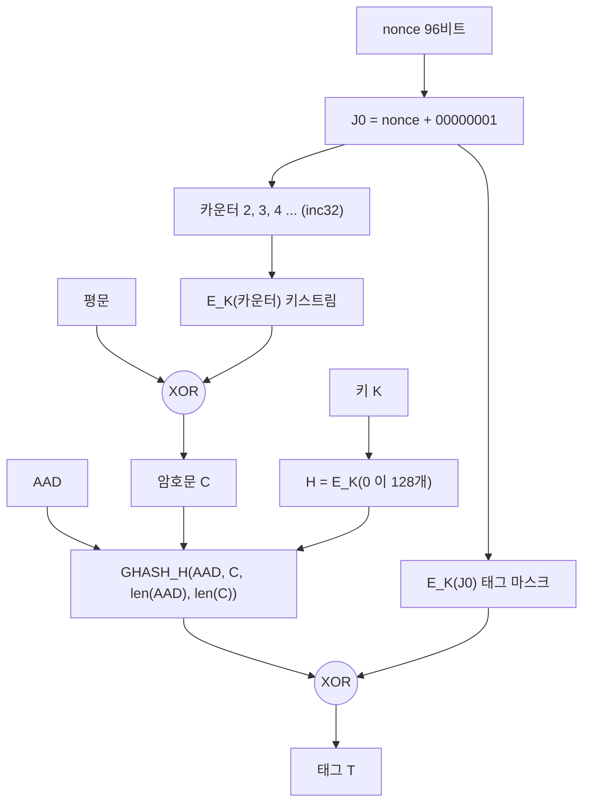
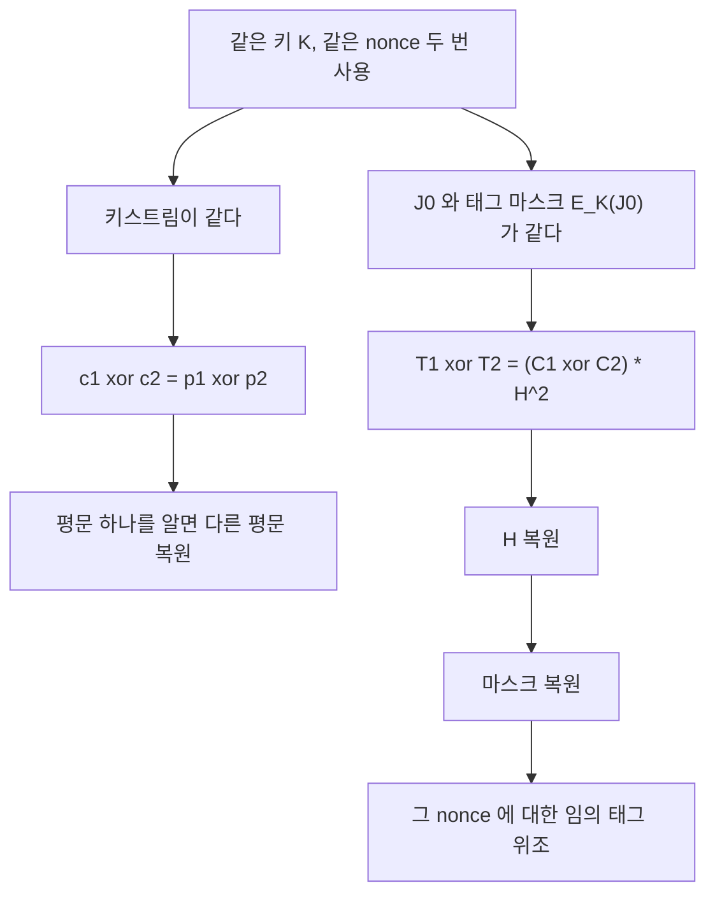
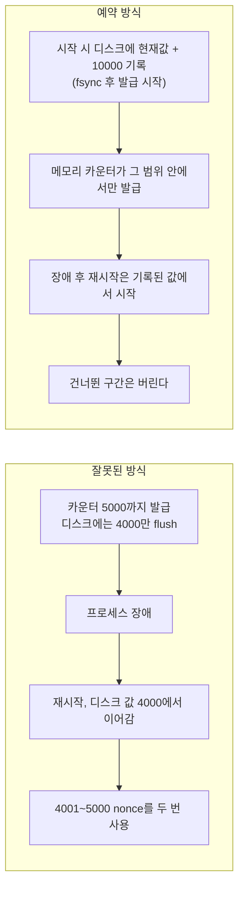
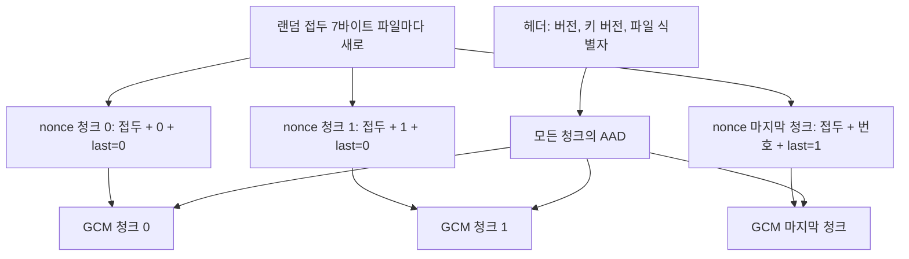
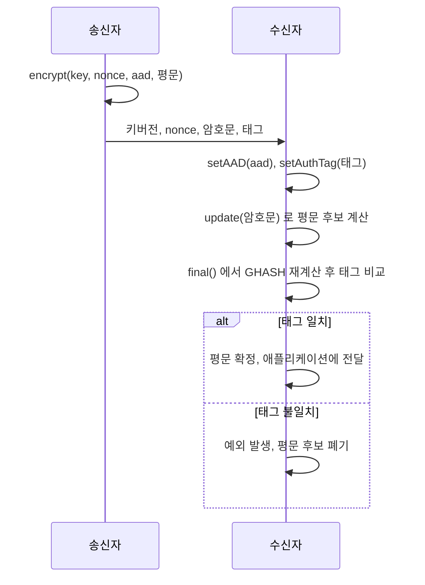
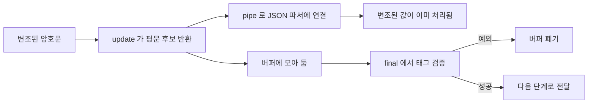
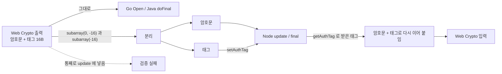
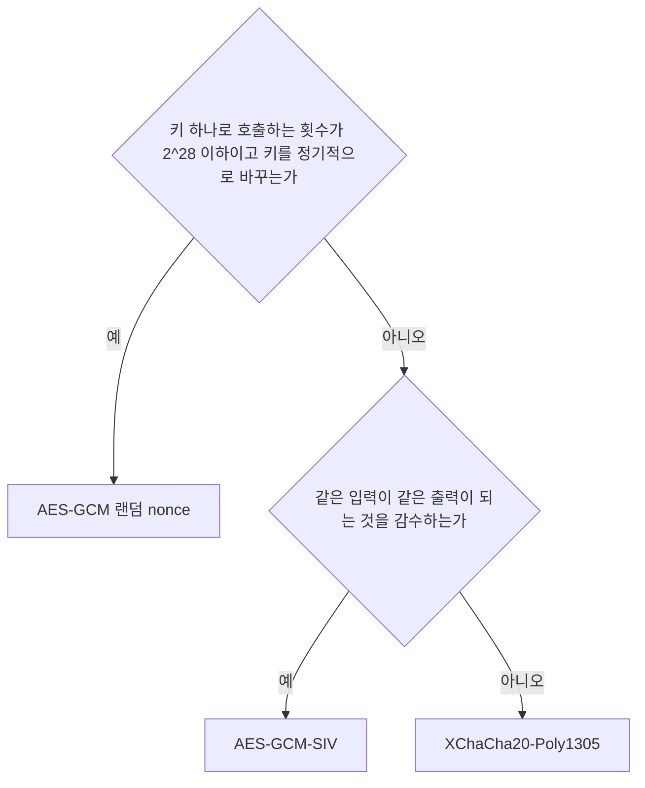

# AES-GCM 내부 구조와 운영에서 조용히 깨지는 지점

[AES](AES.md) 문서에서 모드 비교와 기본 사용법을 다뤘고, [Node.js crypto 모듈](../Framework/Node/Crypto_Module.md)에서는 nonce 재사용 사고를 한 번 짚었다. 이 문서는 그 위에서 시작한다. GCM이 태그를 어떻게 만드는지, nonce가 겹치면 정확히 무엇이 새는지, 그리고 라이브러리 세 개(Node, Java, Go)와 Web Crypto를 섞어 쓸 때 어디서 소리 없이 깨지는지를 다룬다.

본문의 실행 결과는 전부 이 문서를 쓰면서 직접 돌린 것이다. 환경은 Node v20.20.0(OpenSSL 3.0.17), OpenJDK 11.0.32과 17.0.20, Go 1.22.5이고, 이 장비의 CPU(QEMU Virtual CPU)에는 `aes`와 `pclmulqdq` 플래그가 없다. 마지막 장의 성능 수치가 이 조건에서 나온 것이라는 점만 기억하면 된다.

## GCM이 태그를 만드는 과정

GCM은 CTR 모드로 암호화하고, 그 암호문에 GHASH라는 다항식 해시를 걸어 태그를 만든다. 두 부분은 서로 독립적으로 돌아가고, 마지막에 한 번만 합쳐진다.



도식에서 볼 것은 두 가지다. 키스트림은 카운터 2부터 쓰고, 카운터 1(J0)로 만든 블록은 평문에 쓰이지 않고 태그 마스크로만 쓰인다. GHASH의 키 `H`는 `AES_K(0)`이라 키 하나당 값이 하나로 고정된다. 나중에 nonce 재사용 공격이 노리는 게 바로 이 `H`다.

### J0는 nonce 길이에 따라 다르게 만들어진다

nonce가 12바이트(96비트)면 J0는 `nonce || 0x00000001`이다. 그 외 길이면 nonce를 16바이트 단위로 패딩한 뒤 GHASH를 한 번 돌려 J0를 만든다. 직접 구현한 GCM으로 확인했다.

```text
J0(12B nonce): abababababababababababab00000001
J0(16B nonce): d032e86b5bc74bd276782c040c824ce2
```

12바이트가 아니면 J0의 하위 32비트가 해시 결과라 임의의 값이 된다. 8바이트나 1바이트 nonce도 Node에서 동작하고, 아래 구현과 결과가 일치하는 것을 확인했다. 다만 nonce 처리에 GHASH가 한 번 더 들어가고, Go는 기본 `NewGCM`이 12바이트만 받아서 다른 길이를 쓰려면 `NewGCMWithNonceSize`를 따로 불러야 한다. 12바이트로 고정하는 편이 사고가 적다.

### GHASH는 GF(2^128)에서 곱셈하며 블록을 누적한다

GHASH 입력은 `AAD(16바이트 배수로 0 패딩) || 암호문(0 패딩) || AAD 비트 길이(64비트) || 암호문 비트 길이(64비트)`다. 이 입력을 16바이트 블록 `X1, X2, ...`로 나눠 `Y = (Y xor Xi) * H`를 반복한다. 곱셈은 GF(2^128)에서 하고, 기약다항식은 `x^128 + x^7 + x^2 + x + 1`이다. GCM은 비트 순서가 뒤집혀 있어서 최상위 비트가 `x^0` 계수다. 이 뒤집힌 순서를 놓치면 직접 구현이 Node 결과와 안 맞는다.

아래는 이 문서의 실험 전체가 쓰는 구현이다. 60줄 안팎이고, 성능은 기대하지 않는다. `BigInt` 곱셈이라 느리다.

```javascript
import crypto from 'node:crypto';

const R = 0xe1n << 120n;
export const toBig = (b) => BigInt('0x' + (Buffer.from(b).toString('hex') || '0'));
export const toBuf = (n, len = 16) => Buffer.from(n.toString(16).padStart(len * 2, '0'), 'hex');

export function gmul(x, y) {
  let z = 0n, v = y;
  for (let i = 127n; i >= 0n; i--) {
    if ((x >> i) & 1n) z ^= v;
    v = (v & 1n) ? (v >> 1n) ^ R : v >> 1n;
  }
  return z;
}

const pad16 = (b) => Buffer.concat([b, Buffer.alloc((16 - (b.length % 16)) % 16)]);

export function ghash(H, aad, ct) {
  const lens = Buffer.alloc(16);
  lens.writeBigUInt64BE(BigInt(aad.length) * 8n, 0);
  lens.writeBigUInt64BE(BigInt(ct.length) * 8n, 8);
  const data = Buffer.concat([pad16(aad), pad16(ct), lens]);
  let y = 0n;
  for (let i = 0; i < data.length; i += 16) y = gmul(y ^ toBig(data.subarray(i, i + 16)), H);
  return y;
}

export function aesBlock(key, block) {
  const c = crypto.createCipheriv(`aes-${key.length * 8}-ecb`, key, null);
  c.setAutoPadding(false);
  return Buffer.concat([c.update(block), c.final()]);
}

export function inc32(blk) {
  const o = Buffer.from(blk);
  o.writeUInt32BE((o.readUInt32BE(12) + 1) >>> 0, 12);   // 하위 32비트만 증가, 넘치면 0으로 돈다
  return o;
}

export function j0Of(key, nonce) {
  const H = toBig(aesBlock(key, Buffer.alloc(16)));
  if (nonce.length === 12) return Buffer.concat([nonce, Buffer.from([0, 0, 0, 1])]);
  return toBuf(ghash(H, Buffer.alloc(0), nonce));
}

export function gcmEncrypt(key, nonce, pt, aad = Buffer.alloc(0)) {
  const H = toBig(aesBlock(key, Buffer.alloc(16)));
  const j0 = j0Of(key, nonce);
  let ctr = inc32(j0);
  const ct = Buffer.alloc(pt.length);
  for (let i = 0; i < pt.length; i += 16) {
    const ks = aesBlock(key, ctr);
    for (let j = 0; j < 16 && i + j < pt.length; j++) ct[i + j] = pt[i + j] ^ ks[j];
    ctr = inc32(ctr);
  }
  const mask = toBig(aesBlock(key, j0));
  return { ct, tag: toBuf(ghash(H, aad, ct) ^ mask), H, j0, mask };
}
```

이 구현과 `crypto.createCipheriv('aes-256-gcm')` 결과를 nonce 12·16·8·1바이트, AAD `tenant=42`로 비교하면 암호문과 태그가 네 경우 모두 일치한다.

```text
nonce 12B  ct일치=true  tag일치=true
nonce 16B  ct일치=true  tag일치=true
nonce  8B  ct일치=true  tag일치=true
nonce  1B  ct일치=true  tag일치=true
```

태그는 `GHASH_H(AAD, C) xor E_K(J0)`이다. 이 식 하나로 뒤의 내용이 거의 다 설명된다. `E_K(J0)`는 nonce마다 다른 일회용 마스크이고, `H`는 키 하나에 하나뿐인 고정값이다. 마스크가 새면 그 nonce에 한해 태그 위조가 가능하고, `H`가 새면 마스크만 구하는 문제로 줄어든다.

## 같은 nonce를 두 번 쓰면 새는 것

nonce 재사용은 "보안이 약해진다" 수준이 아니라 두 단계로 무너진다. 키스트림이 같아져 평문이 새고, 태그 두 개에서 `H`가 풀린다. 아래 재현은 모두 같은 키·같은 nonce로 `aes-256-gcm`을 두 번 호출한 결과다.

아래 도식은 무너지는 순서를 보여 준다. 위 가지는 키스트림 재사용으로 평문이 새는 경로, 아래 가지는 마스크 재사용으로 `H`가 풀리고 위조까지 가는 경로다.



### 평문 XOR 노출

아래 재현에서 쓰는 헬퍼 세 개는 Node의 `aes-256-gcm`을 얇게 감싼 것이다.

```javascript
const enc = (key, nonce, pt, aad = Buffer.alloc(0)) => {
  const c = crypto.createCipheriv('aes-256-gcm', key, nonce);
  c.setAAD(aad);
  const ct = Buffer.concat([c.update(pt), c.final()]);
  return { ct, tag: c.getAuthTag() };
};
const dec = (key, nonce, ct, tag, aad = Buffer.alloc(0)) => {
  const d = crypto.createDecipheriv('aes-256-gcm', key, nonce, { authTagLength: 16 });
  d.setAAD(aad); d.setAuthTag(tag);
  return Buffer.concat([d.update(ct), d.final()]);
};
const xor = (a, b) => Buffer.from(a.map((v, i) => v ^ b[i]));
```

```javascript
const p1 = Buffer.from('card=4111111111111111;exp=12/29');
const p2 = Buffer.from('card=5500005555555559;exp=01/31');
const a = enc(key, nonce, p1), b = enc(key, nonce, p2);   // 같은 nonce
console.log(xor(a.ct, b.ct).equals(xor(p1, p2)));         // true
console.log(xor(xor(a.ct, b.ct), p1).toString());        // card=5500005555555559;exp=01/31
```

```text
c1^c2 == p1^p2 : true
p1 을 알 때 p2 복원: card=5500005555555559;exp=01/31
```

평문 하나를 알면 다른 평문이 통째로 나온다. 평문을 모르더라도 JSON 키 이름, 고정 헤더, 공백 같은 구조가 있으면 XOR 결과에서 추측이 맞아 들어간다. 로그에 남은 요청 본문이나 매직 넘버가 이런 "아는 평문" 역할을 한다.

### GHASH 키 H 복원

1블록(16바이트) 평문, AAD 없음, 길이가 같은 두 메시지로 재현한다. 암호문이 한 블록 `C`면 `GHASH = (C*H xor L)*H = C*H^2 xor L*H`다(`L`은 길이 블록). 같은 길이라 `L`이 같으므로 두 태그를 XOR하면 `L*H` 항과 마스크 `E_K(J0)`가 같이 지워진다.

```text
T1 xor T2 = (C1 xor C2) * H^2
```

`C1 xor C2`와 `T1 xor T2`를 알고 있으니 `H^2`는 GF(2^128)의 나눗셈이고, `H`는 제곱근이다. 이 체에서는 제곱이 전단사라 제곱근은 127번 제곱하면 나온다.

```javascript
const ONE = 1n << 127n;                               // GCM 비트 순서에서 곱셈 항등원
const gsq = (x) => gmul(x, x);
function gpow(x, e) { let r = ONE, b = x; while (e > 0n) { if (e & 1n) r = gmul(r, b); b = gsq(b); e >>= 1n; } return r; }
const ginv = (x) => gpow(x, (1n << 128n) - 2n);
const gsqrt = (x) => { let r = x; for (let i = 0; i < 127; i++) r = gsq(r); return r; };

const q1 = Buffer.from('transfer:100000 ');   // 16B
const q2 = Buffer.from('transfer:000001 ');   // 16B
const x = enc(key, nonce, q1), y = enc(key, nonce, q2);
const H2 = gmul(toBig(xor(x.tag, y.tag)), ginv(toBig(xor(x.ct, y.ct))));
const Hrec = gsqrt(H2);
```

```text
H 복원 일치: true
```

### 임의 태그 위조

`H`를 알면 `E_K(J0) = T1 xor GHASH_H(AAD, C1)`로 마스크도 구해진다. 그다음은 원하는 암호문에 대해 태그를 직접 계산하면 된다. 첫 메시지의 평문 `q1`을 알고 있으니 키스트림도 알아서 평문을 바꿔 끼울 수 있다.

```javascript
const mask = toBig(x.tag) ^ ghash(Hrec, Buffer.alloc(0), x.ct);
const wanted = Buffer.from('transfer:999999 ');
const forgedCt = xor(xor(x.ct, q1), wanted);
const forgedTag = toBuf(ghash(Hrec, Buffer.alloc(0), forgedCt) ^ mask);
dec(key, nonce, forgedCt, forgedTag);        // 수신 쪽 Node 가 정상 메시지로 받아들인다
```

```text
위조 복호화 결과: transfer:999999 
임의 100B 암호문 통과: 100 bytes
다른 nonce 에는 위조 실패: Unsupported state or unable to authenticate data
```

마지막 줄이 한계를 보여준다. 키 `K`는 복원되지 않고, 마스크를 아는 nonce 하나에 대해서만 위조된다. 다른 nonce를 쓰는 메시지는 마스크를 모르니 위조가 안 된다. 그렇다고 안심할 일은 아니다. `H`는 키가 살아 있는 동안 계속 유효하므로, 같은 키에서 nonce 충돌이 한 번 더 나면 그 nonce의 마스크도 같은 방식으로 풀린다.

이 재현은 1블록 메시지라서 나눗셈 한 번으로 끝났다. 메시지가 여러 블록이면 태그 차이가 `H`에 대한 고차 다항식이 되고, 그 근을 구해야 한다(근이 여러 개면 메시지를 더 모아 후보를 걸러낸다). 이 문서에서는 다항식 근 찾기까지 구현해 돌려 보지 않았고, 1블록 재현만 실행했다.

## nonce를 만드는 세 가지 방식

NIST SP 800-38D는 nonce 생성에 두 가지 구성을 허용한다. 하나는 완전 랜덤(RBG 기반)이고, 다른 하나는 고정 필드(장치·인스턴스 식별)와 호출 카운터를 이어 붙이는 결정적 구성이다. 랜덤 방식에는 "같은 키로 호출하는 횟수는 2^32회 이하"라는 한도가 붙는다. 근거는 [NIST SP 800-38D](https://csrc.nist.gov/pubs/sp/800/38/d/final) 8장이다. 세 번째로, nonce 오용에 내성이 있는 AES-GCM-SIV([RFC 8452](https://www.rfc-editor.org/rfc/rfc8452))가 있다.

| 방식 | nonce 구성 | 충돌이 나는 조건 | 상태 저장 | 충돌 시 피해 |
|---|---|---|---|---|
| 랜덤 96비트 | CSPRNG 12바이트 | 키당 호출 수가 늘수록 생일 확률 증가 | 없음 | H 복원과 위조, 평문 XOR |
| 카운터 | 인스턴스 ID 4바이트 + 카운터 8바이트 | 인스턴스 ID 중복, 카운터 롤백 | 카운터 영속화 필요 | 위와 같음 |
| SIV | 랜덤 12바이트(오용 내성) | 같은 nonce·AAD·평문일 때만 동일 암호문 | 없음 | 동일 입력이었는지만 드러남 |

### 랜덤 nonce의 생일 한계

n번 호출했을 때 충돌 확률은 근사로 `n(n-1)/2 / 2^96`이다. 계산해 보면 다음과 같다.

```text
n=2^24  충돌확률 ≈ 2^-49.0
n=2^28  충돌확률 ≈ 2^-41.0
n=2^30  충돌확률 ≈ 2^-37.0
n=2^32  충돌확률 ≈ 2^-33.0
n=2^34  충돌확률 ≈ 2^-29.0
n=2^36  충돌확률 ≈ 2^-25.0
```

2^32회에서 근사값이 2^-33이고, NIST가 허용하는 충돌 확률 상한은 2^-32다. 한도를 넘기는 순간 바로 터지는 것은 아니고 확률이 서서히 올라간다. 그래도 한 번 터지면 앞 장의 결과가 그대로 적용되므로 확률을 올려 가며 쓸 이유가 없다.

감을 잡기 위해 32비트 nonce로 첫 충돌까지의 횟수를 200번 재 봤다. 중앙값이 75,916회였고 이론값(`sqrt(2 ln2 * 2^32)`)은 약 77,163회였다. 96비트에서는 같은 계산이 2^48 근처로 올라가지만, 키 하나로 호출하는 횟수는 한도 안에서 관리해야 한다.

### 로테이션 주기 계산

호출 수 한도는 키 하나에 대한 전체 합계다. 인스턴스가 여러 대여도 같은 키를 쓰면 합산한다. 초당 요청 수별로 환산하면 이렇다.

```text
100 rps   → 2^32 까지 497.1일
2000 rps  → 2^32 까지 24.9일
20000 rps → 2^32 까지 2.5일

100 rps   → 2^28 까지 31.07일 (745.7시간)
2000 rps  → 2^28 까지 1.55일 (37.3시간)
20000 rps → 2^28 까지 0.16일 (3.7시간)
```

요청 1건당 암호화 호출이 1회라는 가정이다. 한 요청에서 필드 다섯 개를 따로 암호화하면 호출 수는 5배가 된다. 2000 rps에 필드 5개면 2^32까지 5일이 안 걸린다. 월 단위 로테이션이 걸려 있는 서비스에서 이 계산을 처음 해 보고 놀라는 경우가 있다.

주기를 길게 잡고 싶으면 방식을 바꾼다. 레코드마다(또는 파일마다) 데이터 키를 새로 만들고 마스터 키로 감싸는 봉투 암호화를 쓰면, 데이터 키 하나로 호출하는 횟수가 1~수 회라 한도 계산이 필요 없다. [테넌트별 키 격리](Tenant_Key_Management.md)에서 다룬 구조가 이 방식이다. KMS 호출 비용이 부담되면 테넌트별 데이터 키를 캐시하면서 그 키의 호출 횟수를 카운터로 세어 2^28 정도에서 교체한다.

### 카운터 방식에서 깨지는 곳

카운터 방식은 확률이 아니라 규칙으로 중복을 막는다. 그래서 깨지는 곳도 규칙 쪽에서 나온다.

인스턴스마다 0에서 시작하면 첫 nonce부터 겹친다. 컨테이너를 두 개 띄우고 같은 키를 주입한 경우를 그대로 옮기면 다음과 같다.

```text
instance-a 첫 nonce 000000000000000000000000 / instance-b 첫 nonce 000000000000000000000000
id 4B + 카운터 8B: 000000010000000000000000 000000020000000000000000
```

인스턴스 ID를 앞 4바이트에 두면 해결되는데, 이 ID가 정말 유일해야 한다. Kubernetes에서 StatefulSet의 ordinal은 유일하지만 Deployment의 파드 이름 해시는 재시작마다 바뀐다. ID를 어디서 가져오는지가 설계의 핵심이다. 파드가 재시작되면서 같은 ID를 받고 카운터가 0부터 다시 시작하면 같은 문제가 반복된다.

카운터 영속화에서는 롤백이 더 자주 터진다. 카운터를 주기적으로 디스크에 flush하는 구조에서 장애가 나면, 디스크에 있는 값이 마지막으로 발급한 값보다 작다. 재시작이 디스크 값부터 이어 가면 구간이 겹친다.



왼쪽은 발급이 flush보다 앞서가는 구조라 겹치고, 오른쪽은 발급 가능 범위를 먼저 디스크에 적어 두므로 겹치지 않는다. 버려지는 값은 64비트 카운터에서는 문제 되지 않는다. DB 스냅샷 복원, VM 스냅샷 복원, 오토스케일링 이미지에 카운터 상태가 구워진 경우도 같은 롤백이다.

### 시드가 같은 PRNG

랜덤 nonce도 난수원이 CSPRNG일 때만 성립한다. 컨테이너 복제본이 설정값으로 고정한 시드를 쓰는 PRNG로 nonce를 만들면 모든 복제본이 같은 수열을 뽑는다. 시드를 1234로 고정한 xorshift 난수를 두 프로세스에서 돌린 결과다.

```text
replica-a 13d2d77f6e9f6fc1ef86c032
replica-b 13d2d77f6e9f6fc1ef86c032
```

실제 사고에서는 시드를 일부러 고정하진 않는다. 테스트 코드의 `Random(42)`가 운영에 남거나, `Math.random()`/`java.util.Random`/`random.random()`을 편의상 쓰거나, VM 스냅샷에서 복원된 이미지가 같은 엔트로피 풀 상태로 부팅하는 식이다. nonce는 `crypto.randomBytes`, `SecureRandom`, Go의 `crypto/rand` 중 OS CSPRNG를 감싼 것만 쓴다.

## AAD로 암호문의 자리를 묶는다

AAD(Additional Authenticated Data)는 암호화되지 않지만 태그 계산에는 들어가는 데이터다. 복호화할 때 같은 AAD를 넣지 않으면 태그가 맞지 않아 실패한다. 이걸 이용하면 암호문을 다른 행이나 다른 테넌트로 복사하는 공격을 막을 수 있다. 같은 키로 암호화된 컬럼이면 공격자가 DB 쓰기 권한만 있어도 `users.phone`의 암호문을 `1002`번 행에 그대로 붙여 넣으면 복호화가 성공하기 때문이다. 암호문 자체는 정상이니 복호화 경로에서 이상이 안 보인다.

```javascript
const ctx = (tenant, table, col, row, kv) => `t=${tenant}|${table}.${col}|row=${row}|kv=${kv}`;
const box = seal(Buffer.from('010-1234-5678'), ctx(7, 'users', 'phone', 1001, 3));

open(box, ctx(7, 'users', 'phone', 1001, 3));   // 성공
open(box, ctx(7, 'users', 'phone', 1002, 3));   // 다른 행
open(box, ctx(8, 'users', 'phone', 1001, 3));   // 다른 테넌트
open(box, ctx(7, 'users', 'email', 1001, 3));   // 다른 컬럼
open(box, ctx(7, 'users', 'phone', 1001, 2));   // 키 버전
```

```text
원래 위치     : 010-1234-5678
다른 행으로 복사  : 실패 - Unsupported state or unable to authenticate data
다른 테넌트       : 실패 - Unsupported state or unable to authenticate data
다른 컬럼         : 실패 - Unsupported state or unable to authenticate data
키 버전 바꿈      : 실패 - Unsupported state or unable to authenticate data
AAD 없이 암호화한 값은 어느 행에 붙여도: 010-1234-5678
```

마지막 줄이 보여 주듯 AAD 없이 암호화한 값은 어디에 붙여도 복호화된다. 이미 운영 중인 컬럼에 AAD를 뒤늦게 도입하면 기존 암호문이 전부 복호화에 실패하므로, 버전 필드를 두고 "버전 1은 AAD 없음, 버전 2부터 AAD 있음"처럼 구분해 점진적으로 재암호화해야 한다.

AAD를 쓸 때 걸리는 것이 두 가지 있다. 첫째, AAD는 저장하지 않는다. 복호화 시점에 같은 바이트열을 다시 만들 수 있어야 한다. 행 PK가 바뀌는 마이그레이션(예: UUID로 교체)이나 컬럼 이름 변경이 있으면 그 행의 암호문은 전부 못 읽게 된다. 둘째, AAD의 직렬화는 고정 형식이어야 한다. `t=7|users.phone`처럼 구분자를 쓸 때 필드 값에 구분자가 들어가는 경우를 막지 않으면 `t=7|a`+`b` 와 `t=7`+`a|b`가 같은 바이트열이 될 수 있다. 길이 접두를 붙이거나 필드를 고정폭으로 두는 방식이 안전하다.

## 태그 길이와 라이브러리별 단위

GCM 태그는 16바이트(128비트)가 기본이고, 더 짧게 자를 수 있다. 짧아진 만큼 한 번의 시도로 위조에 성공할 확률이 올라간다.

| 태그 길이 | 1회 시도 위조 확률 |
|---|---|
| 16바이트 | 2^-128 |
| 12바이트 | 2^-96 |
| 8바이트 | 2^-64 |
| 4바이트 | 2^-32 |

SP 800-38D는 일반 용도로 128·120·112·104·96비트를 허용하고, 64·32비트는 검증 실패 횟수를 제한하는 조건을 붙여 특정 응용에서만 허용한다. 태그를 줄여서 아끼는 건 한 레코드당 4~8바이트이므로, 저장 공간이 사정이 되는 경우는 거의 없다.

단위가 라이브러리마다 다르다. 같은 12바이트 태그를 표현하는 방법이 이렇게 갈린다.

| 환경 | 설정 | 단위 | 허용값 |
|---|---|---|---|
| Java | `new GCMParameterSpec(128, iv)` | 비트 | 128, 120, 112, 104, 96 |
| Web Crypto | `{ name: 'AES-GCM', iv, tagLength: 128 }` | 비트 | 96이 통과, 12는 거부 |
| Node | `createCipheriv(alg, key, iv, { authTagLength: 16 })` | 바이트 | 4, 8, 12~16 |
| Go | `cipher.NewGCMWithTagSize(b, 12)` | 바이트 | 12~16 (4, 8은 에러) |

Java에 `GCMParameterSpec(16, iv)`를 넣으면 16비트로 해석되어 예외가 난다(17, 11 모두 같다).

```text
GCMParameterSpec(16, iv): InvalidAlgorithmParameterException - Unsupported TLen value.  Must be one of {128, 120, 112, 104, 96}
```

Web Crypto에서 `tagLength: 12`는 `OperationError ... 12 is not a valid AES-GCM tag length`로 막히고, `tagLength: 96`은 출력이 평문+12바이트가 된다. Node에 `authTagLength: 128`을 넣으면 `Invalid authentication tag length: 128`로 바로 실패해서 눈에 띈다. Java에서 16을 바이트로 착각한 경우도 예외가 나니 배포 전에 잡힌다. 문제는 Node와 Java가 같은 포맷을 주고받는 서비스에서 두 설정값을 하나의 상수로 공유하려 할 때다. 상수에 단위가 없으면 한쪽이 틀린다.

### Node 복호화는 태그 길이를 고정하지 않으면 잘린 태그를 받아준다

실제로 놀랐던 부분이다. `createDecipheriv`에 `authTagLength`를 안 주면 Node(v20.20.0)는 4~16바이트 태그를 길이에 상관없이 받아들인다. 16바이트 태그로 암호화한 데이터에 앞 4바이트만 제출하면 복호화가 성공한다.

```javascript
const d = crypto.createDecipheriv('aes-256-gcm', key, nonce);   // authTagLength 없음
d.setAuthTag(full.subarray(0, 4));
Buffer.concat([d.update(ct), d.final()]);                       // 성공
```

```text
옵션 없음, 태그 16B 제출: 성공 "tag length test"
옵션 없음, 태그 12B 제출: 성공 "tag length test"
옵션 없음, 태그 8B 제출: 성공 "tag length test"
옵션 없음, 태그 4B 제출: 성공 "tag length test"
옵션 없음, 태그 3B 제출: 실패 - Invalid authentication tag length: 3
authTagLength:16, 태그 16B 제출: 성공
authTagLength:16, 태그 12B 제출: 실패 - Invalid authentication tag length: 12
authTagLength:16, 태그 4B 제출: 실패 - Invalid authentication tag length: 4
```

태그를 입력으로 받는 API(외부에서 태그가 같이 오는 포맷)에서 공격자가 태그를 4바이트로 줄여 보내면, 위조 성공 확률이 2^-128이 아니라 2^-32로 떨어진다. 복호화 쪽에서 `{ authTagLength: 16 }`을 항상 지정해야 한다. 암호화 쪽 기본값이 16이라 눈에 안 띄지만, 복호화 쪽에서는 기본값이 "길이 검사 없음"에 가깝다.

## 크기 한도와 대용량 파일

GCM 한 번 호출로 암호화할 수 있는 평문은 최대 `2^39 - 256`비트다. 바이트로 환산하면 68,719,476,704바이트, 약 63.99999997 GiB다.

```text
평문 최대 비트 549755813632 = 바이트 68719476704 = GiB 63.99999997
블록 수 (2^32-2) * 128 = 549755813632  같은 값: true
```

이 숫자는 카운터 때문에 나온다. 12바이트 nonce에서 카운터 필드는 하위 32비트이고 `inc32`는 그 32비트만 증가시킨다. J0 카운터가 1이고 평문은 2부터 쓰므로 쓸 수 있는 값은 `2 ... 2^32-1`로 `2^32-2`개 블록이다. 한 블록은 128비트라 `(2^32-2) * 128 = 2^39 - 256`이다. 이 한도를 넘기면 카운터가 한 바퀴 돌아 0, 1이 나오는데, 카운터 1은 J0이다. 평문 블록 하나가 태그 마스크 `E_K(J0)`와 같은 키스트림으로 암호화되는 것이다. 마스크를 알면 태그가 위조된다.

63GiB를 넘기는 파일이 흔하진 않지만, 백업 아카이브나 DB 덤프에서는 나온다. 라이브러리가 이 한도를 검사해 예외를 던지는 경우도 있고, 안 던지는 경우도 있다. 64GiB를 실제로 돌려 확인하지는 못했다. 큰 파일은 처음부터 청크로 나누는 편이 맞다.

### 청크 분할과 STREAM 구조

청크마다 `GCM`을 따로 돌리면 한도 문제는 사라지지만 새 문제가 생긴다. 청크 단위 무결성만 있고 청크 사이의 관계(순서, 개수)는 아무도 지켜주지 않는다. 공격자가 청크를 바꿔치기하거나 뒤쪽 청크를 잘라도 남은 청크는 각자 유효한 태그를 갖고 있다.

STREAM 구조는 이걸 nonce 설계로 막는다. 12바이트 nonce를 `랜덤 접두 7바이트 || 청크 번호 4바이트 || 마지막 청크 표시 1바이트`로 쪼갠다.

```javascript
function chunkNonce(prefix, idx, last) {
  const n = Buffer.alloc(12);
  prefix.copy(n, 0);              // 7바이트 랜덤 접두 (파일마다 새로)
  n.writeUInt32BE(idx, 7);        // 4바이트 청크 번호
  n[11] = last ? 1 : 0;           // 마지막 청크 표시
  return n;
}
```

도식에서 볼 것은 nonce 필드 배치와, 마지막 청크만 `last=1`이 된다는 점이다. 청크마다 nonce가 달라지고 같은 헤더 AAD가 모두에 걸린다.



수신 쪽은 자기가 받은 청크 목록에서 마지막 위치를 "마지막"이라고 가정하고 nonce를 만든다. 공격자가 끝을 잘라 내면 새로 끝이 된 청크는 `last=0`으로 암호화됐는데 수신 쪽은 `last=1`로 복호화를 시도하니 태그가 안 맞는다. 헤더(버전, 키 버전, 파일 식별자)는 모든 청크의 AAD에 넣어 헤더 변조도 막는다. 80바이트를 16바이트 청크 5개로 나눠 공격 6종을 돌려 본 결과다.

```text
정상                성공 80 B
청크 순서 교환      실패 - Unsupported state or unable to authenticate data
끝 청크 잘라냄      실패 - Unsupported state or unable to authenticate data
중간 청크 삭제      실패 - Unsupported state or unable to authenticate data
청크 중복 삽입      실패 - Unsupported state or unable to authenticate data
청크 뒤에 추가      실패 - Unsupported state or unable to authenticate data
헤더 변조           실패 - Unsupported state or unable to authenticate data
```

마지막 표시를 빼고 청크 번호만 쓰는 구조도 같은 조건으로 돌려 봤다. 순서 교환과 삭제는 막히지만 끝을 잘라 내면 막히지 않는다.

```text
last 표시 없음 + 끝 청크 잘라냄: 성공 64 B (잘림을 못 잡는다)
```

청크 번호는 4바이트라 `2^32`개가 한도다. 64KiB 청크면 `2^32 * 2^16 = 2^48`바이트, 256TiB다. 현실적으로 닿지 않는다. 접두 7바이트는 파일마다 새로 뽑는 랜덤인데, 56비트에서 같은 키로 N개 파일을 만들면 생일 충돌 확률이 `N^2/2^57`이라 키 하나로 만드는 파일 수를 2^20개 정도로 제한하면 2^-17 수준이다. 충돌하면 같은 청크 번호끼리 nonce가 겹치니, 파일이 많은 서비스에서는 접두를 늘리고 청크 번호 필드를 줄이거나 파일마다 데이터 키를 따로 쓰는 쪽이 안전하다.

## 저장 포맷과 태그 검증 순서

DB 컬럼이나 오브젝트에 넣을 때 `키버전 | nonce | 암호문 | 태그` 순서로 이어 붙이는 포맷을 자주 쓴다.

| 오프셋 | 길이 | 내용 | 비고 |
|---|---|---|---|
| 0 | 2바이트 | 키 버전(빅엔디언) | AAD에도 포함 |
| 2 | 12바이트 | nonce | 평문과 같이 저장 |
| 14 | n바이트 | 암호문 | 평문과 같은 길이 |
| 14+n | 16바이트 | 태그 | 마지막 16바이트 |

13바이트 평문이면 `2 + 12 + 13 + 16 = 43`바이트다. 아래는 실제로 돌린 `seal`/`open`이다.

```javascript
const keyring = new Map([[1, crypto.randomBytes(32)], [2, crypto.randomBytes(32)]]);
let currentVersion = 2;

export function seal(plain, context) {
  const nonce = crypto.randomBytes(12);
  const ver = Buffer.alloc(2); ver.writeUInt16BE(currentVersion);
  const c = crypto.createCipheriv('aes-256-gcm', keyring.get(currentVersion), nonce, { authTagLength: 16 });
  c.setAAD(Buffer.concat([ver, Buffer.from(context)]));
  const ct = Buffer.concat([c.update(plain), c.final()]);
  return Buffer.concat([ver, nonce, ct, c.getAuthTag()]);
}

export function open(blob, context) {
  if (blob.length < 2 + 12 + 16) throw new Error('blob too short');
  const ver = blob.subarray(0, 2);
  const key = keyring.get(ver.readUInt16BE());
  if (!key) throw new Error(`unknown key version ${ver.readUInt16BE()}`);
  const d = crypto.createDecipheriv('aes-256-gcm', key, blob.subarray(2, 14), { authTagLength: 16 });
  d.setAAD(Buffer.concat([ver, Buffer.from(context)]));
  d.setAuthTag(blob.subarray(blob.length - 16));
  return Buffer.concat([d.update(blob.subarray(14, blob.length - 16)), d.final()]);
}
```

키 버전 2바이트를 AAD에 넣은 이유는 헤더의 버전 바이트를 바꿔 다른 키로 복호화시키는 시도를 태그 검증에서 걸러 내기 위해서다. 버전 바이트를 1로 바꿔 놓고 복호화하면 `Unsupported state or unable to authenticate data`로 실패한다. 키링에 v1 키가 있는 상태에서 돌린 결과다.

수신 쪽의 검증 순서는 다음과 같다. 복호화 자체는 평문을 만들 수 있지만, 태그 검증이 끝나기 전에는 그 평문을 쓰면 안 된다.



핵심은 `update()` 단계의 평문이 확정이 아니라는 점이다. Java는 그 사실을 API 구조로 강제하고(복호화 update는 아무것도 돌려주지 않는다), Node는 그렇지 않다. 다음 장에서 다룬다.

## 라이브러리를 섞을 때 나오는 문제

### Node는 검증 전 평문을 돌려준다

Node에서 `decipher.update()`는 `final()` 전에도 복호화된 바이트를 돌려준다. 태그 검증은 `final()`에서야 일어난다. 암호문의 비트 하나를 뒤집어 돌려 본 결과다.

```javascript
const tampered = Buffer.from(ct); tampered[7] ^= 0x01;
const d = crypto.createDecipheriv('aes-256-gcm', key, nonce, { authTagLength: 16 });
d.setAuthTag(tag);
const leaked = d.update(tampered);
console.log(JSON.stringify(leaked.toString()));
try { d.final(); } catch (e) { console.log(e.message); }
```

```text
update() 반환 (검증 전): "amount=000&to=alice&memo=rent"
final(): Unsupported state or unable to authenticate data
```

원래 평문은 `amount=100&to=alice&memo=rent`였다. 암호문 한 비트를 뒤집으니 평문의 같은 위치 비트가 뒤집혀 `100`이 `000`이 됐다. CTR의 성질이라 의도한 위치를 정확히 바꿀 수 있다. `final()`이 예외를 던지지만, 그 전에 `update()` 결과를 스트림으로 파서에 넘기고 있었다면 이미 변조된 값이 처리된 뒤다. 스트림 파이프라인에서 `decipher`를 `pipe`로 JSON 파서에 연결하는 코드가 이런 형태다. `update()` 결과는 버퍼에 모아 두고, `final()`이 끝나 예외가 없는 것을 확인한 뒤에만 다음 단계로 넘긴다. 큰 파일이라 버퍼링이 곤란하면 앞 장의 STREAM처럼 청크 단위로 `final()`을 호출한다.

아래 도식은 변조된 암호문이 들어왔을 때 Node의 `pipe` 경로와 버퍼링 경로가 어디서 갈리는지 비교한 것이다. 왼쪽은 `final()` 예외가 나기 전에 파서가 값을 받는다.



`setAuthTag()`를 호출하지 않고 `final()`을 부르면 같은 에러로 실패한다(`setAuthTag 없이 final(): Unsupported state or unable to authenticate data`). 에러 문구가 태그 누락, 키 불일치, 변조 세 경우에 똑같아서 원인을 로그만으로 가리기 어렵다.

### Web Crypto와 Node의 태그 위치

Web Crypto `subtle.encrypt`는 암호문 뒤에 태그를 붙여 한 덩어리로 돌려준다. Node는 암호문과 태그를 `update/final`과 `getAuthTag()`로 나눠 준다. 같은 키·nonce로 같은 평문(29바이트)을 암호화한 결과를 비교하면 Web Crypto 출력이 Node의 `ct || tag`와 동일하다.

```text
Web Crypto 출력 길이 45 = 평문 29 + 태그 16
Web Crypto 출력 == Node ct||tag : true
```

라이브러리마다 암호문과 태그를 주고받는 형태가 이렇게 갈린다. 길이는 앞의 실험에서 잰 값이다.

| 환경 | 암호화 결과 | 복호화 입력 |
|---|---|---|
| Node | 암호문(`update`+`final`)과 태그(`getAuthTag`)를 분리 | `setAuthTag`로 태그를 따로 전달 |
| Web Crypto | 암호문 뒤에 태그 16바이트 부착 (평문 29 → 45바이트) | 붙은 형태 그대로 |
| Java `Cipher` | 암호문 뒤에 태그 부착 (평문 100 → 116바이트) | 붙은 형태 그대로 |
| Go `Seal` | 암호문 뒤에 태그 부착 (평문 5 → 21바이트) | 붙은 형태 그대로 |

Node만 분리형이고 나머지 셋은 붙은 형태다. 바이트는 같은데 API가 요구하는 형태가 다르다. Web Crypto 출력을 Node에 그대로 넣으면 태그를 따로 `setAuthTag`로 줘도 암호문 쪽에 태그 16바이트가 섞여 들어가 검증이 실패한다. 반대로 Node의 `ct`만 Web Crypto에 주면 태그가 없으니 실패한다.

```text
Web Crypto 출력을 그대로 Node 에 넣으면: Unsupported state or unable to authenticate data
ct 만 Web Crypto 에 넣으면: OperationError The operation failed for an operation-specific reason
분리해서 넣으면: amount=100&to=alice&memo=rent
Node ct||tag 를 Web Crypto 로: amount=100&to=alice&memo=rent
```

아래 도식은 같은 바이트가 환경마다 어떤 형태로 오가는지 보여 준다. Node만 중간에서 태그를 떼어 내야 한다.



브라우저에서 암호화해 서버(Node)가 복호화하는 구조에서 흔하다. 서버에서 `blob.subarray(0, -16)`과 `blob.subarray(-16)`으로 나눈다. 틀렸을 때의 증상이 "복호화 실패"뿐이라 처음 맞닥뜨리면 키·nonce만 의심하게 된다.

### Java는 복호화를 통째로 버퍼링한다

앞의 Java 실험에서 `Cipher`가 한 일을 정리하면 이렇다.

```text
복호화 update(64B) 반환: 0B
암호화 update(64B) 반환: 64B
변조: AEADBadTagException - Tag mismatch!
```

암호화 `update`는 바로 암호문을 내보내지만, 복호화 `update`는 0바이트를 돌려주고 내부에 쌓는다. 태그가 검증되기 전에는 평문을 내보내지 않으려는 설계다. 그 대가로 `doFinal` 전까지 입력 전체를 메모리에 올려 둔다. 48MiB 암호문 파일(50,331,664바이트)을 `readAllBytes`로 읽어 `doFinal`로 복호화하면서 힙을 바꿔 봤다.

```text
OutOfMemoryError (-Xmx60m)
OutOfMemoryError (-Xmx100m)
doFinal 복호화 50331664 → 50331648 B, 2.8s (-Xmx512m)
```

48MiB를 복호화하는 데 100MB 힙이 모자랐다. 입력 배열, 내부 버퍼, 출력 평문이 겹쳐 올라오기 때문으로 보이고, 필요한 힙은 암호문 크기의 몇 배다. 파일 크기가 힙 한도에 가까운 컨테이너에서 복호화하다 죽는 사고가 이렇게 난다. 크기가 큰 데이터는 앞 장의 청크 구조로 나눠 청크당 `doFinal`을 호출한다.

JDK 버전 차이도 보려고 11.0.32와 17.0.20에서 같은 64MiB, 256MiB 암호화를 돌렸다. 이 장비는 AES-NI가 없어서 두 버전이 모두 소프트웨어 경로를 타고 있었고 차이는 관측되지 않았다.

```text
11.0.32.1 암호화 64MB 8.41s  8 MB/s
11.0.32.1 암호화 256MB 27.95s  9 MB/s
17.0.20.1 암호화 64MB 7.36s  9 MB/s
17.0.20.1 암호화 256MB 28.02s  9 MB/s
```

JDK 버전별 하드웨어 가속 차이는 AES-NI·PCLMULQDQ가 있는 장비에서 따로 재야 한다. 이 문서에서는 확인하지 못했다. 같은 장비에서 Node(OpenSSL)로 16KiB 버퍼를 반복 암호화했을 때 `aes-256-gcm`이 41MB/s였다(마지막 장). 측정 방식이 달라 단순 비교는 못 하지만 JVM 소프트웨어 경로보다 높았다.

### Java 에서 같은 key+IV 재사용 방어

Java는 한 `Cipher` 인스턴스에서 암호화 `doFinal` 뒤에 같은 key+IV로 다시 호출하는 것을 막는다.

```text
doFinal 재호출: IllegalStateException - Must use either different key or iv for GCM encryption
같은 key+IV 로 재 init: InvalidAlgorithmParameterException - Cannot reuse iv for GCM encryption
새 인스턴스로 같은 key+IV: 허용됨 (116B 생성)
```

`doFinal`을 다시 부르면 `IllegalStateException`이고, 같은 key+IV로 `init`을 다시 하면 `InvalidAlgorithmParameterException`이다(11, 17 동일). 둘 다 같은 인스턴스일 때만 막는다. `Cipher.getInstance`로 새로 만들면 같은 key+IV가 허용된다. 요청마다 `Cipher`를 새로 만드는 구조에서는 이 방어가 작동하지 않는다. 이 예외가 로그에 보이면 사고 직전에 걸린 것이니 IV를 만드는 위치부터 본다. 예외를 잡아서 새 `Cipher`에 같은 IV를 그대로 넣어 재시도하는 코드는 방어를 우회한 것이다.

Java는 12바이트 외 IV(16바이트, 1바이트)도 `init`에서 허용했다(`IV 12B 허용`, `IV 16B 허용`, `IV 1B 허용`).

### Go는 nonce 크기가 기본 12바이트고 재사용을 검사하지 않는다

```text
NonceSize: 12 Overhead(태그 바이트): 16
Seal 출력 길이: 21 = 평문 5 + 태그 16
AAD 불일치: cipher: message authentication failed
변조: cipher: message authentication failed 반환 평문 nil 여부: true
nonce 16B 로 Seal: crypto/cipher: incorrect nonce length given to GCM
NewGCMWithNonceSize(16) NonceSize: 16
NewGCMWithTagSize(12) Overhead: 12
NewGCMWithTagSize(3): cipher: incorrect tag size given to GCM
같은 nonce 두 번 Seal: 에러 없음, c1^c2 평문xor 길이 4 4
```

`cipher.NewGCM`은 nonce 12바이트, 태그 16바이트를 기본으로 하고, 다른 크기를 `Seal`에 넘기면 에러가 아니라 panic이다. `Open`은 실패하면 평문을 `nil`로 돌려주므로 검증 전 평문 문제가 없다. Node와 비교하면 Go가 API 구조로 더 안전하다. 반면 같은 nonce로 `Seal`을 두 번 호출해도 아무 검사도 없다. Go와 Node는 재사용 방어가 호출자 책임이고, Java만 인스턴스 단위로 한 겹 막아 준다.

`Seal`의 출력은 `암호문 || 태그`로 Web Crypto와 같은 형식이다. Go ↔ 브라우저 사이는 변환 없이 맞고, Node만 따로 쪼개야 한다.

## nonce 오용 내성 대안과 하드웨어 사정

### AES-GCM-SIV와 XChaCha20-Poly1305

랜덤 nonce의 호출 수 한도(2^32)가 부담이거나, 카운터 관리를 하고 싶지 않을 때 대안이 둘 있다.

AES-GCM-SIV([RFC 8452](https://www.rfc-editor.org/rfc/rfc8452))는 nonce가 중복돼도 평문과 AAD, nonce가 전부 같은 경우에만 같은 암호문이 나온다. 그 외 정보는 새지 않고, GCM처럼 키 전체의 보안이 무너지지 않는다. 대가는 암호화가 두 패스라는 점이다. 평문 전체로 합성 IV를 만든 뒤 그 IV로 CTR 암호화를 하므로 평문을 한 번에 들고 있어야 하고, 스트리밍이 안 된다. 같은 nonce·AAD·평문이면 같은 암호문이 나오니 "같은 값을 또 보냈다"는 사실은 드러난다. Node(v20.20.0)의 `getCiphers()`에는 SIV가 없어서 직접 돌려 보지 못했다.

XChaCha20-Poly1305는 nonce가 24바이트(192비트)다. 랜덤으로 뽑아도 충돌 걱정을 사실상 안 해도 되는 길이다. 구현은 HChaCha20으로 하위 키를 만들고 나머지 8바이트 nonce로 ChaCha20-Poly1305를 돌리는 방식이다([draft-irtf-cfrg-xchacha](https://datatracker.ietf.org/doc/draft-irtf-cfrg-xchacha/)). Node 20의 `getCiphers()`에는 `chacha20-poly1305`(12바이트 nonce)만 있고 XChaCha는 없다. libsodium 계열 라이브러리를 별도로 써야 한다.

세 방식의 선택은 이 정도로 갈린다. 랜덤 nonce가 필요한 호출 수가 2^28을 넘지 않고 키를 정기적으로 바꾼다면 GCM으로 충분하다. 호출 수가 많은데 키를 자주 못 바꾸고 상태 저장도 싫다면 XChaCha20-Poly1305가 맞다. 같은 입력에 같은 출력이 나오는 걸 감수하고 실수가 나도 피해를 줄이고 싶다면 AES-GCM-SIV다.

위 선택 기준을 분기로 옮기면 아래와 같다.



### AES-NI와 PCLMULQDQ가 없을 때

GCM의 속도는 AES 하드웨어 명령(AES-NI)과 GHASH용 캐리리스 곱셈 명령(PCLMULQDQ)에 기대고 있다. 이 장비는 CPU 플래그에 둘 다 없는 QEMU 가상 CPU이고, 그 상태에서 Node로 16KiB 버퍼를 2.5초 동안 반복 암호화한 처리량이다.

| 알고리즘 | 처리량 |
|---|---|
| aes-128-gcm | 60 MB/s |
| aes-256-gcm | 41 MB/s |
| chacha20-poly1305 | 191 MB/s |

AES-NI가 있는 환경에서는 비교를 돌려 보지 못했다. 이 표의 의미는 하드웨어 가속이 없는 환경에서 GCM이 ChaCha20-Poly1305보다 확실히 느리다는 사실 하나다. ChaCha20은 덧셈·XOR·회전만으로 만들어져 소프트웨어에서 고르게 빠르다. 구형 ARM 보드, 가속 명령을 숨긴 가상화 환경, 일부 임베디드에서 GCM이 병목이 되는 일이 실제로 있다. 가상화 계층이 CPU 모델을 낮춰 보여 주면 이 장비처럼 플래그가 사라진다. `grep -o -w -E 'aes|pclmulqdq' /proc/cpuinfo`로 플래그를 먼저 본다. 없다면 TLS 쪽 서버 설정도 `TLS_CHACHA20_POLY1305_SHA256`을 우선하도록 순서를 바꾸는 편이 낫다.

## 운영에서 실제로 터지는 장면

### 키 로테이션 중 구버전 암호문이 복호화되지 않는다

로테이션 배포 직후 "일부 사용자만 값이 안 읽힌다"는 장애가 나는 패턴이다. 새 키로 바꾸면서 구버전 키를 키링에서 같이 제거한 경우다. 위 `open`에서 v1 키를 지운 뒤 구버전 암호문을 읽으면 이렇게 된다.

```text
로테이션 후 구버전 복호화: old-data
v1 키를 지운 뒤: unknown key version 1
```

키 버전을 헤더에 두었으니 "키가 없다"는 에러가 정확히 나온다. 이 헤더가 없는 포맷에서는 키가 틀린 것과 암호문이 변조된 것이 같은 에러다.

```text
암호문 변조: Unsupported state or unable to authenticate data
```

키 버전이 없으면 복호화 실패 원인을 코드가 구분하지 못한다. 구버전 키를 시도해 보는 루프를 돌려 복구하게 되고, 그 루프는 실패마다 전체 복호화 비용을 낸다. 모든 데이터가 새 키로 재암호화되어 구버전 암호문이 0건인 것을 확인한 뒤에야 구버전 키를 폐기한다. 폐기 전에 키 버전별 건수를 세어 보는 쿼리를 한 번 돌리는 편이 안전하다.

### 같은 시드의 복제본

앞서 보인 시드 고정 PRNG 사고의 증상은 "평소엔 정상, 특정 시점에 복호화가 조용히 이상해짐"이 아니라 "아무 증상이 없음"이다. nonce가 겹쳐도 암호화와 복호화는 정상 동작한다. 겹친 쌍이 공격자 손에 있어야 드러나는데, 그때는 이미 늦다. 로그나 메트릭에서 이를 잡으려면 nonce를 저장하는 구조에서 `SELECT nonce, COUNT(*) ... HAVING COUNT(*) > 1` 같은 중복 점검을 배치로 돌린다. 인덱스 없이 돌리면 비싸니 nonce 컬럼에 유니크 인덱스를 거는 방법도 있는데, 이는 중복 저장을 에러로 막을 뿐 이미 사용된 nonce 자체를 되돌리지는 못한다.

### 검증 실패 로그에 평문이 남는 경우

Node의 `update()` 반환값을 먼저 변수에 받아 두고 `final()`이 터지면 `catch`에서 그 변수를 로그에 남기는 코드를 몇 번 봤다. 디버깅을 쉽게 하려고 쓴 코드지만, 앞에서 본 것처럼 그 값은 검증되지 않은 평문이다. 변조된 암호문이면 공격자가 의도한 값이 로그에 찍히고, 정상 암호문인데 키만 틀린 경우에는 의미 없는 바이트가 평문이라는 이름으로 남는다. 정상 데이터에서 AAD만 어긋난 경우(앞 장의 다른 행 복사)에는 진짜 평문이 그대로 로그에 들어간다. 이 평문이 카드번호나 전화번호면 로그 시스템 전체가 PII 보관소가 된다.

검증 실패 로그에는 평문 대신 `키 버전`, `blob 길이`, `레코드 ID`, `AAD 해시 앞 8바이트` 정도만 남긴다. 에러 메시지가 원인을 구분하지 못하니 로그의 목적은 "어떤 레코드가 어떤 키 버전으로 실패했는지"를 추적하는 것이다.
