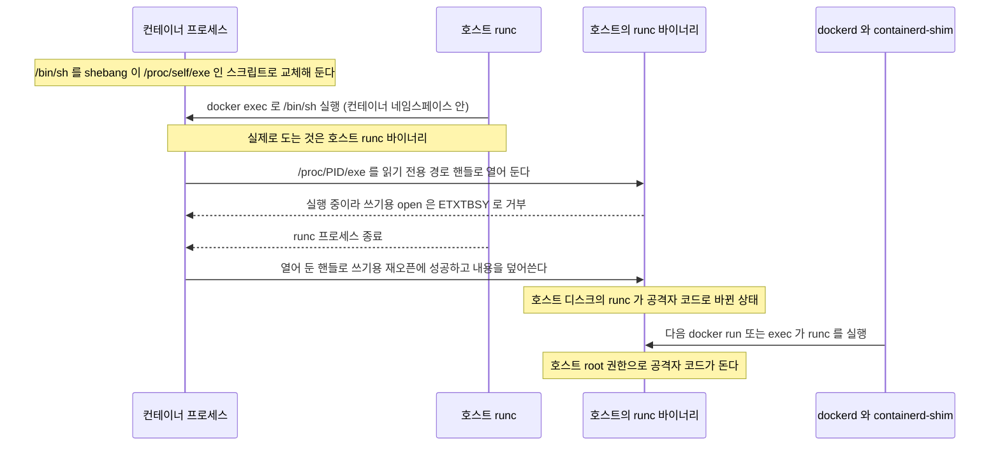
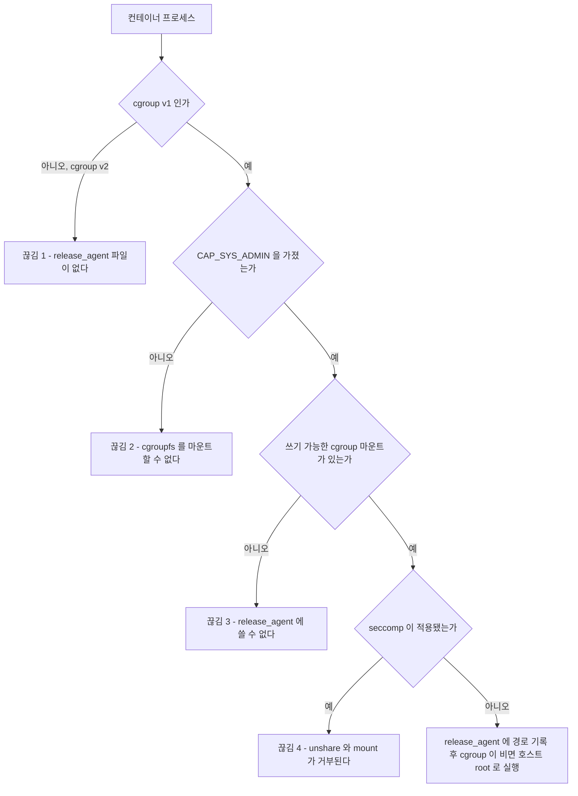
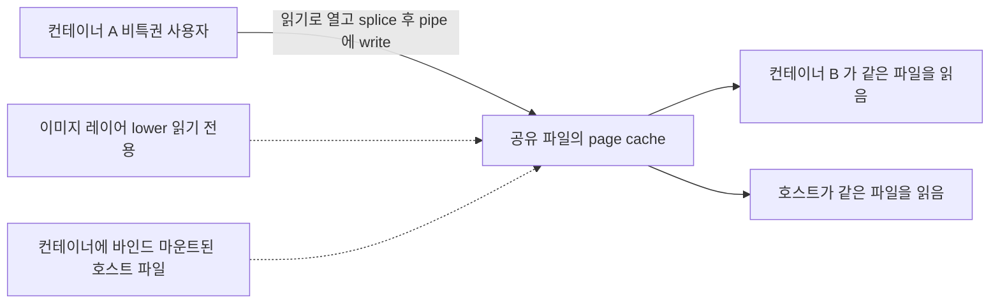
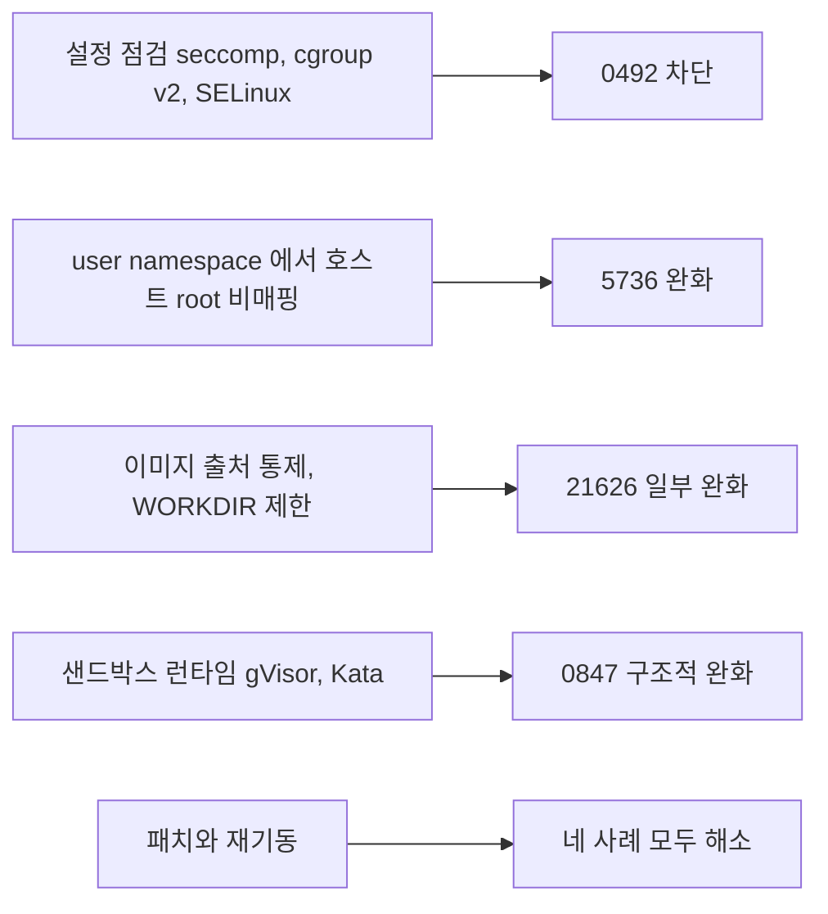

# 컨테이너 탈출 CVE 사례 분석

## 패치 번호보다 먼저 볼 것은 깨진 가정이다

runc 보안 공지가 뜰 때마다 "버전 올리세요"로 끝나면, 다음 공지 때 같은 질문을 처음부터 다시 한다. 우리 클러스터가 노출되는지, 패치가 노드 전체에 도는 며칠 동안 무엇으로 버틸지는 그 취약점이 **어느 격리 장치의 어떤 전제를 깼는지** 알아야 답이 나온다.

[Container Escape](Container_Escape.md)에서 탈출 경로를 설정 오류, 런타임 결함, 커널 취약점으로 나눴다. 이 문서는 뒤의 두 갈래에서 실제로 번호가 붙은 사례 네 개를 골라 원리 단위로 뜯는다. 사례마다 같은 다섯 항목(전제 조건, 깨진 가정, 영향받는 버전, 설정으로 안 막히는 이유, 패치 외 완화책)을 적는다. 익스플로잇 코드는 싣지 않고, 노출 여부를 확인하는 명령만 둔다.

| 사례 | 계층 | 깨진 가정 |
|---|---|---|
| CVE-2019-5736 | 런타임(runc) | 컨테이너 프로세스는 호스트의 runc 바이너리에 쓸 수 없다 |
| CVE-2022-0492 | 커널(cgroup v1) | `release_agent` 는 호스트 관리자 권한을 가진 쪽만 지정한다 |
| CVE-2024-21626 | 런타임(runc) | 컨테이너로 들어가기 전에 호스트 쪽 fd 는 전부 닫혔고, `chdir` 한 곳은 컨테이너 안이다 |
| CVE-2022-0847 | 커널(pipe, page cache) | 읽기 전용으로 연 파일의 page cache 는 바뀌지 않는다 |

영향 버전과 CVE 번호는 2026-10-12 기준 NVD API 응답과 각 프로젝트의 공식 공지로 대조했다. 공지에서 확인하지 못한 범위는 적지 않았고, 확인하지 못한 항목은 문서 안에서 그렇다고 밝혔다.

## CVE-2019-5736 — 호스트 runc 가 컨테이너 안에서 열리는 문제

### 무엇이 일어나는가

`docker exec` 나 `docker run` 은 결국 호스트의 runc 바이너리를 실행한다. runc 는 컨테이너의 네임스페이스로 들어간 다음 사용자가 요청한 명령을 `exec` 하는데, 이 시점에 **컨테이너 안에서 보면 실행 중인 프로세스가 호스트의 runc 바이너리 자체**다. 컨테이너 안에는 그 프로세스의 `/proc/<pid>/exe` 가 보이고, 이 링크는 호스트 파일시스템의 runc 파일을 가리킨다.

공격은 컨테이너 안의 실행 파일(`/bin/sh` 등)을 shebang 줄이 `/proc/self/exe` 인 스크립트로 바꿔 두는 데서 시작한다. 관리자가 그 컨테이너에 `docker exec` 하면 runc 가 `/bin/sh` 를 실행하려다 결국 자기 자신을 컨테이너 안에서 다시 실행한다. 악성 이미지를 새로 띄우는 경로도 같은 원리로 성립한다.



도식에서 볼 부분은 `ETXTBSY` 구간이다. 실행 중인 바이너리는 쓰기용으로 열 수 없으니, 공격자는 runc 가 끝나기를 기다렸다가 미리 열어 둔 핸들로 다시 연다. 컨테이너 격리 장치는 하나도 우회하지 않았다. 호스트 파일이 컨테이너 쪽에서 닿는 곳에 놓여 있었다는 사실 하나로 성립한다.

### 다섯 항목

- **전제 조건**: 컨테이너 안에서 호스트 파일의 소유자(root)와 같은 UID 로 쓸 수 있어야 한다. 컨테이너 root 가 호스트 UID 0 과 같은 일반 Docker 설정이 해당한다. 경로는 둘이다. 공격자가 만든 이미지를 실행하거나, 공격자가 이미 root 로 들어가 있는 컨테이너에 관리자가 `exec` 하는 경우다.
- **깨진 가정**: "runc 는 컨테이너에 들어간 뒤 컨테이너 쪽에서 닿을 수 없다." 수정은 runc 가 시작할 때 자기 바이너리를 복제본으로 만들고 그 복제본으로 다시 실행하게 해서, 컨테이너가 `/proc/self/exe` 로 연 것이 호스트 원본이 아니게 했다.
- **영향받는 버전**: NVD 는 runc 0.1.1 이하와 1.0.0-rc1~rc6, Docker 18.09.2 미만, LXC 3.2.0 미만을 영향 범위로 올렸다. Ubuntu 16.04/18.04/18.10/19.04, RHEL 7·8, Fedora 29·30 같은 배포판 패키지도 목록에 있다. CVSS v3.1 은 NVD 기준 8.6 이다.
- **설정으로 안 막히는 이유**: 컨테이너가 privileged 일 필요가 없고 capability 를 다 떼어도 성립한다. seccomp 과 capability 는 컨테이너 프로세스가 하는 시스템콜을 제한하는 장치인데, 여기서 쓰이는 `open`·`write` 는 일반 프로세스가 늘 쓰는 호출이다. 기본 AppArmor 프로파일도 이 공격을 막지 못한다는 것이 최초 공지(oss-security)의 설명이다.
- **패치 외 완화책**: 공지가 든 것은 두 가지다. 호스트 root 를 컨테이너에 매핑하지 않는 user namespace([Rootless 컨테이너와 User Namespace](Rootless_Containers_User_Namespaces.md))를 쓰면 매핑된 비특권 UID 가 호스트의 root 소유 바이너리에 쓸 수 없어 실패한다. SELinux 정책이 컨테이너 프로세스를 `container_t` 로 가두고 있어도 막힌다. 둘 다 패치가 나오기 전에 있던 장치라는 점이 중요하다. 이 취약점은 "컨테이너 root 와 호스트 root 가 같은 사람"이라는 기본 배치가 만든 피해였다.

## CVE-2022-0492 — user namespace 안에서 쓸 수 있던 release_agent

### cgroup v1 의 release_agent 가 하는 일

cgroup v1 에는 cgroup 안의 마지막 프로세스가 끝나면 지정된 실행 파일을 호출하는 장치가 있다. 그 파일 경로를 적는 곳이 `release_agent` 다. 커널은 이 경로를 **호스트의 초기 네임스페이스에서 root 권한으로** 실행한다. 컨테이너 안에서 이 파일에 쓸 수 있다면 컨테이너 밖에서 코드가 도는 것이니, 원래는 호스트 관리자만 쓸 수 있는 파일이어야 한다.

이 경로는 CVE 이전부터 있었다. `--privileged` 컨테이너나 `CAP_SYS_ADMIN` 을 준 컨테이너에서는 cgroup 파일시스템을 쓰기 가능으로 마운트해 바로 `release_agent` 를 쓸 수 있었고, 이건 CVE 가 아니라 설정 오류다. CVE-2022-0492 가 바꾼 것은 그 **권한 요구 수준**이다.

### 무엇이 깨졌는가

NVD 설명은 `kernel/cgroup/cgroup-v1.c` 의 `cgroup_release_agent_write` 에서 권한 검사가 모자랐다는 것이다. Unit 42 의 분석은 "release_agent 를 쓰는 프로세스가 관리자 권한을 가졌는지 커널이 확인하지 않았다"고 정리한다. 컨테이너에 `CAP_SYS_ADMIN` 이 없어도, `unshare` 로 새 user namespace 와 cgroup namespace 를 만들면 **그 안에서** `CAP_SYS_ADMIN` 을 얻고, 거기서 cgroupfs 를 마운트해 쓸 수 있었다. 새 namespace 안의 관리자 권한이 호스트 전역 파일에 효력을 갖는다는 것이 틀린 가정이었다. 수정은 쓰는 쪽이 초기 user namespace 에서도 관리자 권한을 가졌는지 검사하도록 바뀐 것이다.

필요한 조건이 4개라서 하나만 끊어도 경로가 닫힌다. 어디서 끊기는지를 보면 방어 수단이 서로 어떤 관계인지 보인다.



2번과 4번은 한 줄로 이어져 있다. 일반 컨테이너는 처음에 `CAP_SYS_ADMIN` 이 없지만 `unshare` 가 허용되면 새 user namespace 안에서 만들어 가질 수 있다. Docker 기본 seccomp 프로파일(moby 의 `default.json` 으로 확인)은 `unshare`·`mount`·`setns` 를 `CAP_SYS_ADMIN` 이 있는 경우에만 허용한다. 그래서 기본 설정의 Docker 컨테이너는 CVE 이전에도 이 경로로 가는 문이 닫혀 있었다. 문제가 된 쪽은 seccomp 을 끈 컨테이너(`--security-opt seccomp=unconfined`, `--privileged`)나, 기본 프로파일이 자동 적용되지 않는 환경이다. 쿠버네티스는 kubelet 에 `--seccomp-default` 를 켜지 않으면 `seccompProfile` 을 쓰지 않은 파드가 `Unconfined` 로 뜬다. 이 옵션은 1.27 에서 안정화됐지만 노드마다 켜야 적용된다.

### 다섯 항목

- **전제 조건**: Unit 42 가 꼽은 조건은 다섯 가지다. 컨테이너가 root 이거나 `no_new_privs` 가 없고, AppArmor·SELinux 가 없고, seccomp 이 없고, 호스트가 비특권 user namespace 를 허용하고, cgroup v1 이어야 한다. 위 flowchart 의 4개 조건은 이를 CVE 와 무관한 `--privileged` 경로와 겹쳐 그린 것이다.
- **깨진 가정**: 새로 만든 user namespace 안의 `CAP_SYS_ADMIN` 은 그 namespace 안에서만 의미가 있다는 가정이다. cgroup v1 의 `release_agent` 는 호스트 전역 동작을 일으키는 파일인데 소유 namespace 의 권한만 봤다.
- **영향받는 버전**: NVD 범위는 2.6.24 이상에서 다음 안정 브랜치별 수정 버전 미만이다. 4.9 계열은 4.9.301, 4.14 는 4.14.266, 4.19 는 4.19.229, 5.4 는 5.4.177, 5.10 은 5.10.97, 5.15 는 5.15.20, 5.16 은 5.16.6 에서 수정됐다. 5.17-rc1 과 rc2 도 영향받는다. 배포판 커널은 번호 체계가 다르다. `5.15.0-52-generic` 같은 이름을 업스트림 `5.15.20` 과 직접 비교하지 못하므로 배포판 보안 트래커에서 CVE 번호로 수정 여부를 본다. CVSS v3.1 은 7.8 이다.
- **설정으로 막히는 이유**: 위 도식대로 seccomp, AppArmor, SELinux 중 하나만 있어도 막힌다. cgroup v2 노드면 해당 파일이 없다. 반대로 `--privileged` 컨테이너는 CVE 패치 후에도 `CAP_SYS_ADMIN` 이 초기 namespace 에서 유효하므로 `release_agent` 경로가 그대로 열려 있다. **패치가 닫은 것은 권한 없는 컨테이너가 권한을 만들어 쓰는 길이고, 권한을 직접 준 컨테이너는 패치와 무관하다.**
- **패치 외 완화책**: 노드를 cgroup v2 로 옮기는 것이 근본 해결에 가깝다. 패치까지 버티려면 비특권 user namespace 생성을 막는 방법이 있다(`user.max_user_namespaces=0`). 다만 이 값을 0 으로 두면 rootless 컨테이너와 쿠버네티스 `hostUsers: false` 도 같이 못 쓴다. [Container Escape](Container_Escape.md)가 user namespace 를 켜라고 권하는 것과 충돌하니, 이 완화책은 패치가 도는 동안의 임시 조치로 두는 편이 맞다.

## CVE-2024-21626 — runc 가 흘린 working directory fd

Leaky Vessels 는 2024-01-31 에 한꺼번에 공개된 4개 CVE 묶음이다. Snyk 의 정리 기준으로 runc 에 있는 것은 CVE-2024-21626 하나이고, 나머지 세 건(CVE-2024-23651, 23652, 23653)은 BuildKit 이다. 이 문서는 runc 쪽만 다룬다. BuildKit 쪽은 이미지 **빌드** 단계의 문제라 런타임에서 컨테이너를 돌리는 노드와 노출면이 다르다.

### 무엇이 일어나는가

runc 공지의 원인 설명은 두 줄이다. `runc init` 안으로 호스트 쪽 fd 가 새어 들어갔고, 그 중에 호스트의 `/sys/fs/cgroup` 디렉터리 핸들이 있었다. 그리고 runc 는 `chdir(2)` 이후 최종 working directory 가 컨테이너의 마운트 네임스페이스 안에 있는지 검증하지 않았다.

컨테이너 프로세스는 `/proc/self/fd/<번호>/` 로 그 핸들에 접근한다. 공지의 예시는 `/proc/self/fd/7/` 다. 이미지의 working directory(`process.cwd`, Dockerfile 의 `WORKDIR`)를 이 경로로 지정하면 새 컨테이너 프로세스의 cwd 가 호스트 파일시스템의 어느 디렉터리가 된다. 프로세스의 root 는 컨테이너 루트인데 cwd 만 그 밖에 있으니, `..` 로 올라갈 때 root 에서 멈추는 일이 일어나지 않는다. `chroot` 탈출과 같은 원리다.

### 다섯 항목

- **전제 조건**: 공지가 나눈 공격 경로는 둘이다. `runc run` 쪽은 공격자가 만든 이미지(악성 `process.cwd`)를 실행해야 한다. `runc exec` 쪽은 컨테이너 안 프로세스가 `--cwd` 대상 경로를 심볼릭 링크로 바꿔치기해 둔 상태에서 관리자가 `exec` 해야 한다. 공지에는 호스트 바이너리를 덮어쓰는 변형(공지의 3a·3b)도 있다.
- **깨진 가정**: "컨테이너 진입 전에 호스트 쪽 핸들은 모두 닫혔다"와 "`chdir` 한 곳은 컨테이너 안이다." CVE-2019-5736 이 "runc 바이너리가 컨테이너에서 닿는다"는 가정을 깼다면, 이쪽은 같은 부류의 가정이 fd 라는 다른 경로로 다시 깨진 것이다.
- **영향받는 버전**: 공지와 NVD 모두 runc 1.0.0-rc93 이상 1.1.11 이하이고, 1.1.12 에서 수정됐다. CVSS v3.1 은 8.6 이다. Snyk 정리 기준 같은 날 나온 수정 버전은 Docker(moby) 25.0.2 와 24.0.9, containerd 1.6.28, BuildKit 0.12.5 다. 쿠버네티스 노드는 containerd 와 runc 를 별도 패키지로 설치하는 경우가 많아서, 컨테이너 엔진 버전만 보지 말고 `runc --version` 을 직접 본다.
- **설정으로 안 막히는 이유**: 공격이 컨테이너 프로세스의 시스템콜이 아니라 **runc 자신이 호스트 권한으로 하는 `chdir`** 에서 일어난다. privileged 가 아니어도, capability 를 전부 떼어도, 기본 seccomp 이 켜져 있어도 같다. 컨테이너 설정이 제한하는 것은 컨테이너 프로세스가 시작된 뒤의 행동인데, 이 취약점은 그 시작 시점의 문제다.
- **패치 외 완화책**: 공지는 `process.cwd` 와 `runc exec` 의 `--cwd` 를 `/` 로만 허용하는 방법(루트는 심볼릭 링크로 바꿀 수 없다)과 신뢰하는 이미지만 실행하는 방법을 든다. `runc exec` 로 공격하는 변형(3b)은 "`runc exec` 를 쓰지 않는 것 외에 현실적인 우회책이 없다"고 공지가 적었다. user namespace, seccomp, AppArmor, SELinux 의 효과는 공지에 없고, 이 문서를 쓰면서도 직접 확인하지 못했다. 그래서 완화책 목록에는 넣지 않았다.

### 같은 계열의 이후 사례

runc 는 2025-11-06 에 비슷한 부류의 CVE 세 건이 NVD 에 올라왔다. 이 부분은 NVD 설명과 영향 버전만 확인했고 상세 분석은 하지 않았다.

| CVE | NVD 설명 요지 | 수정 버전 |
|---|---|---|
| CVE-2025-31133 | 컨테이너의 `/dev/null` 로 경로를 가릴 때 bind mount 원본이 진짜 `/dev/null` inode 인지 검증하지 않음 | 1.2.8, 1.3.3 |
| CVE-2025-52565 | `/dev/pts/$n` 을 `/dev/console` 로 bind mount 할 때 검증 부족 | 1.2.8, 1.3.3, 1.4.0-rc.3 |
| CVE-2025-52881 | 레이싱 컨테이너와 공유 마운트로 `/proc` 쓰기를 다른 procfs 파일로 돌릴 수 있음 | 1.2.8, 1.3.3, 1.4.0-rc.3 |

NVD 의 1.4.0 계열 표기는 CVE 마다 다르다(31133 은 `1.4.0-rc.3` 까지 영향, 나머지 둘은 `1.4.0-rc.2` 까지). 1.4.0 을 쓰고 있다면 NVD 표기를 믿지 말고 runc 공지를 직접 본다.

세 건 모두 runc 가 **컨테이너 쪽이 조작할 수 있는 경로**를 호스트 권한으로 다루면서 검증이 모자란 경우다. 5736, 21626 과 같은 줄에 놓인다. 이 부류는 번호만 바뀌어 계속 나온다고 보고, 컨테이너 안에서 root 를 얻을 수 있는 경로를 줄이는 것이 번호별 대응보다 오래 간다.

## CVE-2022-0847 Dirty Pipe — 컨테이너 경계 밖에서 공유되는 page cache

### 컨테이너가 영향받는 이유

Dirty Pipe 는 컨테이너 전용 취약점이 아니라 비특권 사용자가 읽기 권한만 있는 파일의 내용을 바꾸는 로컬 권한 상승이다. NVD 설명은 pipe buffer 구조체의 `flags` 멤버가 `copy_page_to_iter_pipe` 와 `push_pipe` 에서 초기화되지 않아 이전 값이 남는 결함이다. `splice` 로 파일 page 를 pipe 에 넣은 뒤 pipe 에 쓰면, 남은 `PIPE_BUF_FLAG_CAN_MERGE` 때문에 쓰기가 page cache 의 그 page 에 병합된다.

컨테이너와 만나는 지점은 page cache 가 **네임스페이스 대상이 아니라는 것**이다. 같은 이미지에서 뜬 컨테이너들은 overlayfs 의 읽기 전용 lower 레이어를 공유하고, 그 파일의 page cache 는 호스트 커널에 하나만 있다. 컨테이너 A 에서 바꾼 내용이 컨테이너 B 와 호스트에서 같은 파일을 읽을 때도 보인다.



호스트 쪽 효과는 컨테이너에서 **읽을 수 있는 호스트 파일**이 있을 때 생긴다. 호스트 경로를 마운트한 컨테이너, 이미지 레이어가 호스트와 같은 inode 를 쓰는 경우가 해당한다. 마운트가 전혀 없고 이미지 레이어만 공유하는 컨테이너면 영향은 같은 이미지를 쓰는 다른 컨테이너까지다. 실행 중인 컨테이너의 `/bin/sh` 같은 파일을 바꿔 두면 다른 컨테이너의 `exec` 가 오염된 파일을 실행한다.

### 다섯 항목

- **전제 조건**: 대상 파일에 대한 읽기 권한과 커널의 취약 버전만 있으면 된다. 쓰기 권한도 capability 도 필요 없다. 제약은 있다. 쓰는 위치가 page 경계에 걸리면 안 되고, 한 page 를 넘길 수 없고, 파일 크기를 바꿀 수 없다(발견자 문서 기준). 작은 설정 파일이나 바이너리 안의 짧은 영역을 바꾸는 데는 충분하다.
- **깨진 가정**: 읽기 전용으로 연 파일(`O_RDONLY`)이나 읽기 전용 마운트는 내용이 바뀌지 않는다. 발견자 문서는 "쓰기 권한 없이 되고, immutable 파일과 읽기 전용 btrfs 스냅샷, 읽기 전용 마운트(CD-ROM 포함)에서도 된다"고 적었다. `docker run --read-only` 도 막지 못한다.
- **영향받는 버전**: 5.8 에서 도입됐고(commit `f6dd975583bd`), 수정은 5.16.11, 5.15.25, 5.10.102 다. NVD 범위는 5.8 이상 5.10.102 미만, 5.15 이상 5.15.25 미만, 5.16 이상 5.16.11 미만이다. 5.11~5.14 는 NVD 범위에서 빠져 있고 공지된 수정 브랜치도 아니다. 이 커널을 쓰고 있다면 수정 브랜치로 올리거나 배포판의 백포트 여부를 확인한다. CVSS v3.1 은 7.8 이다.
- **설정으로 안 막히는 이유**: Docker 기본 seccomp 프로파일은 `splice` 와 `pipe2` 를 조건 없이 허용한다(moby `default.json` 에서 확인). 비특권, `no-new-privs`, capability drop, 읽기 전용 rootfs 모두 이 호출 경로와 무관하다. user namespace 는 UID 매핑만 바꾸고 이 취약점은 읽기 권한만 있으면 되니 효과가 없다.
- **패치 외 완화책**: 설정으로 막을 방법은 없다. 구조적으로 닫으려면 컨테이너가 호스트 커널의 `splice` 와 pipe 를 직접 부르지 않는 구조인 gVisor 나 Kata Containers 같은 샌드박스 런타임이 있다. 이 부분은 구조에서 추론한 것이고 Dirty Pipe 에 대해 직접 재현해 확인하지는 않았다. 패치 전 유일한 확실한 방법은 커널 교체다.

## 어떤 방어가 어느 사례를 막는가

네 사례를 한 표로 놓으면 "설정으로 막히는 것"과 "패치 말고는 없는 것"이 확연히 갈린다.

| 사례 | 설정으로 막힘 | 패치만 유효 | user namespace 의 효과 |
|---|---|---|---|
| CVE-2019-5736 | SELinux `container_t` 로 가둔 경우. 기본 AppArmor 는 못 막음 | 일반 Docker 기본 구성은 패치 필요 | 완화. 호스트 root 를 컨테이너에 매핑하지 않으면 덮어쓰기가 실패 |
| CVE-2022-0492 | seccomp, AppArmor, SELinux 중 하나. cgroup v2 노드 | `--privileged` 는 패치와 무관하게 열려 있음. 권한 없는 컨테이너의 권한 생성 경로는 패치 필요 | 방어가 아니라 입구. 비특권 user namespace 생성을 막는 것이 임시 완화 |
| CVE-2024-21626 | 컨테이너 설정으로는 안 막힘. 이미지·`WORKDIR` 통제는 운영 정책 | 패치 필요. `runc exec` 변형은 우회책 없음 | 공지에 없고 확인하지 못함 |
| CVE-2022-0847 | 안 막힘. 기본 seccomp 이 `splice` 허용 | 커널 패치 필요 | 효과 없음. 읽기 권한만 있으면 성립 |

같은 표를 노드를 다루는 사람의 행동으로 바꾸면 다음 순서가 된다.

1. 런타임·커널 패치는 모든 사례에 필요하다. 설정으로 막히는 항목이 있어도 패치 기간을 늘려 잡는 근거가 못 된다.
2. 설정으로 막히는 것은 cgroup v1 의 `release_agent` 경로 하나뿐이다. 컨테이너 설정 점검([Container Escape](Container_Escape.md)의 방어 목록)이 이 사례를 대신 닫아 준다.
3. 두 runc 사례(5736, 21626)와 Dirty Pipe 는 컨테이너 설정을 아무리 조여도 열려 있다. 이쪽은 패치 지연 시간이 곧 노출 시간이다.



## 노출 여부를 점검하는 명령

호스트(노드)에서 확인하는 것과 컨테이너 안에서 확인하는 것을 나눈다.

### 호스트에서

```bash
runc --version
docker version --format '{{json .Server.Components}}'
uname -r
stat -fc %T /sys/fs/cgroup
sysctl user.max_user_namespaces
```

테스트한 우분투 22.04 노드의 출력은 이렇다.

```text
runc version 1.3.4-0ubuntu1~22.04.1
[{"Name":"Engine","Version":"29.1.3",...},{"Name":"containerd","Version":"2.2.1",...},{"Name":"runc","Version":"1.3.4-0ubuntu1~22.04.1",...},...]
5.15.0-52-generic
cgroup2fs
user.max_user_namespaces = 0
```

- `runc --version`: 1.1.12 이상이어야 CVE-2024-21626 에서 벗어난다. 1.2.8 미만 1.2 계열과 1.3.3 미만 1.3 계열은 2025-11 의 세 건에 걸린다. 예의 1.3.4 는 두 기준을 모두 넘는다. 우분투처럼 업스트림 버전에 배포판 접미사가 붙은 경우는 배포판 보안 트래커에서 CVE 번호로도 확인한다.
- `docker version`: 번들 runc 인지 별도 설치 runc 인지 구분하려고 `Server.Components` 를 본다. 쿠버네티스 노드는 `docker` 가 없으면 `containerd --version` 과 `runc --version` 을 따로 확인한다.
- `uname -r`: Dirty Pipe 는 5.8 이상 중 5.10.102·5.15.25·5.16.11 미만, CVE-2022-0492 는 앞 절의 브랜치별 수정 버전 미만이다. 배포판 커널은 이름만으로 판단하지 않는다.
- `stat -fc %T /sys/fs/cgroup`: `cgroup2fs` 면 cgroup v2 라 `release_agent` 경로가 없다. `tmpfs` 면 cgroup v1 이거나 v1 과 v2 가 섞인 hybrid 구성이다. v1 계층이 실제로 있는지는 `ls /sys/fs/cgroup/*/release_agent` 로 본다. v2 노드에서는 이 명령이 "No such file or directory" 를 낸다.
- `sysctl user.max_user_namespaces`: 0 이면 비특권 user namespace 가 막혀 있다. 위 예시는 0 이라 rootless 컨테이너도 못 쓰는 노드다. 값을 바꾸기 전에 [Rootless 컨테이너와 User Namespace](Rootless_Containers_User_Namespaces.md)를 쓰는 워크로드가 있는지 먼저 본다.

### 컨테이너 안에서

```bash
grep -E 'CapEff|Seccomp|NoNewPrivs' /proc/self/status
cat /proc/self/uid_map
capsh --decode=$(grep CapEff /proc/self/status | awk '{print $2}')
```

- `Seccomp:` 값이 0 이면 seccomp 이 없고, 2 면 필터가 적용된 상태다. CVE-2022-0492 의 4번 조건이 여기서 갈린다. 쿠버네티스에서 `seccompProfile` 을 쓰지 않았다면 0 이 나오는 노드가 많다.
- `CapEff` 를 `capsh --decode` 로 풀어 `cap_sys_admin` 이 보이면 `release_agent` 의 2번 조건이 충족된다. 테스트한 노드의 호스트 셸에서는 `000001ffffffffff`(전체 capability)가 나왔다. privileged 컨테이너의 값도 이와 같은 모양이다.
- `/proc/self/uid_map` 이 `0 0 4294967295` 면 user namespace 매핑이 없다는 뜻으로 컨테이너 root 가 호스트 root 다(5736 에 취약한 배치). `0 100000 65536` 처럼 호스트 UID 가 밀려 있으면 매핑된 상태다.
- `NoNewPrivs` 가 0 이면 Unit 42 가 꼽은 조건 중 `no_new_privs` 가 없는 쪽에 해당한다.

## 패치가 도는 동안과 그 이후

패치는 노드 재기동이 필요한 경우가 많고 배포에 며칠이 걸린다. 그 사이 추가로 할 수 있는 일은 세 가지다.

첫째는 노출 면을 줄이는 것이다. 신뢰하지 않는 이미지의 실행을 막고(21626 의 `runc run` 경로), 운영자가 침해 가능성이 있는 컨테이너에 `docker exec` 를 하지 않는다(5736 의 `exec` 경로, 21626 의 `runc exec` 경로). 침해됐을 수 있는 컨테이너가 있는데 `exec` 로 들어가면 오히려 트리거를 당기는 셈이 된다.

둘째는 탐지다. 이 사례들은 공통으로 **평소 컨테이너가 하지 않는 파일 접근**을 남긴다. 호스트의 runc 바이너리 경로에 대한 쓰기, `/sys/fs/cgroup/**/release_agent` 에 대한 쓰기, 컨테이너 안에서 `unshare` 호출, 컨테이너 프로세스의 cwd 가 컨테이너 루트 밖을 가리키는 것이 신호다. 이런 이벤트를 보는 방법은 [컨테이너 런타임 탐지와 Falco](Container_Runtime_Security_Falco.md)에 정리돼 있다. 룰 이름은 Falco 버전마다 달라서 이 문서에는 적지 않았다.

셋째는 패치 전에 이미 당했을 가능성이다. 5736 은 호스트의 runc 바이너리를 덮어쓰는 공격이라, 패치 이후에도 덮어쓴 바이너리가 그대로 남아 있으면 의미가 없다. 패키지로 설치한 runc 는 `dpkg -V runc`(RPM 계열은 `rpm -V runc`)로 패키지 원본과 달라진 파일이 있는지 본다. 출력이 없으면 변경이 없다는 뜻이고, 테스트한 노드는 출력 없이 종료 코드 0 이었다. 침해가 의심되는 컨테이너는 패치 뒤 그대로 두지 말고 새로 만든다.

## 참고

- [Container Escape](Container_Escape.md)
- [컨테이너 런타임 탐지와 Falco](Container_Runtime_Security_Falco.md)
- [Rootless 컨테이너와 User Namespace](Rootless_Containers_User_Namespaces.md)
- [Docker 컨테이너 보안](Container_Security.md)
- [CVE-2019-5736 - NVD](https://nvd.nist.gov/vuln/detail/CVE-2019-5736), [최초 공지 oss-security](https://seclists.org/oss-sec/2019/q1/119)
- [CVE-2022-0492 - NVD](https://nvd.nist.gov/vuln/detail/CVE-2022-0492), [Unit 42 분석](https://unit42.paloaltonetworks.com/cve-2022-0492-cgroups/)
- [CVE-2024-21626 - NVD](https://nvd.nist.gov/vuln/detail/CVE-2024-21626), [runc 보안 공지 GHSA-xr7r-f8xq-vfvv](https://github.com/opencontainers/runc/security/advisories/GHSA-xr7r-f8xq-vfvv), [Snyk Leaky Vessels 정리](https://labs.snyk.io/resources/leaky-vessels-docker-runc-container-breakout-vulnerabilities/)
- [CVE-2022-0847 - NVD](https://nvd.nist.gov/vuln/detail/CVE-2022-0847), [Dirty Pipe 발견자 문서](https://dirtypipe.cm4all.com/)
- [CVE-2025-31133](https://nvd.nist.gov/vuln/detail/CVE-2025-31133), [CVE-2025-52565](https://nvd.nist.gov/vuln/detail/CVE-2025-52565), [CVE-2025-52881](https://nvd.nist.gov/vuln/detail/CVE-2025-52881) - NVD
- [Kubernetes seccomp 튜토리얼](https://kubernetes.io/docs/tutorials/security/seccomp/)
