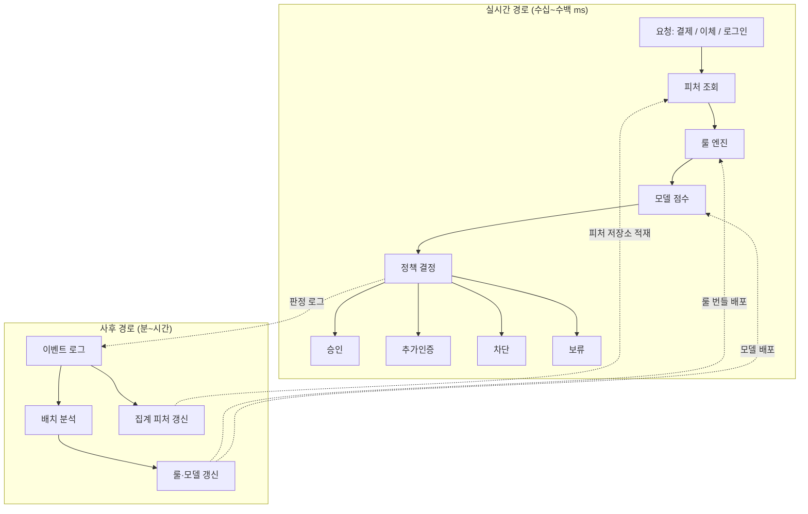
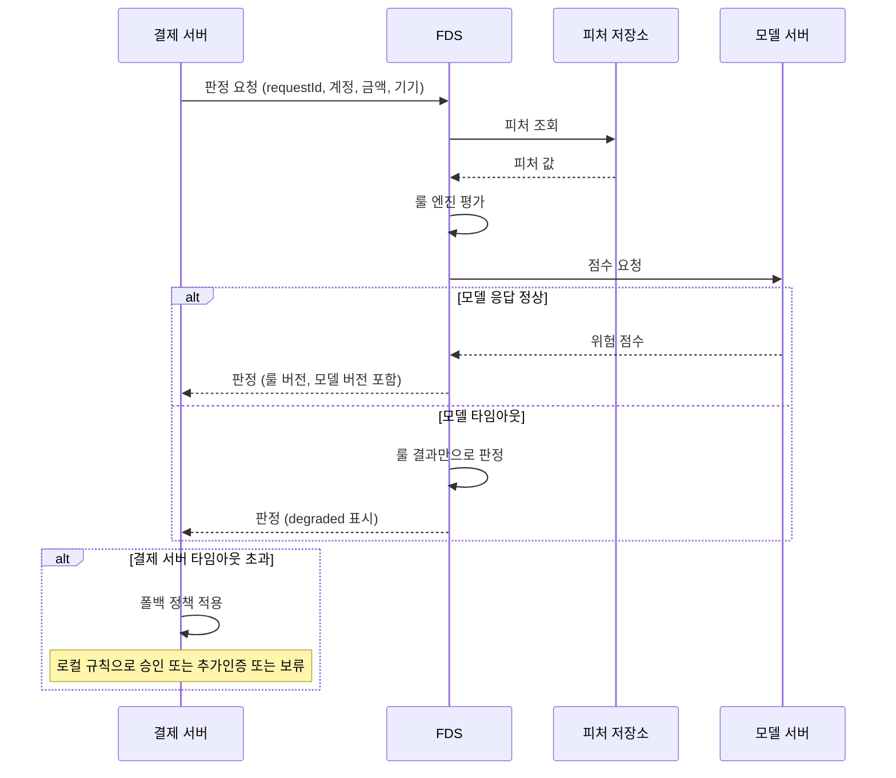
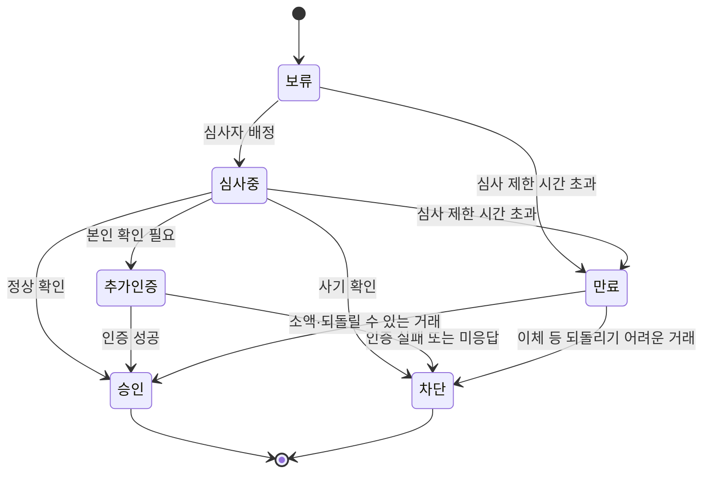

# FDS 이상거래탐지 시스템 구조

결제 승인 API에 FDS 호출을 처음 끼워 넣었을 때 겪는 일은 거의 비슷하다. 기능은 문제없이 돌아가는데, 어느 날 FDS의 피처 저장소가 느려지면 결제 서버의 스레드 풀이 먼저 찬다. 승인 요청이 FDS 응답을 기다리며 쌓이고, FDS와 상관없는 카드 등록이나 환불까지 같이 멈춘다. 사기 차단을 위해 넣은 시스템이 결제 전체의 단일 장애점이 된 것이다. 반대로 타임아웃이 나면 무조건 통과시키도록 짜 두면, 장애 시간대가 곧 공격 시간대가 된다.

FDS(Fraud Detection System)를 만드는 일은 탐지 모델을 만드는 일보다 "승인 경로 안에서 얼마나 오래, 어떤 조건으로 기다릴 것인가"를 정하는 일에 훨씬 가깝다. 이 문서는 모델 알고리즘이 아니라 FDS가 서비스와 맞물리는 구조를 다룬다. 실시간 판정 경로, 지연 예산, 타임아웃 시 폴백 기준, 서비스 쪽 연동 코드, 판정 결과별 후속 처리, 그리고 나중에 "왜 이 거래를 막았나"에 답하려면 로그에 무엇을 남겨야 하는지를 순서대로 본다.

## 두 개의 경로

FDS는 속도가 다른 두 경로로 나뉜다. 하나는 요청 한 건을 받아 수백 ms 안에 판정을 내리는 실시간 경로이고, 다른 하나는 쌓인 이벤트를 모아 몇 분에서 몇 시간 단위로 분석하는 사후 경로다. 실시간 경로는 빨라야 하므로 미리 계산된 값만 읽고, 사후 경로는 느려도 되므로 전체 이력을 본다. 사후 경로의 결과물(갱신된 룰, 새 모델, 집계 피처)이 실시간 경로의 입력이 된다.

아래 그림에서 위층이 실시간 경로, 아래층이 사후 경로다. 점선은 두 층을 잇는 데이터 흐름이다. 판정 결과가 이벤트 로그로 흘러 내려가고, 배치가 만든 산출물이 다시 올라와 룰 엔진과 모델 서버를 갱신한다.



실시간 경로의 단계를 순서대로 보면 이렇다.

피처 조회는 계정의 최근 1시간 거래 건수, 이 기기가 처음 보인 시각, 이 IP에서 최근 실패한 로그인 수 같은 값을 피처 저장소(보통 Redis 계열)에서 읽는 단계다. 요청 본문에 들어 있는 금액, 가맹점, 기기 ID는 저장소 조회 없이 바로 쓴다. 룰 엔진은 사람이 쓴 조건(해외 IP에서 신규 기기로 100만원 이상 이체 등)을 평가한다. 모델 점수는 같은 피처를 모델에 넣어 0~1 사이 위험 점수를 받는다. 정책 결정은 룰 결과와 점수를 합쳐 최종 판정 하나를 고르는 단계다. 룰과 모델을 따로 두는 이유는 책임이 다르기 때문이다. 룰은 "이 패턴은 무조건 막는다"를 즉시 반영하는 수단이고, 모델은 사람이 놓친 조합을 잡는 수단이다. 신종 수법이 발견되면 모델 재학습을 기다리지 않고 룰부터 배포한다.

사후 경로는 판정 로그와 거래 결과(정상 완료, 고객 이의제기, 카드사 차지백 등)를 이어 붙여 정답 라벨을 만든다. 라벨은 늦게 도착한다. 차지백은 거래 후 수 주가 지나서 확정되는 경우도 있어서, 모델 학습 데이터는 항상 "아직 라벨이 안 붙은 최근 거래"가 비어 있는 상태다. 이 지연이 실시간 경로의 룰이 모델보다 먼저 움직여야 하는 또 하나의 이유다.

## 인라인 호출과 이벤트 방식

서비스가 FDS를 부르는 방식은 크게 셋이다. 요청 처리 중에 동기로 부르는 인라인 방식, 거래를 이벤트로 흘려 보내고 서비스는 기다리지 않는 비동기 방식, 둘을 섞은 하이브리드다.

| 구분 | 인라인 동기 | 비동기 이벤트 | 하이브리드 |
|---|---|---|---|
| 호출 위치 | 승인 처리 중 FDS 응답 대기 | 승인 후 Kafka 등으로 이벤트 발행 | 가벼운 판정은 동기, 무거운 분석은 이벤트 |
| 차단 시점 | 승인 전 | 승인 후(사후 조치) | 승인 전 1차 + 승인 후 2차 |
| 요청 지연에 미치는 영향 | FDS 응답 시간이 그대로 더해짐 | 없음 | 동기 구간만큼 더해짐 |
| FDS 장애 시 | 폴백 정책 필요, 결제 전체로 번질 수 있음 | 서비스는 영향 없음, 탐지만 지연 | 동기 구간은 폴백 필요 |
| 막을 수 있는 것 | 결제·이체 자체 | 이미 나간 돈의 회수, 계정 제한, 정산 보류 | 둘 다 |
| 적합한 경우 | 카드 승인, 즉시 이체처럼 되돌리기 어려운 거래 | 로그인 후 행위 분석, 환불·포인트 적립 남용 탐지 | 대부분의 결제·금융 서비스 |

비동기 방식은 "막는다"가 아니라 "나중에 되돌린다"에 가깝다. 즉시 이체나 해외 카드 승인처럼 한 번 나가면 회수가 어려운 거래에는 쓸 수 없다. 반대로 인라인 방식만 쓰면 모델처럼 무거운 연산을 요청 경로에 넣어야 해서 지연 예산이 모자란다. 실제로는 하이브리드가 대부분이다. 동기 구간에서는 룰과 가벼운 모델, 미리 계산된 피처만 쓰고, 그래프 분석이나 여러 계정에 걸친 군집 탐지처럼 무거운 것은 이벤트로 넘긴다. 무거운 쪽이 이상을 찾으면 다음 거래에 쓸 룰·블랙리스트·계정 상태를 갱신하고, 이미 승인된 거래는 정산 보류나 지급 지연으로 처리한다.

### 지연 예산

인라인 구간에서는 FDS가 쓸 수 있는 시간을 먼저 정하고 그 안에서 내부 단계에 나눠 준다. 아래는 카드 승인 API가 전체 800ms 안에 응답해야 하고, 외부 카드사 호출에 상당 부분을 쓴다고 가정했을 때 예시로 잡은 값이다. 서비스마다 숫자는 달라진다. 구조를 보라는 표다.

| 구간 | 예산 | 비고 |
|---|---|---|
| 결제 서버 → FDS 네트워크 왕복 | 5~10ms | 같은 리전·같은 AZ 전제 |
| 피처 조회 | 20ms | 미리 계산된 키 단건/소수 조회만 허용 |
| 룰 엔진 | 10ms | 메모리 내 평가, 외부 호출 금지 |
| 모델 점수 | 50ms | 경량 모델, 배치 추론 금지 |
| 정책 결정 + 직렬화 | 10ms | |
| 합계 | 약 100ms | 결제 서버 타임아웃은 여유를 더해 150ms |

타임아웃은 합계가 아니라 p99를 기준으로 잡는다. 평균 40ms인 FDS가 p99에서 300ms가 나온다면 요청 100건 중 1건은 폴백으로 간다는 뜻이다. 이 비율이 서비스가 감당 가능한 수준인지부터 확인해야 하고, 감당이 안 되면 타임아웃을 늘리는 대신 FDS 내부 단계를 줄여야 한다. 타임아웃을 늘리면 결제 서버 스레드 점유 시간이 늘어나 장애 때 풀이 더 빨리 찬다.

내부 단계 중 예산을 가장 많이 어기는 곳은 피처 조회다. 피처 하나당 저장소를 한 번씩 부르면 10개 피처가 직렬 10번 왕복이 된다. 파이프라인이나 MGET으로 한 번에 읽고, 한 요청에서 읽는 키 수의 상한을 걸어 둔다. 캐시 미스일 때 DB로 내려가는 폴백 경로는 아예 막는 편이 안전하다. 피처가 비어 있으면 "값 없음"으로 판정하고 로그에 남기는 쪽이 DB 부하를 요청 경로에 끌어들이는 쪽보다 낫다.

## 호출 순서와 타임아웃 분기

결제 서버가 FDS를 부르고, FDS가 피처 저장소와 모델 서버를 차례로 호출하는 순서를 보면 타임아웃이 어디서 어떻게 갈리는지 드러난다. 핵심은 결제 서버가 기다리는 시간과 FDS 내부 호출의 타임아웃이 서로 맞물려야 한다는 점이다. FDS 내부 호출의 타임아웃 합이 결제 서버의 타임아웃보다 길면, 결제 서버가 포기한 뒤에도 FDS는 계속 일하고 있다.



그림에는 폴백 지점이 두 곳 있다. 첫째는 FDS 안에서 모델 서버가 늦을 때다. 이때는 모델 점수 없이 룰 결과만으로 판정하고, 응답에 `degraded` 표시를 붙여 돌려보낸다. 둘째는 결제 서버가 FDS 응답 자체를 못 받을 때다. 이 경우 결제 서버는 FDS가 무엇을 하고 있는지 모르므로 자체 판단으로 정해야 한다. 첫째 폴백은 FDS 팀이 정하고 둘째 폴백은 결제 서비스 팀이 정한다. 두 폴백의 기준이 서로 다르면 장애 때 거래 결과가 일관되지 않으므로 같은 문서에서 같이 관리한다.

한 가지 놓치기 쉬운 점이 있다. 결제 서버가 타임아웃으로 폴백해서 승인을 내줬는데 FDS는 뒤늦게 "차단" 판정을 내렸을 수 있다. 이 늦은 판정을 버리지 않고 판정 로그에 `late_result` 로 남겨 두면, 폴백으로 통과한 거래 중 실제로 위험했던 것을 사후에 골라낼 수 있다. 폴백이 얼마나 위험했는지 측정할 수 있는 유일한 데이터다.

## fail-open과 fail-closed

FDS가 응답하지 않을 때 통과시키면 fail-open, 막으면 fail-closed다. 전체 서비스에 하나만 정하면 거의 항상 틀린다. 거래 유형과 금액, 되돌릴 수 있는지에 따라 달라야 하기 때문이다.

| 거래 | 금액·상황 | 폴백 | 이유 |
|---|---|---|---|
| 카드 결제, 소액 | 기존 기기, 평소 가맹점 | fail-open | 막으면 정상 고객 손실이 크고 건당 피해는 작다 |
| 카드 결제, 고액 | 한도 근처 | 추가인증 | 통과도 차단도 부담, 고객 확인으로 위험을 넘긴다 |
| 즉시 이체 | 신규 수취 계좌 | fail-closed(보류) | 한 번 나가면 회수가 어렵다 |
| 로그인 | 평소 기기·IP | fail-open | 로그인 자체를 막으면 서비스가 멈춘다 |
| 로그인 | 신규 기기 | 추가인증 | 인증 단계를 한 번 더 거치는 비용이 작다 |
| 비밀번호·연락처 변경 | 항상 | 추가인증 | 계정 탈취의 마지막 단계에서 자주 쓰인다 |

판단 기준은 세 가지로 줄어든다. 돈이나 데이터가 한 번 나가면 되돌릴 수 있는가, 폴백 시 놓칠 수 있는 건당 최대 피해가 얼마인가, 막았을 때 정상 고객이 입는 손실이 얼마인가. 세 번째가 의외로 크다. 결제를 막으면 해당 고객은 그 자리에서 다른 서비스로 떠날 수 있어서, 소액 결제는 놓치는 사기 금액보다 막아서 잃는 매출이 큰 경우가 많다.

fail-open에는 상한을 같이 걸어야 한다. FDS 장애 중에 무제한으로 통과시키면 공격자가 장애 시간을 알아채는 순간 한도 내에서 최대한 뽑아 간다. 폴백으로 승인하는 거래는 계정당 건수와 누적 금액에 별도 카운터를 두고, 그 카운터를 넘으면 추가인증으로 바꾼다. 또 하나, 공격자가 의도적으로 FDS를 느리게 만들 수 있는 경로(조회 비용이 큰 입력을 반복해서 보내는 식)가 있다면 fail-open 윈도가 곧 공격 창구다. 폴백이 발동한 비율을 지표로 올려 두고, 평소보다 올라가면 장애와 별개로 경보를 건다.

## 서비스 쪽 연동 코드

Spring Boot 3.2 이상과 Resilience4j를 쓰는 결제 서버 쪽 클라이언트 예시다. 구성은 세 가지다. HTTP 타임아웃, 서킷브레이커, 그리고 거래 유형별 폴백 결정. 재시도는 넣지 않았다. 150ms 예산 안에서 재시도는 들어갈 자리가 없고, 재시도가 FDS 쪽 부하를 키워 장애를 오래 끌기도 한다.

```java
public enum Decision { APPROVE, CHALLENGE, BLOCK, HOLD }

public record FdsRequest(
    String requestId,       // 재요청에도 동일하게 유지
    String accountId,
    String txType,          // PAYMENT, TRANSFER, LOGIN, PROFILE_CHANGE
    long amount,
    String deviceId,
    String ip,
    String counterpartyId   // 가맹점 또는 수취 계좌
) {}

public record FdsResponse(
    Decision decision,
    double riskScore,
    String ruleVersion,
    String modelVersion,
    boolean degraded,
    List<String> reasonCodes
) {}
```

```java
@Component
public class FdsClient {

    private final RestClient restClient;
    private final CircuitBreaker breaker;
    private final FallbackPolicy fallback;
    private final MeterRegistry metrics;

    public FdsClient(RestClient.Builder builder, FallbackPolicy fallback, MeterRegistry metrics) {
        var factory = new SimpleClientHttpRequestFactory();
        factory.setConnectTimeout(Duration.ofMillis(30));
        factory.setReadTimeout(Duration.ofMillis(150));
        this.restClient = builder.baseUrl("http://fds.internal").requestFactory(factory).build();

        this.breaker = CircuitBreaker.of("fds", CircuitBreakerConfig.custom()
            .slidingWindowType(CircuitBreakerConfig.SlidingWindowType.COUNT_BASED)
            .slidingWindowSize(50)
            .minimumNumberOfCalls(20)
            .failureRateThreshold(50)
            .slowCallDurationThreshold(Duration.ofMillis(100))
            .slowCallRateThreshold(60)
            .waitDurationInOpenState(Duration.ofSeconds(10))
            .permittedNumberOfCallsInHalfOpenState(5)
            .build());
        this.fallback = fallback;
        this.metrics = metrics;
    }

    public FdsResponse evaluate(FdsRequest req) {
        try {
            return breaker.executeSupplier(() ->
                restClient.post().uri("/v1/evaluate")
                    .header("X-Request-Id", req.requestId())
                    .body(req)
                    .retrieve()
                    .body(FdsResponse.class));
        } catch (CallNotPermittedException e) {
            return fallbackWith(req, "BREAKER_OPEN");
        } catch (Exception e) {
            return fallbackWith(req, e.getClass().getSimpleName());
        }
    }

    private FdsResponse fallbackWith(FdsRequest req, String cause) {
        metrics.counter("fds.fallback", "txType", req.txType(), "cause", cause).increment();
        return fallback.decide(req, cause);
    }
}
```

`setReadTimeout` 은 소켓에서 다음 바이트를 기다리는 시간의 상한이지 요청 전체의 상한이 아니다. 응답이 아주 천천히 흘러오면 150ms를 넘겨도 끊기지 않는다. 전체 시간을 강제해야 하는 구간이면 호출을 별도 스레드에서 돌리고 `Future.get(timeout)` 으로 감싸거나 TimeLimiter를 얹는다. 서킷브레이커의 `slowCallDurationThreshold` 를 타임아웃(150ms)보다 짧은 100ms로 둔 이유는, 타임아웃이 나기 전부터 느려지는 신호를 브레이커가 먼저 읽게 하려는 것이다. 느린 호출이 60%를 넘으면 FDS가 아직 응답은 하고 있어도 브레이커가 열린다.

폴백 정책은 위의 표를 코드로 옮긴 것이다.

```java
@Component
public class FallbackPolicy {

    private static final long SMALL_PAYMENT = 50_000L;
    private static final int  FALLBACK_APPROVE_PER_HOUR = 5;

    private final KnownDeviceCache knownDevices;       // 로컬 캐시, 외부 호출 없음
    private final FallbackCounter counter;             // 계정별 폴백 승인 누적

    public FallbackPolicy(KnownDeviceCache knownDevices, FallbackCounter counter) {
        this.knownDevices = knownDevices;
        this.counter = counter;
    }

    public FdsResponse decide(FdsRequest req, String cause) {
        Decision d = switch (req.txType()) {
            case "TRANSFER" -> Decision.HOLD;
            case "PROFILE_CHANGE" -> Decision.CHALLENGE;
            case "LOGIN" -> knownDevices.contains(req.accountId(), req.deviceId())
                ? Decision.APPROVE : Decision.CHALLENGE;
            case "PAYMENT" -> paymentFallback(req);
            default -> Decision.CHALLENGE;
        };
        return new FdsResponse(d, -1.0, "fallback", "fallback", true, List.of("FALLBACK_" + cause));
    }

    private Decision paymentFallback(FdsRequest req) {
        boolean small = req.amount() <= SMALL_PAYMENT;
        boolean known = knownDevices.contains(req.accountId(), req.deviceId());
        if (small && known && counter.incrementAndGet(req.accountId()) <= FALLBACK_APPROVE_PER_HOUR) {
            return Decision.APPROVE;
        }
        return Decision.CHALLENGE;
    }
}
```

폴백 정책 안에서 외부 호출을 하지 않는 것이 중요하다. 폴백이 DB나 다른 서비스를 부르면, FDS가 죽었을 때 그 폴백까지 같이 느려져서 폴백이 의미가 없어진다. 알려진 기기 목록은 로그인 성공 시점에 로컬 캐시(Caffeine 등)에 채워 두고, 폴백에서는 메모리 조회만 한다. 위험 점수를 `-1.0` 으로 넣은 것도 의도가 있다. 판정 로그나 통계에서 폴백 건이 정상 점수 0에 섞여 평균을 낮추는 것을 막기 위해서다.

`PROFILE_CHANGE` 같은 거래 유형 분기는 서비스마다 늘어난다. 유형이 추가될 때 `default` 로 빠지면 추가인증이 걸리는데, 이 기본값이 fail-closed 쪽인 것은 의도된 선택이다. 새 거래 유형은 누군가 폴백 기준을 명시적으로 정하기 전까지 보수적으로 두는 편이 낫다.

## 판정 결과 4종과 후속 처리

정책 결정 단계의 출력은 승인, 추가인증, 차단, 보류 넷 중 하나다. 이진 판정(통과/차단)으로 시작하면 곧 "애매한 건 어떻게 하냐"는 요구가 나오고, 결국 중간 상태가 생긴다. 처음부터 넷으로 나눠 두는 편이 낫다.

| 판정 | 의미 | 서비스 쪽 후속 처리 | 주의할 점 |
|---|---|---|---|
| 승인 | 위험 신호가 임계값 아래 | 원래 흐름 계속 | 승인도 판정 로그에는 반드시 남긴다. 나중에 사기로 확정된 거래의 당시 점수를 찾아야 한다 |
| 추가인증 | 본인 확인이 되면 통과 가능 | OTP, 생체, 인증 앱 등 단계 상승 후 재판정 | 추가인증 결과를 FDS에 다시 알려야 한다. 안 알리면 같은 거래가 계속 추가인증에 걸린다 |
| 차단 | 거래 거절 | 사용자에게 일반적인 실패 메시지, 사유 코드는 노출하지 않음 | 차단 사유를 자세히 알려주면 공격자가 임계값을 역산한다 |
| 보류 | 자동 판단 불가, 사람 검토 | 거래를 대기 상태로 두고 심사 큐에 등록 | 보류 시간 상한이 없으면 고객 돈이 무기한 묶인다 |

보류는 나머지 셋과 달리 상태를 가진다. 거래가 대기 상태로 남고, 심사자가 처리하거나 시간이 지나면 정해진 방향으로 풀려야 한다. 상태 전이를 먼저 그려 두지 않으면 "심사자가 퇴근한 금요일 저녁에 쌓인 보류 거래"가 문제로 올라온다.



그림에서 눈여겨볼 곳은 `만료` 노드다. 심사 제한 시간이 지났을 때 어느 쪽으로 풀지는 거래 유형이 정한다. 이체는 차단으로, 소액 결제는 승인으로 풀리게 두는 식이다. 앞서 본 fail-open/fail-closed 기준이 여기서 한 번 더 쓰인다. 만료 처리를 만들 때는 사용자에게 보이는 상태(처리 중, 취소됨)와 내부 상태(보류, 심사중, 만료)를 분리해 둔다. 내부 상태를 그대로 노출하면 사용자 문의가 늘고 공격자에게 판정 구조를 알려준다.

추가인증은 서비스 쪽 구현이 까다롭다. FDS가 `CHALLENGE` 를 반환하면 결제 서버는 거래를 중단하고 인증 단계로 넘기는데, 인증이 끝난 뒤 같은 거래를 재개해야 한다. 이때 거래를 식별하는 `requestId` 가 바뀌면 FDS 입장에서는 완전히 새 요청이라 같은 이유로 또 추가인증이 걸린다. 재개 요청에는 원래 `requestId` 와 `challengePassed=true` 를 함께 보내고, FDS는 같은 `requestId` 의 추가인증 통과 이력이 있으면 추가인증 룰을 건너뛴다.

## 판정 로그에 남겨야 할 필드

판정 로그는 FDS 운영에서 가장 자주 열어보는 데이터다. 고객이 "왜 막혔냐"고 문의했을 때, 심사자가 보류 거래를 판단할 때, 모델 담당자가 재학습 데이터를 만들 때, 감사 대응이 필요할 때 전부 이 로그를 본다. 처음에 판정 결과만 남기고 시작했다가 나중에 필드를 추가하면 과거 데이터는 비어 있다. 처음부터 아래 필드를 모두 넣는다.

```json
{
  "request_id": "7f3c2a10-9b1e-4a77-8d0e-5c1f2a9e4b11",
  "evaluated_at": "2026-10-28T09:41:12.381Z",
  "tx_type": "TRANSFER",
  "account_id": "acc_1029384",
  "amount": 1500000,
  "decision": "CHALLENGE",
  "risk_score": 0.74,
  "rule_version": "rules-2026-10-27.3",
  "model_version": "gbm-fraud-2026-10-20",
  "fired_rules": ["R112_NEW_PAYEE_HIGH_AMOUNT", "R031_FOREIGN_IP"],
  "reason_codes": ["NEW_PAYEE", "GEO_MISMATCH"],
  "features": {
    "txn_count_1h": 4,
    "device_age_days": 0,
    "ip_country": "VN",
    "usual_country": "KR",
    "payee_first_seen": true,
    "avg_amount_30d": 82000
  },
  "latency_ms": { "feature": 14, "rule": 3, "model": 41, "total": 63 },
  "degraded": false,
  "fallback_cause": null,
  "late_result": false,
  "challenge_result": null,
  "final_outcome": null
}
```

필드마다 남기는 이유가 있다.

`rule_version` 과 `model_version` 이 없으면 판정을 재현할 수 없다. 룰은 하루에도 몇 번 배포되기 때문에, 3일 전 거래를 지금 룰로 돌려 보면 결과가 다르다. 특정 룰 배포 직후 차단율이 튀었을 때 그 버전만 골라 영향을 보려면 이 필드가 반드시 있어야 한다.

`features` 는 판정 시점의 스냅샷이다. 피처 저장소의 값은 계속 바뀌므로 나중에 같은 계정의 피처를 다시 조회하면 당시 값이 아니다. 거래 건수 4건이라는 이유로 막았는데 지금 조회하면 12건이어서, 막은 근거를 설명할 수 없는 일이 생긴다. 모델 재학습에서도 "당시 알고 있던 값"으로 학습해야 데이터 누수가 없다. 개인정보가 섞여 있으므로 필드는 판정에 쓴 값만 선별하고, 계좌번호·카드번호 같은 식별 정보는 해시나 토큰으로 바꿔서 넣는다. 보존 기간과 접근 권한은 [PII 데이터 보호](PII_Data_Protection.md)와 [보안 로깅과 감사](Security_Logging_and_Auditing.md) 기준을 따른다.

`degraded`, `fallback_cause`, `late_result` 는 장애 구간 분석용이다. 폴백으로 통과된 거래만 모아서 이후 사기 확정 비율을 보면 폴백 정책이 적절했는지 판단할 수 있다.

`challenge_result` 와 `final_outcome` 은 판정 시점에는 비어 있고 나중에 채워진다. 로그 한 줄을 갱신하지 않고, 같은 `request_id` 로 후속 이벤트(추가인증 결과, 이의제기, 차지백 확정)를 별도 레코드로 적재해서 조인한다. 불변 로그를 유지해야 감사 때 변조 의혹이 없다. 사후 경로의 라벨 생성이 바로 이 조인 위에서 돌아간다.

## UEBA와의 차이

헷갈리기 쉬운 것이 [UEBA](UEBA.md)다. 둘 다 "이상"을 찾지만 단위와 시점이 다르다.

| 구분 | FDS | UEBA |
|---|---|---|
| 분석 단위 | 거래 한 건 | 계정·직원·호스트의 행위 흐름 |
| 대상 | 고객의 결제·이체·로그인 | 내부 직원 계정, 서비스 계정, 운영 도구 접근 |
| 시점 | 요청 처리 중 실시간 판정 | 로그를 모아 사후·준실시간 점수화 |
| 결과 | 승인·추가인증·차단·보류 | 위험 점수 상승, 알림, 세션 강제 종료 |
| 막는 것 | 사기 거래 자체 | 계정 오남용, 내부자 유출, 탈취된 계정의 이상 행동 |

FDS의 피처로 UEBA가 만든 계정 위험 점수를 가져다 쓸 수는 있다. 반대로 FDS의 차단 이력이 UEBA의 입력이 되기도 한다. 다만 UEBA의 계정 단위 점수는 계산 주기가 길어서, 실시간 경로에서는 미리 계산된 값을 피처 저장소에서 읽는 형태로만 쓴다.

FDS가 앞단에서 다른 방어와 맞물리는 지점도 있다. 같은 IP나 기기에서 로그인 시도가 몰리는 것은 [Rate Limiting](Rate_Limiting.md)이 먼저 걸러야 FDS 호출량이 줄어든다. 유출된 계정 목록으로 로그인을 반복하는 공격은 [크리덴션 스터핑](Credential_Stuffing.md) 방어가 앞에서 막고, 통과해서 들어온 로그인 뒤의 거래를 FDS가 본다. 음성·영상 위조로 본인 확인을 속이는 수법은 추가인증 단계의 신뢰도를 흔들기 때문에 [딥페이크와 AI 사기](Deepfake_and_AI_Fraud.md)를 같이 봐야 한다. 추가인증을 OTP 하나로만 두면 FDS가 CHALLENGE를 내려도 우회될 수 있어서, 인증 수단 자체의 강도는 FDS 바깥에서 정해진다.
