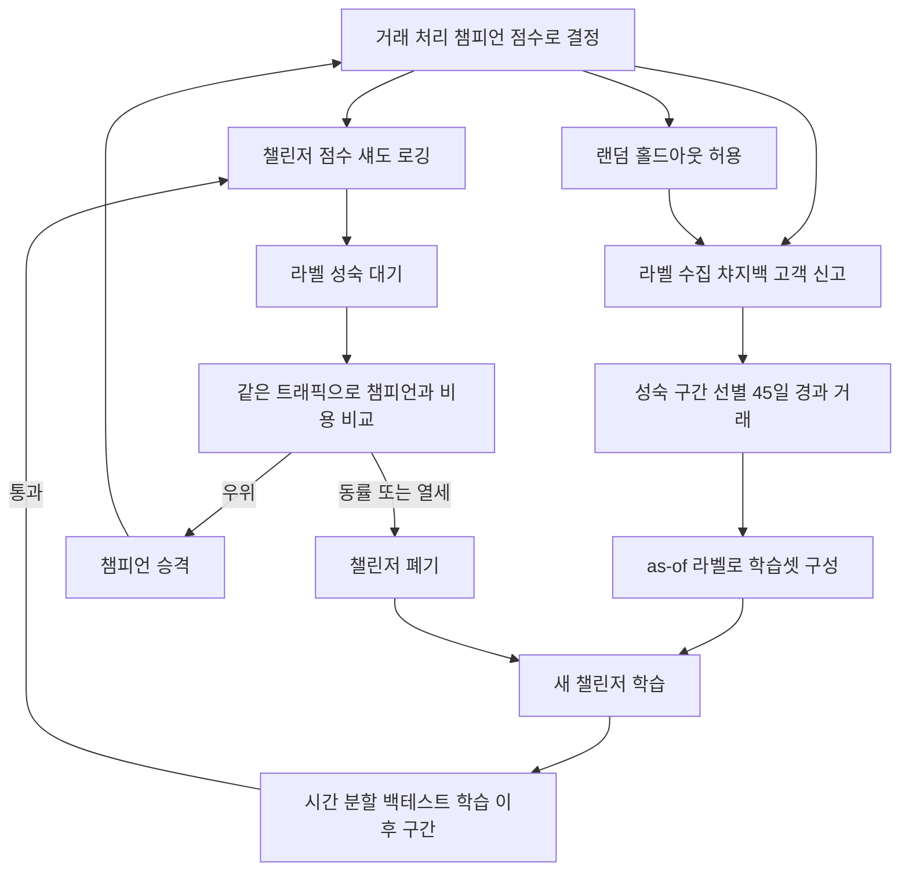
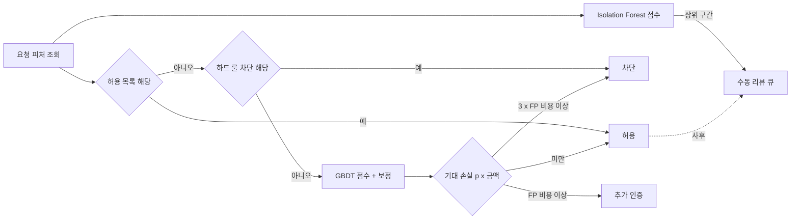

# FDS ML 모델 운영

룰만으로 버티던 FDS에 모델을 붙이는 일은 노트북에서 AUC 0.95를 확인하는 것으로 끝나지 않는다. 운영에 올린 뒤 부딪히는 문제는 대부분 모델 자체가 아니라 모델 바깥에 있다. 정답이 몇 주 늦게 도착한다. 차단한 거래의 정답은 영영 알 수 없다. 사기가 전체의 0.1%도 안 되니 정확도 숫자는 아무것도 말해 주지 않는다. 몇 달 뒤 공격자가 모델이 막지 못하는 쪽으로 옮겨 간다. 고객이 "왜 막았느냐"고 물으면 CS가 대답할 말이 없다.

이 문서는 이 다섯 가지를 순서대로 다룬다. 수치는 전부 직접 만든 합성 데이터에서 돌려서 얻었다. 거래 400만 건, 사기 비율 약 0.086%, 피처는 금액·야간 여부·신규 기기 여부·1시간 속도 카운터·가입 기간 다섯 개다. 실제 서비스의 분포가 아니므로 숫자 자체보다 어느 방향으로 어긋나는지를 봐야 한다. 환경은 Python 3.10, LightGBM 4.7, scikit-learn 1.7, SHAP 0.49다.

## 라벨은 늦게 오고 일부는 영영 오지 않는다

FDS 라벨의 출처는 챠지백, 고객 신고, 카드사 분쟁 접수, CS 티켓이다. 전부 거래가 끝난 뒤에 사람이 알아차려야 생긴다. 어제 거래의 라벨은 거의 비어 있다. 그 빈 라벨을 모델은 "정상"으로 읽는다.

중앙값 14일, 로그정규 분포(σ=0.7)로 신고 지연을 가정하고 거래 경과일별로 사기 거래 중 라벨이 도착한 비율을 구했다.

| 거래 후 경과일 | 라벨이 도착한 사기 거래 |
|---|---|
| 7일 | 16% |
| 14일 | 50% |
| 30일 | 86% |
| 45일 | 95% |
| 60일 | 98% |
| 90일 | 100% |

최근 7일 데이터로 학습하면 사기의 84%가 정상 라벨을 달고 들어간다. 모델은 가장 최근 수법을 정상으로 배운다. 재학습을 자주 돌릴수록 이 문제가 심해진다고 느끼기 쉬운데, 실제로는 재학습 주기와 무관하게 학습 구간의 끝을 얼마나 뒤로 잡느냐의 문제다.

### as-of 라벨과 성숙 구간

학습셋은 두 가지를 지켜서 만든다. 첫째, 라벨이 거의 다 도착한 구간(성숙 구간)의 거래만 쓴다. 둘째, 과거 시점을 재현할 때는 그 시점에 알고 있던 라벨만 쓴다.

```python
import pandas as pd

MATURITY_DAYS = 45   # 사기 라벨의 95%가 도착하는 경과일

def label_as_of(txn: pd.DataFrame, as_of: pd.Timestamp) -> pd.Series:
    # as_of 시점에 이미 접수된 신고만 사기로 본다
    known = txn["reported_at"].notna() & (txn["reported_at"] <= as_of)
    return known.astype(int)

def training_window(txn: pd.DataFrame, as_of: pd.Timestamp) -> pd.DataFrame:
    return txn[txn["txn_at"] <= as_of - pd.Timedelta(days=MATURITY_DAYS)]
```

```text
>>> label_as_of(txn, pd.Timestamp("2026-10-28")).tolist()
[1, 0, 1, 0]
>>> label_as_of(txn, pd.Timestamp("2026-08-10")).tolist()
[0, 0, 0, 0]
```

두 번째 줄이 중요하다. 같은 거래 4건이 8월 10일 기준으로는 사기가 하나도 없다. 백테스트를 오늘 기준 라벨로 돌리면 8월 10일의 모델이 알 수 없던 정답으로 평가하게 되어 성능이 과대평가된다. 반대로 재학습 파이프라인이 오늘 기준 라벨로 최근 거래까지 쓰면 앞서 본 84% 누락이 그대로 들어온다. `reported_at` 컬럼을 거래 테이블에 신고 접수 시각으로 남겨 두지 않으면 이 구분 자체가 불가능하다. `is_fraud` 불리언 하나만 덮어쓰는 스키마는 나중에 고치기 어렵다.

성숙 구간을 길게 잡으면 모델이 45일 전 세상을 배운다는 점이 비용이다. 45일은 정답이 아니라 라벨 도착 곡선과 수법 변화 속도 사이의 타협이다. 조기 신호를 보조로 쓰는 방법이 있다. 신고 접수 전이라도 고객이 3D Secure 인증에 실패했거나 카드를 즉시 정지한 거래는 며칠 안에 사기로 확정되는 경우가 많다. 이런 조기 라벨을 별도 컬럼으로 두고 성숙 전 구간에 한해 쓸지는 정밀도를 확인한 뒤 정한다.

### 차단한 거래는 정답을 모른다

두 번째 문제는 더 조용하다. 현재 FDS가 막은 거래는 결제가 이루어지지 않았으므로 챠지백도 없다. 고객이 신고할 일도 없다. 그 거래가 정말 사기였는지는 영영 알 수 없다. 학습 데이터에는 "통과한 거래"만 정답이 달려 있고, 룰이 막는 영역은 라벨이 비어 있다. 이 영역을 정상으로 간주하면 모델은 룰이 막던 패턴을 안전하다고 배운다. 차단된 거래 전체를 사기로 간주하면 룰의 오탐이 모델에 그대로 복사되고 룰을 없애도 모델이 같은 오탐을 낸다.

합성 데이터로 영향을 쟀다. "신규 기기이면서 1시간 속도 카운터가 2 이상"인 거래를 기존 룰이 전부 막았다고 가정했다. 전체 학습 거래의 0.97%인데 사기의 31%가 이 영역에 있다. 이 영역을 빼고 학습한 모델과 전체로 학습한 모델을 같은 테스트 거래로 비교했다.

| 이 영역(7,809건, 사기 228건)에서 | 전체 라벨로 학습 | 통과한 거래만으로 학습 |
|---|---|---|
| 순위 지표 AUC | 0.863 | 0.852 |
| 평균 점수 | 0.226 | 0.103 |
| 점수 0.5 이상 비율 | 12.3% | 3.5% |

순위는 거의 같다. 이 시뮬레이션에서는 피처가 단순해서 모델이 인접 영역의 패턴을 외삽해 준다. 문제는 점수 수준이다. 점수 0.5 이상으로 올라오는 거래가 12.3%에서 3.5%로 줄었다. 임계값을 0.5에 두고 있었다면 이 영역은 룰을 내리는 순간 모델이 막아 주지 못한다. 실제 서비스에서는 막힌 영역이 피처 공간의 한쪽에 몰려 있는 경우가 많아서 순위까지 무너질 수 있다.

해결책은 하나다. 일부 거래는 점수와 무관하게 통과시켜서 정답을 얻는다. 전체 트래픽의 0.5% 정도를 무작위로 골라 룰·모델의 차단 결정을 무시하고 허용한다(랜덤 홀드아웃). 금액 상한을 걸어 두고, 홀드아웃에 걸린 거래는 `holdout=true`로 표시한다. 손실 한도는 사전에 정해서 승인받는다. 홀드아웃 거래는 편향 없는 정답이라서 학습셋에는 가중치를 역수로 주고, 평가 지표는 이 샘플로만 계산하는 것이 가장 정직하다. 손실이 부담스러우면 차단 대신 추가 인증으로 보내고 인증 실패율을 약한 라벨로 쓰는 방법도 있다.

### 학습에서 승격까지의 순환

아래 흐름에서 눈여겨볼 곳은 "라벨 성숙 대기" 노드다. 챌린저를 섀도로 올린 뒤 챔피언과 비교하려면 그 기간 거래의 라벨이 도착해야 한다. 승격 판단이 가장 빨라도 배포 후 45일 근처에서 나온다는 뜻이다.



## 사기가 0.1%일 때 정확도는 아무것도 말해 주지 않는다

테스트 거래 80만 건에서 사기는 686건(0.086%)이다. 모든 거래를 허용하는 모델의 정확도는 99.91%다. 정확도로 모델을 비교하면 사기를 하나도 못 잡는 모델이 99.91점을 받고, 정상 거래를 수백 건 잘못 막으면서 사기를 잡은 모델이 점수를 깎인다. 지표가 모델의 가치와 반대로 움직인다.

그래서 precision(막은 것 중 진짜 사기 비율)과 recall(사기 중 막은 비율)을 본다. 둘은 임계값을 올리면 precision이 오르고 recall이 내려가는 관계라서, 어느 점을 고를지는 결국 돈 계산이다.

- 정상 고객을 잘못 막으면 비용이 든다. CS 문의, 재시도 이탈, 장바구니 포기를 합쳐 건당 15,000원으로 가정했다. 서비스마다 완전히 다르니 이 숫자는 반드시 자기 서비스 데이터로 갈아 끼워야 한다.
- 사기를 놓치면 그 거래 금액만큼 손실이 난다. 챠지백 수수료는 계산에서 뺐다.

### 비용으로 임계값 고르기

모델은 2,400,000건으로 학습하고 보정과 임계값 선택에 80만 건 검증셋을 반씩 나눠 썼다. 같은 데이터로 보정과 임계값을 둘 다 고르면 낙관적으로 나온다. 최종 비용은 학습·검증에 쓰지 않은 80만 건 테스트에서 낸다.

```python
FP_COST = 15_000   # 정상 고객 차단 1건

def total_cost(block, y, amount):
    false_pos = (block & (y == 0)).sum()
    missed = amount[(~block) & (y == 1)].sum()
    return false_pos * FP_COST + missed

# p_va: 보정된 검증 점수, p_te: 보정된 테스트 점수
cands = np.unique(np.quantile(p_va, np.linspace(0.9, 0.9999, 300)))
best = min(cands, key=lambda t: total_cost(p_va >= t, y_va, amount_va))
print(best, total_cost(p_te >= best, y_te, amount_te))
```

```text
allow-all test cost 120.2M
0.005  flagged=19496  prec=0.024 rec=0.672 cost=308.9M
0.01   flagged=7428   prec=0.048 rec=0.519 cost=145.9M
0.02   flagged=3861   prec=0.073 rec=0.413 cost=107.0M
0.03   flagged=3469   prec=0.078 rec=0.395 cost=102.4M
0.05   flagged=1516   prec=0.140 rec=0.309 cost=86.7M
0.08   flagged=907    prec=0.170 rec=0.224 cost=93.1M
0.12   flagged=372    prec=0.226 rec=0.122 cost=107.3M
0.2    flagged=127    prec=0.299 rec=0.055 cost=112.8M
val-chosen th 0.0597 -> test cost 86.7M flagged 1516
```

임계값 0.005는 사기의 67%를 잡지만 총비용이 308.9M원이다. 아무것도 막지 않았을 때의 120.2M원보다 비싸다. 정상 고객 19,000명 가까이를 막는 비용이 사기 방지 이익을 넘는다. recall이 높은 쪽이 좋아 보여서 임계값을 낮춰 놓고 CS 문의가 폭증한 뒤에야 알아채는 경우가 있다. 반대로 0.2까지 올리면 precision 29.9%로 보기 좋지만 사기 대부분을 통과시켜서 비용이 다시 올라간다. 비용 곡선은 가운데가 낮은 U자다.

precision과 recall이 임계값에 따라 반대로 움직이는 모습을 한 그림에 놓았다. 가로축은 보정된 점수 임계값이고 단위는 퍼센트다.

```
xychart-beta
    title "임계값별 precision, recall (%)"
    x-axis ["0.005", "0.01", "0.02", "0.03", "0.05", "0.08", "0.12", "0.2"]
    y-axis "퍼센트" 0 --> 70
    line [2.4, 4.8, 7.3, 7.8, 14.0, 17.0, 22.6, 29.9]
    line [67.2, 51.9, 41.3, 39.5, 30.9, 22.4, 12.2, 5.5]
```

위쪽에서 시작해 내려가는 선이 recall, 아래에서 올라가는 선이 precision이다. 두 선은 0.08과 0.12 사이에서 교차하는데, 비용 최저점은 그보다 왼쪽인 0.05(86.7M원)다. 교차점이 최적점이라는 규칙은 없다. 최저점은 FP 비용과 사기 금액 분포가 정하고, 둘 중 하나가 바뀌면 움직인다.

### 금액을 판정에 넣는다

임계값 하나로 모든 거래를 자르면 1만 원 거래와 500만 원 거래가 같은 기준을 받는다. 기대 손실이 오탐 비용을 넘을 때만 막도록 바꾸면 금액이 큰 거래는 낮은 점수에서도 걸리고 소액은 높은 점수여야 걸린다.

```python
block = p_te * amount_te > FP_COST     # 기대 손실 > 오탐 비용
```

이 규칙으로 1,034건을 막았고 총비용은 77.6M원이었다. 단일 임계값의 최저점 86.7M원보다 10% 정도 낮다. 이 방식은 `p`가 실제 사기 확률에 가까워야 성립한다. 점수가 확률이 아니면 곱셈 자체가 의미가 없다. 이 문제는 뒤에서 보정으로 다룬다.

## 룰, 지도학습, 비지도학습을 한 판정에 붙이기

세 방식은 서로를 대체하지 않는다. 약점이 겹치지 않아서 병행한다.

| | 룰 | 지도학습 (GBDT) | 비지도학습 (Isolation Forest 등) |
|---|---|---|---|
| 강점 | 즉시 반영, 사유가 명확, 라벨 불필요, 규제 대응이 쉽다 | 라벨이 있는 기존 수법을 정교하게 구분, 피처 간 상호작용 학습 | 라벨 없이 시작, 처음 보는 이상 패턴에 반응 |
| 약점 | 수가 늘면 서로 충돌, 임계값을 공격자가 탐색 가능 | 라벨 지연과 선택 편향에 취약, 새 수법에 느림 | 정상이지만 드문 거래(고액 결제, 해외 출장)를 이상으로 판정 |
| 쓰지 말아야 할 때 | 조건이 수백 개로 불어나 아무도 전체를 설명 못 할 때 | 사기 라벨이 수백 건 미만이거나 라벨 정의가 서비스마다 일관되지 않을 때 | 단독으로 자동 차단에 쓸 때. 정밀도가 낮아 리뷰 큐 정렬용이 한계 |
| 운영 부담 | 룰 수명 관리, 충돌 검사 | 재학습, 보정, 드리프트 감시, 섀도 배포 | 점수 해석이 어렵고 피처가 바뀌면 점수 의미도 바뀜 |

Isolation Forest는 같은 5개 피처로 테스트에서 AUC 0.916, 평균 정밀도(AP) 0.038이 나왔고 GBDT는 AUC 0.935, AP 0.092였다. AUC 차이는 작아 보이지만 사기가 극소수일 때는 AP에서 격차가 크게 벌어진다. 라벨이 충분한 환경에서는 지도학습이 앞선다. 다만 합성 데이터는 학습 시점에 없던 새 수법을 넣지 않았으므로, 비지도의 존재 이유인 "처음 보는 패턴 탐지"는 이 수치로 측정되지 않았다. 두 점수의 스피어만 순위 상관은 0.50이어서 같은 거래를 보고 일부만 같은 곳을 가리킨다. 이 차이를 쓰려면 비지도 점수를 차단 기준이 아니라 사람이 보는 리뷰 큐의 우선순위나 지도학습 모델의 추가 피처로 넣는다.

### 결합 구조

판정은 세 단계로 흐른다. 룰이 먼저 걸러 내고, 모델이 남은 거래의 기대 손실을 계산하고, 결과를 구간으로 나눠 허용·추가 인증·차단으로 보낸다. 비지도 점수는 차단 경로가 아니라 리뷰 큐로 간다.



하드 룰은 모델 점수와 독립적으로 유지한다. 모델이 죽거나 피처 저장소가 응답하지 않을 때도 룰은 계속 돌아야 하고, 룰이 모델의 입력이 되면 둘이 같은 실수를 한꺼번에 하게 된다. 허용 목록(내부 테스트 계정, 신뢰 가맹점)은 모델 앞에 둔다. 모델이 이런 거래에 점수를 매기면 지표가 흐려진다.

이 구조로 테스트 80만 건을 판정한 결과다. 룰은 "신규 기기이면서 속도 카운터 3 이상"으로 두었다.

```text
rule_block   n=1469  frauds=90      (룰 단독 precision 6.1%)
block        1613 건  사기 126건   (룰 + 기대 손실 3 x 15,000원 이상)
step_up       782 건  사기  89건   (기대 손실 15,000원 이상)
allow      797605 건  사기 471건
```

추가 인증으로 보낸 782건 중 89건이 사기였다. 이 구간의 비용은 이번 계산에 넣지 않았다. 인증을 통과한 사기와 인증에서 이탈한 정상 고객 비율을 알아야 계산할 수 있다. 추가 인증 구간을 모델 평가에 섞을 때는 이탈 비용을 따로 측정해야 한다.

### 점수 보정

GBDT 출력은 확률처럼 생겼지만 확률이 아니다. 사기 비율이 0.1% 미만인 데이터에서는 `scale_pos_weight`로 사기 샘플에 가중치를 주는데, 이 값을 올리면 점수 전체가 위로 밀린다. 가중치 20으로 학습한 모델의 점수 대역별 실제 사기 비율을 쟀다.

| 원점수 구간 | 거래 수 | 평균 원점수 | 실제 사기 비율 | 보정 후 평균 |
|---|---|---|---|---|
| 0.3~0.5 | 3,229 | 0.379 | 2.4% | 2.8% |
| 0.5~0.7 | 783 | 0.589 | 7.8% | 5.7% |
| 0.7~0.9 | 324 | 0.779 | 9.0% | 8.2% |

점수 0.59라고 해서 59% 확률로 사기가 아니다. 실제로는 7.8%다. `p * amount > FP_COST` 같은 기대 손실 계산이나 "점수 0.9 이상은 차단" 같은 고정 임계값이 모델 버전마다 다른 의미를 갖게 되는 원인이다. 재학습할 때 가중치나 트리 수를 바꾸면 같은 임계값이 완전히 다른 차단율을 만든다.

검증셋에서 isotonic regression으로 보정한다.

```python
from sklearn.isotonic import IsotonicRegression

half = len(y_va) // 2
iso = IsotonicRegression(out_of_bounds="clip", y_min=0, y_max=1)
iso.fit(raw_va[:half], y_va[:half])        # 보정용 절반
p_va = iso.predict(raw_va[half:])          # 임계값 선택용 나머지 절반
p_te = iso.predict(raw_te)
```

isotonic은 계단 함수라서 점수가 높은 구간에 표본이 적으면 계단이 거칠다. 위 표의 마지막 행 324건이 그 예다. 검증셋의 사기가 수백 건 수준이면 Platt scaling(시그모이드 한 쌍의 파라미터)이 더 안정적일 수 있다. 어느 쪽이든 보정기는 모델과 한 세트로 버전 관리해서 같이 배포한다. 모델만 새로 배포하고 옛 보정기를 쓰면 점수 의미가 어긋난다.

## 드리프트 감시와 공격자의 적응

모델이 낡는 이유는 두 가지다. 정상 고객의 행동이 바뀌거나(프로모션, 신규 채널 출시, 계절), 공격자가 바꾸거나. 앞의 경우는 분포가 움직이고, 뒤의 경우는 분포는 그대로인데 같은 피처 값의 의미가 바뀐다.

### PSI로 점수 분포 보기

PSI(Population Stability Index)는 기준 분포와 현재 분포의 구간별 비율 차이를 합친 값이다. 기준(학습 직후 검증셋)의 분위수로 구간을 나누고 현재 비율과 비교한다.

```python
def psi(base, cur, bins=10):
    edges = np.quantile(base, np.linspace(0, 1, bins + 1))
    edges[0], edges[-1] = -np.inf, np.inf
    e = np.clip(np.histogram(base, edges)[0] / len(base), 1e-4, None)
    a = np.clip(np.histogram(cur,  edges)[0] / len(cur),  1e-4, None)
    return float(np.sum((a - e) * np.log(a / e)))
```

`np.clip`을 빼면 빈 구간에서 `log(0)`이 나온다. 점수가 0 근처에 몰린 FDS 분포에서는 하위 분위 구간이 겹쳐 비는 일이 자주 있다. 흔히 0.1 미만 안정, 0.25 이상 경고를 쓴다.

여기서 함정이 있다. 같은 분포끼리 비교하면 PSI가 0.00002다. 신규 기기 비율이 8%에서 16%로 늘어난 상황(신규 채널 출시나 계정 탈취 캠페인)을 만들어 점수 PSI를 쟀더니 0.0169로 경고선 0.1에 한참 못 미쳤다. 같은 상황에서 점수 0.5 이상으로 올라오는 거래 비율은 0.25%에서 0.47%로 올랐다. 위험 구간의 비율은 두 배 가까이 되었는데 전체 분포를 요약한 PSI는 조용하다. 속도 카운터 평균이 0.5 늘어난 경우도 0.0549다.

PSI 하나로는 FDS 드리프트를 못 잡는다. 점수 PSI와 함께 쓰는 항목은 세 가지다. 피처별 PSI(점수에 평균이 내려가 묻히기 전에 입력을 본다). 점수 상위 구간(차단·추가 인증 구간) 비율의 일 단위 추이. 성숙한 라벨이 들어오는 대로 계산한 구간별 실제 사기 비율이다. 마지막 항목만 진실이지만 45일 늦다. 앞의 둘은 빠른 경보, 마지막은 확인이다.

### 공격자는 모델을 학습한다

모델을 겨냥한 적응은 대체로 두 형태다. 하나는 탐색이다. 소액 거래를 여러 번 보내서 어떤 조합이 통과하는지 본다. 같은 단말·카드·IP 군에서 점수가 차단 임계값 바로 아래 구간에 몰리는 패턴이 나타난다. 금액을 임계값 바로 아래로 쪼개는 형태도 같은 부류다. 다른 하나는 전이다. 막힌 방식을 버리고 모델이 학습한 적 없는 경로(다른 결제 수단, 다른 가맹점 카테고리)로 이동한다. 이때는 드리프트 지표가 올라가지 않고 해당 경로의 사기 비율만 올라간다.

탐색에 대한 대응은 어렵지 않은 것부터 한다. 거절 응답에 점수나 구체 사유를 싣지 않는다(설명 가능성 요구와 충돌하는 지점은 다음 절에서 다룬다). 임계값 직하 구간의 거래 밀도를 일 단위로 보고, 같은 식별자에서 여기에 반복해서 들어오면 룰로 올린다. 룰은 모델 점수와 다른 축(기기 지문, 계정 연결 그래프)에 두어야 공격자가 한 번의 탐색으로 둘을 동시에 우회하지 못한다.

### 재학습 주기와 챔피언-챌린저

재학습 주기는 라벨 성숙(45일)과 수법 변화 속도 사이에서 정한다. 한 달에 한 번 정기 재학습하고, 드리프트 경보나 특정 경로의 사기 비율 급등이 뜨면 임시로 돌리는 구성이 흔하다. 임시 재학습은 성숙하지 않은 최근 라벨을 쓰고 싶어지는 유혹이 가장 큰 순간이다. 이때는 학습 데이터를 늘리는 대신 해당 경로에 룰을 먼저 붙여서 버티고 정기 재학습을 기다리는 쪽이 안전하다.

새 모델은 챌린저로 섀도 배포한다. 챌린저는 모든 요청에서 점수를 계산해 로그에 남기지만 결정에는 쓰이지 않는다. 비교는 라벨이 성숙한 뒤에 같은 거래 집합에서 한다. 비용 총합, 같은 차단 건수에서의 recall, 챔피언과 다르게 판정한 거래의 사기 비율을 본다.

섀도 배포에는 한계가 있다. 챔피언이 막은 거래는 라벨이 없으니 챌린저가 그 거래를 통과시켰어야 했는지 알 수 없다. 반대로 챌린저가 막았을 거래 중 챔피언이 통과시킨 것은 라벨이 있어 평가된다. 비교가 비대칭이라서 챌린저가 더 보수적일수록 유리하게 보이기 쉽다. 이 편향은 랜덤 홀드아웃 샘플로만 줄일 수 있다. 홀드아웃에서의 비용 차이를 승격 기준에 넣는다.

## 차단 사유를 설명해야 한다

고객이 결제가 거절된 이유를 물으면 CS는 무언가 답해야 한다. 분쟁이 생기면 금융 사업자가 판단 근거를 제시해야 하는 경우가 있고, 개인정보 보호법에도 자동화된 결정에 대해 설명이나 검토를 요구할 수 있는 조항이 있다. 적용 대상과 범위는 서비스 유형에 따라 다르므로 법무와 확인한다. 운영 쪽 요구는 법과 별개로 분명하다. 차단 건의 원인을 CS가 한 줄로 볼 수 있어야 하고, 오탐이 쌓일 때 어느 피처가 원인인지 분석팀이 추적할 수 있어야 한다.

트리 앙상블은 직접 읽을 수 없다. SHAP의 TreeExplainer로 피처별 기여도를 계산해 점수를 올린 피처를 사유 코드로 옮긴다.

```python
import shap

explainer = shap.TreeExplainer(model)

REASON = {  # feature -> (코드, CS용 문구, 고객용 문구)
    "new_device":       ("R101", "처음 사용하는 기기",   "평소와 다른 환경에서의 결제"),
    "vel_1h":           ("R102", "짧은 시간 내 반복 시도", "단시간 내 반복된 결제 시도"),
    "log_amount":       ("R103", "평소보다 큰 금액",     "평소와 다른 결제 금액"),
    "night":            ("R104", "평소와 다른 시간대",   "평소와 다른 결제 시간"),
    "account_age_days": ("R105", "가입 기간이 짧음",      "계정 정보 확인 필요"),
}

def reason_codes(x, k=2):
    sv = explainer.shap_values(x.reshape(1, -1))
    sv = sv[1] if isinstance(sv, list) else sv
    order = np.argsort(-sv[0])
    return [(REASON[FEATURES[i]][0], round(float(sv[0][i]), 2))
            for i in order[:k] if sv[0][i] > 0]
```

```text
{'log_amount': 11.8, 'night': 1.0, 'new_device': 1.0, 'vel_1h': 2.0, 'account_age_days': 148.5}
  -> [('R101', 8.8), ('R103', 7.55)]
```

양의 기여만 고르는 이유는 "점수를 낮춘 피처"를 차단 사유로 내보내면 말이 안 되기 때문이다. SHAP 값의 합에 기준값을 더하면 모델의 원점수(로그 오즈)와 정확히 일치한다. 검증 거래에서 `기준값 + 기여도 합 = 23.5315`, `model.predict(raw_score=True) = 23.5315`로 소수점 끝까지 맞았다. 이 일치를 배포 전 테스트로 걸어 두면 모델 교체 때 설명기가 틀어진 것을 바로 알 수 있다.

운영에서 주의할 점이 몇 가지 있다.

- 값의 크기를 고객에게 내보내지 않는다. 위 8.8은 `scale_pos_weight`로 학습한 로그 오즈 단위라서 의미가 없고, 순서만 신뢰한다.
- 고객용 문구는 일부러 뭉갠다. "신규 기기 때문에 막혔다"고 알리면 공격자는 기기를 바꾸는 것을 탐색한다. CS용과 고객용을 분리하고 CS도 상세 사유는 본인 확인 후에만 본다.
- 기여도는 상관된 피처에 분산된다. 금액과 야간 여부가 같이 움직이는 서비스에서는 어느 한쪽이 사유로 선택되는 것이 거의 임의적일 수 있다. 사유 코드가 모델의 인과가 아니라 "점수에 많이 기여한 순서"라는 점을 CS 교육에 포함한다.
- 사유 코드 테이블에도 버전이 있다. 코드의 뜻을 바꾸면 과거 분쟁 건의 사유가 새 뜻으로 읽힌다. 결정 로그에는 점수, 모델·보정기 버전, 상위 사유 코드, 입력 피처 스냅샷을 같이 남긴다. 몇 주 뒤 분쟁이 들어오면 그 시점의 피처 값을 재현할 수 있어야 한다.
- SHAP 계산을 승인 경로에서 동기로 돌리지 않는다. 계산 시간이 트리 수와 깊이에 비례해서 지연 예산을 잡아먹는다. 차단·추가 인증으로 결정된 건에 한해 비동기로 계산해서 결정 로그에 붙이는 구성이 현실적이다.

설명 가능성은 모델 선택 문제이기도 하다. 사유를 한 줄도 못 대는 모델은 정확도가 높아도 운영에 올리기 어렵다. GBDT와 SHAP 조합이 FDS에서 많이 쓰이는 이유가 여기에 있다. 딥러닝 계열로 옮기려면 같은 수준의 사유 산출이 가능한지부터 확인한다.
