# FDS 운영과 보류 거래 심사

FDS를 붙이고 나면 판정 4종(승인, 추가인증, 차단, 보류) 중 보류가 가장 늦게 문제가 된다. 룰과 모델은 배포 직후 숫자로 바로 드러나지만, 보류는 거래가 "대기" 상태로 조용히 쌓이다가 고객 문의가 들어오고서야 보인다. 보류 거래를 누가 어떤 화면으로 보고, 고객에게 어떻게 확인하고, 얼마 안에 풀어야 하는지가 정해져 있지 않으면 FDS는 탐지만 하고 처리는 사람 기억에 의존하는 시스템이 된다.

탐지 쪽(요청 경로 안의 호출 순서, 타임아웃, fail-open·fail-closed)은 [FDS 이상거래탐지 시스템 구조](FDS_Architecture.md), 룰은 [FDS 룰 엔진 설계와 운영](FDS_Rule_Engine.md), 점수를 만드는 모델은 [FDS ML 모델 운영](FDS_ML_Model_Operations.md)에서 다뤘다. 이 문서는 그 뒤, 판정이 나온 다음에 벌어지는 일을 다룬다. 심사 큐, 추가인증, 피드백 루프, 지표, 규제 대응 순서다.

## 보류 거래의 상태 전이

보류는 상태를 가진 판정이다. 상태를 먼저 그려 두지 않으면 코드 곳곳에 `if (held && !expired && contacted)` 같은 조건이 퍼지고, 어느 조합이 가능한지 아무도 모르게 된다. 아래 다이어그램은 거래 하나가 겪을 수 있는 상태와 전이를 전부 적은 것이다. 여기에 없는 전이는 코드에서 거부한다.

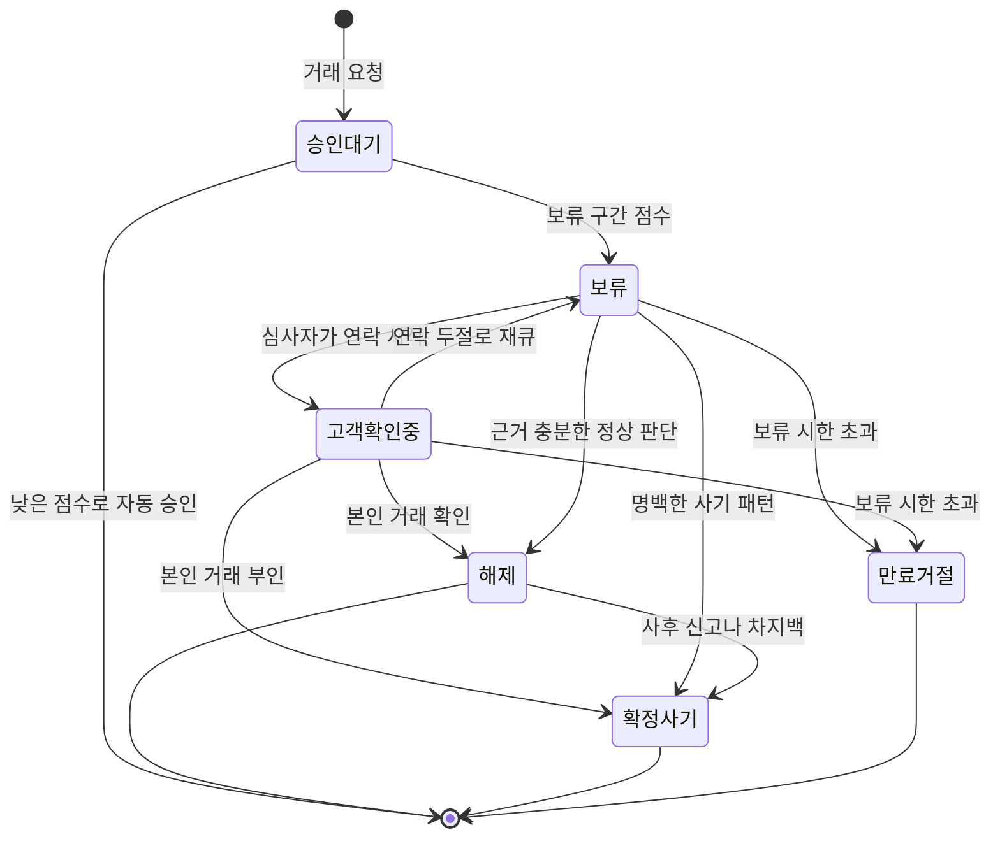

그림에서 볼 곳은 세 군데다.

`해제 → 확정사기` 전이가 있다는 점이다. 해제는 "심사 시점에 정상으로 판단했다"는 뜻이지 "정상이었다"는 뜻이 아니다. 며칠 뒤 고객이 신고하거나 차지백이 들어오면 해제된 거래가 사기로 바뀐다. 이 전이를 막아 두면 사후 신고가 들어와도 케이스에 반영할 방법이 없어서 라벨이 영영 틀린 채로 남는다.

`만료거절`은 `확정사기`와 별개 상태다. 보류 시한이 지나서 정책상 거절된 거래는 사기라고 확인된 것이 아니다. 둘을 같은 상태로 합치면 "심사자가 못 풀어서 거절된 거래"가 사기 라벨로 모델 학습에 들어간다. 적체가 심한 주에 라벨 오염이 몰리는 이유가 이것이다.

`고객확인중 → 보류` 전이는 연락이 안 닿을 때 심사자의 손에서 케이스를 놓게 하는 용도다. 이 경로가 없으면 연락 두절 건이 한 심사자 앞에 영원히 걸려 있다. 재시도 횟수를 세어서 몇 번 넘으면 시한 만료를 기다리지 않고 정책 처리로 넘긴다.

## 점수 구간과 대응

점수 구간을 어디서 자르느냐가 심사 큐의 크기를 정한다. 보류 구간이 넓으면 큐가 길어지고, 좁히면 그 건들이 추가인증이나 차단으로 흘러서 고객 마찰이 늘거나 오차단이 늘어난다. 점수 구간 조정은 모델 튜닝이 아니라 운영 인력 규모와 묶어서 정하는 일이다.

다음 flowchart는 구간별 대응과 심사 결과가 룰·모델 갱신으로 돌아오는 순환을 한 장에 그린 것이다. 위쪽이 실시간 판정, 아래쪽이 사후 순환이다. 점수 숫자는 설명용 예시이고, 실제 임계값은 거래 유형과 모델 보정 상태에 따라 다르다.

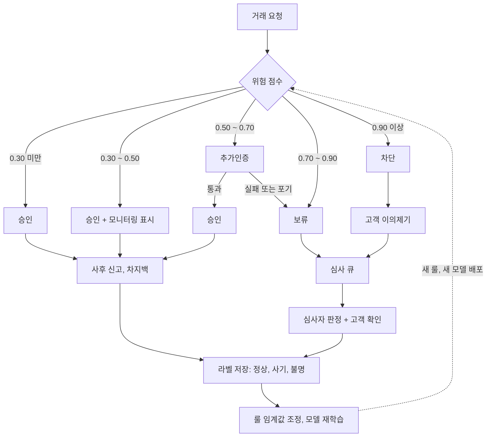

세 가지를 짚어 둔다.

추가인증에 실패하거나 중간에 포기한 거래가 보류로 합류한다. 추가인증을 못 끝낸 사람이 정상 고객일 수도 있고 탈취범일 수도 있어서, 자동으로 차단하지 않고 사람에게 넘기는 구성이다. 이 합류 경로 때문에 추가인증 구간을 넓히면 보류 큐 유입도 같이 는다.

차단 건도 큐로 돌아오는 길이 있다. 고객 이의제기가 그 길이다. 이 경로가 없으면 차단한 거래의 정답을 영영 알 수 없다. 차단된 거래는 결과가 관측되지 않으니 라벨이 생기지 않고, 모델은 "차단한 것은 다 사기"라는 자기 판단을 학습 데이터로 되먹는다.

승인과 모니터링 구간에서도 라벨이 들어온다. 승인된 거래가 며칠 뒤 사기 신고로 확정되는 경로(`사후 신고, 차지백`)다. 이 라벨은 심사 라벨보다 늦게 오지만 FDS가 놓친 건을 알려주는 유일한 신호다. 라벨 지연과 모델 평가 문제는 [FDS ML 모델 운영](FDS_ML_Model_Operations.md)의 라벨 절을 따른다.

## 심사 큐 구현

심사 큐는 메시지 큐가 아니라 테이블로 만드는 편이 낫다. 심사자가 조건을 걸어 검색하고, 우선순위를 바꾸고, 다른 담당자에게 넘기고, 이력을 조회해야 해서 FIFO 큐로는 모자란다. 아래 스키마는 PostgreSQL 기준이다. 상태 전이 허용 목록을 테이블로 두고 트리거로 강제해서, 애플리케이션 버그가 있어도 DB에서 불법 전이가 막힌다.

아래 그림은 테이블 세 개의 관계다. `case_transition`은 외래키로 묶인 테이블이 아니라 트리거가 조회하는 참조 테이블이라 점선으로 그렸다.

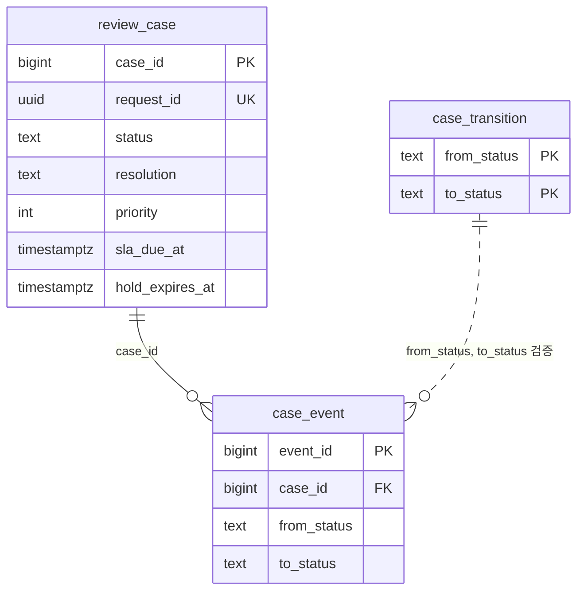

```sql
CREATE TABLE review_case (
  case_id          bigserial PRIMARY KEY,
  request_id       uuid        NOT NULL UNIQUE,
  account_token    text        NOT NULL,
  tx_type          text        NOT NULL,
  amount           bigint      NOT NULL,
  risk_score       numeric(4,3) NOT NULL,
  status           text        NOT NULL DEFAULT 'ON_HOLD'
    CHECK (status IN ('ON_HOLD','CUSTOMER_VERIFYING','RELEASED','CONFIRMED_FRAUD','EXPIRED_REJECTED')),
  resolution       text
    CHECK (resolution IN ('NORMAL','FRAUD','UNKNOWN')),
  priority         int         NOT NULL,
  assignee         text,
  contact_attempts int         NOT NULL DEFAULT 0,
  opened_at        timestamptz NOT NULL DEFAULT now(),
  first_action_at  timestamptz,
  sla_due_at       timestamptz NOT NULL,
  hold_expires_at  timestamptz NOT NULL,
  closed_at        timestamptz
);

CREATE INDEX review_case_pick
  ON review_case (priority DESC, sla_due_at)
  WHERE status = 'ON_HOLD' AND assignee IS NULL;

CREATE TABLE case_transition (
  from_status text NOT NULL,
  to_status   text NOT NULL,
  PRIMARY KEY (from_status, to_status)
);
INSERT INTO case_transition VALUES
  ('ON_HOLD',            'CUSTOMER_VERIFYING'),
  ('ON_HOLD',            'RELEASED'),
  ('ON_HOLD',            'CONFIRMED_FRAUD'),
  ('ON_HOLD',            'EXPIRED_REJECTED'),
  ('CUSTOMER_VERIFYING', 'RELEASED'),
  ('CUSTOMER_VERIFYING', 'CONFIRMED_FRAUD'),
  ('CUSTOMER_VERIFYING', 'ON_HOLD'),
  ('CUSTOMER_VERIFYING', 'EXPIRED_REJECTED'),
  ('RELEASED',           'CONFIRMED_FRAUD');

CREATE TABLE case_event (
  event_id    bigserial PRIMARY KEY,
  case_id     bigint      NOT NULL REFERENCES review_case,
  at          timestamptz NOT NULL DEFAULT now(),
  actor       text        NOT NULL,
  from_status text        NOT NULL,
  to_status   text        NOT NULL,
  note        text
);

CREATE FUNCTION guard_transition() RETURNS trigger AS $$
BEGIN
  IF NEW.status = OLD.status THEN
    RETURN NEW;
  END IF;
  IF NOT EXISTS (SELECT 1 FROM case_transition
                 WHERE from_status = OLD.status AND to_status = NEW.status) THEN
    RAISE EXCEPTION 'illegal transition % -> % (case %)', OLD.status, NEW.status, OLD.case_id;
  END IF;
  INSERT INTO case_event (case_id, actor, from_status, to_status)
  VALUES (OLD.case_id, coalesce(current_setting('app.actor', true), 'system'),
          OLD.status, NEW.status);
  IF NEW.status IN ('RELEASED','CONFIRMED_FRAUD','EXPIRED_REJECTED') THEN
    NEW.closed_at := coalesce(NEW.closed_at, now());
  END IF;
  RETURN NEW;
END $$ LANGUAGE plpgsql;

CREATE TRIGGER review_case_guard
  BEFORE UPDATE OF status ON review_case
  FOR EACH ROW EXECUTE FUNCTION guard_transition();
```

상태를 바꾸는 `UPDATE`가 트리거 안에서 어떤 순서로 검사되는지 그리면 다음과 같다. 허용 목록에 없는 쌍이면 갱신 자체가 거부되고, 허용되면 이력 기록과 종결 시각 기록이 같은 트랜잭션 안에서 일어난다.

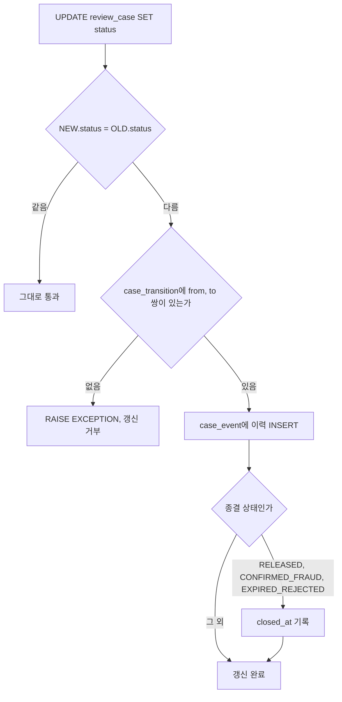

`case_event`는 상태 변화마다 한 줄씩 쌓는 추가 전용 테이블이다. 케이스 행은 갱신되지만 이력은 지우거나 고치지 않는다. 심사자가 해제했다가 나중에 사기로 바뀐 경위를 감사 때 보여줘야 하기 때문이다. 판정 로그를 불변으로 두는 이유는 [FDS 이상거래탐지 시스템 구조](FDS_Architecture.md)의 로그 절과 같다.

`resolution`은 `status`와 따로 둔다. `RELEASED`와 `EXPIRED_REJECTED`가 라벨로는 각각 정상과 불명에 대응하는데, 상태에서 라벨을 자동 유도하면 사후 정정이 어려워진다. 심사자가 입력하는 판정 결과와 시스템 처리 결과를 분리해 둔다.

심사자가 다음 건을 가져갈 때는 `FOR UPDATE SKIP LOCKED`를 쓴다. 이 구문이 없으면 두 심사자가 같은 건을 동시에 열고, 한 명이 풀어 준 거래를 다른 명이 사기로 확정하는 일이 생긴다.

```sql
WITH next AS (
  SELECT case_id FROM review_case
  WHERE status = 'ON_HOLD' AND assignee IS NULL
  ORDER BY priority DESC, sla_due_at
  FOR UPDATE SKIP LOCKED
  LIMIT 1
)
UPDATE review_case c
SET assignee = 'rev_07',
    first_action_at = coalesce(c.first_action_at, now())
FROM next
WHERE c.case_id = next.case_id
RETURNING c.case_id, c.amount, c.priority;
```

`priority`는 점수만으로 정하지 않는다. 점수, 금액 구간, 시한까지 남은 시간을 합쳐 열어 둔 케이스 중 지금 가장 급한 것이 위로 오게 한다. 점수 순으로만 정렬하면 점수는 높지만 금액이 작은 건이 큰 금액의 중간 점수 건을 계속 밀어낸다.

## 심사자 화면에 필요한 정보

심사자는 거래 한 건을 몇 분 안에 판단해야 한다. 정보가 부족하면 고객에게 전화를 걸 수밖에 없고, 정보가 너무 많으면 아무것도 안 읽고 감으로 누른다. 판정 로그의 필드 중에서 심사에 쓰이는 것을 골라 한 화면에 모은다.

| 화면 영역 | 담는 내용 | 이유 |
|---|---|---|
| 거래 요약 | 거래 유형, 금액, 수취인(신규 여부, 마스킹된 계좌), 요청 시각 | 무엇을 막았는지 한눈에 보여야 한다 |
| 발화 사유 | 발화한 룰 ID, 사유 코드, 점수, `rule_version`, `model_version` | 점수만 보면 왜 걸렸는지 모른다. 어느 룰 때문인지가 판단의 절반이다 |
| 평소와 비교 | 기기·IP·지역·시간대·평균 거래액의 평소 값 대 이번 값 | "해외 IP"가 출장인지 탈취인지는 평소 값과 나란히 놓아야 읽힌다 |
| 최근 타임라인 | 최근 로그인, 비밀번호·연락처 변경, 기기 등록, 직전 거래 | 연락처가 얼마 전에 바뀌었으면 고객 확인에 쓸 번호부터 의심해야 한다 |
| 연관 건수 | 같은 수취인·기기·IP를 쓴 다른 계정 수와 그 계정들의 케이스 결과 | 한 수취인에게 여러 계정이 송금하면 개별 계정을 아무리 봐도 안 보인다 |
| 인증 결과 | 추가인증 수단과 통과·실패·미응답 | 추가인증을 통과했는데 보류에 왔다면 사연이 따로 있다 |
| 케이스 이력 | `case_event` 목록, 이전 연락 시도와 메모 | 앞 근무조가 한 일을 다시 하지 않게 한다 |

연락처 변경 이력을 타임라인에 넣는 이유는 뒤의 고객 확인 절에서 나온다. 화면을 설계할 때 "있으면 좋은 정보"를 계속 넣으면 심사 시간이 늘고, 줄이려고 정보를 빼면 전화가 늘어난다. 심사자가 케이스를 처리하며 실제로 클릭하거나 스크롤해서 본 영역을 기록해 두면, 안 보는 영역은 접어도 되는지 근거가 생긴다.

계좌번호·카드번호·이름은 기본 마스킹한다. 전체를 봐야 하는 경우에만 "원문 보기" 버튼을 누르게 하고, 누른 사실을 케이스 ID와 함께 로그에 남긴다. 이 버튼이 뒤에서 다룰 내부자 문제의 접점이다.

## 고객 확인

심사자가 정상 여부를 판단할 수 없을 때 고객에게 확인한다. 흐름은 단순하지만 걸리는 지점이 여럿 있다. 아래 시퀀스는 콜백으로 확인하는 정상 경로다.

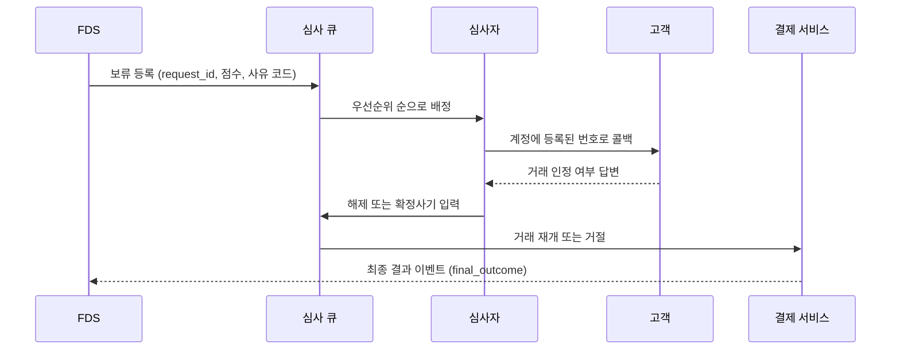

가장 많이 사고가 나는 곳은 어느 번호로 거느냐다. 거래 요청에 같이 들어온 연락처나 고객이 채팅으로 알려준 번호로 걸면, 계정을 탈취한 사람이 미리 연락처를 바꿔 둔 경우에 사기범에게 확인 전화를 걸게 된다. 콜백 번호는 계정에 오래전부터 등록돼 있던 번호만 쓰고, 최근에 변경된 연락처는 변경 전 값이 있으면 그쪽을 우선한다. 타임라인에 연락처 변경 이력을 넣은 이유다.

고객이 "내가 한 거래 맞다"고 말하는데 사기인 경우도 있다. 보이스피싱처럼 피해자가 속아서 직접 이체한 경우다. 이때 심사자가 "본인 거래 맞으시죠" 하고 물으면 "네"가 돌아오고 케이스는 `해제`로 닫힌다. 확인 스크립트는 거래 인정 여부가 아니라 거래 사연을 묻도록 짠다. 누구에게 보내는 돈인지, 어떻게 알게 된 사람인지, 누가 이체를 시키고 있는지를 묻는다. 대답이 어색하거나 통화 중 누군가에게 지시받는 기색이 있으면 해제하지 않고 시한 연장이나 지점 방문 같은 다른 경로를 쓴다. 이 판단은 스크립트로 완전히 짜지 못하고 심사자 교육에 의존하는 부분이라, 뒤에서 말할 판단 편차가 가장 크게 나오는 자리이기도 하다.

연락이 닿지 않으면 시도 횟수와 시각을 `case_event`에 메모로 남기고 `보류`로 되돌린다. 횟수를 넘기면 시한 만료까지 기다릴 필요 없이 거래 유형의 만료 정책(이체는 거절, 소액 결제는 승인)을 적용한다. 만료 처리 정책은 [FDS 이상거래탐지 시스템 구조](FDS_Architecture.md)의 상태 절과 같은 기준을 쓴다.

## SLA와 큐 적체

SLA는 "몇 분 안에 처리"라는 한 숫자로 두지 않고 두 개로 나눈다. 첫 조치까지의 시간(큐에서 심사자에게 배정되고 열어 보기까지)과 종결까지의 시간(해제·확정·만료)이다. 두 시간이 따로 필요한 이유는 적체가 생기면 첫 조치가 먼저 늘어나고, 종결 시간은 고객 연락 여부에 좌우되어 원인이 서로 다르기 때문이다. 금액이 큰 건일수록 짧게 잡는 식으로 `sla_due_at`을 금액 구간별로 정한다. 구체 시간은 서비스 특성, 근무 체계, 법무 검토에 따라 달라서 이 문서가 값을 제안하지 않는다.

적체가 생기는 경로는 대체로 네 가지다.

- 룰 배포 직후 보류 유입이 갑자기 늘어난다. 새 룰의 보류 구간 점수 분포를 잘못 잡았을 때다.
- 이벤트·정기결제 일괄 처리 시각에 평소 안 보이던 패턴이 한꺼번에 들어온다.
- 야간·주말·점심 시간에 심사 인력이 없다.
- 연락 두절 건이 `보류`로 계속 되돌아와 신규 건과 같이 줄을 선다.

첫째 경로는 [FDS 룰 엔진 설계와 운영](FDS_Rule_Engine.md)에서 다룬 섀도 모드로 막는 것이 근본이다. 룰을 배포하기 전에 보류 유입률 예측치를 보고, 배포 후에는 시간당 보류 유입 건수를 룰 버전별로 쪼개서 본다. 어느 룰 버전 때문에 큐가 늘었는지 알아야 롤백할지 판단한다.

이미 쌓였다면 쓸 수 있는 수단은 순서가 정해져 있다. 먼저 우선순위를 재계산해서 금액이 크고 시한이 임박한 건이 위로 오게 한다. 다음에 보류 구간의 아래쪽 경계를 올려서 점수가 낮은 보류 건이 추가인증으로 빠지게 한다. 이 조정은 고객 마찰이 늘어나는 대가를 치르는 대신 큐 유입을 즉시 줄인다. 마지막 수단은 시한 만료 정책에 맡기는 것이다. 이때 `만료거절`과 `해제`로 처리된 건은 라벨 신뢰도가 낮다는 표시를 남겨야 한다. 적체 중 심사자가 압박을 받아 근거 없이 해제하는 경우도 같은 표시 대상이다. 이 표시가 피드백 절에서 쓰인다.

적체가 생겼을 때 수단을 쓰는 순서를 그림으로 정리하면 다음과 같다. 각 단계는 앞 단계로 해소되지 않을 때만 다음으로 넘어가고, 마지막 단계만 라벨 신뢰도 표시가 붙는다.

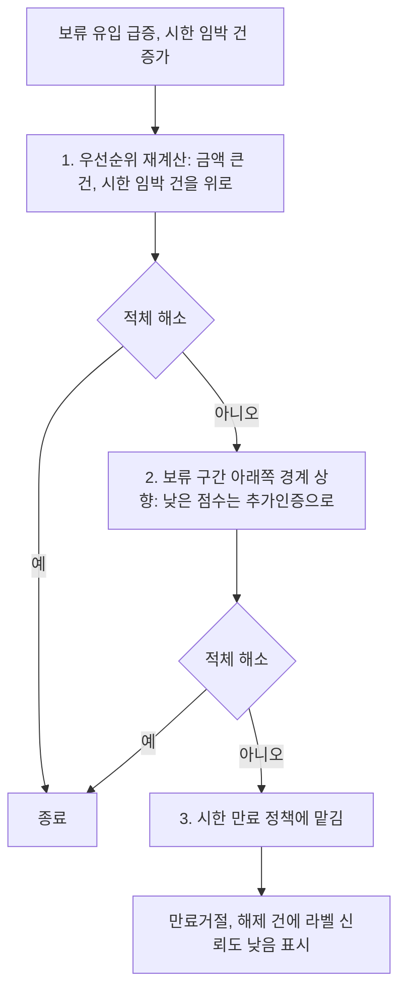

"일단 해제"로 적체를 푸는 방식은 쓰지 않는다. 풀린 만큼 사기가 통과하는데, 그 사기는 며칠 뒤 `해제 → 확정사기`로 돌아와 손실액에 잡히고 모델에게는 정상 라벨로 남는다.

## 추가인증 설계

추가인증은 점수가 중간인 거래에 본인 확인을 한 번 더 요구해서, 정상 고객은 통과시키고 탈취범은 막으려는 장치다. 어떤 수단을 어느 구간에서 요구하느냐가 설계의 전부이고, 수단마다 막는 위협이 다르다.

| 구간(예시) | 수단 | 막는 것 | 무력해지는 경우 |
|---|---|---|---|
| 0.50 ~ 0.60 | 앱 내 생체·PIN 재확인(기기 바인딩) | 기기를 잠깐 빌려 쓴 제3자, 세션 탈취 | 원격제어 앱이 깔린 단말에서 피해자가 직접 승인 |
| 0.60 ~ 0.70 | 앱 푸시 승인 또는 TOTP | 비밀번호만 알아낸 탈취범 | 승인 화면에 거래 내용이 안 나오면 피해자가 습관적으로 승인 |
| 0.60 ~ 0.70 (앱 없는 채널) | SMS OTP | 비밀번호만 알아낸 탈취범 | 문자를 읽는 악성앱이 설치된 단말, SIM 이전 |
| 보류 구간 | 심사자 콜백 | 위 모두. 사람이 사연을 묻는다 | 연락처가 바뀌어 있는 경우, 피해자가 지시받으며 답하는 경우 |

금융감독원과 금융보안원이 2023년 10월 5일 발표한 FDS 운영 지침은 ARS·SMS 본인확인을 우회하는 수법에 대응해 아웃바운드 콜, 화상통화, 생체인증 같은 강화된 본인확인 방법을 권고한다([금융보안원 게시물](https://www.fsec.or.kr/bbs/detail?menuNo=69&bbsNo=11355)). ARS나 SMS를 추가인증 수단으로 쓰는 설계는 이 수법이 알려진 뒤로 신뢰도를 낮게 잡아야 한다. 표에서 SMS를 앱 없는 채널로 한정한 이유다. 인증 수단 자체의 강도는 [WebAuthn·Passkeys](Web_Authn_Passkeys.md)와 [딥페이크와 AI 사기](Deepfake_and_AI_Fraud.md)에서 다룬 위협을 같이 본다. 음성이나 얼굴로 본인 확인을 하는 수단은 위조 비용이 낮아지는 중이다.

인증을 통과했다고 안전한 거래는 아니다. 추가인증은 "이 사람이 계정 주인인가"를 확인하는 장치이고, "이 거래가 주인의 의사인가"는 확인하지 못한다. 피해자가 속아서 직접 승인하는 사기는 인증을 전부 통과한다. 이 때문에 푸시 승인 화면에는 수취인 이름과 금액을 크게 보여주고, 신규 수취인에 고액이면 "처음 보내는 사람입니다" 같은 문구를 붙인다. 인증 화면이 거래 내용을 담으면 습관적 승인이 줄어든다.

### 인증 피로와 이탈

추가인증을 자주 요구하면 정상 고객이 먼저 지친다. 이탈 경로는 몇 가지로 정해져 있다. SMS OTP를 받으러 문자 앱으로 나갔다 오는 사이 앱 세션이 만료되어 처음부터 다시 하게 된다. 같은 거래에서 추가인증을 두 번 요구받는다([FDS 이상거래탐지 시스템 구조](FDS_Architecture.md)에서 다룬 `requestId` 변경 문제다). 인증 후 곧바로 이어진 다음 거래에서 또 요구받는다. 이 가운데 마지막은 FDS가 인증 통과 이력을 피처로 안 쓸 때 생긴다.

설계에서 할 수 있는 것은 이렇다. 인증 통과 후 일정 시간 동안 같은 기기·비슷한 금액의 거래는 추가인증 구간에서 한 칸 낮춰 취급한다. 계정당 하루 추가인증 요구 횟수에 상한을 두고, 상한을 넘으면 요구를 반복하는 대신 보류로 넘긴다. 이 유예 창의 길이는 사기범이 인증을 한 번 통과한 뒤 연속 이체하는 위험과 맞바꾸는 값이라, 임의로 정하지 않고 통과 직후 사기 발생 건을 보고 조정한다.

위 두 가지를 하나의 판단 순서로 그리면 다음과 같다. 유예 창 확인이 먼저고 일일 상한 확인이 그다음이며, 인증에 실패하거나 포기한 건과 상한을 넘긴 건은 둘 다 보류로 합류한다.

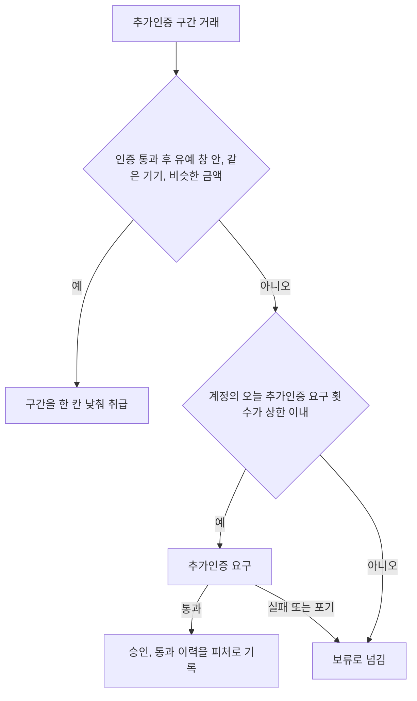

측정은 퍼널로 한다. 추가인증을 요구한 건수에서 시작해 인증 화면 진입, 입력 완료, 통과, 거래 재개까지 단계별 잔존율을 본다. 어느 단계에서 줄어드는지를 알아야 수단 문제(OTP 입력 단계에서 이탈)인지 요구 빈도 문제(진입 전 이탈)인지 가려진다.

## 피드백 루프와 심사자 판단 편차

앞의 flowchart에서 `라벨 저장`에서 `룰 임계값 조정, 모델 재학습`으로 가는 선이 피드백 루프다. 심사 결과가 라벨이 되고, 룰 담당자는 오탐이 많은 룰을 수정하며, 모델 담당자는 라벨을 학습 데이터에 넣는다. 말은 단순한데 라벨 품질이 곳곳에서 흔들린다.

라벨을 신뢰도로 나눠서 저장한다.

```json
{
  "request_id": "7f3c2a10-9b1e-4a77-8d0e-5c1f2a9e4b11",
  "case_id": 48213,
  "label": "FRAUD",
  "label_source": "CHARGEBACK",
  "label_confidence": "CONFIRMED",
  "decided_by": "rev_07",
  "decided_at": "2026-10-28T11:02:40Z",
  "queue_depth_at_decision": 212,
  "contact_made": true
}
```

`label_source`는 `CUSTOMER_DENIED`(고객이 본인 거래를 부인), `CHARGEBACK`(차지백 확정), `REVIEWER_JUDGEMENT`(고객 연락 없이 심사자 판단), `TIMEOUT_POLICY`(시한 만료 정책) 정도로 나눈다. 학습에 쓸 때 `CONFIRMED` 소스만 확실한 라벨로 쓰고 `TIMEOUT_POLICY`는 제외하거나 가중치를 낮춘다. `queue_depth_at_decision`을 같이 남기는 이유는 적체 시점의 판정이 평소보다 해제 쪽으로 쏠리는지 나중에 확인하기 위해서다. 쏠림이 보이면 해당 구간 라벨의 신뢰도를 일괄로 낮춘다.

라벨이 저장된 뒤 학습에 쓰이기까지 두 갈래 검사가 붙는다. 하나는 라벨 출처에 따른 취급이고, 다른 하나는 판정 시점의 적체 상태에 따른 신뢰도 조정이다.

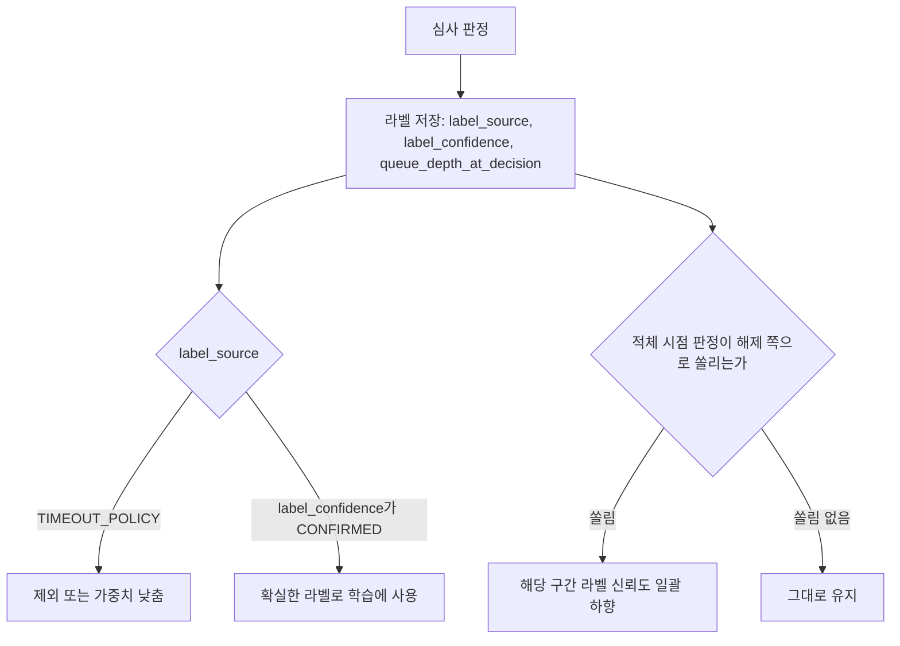

### 심사자마다 다르다

같은 케이스를 두 심사자가 다르게 판단하는 일은 일상적으로 생긴다. 한 명은 연락 두절이면 거절하고, 다른 한 명은 연락 두절이어도 과거 거래 패턴이 정상이면 해제한다. 이 차이를 방치하면 모델은 "일관되지 않은 정답"을 학습하고, 룰 담당자는 오탐률이 심사자 개인의 성향에서 온 것인지 룰 때문인지 구분하지 못한다.

편차는 재서 본다. 전체 케이스 중 일부를 무작위로 골라 다른 심사자에게 이중 심사를 시키고 일치율을 구한다. 우연히 일치할 확률을 보정하려면 단순 일치율보다 Cohen's kappa 같은 지표가 낫다. 두 명이 불일치한 건은 팀 리뷰에서 기준을 정리해 룰 설명이나 스크립트로 되돌린다. 불일치가 몰리는 곳이 대개 같다. 연락 두절, 평소 패턴은 정상인데 신규 수취인 하나만 이상한 경우, 고객이 모호하게 대답한 경우다.

심사자별 해제율도 본다. 심사자 한 명의 해제율이 팀 평균에서 크게 벗어나면 그 사람이 엄격하거나 느슨한 것이다. 느슨한 심사자는 배정받은 케이스 구성이 다를 수도 있어서, 같은 우선순위 구간 안에서 비교한다. 이 분석 대상은 사람의 평가가 아니라 기준의 모호함이다. 개인 평가 용도로 쓰면 심사자가 해제율을 팀 평균에 맞추려고 판단을 왜곡한다.

루프를 끝까지 돌리는 마지막 단계는 변경 반영이다. 룰을 고치면 [FDS 룰 엔진 설계와 운영](FDS_Rule_Engine.md)의 배포 절차(섀도, 카나리, 롤백)를 그대로 거치고, 모델을 다시 학습시키면 [FDS ML 모델 운영](FDS_ML_Model_Operations.md)의 평가 절차를 거친다. 심사 결과가 곧바로 룰에 반영되는 자동 경로는 만들지 않는다. 심사자 판단 편차가 위에서 말한 정도로 있는 상태에서 자동 반영하면 룰 하나가 어느 날 심사자 한 명의 습관을 따라가게 된다.

## 지표

지표는 네 가지를 기본으로 본다. 차단율, 오탐률, 사기 손실액, 심사 큐 평균 대기 시간이다. 정의가 팀마다 다르고 집계 방법에 따라 같은 시스템이 좋아 보이기도 나빠 보이기도 해서, 분자와 분모를 문서에 박아 두지 않으면 회의마다 숫자가 달라진다.

| 지표 | 정의(분자 / 분모) | 집계할 때의 함정 |
|---|---|---|
| 차단율 | 차단 판정 건수 / 전체 판정 건수. 금액 기준이면 차단 금액 / 전체 거래 금액 | 건수와 금액 기준이 다르게 움직인다. 카드 테스트 공격이 몰리면 건수 기준 차단율이 오르지만 금액은 거의 안 변한다. 차단율이 낮다고 좋은 것이 아니다. 공격이 적었을 수도, 놓쳤을 수도 있다 |
| 오탐률 | 용어가 둘이다. 정상 거래 중 차단·보류된 비율(분모: 정상), 또는 차단·보류된 건 중 정상으로 판명된 비율(분모: 차단·보류) | 정상 여부를 아는 건은 심사에서 해제되거나 고객이 인정한 건뿐이다. 차단 후 고객이 포기하고 떠난 건은 정상인지 알 수 없어서 오탐으로 잡히지 않는다 |
| 사기 손실액 | 확정 사기 금액 - 회수액(차지백 반환, 지급정지 환수 등) | 확정까지 시간이 걸려서 최근 거래월의 손실액이 항상 적게 보인다. 거래월 기준으로 집계하고 몇 달 뒤 다시 계산해서 수정한다. 승인 후 사기와 차단 전 사기를 섞지 않는다 |
| 심사 큐 평균 대기 시간 | 보류 등록 시각부터 첫 조치까지의 평균 | 완료된 건만 평균 내면 아직 안 풀린 오래된 건이 빠져서 실제보다 짧게 나온다. 평균 대신 중앙값, p90, p99를 같이 본다 |
| 추가인증 이탈률 | 추가인증 요구 건 중 거래 재개 없이 종료된 건 / 요구 건 | 이탈 건 중 사기범의 포기가 섞여 있다. 이탈이 곧 정상 고객 손실은 아니다 |
| 놓친 사기 비율 | 확정 사기 중 승인(또는 모니터링)으로 통과한 건 / 확정 사기 전체 | 라벨이 늦게 와서 최근 값이 낮다. 차단된 사기는 분모에 들어가지 않으면 이 값이 과장된다 |

심사 큐 대기 시간은 쿼리를 쓰면서도 틀리기 쉽다. 완료된 건만 평균 내면 어떻게 틀리는지 보기 위해 두 방식을 한 번에 계산해 보자. `first_action_at`이 비어 있는 건(아직 아무도 열지 않은 건)을 `now()`로 보정해서 같이 넣으면 대기 중인 오래된 건이 숫자에 반영된다.

```sql
SELECT
  percentile_cont(0.5) WITHIN GROUP (ORDER BY wait_s) FILTER (WHERE started) AS p50_started_only,
  percentile_cont(0.5) WITHIN GROUP (ORDER BY wait_s)                        AS p50_with_waiting,
  percentile_cont(0.9) WITHIN GROUP (ORDER BY wait_s) FILTER (WHERE started) AS p90_started_only,
  percentile_cont(0.9) WITHIN GROUP (ORDER BY wait_s)                        AS p90_with_waiting
FROM (
  SELECT extract(epoch FROM coalesce(first_action_at, now()) - opened_at) AS wait_s,
         first_action_at IS NOT NULL AS started
  FROM review_case
  WHERE opened_at >= now() - interval '7 days'
) t;
```

적체가 심한 날에는 `started_only` 값과 `with_waiting` 값이 크게 벌어진다. 두 값의 차이 자체가 "지금 안 풀린 건이 얼마나 오래 묵었나"를 알려주는 신호다. 알람은 `with_waiting` 기준 p90에 건다.

### 지표가 보여주지 못하는 것

네 지표가 전부 좋아도 사업은 나빠질 수 있다. 가장 큰 구멍은 차단이나 추가인증을 만난 뒤 말없이 떠난 고객이다. 이 고객은 "정상 거래가 차단됐다"는 기록이 남지 않는다. 심사 큐에 안 들어왔고, 이의제기도 없었고, 해제도 안 됐다. 오탐률 분자에 들어갈 방법이 없다.

아래 그림은 차단·추가인증 판정 뒤 갈라지는 경로 중 어느 것이 오탐률에 잡히고 어느 것이 빠지는지 보여준다. 후속 이벤트가 없는 가지만 어떤 지표에도 들어가지 않는다.

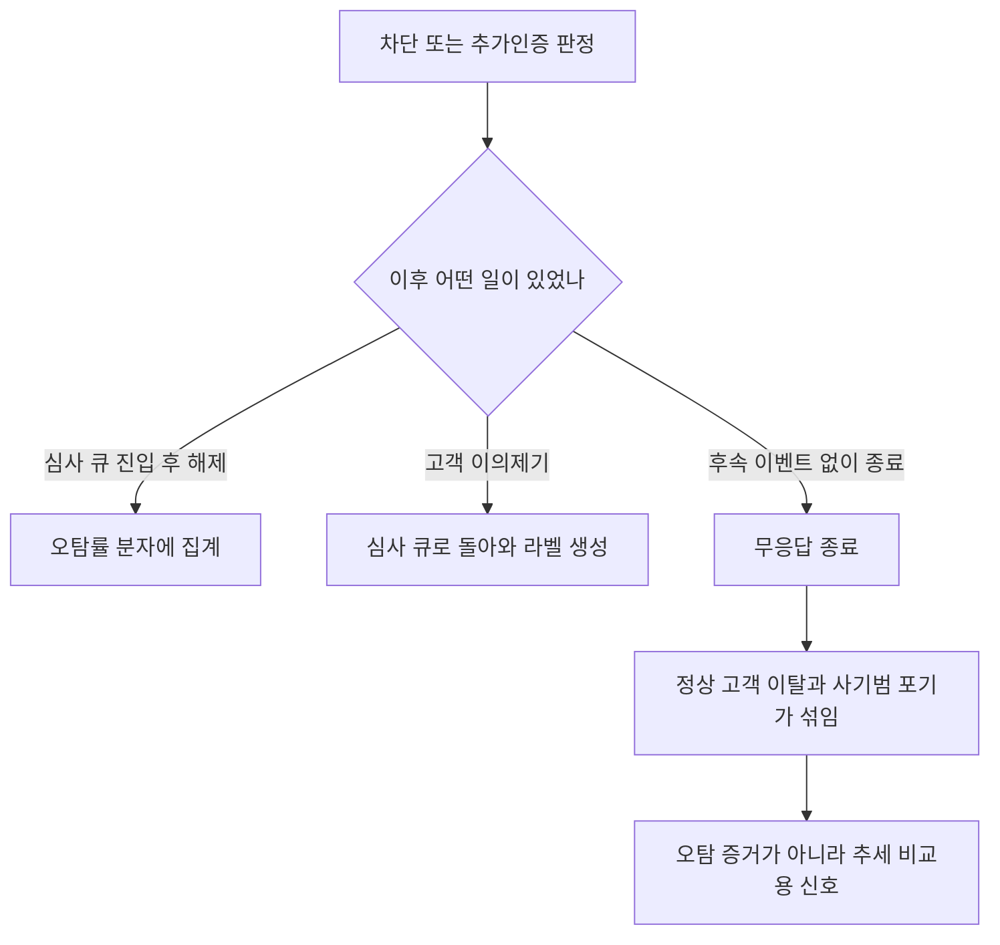

이탈 신호는 판정 로그와 후속 이벤트를 조인해서 따로 만든다. 차단·추가인증 판정 후 일정 시간 안에 같은 계정이 같은 수취인에게 재시도했는지, 후속 이벤트 없이 세션이 끝났는지, 같은 기간에 고객센터 문의가 접수됐는지를 본다. 후속 이벤트가 없는 건을 오탐률과 별개의 "무응답 종료"로 집계해서 추세를 본다. 이 숫자가 룰 배포 직후 뛰면 룰이 정상 고객을 쫓아낸 것일 가능성이 있다.

한계도 있다. 무응답 종료에는 사기범이 차단을 보고 포기한 건이 섞여 있다. 둘을 구분할 수단이 없어서, 이 숫자는 오탐의 증거가 아니라 추세 비교용 신호로만 쓴다. 룰 배포 전후, 룰 버전별, 계정 가입 기간별로 쪼개서 변화를 보는 용도다. 장기적인 영향(이탈 후 30일 활동 감소)은 점수 경계 근처의 거래에서 추가인증 요구 여부를 무작위로 나눠 비교하는 실험으로 잴 수 있지만, 사기 노출이 늘어나므로 승인 가능한 범위가 좁고 사전에 위험 승인을 받아야 한다.

## 규제와 감사

전자금융거래법 제21조 제1항은 금융회사·전자금융업자·전자금융보조업자가 전자금융거래가 안전하게 처리되도록 선량한 관리자로서 주의를 다하라고 규정한다. 제9조는 접근매체의 위조·변조, 전자적 전송·처리 과정의 사고, 정보통신망 침입으로 얻은 접근매체 이용 사고에서 금융회사가 이용자 손해를 배상하도록 하고, 이용자의 고의나 중대한 과실이 있고 약정이 있는 경우 등에 책임을 이용자에게 지울 수 있게 한다([전자금융거래법](https://ko.wikisource.org/wiki/%EC%A0%84%EC%9E%90%EA%B8%88%EC%9C%B5%EA%B1%B0%EB%9E%98%EB%B2%95)). FDS를 운영하는 실질적 동기는 이 배상 구조다. 탈취된 접근매체로 일어난 거래의 손실은 원칙적으로 금융회사가 지므로, 막지 못한 거래의 비용이 사기 손실액으로 직접 돌아온다. 피해자가 속아서 직접 이체한 거래가 제9조 제1항의 사고 유형에 해당하는지, 책임이 어떻게 나뉘는지는 별도 법무 검토가 필요한 영역이라 이 문서에서 판단하지 않는다.

이 문서를 쓰면서 전자금융거래법 제3장(제21조~제27조)의 조문 목록과 전자금융감독규정 본문을 확인했을 때, 이상거래탐지시스템 구축을 직접 의무로 규정한 조문은 찾지 못했다. 시스템 요건의 구체 내용은 금융감독원과 금융보안원이 2023년 10월 5일 발표한 FDS 운영 지침이 담고 있다. 이 지침은 주요 피해 사례를 반영한 시나리오 기반 이상거래 탐지룰 51개와 대응 절차를 싣고, 악성앱 감지 등으로 이상금융거래로 판단되면 즉시 계좌 거래정지를 하도록 안내한다([금융보안원](https://www.fsec.or.kr/bbs/detail?menuNo=69&bbsNo=11355), [KDI 경제정보센터](https://eiec.kdi.re.kr/policy/materialView.do?num=243367)). 적용은 우선 은행권 대상으로 2024년 1월부터 본격화됐고 권고 성격으로 소개된다([Criminal IP 정리](https://www.criminalip.io/ko/knowledge-hub/blog/20175)). 업종별 적용 범위와 구속력은 해석이 갈리므로, 자사에 적용되는지는 컴플라이언스 부서와 확인한다.

### 판정 로그 보존과 개인정보

법 제22조 제1항은 금융회사가 전자금융거래의 내용을 추적·검색하거나 오류를 확인·정정할 수 있는 기록을 생성해 5년의 범위에서 대통령령이 정하는 기간 동안 보존하도록 한다. 시행령 제12조는 기록 종류별로 기간을 나눠서, 건당 거래금액이 1만원을 초과하는 거래 기록과 접속기록 등은 5년, 1만원 이하는 1년으로 정한다([전자금융거래법 시행령](https://casenote.kr/%EB%B2%95%EB%A0%B9/%EC%A0%84%EC%9E%90%EA%B8%88%EC%9C%B5%EA%B1%B0%EB%9E%98%EB%B2%95_%EC%8B%9C%ED%96%89%EB%A0%B9/)). FDS 판정 로그와 심사 케이스 이력이 이 조항의 "전자금융거래기록"에 해당하는지는 이 문서에서 확인하지 못했다. 같은 거래를 추적하는 데 판정 로그가 쓰이므로 동일 기간으로 보존하는 쪽으로 설계해 두고, 실제 범위는 법무와 확정한다. 보안 로그 일반의 보존 기준은 [보안 로깅과 감사](Security_Logging_and_Auditing.md)를 따른다.

보존 의무와 개인정보 최소 수집은 서로 당기는 힘이다. 오래 보존해야 하는 로그에 개인정보가 많이 들어 있을수록 유출 시 피해가 커진다. 그래서 판정 로그 설계부터 넣는 값을 줄인다.

- 계정은 `account_token`으로 쓴다. 원본 계좌·카드 번호를 로그에 직접 넣지 않는다.
- `features`에는 판정에 실제로 쓴 값만 넣는다. 나중에 쓸지 모르니 일단 저장해 두는 방식은 쓰지 않는다.
- 심사 화면과 케이스 메모는 기본 마스킹하고, 원문 조회는 케이스 단위로 기록한다.
- 모델 학습 데이터로 내려보낼 때는 토큰화된 값 그대로 쓴다. 원본으로 되돌리는 키는 FDS 팀 밖에 둔다.
- 법정 보존 기간이 끝난 로그는 파기 스케줄로 지운다. 5년 보존을 "영구 보존"으로 읽지 않는다.

위 목록을 데이터가 흐르는 순서로 그리면 다음과 같다. 로그에 들어가는 시점에 값을 줄이고, 조회와 학습 반출은 각각 다른 통제를 거친다.

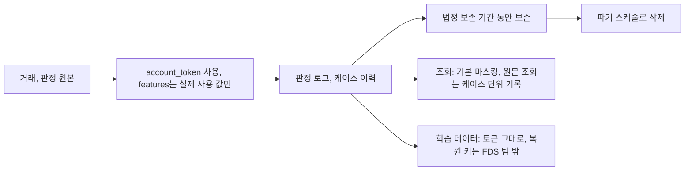

분류와 마스킹 방법은 [PII 데이터 보호](PII_Data_Protection.md), 법적 근거와 정보주체 권리는 [GDPR 컴플라이언스](GDPR_and_Privacy_Compliance.md)를 따른다.

자동화된 결정에 대한 이의 요구도 FDS와 맞닿는다. GDPR 전문 71항은 사기·탈세 감시 및 예방 목적의 프로파일링 기반 결정을 법률이 명시적으로 허가한 경우 허용하되, 정보 제공·사람의 개입 요구·의견 표명·설명 요구·이의 제기 같은 보호조치를 요구한다([Recital 71](https://gdpr-info.eu/recitals/no-71/), [Article 22](https://gdpr-info.eu/art-22-gdpr/)). 차단 건의 이의제기가 심사 큐로 돌아오는 경로와 차단 사유를 설명할 수 있는 판정 로그는 이 요구에 대응하는 근거가 된다. 국내법의 자동화된 결정 규정은 [GDPR 컴플라이언스](GDPR_and_Privacy_Compliance.md)의 비교표에 정리돼 있다. 어느 정도까지 설명해야 하는지는 법무 판단이다. 다만 사유 코드를 고객에게 그대로 알려주면 공격자가 임계값을 역산하므로, 설명은 일반화된 문구로 하고 상세 근거는 내부 로그에 둔다.

## 내부자가 FDS 데이터를 가져가는 경우

FDS와 심사 시스템은 개인정보를 가장 촘촘하게 모아 둔 곳 중 하나다. 이름, 연락처, 거래 내역, 기기, 접속 위치가 계정마다 연결돼 있다. 외부 공격자가 아니라 이 시스템에 합법적으로 접근하는 사람이 문제가 된 사례가 이미 있다.

2014년 1월 8일 검찰이 발표한 카드 3사 사건에서, 신용평가사 직원이 카드사들에 파견되어 부정사용방지시스템(FDS) 개발 프로젝트의 책임을 맡았다. 이 직원은 카드사 전산망에 접근해 개인정보를 USB에 복사해 반출했고, 유출 규모는 KB국민카드 5,300만, 롯데카드 2,600만, NH농협카드 2,500만으로 합계 1억 400만이었다. 판결은 직원이 아무런 관리·감독 없이 USB에 수시로 개인정보를 담았다는 점을 짚었다. 사고 경위와 처분은 [국내 개인정보 유출 사고 사례](Korea_Data_Breach_Cases.md)에 출처와 함께 정리돼 있다. FDS 개발이라는 업무가 운영 데이터 접근을 정당화했다는 점이 핵심이다. 운영 데이터가 없으면 룰 검증과 모델 학습이 안 된다는 이유로, 개발 인력에게 넓은 조회 권한이 주어진다.

접근 통제 관점에서 FDS 쪽에 적용할 수 있는 것은 다음과 같다.

- 개발·테스트 환경에는 운영 원본을 복제하지 않는다. 토큰화·마스킹한 데이터나 합성 데이터를 쓰고, 운영 원본이 꼭 필요한 검증은 운영 환경 안에서 그 권한을 가진 사람이 수행한다.
- 심사자의 조회 권한은 배정된 케이스에 묶는다. 전체 계정 검색 권한은 주지 않고, 케이스에 연결된 계정과 거래만 열린다. 배정이 풀리면 접근도 풀린다.
- 원문 보기, 내보내기, 화면 캡처 가능 여부를 개별로 통제한다. USB 같은 외부 매체와 개인 메신저 반출 경로는 단말 정책으로 막는다.
- 외주·파견 인력의 계정은 계약 기간과 연동해 만료시키고, 계정 보유 사실만이 아니라 실제 조회 행위를 감사 대상에 넣는다.
- 심사자의 조회 로그는 [UEBA 행위 기반 이상 탐지](UEBA.md)의 입력으로 쓴다. 평소 하루 수십 건을 보던 심사자가 한 시간에 수천 건을 조회하는 일은 알림으로 잡혀야 한다. 대량 조회 쿼리의 예시는 [국내 개인정보 유출 사고 사례](Korea_Data_Breach_Cases.md)에 있다.

심사자 한 명의 조회가 통제를 거쳐 알림으로 이어지는 경로는 다음과 같다. 배정되지 않은 계정은 화면에 열리지 않고, 열린 조회는 모두 로그를 거쳐 UEBA 입력이 된다.

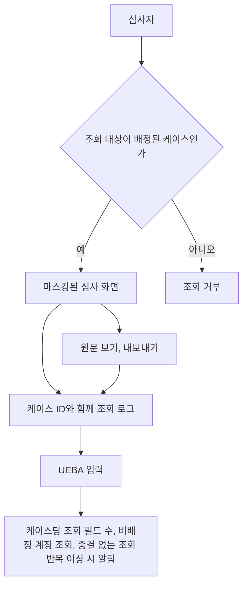

심사 업무의 특성이 탐지를 어렵게 만든다. 심사자는 원래 하루 종일 개인정보를 조회하는 직무라서 단순 건수 임계값은 정상 근무와 구분이 안 된다. 평소 케이스당 조회 필드 수, 배정되지 않은 계정을 조회한 횟수, 케이스 종결 없이 조회만 반복한 횟수를 따로 본다. 케이스와 연결되지 않은 조회가 "직무상 필요"로 설명되기 어렵기 때문에 이 지표가 가장 분명하다.

판정 로그도 마찬가지다. 로그 저장소와 학습 데이터 저장소는 운영 DB와 같은 수준으로 접근 권한을 관리한다. 룰과 모델 담당자가 로그 전체를 읽을 수 있어야 한다는 요구는 흔하지만, 읽는 범위를 필드 단위로 줄이고 조회 기록을 남기는 설계가 가능하다. FDS 데이터는 사기 방지용이면서 동시에 개인의 금융 행동 기록이라는 점을 접근 정책에 반영한다.

## 출처

- 금융감독원·금융보안원 FDS 운영 지침(2023-10-05 발표): [금융보안원 게시물](https://www.fsec.or.kr/bbs/detail?menuNo=69&bbsNo=11355), [KDI 경제정보센터](https://eiec.kdi.re.kr/policy/materialView.do?num=243367), [Criminal IP 정리](https://www.criminalip.io/ko/knowledge-hub/blog/20175)
- 전자금융거래법: [위키문헌](https://ko.wikisource.org/wiki/%EC%A0%84%EC%9E%90%EA%B8%88%EC%9C%B5%EA%B1%B0%EB%9E%98%EB%B2%95)(제9조, 제21조, 제22조), [시행령 제12조](https://casenote.kr/%EB%B2%95%EB%A0%B9/%EC%A0%84%EC%9E%90%EA%B8%88%EC%9C%B5%EA%B1%B0%EB%9E%98%EB%B2%95_%EC%8B%9C%ED%96%89%EB%A0%B9/)
- GDPR: [Recital 71](https://gdpr-info.eu/recitals/no-71/), [Article 22](https://gdpr-info.eu/art-22-gdpr/)
- 카드 3사 FDS 개발 인력 유출 사건: [서울신문 2014](https://www.seoul.co.kr/news/society/law/2014/01/08/20140108500034), [한국일보](https://www.hankookilbo.com/news/article/201607151693114624)
